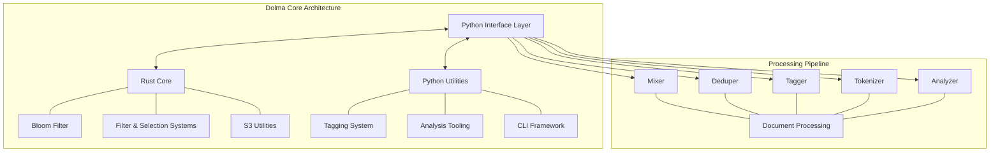
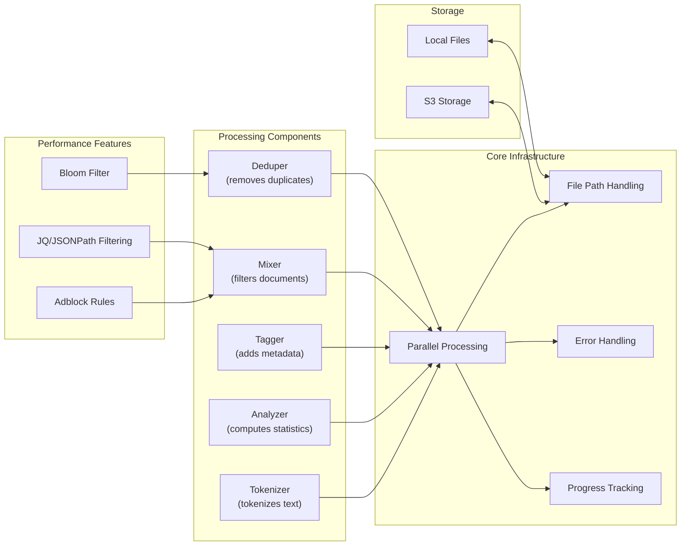
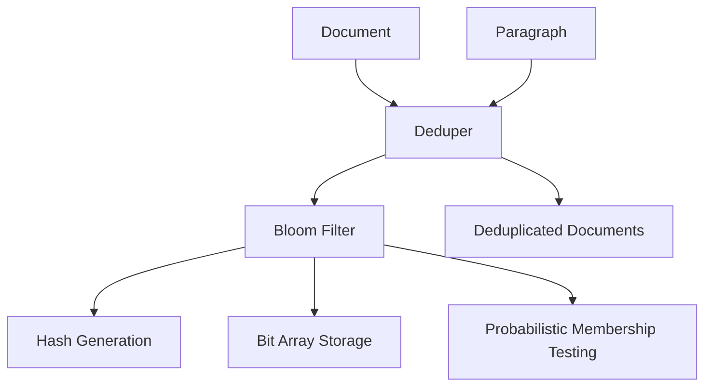
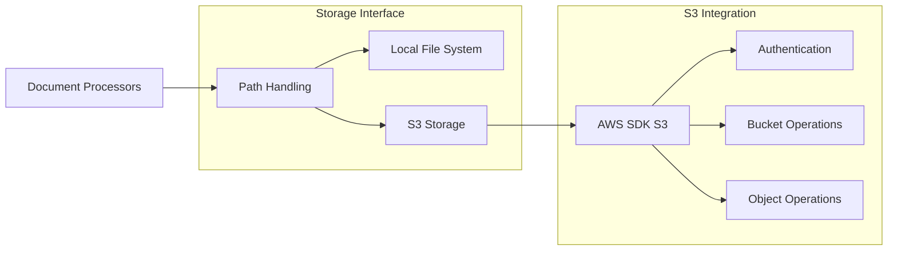
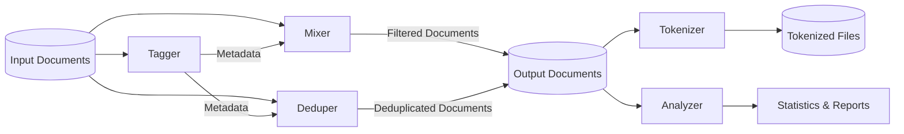
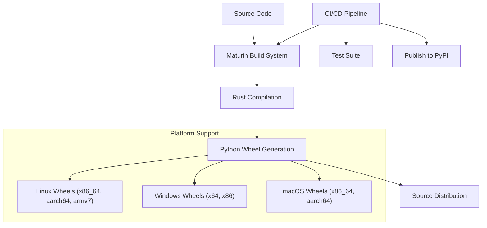
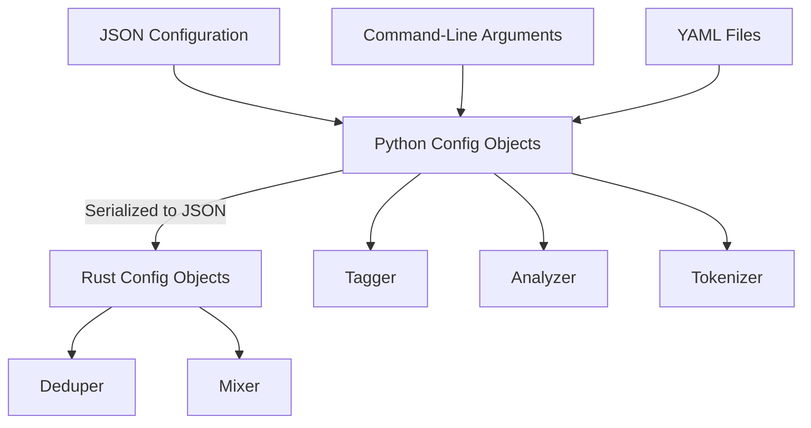

<!-- source: DeepWiki mcp.deepwiki.com · repo allenai/dolma · page 2 Architecture · fetched 2026-10-26 -->

# Architecture

<details>
<summary>Relevant source files</summary>

The following files were used as context for generating this wiki page:

- [.github/workflows/CI.yml](.github/workflows/CI.yml)
- [Cargo.lock](Cargo.lock)
- [Cargo.toml](Cargo.toml)
- [pyproject.toml](pyproject.toml)
- [python/dolma/__init__.py](python/dolma/__init__.py)
- [src/lib.rs](src/lib.rs)

</details>


This document describes the high-level architecture of Dolma, a toolkit for curating datasets used for large language model pre-training. It covers the overall system design, Python-Rust integration, and major components. For specific information about individual components, refer to their dedicated wiki pages: [Data Processing Pipeline](#3), [Python-Rust Integration](#2.1), and [Command Line Interface](#4).

## System Overview

Dolma employs a hybrid architecture that combines Python and Rust components to balance ease of use with high performance. The system is designed to process, filter, deduplicate, and analyze large-scale text datasets efficiently.



Dolma's architecture is split into two main layers:

1. **Python Interface Layer**: Provides high-level APIs, configuration handling, and extensibility
2. **Rust Core**: Implements performance-critical functionality like deduplication, mixing, and filtering

The system processes data through several pipeline components that can be used independently or chained together.

Sources: [src/lib.rs:8-15](), [python/dolma/__init__.py:10-15](), [pyproject.toml:1-47]()

## Python-Rust Integration

Dolma achieves its performance and usability goals through a hybrid language approach, with Python handling high-level operations and Rust handling performance-critical processing.

```mermaid
classDiagram
    class "Python Module" {
        +deduper()
        +mixer()
        +BaseTagger
        +TaggerRegistry
    }
    
    class "pyo3 Bindings" {
        +wrap_pyfunction!()
        +PyModule
    }
    
    class "Rust Library (cdylib)" {
        +deduper_entrypoint()
        +mixer_entrypoint()
        +bloom_filter
        +filters
        +s3_util
    }
    
    class "Config Objects" {
        +DeduperConfig
        +MixerConfig
    }
    
    "Python Module" ..> "pyo3 Bindings" : uses
    "pyo3 Bindings" ..> "Rust Library (cdylib)" : wraps
    "Python Module" --> "Config Objects" : serializes
    "Rust Library (cdylib)" --> "Config Objects" : deserializes
```

The integration works as follows:

1. Python code calls wrapped Rust functions through PyO3 bindings
2. Configuration is serialized to JSON and passed to Rust
3. Rust functions process the data and return results (or errors)
4. Python code handles the results and provides them to the user

This design allows Python to handle user interaction, configuration, and high-level control flow while Rust manages computationally intensive operations.

Sources: [src/lib.rs:1-3](), [src/lib.rs:114-126](), [python/dolma/__init__.py:26-56](), [pyproject.toml:158-170]()

## Major Components

Dolma consists of several major components that work together to process and transform text datasets:

### Processing Components



The main processing components include:

1. **Mixer**: Combines and filters documents based on configurable rules
2. **Deduper**: Identifies and removes duplicate documents using bloom filters
3. **Tagger**: Attaches metadata to documents (language, quality metrics, etc.)
4. **Analyzer**: Computes statistics and visualizations of document attributes
5. **Tokenizer**: Converts text into tokens for language model training

All these components build on a common infrastructure for parallel processing, file path handling, and error management.

Sources: [src/lib.rs:8-15](), [src/lib.rs:17-45]()

### Bloom Filter System

The bloom filter is a key component for efficient deduplication, implemented in Rust for performance:



The bloom filter allows Dolma to:
- Check if a document has been seen before without storing the entire document
- Perform high-speed membership tests with configurable false positive rates
- Handle extremely large datasets with minimal memory usage

Sources: [src/lib.rs:8]()

### Storage System

Dolma supports processing files from both local and remote storage:



The S3 utilities provide:
- Transparent access to remote files as if they were local
- Efficient batch operations for processing large datasets
- Authentication and configuration handling for AWS services

Sources: [src/lib.rs:13](), [Cargo.toml:17-18]()

## Data Flow

The following diagram illustrates how data flows through the Dolma system:



A typical Dolma workflow involves:

1. Processing raw documents through taggers to add metadata
2. Running the mixer to filter and transform documents based on attributes
3. Using the deduper to remove duplicate content
4. Tokenizing the processed documents for model training
5. Analyzing the final dataset to ensure quality

Each step can be run independently or as part of a pipeline, depending on the user's needs.

Sources: [python/dolma/__init__.py:26-56]()

## Build and Deployment

Dolma uses a sophisticated build system to produce binary packages for multiple platforms:



The build process:
1. Uses maturin to compile Rust code and generate Python wheels
2. Creates platform-specific wheels for all supported architectures
3. Runs through a CI/CD pipeline for testing and validation
4. Publishes the package to PyPI when triggered by a tag

This enables efficient distribution of Dolma to users across different operating systems and hardware architectures.

Sources: [pyproject.toml:158-170](), [.github/workflows/CI.yml:174-296]()

## Configuration System

Dolma uses a flexible configuration system to control its processing components:



The configuration flow:
1. Users define settings in JSON, YAML, or via command-line arguments
2. Python creates configuration objects and validates them
3. For Rust components, configurations are serialized to JSON strings
4. Rust deserializes the configuration and uses it to control processing

This approach provides a consistent interface across both language boundaries.

Sources: [src/lib.rs:17-18](), [src/lib.rs:22-45](), [python/dolma/__init__.py:26-56]()

## Conclusion

Dolma's architecture combines the strengths of Python and Rust to create a powerful, flexible toolkit for dataset curation. The hybrid approach allows for both ease of use and high performance when processing large-scale text data.

Key architectural features include:
- Python-Rust integration via PyO3
- Performance-critical operations implemented in Rust
- Modular processing components that can be used independently
- Support for both local and cloud storage systems
- Parallel processing capabilities for handling large datasets
- Cross-platform compatibility through the build system

This architecture enables Dolma to efficiently process, filter, deduplicate, and analyze text data at scale, making it suitable for preparing high-quality training datasets for large language models.

Sources: [pyproject.toml:1-47](), [Cargo.toml:1-68](), [src/lib.rs:1-126]()

---

