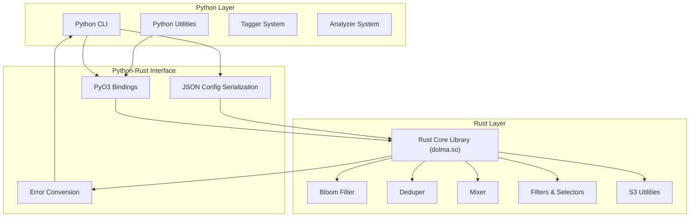
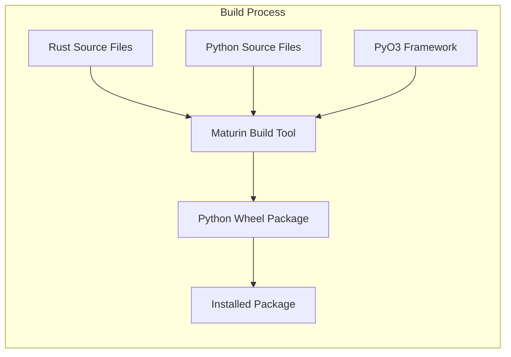
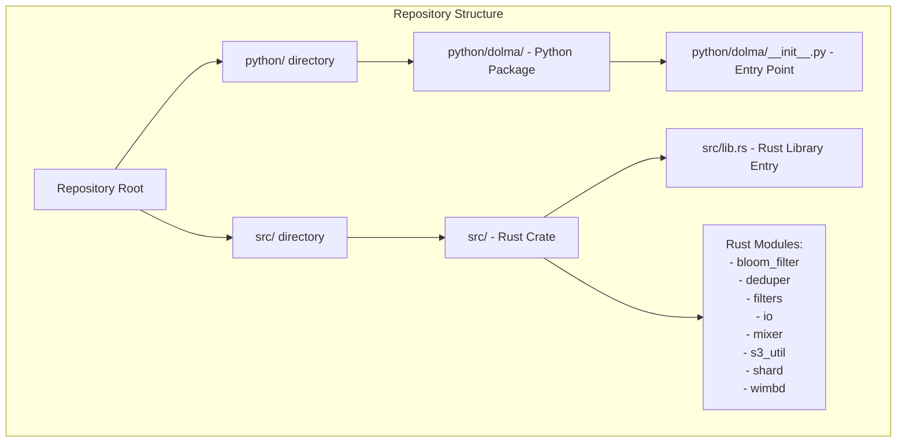
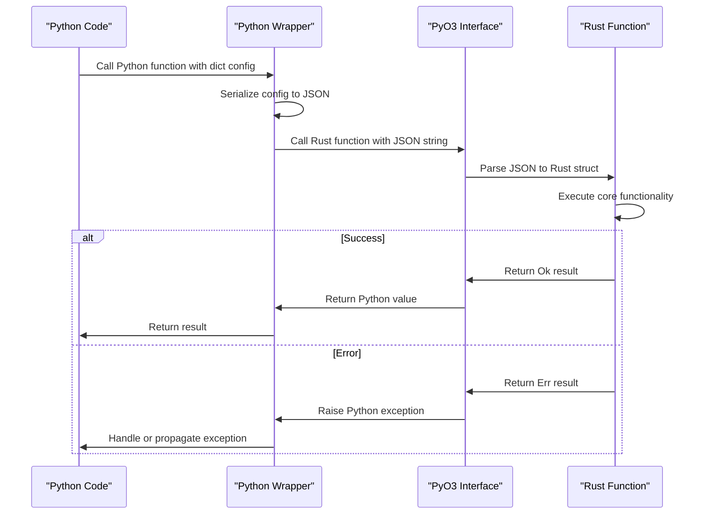
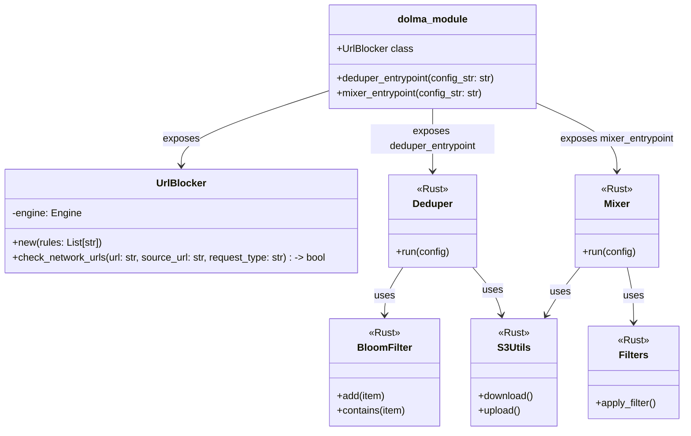
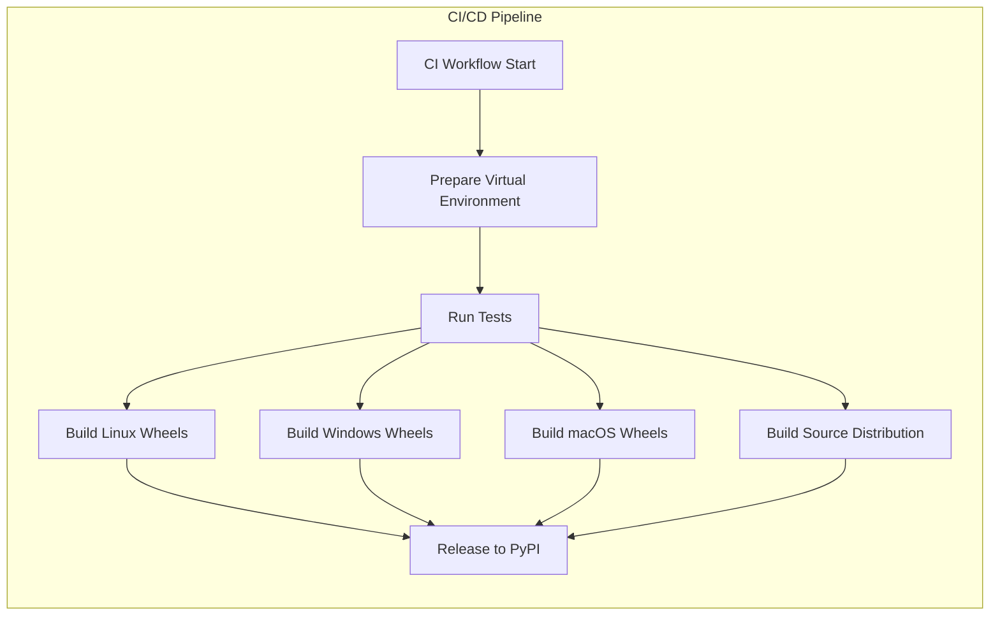

<!-- source: DeepWiki mcp.deepwiki.com · repo allenai/dolma · page 2.1 Python-Rust Integration · fetched 2026-10-26 -->

# Python-Rust Integration

Relevant source files

The following files were used as context for generating this wiki page:

- [.github/workflows/CI.yml](.github/workflows/CI.yml)
- [Cargo.lock](Cargo.lock)
- [Cargo.toml](Cargo.toml)
- [pyproject.toml](pyproject.toml)
- [python/dolma/__init__.py](python/dolma/__init__.py)
- [src/lib.rs](src/lib.rs)

This page documents how Dolma integrates Python and Rust components to leverage the strengths of both languages. It explains the architecture, build process, and interface between the two languages.

Dolma uses Python for high-level control, user interface, and extensibility, while leveraging Rust for performance-critical operations like document processing, filtering, and deduplication.

For information about the overall architecture of Dolma, see [Architecture](#2).

## Architecture Overview

Dolma employs a hybrid architecture where Python and Rust components interact through PyO3 bindings. This design allows developers to write performance-critical code in Rust while maintaining the flexibility and ease of use of Python for higher-level components.

The architecture consists of three main layers:
1. Python Layer: Implements CLI, utilities, tagging and analysis systems
2. Interface Layer: Manages binding, configuration passing, and error handling
3. Rust Layer: Implements performance-critical operations

Sources: [src/lib.rs:1-126](), [python/dolma/__init__.py:1-56](), [pyproject.toml:1-206]()

## Build System

Dolma uses Maturin to build the Rust code into a Python extension. Maturin handles the compilation of Rust code and packaging it into a Python wheel that can be installed with pip.

Key components of the build system:
- Maturin: Builds Rust code into a Python extension
- PyO3: Provides Rust bindings for Python
- CI/CD workflow: Builds wheels for multiple platforms and architectures

The build configuration is specified in:
- `pyproject.toml`: Defines Python package metadata and build requirements
- `Cargo.toml`: Defines Rust crate configuration and dependencies

Sources: [pyproject.toml:158-165](), [Cargo.toml:7-13](), [.github/workflows/CI.yml:174-260]()

## Code Structure and Organization

The codebase is organized into separate directories for Python and Rust code:

The Python package imports the compiled Rust extension and wraps it with Python-friendly interfaces.

Sources: [src/lib.rs:8-15](), [python/dolma/__init__.py:11-56]()

## Interface Between Python and Rust

The PyO3 framework facilitates communication between Python and Rust. The Rust code exports functions that can be called from Python, and the Python code wraps these functions to provide a more Pythonic API.

### Function Binding

Rust functions are exposed to Python using the `#[pyfunction]` attribute. These functions are then added to the Python module using the `wrap_pyfunction!` macro.

Example from `src/lib.rs`:
- `deduper_entrypoint` and `mixer_entrypoint` are exposed to Python
- A `UrlBlocker` class is created using `#[pyclass]` and its methods with `#[pymethods]`
- These are registered in the Python module using `m.add_function` and `m.add_class`

Sources: [src/lib.rs:21-45](), [src/lib.rs:114-126]()

### Configuration Passing

Configuration is passed from Python to Rust as JSON strings:

1. Python code converts a dictionary to a JSON string
2. Rust code parses the JSON string into a Rust struct
3. The Rust function processes the configuration and executes the core functionality

This approach allows for flexible configuration while maintaining type safety in Rust.

Sources: [python/dolma/__init__.py:26-56](), [src/lib.rs:21-45]()

### Error Handling

Errors from Rust are converted to Python exceptions:

1. Rust functions return `PyResult<T>` to indicate success or failure
2. Errors are converted to Python exceptions using PyO3's error handling mechanisms
3. Python wrapper functions catch these exceptions and convert them to more specific Python exceptions

This ensures that errors from the Rust code are properly handled and presented to Python users.

Sources: [python/dolma/__init__.py:37-40](), [python/dolma/__init__.py:53-56](), [src/lib.rs:22-32]()

## Performance-Critical Components in Rust

Several performance-critical components are implemented in Rust:

### Deduper

The Deduper component handles document deduplication, which is computationally intensive. It uses Bloom filters to efficiently detect duplicate documents:

1. Python code calls the `deduper` function with a configuration dictionary
2. The function converts the dictionary to JSON and calls the Rust `deduper_entrypoint` function
3. The Rust code parses the configuration and runs the deduplication process
4. Any errors are converted to Python exceptions

Sources: [python/dolma/__init__.py:26-40](), [src/lib.rs:21-32](), [src/lib.rs:17]()

### Mixer

The Mixer component handles document filtering and transformation:

1. Python code calls the `mixer` function with a configuration dictionary
2. The function converts the dictionary to JSON and calls the Rust `mixer_entrypoint` function
3. The Rust code parses the configuration and runs the mixing process
4. Any errors are converted to Python exceptions

Sources: [python/dolma/__init__.py:43-56](), [src/lib.rs:34-45](), [src/lib.rs:18]()

### URL Blocker

The URL Blocker component provides URL filtering functionality:

1. Python code creates a `UrlBlocker` instance with a list of rules
2. The Rust code initializes an `Engine` with these rules
3. Python code calls the `check_network_urls` method to check if a URL should be blocked
4. The method returns a boolean indicating whether the URL should be blocked

Sources: [src/lib.rs:60-109]()

## Benefits of the Hybrid Approach

Dolma's Python-Rust integration offers several advantages:

1. **Performance**: Computationally intensive tasks like bloom filtering and document processing benefit from Rust's speed
2. **Memory Safety**: Rust's ownership model prevents memory leaks and data races
3. **Concurrency**: Rust's concurrency primitives enable safe parallel processing
4. **Ecosystem**: Python's rich ecosystem remains available for high-level operations
5. **Ease of Use**: Python's simplicity makes the API accessible to users
6. **Type Safety**: Rust's strong type system catches errors at compile time

This approach allows Dolma to efficiently process massive datasets while maintaining a user-friendly interface.

Sources: [pyproject.toml:42-47](), [Cargo.toml:13-58]()

## Building and Testing

Dolma's CI/CD pipeline builds and tests the hybrid codebase on multiple platforms:

The CI/CD workflow:
1. Prepares a virtual environment with dependencies
2. Runs tests for both Python and Rust code
3. Builds wheels for multiple platforms and architectures
4. Publishes releases to PyPI

This ensures that the hybrid codebase works correctly across different environments.

Sources: [.github/workflows/CI.yml:69-172](), [.github/workflows/CI.yml:174-297]()

## Development Workflow

When developing Dolma, you'll work with both Python and Rust code:

1. Make changes to Python code in the `python/` directory
2. Make changes to Rust code in the `src/` directory
3. Build the package using Maturin
4. Install the built package in development mode
5. Run tests to verify your changes

This workflow allows for rapid iteration while maintaining the benefits of the hybrid approach.

Sources: [pyproject.toml:104-135](), [.github/workflows/CI.yml:69-126]()

## Summary

Dolma's Python-Rust integration combines the best of both languages to create a high-performance data processing toolkit with a user-friendly interface. The PyO3 bindings enable seamless communication between Python and Rust components, while the build system ensures compatibility across platforms.

This hybrid approach allows Dolma to efficiently process large datasets while providing a flexible and extensible API for users.

Sources: [src/lib.rs:1-126](), [python/dolma/__init__.py:1-56](), [pyproject.toml:1-206](), [Cargo.toml:1-68]()

---

