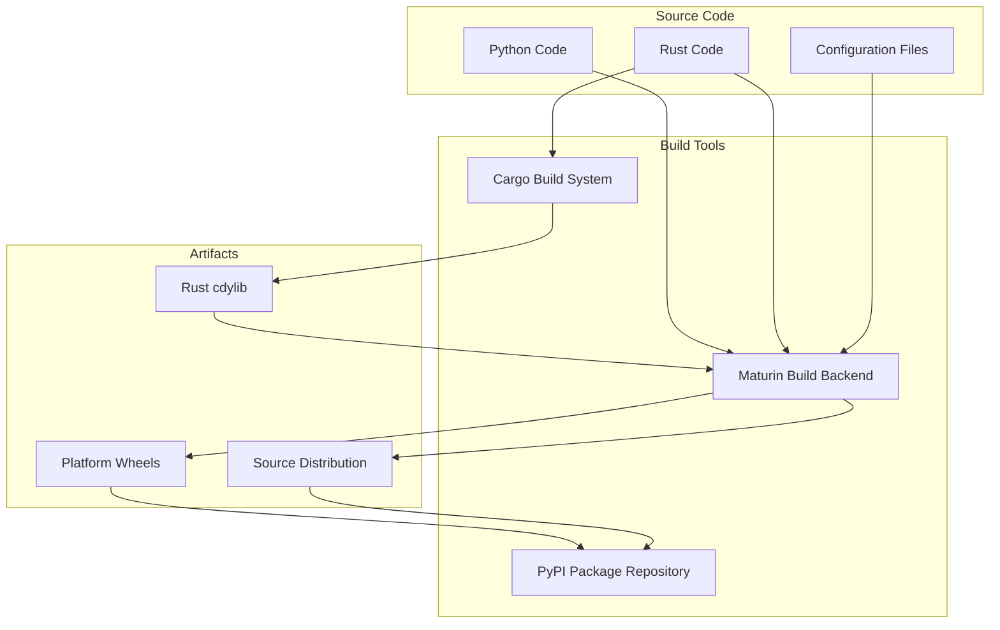
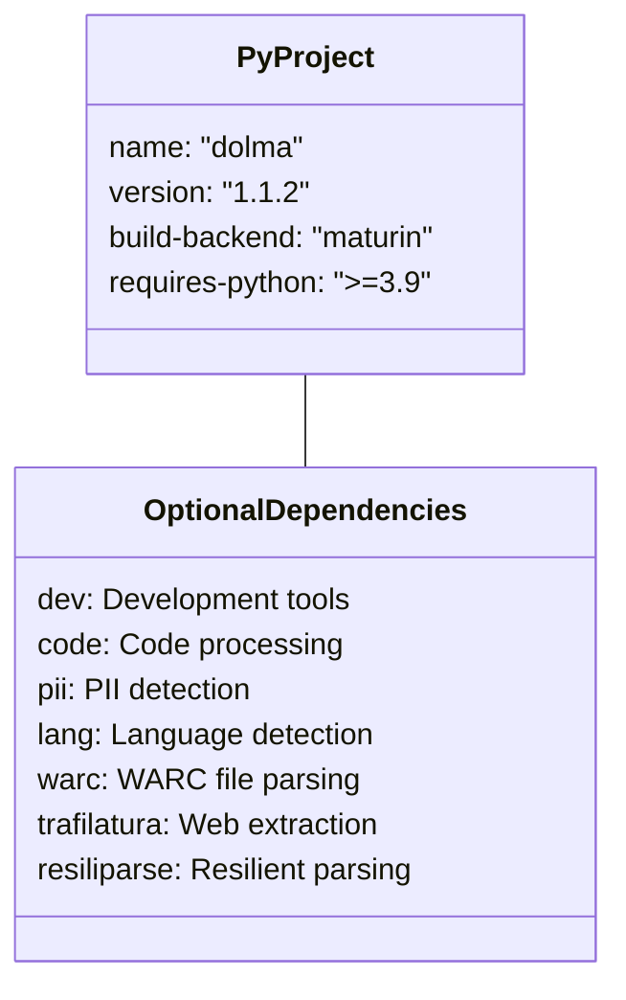
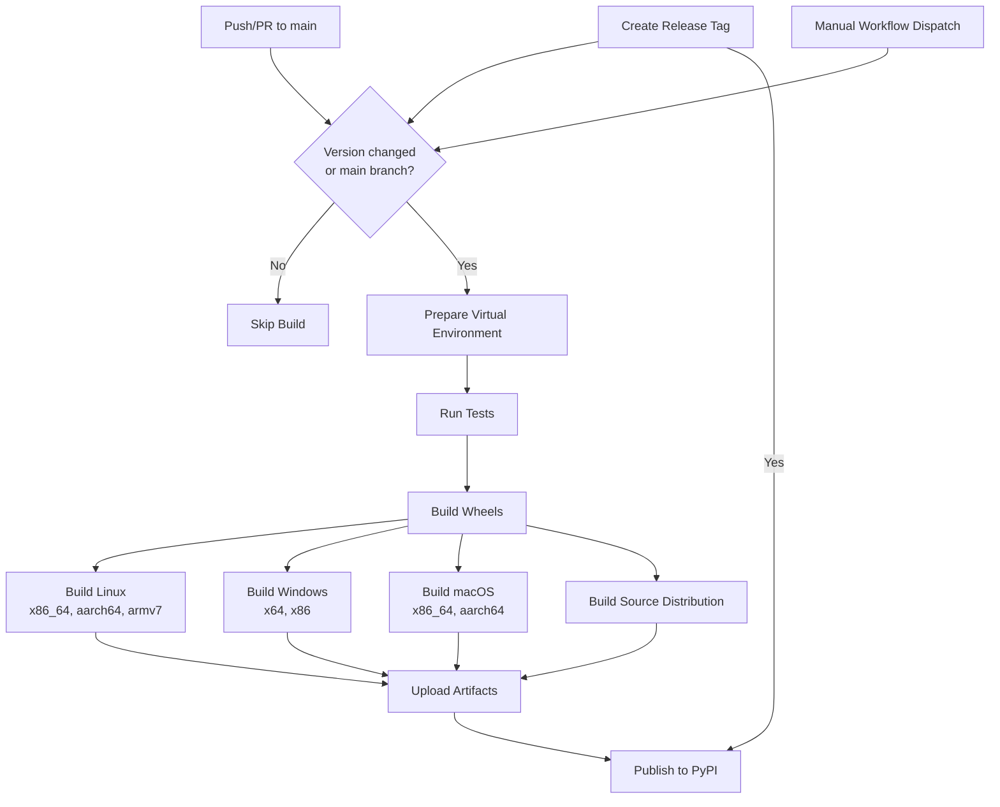
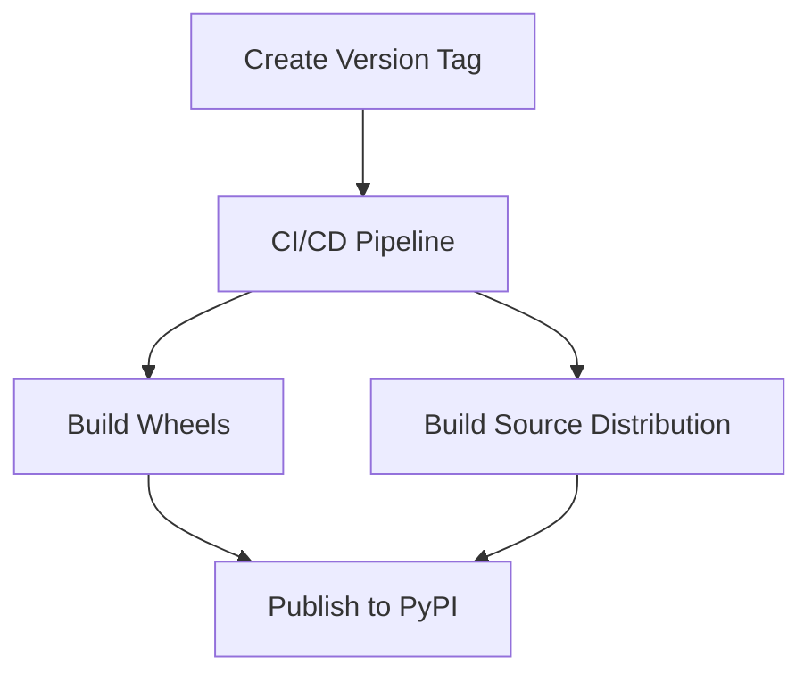

<!-- source: DeepWiki mcp.deepwiki.com · repo allenai/dolma · page 2.2 Build and Deployment · fetched 2026-10-26 -->

# Build and Deployment

<details>
<summary>Relevant source files</summary>

The following files were used as context for generating this wiki page:

- [.github/workflows/CI.yml](.github/workflows/CI.yml)
- [Cargo.lock](Cargo.lock)
- [Cargo.toml](Cargo.toml)
- [pyproject.toml](pyproject.toml)

</details>


This document describes how the Dolma toolkit is built, tested, and deployed. It covers the build system architecture, continuous integration workflows, and release processes. For information about the Python-Rust integration architecture itself, see [Python-Rust Integration](#2.1).

## Build System Architecture

Dolma employs a hybrid build system that manages both Python and Rust components. The core functionality is implemented in Rust for performance, while Python provides the high-level API and CLI interfaces.



Sources: [pyproject.toml:158-165](), [Cargo.toml:9-11]()

### Python Package Configuration

The Python package is configured in `pyproject.toml` with the following key characteristics:

- Package name: `dolma`
- Build backend: `maturin` (for Python-Rust integration)
- CLI entry point: `dolma = "dolma.cli.__main__:main"`
- Numerous dependencies including tokenizers, boto3, and data processing libraries



Sources: [pyproject.toml:1-37](), [pyproject.toml:101-103](), [pyproject.toml:104-156]()

### Rust Crate Configuration

The Rust component is configured as a cdylib (dynamic library) that can be loaded by Python:

- Crate name: `dolma`
- Crate type: `cdylib` (for Python loading)
- Key dependencies: AWS SDK, tokenizers, JSON processing, and parallel processing libraries

Sources: [Cargo.toml:1-13](), [Cargo.toml:14-58]()

## Local Development Setup

### Prerequisites

To build Dolma locally, you need:

1. Rust toolchain (stable channel)
2. Python 3.9+
3. Development tools (specified in the dev dependencies)

### Building Locally

The package uses `maturin` to build the Rust components and integrate them with Python:

1. Install maturin: `pip install maturin`
2. Build the package: `maturin build --release`
3. Install locally: `pip install target/wheels/dolma-*.whl`

For development, you can install in development mode:

```bash
maturin develop --release
```

This builds the Rust components and installs them into your Python environment.

Sources: [pyproject.toml:158-165](), [pyproject.toml:104-117]()

## Continuous Integration

Dolma uses GitHub Actions for CI/CD, defined in `.github/workflows/CI.yml`.



Sources: [.github/workflows/CI.yml:3-14](), [.github/workflows/CI.yml:41-67](), [.github/workflows/CI.yml:69-121](), [.github/workflows/CI.yml:122-173](), [.github/workflows/CI.yml:174-278]()

### Test Process

The CI workflow runs several validation steps:

1. Python style checks (isort, black)
2. Rust style checks (rustfmt)
3. Python linting (flake8)
4. Python type checking (mypy)
5. Python unit tests (pytest)

Tests run on each pull request and push to the main branch.

Sources: [.github/workflows/CI.yml:122-173]()

### Build Matrix

Dolma builds wheels for multiple platforms and architectures:

| Platform | Architectures |
|----------|--------------|
| Linux    | x86_64, aarch64, armv7 |
| Windows  | x64, x86 |
| macOS    | x86_64, aarch64 |

The CI system creates wheels for all these combinations to ensure broad compatibility.

Sources: [.github/workflows/CI.yml:174-210](), [.github/workflows/CI.yml:211-236](), [.github/workflows/CI.yml:237-261]()

## Deployment Process

### Release Workflow

Releases are automated through the CI pipeline:

1. Create and push a tag (e.g., `git tag v1.1.2 && git push --tags`)
2. The CI workflow detects the tag and triggers the release process
3. Wheels are built for all platforms and architectures
4. The package is published to PyPI



Sources: [.github/workflows/CI.yml:280-296]()

### Version Management

Version information is maintained in two places:

1. Python version in `pyproject.toml`
2. Rust version in `Cargo.toml`

These should be kept synchronized when making releases.

Sources: [pyproject.toml:3](), [Cargo.toml:3]()

## Cross-Platform Compatibility

Dolma ensures compatibility across platforms through:

1. Using `maturin` for cross-platform building
2. Specifying platform-specific dependencies where needed
3. Using vendored OpenSSL via the `openssl` crate with the `vendored` feature
4. CI testing across multiple platforms

The package uses the `manylinux_2_28` standard for Linux wheels, ensuring compatibility with most modern Linux distributions.

Sources: [Cargo.toml:52](), [.github/workflows/CI.yml:199]()

### Building with Vendored Dependencies

To handle platform-specific requirements, Dolma uses vendored dependencies where necessary. For example, OpenSSL is included via the `vendored` feature to ensure it works across different environments without requiring system libraries.

```
openssl = { version = "0.10.66", features = ["vendored"] }
```

Sources: [Cargo.toml:52]()

## Utility Tools for Development

The project includes several development tools configured in the `dev` optional dependencies:

- Code formatting (black, isort)
- Linting (flake8)
- Type checking (mypy)
- Testing (pytest)

You can install these with:

```bash
pip install -e ".[dev]"
```

Sources: [pyproject.toml:104-117]()

---

