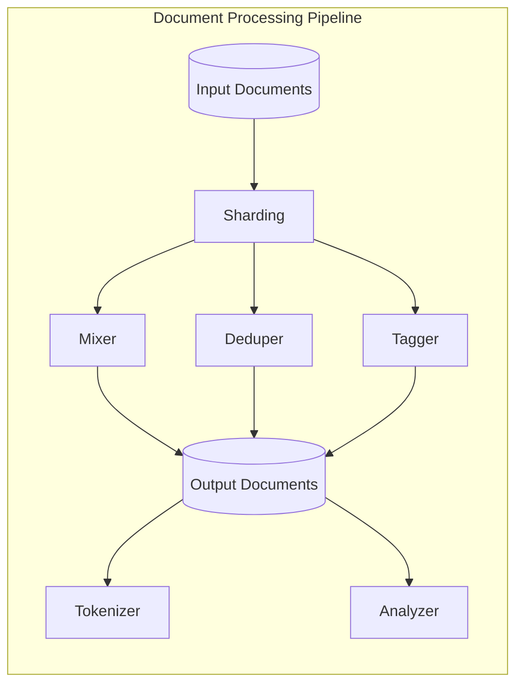
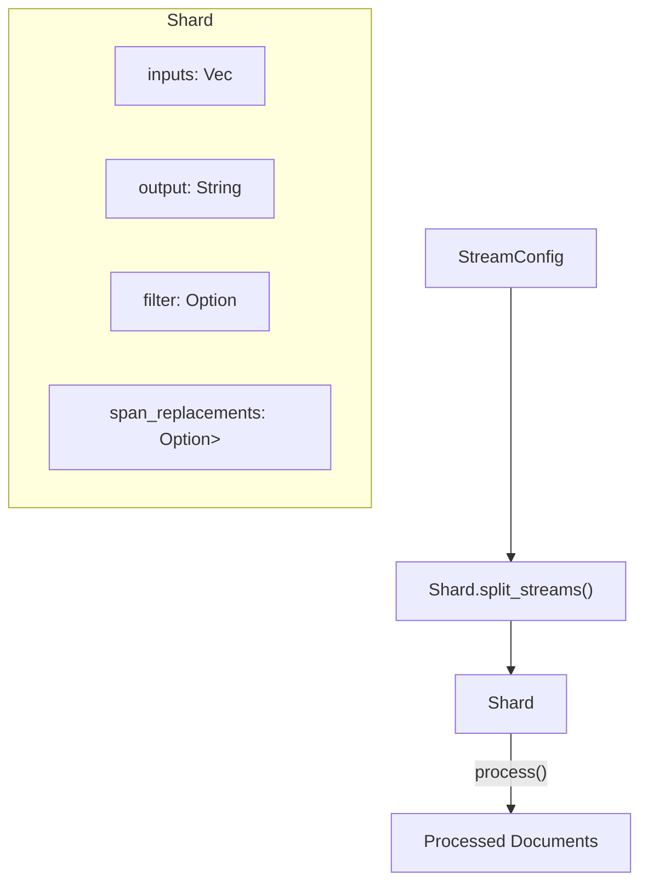
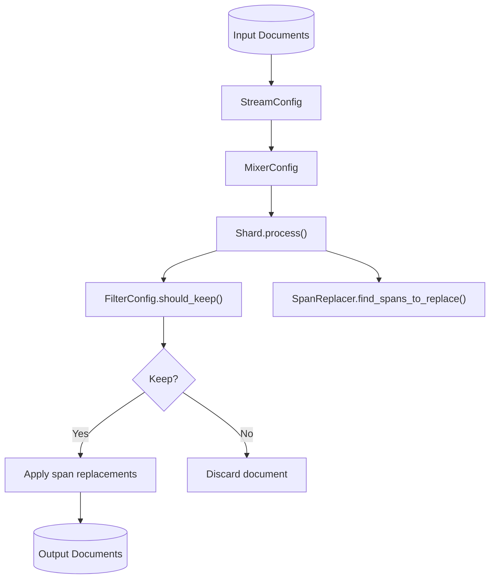
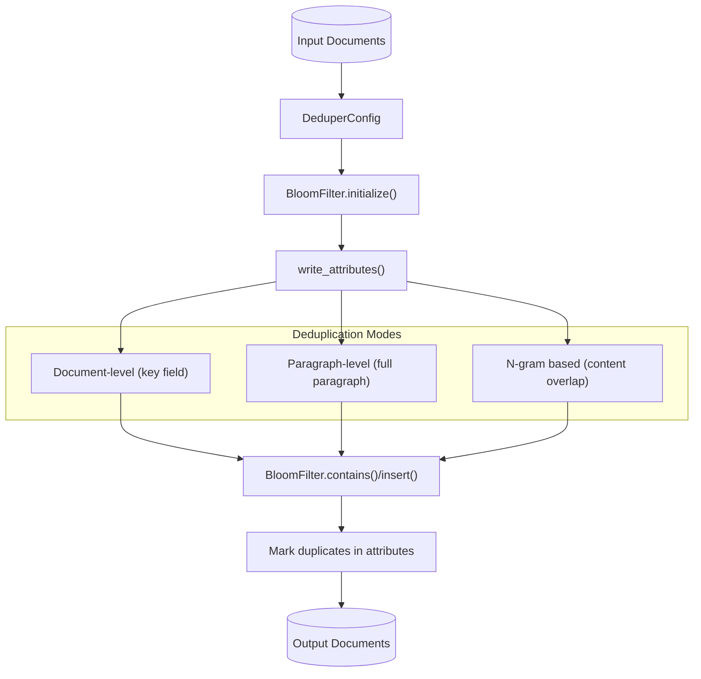
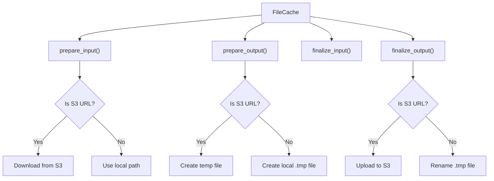
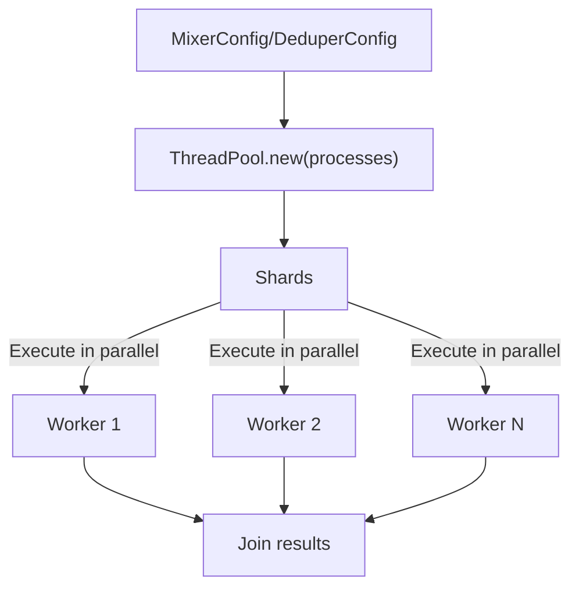
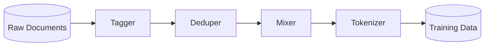

<!-- source: DeepWiki mcp.deepwiki.com · repo allenai/dolma · page 3 Data Processing Pipeline · fetched 2026-10-26 -->

# Data Processing Pipeline

<details>
<summary>Relevant source files</summary>

The following files were used as context for generating this wiki page:

- [configs/dolma-v1_5/mixing/dedupe-test.yaml](configs/dolma-v1_5/mixing/dedupe-test.yaml)
- [configs/test/test_filtered_mixer.yaml](configs/test/test_filtered_mixer.yaml)
- [python/dolma/cli/deduper.py](python/dolma/cli/deduper.py)
- [python/dolma/cli/mixer.py](python/dolma/cli/mixer.py)
- [src/bloom_filter.rs](src/bloom_filter.rs)
- [src/bloom_filter/bloom_test.rs](src/bloom_filter/bloom_test.rs)
- [src/deduper.rs](src/deduper.rs)
- [src/mixer.rs](src/mixer.rs)
- [src/s3_util.rs](src/s3_util.rs)
- [src/shard.rs](src/shard.rs)

</details>


The Dolma data processing pipeline manages the end-to-end workflow for curating large-scale text datasets used in machine learning model pre-training. This document explains the core components and workflows for processing documents with Dolma.

For information about the high-level architecture of Dolma, see [Architecture](#2).

## Pipeline Overview

The Dolma data processing pipeline is a series of modular components that can be run independently or chained together. The pipeline handles large datasets efficiently through sharding, parallel processing, and streaming I/O with support for both local and cloud storage (S3).



Sources: [src/shard.rs:1-880](), [src/deduper.rs:1-605](), [src/mixer.rs:1-84](), [python/dolma/cli/mixer.py:1-198](), [python/dolma/cli/deduper.py:1-275]()

## Core Components

The pipeline consists of several core components that can be used in combination to process text data:

1. **Sharding System**: Partitions input files into manageable work units
2. **Mixer**: Combines documents from multiple sources, filters, and transforms
3. **Deduper**: Removes duplicate documents or paragraphs using Bloom filters
4. **Tagger**: Attaches metadata to documents (covered in [Tagging System](#3.4))
5. **Tokenizer**: Converts text to token sequences (covered in [Tokenization System](#3.5))
6. **Analyzer**: Provides statistics and insights (covered in [Analysis System](#3.6))

### Component Interaction Model

```mermaid
classDiagram
    class Shard {
        +inputs: Vec~DocumentPaths~
        +output: String
        +filter: Option~FilterConfig~
        +span_replacements: Option~Vec~SpanReplacementConfig~~
        +process()
        +split_streams()
        +split_streams_unshuffled()
    }
    
    class DocumentPaths {
        +doc_path: String
        +attribute_paths: Vec~String~
    }
    
    class FilterConfig {
        +include: Vec~String~
        +exclude: Vec~String~
        +syntax: Option~String~
        +should_keep()
    }
    
    class SpanReplacementConfig {
        +span: String
        +min_score: Option~f64~
        +max_score: Option~f64~
        +replacement: String
        +syntax: Option~String~
    }
    
    class BloomFilter {
        +bits: Vec~AtomicU32~
        +hash_builders: Vec~RandomState~
        +read_only: bool
        +insert()
        +contains()
        +hashes()
    }
    
    class FileCache {
        +s3_client: Box~S3Client~
        +work: WorkDirConfig
        +prepare_input()
        +prepare_output()
        +finalize_input()
        +finalize_output()
    }
    
    class MixerConfig {
        +streams: Vec~StreamConfig~
        +processes: usize
        +work_dir: WorkDirConfig
        +shuffle: bool
    }
    
    class DeduperConfig {
        +documents: Vec~String~
        +work_dir: WorkDirConfig
        +dedupe: DedupeConfig
        +bloom_filter: BloomFilterConfig
        +processes: usize
    }
    
    Shard --> DocumentPaths
    Shard --> FilterConfig
    Shard --> SpanReplacementConfig
    Shard --> FileCache
    FileCache --> "S3Client"
    DeduperConfig --> BloomFilter
    MixerConfig --> Shard
```

Sources: [src/shard.rs:17-524](), [src/deduper.rs:11-22](), [src/bloom_filter.rs:15-236]()

## Sharding System

The sharding system splits large document collections into manageable chunks that can be processed independently and in parallel. A shard represents a unit of work that combines input files from potentially different sources into a single output file.

### Shard Configuration



Sources: [src/shard.rs:15-26](), [src/shard.rs:40-130]()

Shards are created by:

1. **Split Streams**: Divides input files according to maximum size configuration
2. **Unshuffled Option**: Alternative mode that preserves original file structure
3. **Document Paths**: Each shard contains document paths and corresponding attribute paths
4. **Compression**: Configurable compression for input and output files

### Sharding Process

1. Input files are located using glob patterns or S3 prefixes
2. Files are grouped into shards based on size limits
3. Each shard is assigned an output path
4. Shards can be processed in parallel

Sources: [src/shard.rs:36-180]()

## Mixer Component

The Mixer combines documents from multiple sources, filters them based on rules, and applies transformations.

### Mixer Workflow



Sources: [src/mixer.rs:1-48](), [src/shard.rs:182-507]()

### Document Filtering

Documents can be filtered using:

1. **JSONPath expressions**: To include or exclude documents based on their content/attributes
2. **JQ expressions**: More complex filtering rules with a powerful query language
3. **Minimum text length**: Filter out documents with insufficient text

```
filter:
  include:                 # Documents matching any of these expressions are kept
    - "$.attributes.quality_score > 0.7"
  exclude:                 # Documents matching any of these expressions are discarded
    - "$.attributes.is_duplicate == true"
  syntax: "jsonpath"       # Can be "jsonpath" or "jq"
```

Sources: [src/shard.rs:526-583](), [python/dolma/cli/mixer.py:22-30]()

### Span Replacement

The mixer can replace specific spans of text:

1. **Span Selection**: Uses JSONPath or JQ to locate spans in the document
2. **Score Filtering**: Only replaces spans within score thresholds
3. **Replacement Text**: Can use static text or dynamic replacements

Sources: [src/shard.rs:584-681](), [python/dolma/cli/mixer.py:32-48]()

## Deduplication System

The deduplication system identifies and marks duplicate content using probabilistic data structures (Bloom filters).

### Deduplication Types

1. **Document-level**: Identifies entire duplicate documents
2. **Paragraph-level**: Identifies duplicate paragraphs within documents
3. **N-gram based**: Identifies duplicates based on overlapping n-grams



Sources: [src/deduper.rs:21-95](), [src/deduper.rs:116-519]()

### Bloom Filter

The deduplication uses a Bloom filter:

1. **Space-efficient**: Uses a bit array to track seen content
2. **Configurable**: Size and hash functions based on expected document count
3. **Persistent**: Can be saved and loaded from disk
4. **Tunable**: Balance between memory usage and false positive rate

The Bloom filter is configured with:
- Size in bytes
- Estimated document count
- Desired false positive rate
- Number of hash functions

Sources: [src/bloom_filter.rs:15-236](), [src/bloom_filter.rs:236-281]()

## File Handling

The pipeline handles both local and S3-stored files transparently.

### FileCache System



Sources: [src/shard.rs:713-818](), [src/s3_util.rs:35-176]()

#### S3 Integration

The pipeline provides robust S3 integration:

1. **Automatic handling**: Downloads/uploads as needed
2. **Pattern matching**: Supports glob-like patterns for S3 objects
3. **Retry mechanism**: Configurable retries for S3 operations
4. **Cleanup**: Removes temporary files after processing

Sources: [src/s3_util.rs:12-326]()

## Parallel Processing

The pipeline processes data in parallel for efficiency:



Sources: [src/mixer.rs:11-48](), [src/deduper.rs:34-76]()

1. **Configurable processes**: Number of parallel workers
2. **Thread pool**: Workers process shards independently
3. **Thread-safe components**: Bloom filter uses atomic operations for concurrent access
4. **Progress tracking**: Monitors failed shards

## Configuration

Both the Mixer and Deduper are configured via structured configuration objects:

### Mixer Configuration Table

| Configuration | Description | Default |
|---------------|-------------|---------|
| `streams` | List of stream configurations | Required |
| `work_dir` | Temporary directory paths | Required |
| `processes` | Number of parallel processes | 1 |
| `shuffle` | Whether to shuffle documents | true |

Sources: [python/dolma/cli/mixer.py:50-82](), [src/mixer.rs:51-69]()

### Deduper Configuration Table

| Configuration | Description | Default |
|---------------|-------------|---------|
| `documents` | Paths to document files | Required |
| `work_dir` | Temporary directory paths | Required |
| `dedupe` | Deduplication settings | Required |
| `bloom_filter` | Bloom filter settings | Required |
| `processes` | Number of parallel processes | 1 |
| `compression` | Input/output compression | Inferred |

Sources: [python/dolma/cli/deduper.py:114-135](), [src/deduper.rs:530-598]()

## Practical Example

A typical data processing workflow with Dolma might include:

1. **Tag documents** to attach quality metrics and language information
2. **Deduplicate** to remove duplicate paragraphs and documents
3. **Mix and filter** to combine datasets and apply quality filters
4. **Tokenize** the result for training language models



Sources: [src/shard.rs:1-26](), [src/deduper.rs:1-22](), [src/mixer.rs:1-48]()

---

