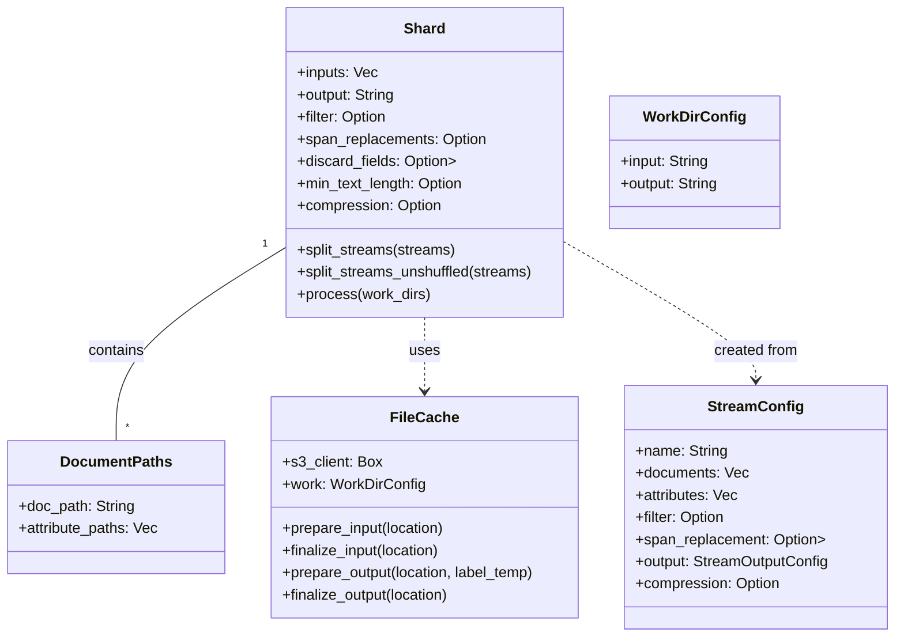
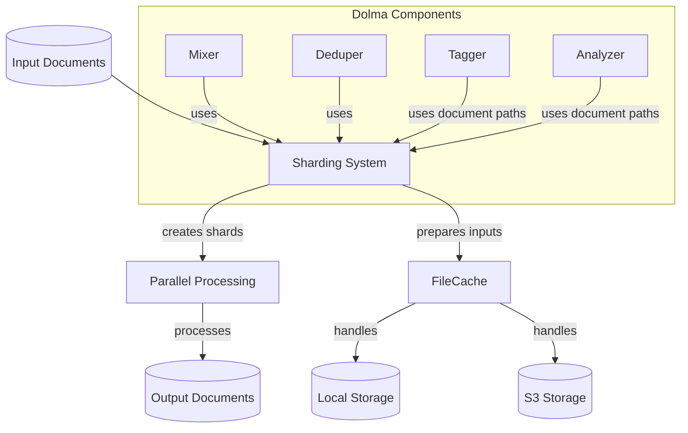
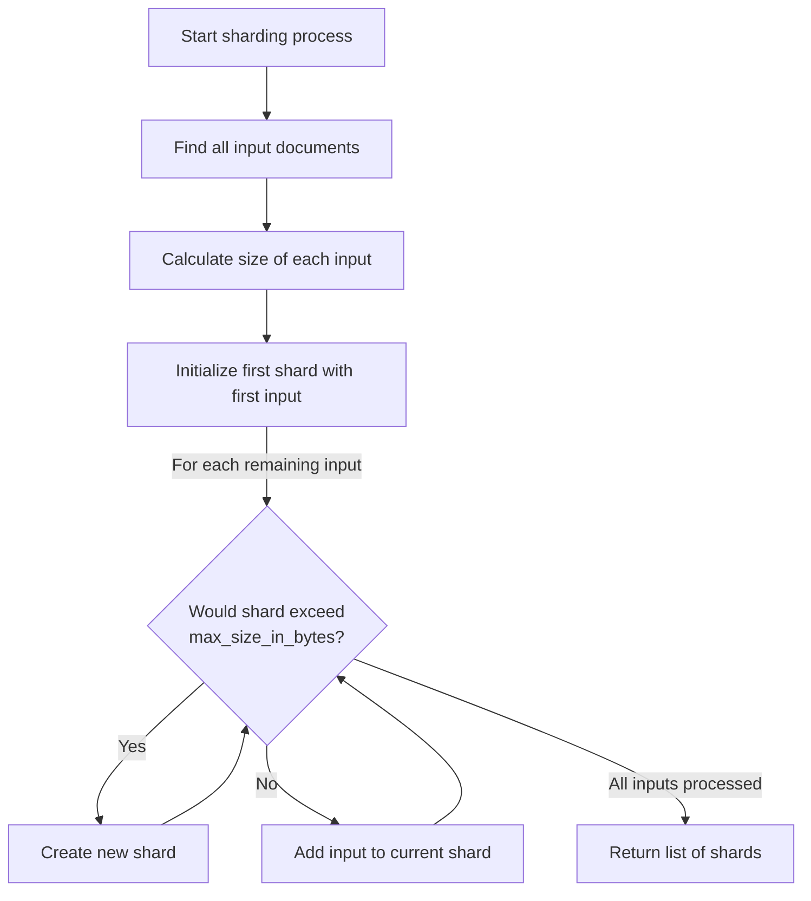
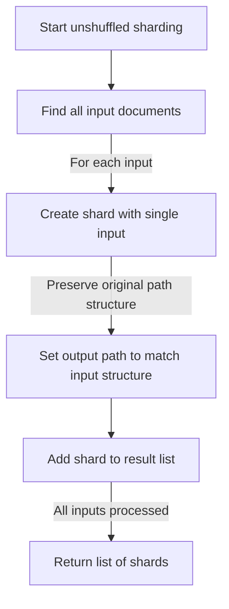
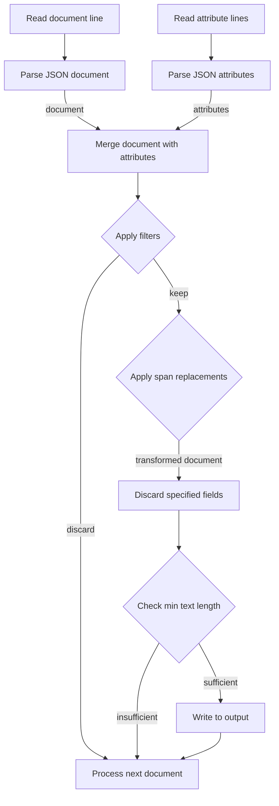
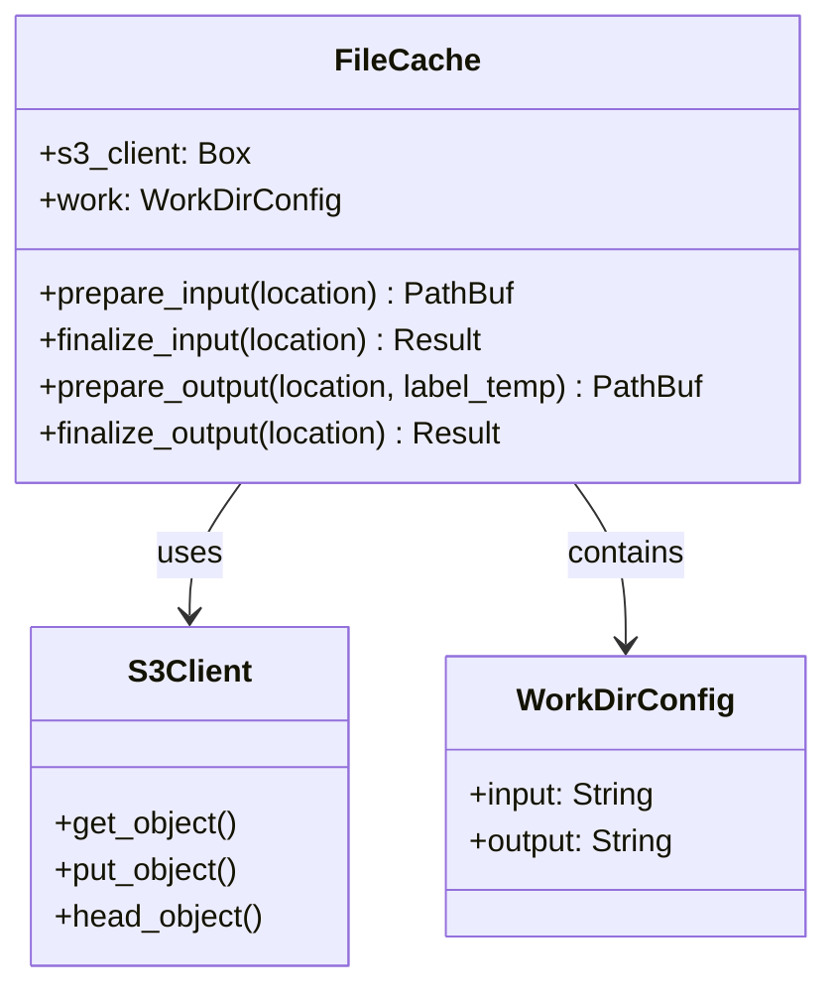

<!-- source: DeepWiki mcp.deepwiki.com · repo allenai/dolma · page 3.1 Sharding System · fetched 2026-10-26 -->

# Sharding System

<details>
<summary>Relevant source files</summary>

The following files were used as context for generating this wiki page:

- [configs/dolma-v1_5/mixing/dedupe-test.yaml](configs/dolma-v1_5/mixing/dedupe-test.yaml)
- [configs/test/test_filtered_mixer.yaml](configs/test/test_filtered_mixer.yaml)
- [src/bloom_filter.rs](src/bloom_filter.rs)
- [src/bloom_filter/bloom_test.rs](src/bloom_filter/bloom_test.rs)
- [src/deduper.rs](src/deduper.rs)
- [src/mixer.rs](src/mixer.rs)
- [src/s3_util.rs](src/s3_util.rs)
- [src/shard.rs](src/shard.rs)

</details>


The Sharding System is a core component of Dolma that divides large collections of documents into manageable units called "shards" for efficient parallel processing. This document explains how the sharding system works, its key components, and how it integrates with other parts of Dolma.

For information about the Mixer component that uses shards for document processing, see [Mixer Component](#3.2). For details about deduplication which also utilizes the sharding system, see [Deduplication System](#3.3).

## Purpose and Scope

The Sharding System provides infrastructure for:

- Partitioning large document collections into smaller units of work
- Managing local and remote (S3) file operations
- Supporting parallel processing across multiple shards
- Handling document attribute merging and filtering
- Applying transformations like span replacements

Sources: [src/shard.rs:15-16]()

## Core Concepts

### What is a Shard?

In Dolma, a shard represents a unit of work for document processing. As defined in the codebase:

> "A shard is a unit of work for the mixer. It is a collection of input files that are combined into a single output file."

A shard contains:
- Input document paths and associated attribute paths
- Output file path
- Optional filtering configuration
- Optional span replacement configuration
- Optional field discarding configuration
- Minimum text length requirement
- Compression configuration

Sources: [src/shard.rs:17-26]()

### Document Path Structure

A `DocumentPaths` object contains paths to both document files and corresponding attribute files. Attributes are stored separately from documents but are merged during processing.

Sources: [src/shard.rs:29-33]()

## System Architecture

### Sharding System Architecture



Sources: [src/shard.rs:18-26](), [src/shard.rs:29-33](), [src/shard.rs:526-561](), [src/shard.rs:713-819]()

### Integration with Other Dolma Components



Sources: [src/shard.rs](), [src/mixer.rs:11-17](), [src/deduper.rs:25-32]()

## Sharding Process

### Creating Shards

The sharding system provides two main methods for creating shards:

1. **`split_streams`** - Partitions input files into shards of approximately equal size, optimizing for parallel processing
2. **`split_streams_unshuffled`** - Creates shards without shuffling, maintaining the original file structure

The standard sharding process (`split_streams`) works as follows:

1. For each stream configuration:
   - Find all input documents matching the specified patterns
   - Calculate the size of each input
   - Group inputs into shards based on maximum size constraints
   - Create output paths for each shard
   - Configure each shard with the appropriate filters and transformations

Sources: [src/shard.rs:40-130](), [src/shard.rs:132-180]()

### Size-Based Partitioning

The standard sharding process attempts to create shards of approximately equal size, bounded by the `max_size_in_bytes` parameter in the stream configuration:



Sources: [src/shard.rs:65-103]()

### Unshuffled Sharding

The unshuffled sharding process creates one shard per input file, maintaining the original structure:



Sources: [src/shard.rs:132-180]()

## Shard Processing

When a shard is processed, the following steps occur:

1. Prepare inputs and outputs using FileCache (download from S3 if needed)
2. Set up document and attribute readers for each input
3. Read documents and their attributes line by line
4. Merge attributes with document data
5. Apply filters to determine which documents to keep
6. Apply span replacements to modify document text
7. Discard specified fields
8. Check minimum text length
9. Write processed documents to output
10. Finalize outputs (upload to S3 if needed)

Sources: [src/shard.rs:182-507]()

### Document and Attribute Merging



Sources: [src/shard.rs:272-476]()

## File Cache System

The `FileCache` component manages the transfer of files between local and remote (S3) storage:



For local files, FileCache simply returns the path. For S3 URLs, it:
- Downloads files to a local cache directory when `prepare_input` is called
- Uploads files to S3 when `finalize_output` is called
- Cleans up local cache files when done

Sources: [src/shard.rs:713-819](), [src/s3_util.rs:35-176]()

## S3 Integration

The sharding system integrates with AWS S3 for both input and output:

### Input Handling
- Can read document and attribute files directly from S3
- Downloads files to local cache for processing
- Pattern matching for S3 paths using wildcards
- Parallel fetching of object sizes for efficient sharding

### Output Handling
- Can write processed documents directly to S3
- Handles compression with various formats
- Supports retries for S3 operations
- Creates empty checkpoint files after successful uploads

Sources: [src/shard.rs:728-769](), [src/s3_util.rs:35-176](), [src/s3_util.rs:199-286]()

## Configuration

The sharding system is configured through several configuration structs:

### Stream Configuration

The `StreamConfig` struct defines how input documents are processed:

```
StreamConfig {
    name: String,                                      // Name of the stream
    documents: Vec<String>,                            // Paths to input documents
    attributes: Vec<String>,                           // Paths to attribute files
    filter: Option<FilterConfig>,                      // Document filtering rules
    span_replacement: Option<Vec<SpanReplacementConfig>>, // Text replacements
    output: StreamOutputConfig,                        // Output configuration
    compression: Option<CompressionConfig>,            // Compression settings
}
```

Sources: [src/shard.rs:533-546]()

### Compression Configuration

```
CompressionConfig {
    input: Option<String>,    // Compression format for input files
    output: Option<String>,   // Compression format for output files
}
```

Sources: [src/shard.rs:548-552]()

### Stream Output Configuration

```
StreamOutputConfig {
    path: String,                         // Output directory path
    max_size_in_bytes: usize,             // Maximum size of each shard
    discard_fields: Option<Vec<String>>,  // Fields to remove from documents
    min_text_length: Option<usize>,       // Minimum text length to retain document
}
```

Sources: [src/shard.rs:563-569]()

### Working Directory Configuration

```
WorkDirConfig {
    input: String,   // Path for temporary input files
    output: String,  // Path for temporary output files
}
```

Sources: [src/shard.rs:571-575]()

## Example Workflow

Here's an example of how the Sharding System is used in the Mixer component:

1. The Mixer reads a configuration file that defines streams
2. It calls `Shard::split_streams` to create shards based on the configuration
3. It creates a thread pool to process shards in parallel
4. For each shard:
   - It checks if the output already exists
   - If not, it calls `shard.process(work_dirs)` to process the shard
   - This processes and transforms all documents in the shard
5. After all shards are processed, the results are combined according to the configuration

Sources: [src/mixer.rs:11-48]()

## Conclusion

The Sharding System is a fundamental component of Dolma that enables efficient processing of large document collections. By partitioning documents into manageable shards, it supports parallel processing while providing a consistent interface for document transformation, filtering, and I/O operations across both local and S3 storage.

---

