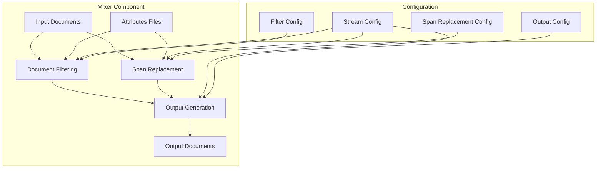
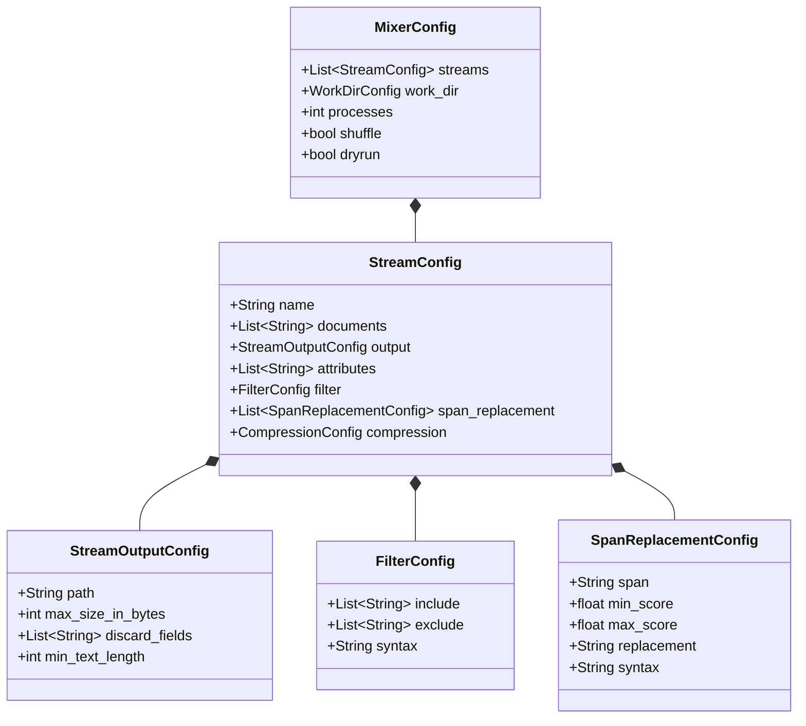
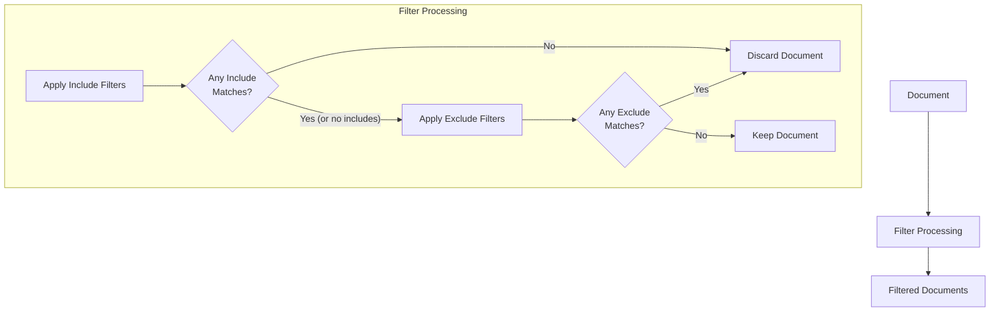
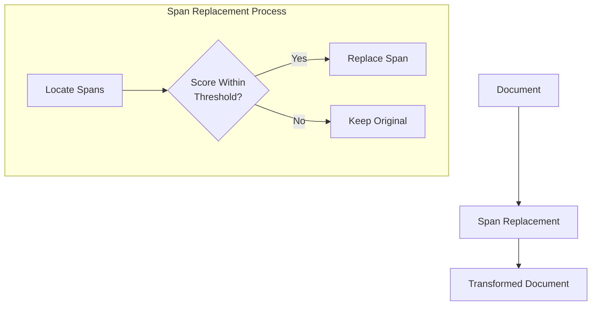
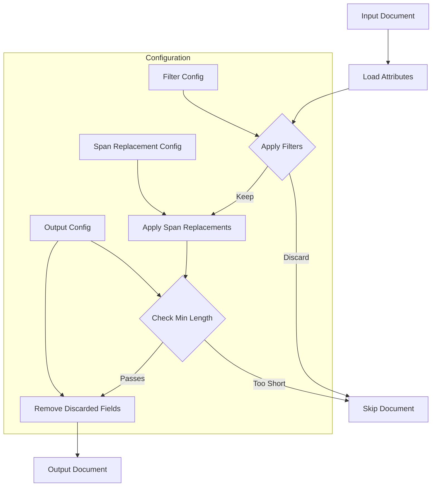
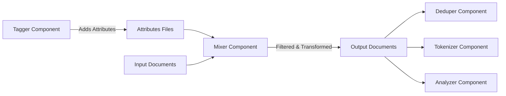

<!-- source: DeepWiki mcp.deepwiki.com · repo allenai/dolma · page 3.2 Mixer Component · fetched 2026-10-26 -->

# Mixer Component

<details>
<summary>Relevant source files</summary>

The following files were used as context for generating this wiki page:

- [python/dolma/cli/deduper.py](python/dolma/cli/deduper.py)
- [python/dolma/cli/mixer.py](python/dolma/cli/mixer.py)
- [scripts/sample_prefix.py](scripts/sample_prefix.py)
- [src/filters.rs](src/filters.rs)
- [tests/config/c4-cleaned.json](tests/config/c4-cleaned.json)
- [tests/config/dedupe-by-url.json](tests/config/dedupe-by-url.json)
- [tests/config/dedupe-paragraphs.json](tests/config/dedupe-paragraphs.json)
- [tests/config/email-spans-jq.yaml](tests/config/email-spans-jq.yaml)
- [tests/config/email-spans.json](tests/config/email-spans.json)
- [tests/config/filter-by-spans.json](tests/config/filter-by-spans.json)
- [tests/config/mixer.json](tests/config/mixer.json)
- [tests/config/paragraph-spans.json](tests/config/paragraph-spans.json)
- [tests/python/test_deduper.py](tests/python/test_deduper.py)
- [tests/python/test_mixer.py](tests/python/test_mixer.py)
- [tests/python/utils.py](tests/python/utils.py)

</details>


The Mixer Component in Dolma is responsible for filtering and transforming documents based on configurable rules. It processes input documents, applies filters to include or exclude documents based on their content, and performs span replacements to modify text content. The Mixer is a key part of the overall data processing pipeline, sitting between the Tagger Component (which adds metadata attributes) and the Deduplication System (which removes duplicates). For information about duplicate detection and removal, see [Deduplication System](#3.3).

## Overview

The Mixer Component allows you to:

1. Filter documents based on their content or attributes using JSONPath or jq expressions
2. Replace specific spans of text (such as PII, toxic content, or low-quality passages)
3. Combine and process multiple streams of documents
4. Discard unnecessary fields from output documents
5. Configure minimum text length requirements

Sources: [python/dolma/cli/mixer.py:1-197]()

## Architecture

The Mixer follows Dolma's general data processing architecture, where documents are processed in streams with configurable filters and transformations.



The Mixer processes documents through a stream-based pipeline. Each stream is configured with:

1. Input documents to process
2. Optional attribute files to use for filtering/replacement
3. Filter rules (include/exclude expressions)
4. Span replacement rules
5. Output configuration

Sources: [python/dolma/cli/mixer.py:50-68](), [python/dolma/cli/mixer.py:72-80]()

## Configuration Model

The Mixer is configured using a hierarchical configuration model:



Sources: [python/dolma/cli/mixer.py:12-80]()

## Document Filtering

The Mixer can filter documents based on their content or attributes using either JSONPath or jq expressions.

### Filter Configuration

Filters are configured with:

1. `include` expressions: Documents must match at least one to be included
2. `exclude` expressions: Documents are excluded if they match any
3. `syntax`: Either "jsonpath" (default) or "jq"



When a filter is applied, it evaluates the document against all include expressions first. If the document matches any include expression (or if there are no include expressions), it is then evaluated against all exclude expressions. If it matches any exclude expression, it is discarded.

Sources: [python/dolma/cli/mixer.py:23-29](), [src/filters.rs:250-481]()

### Filter Syntax

#### JSONPath Example

```json
{
  "filter": {
    "include": ["$.metadata[?(@.length < 10000)]"],
    "exclude": [
      "$.metadata[?(@.length < 500)]",
      "$.attributes[?(@.pii.too_much_pii == true)]"
    ],
    "syntax": "jsonpath"
  }
}
```

This filter keeps documents with metadata length between 500 and 10000 characters, and excludes documents marked with too much PII.

#### jq Example

```json
{
  "filter": {
    "include": [".attributes.quality_score > 0.7"],
    "exclude": [".attributes.toxic_content == true"],
    "syntax": "jq"
  }
}
```

This filter keeps documents with quality score above 0.7 and excludes documents with toxic content.

Sources: [tests/config/mixer.json:16-25](), [tests/config/filter-by-spans.json:16-19]()

## Span Replacement

The Mixer can also replace specific spans of text within documents. This is useful for removing PII, toxic content, or low-quality passages.

### Span Replacement Configuration

Span replacements are configured with:

1. `span`: JSONPath or jq expression to locate spans
2. `min_score` and/or `max_score`: Score threshold for replacement
3. `replacement`: Text to replace the span with
4. `syntax`: Either "jsonpath" (default) or "jq"



When a span replacement is applied, it:
1. Locates all spans in the document matching the selector
2. Checks if each span's score is within the threshold
3. Replaces matching spans with the specified replacement text

Sources: [python/dolma/cli/mixer.py:32-47](), [src/filters.rs:84-147]()

### Span Replacement Examples

#### Removing Email Addresses

```json
{
  "span_replacement": [
    {
      "span": "$.attributes.pii.email",
      "min_score": 0.5,
      "replacement": "[B-EMAIL]{}[E-EMAIL]"
    }
  ]
}
```

This replacement finds spans identified as emails with a confidence score of at least 0.5 and replaces them with a token.

#### Removing Low-Quality Paragraphs

```json
{
  "span_replacement": [
    {
      "span": "$.attributes.quality.low_quality_paragraphs",
      "min_score": 0.8,
      "replacement": ""
    }
  ]
}
```

This replacement removes paragraphs identified as low quality with a confidence score of at least 0.8.

Sources: [tests/config/email-spans.json:15-26](), [tests/config/paragraph-spans.json:15-21]()

## Stream Processing Flow

The complete processing flow of a document through the Mixer is:



The Mixer processes documents in the following steps:

1. Load the document and any associated attribute files
2. Apply filter rules to determine if the document should be kept
3. Apply span replacements to modify the document's text
4. Check if the modified document meets the minimum length requirement
5. Remove any fields specified in the `discard_fields` configuration
6. Write the document to the output

Sources: [python/dolma/cli/mixer.py:89-196]()

## Command Line Interface

The Mixer is accessed through the Dolma CLI:

```bash
dolma -c config.json mix
```

The CLI handles configuration validation, path resolution, and execution of the Mixer.

### Configuration File Example

```json
{
  "streams": [
    {
      "name": "cleaned-wikipedia",
      "documents": ["path/to/documents/*.json.gz"],
      "attributes": ["pii", "quality"],
      "output": {
        "path": "output/cleaned-wikipedia",
        "max_size_in_bytes": 1073741824,
        "discard_fields": ["metadata.url", "metadata.timestamp"],
        "min_text_length": 500
      },
      "filter": {
        "include": ["$.attributes.quality.score > 0.7"],
        "exclude": ["$.attributes.pii.too_much_pii == true"],
        "syntax": "jsonpath"
      },
      "span_replacement": [
        {
          "span": "$.attributes.pii.email",
          "min_score": 0.8,
          "replacement": "[EMAIL]"
        }
      ]
    }
  ],
  "processes": 4,
  "shuffle": true
}
```

Sources: [python/dolma/cli/mixer.py:83-196]()

## Integration with Other Components

The Mixer Component integrates with other Dolma components in the data processing pipeline:



The Mixer typically:

1. Receives input from the Tagger Component in the form of attribute files
2. Processes raw documents with these attributes
3. Outputs filtered and transformed documents
4. Passes these documents to other components for further processing

Sources: [python/dolma/cli/mixer.py:1-5](), [python/dolma/cli/deduper.py:7-13]()

## Common Use Cases

The Mixer Component is commonly used for:

| Use Case | Configuration Focus |
|----------|---------------------|
| PII Removal | Span replacement for email addresses, phone numbers, etc. |
| Quality Filtering | Filter config to remove low-quality documents |
| Toxicity Filtering | Filter config to remove toxic documents |
| Content Cleaning | Span replacement for specific types of low-quality content |
| Dataset Composition | Multiple streams with different filters to create balanced datasets |

Sources: [tests/config/email-spans.json:1-34](), [tests/config/mixer.json:1-33](), [tests/config/c4-cleaned.json:1-34]()

## Performance Considerations

The Mixer uses Rust-based filtering and span replacement for performance, with these key considerations:

1. Setting the appropriate number of processes based on available hardware
2. Being mindful of memory usage when processing large document streams
3. Using efficient filter expressions, especially when dealing with large datasets
4. Leveraging the shuffle option for better performance with multiple processes

The `processes` parameter in the configuration controls parallelization, while `shuffle` controls whether documents are shuffled for more even distribution of work.

Sources: [python/dolma/cli/mixer.py:75-76]()

---

