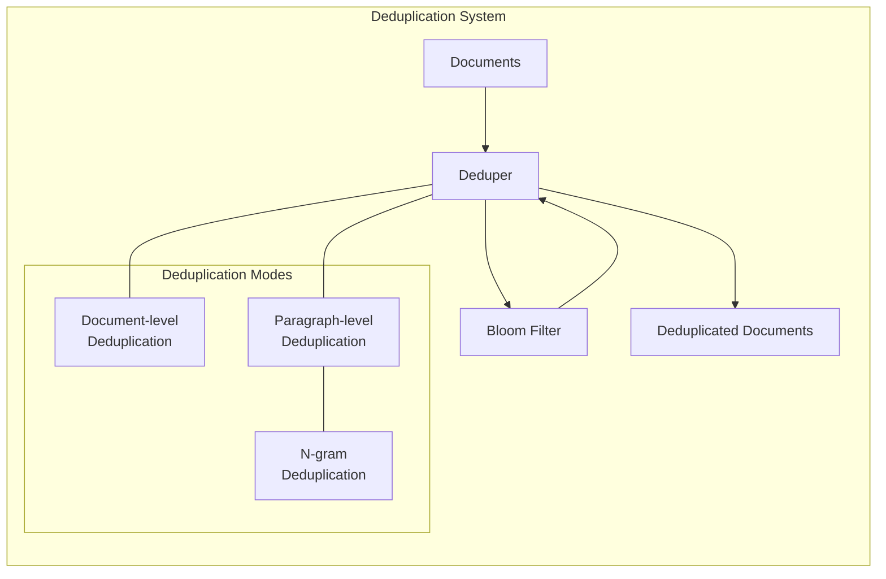
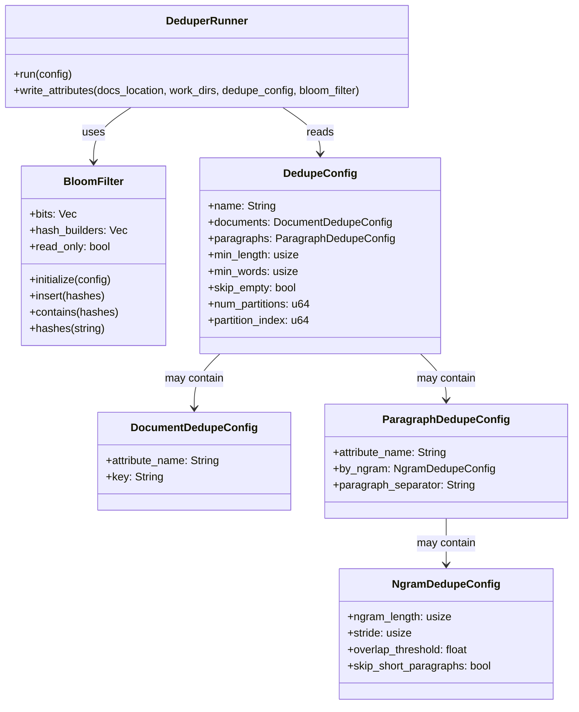
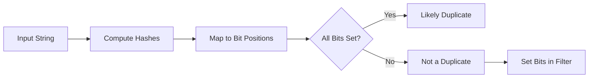
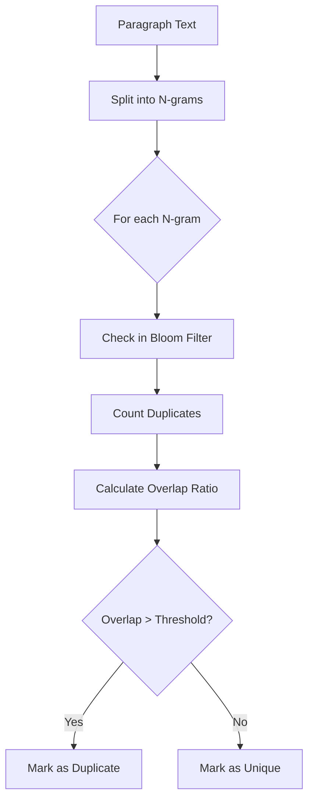
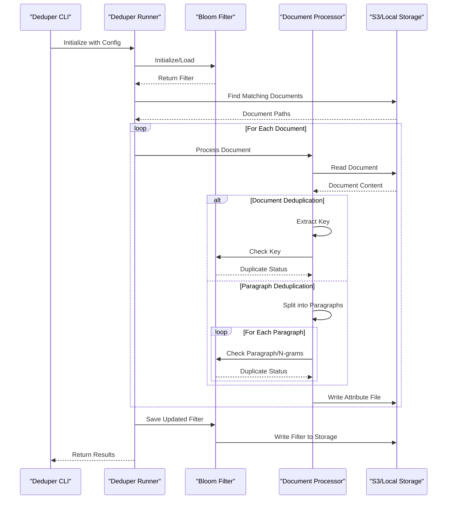
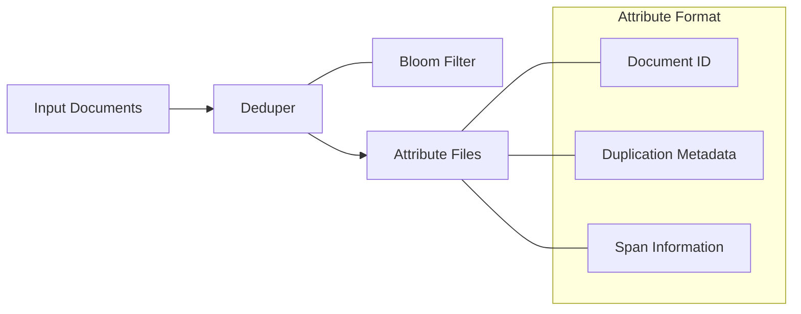
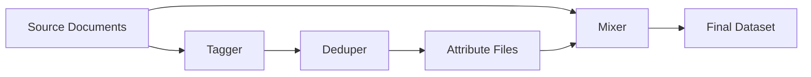

<!-- source: DeepWiki mcp.deepwiki.com · repo allenai/dolma · page 3.3 Deduplication System · fetched 2026-10-26 -->

# Deduplication System

<details>
<summary>Relevant source files</summary>

The following files were used as context for generating this wiki page:

- [configs/dolma-v1_5/mixing/dedupe-test.yaml](configs/dolma-v1_5/mixing/dedupe-test.yaml)
- [configs/test/test_filtered_mixer.yaml](configs/test/test_filtered_mixer.yaml)
- [python/dolma/cli/deduper.py](python/dolma/cli/deduper.py)
- [python/dolma/cli/mixer.py](python/dolma/cli/mixer.py)
- [src/bloom_filter.rs](src/bloom_filter.rs)
- [src/bloom_filter/bloom_test.rs](src/bloom_filter/bloom_test.rs)
- [src/deduper.rs](src/deduper.rs)
- [src/mixer.rs](src/mixer.rs)
- [src/s3_util.rs](src/s3_util.rs)
- [src/shard.rs](src/shard.rs)

</details>


The Deduplication System is a core component in Dolma that identifies and marks duplicate content within large document collections. It supports deduplication at both the document level and paragraph level, enabling the creation of high-quality training datasets by eliminating redundant content. For information about document mixing and filtering, see [Mixer Component](#3.2).

## Overview and Purpose

The Deduplication System efficiently identifies duplicate content using probabilistic data structures (Bloom filters). Rather than removing duplicates directly, it adds metadata attributes to documents identifying which content is duplicated. This approach preserves the original data while allowing downstream components to filter or process duplicates according to specific requirements.

Key capabilities include:

- Document-level deduplication using customizable keys (e.g., URL, document hash)
- Paragraph-level deduplication with configurable paragraph separators
- N-gram based partial deduplication for detecting similar content
- Distributed processing through partitioning for large-scale datasets
- S3 and local filesystem support



Sources: [src/deduper.rs:20-95](), [python/dolma/cli/deduper.py:114-143]()

## System Architecture

The Deduplication System consists of several integrated components that work together to identify and mark duplicate content. At its core is a Bloom filter implementation that efficiently tracks seen content, while the deduper processes documents in parallel and generates attribute files containing duplication metadata.



Sources: [src/deduper.rs:518-603](), [src/bloom_filter.rs:15-281]()

## Core Components

### 1. Bloom Filter

The Bloom filter is a space-efficient probabilistic data structure used for fast membership testing. In Dolma, it's implemented as a thread-safe structure that can detect duplicate content with a configurable false positive rate.

Key features:
- Thread-safe implementation using atomic operations
- Configurable size and number of hash functions
- Serialization to/from disk for persistence
- Automatic sizing based on expected number of elements and desired false positive rate
- Support for read-only mode to prevent updates



Sources: [src/bloom_filter.rs:14-235](), [src/bloom_filter.rs:237-271]()

### 2. Document Deduplication

Document deduplication works by extracting a key from each document (using JSONPath or jq expressions) and checking if that key has been seen before in the Bloom filter. If the key is a duplicate, the document is marked as such in the output attributes file.

Example document deduplication workflow:
1. Extract the key (e.g., URL or content hash) from the document
2. Generate hashes of the key for the Bloom filter
3. Check if all hash positions are set in the Bloom filter
4. Mark the document as duplicate if all positions are set
5. Otherwise, set those positions and mark as non-duplicate

Sources: [src/deduper.rs:232-310]()

### 3. Paragraph Deduplication

Paragraph deduplication breaks document text into paragraphs, then checks each paragraph against the Bloom filter. This allows for more fine-grained deduplication by identifying specific duplicated sections within otherwise unique documents.

The system supports:
- Custom paragraph separators (default: newline)
- Minimum paragraph length requirements
- Minimum word count filters
- Empty paragraph skipping

Sources: [src/deduper.rs:312-484]()

### 4. N-gram Based Deduplication

For more flexible duplicate detection, the system supports n-gram based paragraph deduplication. This approach:
1. Breaks paragraphs into sequences of n consecutive tokens (n-grams)
2. Checks each n-gram against the Bloom filter
3. Calculates the proportion of duplicate n-grams
4. Marks the paragraph as duplicate if the overlap exceeds a threshold

This enables detection of partial duplicates or paraphrased content when exact matching would fail.



Sources: [src/deduper.rs:380-466]()

## Workflow

The deduplication process follows these main steps:

1. Initialize or load a Bloom filter
2. Process input documents in parallel
3. For each document, apply document-level or paragraph-level deduplication
4. Generate attribute files with duplication information
5. Save the updated Bloom filter for future runs



Sources: [src/deduper.rs:20-95](), [src/deduper.rs:116-517]()

## Data Flow

The deduplication system processes documents and produces attribute files. These attribute files contain metadata about which documents or paragraphs are duplicates.



For document-level deduplication, the attribute file contains simple flags indicating whether each document is a duplicate. For paragraph-level deduplication, it contains spans (start/end positions) of duplicated paragraphs within each document.

Sources: [src/deduper.rs:487-492]()

## Configuration

The deduplication system is highly configurable through a JSON or YAML configuration file. Key configuration options include:

### Document vs. Paragraph Deduplication

You must configure either document-level or paragraph-level deduplication (but not both):

```yaml
dedupe:
  name: "my_deduper"
  documents:  # For document-level deduplication
    attribute_name: "duplicate_doc"
    key: "$.metadata.url"  # JSONPath expression to extract document key
  # OR
  paragraphs:  # For paragraph-level deduplication
    attribute_name: "duplicate_paragraphs"
    paragraph_separator: "\n"  # Optional, defaults to newline
```

### N-gram Configuration

For paragraph deduplication, you can optionally configure n-gram based deduplication:

```yaml
paragraphs:
  attribute_name: "duplicate_paragraphs"
  by_ngram:
    ngram_length: 5        # Number of tokens per n-gram
    stride: 2              # Tokens to skip between n-grams
    overlap_threshold: 0.7 # Minimum ratio to consider duplicate
    skip_short_paragraphs: true
```

### Bloom Filter Configuration

The Bloom filter can be configured based on expected dataset size and acceptable false positive rate:

```yaml
bloom_filter:
  file: "/path/to/bloom/filter.bin"
  read_only: false
  # Either specify size directly:
  size_in_bytes: 1073741824  # 1GB
  # OR specify by expected documents and error rate:
  estimated_doc_count: 10000000
  desired_false_positive_rate: 0.001
```

### Partitioning for Distributed Processing

For large datasets, work can be partitioned across multiple machines:

```yaml
dedupe:
  num_partitions: 10     # Total number of partitions
  partition_index: 3     # This process handles partition #3
  file_partition: false  # Partition at content level, not file level
```

Sources: [python/dolma/cli/deduper.py:24-142](), [src/deduper.rs:530-598]()

## Integration with Dolma Pipeline

The deduplication system integrates with the broader Dolma pipeline by:

1. Processing documents after they've been collected and potentially tagged
2. Generating attribute files that can be consumed by the mixer component
3. Supporting distributed processing for large-scale datasets

The mixer can use the deduplication attributes to filter out duplicated content during dataset creation.



Sources: [python/dolma/cli/mixer.py:52-60](), [src/mixer.rs:10-47]()

## Performance Considerations

The deduplication system is designed for large-scale processing with several performance optimizations:

1. **Memory Efficiency**: Bloom filters provide space-efficient duplicate detection
2. **Parallel Processing**: Documents are processed in parallel using a thread pool
3. **Partitioning**: Work can be distributed across multiple machines
4. **Hybrid Implementation**: Core components are implemented in Rust for performance while the CLI is in Python for ease of use
5. **S3 Integration**: Efficient handling of remote files with caching and retry mechanisms

For very large datasets, consider:
- Increasing the Bloom filter size to reduce false positives
- Using partitioning to distribute work
- Tuning the number of processes based on available cores

Sources: [src/deduper.rs:34-74](), [src/s3_util.rs:288-325]()

## Example Usage

Here's a complete example of using the deduplication CLI:

```bash
dolma dedupe config.yaml
```

Where `config.yaml` might look like:

```yaml
documents:
  - s3://my-bucket/documents/wikipedia/*.json.gz

work_dir:
  input: "/tmp/dolma/input"
  output: "/tmp/dolma/output"

dedupe:
  name: "paragraph_duplicates"
  paragraphs:
    attribute_name: "duplicate_paragraphs"
    by_ngram:
      ngram_length: 5
      stride: 2
      overlap_threshold: 0.8
  min_words: 50
  skip_empty: true

bloom_filter:
  file: "s3://my-bucket/bloom_filters/wikipedia.bin"
  read_only: false
  estimated_doc_count: 5000000
  desired_false_positive_rate: 0.001

processes: 16

compression:
  input: gz
  output: gz
```

This configuration would:
1. Process all Wikipedia documents in the specified S3 bucket
2. Check for paragraph-level duplicates using 5-gram comparison with 80% overlap threshold
3. Skip empty paragraphs and those with fewer than 50 words
4. Use 16 parallel processes for processing
5. Store the result in attribute files with the same compression as the input

Sources: [python/dolma/cli/deduper.py:142-275]()

---

