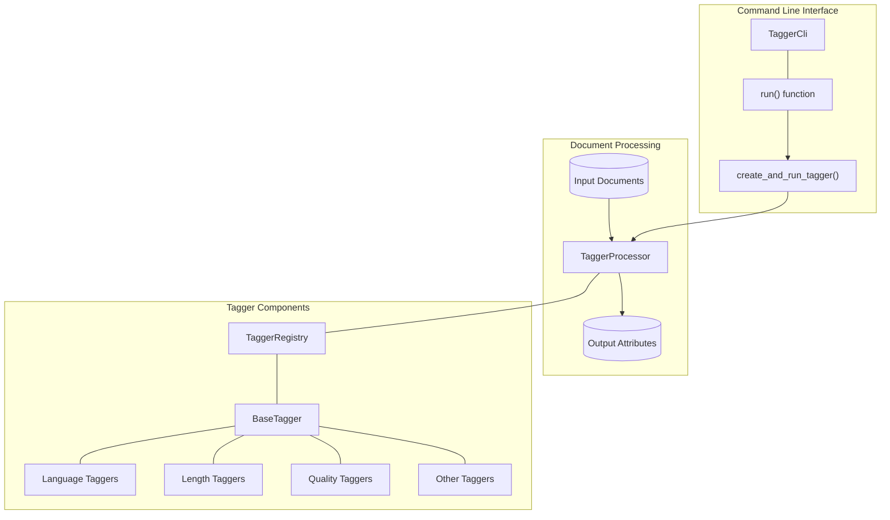
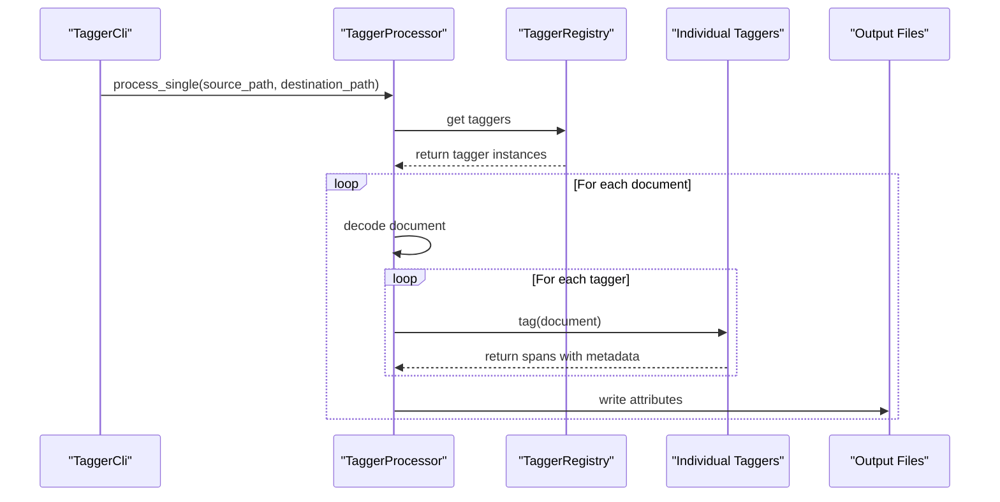
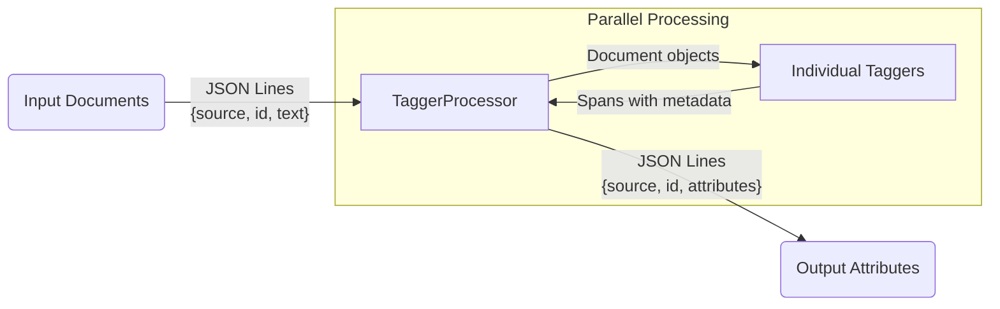

<!-- source: DeepWiki mcp.deepwiki.com · repo allenai/dolma · page 3.4 Tagging System · fetched 2026-10-26 -->

# Tagging System

<details>
<summary>Relevant source files</summary>

The following files were used as context for generating this wiki page:

- [python/dolma/cli/tagger.py](python/dolma/cli/tagger.py)
- [python/dolma/core/runtime.py](python/dolma/core/runtime.py)
- [python/dolma/core/utils.py](python/dolma/core/utils.py)
- [python/dolma/core/vizualizer.py](python/dolma/core/vizualizer.py)
- [python/dolma/taggers/__init__.py](python/dolma/taggers/__init__.py)
- [python/dolma/taggers/c4.py](python/dolma/taggers/c4.py)
- [python/dolma/taggers/gopher.py](python/dolma/taggers/gopher.py)
- [python/dolma/taggers/language.py](python/dolma/taggers/language.py)
- [python/dolma/taggers/length.py](python/dolma/taggers/length.py)
- [python/dolma/taggers/quality.py](python/dolma/taggers/quality.py)
- [scripts/wimbd_to_dolma.py](scripts/wimbd_to_dolma.py)
- [tests/python/test_c4.py](tests/python/test_c4.py)
- [tests/python/test_data_types.py](tests/python/test_data_types.py)
- [tests/python/test_gopher.py](tests/python/test_gopher.py)
- [tests/python/test_quality.py](tests/python/test_quality.py)
- [tests/python/test_utils.py](tests/python/test_utils.py)

</details>


The Dolma Tagging System is a core component of the data processing pipeline that applies metadata to documents. It analyzes text content and generates attributes that describe various properties such as language, quality, length, and content characteristics. These attributes can then be used by the [Mixer Component](#3.2) to filter or transform documents, or by the [Analysis System](#3.6) to generate statistics and visualizations.

## Architecture Overview

The Tagging System follows a modular architecture designed for extensibility and parallel processing. It contains a registry of taggers, each specializing in detecting specific document attributes. The system processes documents in parallel, applies multiple taggers to each document, and saves the results as attribute files.



Sources: [python/dolma/core/runtime.py:224-344](), [python/dolma/cli/tagger.py:96-143](), [python/dolma/taggers/__init__.py:1-17]()

## Core Components

### BaseTagger and Tagger Registry

All taggers inherit from the `BaseTagger` class, which defines the interface for document analysis. The `TaggerRegistry` manages the registration and retrieval of taggers by name using a decorator pattern.

```mermaid
classDiagram
    class "BaseTagger" {
        <<abstract>>
        +predict(doc: Document) -> DocResult
    }
    
    class "BaseLanguageTagger" {
        <<abstract>>
        +predict_text(text: str) -> List[Tuple[str, float]]
        +predict_doc(doc: Document) -> DocResult
        +predict_paragraph(doc: Document) -> DocResult
    }
    
    class "TaggerRegistry" {
        +add(name: str) -> Callable
        +get(name: str) -> BaseTagger
        +items() -> List[Tuple[str, Type[BaseTagger]]]
    }
    
    class "LanguageTagger" {
        +predict(doc: Document) -> DocResult
    }
    
    class "QualityTagger" {
        +predict(doc: Document) -> DocResult
    }
    
    class "LengthTagger" {
        +predict(doc: Document) -> DocResult
    }
    
    "BaseTagger" <|-- "BaseLanguageTagger"
    "BaseTagger" <|-- "QualityTagger"
    "BaseTagger" <|-- "LengthTagger"
    "BaseLanguageTagger" <|-- "LanguageTagger"
    "TaggerRegistry" --> "BaseTagger" : registers
```

Sources: [python/dolma/core/taggers.py]() (inferred from imports), [python/dolma/taggers/language.py:38-71](), [python/dolma/taggers/quality.py:18-68](), [python/dolma/taggers/length.py:21-178]()

### Tagger Processor

The `TaggerProcessor` class handles the parallel processing of documents, applying multiple taggers to each one and collecting the results. It inherits from `BaseParallelProcessor` and implements the document processing workflow.



Sources: [python/dolma/core/runtime.py:224-344]()

### Data Types

The tagging system uses several key data types to represent documents and metadata:

- `Document`: Represents an input document with source, version, ID, and text content
- `InputSpec`: Similar to Document, used for serialization/deserialization
- `Span`: Represents a tagged span within a document with start/end positions, type, and score
- `DocResult`: Container for a document and its associated spans (tagging results)
- `TextSlice`: Represents a slice of text within a document with position information

Sources: [tests/python/test_data_types.py:10-97]()

## Built-in Taggers

Dolma includes several types of built-in taggers for common document analysis tasks:

### Language Taggers

Detect the language of documents using various libraries like FastText, CLD2/CLD3, langdetect, and lingua.

```python
@TaggerRegistry.add("ft_lang_id_en_doc_v2")
class FastTextEnglishLanguageDocumentTagger(FastTextAllLanguagesDocumentTagger):
    # Detects if a document is in English using FastText
    # Returns spans with type "en" and score representing confidence
```

Sources: [python/dolma/taggers/language.py:74-296]()

### Length Taggers

Calculate various length metrics such as character count, word count, and paragraph statistics.

```python
@TaggerRegistry.add("char_length_v1")
class CharLengthV1(BaseTagger):
    # Counts characters in a document
    def predict(self, doc: Document) -> DocResult:
        score = len(doc.text)
        return DocResult(doc=doc, spans=[Span(start=0, end=len(doc.text), type="length", score=score)])
```

Sources: [python/dolma/taggers/length.py:21-179]()

### Quality Taggers

Assess document quality using specialized models trained on high-quality versus low-quality content.

```python
@TaggerRegistry.add("dolma17-quality")
class Dolma17QualityClassifier(BaseFastTextTagger):
    # Uses FastText models to classify document quality
    # Returns confidence scores for high-quality (hq) and low-quality (lq)
```

Sources: [python/dolma/taggers/quality.py:18-68](), [tests/python/test_quality.py:9-54]()

### Filter Taggers

Detect potentially problematic content, based on patterns used in the C4 dataset pipeline.

```python
@TaggerRegistry.add("c4_v2")
class FasterC4Tagger(BaseTagger):
    # Detects issues like naughty words, JavaScript, lorem ipsum, etc.
    # Returns spans indicating detected problems
```

Sources: [python/dolma/taggers/c4.py:1-128](), [tests/python/test_c4.py:1-124]()

### Statistical Taggers

Calculate statistical properties of documents, such as repetition, distribution of n-grams, etc.

```python
@TaggerRegistry.add("gopher_v1")
class GopherTagger(BaseTagger):
    # Calculates Gopher statistical attributes (from DeepMind's Gopher)
    # Returns spans with various statistical metrics
```

Sources: [python/dolma/taggers/gopher.py:1-304](), [tests/python/test_gopher.py:1-304]()

## Tagging Process

The tagging process consists of the following steps:

1. **Initialization**: Load taggers specified by name from the registry
2. **Document Processing**: Read documents from input files
3. **Tagging**: Apply each tagger to each document
4. **Output**: Write results to output files with attribute names prefixed by experiment and tagger names

Below is a diagram of the tagging workflow:



Sources: [python/dolma/core/runtime.py:224-344](), [python/dolma/core/runtime.py:377-489]()

## Command Line Interface

The tagging system provides a command-line interface through the `TaggerCli` class, which allows users to run taggers on documents. The CLI accepts various parameters including:

- Document paths to process
- Tagger names to run
- Destination paths for outputs
- Experiment name for prefixing attributes
- Parallel processing configuration

```
dolma tag --documents <paths> --taggers <tagger_names> [--experiment <name>] [--processes <n>]
```

The CLI also includes a list command to display available taggers:

```
dolma list [--tagger-modules <module_paths>]
```

Sources: [python/dolma/cli/tagger.py:44-172]()

## Output Format

The tagging system produces output files in JSON Lines format, with each line containing:
- `source`: The source identifier from the input document
- `id`: The document ID from the input document
- `attributes`: A dictionary mapping attribute names to values

Attribute names are prefixed with the experiment name and tagger name to avoid conflicts when multiple taggers are used. For example, an attribute from the "en_detector" tagger in the "language" experiment might be named `language__en_detector__en`.

Sources: [python/dolma/core/runtime.py:128-158](), [python/dolma/core/runtime.py:194-222]()

## Creating Custom Taggers

Custom taggers can be created by:

1. Subclassing `BaseTagger`
2. Implementing the `predict` method
3. Registering the tagger with `@TaggerRegistry.add("tagger_name")`

Example:

```python
from dolma.core.data_types import DocResult, Document, Span
from dolma.core.registry import TaggerRegistry
from dolma.core.taggers import BaseTagger

@TaggerRegistry.add("my_custom_tagger")
class MyCustomTagger(BaseTagger):
    def predict(self, doc: Document) -> DocResult:
        # Analyze document and produce spans with metadata
        spans = [Span(start=0, end=len(doc.text), type="my_attribute", score=1.0)]
        return DocResult(doc=doc, spans=spans)
```

Custom taggers can be loaded using the `--tagger-modules` parameter to import modules from Python path or local files.

Sources: [python/dolma/core/utils.py:100-147](), [python/dolma/cli/tagger.py:57-64]()

## Utilities for Taggers

The tagging system provides several utility functions to help with common tagging tasks:

- Text segmentation: `split_paragraphs`, `split_sentences`, `split_words`
- Variable name normalization: `make_variable_name`
- Module importing: `import_modules`

These utilities make it easier to implement custom taggers by providing reusable functionality.

Sources: [python/dolma/core/utils.py:37-95](), [tests/python/test_utils.py:11-86]()

## Integration with Dolma Pipeline

The Tagging System integrates with other components of the Dolma pipeline:

1. It processes documents created or filtered by the [Sharding System](#3.1)
2. It produces attributes used by the [Mixer Component](#3.2) for filtering and transforming
3. Its outputs can be analyzed by the [Analysis System](#3.6)

This integration allows for a complete data processing pipeline from raw documents to filtered, high-quality training data.

Sources: [python/dolma/core/runtime.py:377-489]()

---

