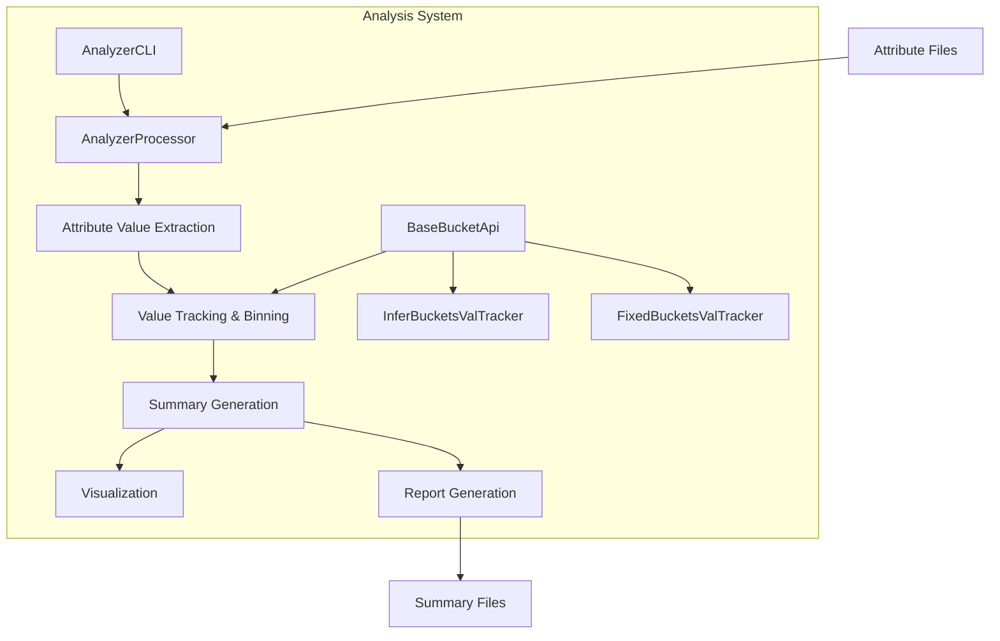
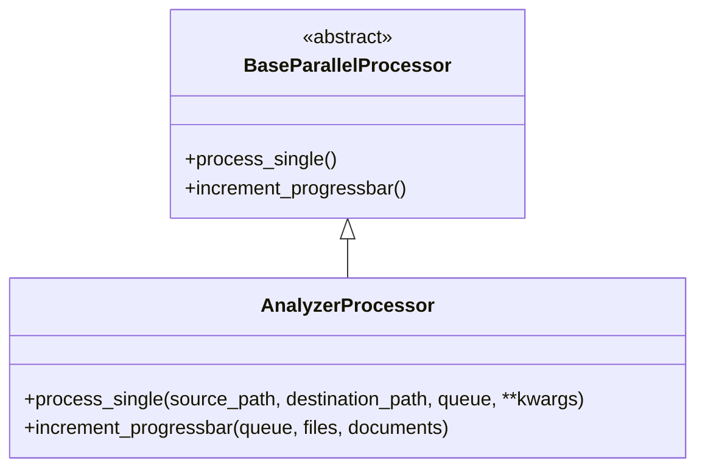
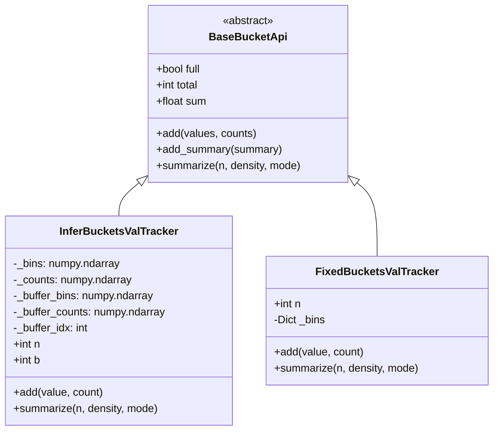
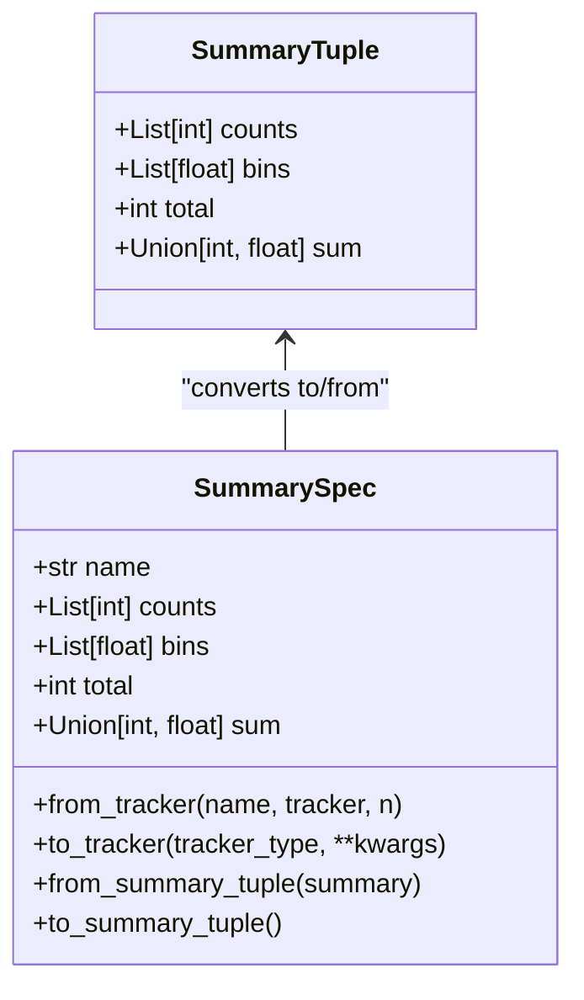
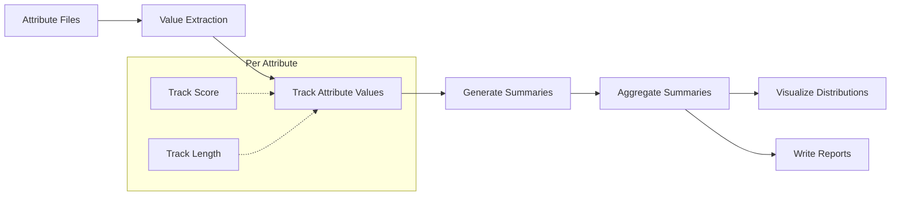
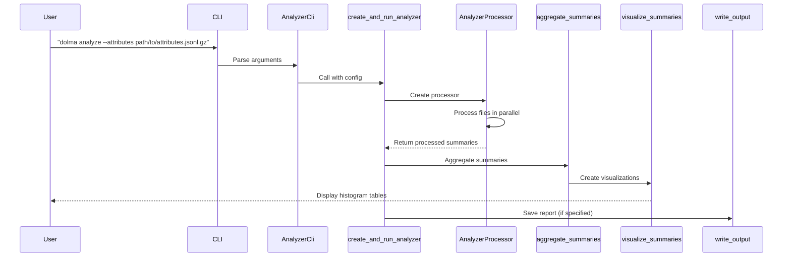
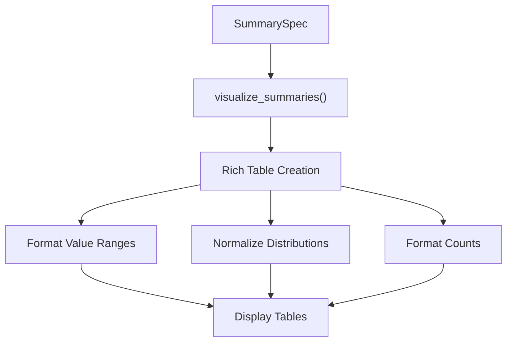

<!-- source: DeepWiki mcp.deepwiki.com · repo allenai/dolma · page 3.6 Analysis System · fetched 2026-10-26 -->

# Analysis System

<details>
<summary>Relevant source files</summary>

The following files were used as context for generating this wiki page:

- [python/dolma/cli/analyzer.py](python/dolma/cli/analyzer.py)
- [python/dolma/cli/resolvers.py](python/dolma/cli/resolvers.py)
- [python/dolma/core/analyzer.py](python/dolma/core/analyzer.py)
- [python/dolma/core/binning.py](python/dolma/core/binning.py)
- [python/dolma/core/ft_dataset.py](python/dolma/core/ft_dataset.py)
- [tests/python/test_binning.py](tests/python/test_binning.py)

</details>


The Analysis System in Dolma is designed to analyze and visualize the distribution of attribute values in processed documents. It processes attribute data to generate statistical summaries, track distributions, and provide visual representations of data characteristics. This system helps users understand the composition and quality of their datasets by revealing patterns and distributions within document attributes.

For information about how documents are tagged with attributes, see [Tagging System](#3.4).

## System Overview

The Analysis System operates in a parallel processing framework to efficiently handle large datasets. It extracts attribute values from documents, bins them into trackable distributions, and generates statistical summaries that can be visualized or saved for further analysis.



Sources: [python/dolma/core/analyzer.py:66-158](), [python/dolma/core/analyzer.py:160-187](), [python/dolma/core/binning.py:206-452]()

## Core Components

### AnalyzerProcessor

The `AnalyzerProcessor` is the main processing engine responsible for reading attribute files, extracting values, and generating summaries. It inherits from `BaseParallelProcessor` to enable parallel processing of multiple files.



Key functions of `AnalyzerProcessor`:
- Processes attribute files in parallel
- Extracts attribute values and their scores
- Creates trackers for each attribute's score and length
- Outputs summary files

Sources: [python/dolma/core/analyzer.py:66-158]()

### Binning System

The Analysis System uses a sophisticated binning mechanism to track and summarize value distributions efficiently. Two main binning strategies are available:

1. **Fixed Buckets** (`FixedBucketsValTracker`): Uses a fixed number of bins based on powers of 10, suitable for datasets with known value ranges.

2. **Inferred Buckets** (`InferBucketsValTracker`): Dynamically infers appropriate bins based on data distribution, better for exploratory analysis.



Sources: [python/dolma/core/binning.py:206-452]()

### Summary System

The binning results are encapsulated in summary structures that facilitate visualization and further analysis:



Sources: [python/dolma/core/analyzer.py:40-65](), [python/dolma/core/binning.py:9-14]()

## Processing Pipeline

The Analysis System follows a clear processing pipeline from input to visualization:



1. **Attribute Processing**: The system processes attribute files, extracting values and scores.
2. **Value Tracking**: For each attribute, both length and score distributions are tracked.
3. **Summary Generation**: Statistical summaries are created for each attribute.
4. **Aggregation**: Summaries from different files are aggregated.
5. **Visualization**: Distribution histograms are visualized using Rich tables.
6. **Reporting**: Summaries can be saved as JSONL files for further analysis.

Sources: [python/dolma/core/analyzer.py:160-187](), [python/dolma/core/analyzer.py:208-267](), [python/dolma/core/analyzer.py:279-336]()

## Integration with CLI

The Analysis System is exposed through Dolma's command line interface, making it accessible for users.

```mermaid
classDiagram
    class BaseCli {
        <<abstract>>
        +Type CONFIG
        +make_parser(parser)
        +run_from_args(args, config)
        +run(parsed_config)
    }
    
    class AnalyzerCli {
        +AnalyzerConfig CONFIG
        +run(parsed_config)
    }
    
    class AnalyzerConfig {
        +List[str] attributes
        +Optional[str] report
        +int bins
        +int processes
        +int seed
        +bool total
        +bool debug
        +WorkDirConfig work_dir
        +Optional[str] regex
    }
    
    BaseCli <|-- AnalyzerCli
    AnalyzerCli --> AnalyzerConfig : "uses"
    AnalyzerCli --> "create_and_run_analyzer()" : "calls"
```

Sources: [python/dolma/cli/analyzer.py:12-87]()

## Usage Example

The Analysis System can be invoked through the CLI or programmatically. Here's the typical flow:



Key configuration options include:
- `--attributes`: Paths to attribute files to analyze
- `--report`: Path to save the report (optional)
- `--bins`: Number of bins for histograms (default: 1000)
- `--processes`: Number of parallel processes to use
- `--regex`: Regular expression for filtering attributes by name

Sources: [python/dolma/cli/analyzer.py:12-87](), [python/dolma/core/analyzer.py:279-336]()

## Visualization

The Analysis System provides rich tabular visualizations of attribute distributions. For each attribute, it shows:

1. Value ranges (binned appropriately)
2. Distribution percentages
3. Counts per bin
4. Optional totals

Here's an example of how these visualizations are generated:



The visualization uses the `rich` library to create formatted tables with clear value ranges, distribution percentages, and counts, making it easy to understand the distribution of each attribute.

Sources: [python/dolma/core/analyzer.py:208-267]()

## Custom Attribute Analysis

The Analysis System is particularly useful for analyzing custom attributes in your data pipeline, such as:

- Language identification scores
- Quality scores
- Paragraph and document lengths
- FastText model predictions

The system automatically detects all attributes in the input files and creates distribution summaries for each.

### Special Handling for FastText Labels

The system includes special handling for FastText label probabilities, which are sometimes slightly above 1.0:

```python
if "__label__" in attr_name:
    # Fasttext sometimes emits probabilities slightly above 1.0
    # We shift these values down to 1.0
    score = min(score, 1.0)
```

This ensures that probability distributions remain within the expected [0, 1] range.

Sources: [python/dolma/core/analyzer.py:126-134]()

## Summary

The Analysis System provides a comprehensive framework for analyzing attribute distributions in Dolma datasets. By leveraging parallel processing, efficient binning algorithms, and rich visualizations, it allows users to gain valuable insights into their data's characteristics without having to write custom analysis code.

The system is designed to be:
- Scalable: Processes large datasets efficiently using parallel processing
- Flexible: Supports different binning strategies and visualization options
- Extensible: Can be integrated into custom pipelines or extended with new analysis capabilities

This makes the Analysis System a valuable tool for understanding dataset composition, validating processing pipelines, and identifying potential issues in your data.

---

