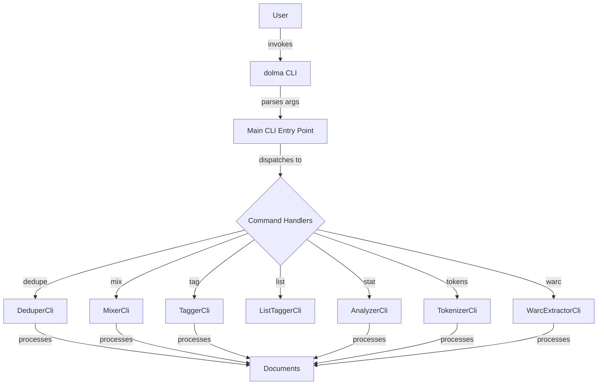
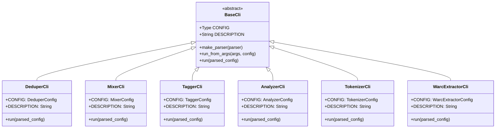
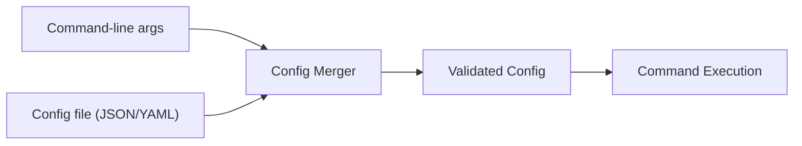
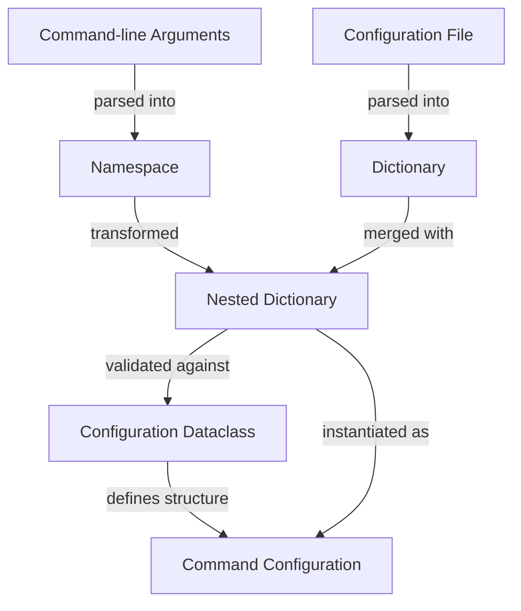
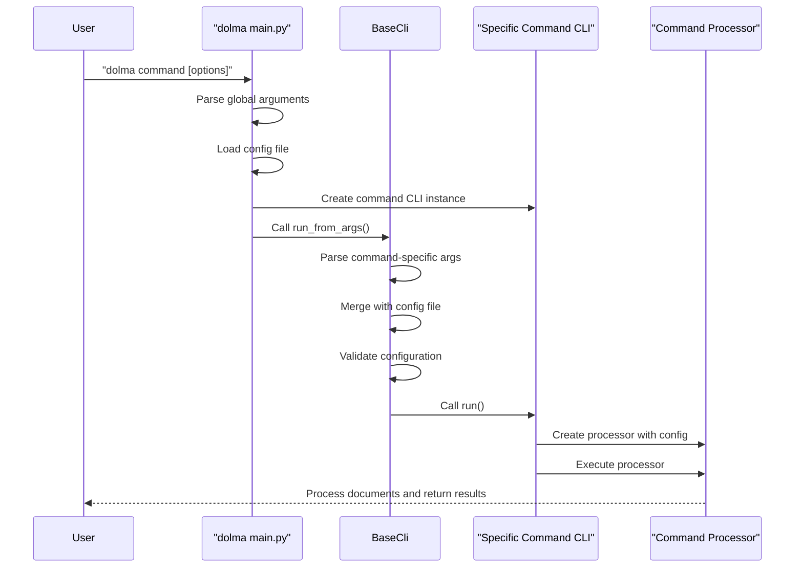
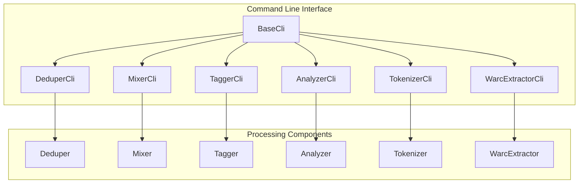

<!-- source: DeepWiki mcp.deepwiki.com · repo allenai/dolma · page 4 Command Line Interface · fetched 2026-10-26 -->

# Command Line Interface

<details>
<summary>Relevant source files</summary>

The following files were used as context for generating this wiki page:

- [docs/examples/wikipedia-mixer.json](docs/examples/wikipedia-mixer.json)
- [docs/getting-started.md](docs/getting-started.md)
- [python/dolma/cli/__init__.py](python/dolma/cli/__init__.py)
- [python/dolma/cli/__main__.py](python/dolma/cli/__main__.py)
- [python/dolma/cli/main.py](python/dolma/cli/main.py)
- [scripts/make_wikipedia.py](scripts/make_wikipedia.py)

</details>


This document provides a comprehensive overview of the Dolma Command Line Interface (CLI) system, which serves as the primary interaction point for users working with the Dolma dataset curation toolkit. The CLI enables users to access the various data processing tools provided by Dolma, including document mixing, deduplication, tagging, analysis, and tokenization.

For information about specific data processing components like the Mixer or Deduper, see the respective documentation in [Data Processing Pipeline](#3) and its subsections.

## Overview

The Dolma CLI provides a unified command-line interface to the various document processing capabilities of the Dolma toolkit. It follows a command-based structure where each major functionality is accessed through a specific subcommand.



Sources: [python/dolma/cli/main.py:20-31](), [python/dolma/cli/__init__.py:176-201]()

## CLI Architecture

The Dolma CLI system is built on an object-oriented architecture centered around the `BaseCli` abstract class, which provides a consistent interface for all CLI commands.



Sources: [python/dolma/cli/__init__.py:176-201](), [python/dolma/cli/main.py:20-31]()

### Key Components

#### BaseCli Class

The `BaseCli` abstract class defines the contract that all CLI command handlers must implement:

- `CONFIG`: A type variable specifying the configuration class for the command
- `DESCRIPTION`: An optional string providing a brief description of the command
- `make_parser()`: A class method that configures the command's argument parser
- `run_from_args()`: A class method that processes command-line arguments and executes the command
- `run()`: An abstract class method that implements the command's functionality

Each specific CLI command (like `DeduperCli`, `MixerCli`, etc.) extends this base class and implements the `run` method to provide command-specific behavior.

Sources: [python/dolma/cli/__init__.py:176-201]()

#### Command Registration

Commands are registered in the `AVAILABLE_COMMANDS` dictionary in `main.py`, which maps command names to their corresponding CLI classes:

```
AVAILABLE_COMMANDS = {
    "dedupe": DeduperCli,
    "mix": MixerCli,
    "tag": TaggerCli,
    "list": ListTaggerCli,
    "stat": AnalyzerCli,
    "tokens": TokenizerCli,
    "warc": WarcExtractorCli,
}
```

Sources: [python/dolma/cli/main.py:20-31]()

#### Configuration Handling

The CLI system supports both command-line arguments and configuration files (in JSON or YAML format). Configuration parsing and validation is handled through OmegaConf, which allows for structured configuration objects. The system employs a multi-step approach:

1. Parse the global command-line arguments (including the configuration file path)
2. Load the configuration file if provided
3. Parse the command-specific arguments
4. Merge the configuration file and command-line arguments
5. Validate the configuration against the command's `CONFIG` class



Sources: [python/dolma/cli/__init__.py:127-162](), [python/dolma/cli/main.py:34-44](), [python/dolma/cli/main.py:78-93]()

## Command Usage

The Dolma CLI uses a consistent command structure:

```
dolma [global options] [command] [command options]
```

Global options apply to all commands, while command options are specific to each command.

### Global Options

| Option | Description |
|--------|-------------|
| `-c`, `--config` | Path to a configuration file (JSON or YAML) |
| `-h`, `--help` | Show help message and exit |

Sources: [python/dolma/cli/main.py:62-68]()

### Available Commands

The Dolma CLI provides the following commands:

| Command | Description |
|---------|-------------|
| `dedupe` | Deduplicate documents or paragraphs using a bloom filter |
| `mix` | Mix documents from multiple streams |
| `tag` | Tag documents or spans of documents using one or more taggers |
| `list` | List available taggers |
| `stat` | Analyze the distribution of attributes values in a dataset |
| `tokens` | Tokenize documents using the provided tokenizer |
| `warc` | Extract documents from WARC (Web ARChive) files |

Sources: [python/dolma/cli/main.py:20-31](), [docs/getting-started.md:11-36]()

### Command-Specific Help

Each command provides detailed help information when invoked with the `--help` flag:

```
dolma [command] --help
```

This displays the available options and their descriptions for the specific command.

Sources: [docs/getting-started.md:35-36]()

## Configuration System

Dolma's CLI employs a sophisticated configuration system based on OmegaConf and dataclasses. This provides several benefits:

1. Type checking and validation of configuration values
2. Default values for unspecified parameters
3. Support for both command-line arguments and configuration files
4. Rich documentation through help text in field definitions



Sources: [python/dolma/cli/__init__.py:45-64](), [python/dolma/cli/__init__.py:127-162]()

### Field Definition

Configuration fields are defined using the `field` helper function, which extends the standard dataclass field with additional metadata:

```python
def field(default: T = MISSING, help: Optional[str] = None, **extra: Any) -> T:
    metadata = {"help": help, "type": type(default), "default": default, "nargs": _field_nargs(default), **extra}
    return dataclass_field(default_factory=lambda: deepcopy(default), metadata=metadata)
```

This creates fields with help text, type information, and proper handling of default values.

Sources: [python/dolma/cli/__init__.py:61-63]()

### Configuration Files

Configuration files can be specified using the `-c` or `--config` option. The system supports both JSON and YAML formats. Configuration files can define all parameters for a command, and command-line options can override values from the configuration file.

Here's an example of a configuration file for the `mix` command:

```json
{
  "streams": [
    {
      "name": "getting-started",
      "documents": [
        "wikipedia/v0/documents/*.gz"
      ],
      "output": {
        "path": "wikipedia/example0/documents",
        "max_size_in_bytes": 1000000000
      },
      "attributes": [
        "exp",
        "bff_duplicate_paragraph_spans"
      ],
      "filter": {
        "include": [
          "$.attributes[?(@.exp__whitespace_tokenizer_with_paragraphs_v1__document[0][2] < 100000)]"
        ],
        "exclude": [
          "$.attributes[?(@.exp__whitespace_tokenizer_with_paragraphs_v1__document[0][2] < 50)]",
          "$.attributes[?(@.exp__ft_lang_id_en_paragraph_with_doc_score_v2__doc_en[0][2] <= 0.5)]",
          "$@.attributes[?(@.bff_duplicate_paragraph_spans && @.bff_duplicate_paragraph_spans[0] && @.bff_duplicate_paragraph_spans[0][2] >= 1.0)]"
        ]
      },
      "span_replacement": [
        {
          "span": "$.attributes.exp__cld2_en_paragraph_with_doc_score_v2__not_en",
          "min_score": 0.1,
          "replacement": ""
        }
      ]
    }
  ],
  "processes": 1
}
```

Sources: [docs/examples/wikipedia-mixer.json:1-36](), [python/dolma/cli/main.py:34-44]()

## Command Execution Flow

When a Dolma CLI command is executed, it follows a specific flow from command-line parsing to execution:



Sources: [python/dolma/cli/__init__.py:185-201](), [python/dolma/cli/main.py:46-93]()

## Examples

Here are some examples of using the Dolma CLI for common tasks:

### Listing Available Taggers

```
dolma list
```

This command displays a list of all available taggers that can be used with the `tag` command.

### Tagging Documents

```
dolma tag \
    --documents "wikipedia/v0/documents/*" \
    --experiment exp \
    --taggers random_number_v1 cld2_en_paragraph_with_doc_score_v2 \
    --processes 16
```

This command tags documents in the specified directory using two different taggers and uses 16 processes for parallel execution.

### Deduplicating Documents

```
dolma dedupe \
    --documents "wikipedia/v0/documents/*" \
    --dedupe.paragraphs.attribute_name 'bff_duplicate_paragraph_spans' \
    --bloom_filter.file /tmp/deduper_bloom_filter.bin \
    --bloom_filter.estimated_doc_count '6_000_000' \
    --processes 16
```

This command deduplicates paragraphs in the specified documents using a bloom filter.

### Mixing Documents

```
dolma -c examples/wikipedia-mixer.json mix --processes 16
```

This command mixes documents according to the configuration in `examples/wikipedia-mixer.json` and uses 16 processes for parallel execution.

Sources: [docs/getting-started.md:76-135]()

## Integration with Dolma Components

The CLI serves as the entry point to the various document processing components in Dolma. Each CLI command corresponds to a specific processor component:



This design allows the CLI to provide a consistent interface while leveraging the specialized functionality of each processing component.

Sources: [python/dolma/cli/main.py:10-18](), [python/dolma/cli/main.py:20-31]()

## Multiprocessing Support

Dolma's CLI is designed to leverage parallel processing to speed up document processing tasks. All commands support a `--processes` option to specify the number of worker processes to use. The system uses Python's multiprocessing module with the "spawn" method to ensure compatibility across platforms.

```python
# Setting multiprocessing start method to spawn for compatibility
try:
    multiprocessing.set_start_method("spawn")
except RuntimeError as ex:
    if multiprocessing.get_start_method() != "spawn":
        raise RuntimeError("Multiprocessing start method must be set to spawn") from ex
```

Sources: [python/dolma/cli/main.py:49-55](), [scripts/make_wikipedia.py:265-266]()

## Summary

The Dolma Command Line Interface provides a powerful, consistent, and configurable interface to the various document processing capabilities of the Dolma toolkit. It follows a well-structured architecture based on the `BaseCli` abstract class and leverages OmegaConf for configuration handling.

Key features of the Dolma CLI include:
- A command-based structure for accessing different functionalities
- Support for both command-line arguments and configuration files
- Type checking and validation of configuration values
- Parallel processing capabilities
- Rich help documentation

These features make the CLI a robust and flexible tool for dataset curation tasks, allowing users to efficiently process, tag, deduplicate, and analyze large document collections.

---

