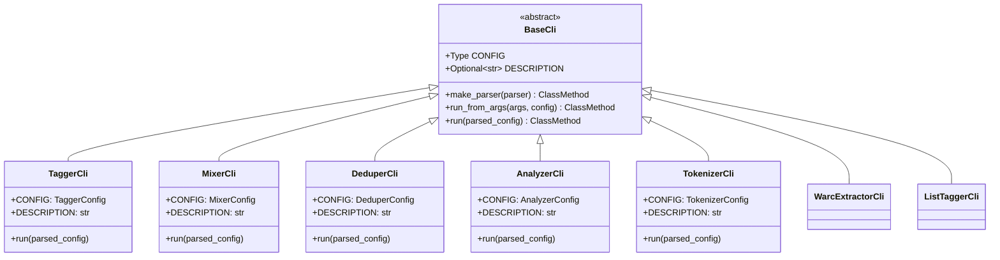
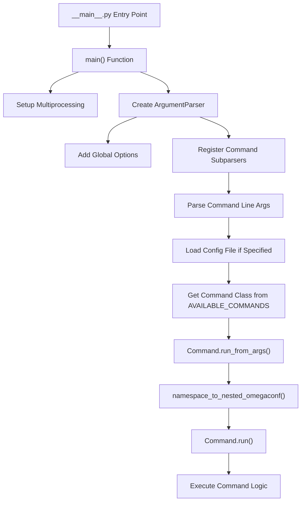
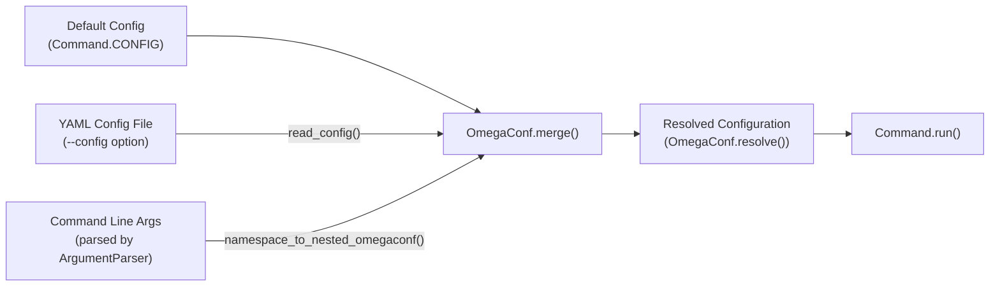

<!-- source: DeepWiki mcp.deepwiki.com · repo allenai/dolma · page 4.1 CLI Architecture · fetched 2026-10-26 -->

# CLI Architecture

<details>
<summary>Relevant source files</summary>

The following files were used as context for generating this wiki page:

- [python/dolma/cli/__init__.py](python/dolma/cli/__init__.py)
- [python/dolma/cli/__main__.py](python/dolma/cli/__main__.py)
- [python/dolma/cli/main.py](python/dolma/cli/main.py)

</details>


This document explains the design and implementation of Dolma's Command Line Interface (CLI) system. The CLI provides a unified way to access Dolma's various data processing tools, handling argument parsing, configuration management, and command execution. For information about available commands and their usage, see [Available Commands](#4.2).

## Core CLI Design

Dolma's CLI is built on a class-based architecture with a common base class that standardizes how commands are defined, configured, and executed.



Sources: [python/dolma/cli/__init__.py:176-201](), [python/dolma/cli/main.py:20-31]()

### The BaseCli Abstract Class

The `BaseCli` class is the foundation of Dolma's CLI system, providing:

- A generic type parameter `D` for configuration types
- A required `CONFIG` class attribute that defines the expected configuration structure
- An optional `DESCRIPTION` class attribute for command help text
- Methods for creating parsers, running from arguments, and executing commands

```python
class BaseCli(Generic[D]):
    CONFIG: Type[D]
    DESCRIPTION: Optional[str] = None

    @classmethod
    def make_parser(cls, parser: A) -> A:
        assert hasattr(cls, "CONFIG"), f"{cls.__name__} must have a CONFIG attribute"
        return make_parser(parser, cls.CONFIG)

    @classmethod
    def run_from_args(cls, args: Namespace, config: Optional[dict] = None):
        assert hasattr(cls, "CONFIG"), f"{cls.__name__} must have a CONFIG attribute"
        parsed_config = namespace_to_nested_omegaconf(args=args, structured=cls.CONFIG, config=config)
        try:
            return cls.run(parsed_config)
        except OmegaConfBaseException as ex:
            raise DolmaConfigError(
                f"Invalid error while parsing key `{ex.full_key}` of `{ex.object_type_str}`: "
                f"{type(ex).__name__}"
            ) from ex

    @classmethod
    def run(cls, parsed_config: D):
        raise NotImplementedError("Abstract method; must be implemented in subclass")
```

Sources: [python/dolma/cli/__init__.py:176-201]()

The `run()` method is abstract and must be implemented by each command subclass to provide its specific functionality.

## Command Registration and Execution Flow

Dolma registers all available commands in the `AVAILABLE_COMMANDS` dictionary, which maps command names to their CLI class implementations:

```python
AVAILABLE_COMMANDS = {
    "dedupe": DeduperCli,
    "mix": MixerCli,
    "tag": TaggerCli,
    "list": ListTaggerCli,
    "stat": AnalyzerCli,
    "tokens": TokenizerCli,
    "warc": WarcExtractorCli,
}
```

Sources: [python/dolma/cli/main.py:20-31]()

The execution flow follows this pattern:



Sources: [python/dolma/cli/__main__.py:1-4](), [python/dolma/cli/main.py:46-93]()

## Configuration System

Dolma's CLI uses a sophisticated configuration system built on OmegaConf that combines multiple configuration sources:

1. Default values from the command's `CONFIG` dataclass
2. Values from an optional YAML configuration file
3. Command-line arguments

### Configuration Utilities

The CLI implementation provides several key utilities for configuration management:

| Utility | Description |
|---------|-------------|
| `field()` | Creates dataclass fields with CLI-specific metadata |
| `make_parser()` | Builds argument parsers from dataclass definitions |
| `namespace_to_nested_omegaconf()` | Converts parsed arguments to OmegaConf structures |
| `print_config()` | Pretty-prints configuration for debugging |
| `read_config()` | Loads configuration from YAML files |

Sources: [python/dolma/cli/__init__.py:61-173](), [python/dolma/cli/main.py:34-43]()

### Configuration Processing Flow

The configuration processing has these key stages:



Sources: [python/dolma/cli/__init__.py:140-162](), [python/dolma/cli/main.py:46-93]()

This approach provides several benefits:
- Type safety through structured dataclasses
- Hierarchical configuration with nested dataclasses
- Flexible configuration through multiple sources
- Automatic validation and resolution of references

## Argument Parser Generation

Dolma automatically generates command-line argument parsers based on the command's configuration dataclass. This is handled by the `make_parser()` function in [python/dolma/cli/__init__.py:70-124]().

The parser generation follows these rules:

1. For nested dataclasses, it recursively adds subparsers with dotted notation
2. For boolean fields, it adds both `--field-name` and `--no-field-name` arguments
3. For iterable fields, it sets the appropriate nargs value
4. For all fields, it adds help text from the field metadata

This automatic parser generation ensures consistency between configuration classes and command-line interfaces.

## Command Implementation Pattern

When implementing a new command in Dolma, developers:

1. Define a dataclass for the command's configuration
2. Subclass `BaseCli` with the configuration type as the generic parameter
3. Set the `CONFIG` class attribute to the configuration class
4. Set the `DESCRIPTION` for help text
5. Implement the `run()` method with the command's logic

Example pattern:

```python
@dataclass
class MyCommandConfig:
    input_path: str = field(help="Path to input files")
    output_path: str = field(help="Path to output files")
    # More configuration options...

class MyCommandCli(BaseCli[MyCommandConfig]):
    CONFIG = MyCommandConfig
    DESCRIPTION = "My command does something useful"

    @classmethod
    def run(cls, parsed_config: MyCommandConfig):
        # Command implementation
        pass
```

This pattern standardizes how commands are defined while allowing each command to have its own specific configuration and implementation.

## Error Handling

The CLI system includes structured error handling for configuration issues:

1. Configuration errors are wrapped in `DolmaConfigError` exceptions
2. OmegaConf errors are caught and converted to more user-friendly messages
3. Missing configuration files are detected with clear error messages

Example error handling in `run_from_args`:

```python
try:
    return cls.run(parsed_config)
except OmegaConfBaseException as ex:
    raise DolmaConfigError(
        f"Invalid error while parsing key `{ex.full_key}` of `{ex.object_type_str}`: "
        f"{type(ex).__name__}"
    ) from ex
```

Sources: [python/dolma/cli/__init__.py:186-197](), [python/dolma/cli/main.py:34-43]()

## Main Entry Point

The main entry point for the CLI is defined in [python/dolma/cli/__main__.py](), which simply imports and calls the `main()` function from [python/dolma/cli/main.py]().

The `main()` function:
1. Sets up multiprocessing with the "spawn" method for consistency across platforms
2. Creates the top-level argument parser
3. Adds a global `--config` option for specifying configuration files
4. Registers subparsers for each command in `AVAILABLE_COMMANDS`
5. Parses arguments
6. Loads configuration from a file if specified
7. Retrieves the appropriate command class and calls its `run_from_args()` method

Sources: [python/dolma/cli/main.py:46-93]()

## Conclusion

Dolma's CLI architecture provides a consistent, type-safe interface to the toolkit's data processing capabilities. The class-based design with automatic argument parser generation simplifies adding new commands while ensuring a consistent user experience. The layered configuration system allows users to combine default values, configuration files, and command-line arguments in a flexible way.

This architecture successfully bridges the gap between the user-facing command-line interface and the underlying data processing components of the Dolma toolkit.

---

