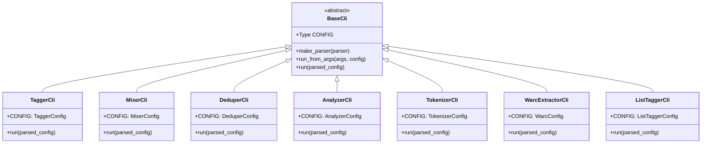
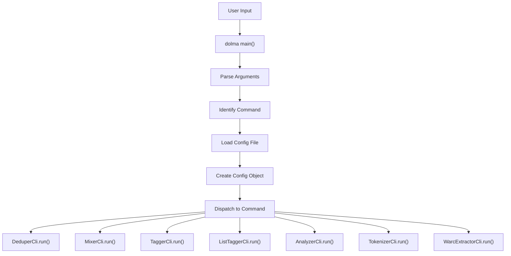
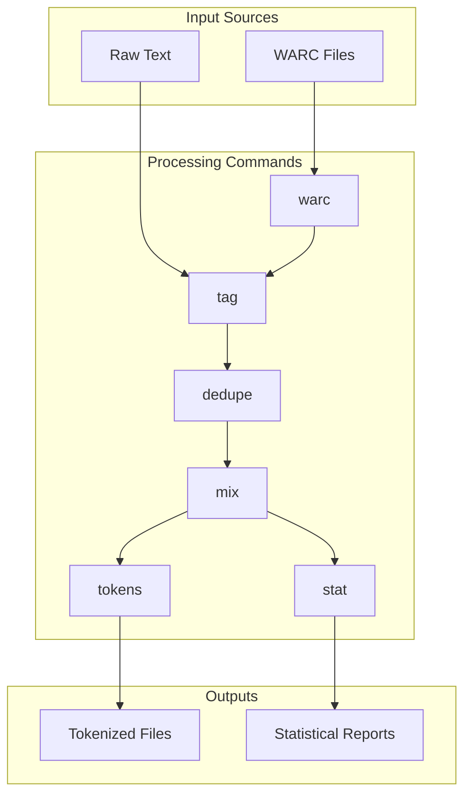
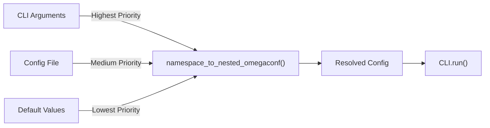

<!-- source: DeepWiki mcp.deepwiki.com · repo allenai/dolma · page 4.2 Available Commands · fetched 2026-10-26 -->

# Available Commands

<details>
<summary>Relevant source files</summary>

The following files were used as context for generating this wiki page:

- [docs/examples/wikipedia-mixer.json](docs/examples/wikipedia-mixer.json)
- [docs/getting-started.md](docs/getting-started.md)
- [python/dolma/cli/__init__.py](python/dolma/cli/__init__.py)
- [python/dolma/cli/__main__.py](python/dolma/cli/__main__.py)
- [python/dolma/cli/main.py](python/dolma/cli/main.py)
- [scripts/make_wikipedia.py](scripts/make_wikipedia.py)

</details>


This page documents the command-line interface (CLI) commands available in the Dolma toolkit. These commands provide access to Dolma's dataset curation capabilities for preprocessing text data for language model training. For information about the underlying CLI architecture, see [CLI Architecture](#4.1). For details on the data processing pipeline these commands operate on, see [Data Processing Pipeline](#3).

## Command System Overview

The Dolma CLI is structured around a main command (`dolma`) with various subcommands, each handling a specific aspect of dataset processing. Each command is implemented as a class extending the abstract `BaseCli` class.

### Command Structure Diagram



Sources: [python/dolma/cli/__init__.py:176-201](), [python/dolma/cli/main.py:20-31]()

### Command Dispatch Flow



Sources: [python/dolma/cli/main.py:46-93](), [python/dolma/cli/__init__.py:186-201]()

## Global Options

| Option | Description |
|--------|-------------|
| `-c, --config` | Path to configuration file (JSON or YAML) |
| `-h, --help` | Show help message and exit |

The configuration file can contain settings for any command, allowing complex configurations to be stored and reused.

Sources: [python/dolma/cli/main.py:57-68]()

## Available Commands

### dedupe

Deduplicates documents or paragraphs using a Bloom filter.

**Basic Usage:**
```
dolma dedupe [options]
```

**Key Options:**
- `--documents` - Path pattern to input documents
- `--dedupe.paragraphs.attribute_name` - Name for the duplicate paragraph spans attribute
- `--bloom_filter.file` - Path to the Bloom filter file
- `--bloom_filter.read_only` - Whether to use the Bloom filter in read-only mode
- `--bloom_filter.estimated_doc_count` - Estimated number of documents for sizing the Bloom filter
- `--bloom_filter.desired_false_positive_rate` - Desired false positive rate for the Bloom filter
- `--processes` - Number of processes to use

**Example:**
```
dolma dedupe \
    --documents "data/documents/*" \
    --dedupe.paragraphs.attribute_name 'duplicate_spans' \
    --bloom_filter.file /tmp/bloom_filter.bin \
    --no-bloom_filter.read_only \
    --bloom_filter.estimated_doc_count '1_000_000' \
    --bloom_filter.desired_false_positive_rate '0.0001' \
    --processes 16
```

Sources: [python/dolma/cli/main.py:21]()

### mix

Combines and filters documents from multiple streams based on their attributes.

**Basic Usage:**
```
dolma mix [options]
```

**Key Options:**
- `--streams` - Configuration for input streams and filters
- `--streams.name` - Name for the stream
- `--streams.documents` - Path patterns to input documents
- `--streams.output.path` - Output directory
- `--streams.output.max_size_in_bytes` - Maximum size of output files
- `--streams.attributes` - Attributes to include
- `--streams.filter.include` - JSONPath/jq expressions for including documents
- `--streams.filter.exclude` - JSONPath/jq expressions for excluding documents
- `--streams.span_replacement` - Span replacement configurations
- `--processes` - Number of processes to use

**Example using a configuration file:**
```
dolma -c mixer-config.json mix --processes 16
```

Sources: [python/dolma/cli/main.py:22](), [docs/examples/wikipedia-mixer.json:1-36]()

### tag

Applies one or more taggers to documents or spans to add metadata.

**Basic Usage:**
```
dolma tag [options]
```

**Key Options:**
- `--documents` - Path pattern to input documents
- `--taggers` - List of taggers to apply
- `--experiment` - Name for grouping taggers
- `--processes` - Number of processes to use

**Example:**
```
dolma tag \
    --documents "data/documents/*" \
    --experiment exp1 \
    --taggers random_number_v1 char_length_with_paragraphs_v1 \
    --processes 16
```

Sources: [python/dolma/cli/main.py:23]()

### list

Shows available taggers and their descriptions.

**Basic Usage:**
```
dolma list
```

Sources: [python/dolma/cli/main.py:24]()

### stat

Analyzes the distribution of attribute values in a dataset.

**Basic Usage:**
```
dolma stat [options]
```

**Key Options:**
- `--documents` - Path pattern to input documents
- `--attributes` - Attributes to analyze
- `--processes` - Number of processes to use

**Example:**
```
dolma stat \
    --documents "data/documents/*" \
    --attributes exp1 \
    --processes 16
```

Sources: [python/dolma/cli/main.py:25]()

### tokens

Tokenizes documents using a specified tokenizer.

**Basic Usage:**
```
dolma tokens [options]
```

**Key Options:**
- `--documents` - Path pattern to input documents
- `--tokenizer.name_or_path` - Tokenizer name or path
- `--destination` - Output directory
- `--processes` - Number of processes to use

**Example:**
```
dolma tokens \
    --documents "data/documents/*" \
    --tokenizer.name_or_path "EleutherAI/gpt-neox-20b" \
    --destination data/tokens \
    --processes 16
```

Sources: [python/dolma/cli/main.py:26]()

### warc

Extracts data from Web Archive (WARC) files.

**Basic Usage:**
```
dolma warc [options]
```

**Key Options:**
- `--source` - Path pattern to WARC files
- `--destination` - Output directory
- `--processes` - Number of processes to use

Sources: [python/dolma/cli/main.py:27]()

## Example Data Processing Workflow



This diagram illustrates how Dolma commands form a data processing pipeline. Starting with raw text or WARC files, documents are processed through various stages (tagging, deduplication, mixing) before being tokenized or analyzed.

Sources: [docs/getting-started.md:34-37]()

## Configuration System

Dolma uses a hierarchical configuration system powered by OmegaConf that allows combining settings from:

1. Command-line arguments
2. Configuration files (JSON or YAML)
3. Default values in the code



The configuration system resolves values with command-line arguments taking highest precedence, followed by configuration file values, and then default values.

Sources: [python/dolma/cli/__init__.py:140-162](), [python/dolma/cli/main.py:34-43]()

## Complete Workflow Example: Processing Wikipedia

Below is a complete workflow for processing Wikipedia data, demonstrating how multiple commands work together:

1. **Tag the data with multiple attributes:**
```
dolma tag \
    --documents "wikipedia/v0/documents/*" \
    --experiment exp \
    --taggers random_number_v1 cld2_en_paragraph_with_doc_score_v2 \
              ft_lang_id_en_paragraph_with_doc_score_v2 \
              char_length_with_paragraphs_v1 \
              whitespace_tokenizer_with_paragraphs_v1 \
    --processes 16
```

2. **Deduplicate paragraphs:**
```
dolma dedupe \
    --documents "wikipedia/v0/documents/*" \
    --dedupe.paragraphs.attribute_name 'bff_duplicate_paragraph_spans' \
    --bloom_filter.file /tmp/deduper_bloom_filter.bin \
    --no-bloom_filter.read_only \
    --bloom_filter.estimated_doc_count '6_000_000' \
    --bloom_filter.desired_false_positive_rate '0.0001' \
    --processes 16
```

3. **Mix and filter the data using configuration file:**
```
dolma -c wikipedia-mixer.json mix --processes 16
```

4. **Tokenize the filtered data:**
```
dolma tokens \
    --documents "wikipedia/example0/documents/*.gz" \
    --tokenizer.name_or_path "EleutherAI/gpt-neox-20b" \
    --destination wikipedia/example0/tokens \
    --processes 16
```

This workflow shows how to use Dolma commands to create a complete dataset processing pipeline, from raw text to tokenized data ready for language model training.

Sources: [docs/getting-started.md:76-137]()

## Implementation Details

Each Dolma command follows the same implementation pattern:

1. A class inheriting from `BaseCli` defines:
   - A `CONFIG` type parameter specifying the command's configuration structure 
   - A `run(parsed_config)` method implementing the command's functionality

2. Command-line arguments are:
   - Parsed from dataclass fields using the `make_parser` method
   - Converted to a structured configuration object via `namespace_to_nested_omegaconf`
   - Passed to the command's `run` method

3. The main entry point in `main.py`:
   - Registers all available commands in `AVAILABLE_COMMANDS`
   - Dispatches to the appropriate command based on user input

Sources: [python/dolma/cli/__init__.py:176-201](), [python/dolma/cli/main.py:46-93]()

---

