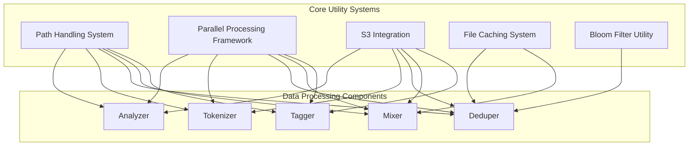
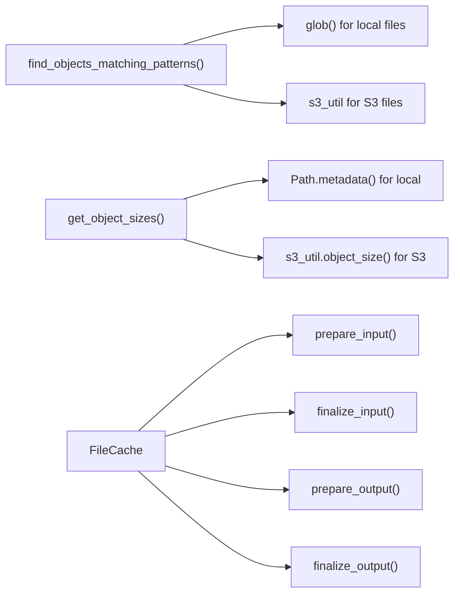
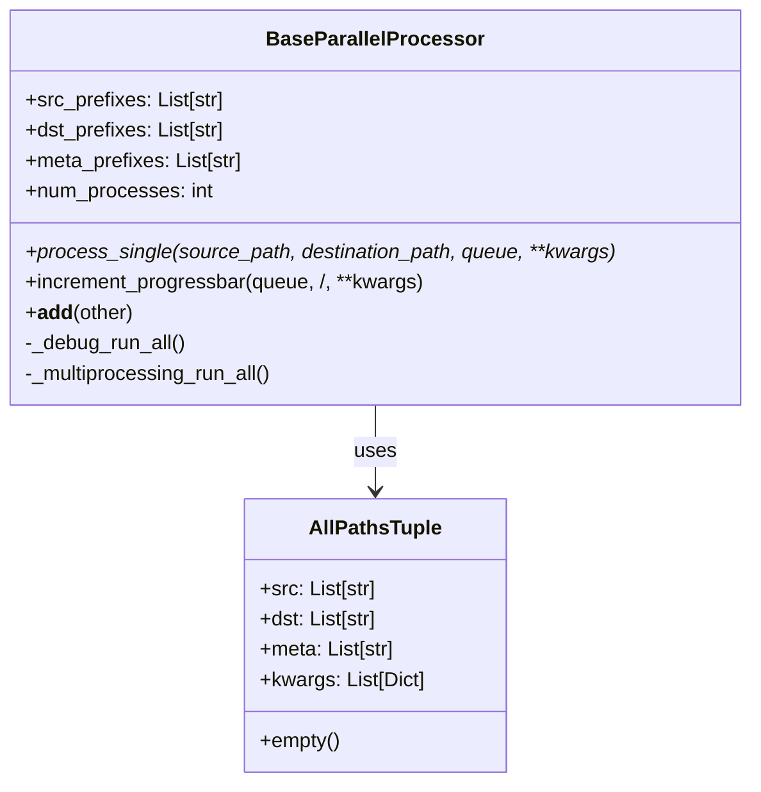
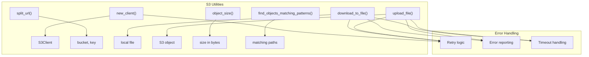
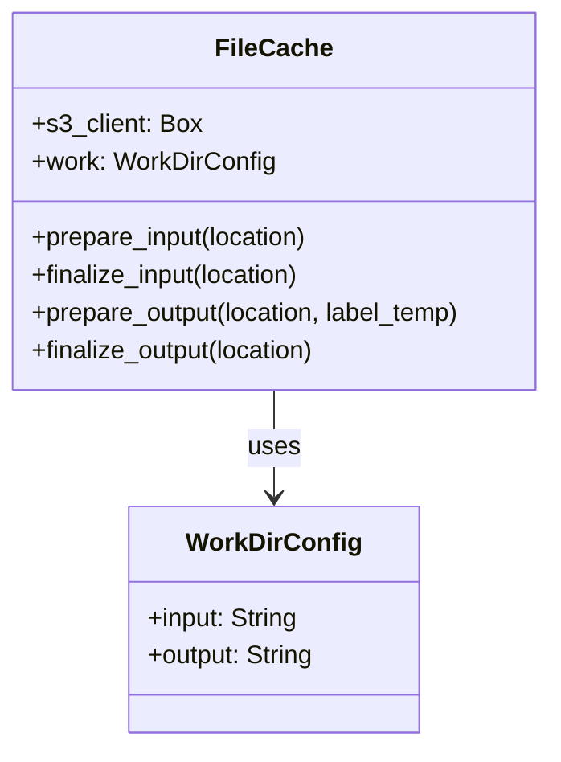
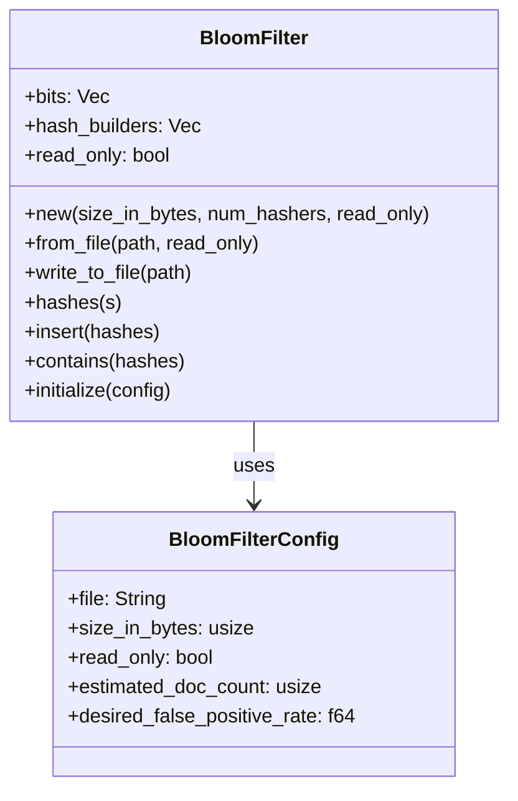
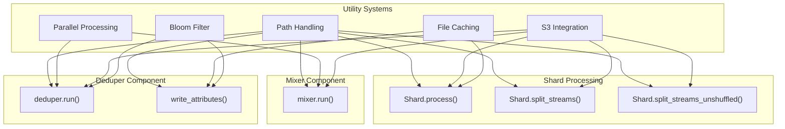
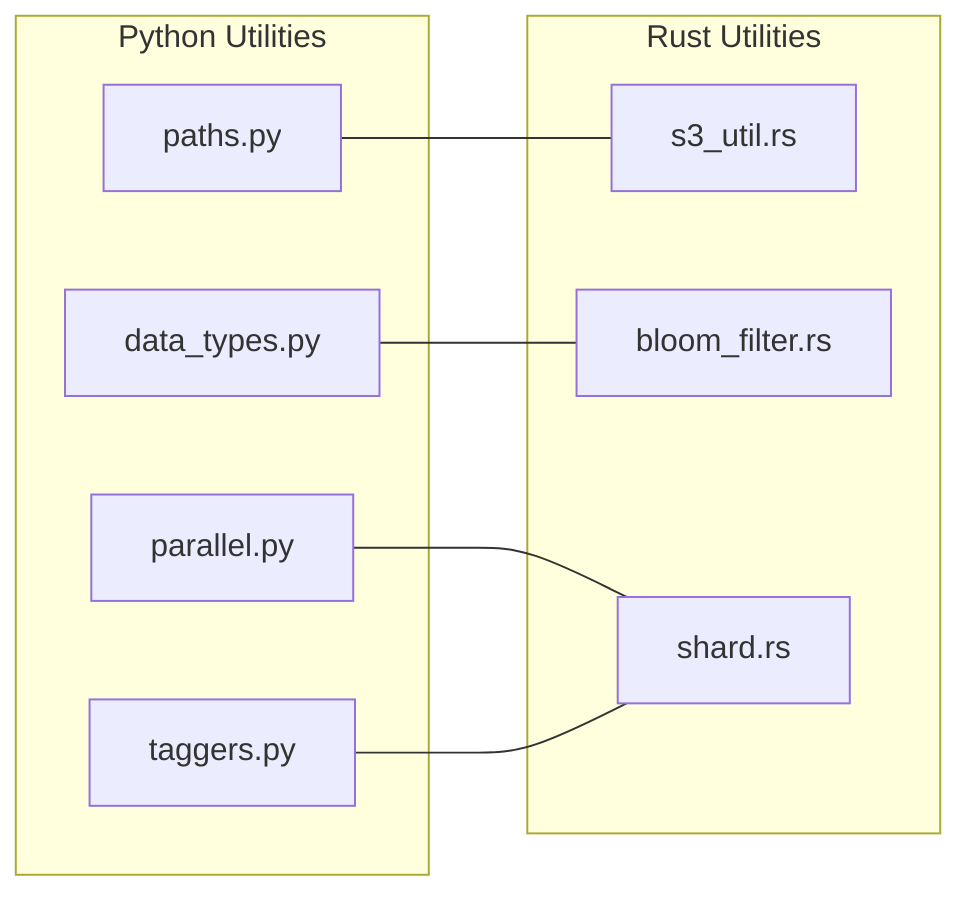
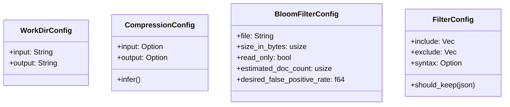

<!-- source: DeepWiki mcp.deepwiki.com · repo allenai/dolma · page 5 Utility Systems · fetched 2026-10-26 -->

# Utility Systems

<details>
<summary>Relevant source files</summary>

The following files were used as context for generating this wiki page:

- [configs/dolma-v1_5/mixing/dedupe-test.yaml](configs/dolma-v1_5/mixing/dedupe-test.yaml)
- [configs/test/test_filtered_mixer.yaml](configs/test/test_filtered_mixer.yaml)
- [python/dolma/core/data_types.py](python/dolma/core/data_types.py)
- [python/dolma/core/parallel.py](python/dolma/core/parallel.py)
- [python/dolma/core/paths.py](python/dolma/core/paths.py)
- [python/dolma/core/taggers.py](python/dolma/core/taggers.py)
- [src/bloom_filter.rs](src/bloom_filter.rs)
- [src/bloom_filter/bloom_test.rs](src/bloom_filter/bloom_test.rs)
- [src/deduper.rs](src/deduper.rs)
- [src/mixer.rs](src/mixer.rs)
- [src/s3_util.rs](src/s3_util.rs)
- [src/shard.rs](src/shard.rs)
- [tests/python/test_paths.py](tests/python/test_paths.py)
- [tests/python/test_runtime.py](tests/python/test_runtime.py)

</details>


This page provides an overview of the core utility components that support Dolma's data processing pipeline. These utilities handle common operations like file path management, parallel processing, S3 storage interaction, and bloom filtering that are used across different parts of the toolkit.

For information about specific data processing components that use these utilities, see [Data Processing Pipeline](#3).

## Key Utility Subsystems

Dolma includes several utility systems that provide infrastructure for the main data processing components:



Sources:
- [src/shard.rs:712-819]()
- [src/s3_util.rs:1-326]()
- [src/bloom_filter.rs:1-282]()
- [python/dolma/core/paths.py:1-540]()
- [python/dolma/core/parallel.py:1-879]()

## Path Handling System

The path handling system provides a unified interface for working with both local and remote (particularly S3) file paths. It supports operations like:

- Path resolution and normalization
- Glob pattern expansion
- Directory creation
- Path manipulation (joining, splitting, etc.)
- Path caching for remote resources

```mermaid
classDiagram
    class "Path Operations" {
        glob_path()
        split_path()
        join_path()
        is_glob()
        split_glob()
        make_relative()
        add_suffix()
        sub_prefix()
        sub_suffix()
    }
    
    class "File System Operations" {
        mkdir_p()
        exists()
        is_dir()
        is_file()
        get_size()
        delete_file()
        delete_dir()
    }
    
    class "Path Utilities" {
        cached_path()
        decompress_path()
        resource_to_filename()
        split_basename_and_extension()
        split_ext()
    }
    
    class "_FS Abstraction" {
        _get_fs()
        _pathify()
        _unpathify()
        _escape_glob()
        _unescape_glob()
    }
    
    "Path Operations" --> "_FS Abstraction"
    "File System Operations" --> "_FS Abstraction"
    "Path Utilities" --> "Path Operations"
    "Path Utilities" --> "File System Operations"
```

The path handling system serves as a foundation for many other components, allowing them to work with different storage backends transparently.

Sources:
- [python/dolma/core/paths.py:31-540]()
- [tests/python/test_paths.py:21-343]()

### Path Handling in Rust 

In the Rust portion of the codebase, path handling utilities include:



These functions handle operations like finding files matching a pattern, retrieving file sizes, and managing local caches of remote files.

Sources:
- [src/shard.rs:820-879]()
- [src/shard.rs:712-819]()

## Parallel Processing Framework

The parallel processing framework provides a structured way to process data in parallel using multiple CPU cores. It includes:



The parallel processing framework enables Dolma to efficiently process large datasets by distributing work across multiple cores, while providing progress tracking and error handling.

Sources:
- [python/dolma/core/parallel.py:31-879]()

Key features include:
- Process orchestration with configurable number of workers
- Progress bar integration for monitoring
- Error handling and retries
- Support for both local and S3 paths
- Metadata tracking to avoid reprocessing completed files

## S3 Integration

Dolma includes comprehensive utilities for interacting with AWS S3 storage, which is critical for handling large-scale datasets:



The S3 utilities are designed with reliability in mind, including features like:
- Automatic retries for transient errors
- Configurable retry policies
- Detailed error reporting
- Efficient operations through streaming and parallel processing

Sources:
- [src/s3_util.rs:1-326]()
- [src/shard.rs:712-819]()

## File Caching System

The file caching system manages temporary local copies of files that need to be processed, particularly for files stored in S3:



The caching system handles:
- Downloading remote files to a local cache directory
- Cleaning up temporary files after processing
- Managing output file paths and uploads
- Handling compression/decompression automatically

Sources:
- [src/shard.rs:712-819]()

## Bloom Filter Utility

Dolma includes a high-performance Bloom filter implementation used primarily for deduplication:



The Bloom filter provides:
- Efficient probabilistic set membership testing
- Customizable false positive rates
- Persistence to disk for reuse
- Thread-safe operations
- Optimal sizing based on estimated document counts

Sources:
- [src/bloom_filter.rs:15-282]()
- [src/deduper.rs:1-604]()

## Integration with Data Processing Pipeline

The utility systems are integrated into the main data processing pipeline, supporting the mixer, deduper, and other components:



This integration enables the main pipeline components to focus on their specific data processing tasks while relying on the utility systems for common operations.

Sources:
- [src/shard.rs:15-505]()
- [src/mixer.rs:1-83]()
- [src/deduper.rs:1-604]()

## Implementation Details

### Hybrid Rust-Python Design

The utility systems are implemented across both Rust and Python, with performance-critical operations in Rust and higher-level abstractions in Python:



This hybrid design allows Dolma to balance developer productivity with performance requirements.

Sources:
- [python/dolma/core/paths.py:1-540]()
- [python/dolma/core/parallel.py:1-879]()
- [python/dolma/core/data_types.py:1-253]()
- [python/dolma/core/taggers.py:1-70]()
- [src/s3_util.rs:1-326]()
- [src/bloom_filter.rs:1-282]()
- [src/shard.rs:1-879]()

### Configuration-Driven Architecture

The utility systems support a configuration-driven architecture through structured configuration objects:



This configuration-driven approach makes the utilities easily adaptable to different use cases and environments.

Sources:
- [src/shard.rs:533-708]()
- [src/bloom_filter.rs:274-281]()
- [src/deduper.rs:530-603]()

## Conclusion

The utility systems in Dolma provide a robust foundation for the data processing pipeline, handling common operations like path management, parallel processing, S3 interactions, file caching, and bloom filtering. These utilities allow the main pipeline components to focus on their specific data processing tasks, leading to a modular and maintainable architecture.

The hybrid Rust-Python implementation balances performance with developer productivity, and the configuration-driven design allows for flexible adaptation to different use cases. Together, these utility systems enable Dolma to efficiently process and manage large-scale datasets for pre-training language models.

---

