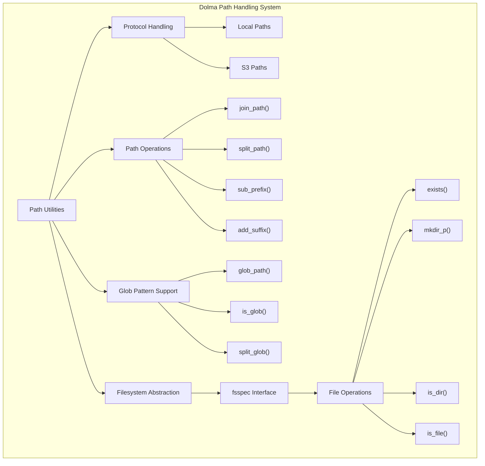
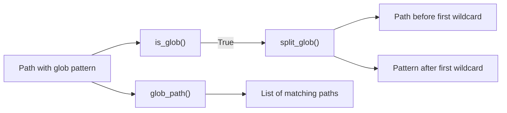
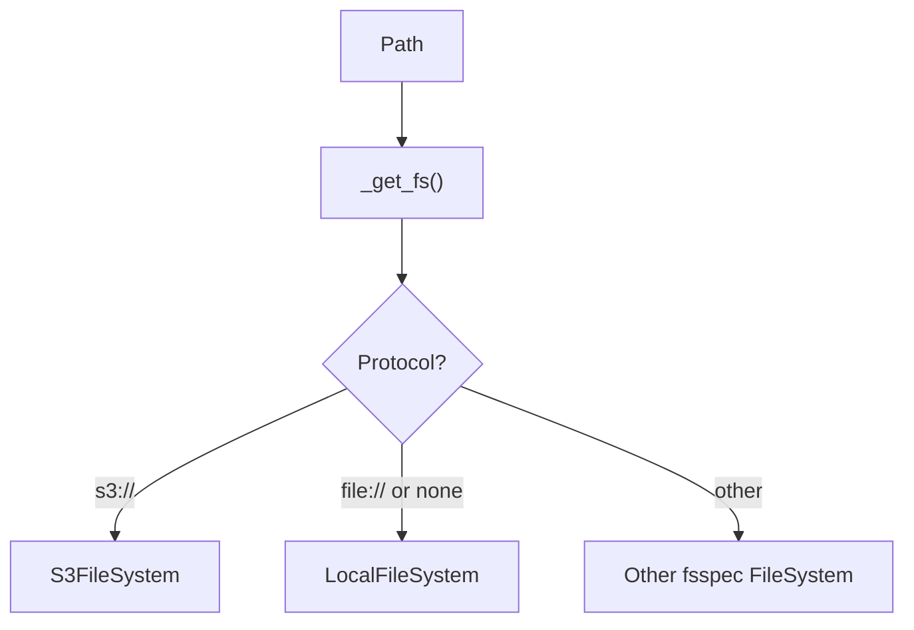
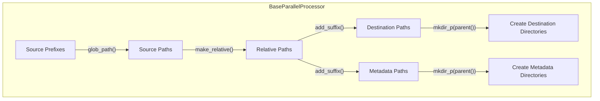

<!-- source: DeepWiki mcp.deepwiki.com · repo allenai/dolma · page 5.1 Path Handling · fetched 2026-10-26 -->

# Path Handling

<details>
<summary>Relevant source files</summary>

The following files were used as context for generating this wiki page:

- [python/dolma/core/data_types.py](python/dolma/core/data_types.py)
- [python/dolma/core/parallel.py](python/dolma/core/parallel.py)
- [python/dolma/core/paths.py](python/dolma/core/paths.py)
- [python/dolma/core/taggers.py](python/dolma/core/taggers.py)
- [tests/python/test_paths.py](tests/python/test_paths.py)
- [tests/python/test_runtime.py](tests/python/test_runtime.py)

</details>


## Purpose and Scope

This document outlines Dolma's path handling system, which provides abstracted access to both local and remote file storage (primarily AWS S3). The system enables uniform manipulation of paths across different storage types, supporting operations like globbing, joining, splitting, and directory management regardless of whether files are stored locally or in cloud storage.

For information about parallel processing that uses these path utilities, see [Parallel Processing](#5.2).

## Overview

Dolma's path handling is implemented as a unified interface that abstracts away the differences between local and remote (S3) filesystems. This allows the rest of the codebase to work with paths consistently without worrying about the underlying storage mechanism.



Sources: [python/dolma/core/paths.py:1-540]()

## Path Representation

### Path Types and Protocols

Dolma handles two main types of paths:

1. **Local paths**: Standard file system paths (e.g., `/path/to/file.txt`)
2. **Remote paths**: URLs with protocols (e.g., `s3://bucket/path/to/file.txt`)

Paths are processed internally by separating them into protocol and path components using the `_pathify` function.

```mermaid
classDiagram
    class "Path" {
        +protocol: str
        +path_components: List[str]
    }
    
    class "LocalPath" {
        +protocol: ""
        +path_components: List[str]
    }
    
    class "S3Path" {
        +protocol: "s3"
        +path_components: List[str]
    }
    
    Path <|-- LocalPath
    Path <|-- S3Path
    
    note for Path "Represented internally\nas (protocol, path) tuples"
```

Sources: [python/dolma/core/paths.py:93-100](), [python/dolma/core/paths.py:103-110](), [python/dolma/core/paths.py:190-195]()

### Protocol Handling

Paths with different protocols are handled using the `_pathify` and `_unpathify` functions that convert between string representations and internal representations:

- `_pathify`: Converts a string path to a (protocol, path) tuple
- `_unpathify`: Converts a (protocol, path) tuple back to a string

The system also detects if a path is local using the `is_local` function.

Sources: [python/dolma/core/paths.py:93-126]()

## Core Path Operations

### Path Splitting and Joining

Dolma provides functions to split paths into components and join components into paths:

- `split_path`: Splits a path into protocol and path components
- `join_path`: Joins a protocol and path components into a complete path
- `parent`: Gets the parent directory of a path

This allows for precise manipulation of paths while preserving their protocol information.

Example from tests:
```python
# Splitting a path
prot, parts = split_path("s3://path/to/dir")
# prot = "s3", parts = ("path", "to", "dir")

# Joining a path
path = join_path("s3", ("path", "to", "dir"))
# path = "s3://path/to/dir"
```

Sources: [python/dolma/core/paths.py:190-210](), [python/dolma/core/paths.py:325-331](), [tests/python/test_paths.py:185-224]()

### Path Manipulation

Several functions allow for sophisticated path manipulations:

- `sub_prefix`: Extract the relative path between two paths
- `sub_suffix`: Remove a suffix from a path
- `add_suffix`: Add a suffix to a path
- `make_relative`: Find common prefix among multiple paths and make them relative to that prefix

These functions are essential for creating destination paths based on source paths while preserving directory structures.

Sources: [python/dolma/core/paths.py:250-298](), [python/dolma/core/paths.py:345-368](), [tests/python/test_paths.py:87-183]()

## Glob Pattern Support

### Globbing Paths

Dolma supports globbing patterns to match multiple files. The `glob_path` function expands glob patterns into lists of matching paths, handling both local and remote paths consistently.

Key features:
- Support for `*`, `?`, and `[]` wildcards
- Option to include/exclude hidden files
- Recursive directory traversal
- Working with both local and remote paths

Example:
```
glob_path("s3://bucket/data/*.json.gz")  # Matches all .json.gz files in the data directory
glob_path("/path/to/data/**/*.txt")      # Recursively matches all .txt files in data
```

Sources: [python/dolma/core/paths.py:213-247](), [tests/python/test_paths.py:54-86]()

### Working with Glob Patterns

Additional functions help work with glob patterns:

- `is_glob`: Checks if a path contains glob wildcards
- `split_glob`: Splits a path at the first wildcard
- `_escape_glob` and `_unescape_glob`: Handle escaping of glob characters



Sources: [python/dolma/core/paths.py:71-90](), [python/dolma/core/paths.py:372-401](), [tests/python/test_paths.py:237-294]()

## Filesystem Operations

### Basic Operations

Dolma provides a set of functions for basic filesystem operations that work across different storage types:

- `exists`: Check if a path exists
- `is_dir`: Check if a path is a directory
- `is_file`: Check if a path is a file
- `mkdir_p`: Create a directory and its parents
- `delete_file`: Delete a file
- `delete_dir`: Delete a directory
- `get_size`: Get the size of a file

These operations use the appropriate filesystem implementation based on the path's protocol.

Sources: [python/dolma/core/paths.py:129-167](), [python/dolma/core/paths.py:302-342]()

### Filesystem Abstraction

The `_get_fs` function obtains the appropriate filesystem implementation for a given path using `fsspec`. This abstracts away differences between local and remote filesystems.



Sources: [python/dolma/core/paths.py:51-68]()

## Caching and Resource Management

Dolma includes utilities for caching remote resources locally:

- `cached_path`: Downloads a remote resource and caches it locally
- `get_cache_dir`: Gets the path to the cache directory
- `resource_to_filename`: Converts a resource URL to a filename for caching

Additionally, there are utilities for handling file extensions and decompression:
- `split_basename_and_extension`: Splits a path into base name and extension
- `decompress_path`: Decompresses a file if it has a supported compression extension
- `split_ext`: Splits a path into protocol, parts, and extension

Sources: [python/dolma/core/paths.py:404-539](), [tests/python/test_paths.py:296-342]()

## Integration with Parallel Processing

The path handling system is integral to Dolma's parallel processing capabilities. The `BaseParallelProcessor` class uses path utilities to:

1. Expand glob patterns in source prefixes
2. Create corresponding destination and metadata paths
3. Track processed files using metadata paths
4. Create directory structures as needed



Sources: [python/dolma/core/parallel.py:456-499](), [python/dolma/core/parallel.py:202-232]()

## Common Usage Patterns

### Path Prefix Substitution

A common pattern in Dolma is to take a path with a prefix (like "documents") and substitute it with another prefix (like "attributes"):

```python
# From a documents path to an attributes path
docs_path = "s3://bucket/common-crawl/documents/cc_*/*.json.gz"
attrs_path = _make_paths_from_substitution(docs_path, "documents", "attributes")
# Result: "s3://bucket/common-crawl/attributes"
```

This is used extensively in the runtime system when creating taggers.

Sources: [tests/python/test_runtime.py:20-31]()

### Working with Multiple Paths

Another common pattern is to extract common parts from multiple paths to create new destination paths:

```python
paths = [
    "s3://bucket/common-crawl/documents/cc_head/*.json.gz",
    "s3://bucket/common-crawl/documents/cc_middle/*.json.gz",
]
new_paths = _make_paths_from_prefix(paths, "s3://bucket/common-crawl/attributes/")
# Result: ["s3://bucket/common-crawl/attributes/cc_head", "s3://bucket/common-crawl/attributes/cc_middle"]
```

Sources: [tests/python/test_runtime.py:33-67]()

## Path Handling in Document Processing

Path handling is fundamental to document processing in Dolma. The system handles paths for:

1. Source documents
2. Tagged document attributes
3. Processed and filtered documents
4. Tokenized outputs


Sources: [tests/python/test_runtime.py:68-107](), [python/dolma/core/parallel.py:62-175]()

## Extension Handling

The path system also includes special handling for file extensions, particularly for compressed files:

- `split_basename_and_extension`: Separates basename from extension, handling multi-part extensions like `.tar.gz`
- `decompress_path`: Decompresses files with supported extensions
- `split_ext`: Advanced extension splitting with protocol handling

This allows the system to work seamlessly with compressed documents and other file types.

Sources: [python/dolma/core/paths.py:461-539](), [tests/python/test_paths.py:296-342]()

---

