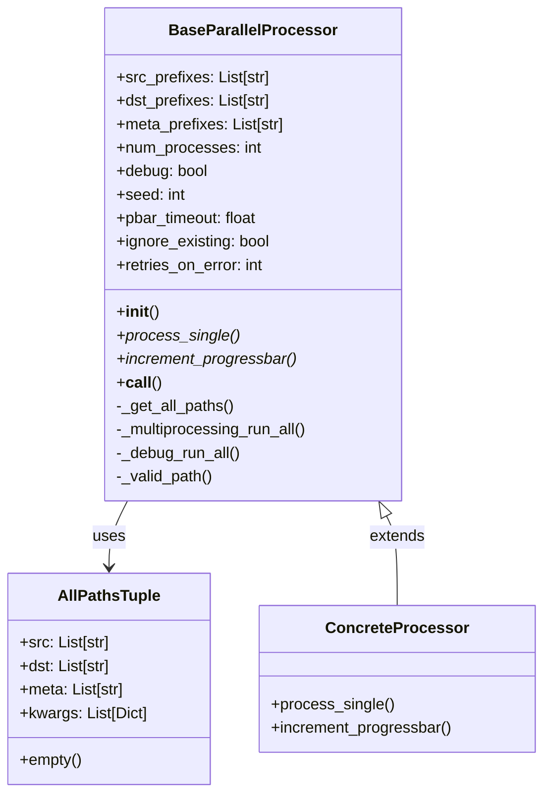
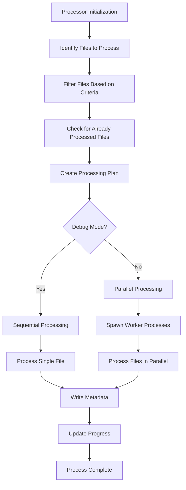
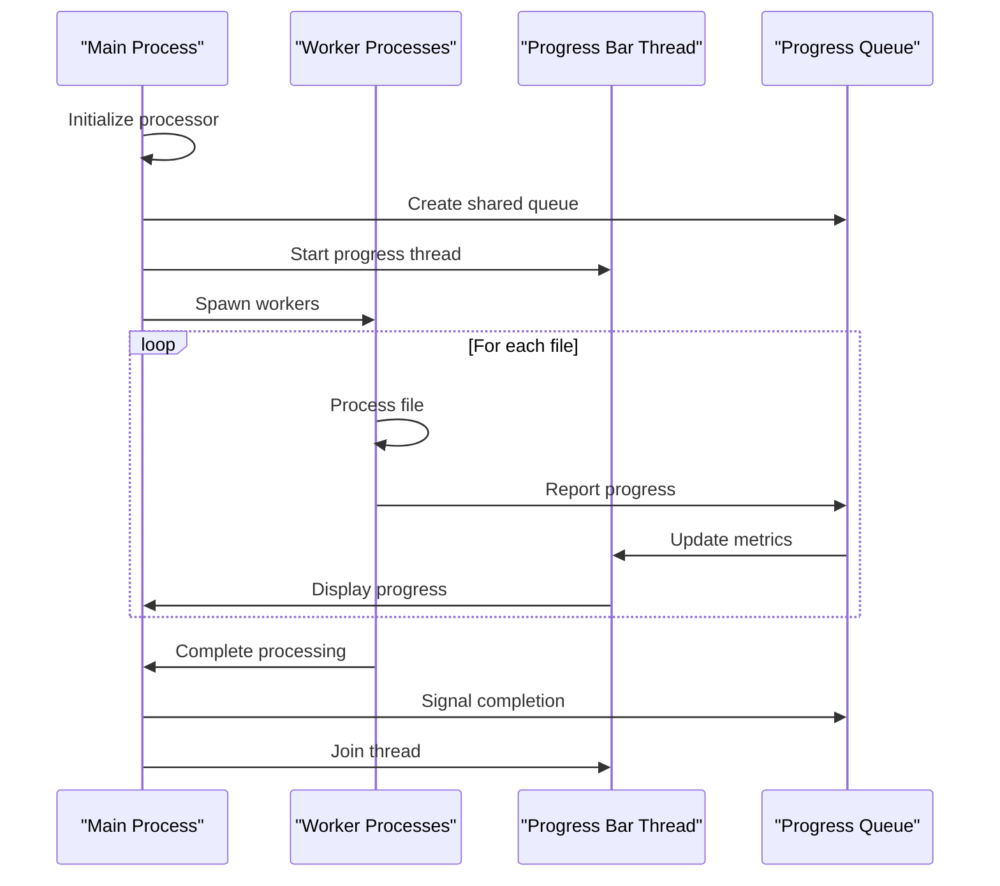
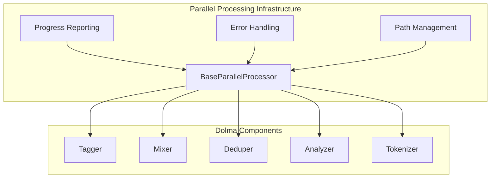

<!-- source: DeepWiki mcp.deepwiki.com · repo allenai/dolma · page 5.2 Parallel Processing · fetched 2026-10-26 -->

# Parallel Processing

<details>
<summary>Relevant source files</summary>

The following files were used as context for generating this wiki page:

- [python/dolma/core/data_types.py](python/dolma/core/data_types.py)
- [python/dolma/core/parallel.py](python/dolma/core/parallel.py)
- [python/dolma/core/paths.py](python/dolma/core/paths.py)
- [python/dolma/core/taggers.py](python/dolma/core/taggers.py)
- [tests/python/test_paths.py](tests/python/test_paths.py)
- [tests/python/test_runtime.py](tests/python/test_runtime.py)

</details>


The Parallel Processing system in Dolma provides infrastructure for efficiently processing large datasets by distributing work across multiple CPU cores. This system enables high-throughput data processing for all major components in the Dolma toolkit, from tagging and mixing to deduplication and tokenization.

For related functionality around file paths used by the parallel processing system, see [Path Handling](#5.1). For details on S3 integration which works seamlessly with parallel processing, see [S3 Integration](#5.3).

## Core Architecture

Dolma's parallel processing system centers around the `BaseParallelProcessor` class, which serves as an abstract base class for implementing parallelized file processing operations. This class handles the complexities of:

- Distributing work across multiple processes
- Managing paths for input and output files
- Tracking progress with configurable metrics
- Handling errors and providing retry mechanisms
- Ensuring metadata is created for completed tasks



**Diagram: BaseParallelProcessor Class Structure**

Sources: [python/dolma/core/parallel.py:52-522]()

## Processing Flow

The parallel processing system follows a clear workflow from initialization to completion. When a processor is called, it first identifies all files to process, then distributes them across multiple workers. Each worker processes its assigned files and updates progress information via a shared queue.



**Diagram: Parallel Processing Execution Flow**

Sources: [python/dolma/core/parallel.py:501-521](), [python/dolma/core/parallel.py:283-326](), [python/dolma/core/parallel.py:369-446]()

## Key Components

### The BaseParallelProcessor Class

The `BaseParallelProcessor` class is the cornerstone of Dolma's parallel processing capability. It provides:

1. A framework for applying the same operation to multiple files in parallel
2. Consistent path handling for both local and remote (S3) files
3. Progress tracking through customizable metrics
4. Error handling with configurable retry logic
5. Composability through the `__add__` method for combining processors

The class requires subclasses to implement:

- The `process_single` method to define how each file is processed
- The `increment_progressbar` method to define progress metrics

Sources: [python/dolma/core/parallel.py:52-200]()

### Path Management

The parallel processor leverages Dolma's path utilities to handle:

- Local and remote (S3) file paths
- Glob patterns for identifying input files
- Directory structure replication between source and destination
- Metadata file creation for tracking completed files

Each processor is configured with:

- Source prefixes: Where to find input files
- Destination prefixes: Where to save output files
- Metadata prefixes: Where to store processing metadata

Sources: [python/dolma/core/parallel.py:456-499](), [python/dolma/core/paths.py:213-247]()

### Progress Reporting

The parallel processor implements a thread-based progress reporting system that:

1. Creates a progress queue shared across all worker processes
2. Spawns a thread to monitor this queue and update progress bars
3. Allows each processor to define custom progress metrics
4. Updates progress in real-time across all workers



**Diagram: Progress Reporting System**

Sources: [python/dolma/core/parallel.py:234-282]()

### Error Handling

The parallel processing system includes robust error handling:

- Configurable retries for transient failures
- `DolmaRetryableFailure` exception type for indicating retry-eligible errors
- Metadata files to track successful completion
- Ability to resume interrupted processing runs

Sources: [python/dolma/core/parallel.py:201-233]()

## Process Distribution

Work is distributed across multiple processes using Python's `multiprocessing` module:

1. The main process identifies all files to process
2. A process pool is created with the specified number of worker processes
3. Processing tasks are submitted to the pool as asynchronous tasks
4. The main process monitors task completion and handles errors
5. A shared queue is used for progress reporting across processes

The system includes a debug mode that processes files sequentially in the main process, which is useful for troubleshooting.

Sources: [python/dolma/core/parallel.py:369-446](), [python/dolma/core/parallel.py:283-326]()

## Using the Parallel Processing System

To create a new processor that leverages parallel processing, follow these steps:

1. Subclass `BaseParallelProcessor`
2. Implement the `process_single` method to define file processing logic
3. Implement the `increment_progressbar` method to define progress metrics
4. Instantiate the processor with appropriate path configurations
5. Call the processor instance to start processing

Here's an example implementation pattern:

```python
class MyProcessor(BaseParallelProcessor):
    @classmethod
    def process_single(cls, source_path, destination_path, queue, **kwargs):
        # Process the file from source_path and write to destination_path
        
        # Update progress
        cls.increment_progressbar(queue, files=1, items=processed_items)
        
    @classmethod
    def increment_progressbar(cls, queue, /, files=0, items=0):
        return super().increment_progressbar(queue, files=files, items=items)

# Usage
processor = MyProcessor(
    source_prefix="path/to/input/*",
    destination_prefix="path/to/output",
    metadata_prefix="path/to/metadata",
    num_processes=8
)
processor()  # Start processing
```

Sources: [python/dolma/core/parallel.py:52-200](), [python/dolma/core/parallel.py:501-521]()

## Integration with Dolma Components

The parallel processing system powers all major components in Dolma. Each component extends `BaseParallelProcessor` to implement specific functionality while leveraging the common parallel processing infrastructure.



**Diagram: Integration with Dolma Components**

Sources: [python/dolma/core/parallel.py:52-200]()

## Performance Considerations

To maximize performance of parallel processing:

1. **Optimize Process Count**: Set `num_processes` based on the system's CPU cores and the I/O characteristics of the processing task. CPU-bound tasks benefit from a number close to the CPU core count, while I/O-bound tasks may benefit from a higher number.

2. **File Batching**: Processing many small files can introduce overhead. Consider batching small files together if possible.

3. **Error Handling**: Set appropriate `retries_on_error` to handle transient failures without manual intervention.

4. **Efficient Processing**: Implement `process_single` methods that minimize memory usage and maximize throughput.

Sources: [python/dolma/core/parallel.py:63-126]()

## Path Configuration

The parallel processor supports flexible path configurations:

- **Global patterns**: Process all files that match a pattern (e.g., `path/to/files/*.json.gz`)
- **Recursive patterns**: Process files in subdirectories (e.g., `path/to/files/**/*.json.gz`) 
- **Multiple sources**: Process files from multiple source directories
- **S3 integration**: Seamlessly process files stored on S3

All paths are managed using Dolma's path utilities, which provide consistent handling of local and remote paths.

Sources: [python/dolma/core/parallel.py:456-499](), [python/dolma/core/paths.py:213-247]()

## Resumability and Idempotence

The parallel processing system is designed to be resumable and idempotent:

1. It creates metadata files for each successfully processed file
2. On restart, it checks for existing metadata files to avoid reprocessing
3. The `ignore_existing` flag can be set to force reprocessing of all files
4. Path filtering can be used to process specific subsets of files

This design makes it resilient to interruptions and allows for incremental processing of large datasets.

Sources: [python/dolma/core/parallel.py:456-499]()

---

