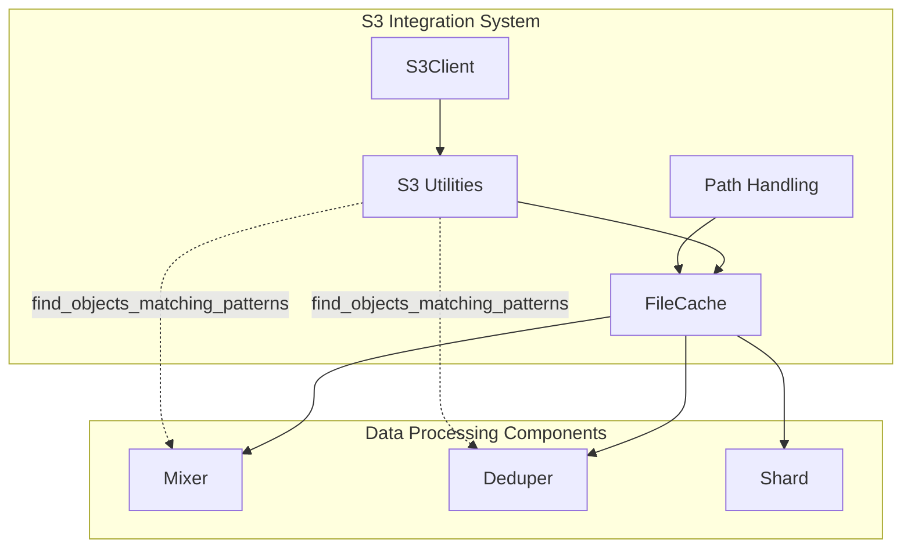
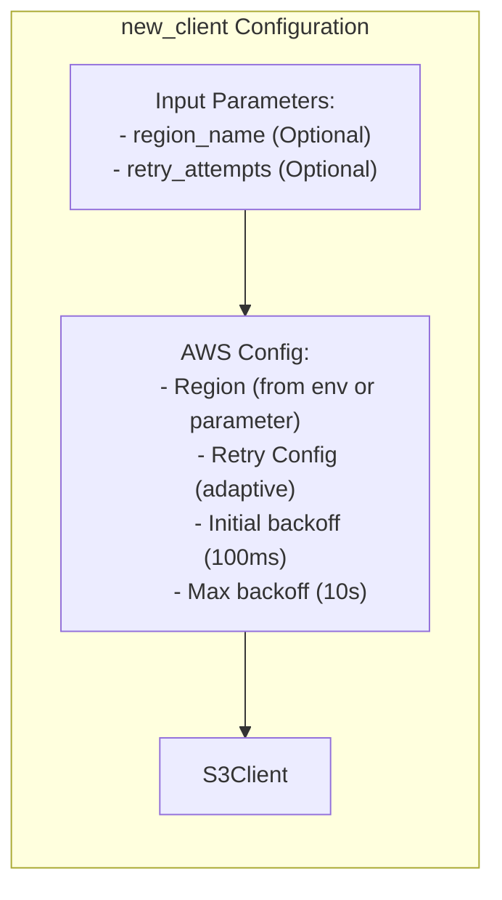
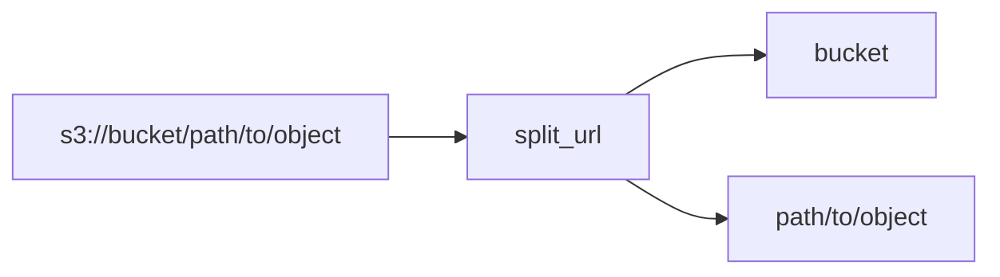
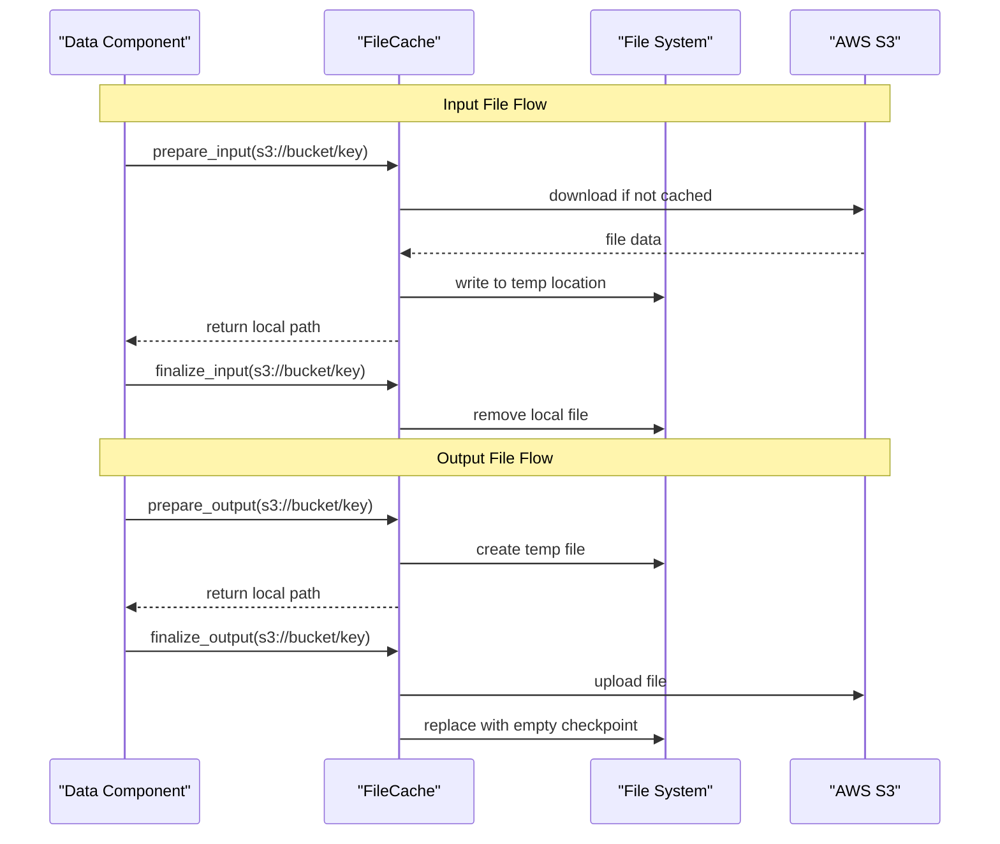
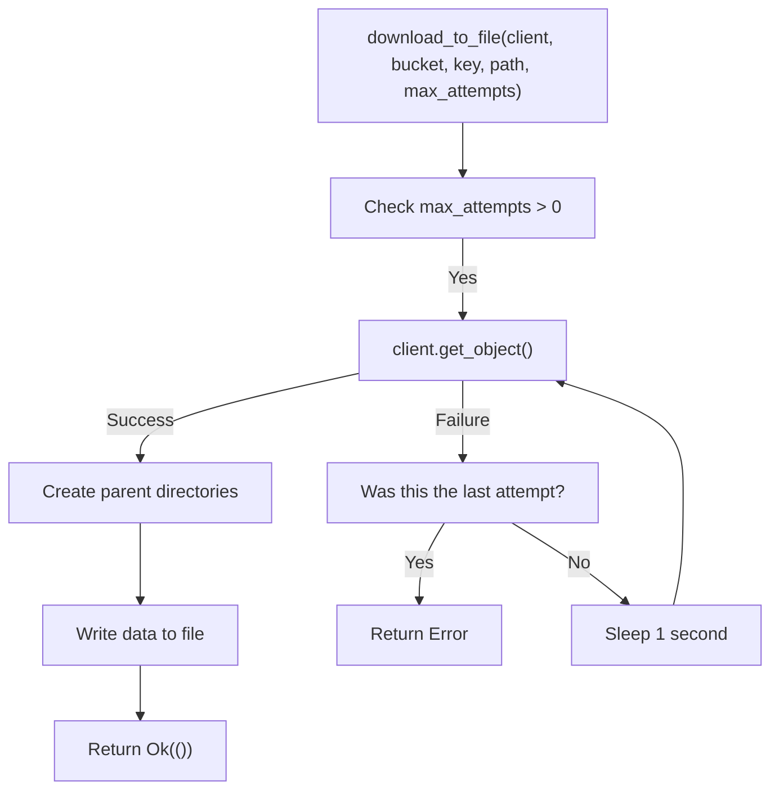
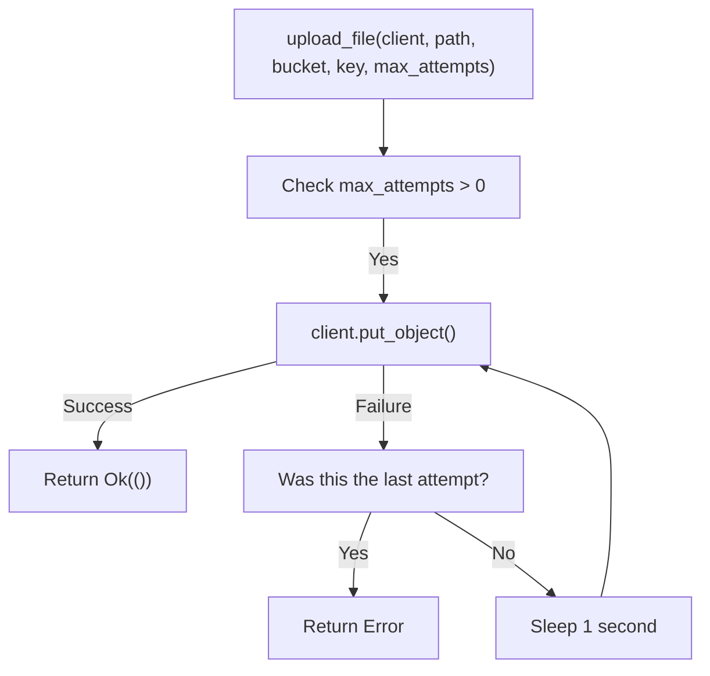
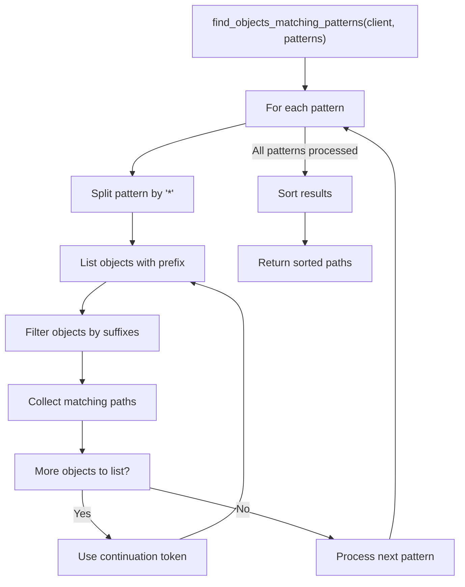
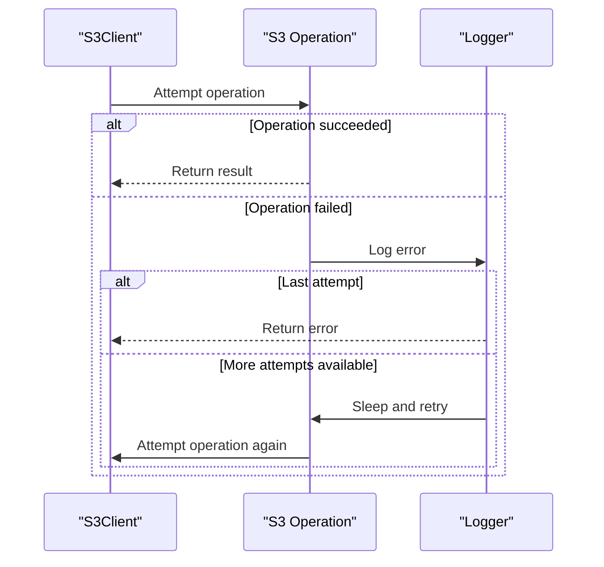
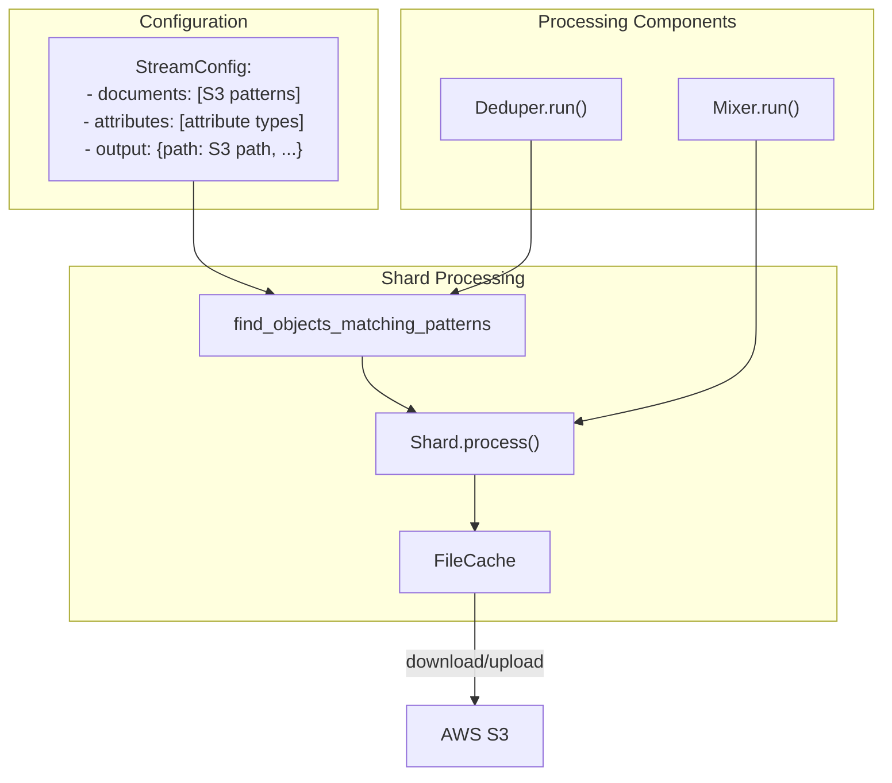

<!-- source: DeepWiki mcp.deepwiki.com · repo allenai/dolma · page 5.3 S3 Integration · fetched 2026-10-26 -->

# S3 Integration

<details>
<summary>Relevant source files</summary>

The following files were used as context for generating this wiki page:

- [configs/dolma-v1_5/mixing/dedupe-test.yaml](configs/dolma-v1_5/mixing/dedupe-test.yaml)
- [configs/test/test_filtered_mixer.yaml](configs/test/test_filtered_mixer.yaml)
- [src/bloom_filter.rs](src/bloom_filter.rs)
- [src/bloom_filter/bloom_test.rs](src/bloom_filter/bloom_test.rs)
- [src/deduper.rs](src/deduper.rs)
- [src/mixer.rs](src/mixer.rs)
- [src/s3_util.rs](src/s3_util.rs)
- [src/shard.rs](src/shard.rs)

</details>


This document details how the Dolma toolkit integrates with Amazon S3 for storage and retrieval of large datasets. It covers the S3 utility functions, path handling, file caching mechanisms, error handling, and integration with Dolma's data processing pipeline. For information about the parallel processing system that works alongside S3 integration, see [Parallel Processing](#5.2).

## Overview

Dolma's S3 integration enables the toolkit to efficiently process large datasets stored in S3 buckets. The system provides functionality for downloading, uploading, finding, and managing S3 objects with built-in caching, error handling, and retry mechanisms. This integration is critical for Dolma's ability to handle dataset curation at scale.



Sources: [src/s3_util.rs:1-326](), [src/shard.rs:712-819]()

## S3 Client Configuration

The S3 client is implemented using the AWS SDK for Rust (`aws_sdk_s3`). Dolma creates a configured client with customizable region and retry settings through the `new_client` function in the `s3_util` module.



Sources: [src/s3_util.rs:288-325]()

The S3 client is configured with:

- **Region**: Defaults to "us-east-1" but can be overridden by the `REGION` environment variable or through parameters
- **Retry strategy**: Uses an adaptive retry strategy with configurable maximum attempts
- **Backoff settings**: Initial backoff of 100ms, increasing up to 10 seconds maximum

## S3 Path Handling

Dolma handles S3 paths using the format `s3://bucket/key`. The `split_url` function parses this format into bucket and key components.



Sources: [src/s3_util.rs:13-33]()

## File Caching Mechanism

The `FileCache` struct implements a caching mechanism for S3 files, making the data processing more efficient by:

1. Downloading files from S3 to local storage only when needed
2. Managing local temporary files for both input and output
3. Uploading processed files back to S3
4. Creating checkpoint files to track progress



Sources: [src/shard.rs:712-819]()

The `FileCache` methods include:

| Method | Description |
|--------|-------------|
| `prepare_input` | Downloads a file from S3 to local storage if it's not already available |
| `finalize_input` | Cleans up local files after processing |
| `prepare_output` | Creates a local file for output that will be uploaded to S3 |
| `finalize_output` | Uploads the local output file to S3 and creates an empty checkpoint |

## Core S3 Operations

Dolma provides several core S3 operations through the `s3_util` module:

### Downloading Files

The `download_to_file` function downloads an object from S3 to a local file with optional retry logic.



Sources: [src/s3_util.rs:35-104]()

### Uploading Files

The `upload_file` function uploads a local file to S3 with similar retry capabilities.



Sources: [src/s3_util.rs:106-176]()

### Finding Objects

The `find_objects_matching_patterns` function locates S3 objects matching wildcard patterns, which is essential for processing large datasets with varied file patterns.



Sources: [src/s3_util.rs:195-286]()

## Error Handling and Retries

Dolma implements robust error handling for S3 operations with configurable retry logic.



Sources: [src/s3_util.rs:35-104](), [src/s3_util.rs:106-176]()

Key features of the error handling system:

- Configurable maximum attempts for each operation
- Exponential backoff for retry delays (starting at 100ms, up to 10s)
- Detailed error logging with attempt counts
- Custom error messages that include S3 paths

## Integration with Data Processing Pipeline

The S3 integration is tightly integrated with Dolma's data processing pipeline, particularly with the Mixer, Deduper, and Shard components.



Sources: [src/shard.rs:35-130](), [src/mixer.rs:10-48](), [src/deduper.rs:25-95]()

### S3 in the Mixer Component

The Mixer component uses S3 integration to:

1. Find input documents matching configured patterns
2. Download input files for processing
3. Upload mixed output files back to S3

Example configuration from a mixer YAML file:

```yaml
streams:
  - name: filtered_object_test
    documents:
      - s3://ai2-oe-data/pretraining-data/sources/refine/v0/documents/0001/0000_dclm_shard_00000*.jsonl.zstd
    attributes:
      - random_number_v1
      - fineweb-edu-classifier
    output:
      path: s3://ai2-oe-data/tylerm/test/mixer/filtered
```

Sources: [configs/test/test_filtered_mixer.yaml:1-25]()

### S3 in the Deduper Component

The Deduper component uses S3 integration to:

1. Find documents to check for duplicates
2. Download files for deduplication processing
3. Upload attribute files marking duplicates back to S3

## S3 Performance Considerations

Dolma implements several strategies to optimize S3 performance:

1. **Caching**: Local file caching to minimize redundant S3 operations
2. **Sharding**: Processing data in shards of appropriate size to optimize throughput
3. **Parallel Processing**: Using multiple threads to process files in parallel
4. **Retries with Backoff**: Adaptive retry strategy to handle transient failures
5. **Compression**: Support for different compression formats to reduce transfer sizes

## Conclusion

The S3 integration in Dolma provides a robust foundation for large-scale dataset curation. By efficiently managing the download, processing, and upload of data to and from S3, Dolma can handle terabyte-scale datasets while maintaining resilience to failures and optimizing performance.

The integration uses a combination of AWS SDK capabilities and custom utilities to create a seamless workflow for dataset processing, with features like automatic retries, caching, and wildcard pattern matching making it well-suited for production-scale data processing.

---

