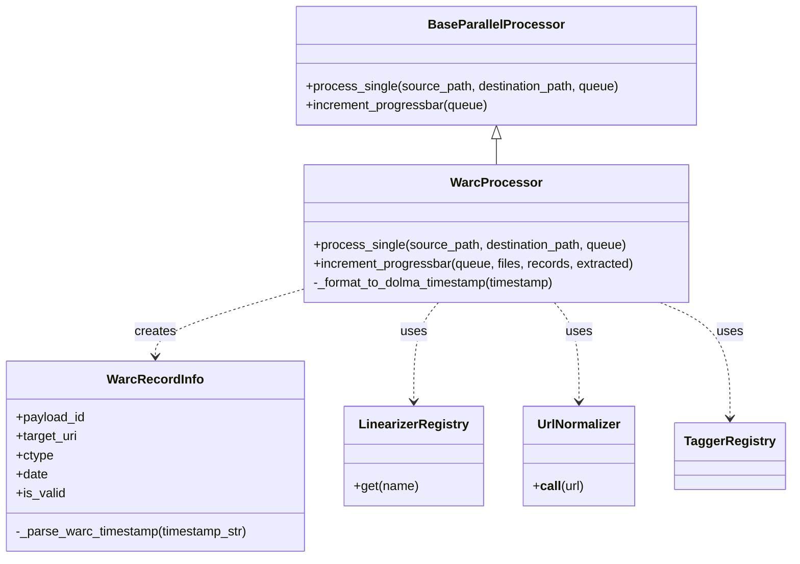
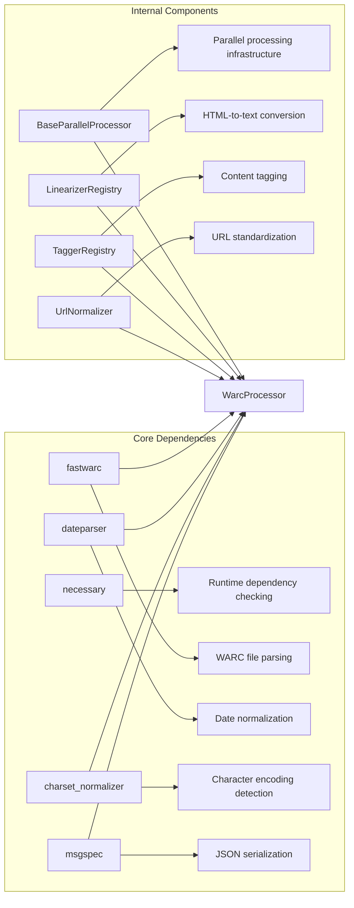
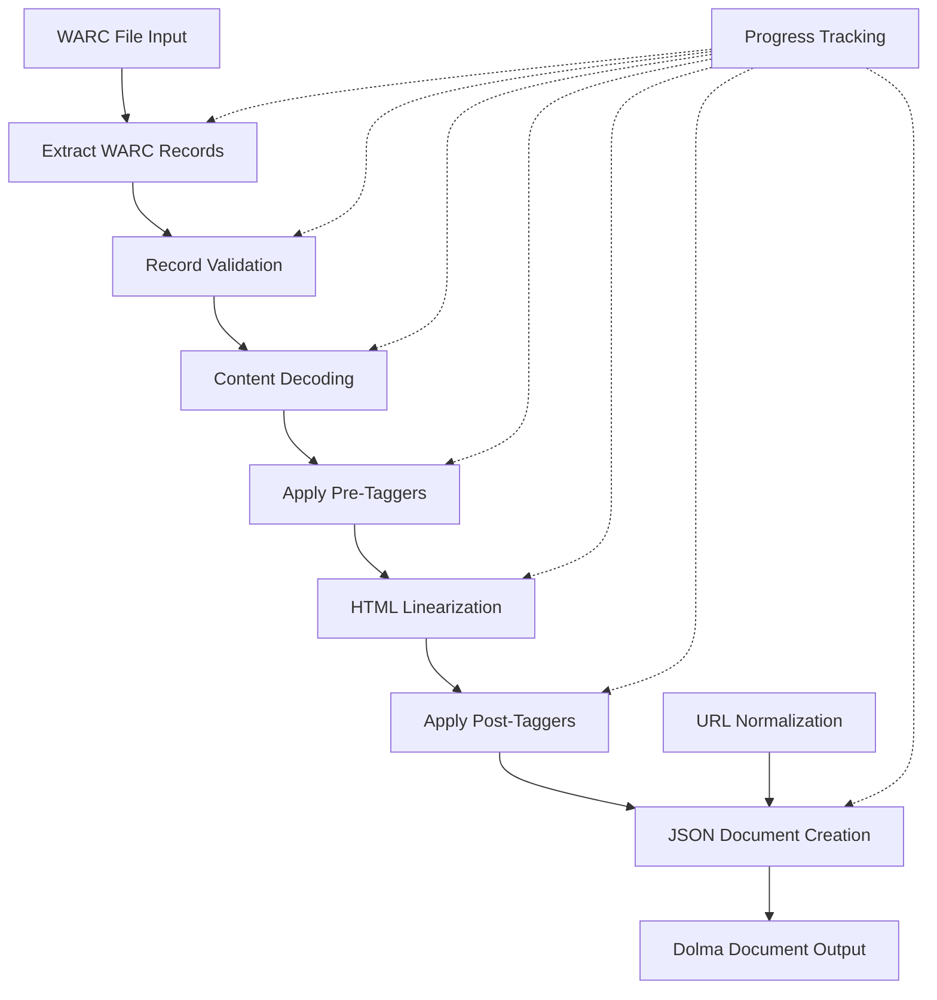
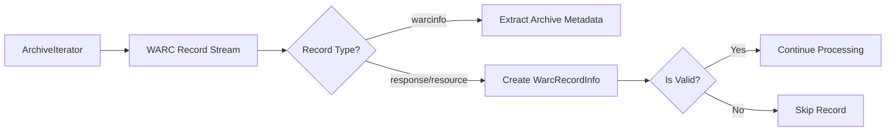
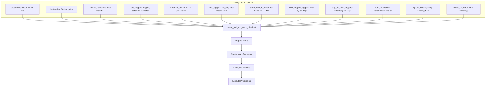
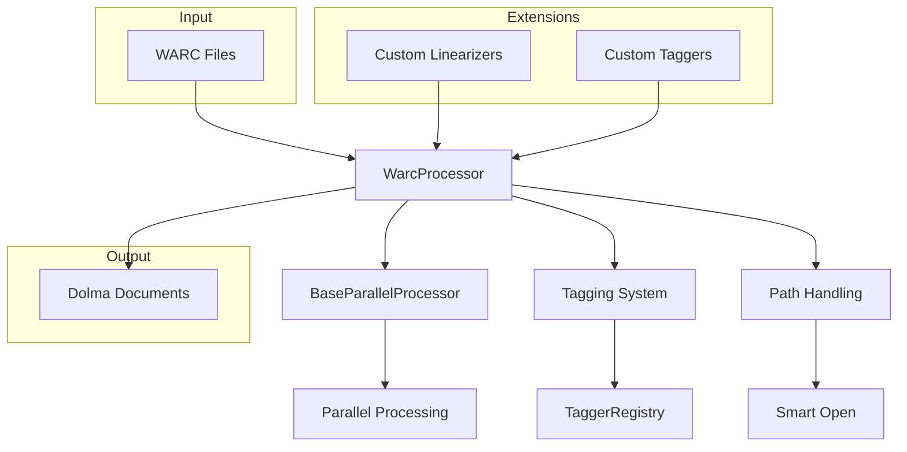

<!-- source: DeepWiki mcp.deepwiki.com · repo allenai/dolma · page 6 WARC Processing · fetched 2026-10-26 -->

# WARC Processing

Relevant source files

The following files were used as context for generating this wiki page:

- [python/dolma/warc/processor.py](python/dolma/warc/processor.py)
- [python/dolma/warc/record_info.py](python/dolma/warc/record_info.py)
- [tests/config/filepath-bad.json](tests/config/filepath-bad.json)
- [tests/config/filepath-good.json](tests/config/filepath-good.json)
- [tests/data/provided/deduper/pathnotd0cumentz/000.json.gz](tests/data/provided/deduper/pathnotd0cumentz/000.json.gz)
- [tests/python/test_warc_record_info.py](tests/python/test_warc_record_info.py)

This document details how Web ARChive (WARC) files are processed within the Dolma toolkit. WARC is a standard format for storing web crawl data, commonly used for large-scale web archives like Common Crawl. Dolma provides specialized components for efficiently processing these files and converting them into the standard Dolma document format.

## Purpose and Scope

The WARC processing system handles:
- Extracting web content from WARC files
- Converting HTML to plain text
- Normalizing URLs
- Applying tagging pipelines to extract features
- Producing standardized Dolma document outputs

This document focuses specifically on WARC file processing. For information about the general Parallel Processing system, see [Path Handling](#5.1) and [Parallel Processing](#5.2).

## Architecture

The WARC processor is built on Dolma's parallel processing infrastructure, with specialized components for handling web archive data.

Sources: [python/dolma/warc/processor.py:35-221](), [python/dolma/warc/record_info.py:15-51]()

### Dependencies

The WARC processor relies on external libraries for efficient processing:

- `fastwarc`: High-performance WARC file parser
- `dateparser`: Handles various date formats in WARC files
- `charset_normalizer`: Detects and normalizes character encodings
- `msgspec`: Fast JSON encoding/decoding

These dependencies are specified with Dolma's `necessary` utility, which provides graceful handling when optional dependencies are missing.

Sources: [python/dolma/warc/processor.py:8-24](), [python/dolma/warc/processor.py:26-32]()

## WARC Processing Workflow

The WARC processor follows a pipeline approach for processing web archive files:

Sources: [python/dolma/warc/processor.py:66-221]()

### Record Extraction and Validation

The process begins by opening a WARC file and iterating through its records. Only response and resource records are processed, while warcinfo records are used to extract metadata about the archive itself.

Each record is validated using `WarcRecordInfo`, which checks:
- Presence of valid payload digest
- Presence of a target URI
- Record type compatibility

Sources: [python/dolma/warc/processor.py:131-158](), [python/dolma/warc/record_info.py:15-43]()

### Content Decoding

WARC content is stored as bytes, so it must be decoded to text before processing:

1. First attempt: Use the HTTP charset from the record's headers
2. Fallback: Use charset detection via `charset_normalizer`
3. If both fail: Skip the record

This approach balances performance and accuracy, as header-based decoding is faster but not always reliable.

Sources: [python/dolma/warc/processor.py:148-157]()

### HTML Linearization

The processor converts HTML to plain text using a configurable linearizer:

1. The linearizer is retrieved from the `LinearizerRegistry` using the specified name (default: "resiliparse")
2. The HTML content is passed to the linearizer's `linearize` method
3. The resulting plain text is stored in the document's `text` field

Linearization preserves the semantic structure of the document while removing HTML markup, making the content suitable for downstream NLP tasks.

Sources: [python/dolma/warc/processor.py:100-102](), [python/dolma/warc/processor.py:186]()

### Tagging Pipeline

The WARC processor supports both pre-linearization and post-linearization tagging:

- **Pre-taggers**: Run on the raw document before HTML linearization
- **Post-taggers**: Run after linearization, on the plain text content

Taggers can be configured by name, and the processor will load them from the `TaggerRegistry`. The results from both tagging phases are combined and stored in the document's `attributes` field.

A document can optionally be skipped if no tags are produced by either pre-taggers or post-taggers, controlled by the `skip_no_pre_taggers` and `skip_no_post_taggers` flags.

Sources: [python/dolma/warc/processor.py:97-118](), [python/dolma/warc/processor.py:181-191](), [python/dolma/warc/processor.py:193-197]()

## Document Creation and Output

The processor creates standardized Dolma documents with the following structure:

| Field | Description |
|-------|-------------|
| `source` | The name of the data source |
| `version` | The version of the data source |
| `id` | A unique identifier derived from the WARC payload digest |
| `text` | The linearized text content |
| `metadata` | WARC-specific metadata (URL, content type, etc.) |
| `attributes` | Tags and features extracted by the taggers |
| `created` | Timestamp from the WARC record |
| `added` | Timestamp of processing |

The documents are serialized to JSON and written to the output file path.

Sources: [python/dolma/warc/processor.py:172-204]()

## Pipeline Configuration

WARC processing can be configured through the `create_and_run_warc_pipeline` function:

Sources: [python/dolma/warc/processor.py:224-296]()

### Progress Tracking

The WARC processor extends the base progress tracking system to monitor:

1. Number of files processed
2. Number of records (web pages) examined
3. Number of documents successfully extracted

This information is displayed in the progress bar during processing, giving users real-time feedback on the extraction process.

Sources: [python/dolma/warc/processor.py:52-64](), [python/dolma/warc/processor.py:208-221]()

## Integration with Dolma

The WARC processor is integrated with other Dolma components:

Sources: [python/dolma/warc/processor.py:35-41](), [python/dolma/warc/processor.py:97-118]()

## Usage Considerations

### Performance Optimization

- Processing is parallelized across multiple CPU cores
- The progress update interval dynamically adjusts based on queue fullness
- HTML parsing is selective - only valid records are processed
- Character encoding detection uses a two-stage approach for efficiency

### Error Handling

The processor includes several error handling mechanisms:

- Invalid records are skipped
- Decoding errors are handled gracefully 
- Dependencies are checked at runtime with informative error messages
- The parallel processing framework provides retries for transient errors

Sources: [python/dolma/warc/processor.py:40-43](), [python/dolma/warc/processor.py:148-157]()

## Summary

The WARC processing system in Dolma provides a robust, efficient pipeline for extracting and transforming web archive content into structured documents. It leverages parallel processing, configurable tagging, and specialized web content handling to process large-scale web archives while maintaining high quality and performance.

---

