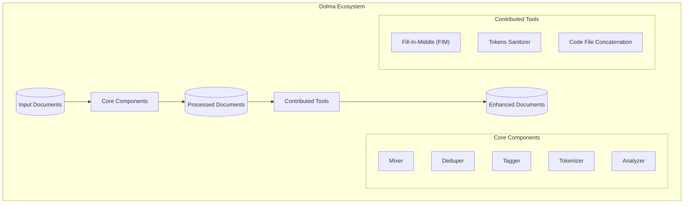
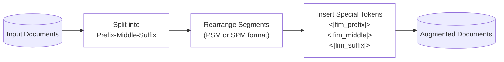
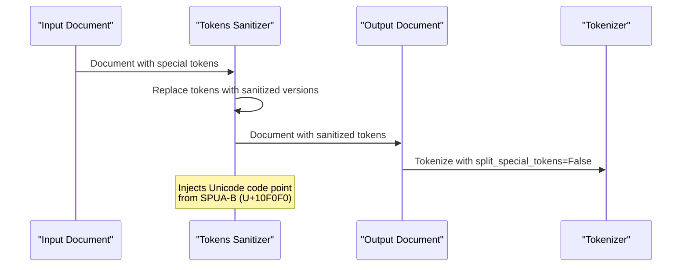
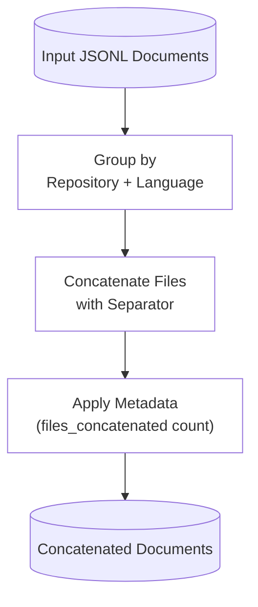
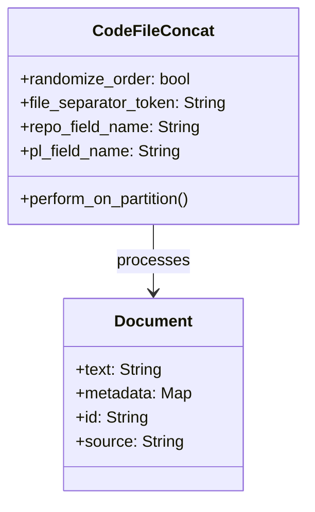
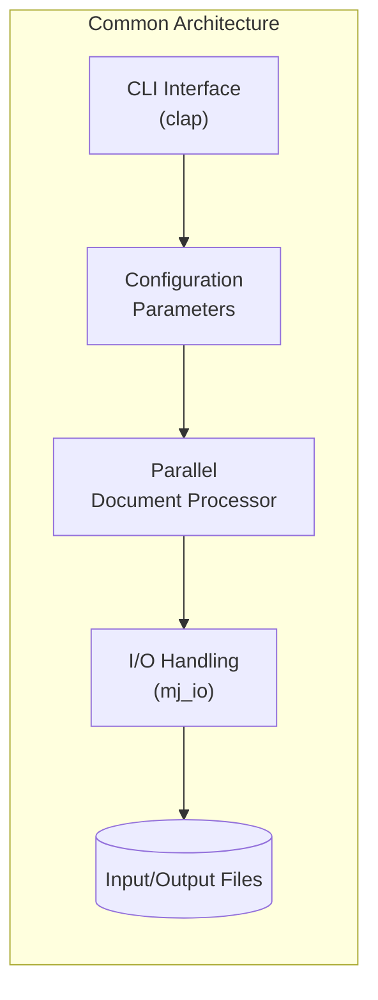

<!-- source: DeepWiki mcp.deepwiki.com · repo allenai/dolma · page 7 Contributed Tools · fetched 2026-10-26 -->

# Contributed Tools

<details>
<summary>Relevant source files</summary>

The following files were used as context for generating this wiki page:

- [contrib/code-file-concat/.gitignore](contrib/code-file-concat/.gitignore)
- [contrib/code-file-concat/Cargo.lock](contrib/code-file-concat/Cargo.lock)
- [contrib/code-file-concat/Cargo.toml](contrib/code-file-concat/Cargo.toml)
- [contrib/code-file-concat/README.md](contrib/code-file-concat/README.md)
- [contrib/code-file-concat/src/concat.rs](contrib/code-file-concat/src/concat.rs)
- [contrib/code-file-concat/src/main.rs](contrib/code-file-concat/src/main.rs)
- [contrib/code-file-concat/tests/test_concat.py](contrib/code-file-concat/tests/test_concat.py)
- [contrib/fill-in-middle/tests/test_fim.py](contrib/fill-in-middle/tests/test_fim.py)
- [contrib/tokens-sanitizer/.gitignore](contrib/tokens-sanitizer/.gitignore)
- [contrib/tokens-sanitizer/Cargo.lock](contrib/tokens-sanitizer/Cargo.lock)
- [contrib/tokens-sanitizer/Cargo.toml](contrib/tokens-sanitizer/Cargo.toml)
- [contrib/tokens-sanitizer/README.md](contrib/tokens-sanitizer/README.md)
- [contrib/tokens-sanitizer/data/input/f1.jsonl](contrib/tokens-sanitizer/data/input/f1.jsonl)
- [contrib/tokens-sanitizer/src/main.rs](contrib/tokens-sanitizer/src/main.rs)
- [contrib/tokens-sanitizer/tests/test_sanitizer.py](contrib/tokens-sanitizer/tests/test_sanitizer.py)
- [tests/data/multiple_files/cc_en_head-0091.jsonl](tests/data/multiple_files/cc_en_head-0091.jsonl)
- [tests/data/multiple_files/cc_en_head-0174.jsonl](tests/data/multiple_files/cc_en_head-0174.jsonl)

</details>


The Dolma repository contains several contributed tools in the `contrib` directory that extend the core functionality of the system. These tools provide specialized data processing capabilities for specific use cases that complement the main Dolma processing pipeline. While not part of the core framework, they follow similar design patterns and can be seamlessly integrated into Dolma-based workflows.

This document covers the purpose, implementation, and usage of each contributed tool. For information about the core Dolma systems, see [Data Processing Pipeline](#3).



Sources: All provided files

## Tool Descriptions

The contributed tools address specialized data processing needs particularly focused on code data preparation and token handling:

| Tool | Purpose | Implementation |
|------|---------|----------------|
| Fill-In-Middle (FIM) | Data augmentation for code completion by rearranging text segments | Rust with Python tests |
| Tokens Sanitizer | Prepares text for tokenization by handling special tokens properly | Rust |
| Code File Concatenation | Combines code files from the same repository/language | Rust |

Each tool is designed as a standalone utility that can be run independently or integrated into a larger data processing pipeline.

## Fill-In-Middle (FIM)

The Fill-In-Middle (FIM) tool is designed for data augmentation in code completion tasks. It takes code documents and splits them into three parts: prefix, middle, and suffix. These parts are then rearranged to create training examples that help models learn to generate missing code segments.



Sources: [contrib/fill-in-middle/tests/test_fim.py:12-15]()

### Key Features

- **Two Rearrangement Patterns**:
  - **Prefix-Suffix-Middle (PSM)**: `<|fim_prefix|>prefix<|fim_suffix|>suffix<|fim_mid|>middle`
  - **Suffix-Prefix-Middle (SPM)**: `<|fim_suffix|>suffix<|fim_prefix|>prefix<|fim_mid|>middle`
- **Configurable Parameters**:
  - `fim_rate`: Controls the fraction of documents to transform (0.0-1.0)
  - `psm_spm_split`: Controls the ratio between PSM and SPM orderings (0.0-1.0)
  - `file_separator_token`: Defines the token used to separate files in a document

Sources: [contrib/fill-in-middle/tests/test_fim.py:52-68]()

### Usage Example

The tool is invoked via a command-line interface:

```
cargo run -- \
    --inputs 'data/input/*.jsonl' \
    --output data/output \
    --fim-rate 0.5 \
    --psm-spm-split 0.5 \
    --file-separator-token '<|file_sep|>' \
    --fim-prefix-token '<|fim_prefix|>' \
    --fim-middle-token '<|fim_mid|>' \
    --fim-suffix-token '<|fim_suffix|>'
```

Sources: [contrib/fill-in-middle/tests/test_fim.py:58-68]()

### Implementation Details

The FIM tool processes JSONL documents, with each document containing a `text` field. It splits the text at random positions and applies the rearrangement, preserving all other fields in the document. The implementation requires minimal document length (at least 5 characters) to perform the transformation.

Sources: [contrib/fill-in-middle/tests/test_fim.py:205-219]()

## Tokens Sanitizer

The Tokens Sanitizer is a utility for preparing text documents for tokenization by handling special tokens in a way that prevents conflicts between naturally occurring tokens in text and tokenizer-specific control tokens.



Sources: [contrib/tokens-sanitizer/README.md:24-29](), [contrib/tokens-sanitizer/src/main.rs:127-133]()

### Purpose

When training language models, special tokens like `<|endoftext|>` that occur naturally in text can be confused with the actual control tokens used by the model. The Tokens Sanitizer solves this by:

1. Replacing special tokens with versions that contain an invisible Unicode character from the Supplementary Private Use Area-B
2. Using a specially modified tokenizer that handles these sanitized tokens correctly

This approach allows models to learn about special tokens as concepts while preventing confusion with actual control tokens during tokenization.

Sources: [contrib/tokens-sanitizer/README.md:3-18]()

### Key Features

- Processes JSONL files with a specific format (containing a `text` field)
- Supports multiple substitution patterns in the form `<original>=<replacement>`
- Operates in parallel for efficient processing of large datasets
- Preserves all document fields and structure except for the sanitized text

Sources: [contrib/tokens-sanitizer/README.md:50-68](), [contrib/tokens-sanitizer/src/main.rs:30-31]()

### Usage Example

```
cargo run --release -- \
    --inputs 'data/input/*jsonl' \
    --output data/output \
    --substitutions '<|endoftext|>=<|􏃰endoftext|>' \
    --substitutions '<|fim_prefix|>=<|􏃰fim_prefix|>' \
    --substitutions '<|fim_middle|>=<|􏃰fim_middle|>' \
    --substitutions '<|fim_suffix|>=<|􏃰fim_suffix|>' \
    --substitutions '<|im_start|>=<|􏃰im_start|>' \
    --substitutions '<|im_end|>=<|􏃰im_end|>' \
    --substitutions '<|endofprompt|>=<|􏃰endofprompt|>' \
    --substitutions '<|pad|>=<|􏃰pad|>'
```

Sources: [contrib/tokens-sanitizer/README.md:55-67]()

### Tokenizer Configuration

To use the sanitized documents, you must use a specially modified tokenizer:

```yaml
tokenizer:
  name_or_path: allenai/dolma2-tokenizer-U10F0F0
  bos_token_id: null
  eos_token_id: 100257
  pad_token_id: 100277
  segment_before_tokenization: false
  encode_special_tokens: false
```

Sources: [contrib/tokens-sanitizer/README.md:82-89]()

## Code File Concatenation

The Code File Concatenation tool combines multiple code files from the same repository and programming language into a single document. This helps models learn relationships between files in a codebase and understand larger code structures.



Sources: [contrib/code-file-concat/src/concat.rs:24-82](), [contrib/code-file-concat/README.md:3-9]()

### Key Features

- **Document Grouping**: Groups code files by repository and programming language
- **Configurable Separator**: Uses a custom token to separate files in the concatenated document
- **Randomization Option**: Can randomize file order within each repository/language group
- **Metadata Preservation**: Retains the metadata from one file and adds a `files_concatenated` count
- **Parallel Processing**: Processes input partitions in parallel for efficiency

Sources: [contrib/code-file-concat/src/main.rs:11-37](), [contrib/code-file-concat/src/concat.rs:16-22]()

### Internal Processing Steps



Sources: [contrib/code-file-concat/src/concat.rs:16-22](), [contrib/code-file-concat/src/concat.rs:24-82]()

### Usage Example

```
cargo run --release -- \
    --inputs 'data/input/*jsonl' \
    --output data/output \
    --randomize-order \
    --file-separator-token '<|file_sep|>' \
    --repo-field-name repo_name \
    --pl-field-name language
```

Sources: [contrib/code-file-concat/README.md:19-26]()

### Input Document Requirements

The tool expects input documents in JSONL format with specific fields:

1. A `text` field containing the code content
2. A `metadata` field with subfields for:
   - Repository name (configurable field name, default: `repo_name`)
   - Programming language (configurable field name, default: `language`)

Sources: [contrib/code-file-concat/README.md:13-16](), [contrib/code-file-concat/src/main.rs:30-36]()

## Common Design Patterns

All contributed tools share several design patterns that align with the broader Dolma architecture:



Sources: [contrib/tokens-sanitizer/src/main.rs:11-36](), [contrib/code-file-concat/src/main.rs:11-37]()

### Shared Characteristics

1. **Command-Line Interface**: All tools use the `clap` crate for command-line argument parsing
2. **JSONL Processing**: Input and output are JSONL documents with a consistent structure
3. **Parallel Execution**: Uses the `rayon` crate for parallel processing
4. **Common I/O Utilities**: Uses the `mj_io` utility package for file handling
5. **Preserving Document Structure**: Maintains document fields and only modifies the necessary parts

Sources: [contrib/tokens-sanitizer/Cargo.toml:6-11](), [contrib/code-file-concat/Cargo.toml:6-11]()

## Integration with Dolma Workflows

The contributed tools can be integrated with the core Dolma pipeline in various ways:

1. **Pre-processing**: Used before the main Dolma pipeline to prepare documents 
2. **Post-processing**: Applied after the main processing to enhance the final documents
3. **Specialized Processing**: Used for specific datasets while others go through the standard pipeline

When integrating these tools, it's important to ensure that document formats and field names are consistent across the entire workflow.

---

