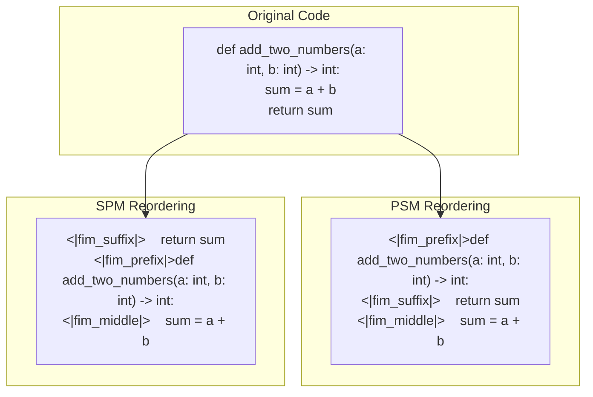
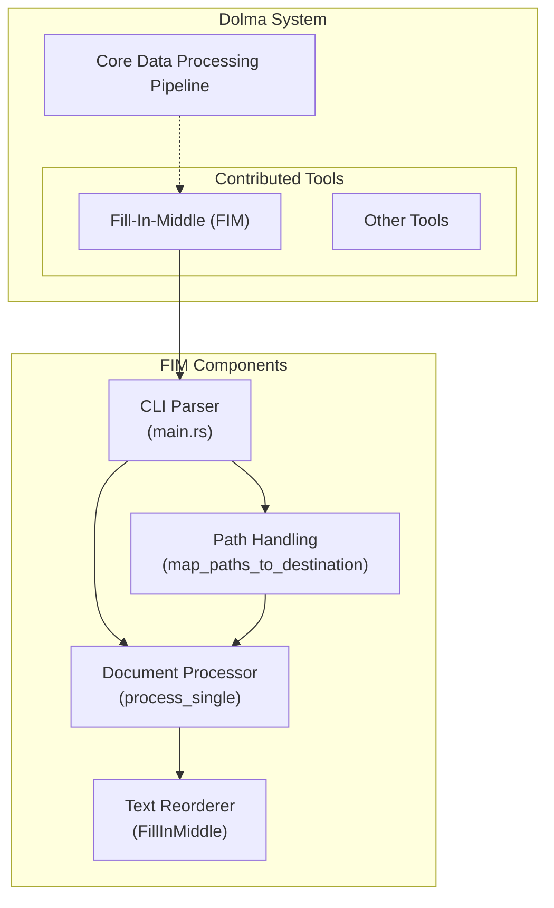
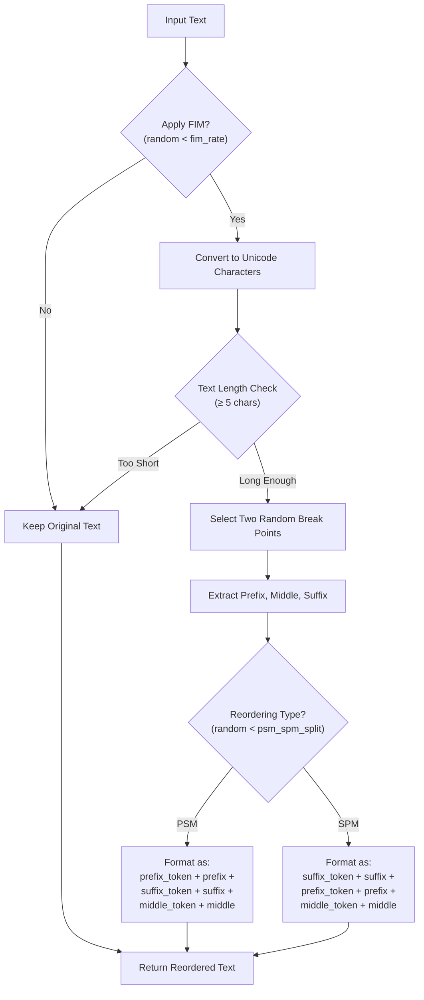
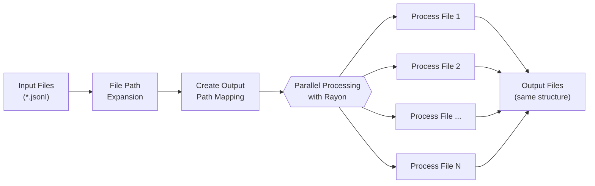

<!-- source: DeepWiki mcp.deepwiki.com · repo allenai/dolma · page 7.1 Fill-In-Middle (FIM) · fetched 2026-10-26 -->

# Fill-In-Middle (FIM)

<details>
<summary>Relevant source files</summary>

The following files were used as context for generating this wiki page:

- [contrib/code-file-concat/tests/test_concat.py](contrib/code-file-concat/tests/test_concat.py)
- [contrib/fill-in-middle/.gitignore](contrib/fill-in-middle/.gitignore)
- [contrib/fill-in-middle/Cargo.lock](contrib/fill-in-middle/Cargo.lock)
- [contrib/fill-in-middle/Cargo.toml](contrib/fill-in-middle/Cargo.toml)
- [contrib/fill-in-middle/README.md](contrib/fill-in-middle/README.md)
- [contrib/fill-in-middle/src/fim.rs](contrib/fill-in-middle/src/fim.rs)
- [contrib/fill-in-middle/src/main.rs](contrib/fill-in-middle/src/main.rs)
- [contrib/fill-in-middle/tests/test_fim.py](contrib/fill-in-middle/tests/test_fim.py)

</details>


## Purpose and Scope

The Fill-In-Middle (FIM) tool is a data augmentation utility that reorders code text to support training code completion models. It specifically prepares data for models that need to learn how to generate code in the middle of a given context (between a prefix and suffix). This tool is part of the contributed tools in Dolma, separate from the core data processing pipeline.

For information about other code processing tools, see [Code File Concatenation](#7.3) and [Tokens Sanitizer](#7.2).

Sources: [contrib/fill-in-middle/README.md:1-26]()

## Concept and Technique

Fill-In-Middle is a technique that transforms code snippets by rearranging them with special sentinel tokens. The technique supports two different reordering formats:

1. **PSM (Prefix-Suffix-Middle)**: Arranges code as `<prefix><suffix><middle>`
2. **SPM (Suffix-Prefix-Middle)**: Arranges code as `<suffix><prefix><middle>`

These reorderings help language models learn to complete code fragments when given both the beginning and end of a code block.

### FIM Reordering Example



Sources: [contrib/fill-in-middle/README.md:7-22](), [contrib/fill-in-middle/src/fim.rs:49-71]()

## Architecture and Components

The FIM tool is implemented as a standalone Rust application within the Dolma contributed tools. It processes JSONL files containing code text and applies the reordering transformation based on configurable parameters.

### System Architecture



Sources: [contrib/fill-in-middle/src/main.rs:12-45](), [contrib/fill-in-middle/src/main.rs:138-176](), [contrib/fill-in-middle/src/fim.rs:5-12]()

## Processing Workflow

The FIM tool follows a structured workflow to process and transform code text:


Sources: [contrib/fill-in-middle/src/main.rs:178-211](), [contrib/fill-in-middle/src/fim.rs:15-79]()

## Reordering Algorithm

The core of the FIM tool is the reordering algorithm implemented in the `FillInMiddle` struct. The algorithm:

1. Splits input text on file separator tokens to process individual code files
2. For each file, decides whether to apply FIM based on the configured probability (`fim_rate`)
3. For files selected for reordering:
   - Randomly selects two points to split the text into prefix, middle, and suffix
   - Decides between PSM and SPM format based on the configured probability (`psm_spm_split`)
   - Applies the appropriate reordering with sentinel tokens



Sources: [contrib/fill-in-middle/src/fim.rs:15-79](), [contrib/fill-in-middle/tests/test_fim.py:145-204]()

## Configuration Options

The FIM tool accepts several command-line parameters to customize its behavior:

| Parameter | Description | Default |
|-----------|-------------|---------|
| `--inputs` | Input files to process (supports glob patterns) | - |
| `--output` | Destination output directory | - |
| `--fim-rate` | Probability of applying FIM reordering to a file | - |
| `--psm-spm-split` | Probability of using PSM vs SPM reordering | - |
| `--file-separator-token` | Token used to separate multiple code files | `<\|file_sep\|>` |
| `--fim-prefix-token` | Token marking the start of prefix | `<\|fim_prefix\|>` |
| `--fim-middle-token` | Token marking the start of middle | `<\|fim_middle\|>` |
| `--fim-suffix-token` | Token marking the start of suffix | `<\|fim_suffix\|>` |

Sources: [contrib/fill-in-middle/src/main.rs:12-45](), [contrib/fill-in-middle/README.md:38-49]()

## Usage Example

Here's a typical example of using the FIM tool:

```shell
cargo run --release -- \
    --inputs 'data/input/*.jsonl' \
    --output data/output \
    --fim-rate 0.5 \
    --psm-spm-split 0.25 \
    --file-separator-token '<|file_sep|>' \
    --fim-prefix-token '<|fim_prefix|>' \
    --fim-middle-token '<|fim_middle|>' \
    --fim-suffix-token '<|fim_suffix|>'
```

This command:
- Processes all JSONL files in the `data/input/` directory
- Writes output files to `data/output/` preserving directory structure
- Applies FIM reordering to 50% of code files
- Uses PSM reordering 25% of the time and SPM reordering 75% of the time
- Uses the specified sentinel tokens

Sources: [contrib/fill-in-middle/README.md:39-49]()

## Implementation Details

### Input Format

The FIM tool expects input files in JSONL format, where each line is a valid JSON object containing a `text` field. The text field can contain one or more code files separated by the file separator token.

### Parallel Processing

The tool utilizes Rayon for parallel processing of input files, maintaining the original partitioning and order:



Sources: [contrib/fill-in-middle/src/main.rs:192-210]()

### Minimum Length Requirement

The FIM reordering is only applied to text fragments with a minimum length of 5 characters. This threshold ensures that the reordering produces meaningful splits into prefix, middle, and suffix.

Sources: [contrib/fill-in-middle/src/fim.rs:31-33](), [contrib/fill-in-middle/tests/test_fim.py:205-220]()

## Testing

The FIM tool includes comprehensive tests that verify:
- Correct reordering for both PSM and SPM formats
- Proper handling of the minimum length requirement
- Accurate distribution of FIM rate and PSM/SPM split
- Processing of multiple files and partitions

Sources: [contrib/fill-in-middle/tests/test_fim.py:144-240]()

---

