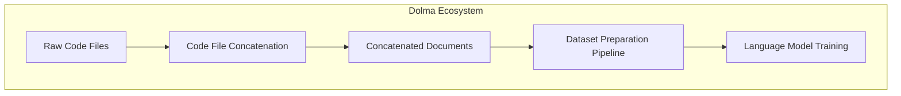
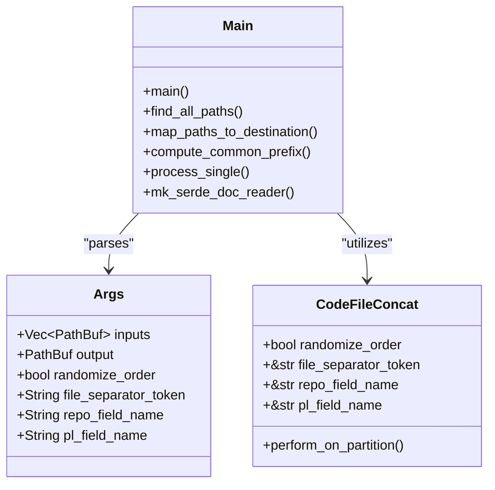
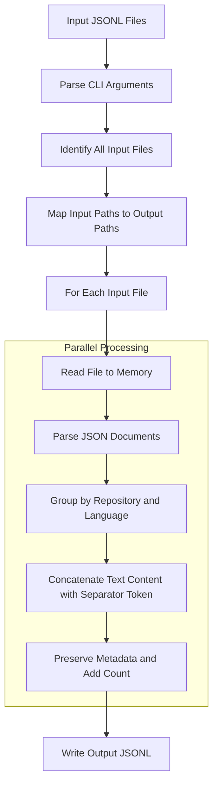
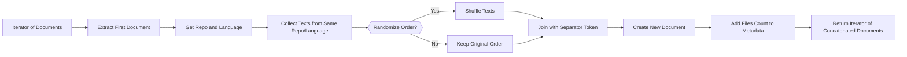
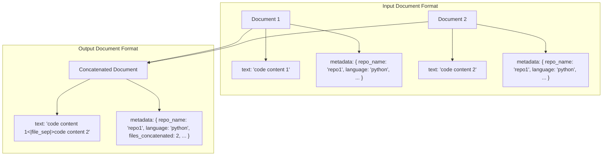

<!-- source: DeepWiki mcp.deepwiki.com · repo allenai/dolma · page 7.3 Code File Concatenation · fetched 2026-10-26 -->

# Code File Concatenation

<details>
<summary>Relevant source files</summary>

The following files were used as context for generating this wiki page:

- [contrib/code-file-concat/.gitignore](contrib/code-file-concat/.gitignore)
- [contrib/code-file-concat/Cargo.lock](contrib/code-file-concat/Cargo.lock)
- [contrib/code-file-concat/Cargo.toml](contrib/code-file-concat/Cargo.toml)
- [contrib/code-file-concat/README.md](contrib/code-file-concat/README.md)
- [contrib/code-file-concat/src/concat.rs](contrib/code-file-concat/src/concat.rs)
- [contrib/code-file-concat/src/main.rs](contrib/code-file-concat/src/main.rs)

</details>


This document describes the Code File Concatenation tool, a standalone utility found in the Dolma repository's `contrib` directory. The tool is designed to process and combine multiple code files from the same repository and programming language, creating concatenated documents that preserve the original content while reducing the number of individual files.

## Purpose and Functionality

Code File Concatenation addresses a specific preprocessing need when working with code datasets: transforming multiple individual source code files into coherent, larger documents grouped by their repository and programming language. This process is particularly useful for:

- Reducing the number of small documents in a dataset
- Maintaining repository and language context during model training
- Preparing code data for pre-training language models

The tool assumes input data is already partitioned by repository and sorted by repository and programming language, where each partition may contain multiple repositories.



Sources: [contrib/code-file-concat/README.md:1-9]()

## System Architecture

The Code File Concatenation tool is implemented in Rust and consists of a simple command-line interface with core concatenation logic. The system processes JSONL files (JSON Lines format) where each line represents a document containing code text and its associated metadata.



Sources: [contrib/code-file-concat/src/main.rs:11-37](), [contrib/code-file-concat/src/concat.rs:16-21]()

## Data Flow Process

The concatenation process follows a series of steps to transform individual code files into concatenated documents:



Sources: [contrib/code-file-concat/src/main.rs:137-167](), [contrib/code-file-concat/src/concat.rs:23-82]()

## Core Concatenation Logic

The `CodeFileConcat` struct implements the core concatenation logic in the `perform_on_partition` method. This method:

1. Takes an iterator of JSON documents as input
2. Groups documents by repository name and programming language
3. Extracts the text content from each document
4. Optionally randomizes the order of files within a group
5. Joins all text content with a separator token
6. Creates a new document with the concatenated text and updated metadata



Sources: [contrib/code-file-concat/src/concat.rs:24-81]()

## Command Line Interface

The tool provides a command-line interface with the following parameters:

| Parameter | Description | Default |
|-----------|-------------|---------|
| `--inputs` | Input files to process (supports glob patterns) | (Required) |
| `--output` | Destination output directory | (Required) |
| `--randomize-order` | Whether to randomize the order during concatenation | `false` |
| `--file-separator-token` | Value of the file separator token | `<\|file_sep\|>` |
| `--repo-field-name` | Which metadata field contains the repo name | `repo_name` |
| `--pl-field-name` | Which metadata field contains the programming language | `language` |

Example usage:

```shell
cargo run --release -- \
    --inputs 'data/input/*jsonl' \
    --output data/output \
    --randomize-order \
    --file-separator-token '<|file_sep|>'
```

Sources: [contrib/code-file-concat/README.md:11-31](), [contrib/code-file-concat/src/main.rs:11-37]()

## Path Handling

The system includes utility functions for path handling to ensure input files are correctly mapped to output locations:

1. `find_all_paths`: Expands directories and glob patterns to individual file paths
2. `compute_common_prefix`: Identifies the common prefix among input paths
3. `map_paths_to_destination`: Maps input paths to corresponding output paths, preserving relative directory structure

This ensures that the output file organization mirrors the input file structure, making it easier to track file origins.

Sources: [contrib/code-file-concat/src/main.rs:40-96]()

## Document Processing

Each document in the input JSONL file is expected to have:

1. A `text` field containing the code content
2. A `metadata` field containing repository and programming language information

The concatenation process preserves the metadata from the first document in each group and adds a new field `files_concatenated` to track the number of files that were combined.



Sources: [contrib/code-file-concat/src/concat.rs:58-77]()

## Performance Considerations

The tool utilizes Rayon for parallel processing, allowing it to efficiently process multiple input files simultaneously. Each input file is processed independently, but the documents within a file are processed sequentially to maintain proper grouping by repository and programming language.

The system reads each input file completely into memory before processing, which provides good performance but may be a limitation for extremely large input files.

Sources: [contrib/code-file-concat/src/main.rs:182-199](), [contrib/code-file-concat/Cargo.toml:1-12]()

## Integration with Dolma

While the Code File Concatenation tool is designed as a standalone utility, it can be integrated into the broader Dolma workflow as a preprocessing step before using the main Dolma components like the mixer or tokenizer. The tool preserves the JSONL format expected by other Dolma components, making integration seamless.

For information about other code-related processing tools in Dolma, see the Fill-In-Middle (FIM) data augmentation tool [7.1](#7.1) and the Tokens Sanitizer [7.2](#7.2).

Sources: [contrib/code-file-concat/README.md:1-31]()

---

