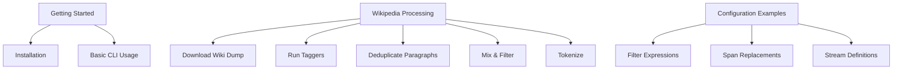
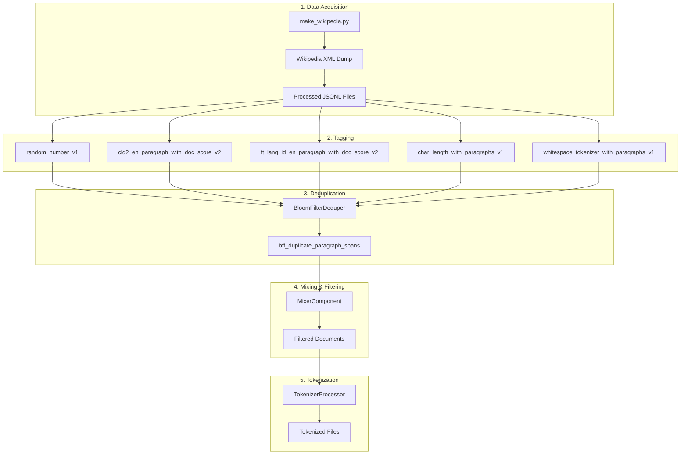
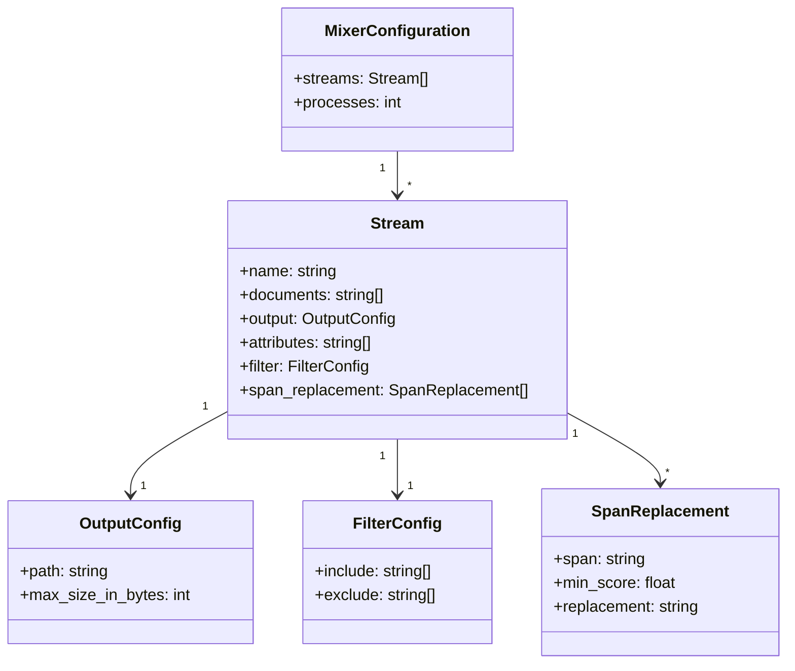
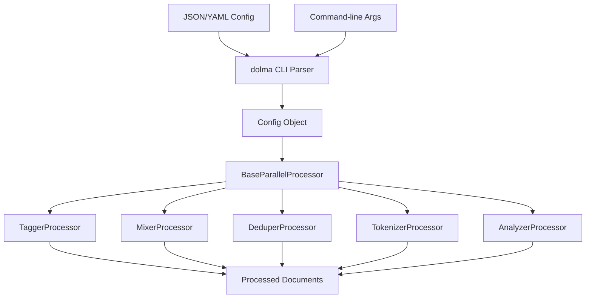

<!-- source: DeepWiki mcp.deepwiki.com · repo allenai/dolma · page 8 Tutorials and Examples · fetched 2026-10-26 -->

# Tutorials and Examples

<details>
<summary>Relevant source files</summary>

The following files were used as context for generating this wiki page:

- [docs/examples/wikipedia-mixer.json](docs/examples/wikipedia-mixer.json)
- [docs/getting-started.md](docs/getting-started.md)
- [scripts/make_wikipedia.py](scripts/make_wikipedia.py)

</details>


This page provides practical examples and tutorials for using the Dolma toolkit to curate datasets for machine learning model pre-training. The examples demonstrate how to use various Dolma components including taggers, deduplication tools, mixers, and tokenizers to process and prepare large text datasets.

For information about the overall architecture of Dolma, see [Architecture](#2). For details on individual components, refer to [Data Processing Pipeline](#3).

## Overview of Available Examples

Dolma includes several documented examples to help users understand how to implement common dataset curation workflows:

1. **Getting Started** - Basic installation and CLI usage
2. **Wikipedia Processing** - Complete pipeline for processing Wikipedia data
3. **Configuration Examples** - Working with JSON/YAML configuration files



Sources: [docs/getting-started.md:1-38]()

## Quick Start Guide

### Installation

Dolma can be installed via pip:

```
pip install dolma
```

After installation, the `dolma` command line tool becomes available, providing access to various dataset processing commands.

### Available Commands

Dolma provides several commands for dataset processing:

| Command | Purpose |
|---------|---------|
| `dedupe` | Deduplicate documents or paragraphs using a bloom filter |
| `mix` | Mix documents from multiple streams with filtering |
| `tag` | Apply various taggers to documents |
| `list` | Display available taggers |
| `stat` | Analyze attribute value distributions |
| `tokens` | Tokenize documents with a specified tokenizer |

To see available options for each command, use the `--help` flag:

```
dolma tag --help
```

Sources: [docs/getting-started.md:3-36]()

## Example Workflow: Processing Wikipedia Data

This example demonstrates a complete workflow for processing Wikipedia data using Dolma.



Sources: [docs/getting-started.md:40-137](), [scripts/make_wikipedia.py:1-269]()

### Step 1: Obtain Wikipedia Data

The first step involves downloading and processing a Wikipedia dump. Dolma provides a script for this purpose:

```
python scripts/make_wikipedia.py \
  --output wikipedia \
  --date 20231001 \
  --lang simple \
  --processes 16
```

This script:
1. Downloads a Wikipedia dump for the specified language and date
2. Processes it using WikiExtractor
3. Converts the extracted content to Dolma's document format
4. Stores the result in a directory structure under `wikipedia/v0/documents`

The script uses `WikiExtractorParallel` which extends Dolma's `BaseParallelProcessor` to enable efficient multi-process execution.

Sources: [docs/getting-started.md:44-61](), [scripts/make_wikipedia.py:170-242]()

### Step 2: Run Taggers

After obtaining the Wikipedia data, the next step is to tag it with various attributes:

```
dolma tag \
    --documents "wikipedia/v0/documents/*" \
    --experiment exp \
    --taggers random_number_v1 \
              cld2_en_paragraph_with_doc_score_v2 \
              ft_lang_id_en_paragraph_with_doc_score_v2 \
              char_length_with_paragraphs_v1 \
              whitespace_tokenizer_with_paragraphs_v1 \
    --processes 16
```

This command applies multiple taggers to each document:
- `random_number_v1`: Assigns a random number to each document (useful for dataset splitting)
- `cld2_en_paragraph_with_doc_score_v2` and `ft_lang_id_en_paragraph_with_doc_score_v2`: Tag paragraphs as English or non-English using different language detection algorithms
- `char_length_with_paragraphs_v1`: Counts characters in each document and paragraph
- `whitespace_tokenizer_with_paragraphs_v1`: Counts tokens in each document and paragraph

The results are stored in the `wikipedia/v0/attributes/exp` directory, with each tagger creating its own set of attribute files.

Sources: [docs/getting-started.md:63-89]()

### Step 3: Deduplicate Paragraphs

After tagging, you can deduplicate at the paragraph level to remove duplicate content:

```
dolma dedupe \
    --documents "wikipedia/v0/documents/*" \
    --dedupe.paragraphs.attribute_name 'bff_duplicate_paragraph_spans' \
    --dedupe.skip_empty \
    --bloom_filter.file /tmp/deduper_bloom_filter.bin \
    --no-bloom_filter.read_only \
    --bloom_filter.estimated_doc_count '6_000_000' \
    --bloom_filter.desired_false_positive_rate '0.0001' \
    --processes 188
```

This command:
1. Processes each document's paragraphs
2. Uses a bloom filter to identify duplicates
3. Creates an attribute called `bff_duplicate_paragraph_spans` marking duplicate paragraphs

Sources: [docs/getting-started.md:91-107]()

### Step 4: Mix and Filter Documents

The mixer component combines documents from multiple sources and applies filters:

```
dolma -c examples/wikipedia-mixer.json mix --processes 16
```

The configuration file (`wikipedia-mixer.json`) specifies:
1. Source document paths
2. Output location and size limits
3. Required attributes
4. Filter expressions (include/exclude)
5. Span replacement rules



The example configuration:
- Filters out documents that are too short (<50 tokens) or too long (>100,000 tokens)
- Excludes documents with a low English language score
- Excludes documents that are completely duplicated
- Replaces non-English paragraphs with empty strings

Sources: [docs/getting-started.md:109-123](), [docs/examples/wikipedia-mixer.json:1-36]()

### Step 5: Tokenize the Dataset

The final step involves tokenizing the processed dataset:

```
dolma tokens \
    --documents "wikipedia/example0/documents/*.gz" \
    --tokenizer.name_or_path "EleutherAI/gpt-neox-20b" \
    --destination wikipedia/example0/tokens \
    --processes 16
```

This command:
1. Uses the specified tokenizer (GPT-NeoX 20B in this example)
2. Processes all documents in the filtered dataset
3. Writes tokenized output to the destination directory

Sources: [docs/getting-started.md:125-137]()

## Configuration-Based Processing

Dolma supports both command-line arguments and configuration files (JSON or YAML) for more complex processing. Configuration files are particularly useful for:

1. Complex filter expressions
2. Multiple input and output streams
3. Span replacement rules
4. Reproducible workflows

Here's a visualization of how configuration files interact with the Dolma pipeline:



Sources: [docs/getting-started.md:109-123](), [docs/examples/wikipedia-mixer.json:1-36]()

## Advanced Usage and Customization

### Customizing Filters with JSONPath/JQ

The mixer component uses JSONPath/JQ-like syntax to filter documents. This allows for complex filtering based on:

- Document content
- Tagged attributes
- Metadata

Example filters from the Wikipedia processing example:

| Filter Type | Expression | Purpose |
|-------------|------------|---------|
| Include | `$.attributes[?(@.exp__whitespace_tokenizer_with_paragraphs_v1__document[0][2] < 100000)]` | Include documents with fewer than 100,000 tokens |
| Exclude | `$.attributes[?(@.exp__whitespace_tokenizer_with_paragraphs_v1__document[0][2] < 50)]` | Exclude documents with fewer than 50 tokens |
| Exclude | `$.attributes[?(@.exp__ft_lang_id_en_paragraph_with_doc_score_v2__doc_en[0][2] <= 0.5)]` | Exclude documents with low English language score |
| Exclude | `$@.attributes[?(@.bff_duplicate_paragraph_spans && @.bff_duplicate_paragraph_spans[0] && @.bff_duplicate_paragraph_spans[0][2] >= 1.0)]` | Exclude completely duplicated documents |

Sources: [docs/examples/wikipedia-mixer.json:16-25]()

### Span Replacements

The mixer also supports replacing specific spans of text based on attribute scores:

```json
"span_replacement": [
  {
    "span": "$.attributes.exp__cld2_en_paragraph_with_doc_score_v2__not_en",
    "min_score": 0.1,
    "replacement": ""
  }
]
```

This example replaces non-English paragraphs (as identified by the CLD2 tagger with a confidence score > 0.1) with empty strings, effectively removing them from the final dataset.

Sources: [docs/examples/wikipedia-mixer.json:26-32]()

## Summary

This page has demonstrated practical examples of using Dolma for dataset curation, with a focus on processing Wikipedia data. The examples showcase how to:

1. Download and preprocess source data
2. Apply various taggers to annotate documents
3. Deduplicate content using bloom filters
4. Filter and transform documents using configurable rules
5. Tokenize the final dataset for language model training

For more detailed information about specific components, refer to their respective documentation pages in the [Data Processing Pipeline](#3) section.

---

