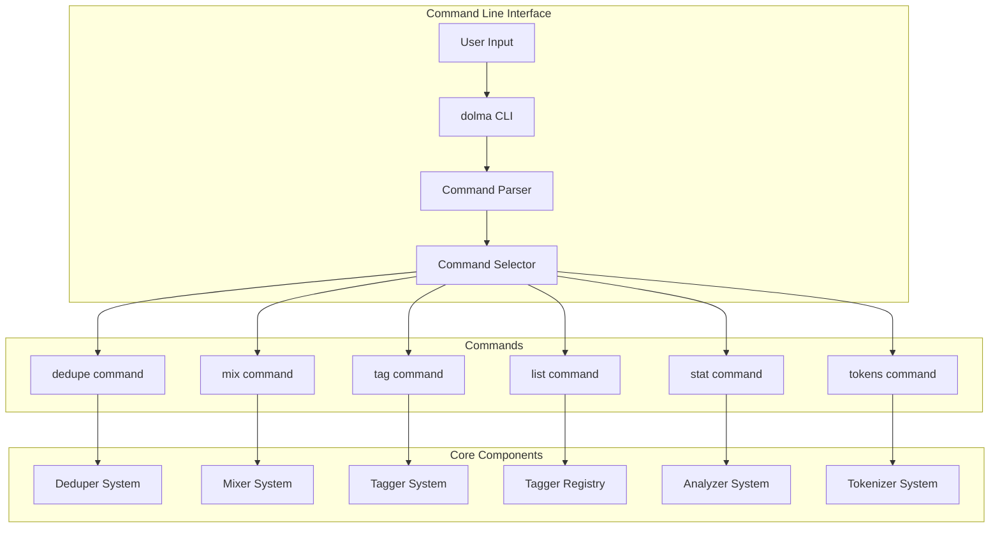
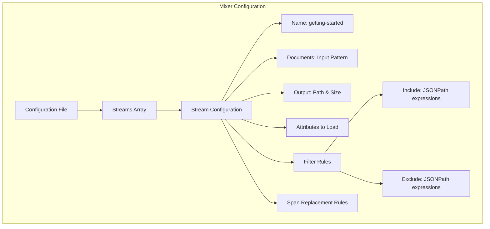
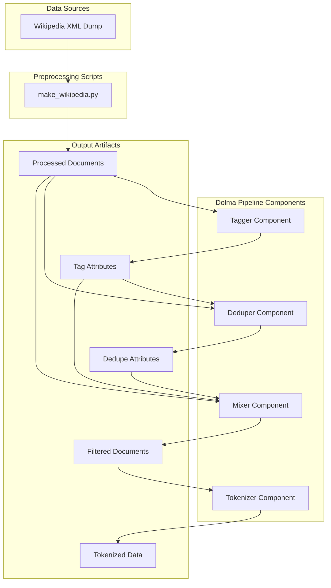

<!-- source: DeepWiki mcp.deepwiki.com · repo allenai/dolma · page 8.1 Getting Started · fetched 2026-10-26 -->

# Getting Started

<details>
<summary>Relevant source files</summary>

The following files were used as context for generating this wiki page:

- [docs/examples/wikipedia-mixer.json](docs/examples/wikipedia-mixer.json)
- [docs/getting-started.md](docs/getting-started.md)
- [scripts/make_wikipedia.py](scripts/make_wikipedia.py)

</details>


This guide provides step-by-step instructions for installing and using the Dolma toolkit, a powerful system for curating large-scale datasets for machine learning model pre-training. This document covers basic installation, command-line interface usage, and a complete walkthrough example of processing Wikipedia data.

For detailed information about the architecture of Dolma, see [Architecture](#2). For advanced usage of specific components, refer to the [Data Processing Pipeline](#3) documentation.

## Installation

Dolma can be easily installed using pip:

```shell
pip install dolma
```

After installation, you'll have access to the `dolma` command-line tool.

Sources: [docs/getting-started.md:3-7]()

## Command-Line Interface Overview

Dolma provides a comprehensive set of commands through its CLI. To view available commands, use the `--help` flag:

```
dolma --help
```

The following commands are available:

| Command | Description |
|---------|-------------|
| `dedupe` | Deduplicate documents or paragraphs using a bloom filter |
| `mix` | Mix documents from multiple streams according to configured rules |
| `tag` | Apply various taggers to documents or spans |
| `list` | List all available taggers |
| `stat` | Analyze the distribution of attribute values in a dataset |
| `tokens` | Tokenize documents using a specified tokenizer |

Each command has specific options that can be viewed using `--help` (e.g., `dolma tag --help`).

Sources: [docs/getting-started.md:9-36]()

## Dolma CLI Architecture

The following diagram illustrates how the Dolma CLI commands map to the underlying system components:



Sources: [docs/getting-started.md:9-36]()

## Example: Processing Wikipedia Data

This section walks through a complete example of how to use Dolma to process Wikipedia data, demonstrating the typical workflow from raw data to tokenized output ready for language model training.

### Data Processing Workflow

The following diagram shows the data flow for processing Wikipedia data with Dolma:

```mermaid
flowchart LR
    RawWiki["Wikipedia XML Dump"] --> |"scripts/make_wikipedia.py"| JSONLDocs["JSONL Documents"]
    JSONLDocs --> |"dolma tag"| TaggedDocs["Tagged Documents"]
    TaggedDocs --> |"dolma dedupe"| DedupedDocs["Deduplicated Documents"]
    DedupedDocs --> |"dolma mix"| FilteredDocs["Filtered Documents"]
    FilteredDocs --> |"dolma tokens"| TokenizedDocs["Tokenized Documents"]
```



Sources: [docs/getting-started.md:38-137]()

### Step 0: Obtain Wikipedia Data

First, install the required dependencies:

```bash
pip install git+https://github.com/santhoshtr/wikiextractor.git requests smart_open tqdm
```

Then, use the provided script to download and process Wikipedia data:

```bash
python scripts/make_wikipedia.py \
  --output wikipedia \
  --date 20231001 \
  --lang simple \
  --processes 16
```

This script:
1. Downloads the specified Wikipedia dump
2. Processes it using WikiExtractor
3. Converts the extracted data to a format compatible with Dolma

The script accepts several parameters:

| Parameter | Description | Default |
|-----------|-------------|---------|
| `--output` | Directory to store the processed data | Required |
| `--date` | Wikipedia dump date in YYYYMMDD format | 20231001 |
| `--lang` | Wikipedia language code | simple |
| `--processes` | Number of parallel processes to use | 1 |

The processed articles will be stored in `wikipedia/v0/documents/` as compressed JSONL files.

Sources: [docs/getting-started.md:40-61](), [scripts/make_wikipedia.py:88-95](), [scripts/make_wikipedia.py:245-262]()

### Step 1: Run Taggers

Tagging is the process of analyzing documents and attaching metadata about their properties. For Wikipedia processing, we'll use several taggers:

```bash
dolma tag \
    --documents "wikipedia/v0/documents/*" \
    --experiment exp \
    --taggers random_number_v1 \
              cld2_en_paragraph_with_doc_score_v2 \
              ft_lang_id_en_paragraph_with_doc_score_v2 \
              char_length_with_paragraphs_v1 \
              whitespace_tokenizer_with_paragraphs_v1 \
    --processes 16
```

The following table explains the taggers used in this example:

| Tagger | Purpose |
|--------|---------|
| `random_number_v1` | Assigns a random number to each document for train/test splitting |
| `cld2_en_paragraph_with_doc_score_v2` | Uses CLD2 to detect English paragraphs and score documents |
| `ft_lang_id_en_paragraph_with_doc_score_v2` | Uses FastText to detect English paragraphs and score documents |
| `char_length_with_paragraphs_v1` | Counts characters in documents and paragraphs |
| `whitespace_tokenizer_with_paragraphs_v1` | Counts tokens in documents and paragraphs |

The `--experiment exp` parameter groups all the taggers under a common directory name for easier management.

Sources: [docs/getting-started.md:63-89]()

### Step 2: Deduplicate Paragraphs

Deduplication helps remove redundant content, which is important for creating high-quality training datasets:

```bash
dolma dedupe \
    --documents "wikipedia/v0/documents/*" \
    --dedupe.paragraphs.attribute_name 'bff_duplicate_paragraph_spans' \
    --dedupe.skip_empty \
    --bloom_filter.file /tmp/deduper_bloom_filter.bin \
    --no-bloom_filter.read_only \
    --bloom_filter.estimated_doc_count '6_000_000' \
    --bloom_filter.desired_false_positive_rate '0.0001' \
    --processes 16
```

This command creates an attribute directory called `bff_duplicate_paragraph_spans` that marks which paragraphs are duplicates. The deduplication uses a Bloom filter for efficient memory usage when processing large datasets.

Sources: [docs/getting-started.md:91-107]()

### Step 3: Run Mixer

The mixer combines, filters, and transforms documents based on configurable rules:

```bash
dolma -c examples/wikipedia-mixer.json mix --processes 16
```

Rather than specifying all options on the command line, this example uses a configuration file. The configuration can be provided in either JSON or YAML format.

Here's the structure of the mixer configuration:



The configuration in `wikipedia-mixer.json` applies the following rules:
- Excludes documents with fewer than 50 tokens
- Excludes documents with more than 100,000 tokens
- Excludes documents with an English language score below 0.5
- Excludes documents that are completely duplicate
- Removes non-English paragraphs detected by CLD2

Sources: [docs/getting-started.md:109-123](), [docs/examples/wikipedia-mixer.json:1-36]()

### Step 4: Tokenize The Dataset

Finally, we tokenize the processed documents for use in language model training:

```bash
dolma tokens \
    --documents "wikipedia/example0/documents/*.gz" \
    --tokenizer.name_or_path "EleutherAI/gpt-neox-20b" \
    --destination wikipedia/example0/tokens \
    --processes 16
```

This command tokenizes the documents using the GPT Neo-X 20B tokenizer and saves the tokenized data to the specified destination directory.

Sources: [docs/getting-started.md:125-137]()

## End-to-End Process Components

The following diagram illustrates how the various components of Dolma interact during the end-to-end processing of Wikipedia data:



Sources: [docs/getting-started.md:38-137]()

## Next Steps

After completing this tutorial, you'll have a processed Wikipedia dataset ready for language model training. To learn more about specific components of Dolma, check out the following resources:

- [Architecture](#2) for understanding the overall system design
- [Data Processing Pipeline](#3) for details on each processing component
- [Command Line Interface](#4) for complete CLI documentation
- [Wikipedia Processing Example](#8.2) for a more detailed exploration of this example

---

