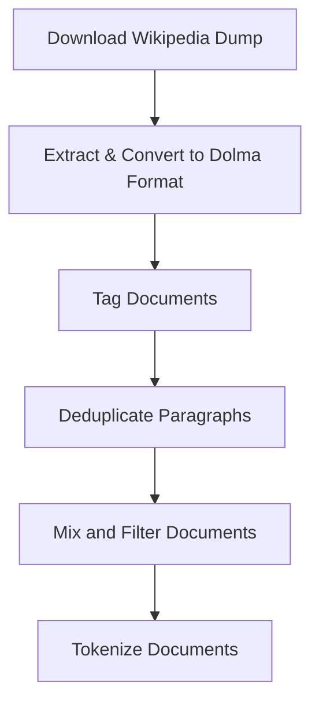
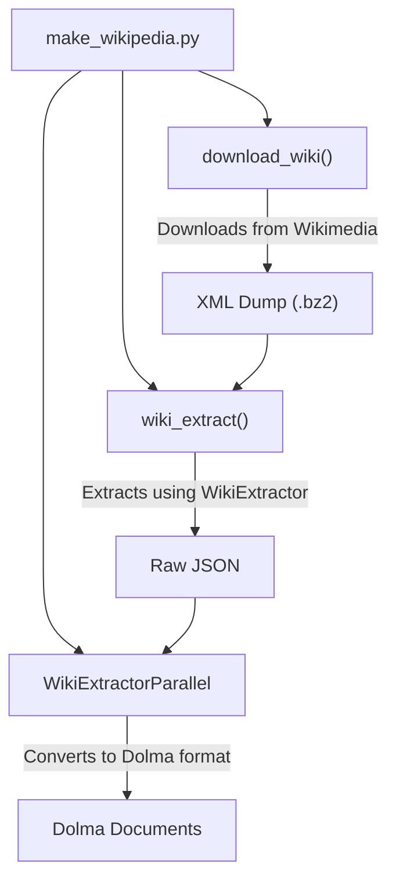
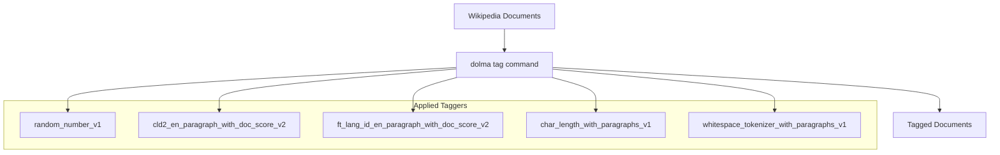
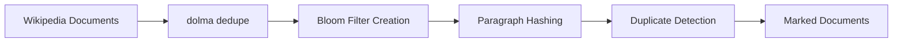
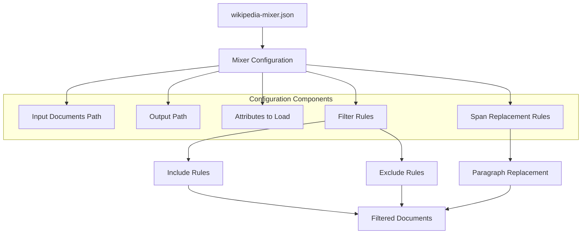
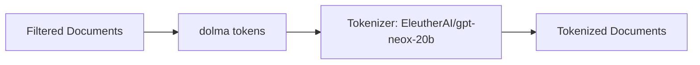
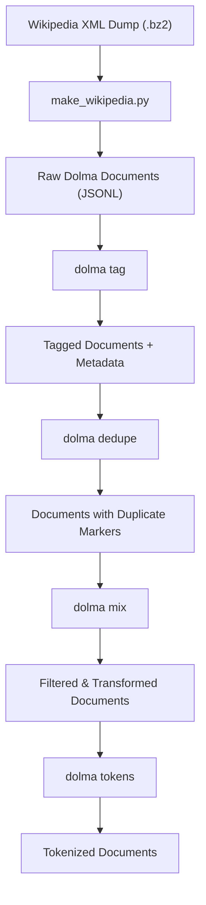
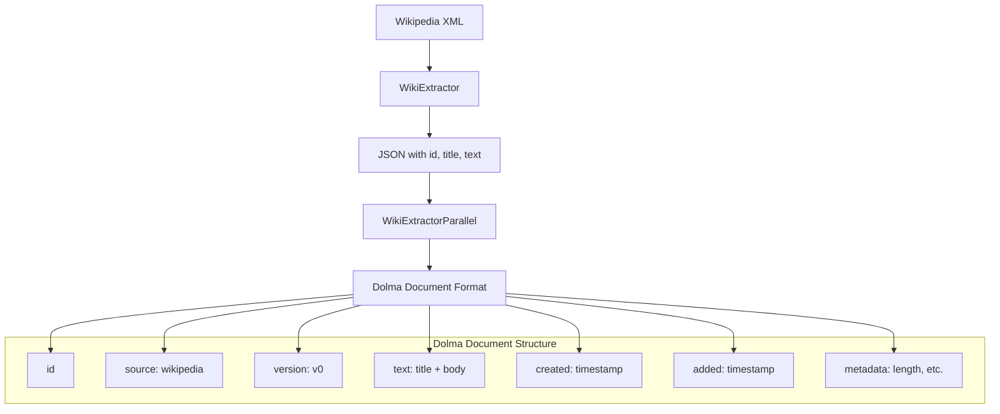

<!-- source: DeepWiki mcp.deepwiki.com · repo allenai/dolma · page 8.2 Wikipedia Processing Example · fetched 2026-10-26 -->

# Wikipedia Processing Example

<details>
<summary>Relevant source files</summary>

The following files were used as context for generating this wiki page:

- [docs/examples/wikipedia-mixer.json](docs/examples/wikipedia-mixer.json)
- [docs/getting-started.md](docs/getting-started.md)
- [scripts/make_wikipedia.py](scripts/make_wikipedia.py)

</details>


## Purpose and Scope

This document provides a comprehensive guide for processing Wikipedia data using the Dolma toolkit. It covers downloading Wikipedia dumps, converting them to Dolma's format, tagging documents, deduplicating paragraphs, filtering content, and tokenizing for language model training. This example serves as a practical demonstration of Dolma's data processing capabilities with a widely-used dataset.

For general information about getting started with Dolma, see [Getting Started](#8.1).

## Processing Workflow Overview

Processing Wikipedia with Dolma involves several distinct steps, forming a complete data preparation pipeline.



This workflow transforms raw Wikipedia dumps into a clean, deduplicated, and properly formatted dataset suitable for language model training.

Sources: [docs/getting-started.md:38-138]()

## Step 0: Obtaining Wikipedia Data

The first step is to download and process a Wikipedia dump using the provided script.

### Prerequisites

Install the required dependencies:
```
pip install git+https://github.com/santhoshtr/wikiextractor.git requests smart_open tqdm
```

### Download and Process Wikipedia

The `make_wikipedia.py` script handles three main tasks:
1. Downloading the Wikipedia dump
2. Extracting articles using WikiExtractor
3. Converting to Dolma's document format



Execute the script as follows:

```
python scripts/make_wikipedia.py \
  --output wikipedia \
  --date 20231001 \
  --lang simple \
  --processes 16
```

Parameters:
- `--output`: Output directory
- `--date`: Wikipedia dump date (format: YYYYMMDD)
- `--lang`: Wikipedia language code
- `--processes`: Number of parallel processes

The script will create a directory structure with processed documents in `wikipedia/v0/documents/`.

Sources: [scripts/make_wikipedia.py:44-269](), [docs/getting-started.md:44-61]()

## Step 1: Tagging Documents

After obtaining the Wikipedia data, the next step is to tag documents with metadata that will be used for filtering and quality assessment.

### Running the Taggers



Execute the tagging process:

```
dolma tag \
    --documents "wikipedia/v0/documents/*" \
    --experiment exp \
    --taggers random_number_v1 \
              cld2_en_paragraph_with_doc_score_v2 \
              ft_lang_id_en_paragraph_with_doc_score_v2 \
              char_length_with_paragraphs_v1 \
              whitespace_tokenizer_with_paragraphs_v1 \
    --processes 16
```

Tagger descriptions:
- `random_number_v1`: Assigns a random number to each document for dataset splitting
- `cld2_en_paragraph_with_doc_score_v2`: Uses cld2 to identify English paragraphs and score documents
- `ft_lang_id_en_paragraph_with_doc_score_v2`: Uses fastText for language identification
- `char_length_with_paragraphs_v1`: Counts characters in documents and paragraphs
- `whitespace_tokenizer_with_paragraphs_v1`: Counts whitespace-separated tokens

The tagged attributes are stored in the `wikipedia/v0/attributes/exp/` directory.

Sources: [docs/getting-started.md:65-89]()

## Step 2: Deduplicating Paragraphs

Deduplication is crucial for creating high-quality datasets by removing redundant content.



Execute the deduplication process:

```
dolma dedupe \
    --documents "wikipedia/v0/documents/*" \
    --dedupe.paragraphs.attribute_name 'bff_duplicate_paragraph_spans' \
    --dedupe.skip_empty \
    --bloom_filter.file /tmp/deduper_bloom_filter.bin \
    --no-bloom_filter.read_only \
    --bloom_filter.estimated_doc_count '6_000_000' \
    --bloom_filter.desired_false_positive_rate '0.0001' \
    --processes 16
```

Key parameters:
- `dedupe.paragraphs.attribute_name`: Name for the attribute storing duplicate information
- `bloom_filter.file`: Path to store the bloom filter
- `bloom_filter.estimated_doc_count`: Estimated number of documents
- `bloom_filter.desired_false_positive_rate`: Acceptable false positive rate

This command creates an attribute directory `bff_duplicate_paragraph_spans` containing information about duplicate paragraphs.

Sources: [docs/getting-started.md:92-108]()

## Step 3: Mixing and Filtering Documents

The mixer component combines, filters, and transforms documents based on configured rules.



Execute the mixer with a configuration file:

```
dolma -c examples/wikipedia-mixer.json mix --processes 16
```

The configuration file `wikipedia-mixer.json` specifies:

1. Document sources and destination
2. Attributes to load
3. Filter rules:
   - Include documents with fewer than 100,000 whitespace tokens
   - Exclude documents with fewer than 50 whitespace tokens
   - Exclude documents with less than 50% English content
   - Exclude documents with entirely duplicate paragraphs
4. Span replacement rules:
   - Replace non-English paragraphs with empty text

The mixer creates a new set of filtered documents in `wikipedia/example0/documents/`.

Sources: [docs/getting-started.md:109-124](), [docs/examples/wikipedia-mixer.json:1-36]()

## Step 4: Tokenizing Documents

The final step is to tokenize the filtered documents for language model training.



Execute the tokenization:

```
dolma tokens \
    --documents "wikipedia/example0/documents/*.gz" \
    --tokenizer.name_or_path "EleutherAI/gpt-neox-20b" \
    --destination wikipedia/example0/tokens \
    --processes 16
```

This command tokenizes the documents using the GPT-NeoX 20B tokenizer and writes the tokenized files to `wikipedia/example0/tokens/`.

Sources: [docs/getting-started.md:126-138]()

## Complete Processing Pipeline

The diagram below shows the complete Wikipedia processing pipeline, including data formats and transformations:



This pipeline transforms raw Wikipedia dumps into a clean, filtered, and tokenized dataset ready for language model training.

Sources: [docs/getting-started.md:38-138](), [scripts/make_wikipedia.py:246-262]()

## Filter Configuration Breakdown

The Wikipedia mixer configuration uses JSONPath expressions to filter documents:

| Filter Type | JSONPath Expression | Purpose |
|-------------|---------------------|---------|
| Include | `$.attributes[?(@.exp__whitespace_tokenizer_with_paragraphs_v1__document[0][2] < 100000)]` | Keep documents with fewer than 100,000 tokens |
| Exclude | `$.attributes[?(@.exp__whitespace_tokenizer_with_paragraphs_v1__document[0][2] < 50)]` | Remove documents with fewer than 50 tokens |
| Exclude | `$.attributes[?(@.exp__ft_lang_id_en_paragraph_with_doc_score_v2__doc_en[0][2] <= 0.5)]` | Remove documents with less than 50% English content |
| Exclude | `$@.attributes[?(@.bff_duplicate_paragraph_spans && @.bff_duplicate_paragraph_spans[0] && @.bff_duplicate_paragraph_spans[0][2] >= 1.0)]` | Remove documents that consist entirely of duplicate paragraphs |

The span replacement configuration removes non-English paragraphs:

```json
{
  "span": "$.attributes.exp__cld2_en_paragraph_with_doc_score_v2__not_en",
  "min_score": 0.1,
  "replacement": ""
}
```

This replaces paragraphs identified as non-English by the cld2 tagger with an empty string.

Sources: [docs/examples/wikipedia-mixer.json:16-32]()

## Data Format Transformation

The `make_wikipedia.py` script transforms Wikipedia articles into Dolma's document format:



The Dolma document format contains:
- Unique identifier
- Source indicator ("wikipedia")
- Version information
- Text content (title + body)
- Creation timestamp
- Addition timestamp
- Metadata including document length

Sources: [scripts/make_wikipedia.py:194-224]()

This comprehensive guide demonstrates how to process Wikipedia data using the Dolma toolkit, transforming raw Wikipedia dumps into a clean, filtered, and tokenized dataset suitable for language model training.