# Page: Overview

# Overview

<details>
<summary>Relevant source files</summary>

The following files were used as context for generating this wiki page:

- [.gitignore](.gitignore)
- [CITATION.cff](CITATION.cff)
- [LICENSE](LICENSE)
- [Makefile](Makefile)
- [README.md](README.md)

</details>


## Purpose and Scope

This document provides an overview of the Dolma toolkit, an open-source system for curating large datasets for machine learning model pre-training. The Dolma toolkit enables efficient processing of billions of documents through a high-performance, hybrid Python-Rust architecture. It was used to create the Dolma dataset, a 3 trillion token corpus used to train the OLMo language model.

For detailed information about the system architecture, see [Architecture](#2). For specifics on data processing components, see [Data Processing Pipeline](#3).

Sources: [README.md:3-15]()

## What is Dolma?

Dolma consists of two distinct but related components:

1. **Dolma Dataset**: An open corpus containing 3 trillion tokens from diverse sources including web content, academic publications, code, books, and encyclopedic materials.

2. **Dolma Toolkit**: A high-performance system for curating large-scale datasets for language model pre-training - the focus of this documentation.

The toolkit implements efficient processing methods for document tagging, filtering, deduplication, and tokenization, allowing researchers to create custom pre-training datasets at scale.

Sources: [README.md:3-15](), [README.md:18-30]()

## System Architecture Overview

Dolma follows a hybrid architecture that combines Python for high-level functionality and Rust for performance-critical operations.

### High-Level Architecture

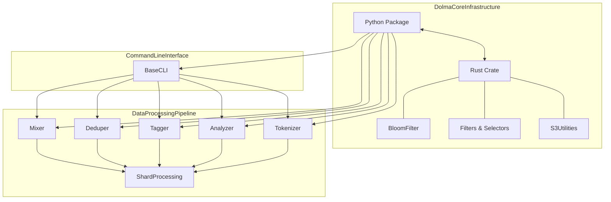

The architecture consists of three main components:
- **Core Infrastructure**: Python package with Rust integration for performance-critical operations
- **Data Processing Pipeline**: Components for document transformation (mixing, deduplication, tagging, etc.)
- **Command Line Interface**: Unified interface for accessing all tools

Sources: [README.md:20-26]()

## Key Features

### 1. High Performance

Dolma is designed to process billions of documents concurrently using built-in parallelism. The performance-critical components are implemented in Rust, while the higher-level functionality and orchestration are implemented in Python.

### 2. Portability

The toolkit works seamlessly across different computing environments:
- Single machines
- Computing clusters
- Cloud environments

### 3. Built-In Taggers

Dolma includes ready-to-use document taggers that implement common filtering and tagging strategies used in datasets like:
- Gopher
- C4 (Common Crawl)
- OpenWebText

### 4. Fast Deduplication

Document deduplication is implemented using a high-performance Bloom filter written in Rust, enabling efficient processing of large volumes of text.

### 5. Extensibility and Cloud Support

Dolma supports:
- Custom tagging and filtering logic
- AWS S3-compatible storage locations
- Integration with various cloud services

Sources: [README.md:20-26]()

## Data Processing Workflow

The following diagram illustrates how data flows through the Dolma toolkit:

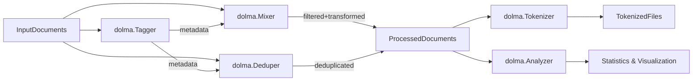

The workflow consists of several stages:
1. **Input Documents**: Raw text from various sources
2. **Processing**: 
   - **Tagging**: Adding metadata (language, quality metrics, etc.)
   - **Mixing**: Combining, filtering, and transforming documents
   - **Deduplication**: Removing duplicate content
3. **Output**:
   - **Tokenization**: Converting text to tokens for model training
   - **Analysis**: Generating statistics and visualizations of the processed data

For detailed information about each component, see [Data Processing Pipeline](#3).

Sources: [README.md:18-30]()

## Core Components

### 1. Tagger

The `Tagger` component analyzes documents and attaches metadata attributes such as language, quality scores, length metrics, and other properties. These attributes can then be used by other components for filtering or analysis.

### 2. Mixer

The `Mixer` component combines, filters, and transforms documents based on configurable rules. It can filter documents based on their attributes, apply transformations, and merge documents from multiple sources.

### 3. Deduper

The `Deduper` identifies and removes duplicate content using a high-performance Bloom filter implementation in Rust. It can operate at document or paragraph level.

### 4. Tokenizer

The `Tokenizer` converts processed text documents into token sequences suitable for language model training. It supports various tokenization schemes.

### 5. Analyzer

The `Analyzer` generates statistics and visualizations about processed documents, helping researchers understand dataset characteristics.

Sources: [README.md:18-30]()

## Command Line Interface

Dolma provides a unified command-line interface for all components. The CLI system is built around a `BaseCli` abstract class with specialized implementations for each tool:

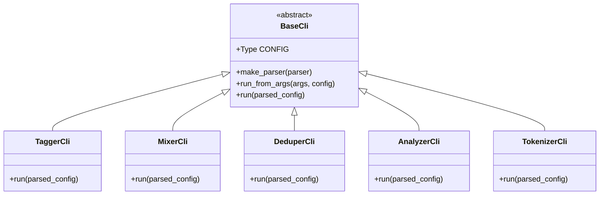

Each specialized CLI handles specific configuration options and executes the corresponding tool. For more details on the CLI system, see [Command Line Interface](#4).

Sources: [README.md:28-30]()

## Python-Rust Integration

One of Dolma's key architectural features is its Python-Rust integration, which provides both ease of use and high performance:

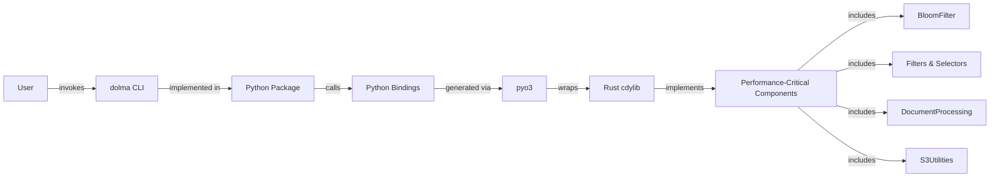

The integration works as follows:
1. Users interact with the Python CLI
2. The Python package orchestrates high-level workflows
3. Performance-critical operations call into compiled Rust code via pyo3 bindings
4. Rust implements computationally intensive components like the Bloom filter and document processors

For more details about this integration, see [Python-Rust Integration](#2.1).

Sources: [Makefile:4-19]()

## Getting Started

To install Dolma, use pip:

```
pip install dolma
```

For detailed tutorials and examples, see [Tutorials and Examples](#8).

Sources: [README.md:28]()

## Citation and Licensing

The Dolma toolkit is licensed under Apache 2.0, while the Dolma dataset is licensed under ODC-BY.

If you use Dolma in your research, please cite the following:

```
@article{dolma,
  title = {{Dolma: An Open Corpus of Three Trillion Tokens for Language Model Pretraining Research}},
  author={Luca Soldaini and Rodney Kinney and [additional authors]},
  year={2024},
  journal={arXiv preprint},
  url={https://arxiv.org/abs/2402.00159}
}
```

Sources: [README.md:32-46](), [LICENSE:1-201](), [CITATION.cff:1-201]()

---

# Page: Architecture

# Architecture

<details>
<summary>Relevant source files</summary>

The following files were used as context for generating this wiki page:

- [.github/workflows/CI.yml](.github/workflows/CI.yml)
- [Cargo.lock](Cargo.lock)
- [Cargo.toml](Cargo.toml)
- [pyproject.toml](pyproject.toml)
- [python/dolma/__init__.py](python/dolma/__init__.py)
- [src/lib.rs](src/lib.rs)

</details>


This document describes the high-level architecture of Dolma, a toolkit for curating datasets used for large language model pre-training. It covers the overall system design, Python-Rust integration, and major components. For specific information about individual components, refer to their dedicated wiki pages: [Data Processing Pipeline](#3), [Python-Rust Integration](#2.1), and [Command Line Interface](#4).

## System Overview

Dolma employs a hybrid architecture that combines Python and Rust components to balance ease of use with high performance. The system is designed to process, filter, deduplicate, and analyze large-scale text datasets efficiently.

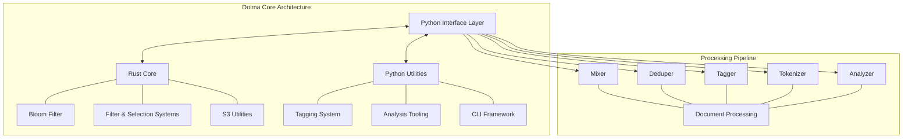

Dolma's architecture is split into two main layers:

1. **Python Interface Layer**: Provides high-level APIs, configuration handling, and extensibility
2. **Rust Core**: Implements performance-critical functionality like deduplication, mixing, and filtering

The system processes data through several pipeline components that can be used independently or chained together.

Sources: [src/lib.rs:8-15](), [python/dolma/__init__.py:10-15](), [pyproject.toml:1-47]()

## Python-Rust Integration

Dolma achieves its performance and usability goals through a hybrid language approach, with Python handling high-level operations and Rust handling performance-critical processing.

```mermaid
classDiagram
    class "Python Module" {
        +deduper()
        +mixer()
        +BaseTagger
        +TaggerRegistry
    }
    
    class "pyo3 Bindings" {
        +wrap_pyfunction!()
        +PyModule
    }
    
    class "Rust Library (cdylib)" {
        +deduper_entrypoint()
        +mixer_entrypoint()
        +bloom_filter
        +filters
        +s3_util
    }
    
    class "Config Objects" {
        +DeduperConfig
        +MixerConfig
    }
    
    "Python Module" ..> "pyo3 Bindings" : uses
    "pyo3 Bindings" ..> "Rust Library (cdylib)" : wraps
    "Python Module" --> "Config Objects" : serializes
    "Rust Library (cdylib)" --> "Config Objects" : deserializes
```

The integration works as follows:

1. Python code calls wrapped Rust functions through PyO3 bindings
2. Configuration is serialized to JSON and passed to Rust
3. Rust functions process the data and return results (or errors)
4. Python code handles the results and provides them to the user

This design allows Python to handle user interaction, configuration, and high-level control flow while Rust manages computationally intensive operations.

Sources: [src/lib.rs:1-3](), [src/lib.rs:114-126](), [python/dolma/__init__.py:26-56](), [pyproject.toml:158-170]()

## Major Components

Dolma consists of several major components that work together to process and transform text datasets:

### Processing Components

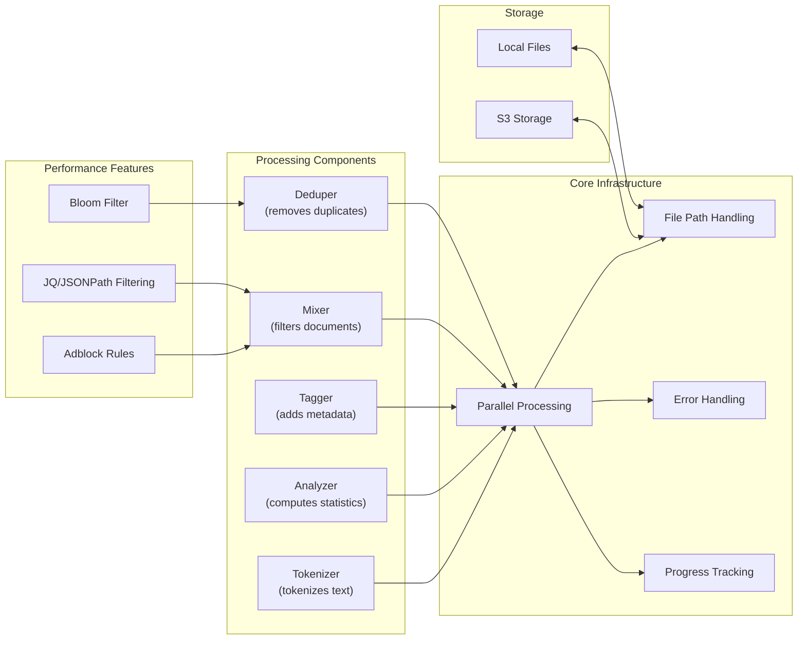

The main processing components include:

1. **Mixer**: Combines and filters documents based on configurable rules
2. **Deduper**: Identifies and removes duplicate documents using bloom filters
3. **Tagger**: Attaches metadata to documents (language, quality metrics, etc.)
4. **Analyzer**: Computes statistics and visualizations of document attributes
5. **Tokenizer**: Converts text into tokens for language model training

All these components build on a common infrastructure for parallel processing, file path handling, and error management.

Sources: [src/lib.rs:8-15](), [src/lib.rs:17-45]()

### Bloom Filter System

The bloom filter is a key component for efficient deduplication, implemented in Rust for performance:

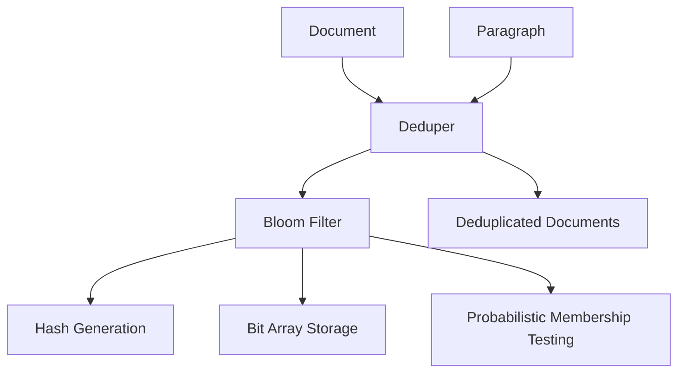

The bloom filter allows Dolma to:
- Check if a document has been seen before without storing the entire document
- Perform high-speed membership tests with configurable false positive rates
- Handle extremely large datasets with minimal memory usage

Sources: [src/lib.rs:8]()

### Storage System

Dolma supports processing files from both local and remote storage:

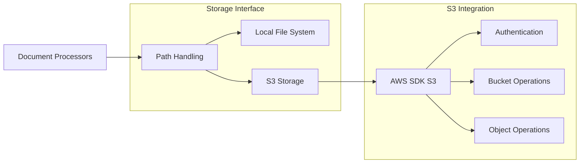

The S3 utilities provide:
- Transparent access to remote files as if they were local
- Efficient batch operations for processing large datasets
- Authentication and configuration handling for AWS services

Sources: [src/lib.rs:13](), [Cargo.toml:17-18]()

## Data Flow

The following diagram illustrates how data flows through the Dolma system:

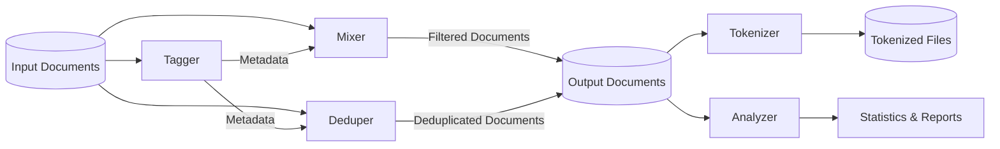

A typical Dolma workflow involves:

1. Processing raw documents through taggers to add metadata
2. Running the mixer to filter and transform documents based on attributes
3. Using the deduper to remove duplicate content
4. Tokenizing the processed documents for model training
5. Analyzing the final dataset to ensure quality

Each step can be run independently or as part of a pipeline, depending on the user's needs.

Sources: [python/dolma/__init__.py:26-56]()

## Build and Deployment

Dolma uses a sophisticated build system to produce binary packages for multiple platforms:

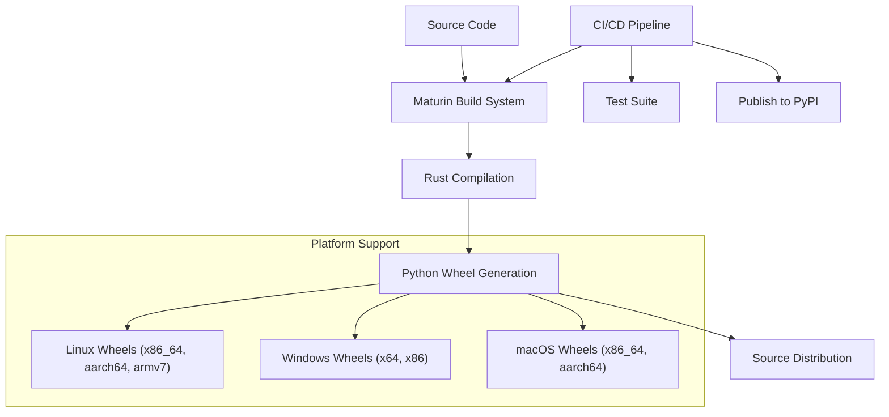

The build process:
1. Uses maturin to compile Rust code and generate Python wheels
2. Creates platform-specific wheels for all supported architectures
3. Runs through a CI/CD pipeline for testing and validation
4. Publishes the package to PyPI when triggered by a tag

This enables efficient distribution of Dolma to users across different operating systems and hardware architectures.

Sources: [pyproject.toml:158-170](), [.github/workflows/CI.yml:174-296]()

## Configuration System

Dolma uses a flexible configuration system to control its processing components:

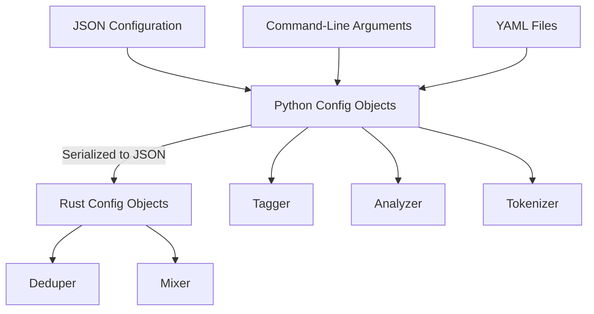

The configuration flow:
1. Users define settings in JSON, YAML, or via command-line arguments
2. Python creates configuration objects and validates them
3. For Rust components, configurations are serialized to JSON strings
4. Rust deserializes the configuration and uses it to control processing

This approach provides a consistent interface across both language boundaries.

Sources: [src/lib.rs:17-18](), [src/lib.rs:22-45](), [python/dolma/__init__.py:26-56]()

## Conclusion

Dolma's architecture combines the strengths of Python and Rust to create a powerful, flexible toolkit for dataset curation. The hybrid approach allows for both ease of use and high performance when processing large-scale text data.

Key architectural features include:
- Python-Rust integration via PyO3
- Performance-critical operations implemented in Rust
- Modular processing components that can be used independently
- Support for both local and cloud storage systems
- Parallel processing capabilities for handling large datasets
- Cross-platform compatibility through the build system

This architecture enables Dolma to efficiently process, filter, deduplicate, and analyze text data at scale, making it suitable for preparing high-quality training datasets for large language models.

Sources: [pyproject.toml:1-47](), [Cargo.toml:1-68](), [src/lib.rs:1-126]()

---

# Page: Python-Rust Integration

# Python-Rust Integration

<details>
<summary>Relevant source files</summary>

The following files were used as context for generating this wiki page:

- [.github/workflows/CI.yml](.github/workflows/CI.yml)
- [Cargo.lock](Cargo.lock)
- [Cargo.toml](Cargo.toml)
- [pyproject.toml](pyproject.toml)
- [python/dolma/__init__.py](python/dolma/__init__.py)
- [src/lib.rs](src/lib.rs)

</details>


This page documents how Dolma integrates Python and Rust components to leverage the strengths of both languages. It explains the architecture, build process, and interface between the two languages.

Dolma uses Python for high-level control, user interface, and extensibility, while leveraging Rust for performance-critical operations like document processing, filtering, and deduplication.

For information about the overall architecture of Dolma, see [Architecture](#2).

## Architecture Overview

Dolma employs a hybrid architecture where Python and Rust components interact through PyO3 bindings. This design allows developers to write performance-critical code in Rust while maintaining the flexibility and ease of use of Python for higher-level components.

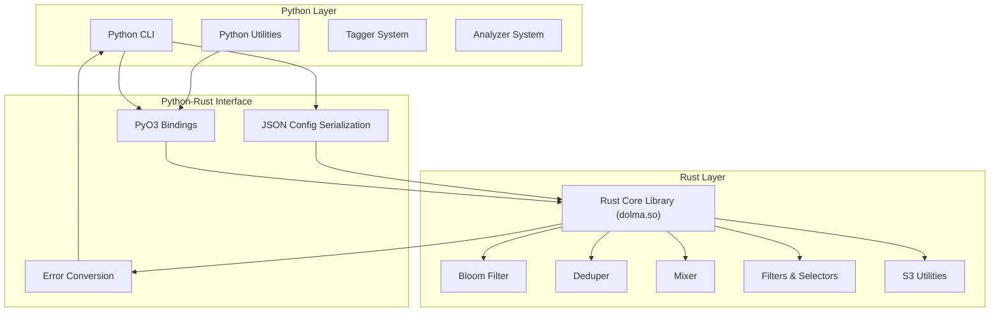

The architecture consists of three main layers:
1. Python Layer: Implements CLI, utilities, tagging and analysis systems
2. Interface Layer: Manages binding, configuration passing, and error handling
3. Rust Layer: Implements performance-critical operations

Sources: [src/lib.rs:1-126](), [python/dolma/__init__.py:1-56](), [pyproject.toml:1-206]()

## Build System

Dolma uses Maturin to build the Rust code into a Python extension. Maturin handles the compilation of Rust code and packaging it into a Python wheel that can be installed with pip.

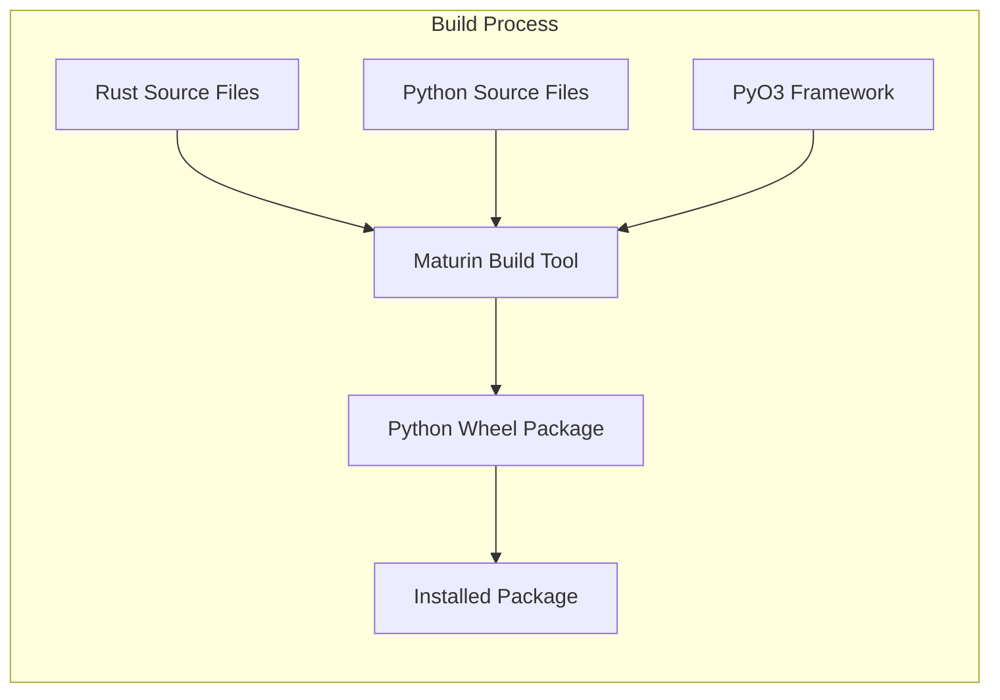

Key components of the build system:
- Maturin: Builds Rust code into a Python extension
- PyO3: Provides Rust bindings for Python
- CI/CD workflow: Builds wheels for multiple platforms and architectures

The build configuration is specified in:
- `pyproject.toml`: Defines Python package metadata and build requirements
- `Cargo.toml`: Defines Rust crate configuration and dependencies

Sources: [pyproject.toml:158-165](), [Cargo.toml:7-13](), [.github/workflows/CI.yml:174-260]()

## Code Structure and Organization

The codebase is organized into separate directories for Python and Rust code:

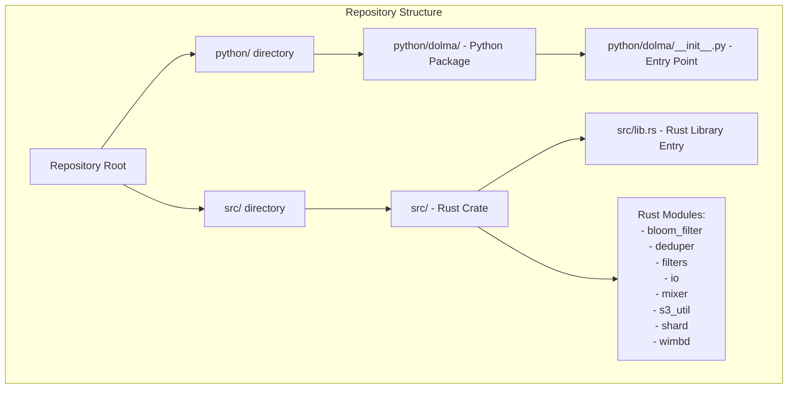

The Python package imports the compiled Rust extension and wraps it with Python-friendly interfaces.

Sources: [src/lib.rs:8-15](), [python/dolma/__init__.py:11-56]()

## Interface Between Python and Rust

The PyO3 framework facilitates communication between Python and Rust. The Rust code exports functions that can be called from Python, and the Python code wraps these functions to provide a more Pythonic API.

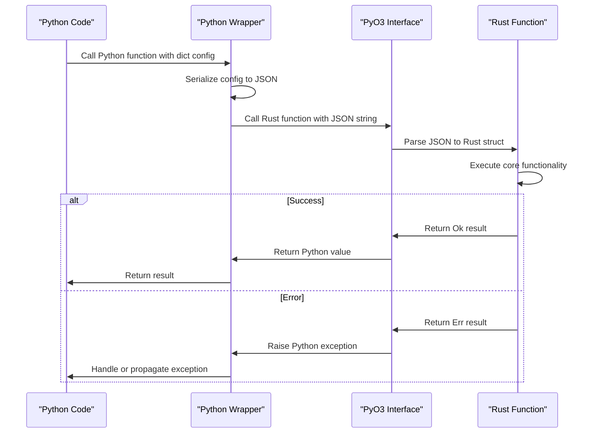

### Function Binding

Rust functions are exposed to Python using the `#[pyfunction]` attribute. These functions are then added to the Python module using the `wrap_pyfunction!` macro.

Example from `src/lib.rs`:
- `deduper_entrypoint` and `mixer_entrypoint` are exposed to Python
- A `UrlBlocker` class is created using `#[pyclass]` and its methods with `#[pymethods]`
- These are registered in the Python module using `m.add_function` and `m.add_class`

Sources: [src/lib.rs:21-45](), [src/lib.rs:114-126]()

### Configuration Passing

Configuration is passed from Python to Rust as JSON strings:

1. Python code converts a dictionary to a JSON string
2. Rust code parses the JSON string into a Rust struct
3. The Rust function processes the configuration and executes the core functionality

This approach allows for flexible configuration while maintaining type safety in Rust.

Sources: [python/dolma/__init__.py:26-56](), [src/lib.rs:21-45]()

### Error Handling

Errors from Rust are converted to Python exceptions:

1. Rust functions return `PyResult<T>` to indicate success or failure
2. Errors are converted to Python exceptions using PyO3's error handling mechanisms
3. Python wrapper functions catch these exceptions and convert them to more specific Python exceptions

This ensures that errors from the Rust code are properly handled and presented to Python users.

Sources: [python/dolma/__init__.py:37-40](), [python/dolma/__init__.py:53-56](), [src/lib.rs:22-32]()

## Performance-Critical Components in Rust

Several performance-critical components are implemented in Rust:

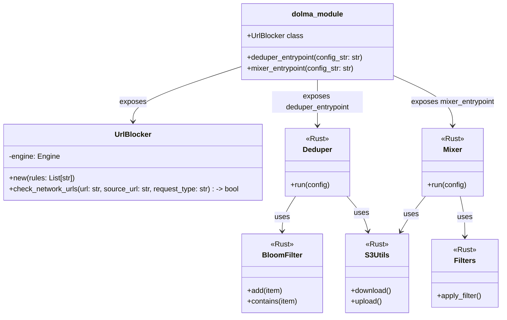

### Deduper

The Deduper component handles document deduplication, which is computationally intensive. It uses Bloom filters to efficiently detect duplicate documents:

1. Python code calls the `deduper` function with a configuration dictionary
2. The function converts the dictionary to JSON and calls the Rust `deduper_entrypoint` function
3. The Rust code parses the configuration and runs the deduplication process
4. Any errors are converted to Python exceptions

Sources: [python/dolma/__init__.py:26-40](), [src/lib.rs:21-32](), [src/lib.rs:17]()

### Mixer

The Mixer component handles document filtering and transformation:

1. Python code calls the `mixer` function with a configuration dictionary
2. The function converts the dictionary to JSON and calls the Rust `mixer_entrypoint` function
3. The Rust code parses the configuration and runs the mixing process
4. Any errors are converted to Python exceptions

Sources: [python/dolma/__init__.py:43-56](), [src/lib.rs:34-45](), [src/lib.rs:18]()

### URL Blocker

The URL Blocker component provides URL filtering functionality:

1. Python code creates a `UrlBlocker` instance with a list of rules
2. The Rust code initializes an `Engine` with these rules
3. Python code calls the `check_network_urls` method to check if a URL should be blocked
4. The method returns a boolean indicating whether the URL should be blocked

Sources: [src/lib.rs:60-109]()

## Benefits of the Hybrid Approach

Dolma's Python-Rust integration offers several advantages:

1. **Performance**: Computationally intensive tasks like bloom filtering and document processing benefit from Rust's speed
2. **Memory Safety**: Rust's ownership model prevents memory leaks and data races
3. **Concurrency**: Rust's concurrency primitives enable safe parallel processing
4. **Ecosystem**: Python's rich ecosystem remains available for high-level operations
5. **Ease of Use**: Python's simplicity makes the API accessible to users
6. **Type Safety**: Rust's strong type system catches errors at compile time

This approach allows Dolma to efficiently process massive datasets while maintaining a user-friendly interface.

Sources: [pyproject.toml:42-47](), [Cargo.toml:13-58]()

## Building and Testing

Dolma's CI/CD pipeline builds and tests the hybrid codebase on multiple platforms:

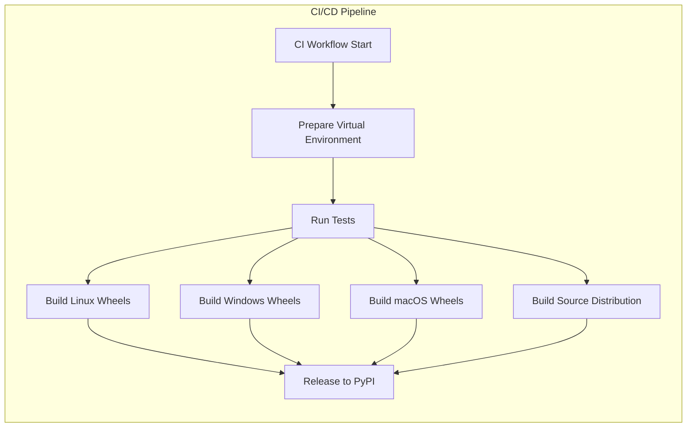

The CI/CD workflow:
1. Prepares a virtual environment with dependencies
2. Runs tests for both Python and Rust code
3. Builds wheels for multiple platforms and architectures
4. Publishes releases to PyPI

This ensures that the hybrid codebase works correctly across different environments.

Sources: [.github/workflows/CI.yml:69-172](), [.github/workflows/CI.yml:174-297]()

## Development Workflow

When developing Dolma, you'll work with both Python and Rust code:

1. Make changes to Python code in the `python/` directory
2. Make changes to Rust code in the `src/` directory
3. Build the package using Maturin
4. Install the built package in development mode
5. Run tests to verify your changes

This workflow allows for rapid iteration while maintaining the benefits of the hybrid approach.

Sources: [pyproject.toml:104-135](), [.github/workflows/CI.yml:69-126]()

## Summary

Dolma's Python-Rust integration combines the best of both languages to create a high-performance data processing toolkit with a user-friendly interface. The PyO3 bindings enable seamless communication between Python and Rust components, while the build system ensures compatibility across platforms.

This hybrid approach allows Dolma to efficiently process large datasets while providing a flexible and extensible API for users.

Sources: [src/lib.rs:1-126](), [python/dolma/__init__.py:1-56](), [pyproject.toml:1-206](), [Cargo.toml:1-68]()

---

# Page: Build and Deployment

# Build and Deployment

<details>
<summary>Relevant source files</summary>

The following files were used as context for generating this wiki page:

- [.github/workflows/CI.yml](.github/workflows/CI.yml)
- [Cargo.lock](Cargo.lock)
- [Cargo.toml](Cargo.toml)
- [pyproject.toml](pyproject.toml)

</details>


This document describes how the Dolma toolkit is built, tested, and deployed. It covers the build system architecture, continuous integration workflows, and release processes. For information about the Python-Rust integration architecture itself, see [Python-Rust Integration](#2.1).

## Build System Architecture

Dolma employs a hybrid build system that manages both Python and Rust components. The core functionality is implemented in Rust for performance, while Python provides the high-level API and CLI interfaces.

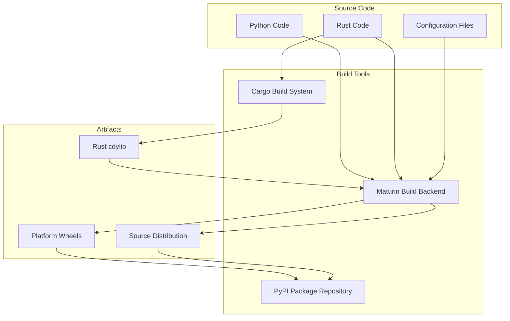

Sources: [pyproject.toml:158-165](), [Cargo.toml:9-11]()

### Python Package Configuration

The Python package is configured in `pyproject.toml` with the following key characteristics:

- Package name: `dolma`
- Build backend: `maturin` (for Python-Rust integration)
- CLI entry point: `dolma = "dolma.cli.__main__:main"`
- Numerous dependencies including tokenizers, boto3, and data processing libraries

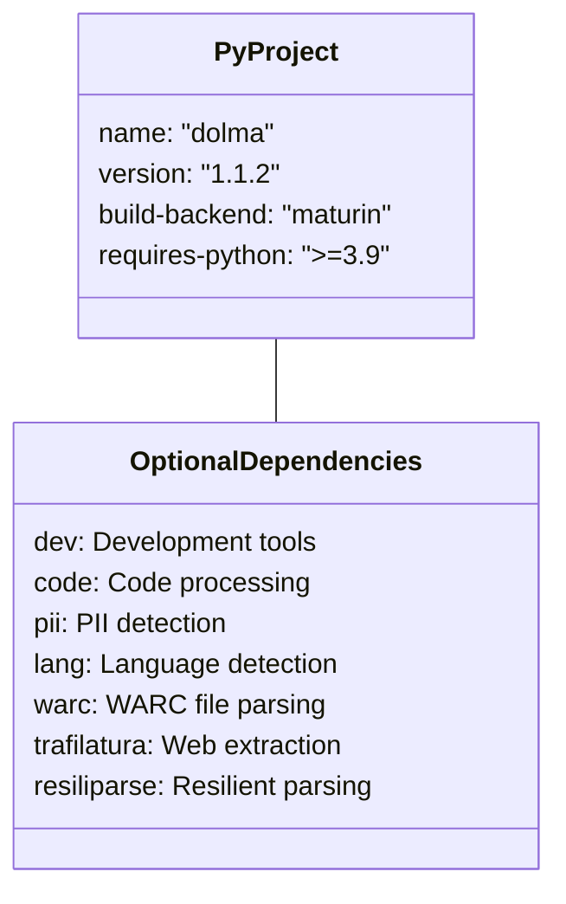

Sources: [pyproject.toml:1-37](), [pyproject.toml:101-103](), [pyproject.toml:104-156]()

### Rust Crate Configuration

The Rust component is configured as a cdylib (dynamic library) that can be loaded by Python:

- Crate name: `dolma`
- Crate type: `cdylib` (for Python loading)
- Key dependencies: AWS SDK, tokenizers, JSON processing, and parallel processing libraries

Sources: [Cargo.toml:1-13](), [Cargo.toml:14-58]()

## Local Development Setup

### Prerequisites

To build Dolma locally, you need:

1. Rust toolchain (stable channel)
2. Python 3.9+
3. Development tools (specified in the dev dependencies)

### Building Locally

The package uses `maturin` to build the Rust components and integrate them with Python:

1. Install maturin: `pip install maturin`
2. Build the package: `maturin build --release`
3. Install locally: `pip install target/wheels/dolma-*.whl`

For development, you can install in development mode:

```bash
maturin develop --release
```

This builds the Rust components and installs them into your Python environment.

Sources: [pyproject.toml:158-165](), [pyproject.toml:104-117]()

## Continuous Integration

Dolma uses GitHub Actions for CI/CD, defined in `.github/workflows/CI.yml`.

```mermaid
flowchart TD
    push["Push/PR to main"]
    tag["Create Release Tag"]
    manual["Manual Workflow Dispatch"]
    
    push --> check{"Version changed\nor main branch?"}
    tag --> check
    manual --> check
    
    check -->|No| skip["Skip Build"]
    check -->|Yes| prepare["Prepare Virtual Environment"]
    
    prepare --> tests["Run Tests"]
    
    tests --> build["Build Wheels"]
    
    build --> linux["Build Linux\nx86_64, aarch64, armv7"]
    build --> windows["Build Windows\nx64, x86"]
    build --> macos["Build macOS\nx86_64, aarch64"]
    build --> source["Build Source Distribution"]
    
    linux --> artifacts["Upload Artifacts"]
    windows --> artifacts
    macos --> artifacts
    source --> artifacts
    
    tag -->|Yes| release["Publish to PyPI"]
    artifacts --> release
```

Sources: [.github/workflows/CI.yml:3-14](), [.github/workflows/CI.yml:41-67](), [.github/workflows/CI.yml:69-121](), [.github/workflows/CI.yml:122-173](), [.github/workflows/CI.yml:174-278]()

### Test Process

The CI workflow runs several validation steps:

1. Python style checks (isort, black)
2. Rust style checks (rustfmt)
3. Python linting (flake8)
4. Python type checking (mypy)
5. Python unit tests (pytest)

Tests run on each pull request and push to the main branch.

Sources: [.github/workflows/CI.yml:122-173]()

### Build Matrix

Dolma builds wheels for multiple platforms and architectures:

| Platform | Architectures |
|----------|--------------|
| Linux    | x86_64, aarch64, armv7 |
| Windows  | x64, x86 |
| macOS    | x86_64, aarch64 |

The CI system creates wheels for all these combinations to ensure broad compatibility.

Sources: [.github/workflows/CI.yml:174-210](), [.github/workflows/CI.yml:211-236](), [.github/workflows/CI.yml:237-261]()

## Deployment Process

### Release Workflow

Releases are automated through the CI pipeline:

1. Create and push a tag (e.g., `git tag v1.1.2 && git push --tags`)
2. The CI workflow detects the tag and triggers the release process
3. Wheels are built for all platforms and architectures
4. The package is published to PyPI

```mermaid
flowchart TD
    tag["Create Version Tag"]
    ci["CI/CD Pipeline"]
    wheels["Build Wheels"]
    sdist["Build Source Distribution"]
    pypi["Publish to PyPI"]
    
    tag --> ci
    ci --> wheels
    ci --> sdist
    wheels --> pypi
    sdist --> pypi
```

Sources: [.github/workflows/CI.yml:280-296]()

### Version Management

Version information is maintained in two places:

1. Python version in `pyproject.toml`
2. Rust version in `Cargo.toml`

These should be kept synchronized when making releases.

Sources: [pyproject.toml:3](), [Cargo.toml:3]()

## Cross-Platform Compatibility

Dolma ensures compatibility across platforms through:

1. Using `maturin` for cross-platform building
2. Specifying platform-specific dependencies where needed
3. Using vendored OpenSSL via the `openssl` crate with the `vendored` feature
4. CI testing across multiple platforms

The package uses the `manylinux_2_28` standard for Linux wheels, ensuring compatibility with most modern Linux distributions.

Sources: [Cargo.toml:52](), [.github/workflows/CI.yml:199]()

### Building with Vendored Dependencies

To handle platform-specific requirements, Dolma uses vendored dependencies where necessary. For example, OpenSSL is included via the `vendored` feature to ensure it works across different environments without requiring system libraries.

```
openssl = { version = "0.10.66", features = ["vendored"] }
```

Sources: [Cargo.toml:52]()

## Utility Tools for Development

The project includes several development tools configured in the `dev` optional dependencies:

- Code formatting (black, isort)
- Linting (flake8)
- Type checking (mypy)
- Testing (pytest)

You can install these with:

```bash
pip install -e ".[dev]"
```

Sources: [pyproject.toml:104-117]()

---

# Page: Data Processing Pipeline

# Data Processing Pipeline

<details>
<summary>Relevant source files</summary>

The following files were used as context for generating this wiki page:

- [configs/dolma-v1_5/mixing/dedupe-test.yaml](configs/dolma-v1_5/mixing/dedupe-test.yaml)
- [configs/test/test_filtered_mixer.yaml](configs/test/test_filtered_mixer.yaml)
- [python/dolma/cli/deduper.py](python/dolma/cli/deduper.py)
- [python/dolma/cli/mixer.py](python/dolma/cli/mixer.py)
- [src/bloom_filter.rs](src/bloom_filter.rs)
- [src/bloom_filter/bloom_test.rs](src/bloom_filter/bloom_test.rs)
- [src/deduper.rs](src/deduper.rs)
- [src/mixer.rs](src/mixer.rs)
- [src/s3_util.rs](src/s3_util.rs)
- [src/shard.rs](src/shard.rs)

</details>


The Dolma data processing pipeline manages the end-to-end workflow for curating large-scale text datasets used in machine learning model pre-training. This document explains the core components and workflows for processing documents with Dolma.

For information about the high-level architecture of Dolma, see [Architecture](#2).

## Pipeline Overview

The Dolma data processing pipeline is a series of modular components that can be run independently or chained together. The pipeline handles large datasets efficiently through sharding, parallel processing, and streaming I/O with support for both local and cloud storage (S3).

```mermaid
flowchart LR
    subgraph "Document Processing Pipeline"
        A[(Input Documents)]
        B[Sharding]
        C[Mixer]
        D[Deduper]
        E[Tagger]
        F[Tokenizer]
        G[Analyzer]
        H[(Output Documents)]
        
        A --> B
        B --> C
        B --> D
        B --> E
        C --> H
        D --> H
        E --> H
        H --> F
        H --> G
    end
```

Sources: [src/shard.rs:1-880](), [src/deduper.rs:1-605](), [src/mixer.rs:1-84](), [python/dolma/cli/mixer.py:1-198](), [python/dolma/cli/deduper.py:1-275]()

## Core Components

The pipeline consists of several core components that can be used in combination to process text data:

1. **Sharding System**: Partitions input files into manageable work units
2. **Mixer**: Combines documents from multiple sources, filters, and transforms
3. **Deduper**: Removes duplicate documents or paragraphs using Bloom filters
4. **Tagger**: Attaches metadata to documents (covered in [Tagging System](#3.4))
5. **Tokenizer**: Converts text to token sequences (covered in [Tokenization System](#3.5))
6. **Analyzer**: Provides statistics and insights (covered in [Analysis System](#3.6))

### Component Interaction Model

```mermaid
classDiagram
    class Shard {
        +inputs: Vec~DocumentPaths~
        +output: String
        +filter: Option~FilterConfig~
        +span_replacements: Option~Vec~SpanReplacementConfig~~
        +process()
        +split_streams()
        +split_streams_unshuffled()
    }
    
    class DocumentPaths {
        +doc_path: String
        +attribute_paths: Vec~String~
    }
    
    class FilterConfig {
        +include: Vec~String~
        +exclude: Vec~String~
        +syntax: Option~String~
        +should_keep()
    }
    
    class SpanReplacementConfig {
        +span: String
        +min_score: Option~f64~
        +max_score: Option~f64~
        +replacement: String
        +syntax: Option~String~
    }
    
    class BloomFilter {
        +bits: Vec~AtomicU32~
        +hash_builders: Vec~RandomState~
        +read_only: bool
        +insert()
        +contains()
        +hashes()
    }
    
    class FileCache {
        +s3_client: Box~S3Client~
        +work: WorkDirConfig
        +prepare_input()
        +prepare_output()
        +finalize_input()
        +finalize_output()
    }
    
    class MixerConfig {
        +streams: Vec~StreamConfig~
        +processes: usize
        +work_dir: WorkDirConfig
        +shuffle: bool
    }
    
    class DeduperConfig {
        +documents: Vec~String~
        +work_dir: WorkDirConfig
        +dedupe: DedupeConfig
        +bloom_filter: BloomFilterConfig
        +processes: usize
    }
    
    Shard --> DocumentPaths
    Shard --> FilterConfig
    Shard --> SpanReplacementConfig
    Shard --> FileCache
    FileCache --> "S3Client"
    DeduperConfig --> BloomFilter
    MixerConfig --> Shard
```

Sources: [src/shard.rs:17-524](), [src/deduper.rs:11-22](), [src/bloom_filter.rs:15-236]()

## Sharding System

The sharding system splits large document collections into manageable chunks that can be processed independently and in parallel. A shard represents a unit of work that combines input files from potentially different sources into a single output file.

### Shard Configuration

```mermaid
flowchart TD
    A["StreamConfig"] --> B["Shard.split_streams()"]
    B --> C["Shard"]
    C --> |"process()"| D["Processed Documents"]
    
    subgraph "Shard"
        E["inputs: Vec<DocumentPaths>"]
        F["output: String"]
        G["filter: Option<FilterConfig>"]
        H["span_replacements: Option<Vec<SpanReplacementConfig>>"]
    end
```

Sources: [src/shard.rs:15-26](), [src/shard.rs:40-130]()

Shards are created by:

1. **Split Streams**: Divides input files according to maximum size configuration
2. **Unshuffled Option**: Alternative mode that preserves original file structure
3. **Document Paths**: Each shard contains document paths and corresponding attribute paths
4. **Compression**: Configurable compression for input and output files

### Sharding Process

1. Input files are located using glob patterns or S3 prefixes
2. Files are grouped into shards based on size limits
3. Each shard is assigned an output path
4. Shards can be processed in parallel

Sources: [src/shard.rs:36-180]()

## Mixer Component

The Mixer combines documents from multiple sources, filters them based on rules, and applies transformations.

### Mixer Workflow

```mermaid
flowchart TD
    A[(Input Documents)] --> B["StreamConfig"]
    B --> C["MixerConfig"]
    C --> D["Shard.process()"]
    D --> E["FilterConfig.should_keep()"]
    D --> F["SpanReplacer.find_spans_to_replace()"]
    E --> G{Keep?}
    G -- Yes --> H["Apply span replacements"]
    G -- No --> I["Discard document"]
    H --> J[(Output Documents)]
```

Sources: [src/mixer.rs:1-48](), [src/shard.rs:182-507]()

### Document Filtering

Documents can be filtered using:

1. **JSONPath expressions**: To include or exclude documents based on their content/attributes
2. **JQ expressions**: More complex filtering rules with a powerful query language
3. **Minimum text length**: Filter out documents with insufficient text

```
filter:
  include:                 # Documents matching any of these expressions are kept
    - "$.attributes.quality_score > 0.7"
  exclude:                 # Documents matching any of these expressions are discarded
    - "$.attributes.is_duplicate == true"
  syntax: "jsonpath"       # Can be "jsonpath" or "jq"
```

Sources: [src/shard.rs:526-583](), [python/dolma/cli/mixer.py:22-30]()

### Span Replacement

The mixer can replace specific spans of text:

1. **Span Selection**: Uses JSONPath or JQ to locate spans in the document
2. **Score Filtering**: Only replaces spans within score thresholds
3. **Replacement Text**: Can use static text or dynamic replacements

Sources: [src/shard.rs:584-681](), [python/dolma/cli/mixer.py:32-48]()

## Deduplication System

The deduplication system identifies and marks duplicate content using probabilistic data structures (Bloom filters).

### Deduplication Types

1. **Document-level**: Identifies entire duplicate documents
2. **Paragraph-level**: Identifies duplicate paragraphs within documents
3. **N-gram based**: Identifies duplicates based on overlapping n-grams

```mermaid
flowchart TD
    A[(Input Documents)] --> B["DeduperConfig"]
    B --> C["BloomFilter.initialize()"]
    C --> D["write_attributes()"]
    
    subgraph "Deduplication Modes"
        E["Document-level (key field)"]
        F["Paragraph-level (full paragraph)"]
        G["N-gram based (content overlap)"]
    end
    
    D --> E
    D --> F
    D --> G
    
    E --> H["BloomFilter.contains()/insert()"]
    F --> H
    G --> H
    
    H --> I["Mark duplicates in attributes"]
    I --> J[(Output Documents)]
```

Sources: [src/deduper.rs:21-95](), [src/deduper.rs:116-519]()

### Bloom Filter

The deduplication uses a Bloom filter:

1. **Space-efficient**: Uses a bit array to track seen content
2. **Configurable**: Size and hash functions based on expected document count
3. **Persistent**: Can be saved and loaded from disk
4. **Tunable**: Balance between memory usage and false positive rate

The Bloom filter is configured with:
- Size in bytes
- Estimated document count
- Desired false positive rate
- Number of hash functions

Sources: [src/bloom_filter.rs:15-236](), [src/bloom_filter.rs:236-281]()

## File Handling

The pipeline handles both local and S3-stored files transparently.

### FileCache System

```mermaid
flowchart TD
    A["FileCache"] --> B["prepare_input()"]
    A --> C["prepare_output()"]
    A --> D["finalize_input()"]
    A --> E["finalize_output()"]
    
    B --> F{"Is S3 URL?"}
    F -- Yes --> G["Download from S3"]
    F -- No --> H["Use local path"]
    
    C --> I{"Is S3 URL?"}
    I -- Yes --> J["Create temp file"]
    I -- No --> K["Create local .tmp file"]
    
    E --> L{"Is S3 URL?"}
    L -- Yes --> M["Upload to S3"]
    L -- No --> N["Rename .tmp file"]
```

Sources: [src/shard.rs:713-818](), [src/s3_util.rs:35-176]()

#### S3 Integration

The pipeline provides robust S3 integration:

1. **Automatic handling**: Downloads/uploads as needed
2. **Pattern matching**: Supports glob-like patterns for S3 objects
3. **Retry mechanism**: Configurable retries for S3 operations
4. **Cleanup**: Removes temporary files after processing

Sources: [src/s3_util.rs:12-326]()

## Parallel Processing

The pipeline processes data in parallel for efficiency:

```mermaid
flowchart TD
    A["MixerConfig/DeduperConfig"] --> B["ThreadPool.new(processes)"]
    B --> C["Shards"]
    
    C --> |"Execute in parallel"| D["Worker 1"]
    C --> |"Execute in parallel"| E["Worker 2"]
    C --> |"Execute in parallel"| F["Worker N"]
    
    D --> G["Join results"]
    E --> G
    F --> G
```

Sources: [src/mixer.rs:11-48](), [src/deduper.rs:34-76]()

1. **Configurable processes**: Number of parallel workers
2. **Thread pool**: Workers process shards independently
3. **Thread-safe components**: Bloom filter uses atomic operations for concurrent access
4. **Progress tracking**: Monitors failed shards

## Configuration

Both the Mixer and Deduper are configured via structured configuration objects:

### Mixer Configuration Table

| Configuration | Description | Default |
|---------------|-------------|---------|
| `streams` | List of stream configurations | Required |
| `work_dir` | Temporary directory paths | Required |
| `processes` | Number of parallel processes | 1 |
| `shuffle` | Whether to shuffle documents | true |

Sources: [python/dolma/cli/mixer.py:50-82](), [src/mixer.rs:51-69]()

### Deduper Configuration Table

| Configuration | Description | Default |
|---------------|-------------|---------|
| `documents` | Paths to document files | Required |
| `work_dir` | Temporary directory paths | Required |
| `dedupe` | Deduplication settings | Required |
| `bloom_filter` | Bloom filter settings | Required |
| `processes` | Number of parallel processes | 1 |
| `compression` | Input/output compression | Inferred |

Sources: [python/dolma/cli/deduper.py:114-135](), [src/deduper.rs:530-598]()

## Practical Example

A typical data processing workflow with Dolma might include:

1. **Tag documents** to attach quality metrics and language information
2. **Deduplicate** to remove duplicate paragraphs and documents
3. **Mix and filter** to combine datasets and apply quality filters
4. **Tokenize** the result for training language models

```mermaid
flowchart LR
    A[(Raw Documents)] --> B["Tagger"]
    B --> C["Deduper"]
    C --> D["Mixer"]
    D --> E["Tokenizer"]
    E --> F[(Training Data)]
```

Sources: [src/shard.rs:1-26](), [src/deduper.rs:1-22](), [src/mixer.rs:1-48]()

---

# Page: Sharding System

# Sharding System

<details>
<summary>Relevant source files</summary>

The following files were used as context for generating this wiki page:

- [configs/dolma-v1_5/mixing/dedupe-test.yaml](configs/dolma-v1_5/mixing/dedupe-test.yaml)
- [configs/test/test_filtered_mixer.yaml](configs/test/test_filtered_mixer.yaml)
- [src/bloom_filter.rs](src/bloom_filter.rs)
- [src/bloom_filter/bloom_test.rs](src/bloom_filter/bloom_test.rs)
- [src/deduper.rs](src/deduper.rs)
- [src/mixer.rs](src/mixer.rs)
- [src/s3_util.rs](src/s3_util.rs)
- [src/shard.rs](src/shard.rs)

</details>


The Sharding System is a core component of Dolma that divides large collections of documents into manageable units called "shards" for efficient parallel processing. This document explains how the sharding system works, its key components, and how it integrates with other parts of Dolma.

For information about the Mixer component that uses shards for document processing, see [Mixer Component](#3.2). For details about deduplication which also utilizes the sharding system, see [Deduplication System](#3.3).

## Purpose and Scope

The Sharding System provides infrastructure for:

- Partitioning large document collections into smaller units of work
- Managing local and remote (S3) file operations
- Supporting parallel processing across multiple shards
- Handling document attribute merging and filtering
- Applying transformations like span replacements

Sources: [src/shard.rs:15-16]()

## Core Concepts

### What is a Shard?

In Dolma, a shard represents a unit of work for document processing. As defined in the codebase:

> "A shard is a unit of work for the mixer. It is a collection of input files that are combined into a single output file."

A shard contains:
- Input document paths and associated attribute paths
- Output file path
- Optional filtering configuration
- Optional span replacement configuration
- Optional field discarding configuration
- Minimum text length requirement
- Compression configuration

Sources: [src/shard.rs:17-26]()

### Document Path Structure

A `DocumentPaths` object contains paths to both document files and corresponding attribute files. Attributes are stored separately from documents but are merged during processing.

Sources: [src/shard.rs:29-33]()

## System Architecture

### Sharding System Architecture

```mermaid
classDiagram
    class Shard {
        +inputs: Vec<DocumentPaths>
        +output: String
        +filter: Option<FilterConfig>
        +span_replacements: Option<SpanReplacementConfig>
        +discard_fields: Option<Vec<String>>
        +min_text_length: Option<usize>
        +compression: Option<CompressionConfig>
        +split_streams(streams)
        +split_streams_unshuffled(streams)
        +process(work_dirs)
    }

    class DocumentPaths {
        +doc_path: String
        +attribute_paths: Vec<String>
    }

    class FileCache {
        +s3_client: Box<S3Client>
        +work: WorkDirConfig
        +prepare_input(location)
        +finalize_input(location)
        +prepare_output(location, label_temp)
        +finalize_output(location)
    }

    class StreamConfig {
        +name: String
        +documents: Vec<String>
        +attributes: Vec<String>
        +filter: Option<FilterConfig>
        +span_replacement: Option<Vec<SpanReplacementConfig>>
        +output: StreamOutputConfig
        +compression: Option<CompressionConfig>
    }

    class WorkDirConfig {
        +input: String
        +output: String
    }

    Shard "1" -- "*" DocumentPaths: contains
    Shard ..> FileCache: uses
    Shard ..> StreamConfig: created from
```

Sources: [src/shard.rs:18-26](), [src/shard.rs:29-33](), [src/shard.rs:526-561](), [src/shard.rs:713-819]()

### Integration with Other Dolma Components

```mermaid
flowchart TD
    subgraph "Dolma Components"
        S["Sharding System"]
        M["Mixer"]
        D["Deduper"]
        T["Tagger"]
        A["Analyzer"]
    end

    I[("Input Documents")] --> S
    S --> |"creates shards"| P["Parallel Processing"]
    P --> |"processes"| O[("Output Documents")]
    
    M --> |"uses"| S
    D --> |"uses"| S
    T --> |"uses document paths"| S
    A --> |"uses document paths"| S

    S --> |"prepares inputs"| FC["FileCache"]
    FC --> |"handles"| LS[("Local Storage")]
    FC --> |"handles"| S3[("S3 Storage")]
```

Sources: [src/shard.rs](), [src/mixer.rs:11-17](), [src/deduper.rs:25-32]()

## Sharding Process

### Creating Shards

The sharding system provides two main methods for creating shards:

1. **`split_streams`** - Partitions input files into shards of approximately equal size, optimizing for parallel processing
2. **`split_streams_unshuffled`** - Creates shards without shuffling, maintaining the original file structure

The standard sharding process (`split_streams`) works as follows:

1. For each stream configuration:
   - Find all input documents matching the specified patterns
   - Calculate the size of each input
   - Group inputs into shards based on maximum size constraints
   - Create output paths for each shard
   - Configure each shard with the appropriate filters and transformations

Sources: [src/shard.rs:40-130](), [src/shard.rs:132-180]()

### Size-Based Partitioning

The standard sharding process attempts to create shards of approximately equal size, bounded by the `max_size_in_bytes` parameter in the stream configuration:

```mermaid
flowchart TD
    Start["Start sharding process"] --> FindInputs["Find all input documents"]
    FindInputs --> GetSizes["Calculate size of each input"]
    GetSizes --> InitShard["Initialize first shard with first input"]
    InitShard --> |"For each remaining input"| CheckSize{"Would shard exceed\nmax_size_in_bytes?"}
    CheckSize --> |"Yes"| CreateShard["Create new shard"]
    CheckSize --> |"No"| AddToShard["Add input to current shard"]
    CreateShard --> CheckSize
    AddToShard --> CheckSize
    CheckSize --> |"All inputs processed"| Return["Return list of shards"]
```

Sources: [src/shard.rs:65-103]()

### Unshuffled Sharding

The unshuffled sharding process creates one shard per input file, maintaining the original structure:

```mermaid
flowchart TD
    Start["Start unshuffled sharding"] --> FindInputs["Find all input documents"]
    FindInputs --> |"For each input"| CreateShard["Create shard with single input"]
    CreateShard --> |"Preserve original path structure"| SetOutput["Set output path to match input structure"]
    SetOutput --> AddToList["Add shard to result list"]
    AddToList --> |"All inputs processed"| Return["Return list of shards"]
```

Sources: [src/shard.rs:132-180]()

## Shard Processing

When a shard is processed, the following steps occur:

1. Prepare inputs and outputs using FileCache (download from S3 if needed)
2. Set up document and attribute readers for each input
3. Read documents and their attributes line by line
4. Merge attributes with document data
5. Apply filters to determine which documents to keep
6. Apply span replacements to modify document text
7. Discard specified fields
8. Check minimum text length
9. Write processed documents to output
10. Finalize outputs (upload to S3 if needed)

Sources: [src/shard.rs:182-507]()

### Document and Attribute Merging

```mermaid
flowchart TD
    ReadDoc["Read document line"] --> ParseDoc["Parse JSON document"]
    ReadAttr["Read attribute lines"] --> ParseAttr["Parse JSON attributes"]
    ParseDoc --> |"document"| Merge["Merge document with attributes"]
    ParseAttr --> |"attributes"| Merge
    Merge --> Filter{"Apply filters"}
    Filter --> |"keep"| Replace{"Apply span replacements"}
    Filter --> |"discard"| NextDoc["Process next document"]
    Replace --> |"transformed document"| Discard["Discard specified fields"]
    Discard --> CheckLength{"Check min text length"}
    CheckLength --> |"sufficient"| WriteOutput["Write to output"]
    CheckLength --> |"insufficient"| NextDoc
    WriteOutput --> NextDoc
```

Sources: [src/shard.rs:272-476]()

## File Cache System

The `FileCache` component manages the transfer of files between local and remote (S3) storage:

```mermaid
classDiagram
    class FileCache {
        +s3_client: Box<S3Client>
        +work: WorkDirConfig
        +prepare_input(location) PathBuf
        +finalize_input(location) Result
        +prepare_output(location, label_temp) PathBuf
        +finalize_output(location) Result
    }

    class WorkDirConfig {
        +input: String
        +output: String
    }

    class S3Client {
        +get_object()
        +put_object()
        +head_object()
    }

    FileCache --> S3Client: uses
    FileCache --> WorkDirConfig: contains
```

For local files, FileCache simply returns the path. For S3 URLs, it:
- Downloads files to a local cache directory when `prepare_input` is called
- Uploads files to S3 when `finalize_output` is called
- Cleans up local cache files when done

Sources: [src/shard.rs:713-819](), [src/s3_util.rs:35-176]()

## S3 Integration

The sharding system integrates with AWS S3 for both input and output:

### Input Handling
- Can read document and attribute files directly from S3
- Downloads files to local cache for processing
- Pattern matching for S3 paths using wildcards
- Parallel fetching of object sizes for efficient sharding

### Output Handling
- Can write processed documents directly to S3
- Handles compression with various formats
- Supports retries for S3 operations
- Creates empty checkpoint files after successful uploads

Sources: [src/shard.rs:728-769](), [src/s3_util.rs:35-176](), [src/s3_util.rs:199-286]()

## Configuration

The sharding system is configured through several configuration structs:

### Stream Configuration

The `StreamConfig` struct defines how input documents are processed:

```
StreamConfig {
    name: String,                                      // Name of the stream
    documents: Vec<String>,                            // Paths to input documents
    attributes: Vec<String>,                           // Paths to attribute files
    filter: Option<FilterConfig>,                      // Document filtering rules
    span_replacement: Option<Vec<SpanReplacementConfig>>, // Text replacements
    output: StreamOutputConfig,                        // Output configuration
    compression: Option<CompressionConfig>,            // Compression settings
}
```

Sources: [src/shard.rs:533-546]()

### Compression Configuration

```
CompressionConfig {
    input: Option<String>,    // Compression format for input files
    output: Option<String>,   // Compression format for output files
}
```

Sources: [src/shard.rs:548-552]()

### Stream Output Configuration

```
StreamOutputConfig {
    path: String,                         // Output directory path
    max_size_in_bytes: usize,             // Maximum size of each shard
    discard_fields: Option<Vec<String>>,  // Fields to remove from documents
    min_text_length: Option<usize>,       // Minimum text length to retain document
}
```

Sources: [src/shard.rs:563-569]()

### Working Directory Configuration

```
WorkDirConfig {
    input: String,   // Path for temporary input files
    output: String,  // Path for temporary output files
}
```

Sources: [src/shard.rs:571-575]()

## Example Workflow

Here's an example of how the Sharding System is used in the Mixer component:

1. The Mixer reads a configuration file that defines streams
2. It calls `Shard::split_streams` to create shards based on the configuration
3. It creates a thread pool to process shards in parallel
4. For each shard:
   - It checks if the output already exists
   - If not, it calls `shard.process(work_dirs)` to process the shard
   - This processes and transforms all documents in the shard
5. After all shards are processed, the results are combined according to the configuration

Sources: [src/mixer.rs:11-48]()

## Conclusion

The Sharding System is a fundamental component of Dolma that enables efficient processing of large document collections. By partitioning documents into manageable shards, it supports parallel processing while providing a consistent interface for document transformation, filtering, and I/O operations across both local and S3 storage.

---

# Page: Mixer Component

# Mixer Component

<details>
<summary>Relevant source files</summary>

The following files were used as context for generating this wiki page:

- [python/dolma/cli/deduper.py](python/dolma/cli/deduper.py)
- [python/dolma/cli/mixer.py](python/dolma/cli/mixer.py)
- [scripts/sample_prefix.py](scripts/sample_prefix.py)
- [src/filters.rs](src/filters.rs)
- [tests/config/c4-cleaned.json](tests/config/c4-cleaned.json)
- [tests/config/dedupe-by-url.json](tests/config/dedupe-by-url.json)
- [tests/config/dedupe-paragraphs.json](tests/config/dedupe-paragraphs.json)
- [tests/config/email-spans-jq.yaml](tests/config/email-spans-jq.yaml)
- [tests/config/email-spans.json](tests/config/email-spans.json)
- [tests/config/filter-by-spans.json](tests/config/filter-by-spans.json)
- [tests/config/mixer.json](tests/config/mixer.json)
- [tests/config/paragraph-spans.json](tests/config/paragraph-spans.json)
- [tests/python/test_deduper.py](tests/python/test_deduper.py)
- [tests/python/test_mixer.py](tests/python/test_mixer.py)
- [tests/python/utils.py](tests/python/utils.py)

</details>


The Mixer Component in Dolma is responsible for filtering and transforming documents based on configurable rules. It processes input documents, applies filters to include or exclude documents based on their content, and performs span replacements to modify text content. The Mixer is a key part of the overall data processing pipeline, sitting between the Tagger Component (which adds metadata attributes) and the Deduplication System (which removes duplicates). For information about duplicate detection and removal, see [Deduplication System](#3.3).

## Overview

The Mixer Component allows you to:

1. Filter documents based on their content or attributes using JSONPath or jq expressions
2. Replace specific spans of text (such as PII, toxic content, or low-quality passages)
3. Combine and process multiple streams of documents
4. Discard unnecessary fields from output documents
5. Configure minimum text length requirements

Sources: [python/dolma/cli/mixer.py:1-197]()

## Architecture

The Mixer follows Dolma's general data processing architecture, where documents are processed in streams with configurable filters and transformations.

```mermaid
flowchart TD
    subgraph "Mixer Component"
        A["Input Documents"] --> B["Document Filtering"]
        A --> C["Span Replacement"]
        
        B --> D["Output Generation"]
        C --> D
        
        E["Attributes Files"] --> B
        E --> C
        
        D --> F["Output Documents"]
    end
    
    subgraph "Configuration"
        G["Stream Config"] --> B
        G --> C
        G --> D
        
        H["Filter Config"] --> B
        I["Span Replacement Config"] --> C
        J["Output Config"] --> D
    end
```

The Mixer processes documents through a stream-based pipeline. Each stream is configured with:

1. Input documents to process
2. Optional attribute files to use for filtering/replacement
3. Filter rules (include/exclude expressions)
4. Span replacement rules
5. Output configuration

Sources: [python/dolma/cli/mixer.py:50-68](), [python/dolma/cli/mixer.py:72-80]()

## Configuration Model

The Mixer is configured using a hierarchical configuration model:

```mermaid
classDiagram
    class MixerConfig {
        +List~StreamConfig~ streams
        +WorkDirConfig work_dir
        +int processes
        +bool shuffle
        +bool dryrun
    }
    
    class StreamConfig {
        +String name
        +List~String~ documents
        +StreamOutputConfig output
        +List~String~ attributes
        +FilterConfig filter
        +List~SpanReplacementConfig~ span_replacement
        +CompressionConfig compression
    }
    
    class StreamOutputConfig {
        +String path
        +int max_size_in_bytes
        +List~String~ discard_fields
        +int min_text_length
    }
    
    class FilterConfig {
        +List~String~ include
        +List~String~ exclude
        +String syntax
    }
    
    class SpanReplacementConfig {
        +String span
        +float min_score
        +float max_score
        +String replacement
        +String syntax
    }
    
    MixerConfig *-- StreamConfig
    StreamConfig *-- StreamOutputConfig
    StreamConfig *-- FilterConfig
    StreamConfig *-- SpanReplacementConfig
```

Sources: [python/dolma/cli/mixer.py:12-80]()

## Document Filtering

The Mixer can filter documents based on their content or attributes using either JSONPath or jq expressions.

### Filter Configuration

Filters are configured with:

1. `include` expressions: Documents must match at least one to be included
2. `exclude` expressions: Documents are excluded if they match any
3. `syntax`: Either "jsonpath" (default) or "jq"

```mermaid
flowchart TD
    A["Document"] --> B["Filter Processing"]
    
    subgraph "Filter Processing"
        C["Apply Include Filters"] --> D{"Any Include\nMatches?"}
        D -->|"Yes (or no includes)"| E["Apply Exclude Filters"]
        D -->|"No"| F["Discard Document"]
        
        E --> G{"Any Exclude\nMatches?"}
        G -->|"Yes"| F
        G -->|"No"| H["Keep Document"]
    end
    
    B --> I["Filtered Documents"]
```

When a filter is applied, it evaluates the document against all include expressions first. If the document matches any include expression (or if there are no include expressions), it is then evaluated against all exclude expressions. If it matches any exclude expression, it is discarded.

Sources: [python/dolma/cli/mixer.py:23-29](), [src/filters.rs:250-481]()

### Filter Syntax

#### JSONPath Example

```json
{
  "filter": {
    "include": ["$.metadata[?(@.length < 10000)]"],
    "exclude": [
      "$.metadata[?(@.length < 500)]",
      "$.attributes[?(@.pii.too_much_pii == true)]"
    ],
    "syntax": "jsonpath"
  }
}
```

This filter keeps documents with metadata length between 500 and 10000 characters, and excludes documents marked with too much PII.

#### jq Example

```json
{
  "filter": {
    "include": [".attributes.quality_score > 0.7"],
    "exclude": [".attributes.toxic_content == true"],
    "syntax": "jq"
  }
}
```

This filter keeps documents with quality score above 0.7 and excludes documents with toxic content.

Sources: [tests/config/mixer.json:16-25](), [tests/config/filter-by-spans.json:16-19]()

## Span Replacement

The Mixer can also replace specific spans of text within documents. This is useful for removing PII, toxic content, or low-quality passages.

### Span Replacement Configuration

Span replacements are configured with:

1. `span`: JSONPath or jq expression to locate spans
2. `min_score` and/or `max_score`: Score threshold for replacement
3. `replacement`: Text to replace the span with
4. `syntax`: Either "jsonpath" (default) or "jq"

```mermaid
flowchart TD
    A["Document"] --> B["Span Replacement"]
    
    subgraph "Span Replacement Process"
        C["Locate Spans"] --> D{"Score Within\nThreshold?"}
        D -->|"Yes"| E["Replace Span"]
        D -->|"No"| F["Keep Original"]
    end
    
    B --> G["Transformed Document"]
```

When a span replacement is applied, it:
1. Locates all spans in the document matching the selector
2. Checks if each span's score is within the threshold
3. Replaces matching spans with the specified replacement text

Sources: [python/dolma/cli/mixer.py:32-47](), [src/filters.rs:84-147]()

### Span Replacement Examples

#### Removing Email Addresses

```json
{
  "span_replacement": [
    {
      "span": "$.attributes.pii.email",
      "min_score": 0.5,
      "replacement": "[B-EMAIL]{}[E-EMAIL]"
    }
  ]
}
```

This replacement finds spans identified as emails with a confidence score of at least 0.5 and replaces them with a token.

#### Removing Low-Quality Paragraphs

```json
{
  "span_replacement": [
    {
      "span": "$.attributes.quality.low_quality_paragraphs",
      "min_score": 0.8,
      "replacement": ""
    }
  ]
}
```

This replacement removes paragraphs identified as low quality with a confidence score of at least 0.8.

Sources: [tests/config/email-spans.json:15-26](), [tests/config/paragraph-spans.json:15-21]()

## Stream Processing Flow

The complete processing flow of a document through the Mixer is:

```mermaid
flowchart TD
    A["Input Document"] --> B["Load Attributes"]
    B --> C{"Apply Filters"}
    C -->|"Keep"| D["Apply Span Replacements"]
    C -->|"Discard"| E["Skip Document"]
    
    D --> F{"Check Min Length"}
    F -->|"Passes"| G["Remove Discarded Fields"]
    F -->|"Too Short"| E
    
    G --> H["Output Document"]
    
    subgraph "Configuration"
        I["Filter Config"] --> C
        J["Span Replacement Config"] --> D
        K["Output Config"] --> F
        K --> G
    end
```

The Mixer processes documents in the following steps:

1. Load the document and any associated attribute files
2. Apply filter rules to determine if the document should be kept
3. Apply span replacements to modify the document's text
4. Check if the modified document meets the minimum length requirement
5. Remove any fields specified in the `discard_fields` configuration
6. Write the document to the output

Sources: [python/dolma/cli/mixer.py:89-196]()

## Command Line Interface

The Mixer is accessed through the Dolma CLI:

```bash
dolma -c config.json mix
```

The CLI handles configuration validation, path resolution, and execution of the Mixer.

### Configuration File Example

```json
{
  "streams": [
    {
      "name": "cleaned-wikipedia",
      "documents": ["path/to/documents/*.json.gz"],
      "attributes": ["pii", "quality"],
      "output": {
        "path": "output/cleaned-wikipedia",
        "max_size_in_bytes": 1073741824,
        "discard_fields": ["metadata.url", "metadata.timestamp"],
        "min_text_length": 500
      },
      "filter": {
        "include": ["$.attributes.quality.score > 0.7"],
        "exclude": ["$.attributes.pii.too_much_pii == true"],
        "syntax": "jsonpath"
      },
      "span_replacement": [
        {
          "span": "$.attributes.pii.email",
          "min_score": 0.8,
          "replacement": "[EMAIL]"
        }
      ]
    }
  ],
  "processes": 4,
  "shuffle": true
}
```

Sources: [python/dolma/cli/mixer.py:83-196]()

## Integration with Other Components

The Mixer Component integrates with other Dolma components in the data processing pipeline:

```mermaid
flowchart LR
    A["Tagger Component"] -->|"Adds Attributes"| B["Attributes Files"]
    B --> C["Mixer Component"]
    D["Input Documents"] --> C
    
    C -->|"Filtered & Transformed"| E["Output Documents"]
    
    E --> F["Deduper Component"]
    E --> G["Tokenizer Component"]
    E --> H["Analyzer Component"]
```

The Mixer typically:

1. Receives input from the Tagger Component in the form of attribute files
2. Processes raw documents with these attributes
3. Outputs filtered and transformed documents
4. Passes these documents to other components for further processing

Sources: [python/dolma/cli/mixer.py:1-5](), [python/dolma/cli/deduper.py:7-13]()

## Common Use Cases

The Mixer Component is commonly used for:

| Use Case | Configuration Focus |
|----------|---------------------|
| PII Removal | Span replacement for email addresses, phone numbers, etc. |
| Quality Filtering | Filter config to remove low-quality documents |
| Toxicity Filtering | Filter config to remove toxic documents |
| Content Cleaning | Span replacement for specific types of low-quality content |
| Dataset Composition | Multiple streams with different filters to create balanced datasets |

Sources: [tests/config/email-spans.json:1-34](), [tests/config/mixer.json:1-33](), [tests/config/c4-cleaned.json:1-34]()

## Performance Considerations

The Mixer uses Rust-based filtering and span replacement for performance, with these key considerations:

1. Setting the appropriate number of processes based on available hardware
2. Being mindful of memory usage when processing large document streams
3. Using efficient filter expressions, especially when dealing with large datasets
4. Leveraging the shuffle option for better performance with multiple processes

The `processes` parameter in the configuration controls parallelization, while `shuffle` controls whether documents are shuffled for more even distribution of work.

Sources: [python/dolma/cli/mixer.py:75-76]()

---

# Page: Deduplication System

# Deduplication System

<details>
<summary>Relevant source files</summary>

The following files were used as context for generating this wiki page:

- [configs/dolma-v1_5/mixing/dedupe-test.yaml](configs/dolma-v1_5/mixing/dedupe-test.yaml)
- [configs/test/test_filtered_mixer.yaml](configs/test/test_filtered_mixer.yaml)
- [python/dolma/cli/deduper.py](python/dolma/cli/deduper.py)
- [python/dolma/cli/mixer.py](python/dolma/cli/mixer.py)
- [src/bloom_filter.rs](src/bloom_filter.rs)
- [src/bloom_filter/bloom_test.rs](src/bloom_filter/bloom_test.rs)
- [src/deduper.rs](src/deduper.rs)
- [src/mixer.rs](src/mixer.rs)
- [src/s3_util.rs](src/s3_util.rs)
- [src/shard.rs](src/shard.rs)

</details>


The Deduplication System is a core component in Dolma that identifies and marks duplicate content within large document collections. It supports deduplication at both the document level and paragraph level, enabling the creation of high-quality training datasets by eliminating redundant content. For information about document mixing and filtering, see [Mixer Component](#3.2).

## Overview and Purpose

The Deduplication System efficiently identifies duplicate content using probabilistic data structures (Bloom filters). Rather than removing duplicates directly, it adds metadata attributes to documents identifying which content is duplicated. This approach preserves the original data while allowing downstream components to filter or process duplicates according to specific requirements.

Key capabilities include:

- Document-level deduplication using customizable keys (e.g., URL, document hash)
- Paragraph-level deduplication with configurable paragraph separators
- N-gram based partial deduplication for detecting similar content
- Distributed processing through partitioning for large-scale datasets
- S3 and local filesystem support

```mermaid
flowchart TB
    subgraph "Deduplication System"
        direction TB
        A["Documents"] --> B["Deduper"]
        B --> C["Bloom Filter"]
        C --> B
        B --> D["Deduplicated Documents"]
        
        subgraph "Deduplication Modes"
            E["Document-level\nDeduplication"]
            F["Paragraph-level\nDeduplication"]
            G["N-gram\nDeduplication"]
        end
        
        B --- E
        B --- F
        F --- G
    end
```

Sources: [src/deduper.rs:20-95](), [python/dolma/cli/deduper.py:114-143]()

## System Architecture

The Deduplication System consists of several integrated components that work together to identify and mark duplicate content. At its core is a Bloom filter implementation that efficiently tracks seen content, while the deduper processes documents in parallel and generates attribute files containing duplication metadata.

```mermaid
classDiagram
    class BloomFilter {
        +bits: Vec<AtomicU32>
        +hash_builders: Vec<RandomState>
        +read_only: bool
        +initialize(config)
        +insert(hashes)
        +contains(hashes)
        +hashes(string)
    }
    
    class DedupeConfig {
        +name: String
        +documents: DocumentDedupeConfig
        +paragraphs: ParagraphDedupeConfig
        +min_length: usize
        +min_words: usize
        +skip_empty: bool
        +num_partitions: u64
        +partition_index: u64
    }
    
    class DeduperRunner {
        +run(config)
        +write_attributes(docs_location, work_dirs, dedupe_config, bloom_filter)
    }
    
    class DocumentDedupeConfig {
        +attribute_name: String
        +key: String
    }
    
    class ParagraphDedupeConfig {
        +attribute_name: String
        +by_ngram: NgramDedupeConfig
        +paragraph_separator: String
    }
    
    class NgramDedupeConfig {
        +ngram_length: usize
        +stride: usize
        +overlap_threshold: float
        +skip_short_paragraphs: bool
    }
    
    DeduperRunner --> BloomFilter: uses
    DeduperRunner --> DedupeConfig: reads
    DedupeConfig --> DocumentDedupeConfig: may contain
    DedupeConfig --> ParagraphDedupeConfig: may contain
    ParagraphDedupeConfig --> NgramDedupeConfig: may contain
```

Sources: [src/deduper.rs:518-603](), [src/bloom_filter.rs:15-281]()

## Core Components

### 1. Bloom Filter

The Bloom filter is a space-efficient probabilistic data structure used for fast membership testing. In Dolma, it's implemented as a thread-safe structure that can detect duplicate content with a configurable false positive rate.

Key features:
- Thread-safe implementation using atomic operations
- Configurable size and number of hash functions
- Serialization to/from disk for persistence
- Automatic sizing based on expected number of elements and desired false positive rate
- Support for read-only mode to prevent updates

```mermaid
flowchart LR
    A["Input String"] --> B["Compute Hashes"]
    B --> C["Map to Bit Positions"]
    C --> D{"All Bits Set?"}
    D -->|"Yes"| E["Likely Duplicate"]
    D -->|"No"| F["Not a Duplicate"]
    F --> G["Set Bits in Filter"]
```

Sources: [src/bloom_filter.rs:14-235](), [src/bloom_filter.rs:237-271]()

### 2. Document Deduplication

Document deduplication works by extracting a key from each document (using JSONPath or jq expressions) and checking if that key has been seen before in the Bloom filter. If the key is a duplicate, the document is marked as such in the output attributes file.

Example document deduplication workflow:
1. Extract the key (e.g., URL or content hash) from the document
2. Generate hashes of the key for the Bloom filter
3. Check if all hash positions are set in the Bloom filter
4. Mark the document as duplicate if all positions are set
5. Otherwise, set those positions and mark as non-duplicate

Sources: [src/deduper.rs:232-310]()

### 3. Paragraph Deduplication

Paragraph deduplication breaks document text into paragraphs, then checks each paragraph against the Bloom filter. This allows for more fine-grained deduplication by identifying specific duplicated sections within otherwise unique documents.

The system supports:
- Custom paragraph separators (default: newline)
- Minimum paragraph length requirements
- Minimum word count filters
- Empty paragraph skipping

Sources: [src/deduper.rs:312-484]()

### 4. N-gram Based Deduplication

For more flexible duplicate detection, the system supports n-gram based paragraph deduplication. This approach:
1. Breaks paragraphs into sequences of n consecutive tokens (n-grams)
2. Checks each n-gram against the Bloom filter
3. Calculates the proportion of duplicate n-grams
4. Marks the paragraph as duplicate if the overlap exceeds a threshold

This enables detection of partial duplicates or paraphrased content when exact matching would fail.

```mermaid
flowchart TB
    A["Paragraph Text"] --> B["Split into N-grams"]
    B --> C{"For each N-gram"}
    C --> D["Check in Bloom Filter"]
    D --> E["Count Duplicates"]
    E --> F["Calculate Overlap Ratio"]
    F --> G{"Overlap > Threshold?"}
    G -->|"Yes"| H["Mark as Duplicate"]
    G -->|"No"| I["Mark as Unique"]
```

Sources: [src/deduper.rs:380-466]()

## Workflow

The deduplication process follows these main steps:

1. Initialize or load a Bloom filter
2. Process input documents in parallel
3. For each document, apply document-level or paragraph-level deduplication
4. Generate attribute files with duplication information
5. Save the updated Bloom filter for future runs

```mermaid
sequenceDiagram
    participant CLI as "Deduper CLI"
    participant Runner as "Deduper Runner"
    participant BFilter as "Bloom Filter"
    participant DocProcessor as "Document Processor"
    participant S3 as "S3/Local Storage"
    
    CLI->>Runner: Initialize with Config
    Runner->>BFilter: Initialize/Load
    BFilter-->>Runner: Return Filter
    Runner->>S3: Find Matching Documents
    S3-->>Runner: Document Paths
    
    loop For Each Document
        Runner->>DocProcessor: Process Document
        DocProcessor->>S3: Read Document
        S3-->>DocProcessor: Document Content
        
        alt Document Deduplication
            DocProcessor->>DocProcessor: Extract Key
            DocProcessor->>BFilter: Check Key
            BFilter-->>DocProcessor: Duplicate Status
        else Paragraph Deduplication
            DocProcessor->>DocProcessor: Split into Paragraphs
            loop For Each Paragraph
                DocProcessor->>BFilter: Check Paragraph/N-grams
                BFilter-->>DocProcessor: Duplicate Status
            end
        end
        
        DocProcessor->>S3: Write Attribute File
    end
    
    Runner->>BFilter: Save Updated Filter
    BFilter->>S3: Write Filter to Storage
    Runner-->>CLI: Return Results
```

Sources: [src/deduper.rs:20-95](), [src/deduper.rs:116-517]()

## Data Flow

The deduplication system processes documents and produces attribute files. These attribute files contain metadata about which documents or paragraphs are duplicates.

```mermaid
flowchart LR
    A["Input Documents"] --> B["Deduper"]
    B --- C["Bloom Filter"]
    B --> D["Attribute Files"]
    
    subgraph "Attribute Format"
        E["Document ID"]
        F["Duplication Metadata"]
        G["Span Information"]
    end
    
    D --- E
    D --- F
    D --- G
```

For document-level deduplication, the attribute file contains simple flags indicating whether each document is a duplicate. For paragraph-level deduplication, it contains spans (start/end positions) of duplicated paragraphs within each document.

Sources: [src/deduper.rs:487-492]()

## Configuration

The deduplication system is highly configurable through a JSON or YAML configuration file. Key configuration options include:

### Document vs. Paragraph Deduplication

You must configure either document-level or paragraph-level deduplication (but not both):

```yaml
dedupe:
  name: "my_deduper"
  documents:  # For document-level deduplication
    attribute_name: "duplicate_doc"
    key: "$.metadata.url"  # JSONPath expression to extract document key
  # OR
  paragraphs:  # For paragraph-level deduplication
    attribute_name: "duplicate_paragraphs"
    paragraph_separator: "\n"  # Optional, defaults to newline
```

### N-gram Configuration

For paragraph deduplication, you can optionally configure n-gram based deduplication:

```yaml
paragraphs:
  attribute_name: "duplicate_paragraphs"
  by_ngram:
    ngram_length: 5        # Number of tokens per n-gram
    stride: 2              # Tokens to skip between n-grams
    overlap_threshold: 0.7 # Minimum ratio to consider duplicate
    skip_short_paragraphs: true
```

### Bloom Filter Configuration

The Bloom filter can be configured based on expected dataset size and acceptable false positive rate:

```yaml
bloom_filter:
  file: "/path/to/bloom/filter.bin"
  read_only: false
  # Either specify size directly:
  size_in_bytes: 1073741824  # 1GB
  # OR specify by expected documents and error rate:
  estimated_doc_count: 10000000
  desired_false_positive_rate: 0.001
```

### Partitioning for Distributed Processing

For large datasets, work can be partitioned across multiple machines:

```yaml
dedupe:
  num_partitions: 10     # Total number of partitions
  partition_index: 3     # This process handles partition #3
  file_partition: false  # Partition at content level, not file level
```

Sources: [python/dolma/cli/deduper.py:24-142](), [src/deduper.rs:530-598]()

## Integration with Dolma Pipeline

The deduplication system integrates with the broader Dolma pipeline by:

1. Processing documents after they've been collected and potentially tagged
2. Generating attribute files that can be consumed by the mixer component
3. Supporting distributed processing for large-scale datasets

The mixer can use the deduplication attributes to filter out duplicated content during dataset creation.

```mermaid
flowchart LR
    A["Source Documents"] --> B["Tagger"]
    B --> C["Deduper"]
    C --> D["Attribute Files"]
    A --> E["Mixer"]
    D --> E
    E --> F["Final Dataset"]
```

Sources: [python/dolma/cli/mixer.py:52-60](), [src/mixer.rs:10-47]()

## Performance Considerations

The deduplication system is designed for large-scale processing with several performance optimizations:

1. **Memory Efficiency**: Bloom filters provide space-efficient duplicate detection
2. **Parallel Processing**: Documents are processed in parallel using a thread pool
3. **Partitioning**: Work can be distributed across multiple machines
4. **Hybrid Implementation**: Core components are implemented in Rust for performance while the CLI is in Python for ease of use
5. **S3 Integration**: Efficient handling of remote files with caching and retry mechanisms

For very large datasets, consider:
- Increasing the Bloom filter size to reduce false positives
- Using partitioning to distribute work
- Tuning the number of processes based on available cores

Sources: [src/deduper.rs:34-74](), [src/s3_util.rs:288-325]()

## Example Usage

Here's a complete example of using the deduplication CLI:

```bash
dolma dedupe config.yaml
```

Where `config.yaml` might look like:

```yaml
documents:
  - s3://my-bucket/documents/wikipedia/*.json.gz

work_dir:
  input: "/tmp/dolma/input"
  output: "/tmp/dolma/output"

dedupe:
  name: "paragraph_duplicates"
  paragraphs:
    attribute_name: "duplicate_paragraphs"
    by_ngram:
      ngram_length: 5
      stride: 2
      overlap_threshold: 0.8
  min_words: 50
  skip_empty: true

bloom_filter:
  file: "s3://my-bucket/bloom_filters/wikipedia.bin"
  read_only: false
  estimated_doc_count: 5000000
  desired_false_positive_rate: 0.001

processes: 16

compression:
  input: gz
  output: gz
```

This configuration would:
1. Process all Wikipedia documents in the specified S3 bucket
2. Check for paragraph-level duplicates using 5-gram comparison with 80% overlap threshold
3. Skip empty paragraphs and those with fewer than 50 words
4. Use 16 parallel processes for processing
5. Store the result in attribute files with the same compression as the input

Sources: [python/dolma/cli/deduper.py:142-275]()

---

# Page: Tagging System

# Tagging System

<details>
<summary>Relevant source files</summary>

The following files were used as context for generating this wiki page:

- [python/dolma/cli/tagger.py](python/dolma/cli/tagger.py)
- [python/dolma/core/runtime.py](python/dolma/core/runtime.py)
- [python/dolma/core/utils.py](python/dolma/core/utils.py)
- [python/dolma/core/vizualizer.py](python/dolma/core/vizualizer.py)
- [python/dolma/taggers/__init__.py](python/dolma/taggers/__init__.py)
- [python/dolma/taggers/c4.py](python/dolma/taggers/c4.py)
- [python/dolma/taggers/gopher.py](python/dolma/taggers/gopher.py)
- [python/dolma/taggers/language.py](python/dolma/taggers/language.py)
- [python/dolma/taggers/length.py](python/dolma/taggers/length.py)
- [python/dolma/taggers/quality.py](python/dolma/taggers/quality.py)
- [scripts/wimbd_to_dolma.py](scripts/wimbd_to_dolma.py)
- [tests/python/test_c4.py](tests/python/test_c4.py)
- [tests/python/test_data_types.py](tests/python/test_data_types.py)
- [tests/python/test_gopher.py](tests/python/test_gopher.py)
- [tests/python/test_quality.py](tests/python/test_quality.py)
- [tests/python/test_utils.py](tests/python/test_utils.py)

</details>


The Dolma Tagging System is a core component of the data processing pipeline that applies metadata to documents. It analyzes text content and generates attributes that describe various properties such as language, quality, length, and content characteristics. These attributes can then be used by the [Mixer Component](#3.2) to filter or transform documents, or by the [Analysis System](#3.6) to generate statistics and visualizations.

## Architecture Overview

The Tagging System follows a modular architecture designed for extensibility and parallel processing. It contains a registry of taggers, each specializing in detecting specific document attributes. The system processes documents in parallel, applies multiple taggers to each document, and saves the results as attribute files.

```mermaid
flowchart TB
    subgraph "Document Processing"
        I1[("Input Documents")] --> TP["TaggerProcessor"]
        TP --> O1[("Output Attributes")]
    end
    
    subgraph "Tagger Components"
        TP --- TR["TaggerRegistry"]
        TR --- BT["BaseTagger"]
        BT --- Lang["Language Taggers"]
        BT --- Len["Length Taggers"]
        BT --- Qual["Quality Taggers"]
        BT --- Other["Other Taggers"]
    end
    
    subgraph "Command Line Interface"
        TC["TaggerCli"] --- TCCF["run() function"]
        TCCF --> CART["create_and_run_tagger()"]
        CART --> TP
    end
```

Sources: [python/dolma/core/runtime.py:224-344](), [python/dolma/cli/tagger.py:96-143](), [python/dolma/taggers/__init__.py:1-17]()

## Core Components

### BaseTagger and Tagger Registry

All taggers inherit from the `BaseTagger` class, which defines the interface for document analysis. The `TaggerRegistry` manages the registration and retrieval of taggers by name using a decorator pattern.

```mermaid
classDiagram
    class "BaseTagger" {
        <<abstract>>
        +predict(doc: Document) -> DocResult
    }
    
    class "BaseLanguageTagger" {
        <<abstract>>
        +predict_text(text: str) -> List[Tuple[str, float]]
        +predict_doc(doc: Document) -> DocResult
        +predict_paragraph(doc: Document) -> DocResult
    }
    
    class "TaggerRegistry" {
        +add(name: str) -> Callable
        +get(name: str) -> BaseTagger
        +items() -> List[Tuple[str, Type[BaseTagger]]]
    }
    
    class "LanguageTagger" {
        +predict(doc: Document) -> DocResult
    }
    
    class "QualityTagger" {
        +predict(doc: Document) -> DocResult
    }
    
    class "LengthTagger" {
        +predict(doc: Document) -> DocResult
    }
    
    "BaseTagger" <|-- "BaseLanguageTagger"
    "BaseTagger" <|-- "QualityTagger"
    "BaseTagger" <|-- "LengthTagger"
    "BaseLanguageTagger" <|-- "LanguageTagger"
    "TaggerRegistry" --> "BaseTagger" : registers
```

Sources: [python/dolma/core/taggers.py]() (inferred from imports), [python/dolma/taggers/language.py:38-71](), [python/dolma/taggers/quality.py:18-68](), [python/dolma/taggers/length.py:21-178]()

### Tagger Processor

The `TaggerProcessor` class handles the parallel processing of documents, applying multiple taggers to each one and collecting the results. It inherits from `BaseParallelProcessor` and implements the document processing workflow.

```mermaid
sequenceDiagram
    participant CLI as "TaggerCli"
    participant Processor as "TaggerProcessor"
    participant Registry as "TaggerRegistry"
    participant Tagger as "Individual Taggers"
    participant Output as "Output Files"
    
    CLI->>Processor: process_single(source_path, destination_path)
    Processor->>Registry: get taggers
    Registry-->>Processor: return tagger instances
    
    loop For each document
        Processor->>Processor: decode document
        loop For each tagger
            Processor->>Tagger: tag(document)
            Tagger-->>Processor: return spans with metadata
        end
        Processor->>Output: write attributes
    end
```

Sources: [python/dolma/core/runtime.py:224-344]()

### Data Types

The tagging system uses several key data types to represent documents and metadata:

- `Document`: Represents an input document with source, version, ID, and text content
- `InputSpec`: Similar to Document, used for serialization/deserialization
- `Span`: Represents a tagged span within a document with start/end positions, type, and score
- `DocResult`: Container for a document and its associated spans (tagging results)
- `TextSlice`: Represents a slice of text within a document with position information

Sources: [tests/python/test_data_types.py:10-97]()

## Built-in Taggers

Dolma includes several types of built-in taggers for common document analysis tasks:

### Language Taggers

Detect the language of documents using various libraries like FastText, CLD2/CLD3, langdetect, and lingua.

```python
@TaggerRegistry.add("ft_lang_id_en_doc_v2")
class FastTextEnglishLanguageDocumentTagger(FastTextAllLanguagesDocumentTagger):
    # Detects if a document is in English using FastText
    # Returns spans with type "en" and score representing confidence
```

Sources: [python/dolma/taggers/language.py:74-296]()

### Length Taggers

Calculate various length metrics such as character count, word count, and paragraph statistics.

```python
@TaggerRegistry.add("char_length_v1")
class CharLengthV1(BaseTagger):
    # Counts characters in a document
    def predict(self, doc: Document) -> DocResult:
        score = len(doc.text)
        return DocResult(doc=doc, spans=[Span(start=0, end=len(doc.text), type="length", score=score)])
```

Sources: [python/dolma/taggers/length.py:21-179]()

### Quality Taggers

Assess document quality using specialized models trained on high-quality versus low-quality content.

```python
@TaggerRegistry.add("dolma17-quality")
class Dolma17QualityClassifier(BaseFastTextTagger):
    # Uses FastText models to classify document quality
    # Returns confidence scores for high-quality (hq) and low-quality (lq)
```

Sources: [python/dolma/taggers/quality.py:18-68](), [tests/python/test_quality.py:9-54]()

### Filter Taggers

Detect potentially problematic content, based on patterns used in the C4 dataset pipeline.

```python
@TaggerRegistry.add("c4_v2")
class FasterC4Tagger(BaseTagger):
    # Detects issues like naughty words, JavaScript, lorem ipsum, etc.
    # Returns spans indicating detected problems
```

Sources: [python/dolma/taggers/c4.py:1-128](), [tests/python/test_c4.py:1-124]()

### Statistical Taggers

Calculate statistical properties of documents, such as repetition, distribution of n-grams, etc.

```python
@TaggerRegistry.add("gopher_v1")
class GopherTagger(BaseTagger):
    # Calculates Gopher statistical attributes (from DeepMind's Gopher)
    # Returns spans with various statistical metrics
```

Sources: [python/dolma/taggers/gopher.py:1-304](), [tests/python/test_gopher.py:1-304]()

## Tagging Process

The tagging process consists of the following steps:

1. **Initialization**: Load taggers specified by name from the registry
2. **Document Processing**: Read documents from input files
3. **Tagging**: Apply each tagger to each document
4. **Output**: Write results to output files with attribute names prefixed by experiment and tagger names

Below is a diagram of the tagging workflow:

```mermaid
flowchart LR
    Input("Input Documents")
    Tagger["TaggerProcessor"]
    Taggers["Individual Taggers"]
    Output("Output Attributes")
    
    Input -->|"JSON Lines\n{source, id, text}"| Tagger
    Tagger -->|"Document objects"| Taggers
    Taggers -->|"Spans with metadata"| Tagger
    Tagger -->|"JSON Lines\n{source, id, attributes}"| Output
    
    subgraph "Parallel Processing"
        Tagger
        Taggers
    end
```

Sources: [python/dolma/core/runtime.py:224-344](), [python/dolma/core/runtime.py:377-489]()

## Command Line Interface

The tagging system provides a command-line interface through the `TaggerCli` class, which allows users to run taggers on documents. The CLI accepts various parameters including:

- Document paths to process
- Tagger names to run
- Destination paths for outputs
- Experiment name for prefixing attributes
- Parallel processing configuration

```
dolma tag --documents <paths> --taggers <tagger_names> [--experiment <name>] [--processes <n>]
```

The CLI also includes a list command to display available taggers:

```
dolma list [--tagger-modules <module_paths>]
```

Sources: [python/dolma/cli/tagger.py:44-172]()

## Output Format

The tagging system produces output files in JSON Lines format, with each line containing:
- `source`: The source identifier from the input document
- `id`: The document ID from the input document
- `attributes`: A dictionary mapping attribute names to values

Attribute names are prefixed with the experiment name and tagger name to avoid conflicts when multiple taggers are used. For example, an attribute from the "en_detector" tagger in the "language" experiment might be named `language__en_detector__en`.

Sources: [python/dolma/core/runtime.py:128-158](), [python/dolma/core/runtime.py:194-222]()

## Creating Custom Taggers

Custom taggers can be created by:

1. Subclassing `BaseTagger`
2. Implementing the `predict` method
3. Registering the tagger with `@TaggerRegistry.add("tagger_name")`

Example:

```python
from dolma.core.data_types import DocResult, Document, Span
from dolma.core.registry import TaggerRegistry
from dolma.core.taggers import BaseTagger

@TaggerRegistry.add("my_custom_tagger")
class MyCustomTagger(BaseTagger):
    def predict(self, doc: Document) -> DocResult:
        # Analyze document and produce spans with metadata
        spans = [Span(start=0, end=len(doc.text), type="my_attribute", score=1.0)]
        return DocResult(doc=doc, spans=spans)
```

Custom taggers can be loaded using the `--tagger-modules` parameter to import modules from Python path or local files.

Sources: [python/dolma/core/utils.py:100-147](), [python/dolma/cli/tagger.py:57-64]()

## Utilities for Taggers

The tagging system provides several utility functions to help with common tagging tasks:

- Text segmentation: `split_paragraphs`, `split_sentences`, `split_words`
- Variable name normalization: `make_variable_name`
- Module importing: `import_modules`

These utilities make it easier to implement custom taggers by providing reusable functionality.

Sources: [python/dolma/core/utils.py:37-95](), [tests/python/test_utils.py:11-86]()

## Integration with Dolma Pipeline

The Tagging System integrates with other components of the Dolma pipeline:

1. It processes documents created or filtered by the [Sharding System](#3.1)
2. It produces attributes used by the [Mixer Component](#3.2) for filtering and transforming
3. Its outputs can be analyzed by the [Analysis System](#3.6)

This integration allows for a complete data processing pipeline from raw documents to filtered, high-quality training data.

Sources: [python/dolma/core/runtime.py:377-489]()

---

# Page: Tokenization System

# Tokenization System

<details>
<summary>Relevant source files</summary>

The following files were used as context for generating this wiki page:

- [python/dolma/cli/tokenizer.py](python/dolma/cli/tokenizer.py)
- [python/dolma/tokenizer/executor.py](python/dolma/tokenizer/executor.py)
- [python/dolma/tokenizer/tokenizer.py](python/dolma/tokenizer/tokenizer.py)
- [scripts/make_olmo2_tokenizer.py](scripts/make_olmo2_tokenizer.py)
- [tests/data/tokenizer/dolma2-test-tokenizer.json](tests/data/tokenizer/dolma2-test-tokenizer.json)
- [tests/data/tokenizer/llama3-test-tokenizer.json](tests/data/tokenizer/llama3-test-tokenizer.json)
- [tests/python/__init__.py](tests/python/__init__.py)
- [tests/python/test_tokenizer.py](tests/python/test_tokenizer.py)

</details>


The Tokenization System in Dolma is responsible for converting text documents into numerical token representations that can be used for language model training. It provides efficient parallel processing capabilities and flexible configuration options to handle large-scale tokenization tasks.

For information about tagging documents with metadata before tokenization, see [Tagging System](#3.4). For analyzing tokenized documents, see [Analysis System](#3.6).

## System Overview

The Tokenization System transforms processed text documents (typically in JSONL format) into tokenized representations stored in memory-mapped files. The system includes components for handling different tokenizers, managing parallel processing of documents, and efficiently writing tokenized outputs to disk.

```mermaid
flowchart TD
    subgraph "Tokenization Pipeline"
        A["JSON Documents"] --> B["Tokenizer"]
        B --> C["Parallel Processor"]
        C --> D["Memory-Mapped Files"]
        
        E["TokenizerConfig"] --> B
        F["Process Configuration"] --> C
    end
    
    subgraph "Output Files"
        D --> G["Token Arrays (.npy)"]
        D --> H["Metadata (.csv.gz)"]
    end
```

Sources: [python/dolma/tokenizer/tokenizer.py:57-98](), [python/dolma/tokenizer/executor.py:287-383]()

## Core Components

### Tokenizer Class

The central component is the `Tokenizer` class, which wraps around HuggingFace tokenizers (either the fast Rust-based or Python-based implementations) and provides additional functionality:

```mermaid
classDiagram
    class Tokenizer {
        +base_tokenizer: BaseTokenizer
        +bos_token_id: Optional[int]
        +eos_token_id: Optional[int]
        +pad_token_id: Optional[int]
        +truncate_to: Optional[int]
        +segment_before_tokenization: bool
        +encode_special_tokens: bool
        
        +encode(text: str) -> List[int]
        +encode_batch(inputs: List[str]) -> List[List[int]]
        +decode(token_ids: List[int]) -> str
        +from_pretrained(identifier: str) -> Tokenizer
        +from_file(filename: PathOrStr) -> Tokenizer
    }
    
    class TokenizerOutput {
        +id: str
        +src: str
        +pos: int
        +start: int
        +end: int
        
        +from_tokens() -> TokenizerOutput
    }
    
    Tokenizer -- TokenizerOutput: produces
```

The `Tokenizer` class can be initialized from:
- A pretrained model using `from_pretrained(identifier)`
- A local tokenizer file using `from_file(filename)`

Key functionality includes:
- Adding and handling special tokens (BOS, EOS, PAD)
- Optional segmentation of documents by paragraph before tokenization
- Support for encoding special tokens as regular tokens
- Configurable truncation direction

Sources: [python/dolma/tokenizer/tokenizer.py:57-344]()

### Parallel Processing System

The `tokenize_in_parallel` function and supporting classes enable efficient parallel tokenization:

```mermaid
flowchart LR
    A["tokenize_in_parallel()"] --> B["MemMapParallelWriter"]
    B --> C["process_single()"]
    C --> D["tokenize_file()"]
    D --> E["Tokenizer.encode()"]
    C --> F["MemmapWriter"]
    
    subgraph "Input Processing"
        G["Source Documents"] --> D
        H["Ring Buffer"] -.-> D
        I["Local Shuffling"] -.-> C
    end
    
    subgraph "Output Generation"
        F --> J["Token Arrays (.npy)"]
        F --> K["Metadata Files (.csv.gz)"]
    end
```

Key components:
- `MemMapParallelWriter`: Manages multiple parallel tokenization processes
- `tokenize_file`: Processes a single file, yielding tokenized documents
- `MemmapWriter`: Writes tokenized outputs to memory-mapped files

Sources: [python/dolma/tokenizer/executor.py:29-284](), [python/dolma/tokenizer/tokenizer.py:358-406]()

### Configuration and CLI

The system provides a command-line interface through the `TokenizerCli` class:

```mermaid
classDiagram
    class TokenizerConfig {
        +name_or_path: str
        +bos_token_id: Optional[int]
        +eos_token_id: Optional[int]
        +pad_token_id: Optional[int]
        +segment_before_tokenization: bool
        +refresh: int
        +fast: bool
        +encode_special_tokens: bool
    }
    
    class TokenizationConfig {
        +documents: List[str]
        +destination: str
        +tokenizer: TokenizerConfig
        +processes: int
        +files_per_process: Optional[int]
        +batch_size: int
        +ring_size: int
        +sample_ring_prop: bool
        +max_size: int
        +dtype: str
        +seed: int
    }
    
    class TokenizerCli {
        +CONFIG: TokenizationConfig
        +run(parsed_config)
    }
    
    TokenizationConfig -- TokenizerConfig: contains
    TokenizerCli -- TokenizationConfig: uses
```

The CLI lets users configure:
- Input document paths and output destination
- Tokenizer parameters (model, special tokens)
- Processing parameters (number of processes, batch size)
- Output format (data type, maximum file size)

Sources: [python/dolma/cli/tokenizer.py:12-224]()

## Tokenization Process

The tokenization process follows these steps:

1. **Initialization**:
   - Load tokenizer model
   - Configure parallel processing
   - Set up output directories

2. **Document Processing**:
   - Group source files for balanced parallel processing
   - Process documents in parallel with shuffling
   - Add special tokens (BOS/EOS) to tokenized sequences

3. **Output Generation**:
   - Write tokenized sequences to memory-mapped files
   - Write metadata with document origins and token positions
   - Split output into multiple files if size exceeds maximum

```mermaid
sequenceDiagram
    participant User
    participant TokenizerCli
    participant tokenize_in_parallel
    participant MemMapParallelWriter
    participant tokenize_file
    participant MemmapWriter
    
    User->>TokenizerCli: Run with configuration
    TokenizerCli->>tokenize_in_parallel: Call with parsed config
    tokenize_in_parallel->>MemMapParallelWriter: Initialize
    
    loop For each processor
        MemMapParallelWriter->>MemMapParallelWriter: Group source files
        MemMapParallelWriter->>MemMapParallelWriter: process_single
        
        loop For each batch
            MemMapParallelWriter->>tokenize_file: Process documents
            tokenize_file->>MemMapParallelWriter: Return TokenizerOutput
            MemMapParallelWriter->>MemMapParallelWriter: Shuffle sequences
            MemMapParallelWriter->>MemmapWriter: Write tokenized sequences
            
            alt File size exceeds maximum
                MemmapWriter->>MemmapWriter: Create new output file
            end
        end
    end
    
    MemMapParallelWriter->>tokenize_in_parallel: Complete processing
    tokenize_in_parallel->>TokenizerCli: Return results
    TokenizerCli->>User: Show completion
```

Sources: [python/dolma/tokenizer/executor.py:287-383](), [python/dolma/tokenizer/executor.py:29-204]()

## Key Features

### Document Shuffling

The system implements two levels of shuffling to ensure diverse mixing of data:

1. **Ring buffer** - Multiple files are processed simultaneously in a "ring," either sampled proportionally to file size or in round-robin fashion.
2. **Local shuffling** - Tokenized sequences are accumulated in batches and shuffled before writing to output files.

This approach helps create more diverse training data by avoiding blocks of similar content.

Sources: [python/dolma/tokenizer/executor.py:95-169]()

### Memory-Mapped Output

Tokenized data is written to memory-mapped NumPy arrays (`.npy` files) with associated metadata files (`.csv.gz`):

```
destination/
├── part-0-00000.npy    # Token arrays (memory-mapped)
├── part-0-00000.csv.gz # Metadata (document IDs, positions)
├── part-0-00001.npy    # Additional file if size exceeds maximum
└── part-0-00001.csv.gz
```

The metadata contains:
- `start`: Starting position in the token array
- `end`: Ending position in the token array
- `id`: Document ID
- `src`: Source file path
- `pos`: Position in the source file

This format allows efficient storage and random access to tokenized documents.

Sources: [python/dolma/tokenizer/executor.py:120-198]()

### Special Token Handling

The system provides several options for special token handling:

1. **BOS/EOS tokens**: Configure beginning-of-sequence and end-of-sequence tokens
2. **Padding token**: Set a specific padding token ID or default to EOS token
3. **Special token encoding**: Option to encode special tokens as regular tokens

At least one of BOS or EOS tokens must be provided to properly separate documents in the output.

Sources: [python/dolma/cli/tokenizer.py:14-73](), [python/dolma/tokenizer/tokenizer.py:233-246]()

### Tokenizer Refresh

To mitigate memory leaks in the HuggingFace tokenizers library, the system includes an option to refresh the tokenizer after a specified number of tokenizations:

```python
if (refresh_tokenizer_every > 0 and i % refresh_tokenizer_every == 0) or force_refresh:
    # to prevent memory leaks, we refresh the tokenizer every so often
    del tokenizer
    gc.collect()
    tokenizer = make_tokenizer(tokenizer_name_or_path, **tokenizer_kwargs)
```

This feature is particularly useful for processing large datasets where memory usage might otherwise grow uncontrollably.

Sources: [python/dolma/tokenizer/tokenizer.py:395-402]()

## Configuration Options

The tokenization system provides numerous configuration options:

| Option | Description | Default |
|--------|-------------|---------|
| `name_or_path` | HuggingFace tokenizer name or path to local tokenizer file | Required |
| `bos_token_id` | ID for beginning-of-sequence token | None |
| `eos_token_id` | ID for end-of-sequence token | None |
| `pad_token_id` | ID for padding token | Same as EOS token |
| `segment_before_tokenization` | Whether to segment documents by paragraph before tokenization | False |
| `refresh` | Number of tokenizations after which to refresh the tokenizer | 0 (disabled) |
| `fast` | Whether to use the fast Rust-based tokenizer | True |
| `encode_special_tokens` | Whether to encode special tokens as regular tokens | False |
| `processes` | Number of parallel processes to use | 1 |
| `files_per_process` | Number of files to process per process | Auto-determined |
| `batch_size` | Number of sequences to tokenize before writing to disk | 10,000 |
| `ring_size` | Number of files to open in parallel for tokenization | 8 |
| `sample_ring_prop` | Whether to sample the ring proportionally to file sizes | False |
| `max_size` | Maximum size of a file in bytes | 1 GB |
| `dtype` | NumPy data type for token arrays | "uint16" |

Sources: [python/dolma/cli/tokenizer.py:12-154]()

## Usage Example

A typical tokenization command using the CLI looks like:

```bash
dolma tokens \
  --documents="path/to/documents/*.jsonl.gz" \
  --destination="path/to/output" \
  --tokenizer.name_or_path="allenai/gpt-neox-olmo-dolma-v1_5" \
  --tokenizer.eos_token_id=50279 \
  --processes=8 \
  --batch_size=10000
```

The system can handle various tokenizers, including:
- GPT-NeoX-based tokenizers (e.g., OLMo)
- Llama tokenizers
- Llama3 tokenizers with higher token IDs (requiring uint32 datatype)
- Custom tokenizers loaded from local files

Sources: [tests/python/test_tokenizer.py:122-307]()

## Integration with Dolma Pipeline

The Tokenization System is typically used as the final step in the Dolma data processing pipeline, after documents have been tagged, filtered, and deduplicated:

```mermaid
flowchart LR
    A["Raw Documents"] --> B["Tagging System"]
    B --> C["Mixer Component"]
    C --> D["Deduplication System"]
    D --> E["Tokenization System"]
    E --> F["Tokenized Output for Model Training"]
    
    subgraph "Tokenization Process"
        E1["TokenizerCli"] --> E2["tokenize_in_parallel"]
        E2 --> E3["MemMapParallelWriter"]
        E3 --> E4["TokenizerOutput Files"]
    end
```

The tokenized outputs can then be directly used for training language models or further analyzed using the Analysis System.

Sources: [python/dolma/cli/tokenizer.py:161-224](), [python/dolma/tokenizer/executor.py:287-383]()

---

# Page: Analysis System

# Analysis System

<details>
<summary>Relevant source files</summary>

The following files were used as context for generating this wiki page:

- [python/dolma/cli/analyzer.py](python/dolma/cli/analyzer.py)
- [python/dolma/cli/resolvers.py](python/dolma/cli/resolvers.py)
- [python/dolma/core/analyzer.py](python/dolma/core/analyzer.py)
- [python/dolma/core/binning.py](python/dolma/core/binning.py)
- [python/dolma/core/ft_dataset.py](python/dolma/core/ft_dataset.py)
- [tests/python/test_binning.py](tests/python/test_binning.py)

</details>


The Analysis System in Dolma is designed to analyze and visualize the distribution of attribute values in processed documents. It processes attribute data to generate statistical summaries, track distributions, and provide visual representations of data characteristics. This system helps users understand the composition and quality of their datasets by revealing patterns and distributions within document attributes.

For information about how documents are tagged with attributes, see [Tagging System](#3.4).

## System Overview

The Analysis System operates in a parallel processing framework to efficiently handle large datasets. It extracts attribute values from documents, bins them into trackable distributions, and generates statistical summaries that can be visualized or saved for further analysis.

```mermaid
flowchart TD
    subgraph "Analysis System"
        A["AnalyzerCLI"] --> B["AnalyzerProcessor"]
        B --> C["Attribute Value Extraction"]
        C --> D["Value Tracking & Binning"]
        D --> E["Summary Generation"]
        E --> F["Visualization"]
        E --> G["Report Generation"]
        
        H["BaseBucketApi"] --> D
        H --> I["InferBucketsValTracker"]
        H --> J["FixedBucketsValTracker"]
    end
    
    K["Attribute Files"] --> B
    G --> L["Summary Files"]
```

Sources: [python/dolma/core/analyzer.py:66-158](), [python/dolma/core/analyzer.py:160-187](), [python/dolma/core/binning.py:206-452]()

## Core Components

### AnalyzerProcessor

The `AnalyzerProcessor` is the main processing engine responsible for reading attribute files, extracting values, and generating summaries. It inherits from `BaseParallelProcessor` to enable parallel processing of multiple files.

```mermaid
classDiagram
    class BaseParallelProcessor {
        <<abstract>>
        +process_single()
        +increment_progressbar()
    }
    
    class AnalyzerProcessor {
        +process_single(source_path, destination_path, queue, **kwargs)
        +increment_progressbar(queue, files, documents)
    }
    
    BaseParallelProcessor <|-- AnalyzerProcessor
```

Key functions of `AnalyzerProcessor`:
- Processes attribute files in parallel
- Extracts attribute values and their scores
- Creates trackers for each attribute's score and length
- Outputs summary files

Sources: [python/dolma/core/analyzer.py:66-158]()

### Binning System

The Analysis System uses a sophisticated binning mechanism to track and summarize value distributions efficiently. Two main binning strategies are available:

1. **Fixed Buckets** (`FixedBucketsValTracker`): Uses a fixed number of bins based on powers of 10, suitable for datasets with known value ranges.

2. **Inferred Buckets** (`InferBucketsValTracker`): Dynamically infers appropriate bins based on data distribution, better for exploratory analysis.

```mermaid
classDiagram
    class BaseBucketApi {
        <<abstract>>
        +bool full
        +add(values, counts)
        +add_summary(summary)
        +summarize(n, density, mode)
        +int total
        +float sum
    }
    
    class InferBucketsValTracker {
        -_bins: numpy.ndarray
        -_counts: numpy.ndarray
        -_buffer_bins: numpy.ndarray
        -_buffer_counts: numpy.ndarray
        -_buffer_idx: int
        +int n
        +int b
        +add(value, count)
        +summarize(n, density, mode)
    }
    
    class FixedBucketsValTracker {
        +int n
        -Dict _bins
        +add(value, count)
        +summarize(n, density, mode)
    }
    
    BaseBucketApi <|-- InferBucketsValTracker
    BaseBucketApi <|-- FixedBucketsValTracker
```

Sources: [python/dolma/core/binning.py:206-452]()

### Summary System

The binning results are encapsulated in summary structures that facilitate visualization and further analysis:

```mermaid
classDiagram
    class SummaryTuple {
        +List[int] counts
        +List[float] bins
        +int total
        +Union[int, float] sum
    }
    
    class SummarySpec {
        +str name
        +List[int] counts
        +List[float] bins
        +int total
        +Union[int, float] sum
        +from_tracker(name, tracker, n)
        +to_tracker(tracker_type, **kwargs)
        +from_summary_tuple(summary)
        +to_summary_tuple()
    }
    
    SummaryTuple <-- SummarySpec : "converts to/from"
```

Sources: [python/dolma/core/analyzer.py:40-65](), [python/dolma/core/binning.py:9-14]()

## Processing Pipeline

The Analysis System follows a clear processing pipeline from input to visualization:

```mermaid
flowchart LR
    A["Attribute Files"] --> B["Value Extraction"]
    B --> C["Track Attribute Values"]
    C --> D["Generate Summaries"]
    D --> E["Aggregate Summaries"]
    E --> F["Visualize Distributions"]
    E --> G["Write Reports"]
    
    subgraph "Per Attribute"
        C1["Track Score"] -.-> C
        C2["Track Length"] -.-> C
    end
```

1. **Attribute Processing**: The system processes attribute files, extracting values and scores.
2. **Value Tracking**: For each attribute, both length and score distributions are tracked.
3. **Summary Generation**: Statistical summaries are created for each attribute.
4. **Aggregation**: Summaries from different files are aggregated.
5. **Visualization**: Distribution histograms are visualized using Rich tables.
6. **Reporting**: Summaries can be saved as JSONL files for further analysis.

Sources: [python/dolma/core/analyzer.py:160-187](), [python/dolma/core/analyzer.py:208-267](), [python/dolma/core/analyzer.py:279-336]()

## Integration with CLI

The Analysis System is exposed through Dolma's command line interface, making it accessible for users.

```mermaid
classDiagram
    class BaseCli {
        <<abstract>>
        +Type CONFIG
        +make_parser(parser)
        +run_from_args(args, config)
        +run(parsed_config)
    }
    
    class AnalyzerCli {
        +AnalyzerConfig CONFIG
        +run(parsed_config)
    }
    
    class AnalyzerConfig {
        +List[str] attributes
        +Optional[str] report
        +int bins
        +int processes
        +int seed
        +bool total
        +bool debug
        +WorkDirConfig work_dir
        +Optional[str] regex
    }
    
    BaseCli <|-- AnalyzerCli
    AnalyzerCli --> AnalyzerConfig : "uses"
    AnalyzerCli --> "create_and_run_analyzer()" : "calls"
```

Sources: [python/dolma/cli/analyzer.py:12-87]()

## Usage Example

The Analysis System can be invoked through the CLI or programmatically. Here's the typical flow:

```mermaid
sequenceDiagram
    User->>CLI: "dolma analyze --attributes path/to/attributes.jsonl.gz"
    CLI->>AnalyzerCli: Parse arguments
    AnalyzerCli->>create_and_run_analyzer: Call with config
    create_and_run_analyzer->>AnalyzerProcessor: Create processor
    AnalyzerProcessor->>AnalyzerProcessor: Process files in parallel
    AnalyzerProcessor-->>create_and_run_analyzer: Return processed summaries
    create_and_run_analyzer->>aggregate_summaries: Aggregate summaries
    aggregate_summaries->>visualize_summaries: Create visualizations
    visualize_summaries-->>User: Display histogram tables
    create_and_run_analyzer->>write_output: Save report (if specified)
```

Key configuration options include:
- `--attributes`: Paths to attribute files to analyze
- `--report`: Path to save the report (optional)
- `--bins`: Number of bins for histograms (default: 1000)
- `--processes`: Number of parallel processes to use
- `--regex`: Regular expression for filtering attributes by name

Sources: [python/dolma/cli/analyzer.py:12-87](), [python/dolma/core/analyzer.py:279-336]()

## Visualization

The Analysis System provides rich tabular visualizations of attribute distributions. For each attribute, it shows:

1. Value ranges (binned appropriately)
2. Distribution percentages
3. Counts per bin
4. Optional totals

Here's an example of how these visualizations are generated:

```mermaid
flowchart TD
    A["SummarySpec"] --> B["visualize_summaries()"]
    B --> C["Rich Table Creation"]
    C --> D["Format Value Ranges"]
    C --> E["Normalize Distributions"]
    C --> F["Format Counts"]
    D & E & F --> G["Display Tables"]
```

The visualization uses the `rich` library to create formatted tables with clear value ranges, distribution percentages, and counts, making it easy to understand the distribution of each attribute.

Sources: [python/dolma/core/analyzer.py:208-267]()

## Custom Attribute Analysis

The Analysis System is particularly useful for analyzing custom attributes in your data pipeline, such as:

- Language identification scores
- Quality scores
- Paragraph and document lengths
- FastText model predictions

The system automatically detects all attributes in the input files and creates distribution summaries for each.

### Special Handling for FastText Labels

The system includes special handling for FastText label probabilities, which are sometimes slightly above 1.0:

```python
if "__label__" in attr_name:
    # Fasttext sometimes emits probabilities slightly above 1.0
    # We shift these values down to 1.0
    score = min(score, 1.0)
```

This ensures that probability distributions remain within the expected [0, 1] range.

Sources: [python/dolma/core/analyzer.py:126-134]()

## Summary

The Analysis System provides a comprehensive framework for analyzing attribute distributions in Dolma datasets. By leveraging parallel processing, efficient binning algorithms, and rich visualizations, it allows users to gain valuable insights into their data's characteristics without having to write custom analysis code.

The system is designed to be:
- Scalable: Processes large datasets efficiently using parallel processing
- Flexible: Supports different binning strategies and visualization options
- Extensible: Can be integrated into custom pipelines or extended with new analysis capabilities

This makes the Analysis System a valuable tool for understanding dataset composition, validating processing pipelines, and identifying potential issues in your data.

---

# Page: Command Line Interface

# Command Line Interface

<details>
<summary>Relevant source files</summary>

The following files were used as context for generating this wiki page:

- [docs/examples/wikipedia-mixer.json](docs/examples/wikipedia-mixer.json)
- [docs/getting-started.md](docs/getting-started.md)
- [python/dolma/cli/__init__.py](python/dolma/cli/__init__.py)
- [python/dolma/cli/__main__.py](python/dolma/cli/__main__.py)
- [python/dolma/cli/main.py](python/dolma/cli/main.py)
- [scripts/make_wikipedia.py](scripts/make_wikipedia.py)

</details>


This document provides a comprehensive overview of the Dolma Command Line Interface (CLI) system, which serves as the primary interaction point for users working with the Dolma dataset curation toolkit. The CLI enables users to access the various data processing tools provided by Dolma, including document mixing, deduplication, tagging, analysis, and tokenization.

For information about specific data processing components like the Mixer or Deduper, see the respective documentation in [Data Processing Pipeline](#3) and its subsections.

## Overview

The Dolma CLI provides a unified command-line interface to the various document processing capabilities of the Dolma toolkit. It follows a command-based structure where each major functionality is accessed through a specific subcommand.

```mermaid
flowchart TD
    A["User"] -->|"invokes"| B["dolma CLI"]
    B -->|"parses args"| C["Main CLI Entry Point"]
    C -->|"dispatches to"| D{"Command Handlers"}
    D -->|"dedupe"| E["DeduperCli"]
    D -->|"mix"| F["MixerCli"]
    D -->|"tag"| G["TaggerCli"]
    D -->|"list"| H["ListTaggerCli"]
    D -->|"stat"| I["AnalyzerCli"]
    D -->|"tokens"| J["TokenizerCli"]
    D -->|"warc"| K["WarcExtractorCli"]
    
    E -->|"processes"| L["Documents"]
    F -->|"processes"| L
    G -->|"processes"| L
    I -->|"processes"| L
    J -->|"processes"| L
    K -->|"processes"| L
```

Sources: [python/dolma/cli/main.py:20-31](), [python/dolma/cli/__init__.py:176-201]()

## CLI Architecture

The Dolma CLI system is built on an object-oriented architecture centered around the `BaseCli` abstract class, which provides a consistent interface for all CLI commands.

```mermaid
classDiagram
    class BaseCli {
        <<abstract>>
        +Type CONFIG
        +String DESCRIPTION
        +make_parser(parser)
        +run_from_args(args, config)
        +run(parsed_config)
    }
    
    class DeduperCli {
        +CONFIG: DeduperConfig
        +DESCRIPTION: String
        +run(parsed_config)
    }
    
    class MixerCli {
        +CONFIG: MixerConfig
        +DESCRIPTION: String
        +run(parsed_config)
    }
    
    class TaggerCli {
        +CONFIG: TaggerConfig
        +DESCRIPTION: String
        +run(parsed_config)
    }
    
    class AnalyzerCli {
        +CONFIG: AnalyzerConfig
        +DESCRIPTION: String
        +run(parsed_config)
    }
    
    class TokenizerCli {
        +CONFIG: TokenizerConfig
        +DESCRIPTION: String
        +run(parsed_config)
    }
    
    class WarcExtractorCli {
        +CONFIG: WarcExtractorConfig
        +DESCRIPTION: String
        +run(parsed_config)
    }
    
    BaseCli <|-- DeduperCli
    BaseCli <|-- MixerCli
    BaseCli <|-- TaggerCli
    BaseCli <|-- AnalyzerCli
    BaseCli <|-- TokenizerCli
    BaseCli <|-- WarcExtractorCli
```

Sources: [python/dolma/cli/__init__.py:176-201](), [python/dolma/cli/main.py:20-31]()

### Key Components

#### BaseCli Class

The `BaseCli` abstract class defines the contract that all CLI command handlers must implement:

- `CONFIG`: A type variable specifying the configuration class for the command
- `DESCRIPTION`: An optional string providing a brief description of the command
- `make_parser()`: A class method that configures the command's argument parser
- `run_from_args()`: A class method that processes command-line arguments and executes the command
- `run()`: An abstract class method that implements the command's functionality

Each specific CLI command (like `DeduperCli`, `MixerCli`, etc.) extends this base class and implements the `run` method to provide command-specific behavior.

Sources: [python/dolma/cli/__init__.py:176-201]()

#### Command Registration

Commands are registered in the `AVAILABLE_COMMANDS` dictionary in `main.py`, which maps command names to their corresponding CLI classes:

```
AVAILABLE_COMMANDS = {
    "dedupe": DeduperCli,
    "mix": MixerCli,
    "tag": TaggerCli,
    "list": ListTaggerCli,
    "stat": AnalyzerCli,
    "tokens": TokenizerCli,
    "warc": WarcExtractorCli,
}
```

Sources: [python/dolma/cli/main.py:20-31]()

#### Configuration Handling

The CLI system supports both command-line arguments and configuration files (in JSON or YAML format). Configuration parsing and validation is handled through OmegaConf, which allows for structured configuration objects. The system employs a multi-step approach:

1. Parse the global command-line arguments (including the configuration file path)
2. Load the configuration file if provided
3. Parse the command-specific arguments
4. Merge the configuration file and command-line arguments
5. Validate the configuration against the command's `CONFIG` class

```mermaid
flowchart LR
    A["Command-line args"] --> C["Config Merger"]
    B["Config file (JSON/YAML)"] --> C
    C --> D["Validated Config"]
    D --> E["Command Execution"]
```

Sources: [python/dolma/cli/__init__.py:127-162](), [python/dolma/cli/main.py:34-44](), [python/dolma/cli/main.py:78-93]()

## Command Usage

The Dolma CLI uses a consistent command structure:

```
dolma [global options] [command] [command options]
```

Global options apply to all commands, while command options are specific to each command.

### Global Options

| Option | Description |
|--------|-------------|
| `-c`, `--config` | Path to a configuration file (JSON or YAML) |
| `-h`, `--help` | Show help message and exit |

Sources: [python/dolma/cli/main.py:62-68]()

### Available Commands

The Dolma CLI provides the following commands:

| Command | Description |
|---------|-------------|
| `dedupe` | Deduplicate documents or paragraphs using a bloom filter |
| `mix` | Mix documents from multiple streams |
| `tag` | Tag documents or spans of documents using one or more taggers |
| `list` | List available taggers |
| `stat` | Analyze the distribution of attributes values in a dataset |
| `tokens` | Tokenize documents using the provided tokenizer |
| `warc` | Extract documents from WARC (Web ARChive) files |

Sources: [python/dolma/cli/main.py:20-31](), [docs/getting-started.md:11-36]()

### Command-Specific Help

Each command provides detailed help information when invoked with the `--help` flag:

```
dolma [command] --help
```

This displays the available options and their descriptions for the specific command.

Sources: [docs/getting-started.md:35-36]()

## Configuration System

Dolma's CLI employs a sophisticated configuration system based on OmegaConf and dataclasses. This provides several benefits:

1. Type checking and validation of configuration values
2. Default values for unspecified parameters
3. Support for both command-line arguments and configuration files
4. Rich documentation through help text in field definitions

```mermaid
flowchart TD
    A["Configuration Dataclass"] -->|"defines structure"| B["Command Configuration"]
    C["Command-line Arguments"] -->|"parsed into"| D["Namespace"]
    E["Configuration File"] -->|"parsed into"| F["Dictionary"]
    D -->|"transformed"| G["Nested Dictionary"]
    F -->|"merged with"| G
    G -->|"validated against"| A
    G -->|"instantiated as"| B
```

Sources: [python/dolma/cli/__init__.py:45-64](), [python/dolma/cli/__init__.py:127-162]()

### Field Definition

Configuration fields are defined using the `field` helper function, which extends the standard dataclass field with additional metadata:

```python
def field(default: T = MISSING, help: Optional[str] = None, **extra: Any) -> T:
    metadata = {"help": help, "type": type(default), "default": default, "nargs": _field_nargs(default), **extra}
    return dataclass_field(default_factory=lambda: deepcopy(default), metadata=metadata)
```

This creates fields with help text, type information, and proper handling of default values.

Sources: [python/dolma/cli/__init__.py:61-63]()

### Configuration Files

Configuration files can be specified using the `-c` or `--config` option. The system supports both JSON and YAML formats. Configuration files can define all parameters for a command, and command-line options can override values from the configuration file.

Here's an example of a configuration file for the `mix` command:

```json
{
  "streams": [
    {
      "name": "getting-started",
      "documents": [
        "wikipedia/v0/documents/*.gz"
      ],
      "output": {
        "path": "wikipedia/example0/documents",
        "max_size_in_bytes": 1000000000
      },
      "attributes": [
        "exp",
        "bff_duplicate_paragraph_spans"
      ],
      "filter": {
        "include": [
          "$.attributes[?(@.exp__whitespace_tokenizer_with_paragraphs_v1__document[0][2] < 100000)]"
        ],
        "exclude": [
          "$.attributes[?(@.exp__whitespace_tokenizer_with_paragraphs_v1__document[0][2] < 50)]",
          "$.attributes[?(@.exp__ft_lang_id_en_paragraph_with_doc_score_v2__doc_en[0][2] <= 0.5)]",
          "$@.attributes[?(@.bff_duplicate_paragraph_spans && @.bff_duplicate_paragraph_spans[0] && @.bff_duplicate_paragraph_spans[0][2] >= 1.0)]"
        ]
      },
      "span_replacement": [
        {
          "span": "$.attributes.exp__cld2_en_paragraph_with_doc_score_v2__not_en",
          "min_score": 0.1,
          "replacement": ""
        }
      ]
    }
  ],
  "processes": 1
}
```

Sources: [docs/examples/wikipedia-mixer.json:1-36](), [python/dolma/cli/main.py:34-44]()

## Command Execution Flow

When a Dolma CLI command is executed, it follows a specific flow from command-line parsing to execution:

```mermaid
sequenceDiagram
    participant User
    participant main as "dolma main.py"
    participant BaseCli
    participant CommandCli as "Specific Command CLI"
    participant CommandProcessor as "Command Processor"
    
    User->>main: "dolma command [options]"
    main->>main: Parse global arguments
    main->>main: Load config file
    main->>CommandCli: Create command CLI instance
    main->>BaseCli: Call run_from_args()
    
    BaseCli->>BaseCli: Parse command-specific args
    BaseCli->>BaseCli: Merge with config file
    BaseCli->>BaseCli: Validate configuration
    BaseCli->>CommandCli: Call run()
    
    CommandCli->>CommandProcessor: Create processor with config
    CommandCli->>CommandProcessor: Execute processor
    CommandProcessor-->>User: Process documents and return results
```

Sources: [python/dolma/cli/__init__.py:185-201](), [python/dolma/cli/main.py:46-93]()

## Examples

Here are some examples of using the Dolma CLI for common tasks:

### Listing Available Taggers

```
dolma list
```

This command displays a list of all available taggers that can be used with the `tag` command.

### Tagging Documents

```
dolma tag \
    --documents "wikipedia/v0/documents/*" \
    --experiment exp \
    --taggers random_number_v1 cld2_en_paragraph_with_doc_score_v2 \
    --processes 16
```

This command tags documents in the specified directory using two different taggers and uses 16 processes for parallel execution.

### Deduplicating Documents

```
dolma dedupe \
    --documents "wikipedia/v0/documents/*" \
    --dedupe.paragraphs.attribute_name 'bff_duplicate_paragraph_spans' \
    --bloom_filter.file /tmp/deduper_bloom_filter.bin \
    --bloom_filter.estimated_doc_count '6_000_000' \
    --processes 16
```

This command deduplicates paragraphs in the specified documents using a bloom filter.

### Mixing Documents

```
dolma -c examples/wikipedia-mixer.json mix --processes 16
```

This command mixes documents according to the configuration in `examples/wikipedia-mixer.json` and uses 16 processes for parallel execution.

Sources: [docs/getting-started.md:76-135]()

## Integration with Dolma Components

The CLI serves as the entry point to the various document processing components in Dolma. Each CLI command corresponds to a specific processor component:

```mermaid
flowchart TD
    subgraph "Command Line Interface"
        A["BaseCli"] --> B["DeduperCli"]
        A --> C["MixerCli"]
        A --> D["TaggerCli"]
        A --> E["AnalyzerCli"]
        A --> F["TokenizerCli"]
        A --> G["WarcExtractorCli"]
    end
    
    subgraph "Processing Components"
        H["Deduper"] 
        I["Mixer"]
        J["Tagger"]
        K["Analyzer"]
        L["Tokenizer"]
        M["WarcExtractor"]
    end
    
    B --> H
    C --> I
    D --> J
    E --> K
    F --> L
    G --> M
```

This design allows the CLI to provide a consistent interface while leveraging the specialized functionality of each processing component.

Sources: [python/dolma/cli/main.py:10-18](), [python/dolma/cli/main.py:20-31]()

## Multiprocessing Support

Dolma's CLI is designed to leverage parallel processing to speed up document processing tasks. All commands support a `--processes` option to specify the number of worker processes to use. The system uses Python's multiprocessing module with the "spawn" method to ensure compatibility across platforms.

```python
# Setting multiprocessing start method to spawn for compatibility
try:
    multiprocessing.set_start_method("spawn")
except RuntimeError as ex:
    if multiprocessing.get_start_method() != "spawn":
        raise RuntimeError("Multiprocessing start method must be set to spawn") from ex
```

Sources: [python/dolma/cli/main.py:49-55](), [scripts/make_wikipedia.py:265-266]()

## Summary

The Dolma Command Line Interface provides a powerful, consistent, and configurable interface to the various document processing capabilities of the Dolma toolkit. It follows a well-structured architecture based on the `BaseCli` abstract class and leverages OmegaConf for configuration handling.

Key features of the Dolma CLI include:
- A command-based structure for accessing different functionalities
- Support for both command-line arguments and configuration files
- Type checking and validation of configuration values
- Parallel processing capabilities
- Rich help documentation

These features make the CLI a robust and flexible tool for dataset curation tasks, allowing users to efficiently process, tag, deduplicate, and analyze large document collections.

---

# Page: CLI Architecture

# CLI Architecture

<details>
<summary>Relevant source files</summary>

The following files were used as context for generating this wiki page:

- [python/dolma/cli/__init__.py](python/dolma/cli/__init__.py)
- [python/dolma/cli/__main__.py](python/dolma/cli/__main__.py)
- [python/dolma/cli/main.py](python/dolma/cli/main.py)

</details>


This document explains the design and implementation of Dolma's Command Line Interface (CLI) system. The CLI provides a unified way to access Dolma's various data processing tools, handling argument parsing, configuration management, and command execution. For information about available commands and their usage, see [Available Commands](#4.2).

## Core CLI Design

Dolma's CLI is built on a class-based architecture with a common base class that standardizes how commands are defined, configured, and executed.

```mermaid
classDiagram
    class BaseCli {
        <<abstract>>
        +Type CONFIG
        +Optional~str~ DESCRIPTION
        +make_parser(parser) ClassMethod
        +run_from_args(args, config) ClassMethod
        +run(parsed_config) ClassMethod
    }
    
    class TaggerCli {
        +CONFIG: TaggerConfig
        +DESCRIPTION: str
        +run(parsed_config)
    }
    
    class MixerCli {
        +CONFIG: MixerConfig
        +DESCRIPTION: str
        +run(parsed_config)
    }
    
    class DeduperCli {
        +CONFIG: DeduperConfig
        +DESCRIPTION: str
        +run(parsed_config)
    }
    
    class AnalyzerCli {
        +CONFIG: AnalyzerConfig
        +DESCRIPTION: str
        +run(parsed_config)
    }
    
    class TokenizerCli {
        +CONFIG: TokenizerConfig
        +DESCRIPTION: str
        +run(parsed_config)
    }
    
    BaseCli <|-- TaggerCli
    BaseCli <|-- MixerCli
    BaseCli <|-- DeduperCli
    BaseCli <|-- AnalyzerCli
    BaseCli <|-- TokenizerCli
    BaseCli <|-- WarcExtractorCli
    BaseCli <|-- ListTaggerCli
```

Sources: [python/dolma/cli/__init__.py:176-201](), [python/dolma/cli/main.py:20-31]()

### The BaseCli Abstract Class

The `BaseCli` class is the foundation of Dolma's CLI system, providing:

- A generic type parameter `D` for configuration types
- A required `CONFIG` class attribute that defines the expected configuration structure
- An optional `DESCRIPTION` class attribute for command help text
- Methods for creating parsers, running from arguments, and executing commands

```python
class BaseCli(Generic[D]):
    CONFIG: Type[D]
    DESCRIPTION: Optional[str] = None

    @classmethod
    def make_parser(cls, parser: A) -> A:
        assert hasattr(cls, "CONFIG"), f"{cls.__name__} must have a CONFIG attribute"
        return make_parser(parser, cls.CONFIG)

    @classmethod
    def run_from_args(cls, args: Namespace, config: Optional[dict] = None):
        assert hasattr(cls, "CONFIG"), f"{cls.__name__} must have a CONFIG attribute"
        parsed_config = namespace_to_nested_omegaconf(args=args, structured=cls.CONFIG, config=config)
        try:
            return cls.run(parsed_config)
        except OmegaConfBaseException as ex:
            raise DolmaConfigError(
                f"Invalid error while parsing key `{ex.full_key}` of `{ex.object_type_str}`: "
                f"{type(ex).__name__}"
            ) from ex

    @classmethod
    def run(cls, parsed_config: D):
        raise NotImplementedError("Abstract method; must be implemented in subclass")
```

Sources: [python/dolma/cli/__init__.py:176-201]()

The `run()` method is abstract and must be implemented by each command subclass to provide its specific functionality.

## Command Registration and Execution Flow

Dolma registers all available commands in the `AVAILABLE_COMMANDS` dictionary, which maps command names to their CLI class implementations:

```python
AVAILABLE_COMMANDS = {
    "dedupe": DeduperCli,
    "mix": MixerCli,
    "tag": TaggerCli,
    "list": ListTaggerCli,
    "stat": AnalyzerCli,
    "tokens": TokenizerCli,
    "warc": WarcExtractorCli,
}
```

Sources: [python/dolma/cli/main.py:20-31]()

The execution flow follows this pattern:

```mermaid
flowchart TD
    A["__main__.py Entry Point"] --> B["main() Function"]
    B --> C["Setup Multiprocessing"]
    B --> D["Create ArgumentParser"]
    D --> E["Add Global Options"]
    D --> F["Register Command Subparsers"]
    F --> G["Parse Command Line Args"]
    G --> H["Load Config File if Specified"]
    H --> I["Get Command Class from AVAILABLE_COMMANDS"]
    I --> J["Command.run_from_args()"]
    J --> K["namespace_to_nested_omegaconf()"]
    K --> L["Command.run()"]
    L --> M["Execute Command Logic"]
```

Sources: [python/dolma/cli/__main__.py:1-4](), [python/dolma/cli/main.py:46-93]()

## Configuration System

Dolma's CLI uses a sophisticated configuration system built on OmegaConf that combines multiple configuration sources:

1. Default values from the command's `CONFIG` dataclass
2. Values from an optional YAML configuration file
3. Command-line arguments

### Configuration Utilities

The CLI implementation provides several key utilities for configuration management:

| Utility | Description |
|---------|-------------|
| `field()` | Creates dataclass fields with CLI-specific metadata |
| `make_parser()` | Builds argument parsers from dataclass definitions |
| `namespace_to_nested_omegaconf()` | Converts parsed arguments to OmegaConf structures |
| `print_config()` | Pretty-prints configuration for debugging |
| `read_config()` | Loads configuration from YAML files |

Sources: [python/dolma/cli/__init__.py:61-173](), [python/dolma/cli/main.py:34-43]()

### Configuration Processing Flow

The configuration processing has these key stages:

```mermaid
flowchart LR
    A["Default Config<br/>(Command.CONFIG)"] --> D["OmegaConf.merge()"]
    B["YAML Config File<br/>(--config option)"] --> |"read_config()"| D
    C["Command Line Args<br/>(parsed by ArgumentParser)"] --> |"namespace_to_nested_omegaconf()"| D
    D --> E["Resolved Configuration<br/>(OmegaConf.resolve())"]
    E --> F["Command.run()"]
```

Sources: [python/dolma/cli/__init__.py:140-162](), [python/dolma/cli/main.py:46-93]()

This approach provides several benefits:
- Type safety through structured dataclasses
- Hierarchical configuration with nested dataclasses
- Flexible configuration through multiple sources
- Automatic validation and resolution of references

## Argument Parser Generation

Dolma automatically generates command-line argument parsers based on the command's configuration dataclass. This is handled by the `make_parser()` function in [python/dolma/cli/__init__.py:70-124]().

The parser generation follows these rules:

1. For nested dataclasses, it recursively adds subparsers with dotted notation
2. For boolean fields, it adds both `--field-name` and `--no-field-name` arguments
3. For iterable fields, it sets the appropriate nargs value
4. For all fields, it adds help text from the field metadata

This automatic parser generation ensures consistency between configuration classes and command-line interfaces.

## Command Implementation Pattern

When implementing a new command in Dolma, developers:

1. Define a dataclass for the command's configuration
2. Subclass `BaseCli` with the configuration type as the generic parameter
3. Set the `CONFIG` class attribute to the configuration class
4. Set the `DESCRIPTION` for help text
5. Implement the `run()` method with the command's logic

Example pattern:

```python
@dataclass
class MyCommandConfig:
    input_path: str = field(help="Path to input files")
    output_path: str = field(help="Path to output files")
    # More configuration options...

class MyCommandCli(BaseCli[MyCommandConfig]):
    CONFIG = MyCommandConfig
    DESCRIPTION = "My command does something useful"

    @classmethod
    def run(cls, parsed_config: MyCommandConfig):
        # Command implementation
        pass
```

This pattern standardizes how commands are defined while allowing each command to have its own specific configuration and implementation.

## Error Handling

The CLI system includes structured error handling for configuration issues:

1. Configuration errors are wrapped in `DolmaConfigError` exceptions
2. OmegaConf errors are caught and converted to more user-friendly messages
3. Missing configuration files are detected with clear error messages

Example error handling in `run_from_args`:

```python
try:
    return cls.run(parsed_config)
except OmegaConfBaseException as ex:
    raise DolmaConfigError(
        f"Invalid error while parsing key `{ex.full_key}` of `{ex.object_type_str}`: "
        f"{type(ex).__name__}"
    ) from ex
```

Sources: [python/dolma/cli/__init__.py:186-197](), [python/dolma/cli/main.py:34-43]()

## Main Entry Point

The main entry point for the CLI is defined in [python/dolma/cli/__main__.py](), which simply imports and calls the `main()` function from [python/dolma/cli/main.py]().

The `main()` function:
1. Sets up multiprocessing with the "spawn" method for consistency across platforms
2. Creates the top-level argument parser
3. Adds a global `--config` option for specifying configuration files
4. Registers subparsers for each command in `AVAILABLE_COMMANDS`
5. Parses arguments
6. Loads configuration from a file if specified
7. Retrieves the appropriate command class and calls its `run_from_args()` method

Sources: [python/dolma/cli/main.py:46-93]()

## Conclusion

Dolma's CLI architecture provides a consistent, type-safe interface to the toolkit's data processing capabilities. The class-based design with automatic argument parser generation simplifies adding new commands while ensuring a consistent user experience. The layered configuration system allows users to combine default values, configuration files, and command-line arguments in a flexible way.

This architecture successfully bridges the gap between the user-facing command-line interface and the underlying data processing components of the Dolma toolkit.

---

# Page: Available Commands

# Available Commands

<details>
<summary>Relevant source files</summary>

The following files were used as context for generating this wiki page:

- [docs/examples/wikipedia-mixer.json](docs/examples/wikipedia-mixer.json)
- [docs/getting-started.md](docs/getting-started.md)
- [python/dolma/cli/__init__.py](python/dolma/cli/__init__.py)
- [python/dolma/cli/__main__.py](python/dolma/cli/__main__.py)
- [python/dolma/cli/main.py](python/dolma/cli/main.py)
- [scripts/make_wikipedia.py](scripts/make_wikipedia.py)

</details>


This page documents the command-line interface (CLI) commands available in the Dolma toolkit. These commands provide access to Dolma's dataset curation capabilities for preprocessing text data for language model training. For information about the underlying CLI architecture, see [CLI Architecture](#4.1). For details on the data processing pipeline these commands operate on, see [Data Processing Pipeline](#3).

## Command System Overview

The Dolma CLI is structured around a main command (`dolma`) with various subcommands, each handling a specific aspect of dataset processing. Each command is implemented as a class extending the abstract `BaseCli` class.

### Command Structure Diagram

```mermaid
classDiagram
    class BaseCli {
        <<abstract>>
        +Type CONFIG
        +make_parser(parser)
        +run_from_args(args, config)
        +run(parsed_config)
    }
    
    class TaggerCli {
        +CONFIG: TaggerConfig
        +run(parsed_config)
    }
    
    class MixerCli {
        +CONFIG: MixerConfig
        +run(parsed_config)
    }
    
    class DeduperCli {
        +CONFIG: DeduperConfig
        +run(parsed_config)
    }
    
    class AnalyzerCli {
        +CONFIG: AnalyzerConfig
        +run(parsed_config)
    }
    
    class TokenizerCli {
        +CONFIG: TokenizerConfig
        +run(parsed_config)
    }
    
    class WarcExtractorCli {
        +CONFIG: WarcConfig
        +run(parsed_config)
    }
    
    class ListTaggerCli {
        +CONFIG: ListTaggerConfig
        +run(parsed_config)
    }
    
    BaseCli <|-- TaggerCli
    BaseCli <|-- MixerCli
    BaseCli <|-- DeduperCli
    BaseCli <|-- AnalyzerCli
    BaseCli <|-- TokenizerCli
    BaseCli <|-- WarcExtractorCli
    BaseCli <|-- ListTaggerCli
```

Sources: [python/dolma/cli/__init__.py:176-201](), [python/dolma/cli/main.py:20-31]()

### Command Dispatch Flow

```mermaid
flowchart TD
    A["User Input"] --> B["dolma main()"]
    B --> C["Parse Arguments"]
    C --> D["Identify Command"]
    D --> E["Load Config File"]
    E --> F["Create Config Object"]
    F --> G["Dispatch to Command"]
    
    G --> H["DeduperCli.run()"]
    G --> I["MixerCli.run()"]
    G --> J["TaggerCli.run()"]
    G --> K["ListTaggerCli.run()"]
    G --> L["AnalyzerCli.run()"]
    G --> M["TokenizerCli.run()"]
    G --> N["WarcExtractorCli.run()"]
```

Sources: [python/dolma/cli/main.py:46-93](), [python/dolma/cli/__init__.py:186-201]()

## Global Options

| Option | Description |
|--------|-------------|
| `-c, --config` | Path to configuration file (JSON or YAML) |
| `-h, --help` | Show help message and exit |

The configuration file can contain settings for any command, allowing complex configurations to be stored and reused.

Sources: [python/dolma/cli/main.py:57-68]()

## Available Commands

### dedupe

Deduplicates documents or paragraphs using a Bloom filter.

**Basic Usage:**
```
dolma dedupe [options]
```

**Key Options:**
- `--documents` - Path pattern to input documents
- `--dedupe.paragraphs.attribute_name` - Name for the duplicate paragraph spans attribute
- `--bloom_filter.file` - Path to the Bloom filter file
- `--bloom_filter.read_only` - Whether to use the Bloom filter in read-only mode
- `--bloom_filter.estimated_doc_count` - Estimated number of documents for sizing the Bloom filter
- `--bloom_filter.desired_false_positive_rate` - Desired false positive rate for the Bloom filter
- `--processes` - Number of processes to use

**Example:**
```
dolma dedupe \
    --documents "data/documents/*" \
    --dedupe.paragraphs.attribute_name 'duplicate_spans' \
    --bloom_filter.file /tmp/bloom_filter.bin \
    --no-bloom_filter.read_only \
    --bloom_filter.estimated_doc_count '1_000_000' \
    --bloom_filter.desired_false_positive_rate '0.0001' \
    --processes 16
```

Sources: [python/dolma/cli/main.py:21]()

### mix

Combines and filters documents from multiple streams based on their attributes.

**Basic Usage:**
```
dolma mix [options]
```

**Key Options:**
- `--streams` - Configuration for input streams and filters
- `--streams.name` - Name for the stream
- `--streams.documents` - Path patterns to input documents
- `--streams.output.path` - Output directory
- `--streams.output.max_size_in_bytes` - Maximum size of output files
- `--streams.attributes` - Attributes to include
- `--streams.filter.include` - JSONPath/jq expressions for including documents
- `--streams.filter.exclude` - JSONPath/jq expressions for excluding documents
- `--streams.span_replacement` - Span replacement configurations
- `--processes` - Number of processes to use

**Example using a configuration file:**
```
dolma -c mixer-config.json mix --processes 16
```

Sources: [python/dolma/cli/main.py:22](), [docs/examples/wikipedia-mixer.json:1-36]()

### tag

Applies one or more taggers to documents or spans to add metadata.

**Basic Usage:**
```
dolma tag [options]
```

**Key Options:**
- `--documents` - Path pattern to input documents
- `--taggers` - List of taggers to apply
- `--experiment` - Name for grouping taggers
- `--processes` - Number of processes to use

**Example:**
```
dolma tag \
    --documents "data/documents/*" \
    --experiment exp1 \
    --taggers random_number_v1 char_length_with_paragraphs_v1 \
    --processes 16
```

Sources: [python/dolma/cli/main.py:23]()

### list

Shows available taggers and their descriptions.

**Basic Usage:**
```
dolma list
```

Sources: [python/dolma/cli/main.py:24]()

### stat

Analyzes the distribution of attribute values in a dataset.

**Basic Usage:**
```
dolma stat [options]
```

**Key Options:**
- `--documents` - Path pattern to input documents
- `--attributes` - Attributes to analyze
- `--processes` - Number of processes to use

**Example:**
```
dolma stat \
    --documents "data/documents/*" \
    --attributes exp1 \
    --processes 16
```

Sources: [python/dolma/cli/main.py:25]()

### tokens

Tokenizes documents using a specified tokenizer.

**Basic Usage:**
```
dolma tokens [options]
```

**Key Options:**
- `--documents` - Path pattern to input documents
- `--tokenizer.name_or_path` - Tokenizer name or path
- `--destination` - Output directory
- `--processes` - Number of processes to use

**Example:**
```
dolma tokens \
    --documents "data/documents/*" \
    --tokenizer.name_or_path "EleutherAI/gpt-neox-20b" \
    --destination data/tokens \
    --processes 16
```

Sources: [python/dolma/cli/main.py:26]()

### warc

Extracts data from Web Archive (WARC) files.

**Basic Usage:**
```
dolma warc [options]
```

**Key Options:**
- `--source` - Path pattern to WARC files
- `--destination` - Output directory
- `--processes` - Number of processes to use

Sources: [python/dolma/cli/main.py:27]()

## Example Data Processing Workflow

```mermaid
flowchart TD
    subgraph "Input Sources"
        A1["Raw Text"] 
        A2["WARC Files"]
    end
    
    subgraph "Processing Commands"
        B["warc"]
        C["tag"]
        D["dedupe"]
        E["mix"]
        F1["tokens"]
        F2["stat"]
    end
    
    subgraph "Outputs"
        G["Tokenized Files"]
        H["Statistical Reports"]
    end
    
    A1 --> C
    A2 --> B
    B --> C
    C --> D
    D --> E
    E --> F1
    E --> F2
    F1 --> G
    F2 --> H
```

This diagram illustrates how Dolma commands form a data processing pipeline. Starting with raw text or WARC files, documents are processed through various stages (tagging, deduplication, mixing) before being tokenized or analyzed.

Sources: [docs/getting-started.md:34-37]()

## Configuration System

Dolma uses a hierarchical configuration system powered by OmegaConf that allows combining settings from:

1. Command-line arguments
2. Configuration files (JSON or YAML)
3. Default values in the code

```mermaid
flowchart LR
    A["CLI Arguments"] --> |"Highest Priority"| D["namespace_to_nested_omegaconf()"]
    B["Config File"] --> |"Medium Priority"| D
    C["Default Values"] --> |"Lowest Priority"| D
    
    D --> E["Resolved Config"]
    E --> F["CLI.run()"]
```

The configuration system resolves values with command-line arguments taking highest precedence, followed by configuration file values, and then default values.

Sources: [python/dolma/cli/__init__.py:140-162](), [python/dolma/cli/main.py:34-43]()

## Complete Workflow Example: Processing Wikipedia

Below is a complete workflow for processing Wikipedia data, demonstrating how multiple commands work together:

1. **Tag the data with multiple attributes:**
```
dolma tag \
    --documents "wikipedia/v0/documents/*" \
    --experiment exp \
    --taggers random_number_v1 cld2_en_paragraph_with_doc_score_v2 \
              ft_lang_id_en_paragraph_with_doc_score_v2 \
              char_length_with_paragraphs_v1 \
              whitespace_tokenizer_with_paragraphs_v1 \
    --processes 16
```

2. **Deduplicate paragraphs:**
```
dolma dedupe \
    --documents "wikipedia/v0/documents/*" \
    --dedupe.paragraphs.attribute_name 'bff_duplicate_paragraph_spans' \
    --bloom_filter.file /tmp/deduper_bloom_filter.bin \
    --no-bloom_filter.read_only \
    --bloom_filter.estimated_doc_count '6_000_000' \
    --bloom_filter.desired_false_positive_rate '0.0001' \
    --processes 16
```

3. **Mix and filter the data using configuration file:**
```
dolma -c wikipedia-mixer.json mix --processes 16
```

4. **Tokenize the filtered data:**
```
dolma tokens \
    --documents "wikipedia/example0/documents/*.gz" \
    --tokenizer.name_or_path "EleutherAI/gpt-neox-20b" \
    --destination wikipedia/example0/tokens \
    --processes 16
```

This workflow shows how to use Dolma commands to create a complete dataset processing pipeline, from raw text to tokenized data ready for language model training.

Sources: [docs/getting-started.md:76-137]()

## Implementation Details

Each Dolma command follows the same implementation pattern:

1. A class inheriting from `BaseCli` defines:
   - A `CONFIG` type parameter specifying the command's configuration structure 
   - A `run(parsed_config)` method implementing the command's functionality

2. Command-line arguments are:
   - Parsed from dataclass fields using the `make_parser` method
   - Converted to a structured configuration object via `namespace_to_nested_omegaconf`
   - Passed to the command's `run` method

3. The main entry point in `main.py`:
   - Registers all available commands in `AVAILABLE_COMMANDS`
   - Dispatches to the appropriate command based on user input

Sources: [python/dolma/cli/__init__.py:176-201](), [python/dolma/cli/main.py:46-93]()

---

# Page: Utility Systems

# Utility Systems

<details>
<summary>Relevant source files</summary>

The following files were used as context for generating this wiki page:

- [configs/dolma-v1_5/mixing/dedupe-test.yaml](configs/dolma-v1_5/mixing/dedupe-test.yaml)
- [configs/test/test_filtered_mixer.yaml](configs/test/test_filtered_mixer.yaml)
- [python/dolma/core/data_types.py](python/dolma/core/data_types.py)
- [python/dolma/core/parallel.py](python/dolma/core/parallel.py)
- [python/dolma/core/paths.py](python/dolma/core/paths.py)
- [python/dolma/core/taggers.py](python/dolma/core/taggers.py)
- [src/bloom_filter.rs](src/bloom_filter.rs)
- [src/bloom_filter/bloom_test.rs](src/bloom_filter/bloom_test.rs)
- [src/deduper.rs](src/deduper.rs)
- [src/mixer.rs](src/mixer.rs)
- [src/s3_util.rs](src/s3_util.rs)
- [src/shard.rs](src/shard.rs)
- [tests/python/test_paths.py](tests/python/test_paths.py)
- [tests/python/test_runtime.py](tests/python/test_runtime.py)

</details>


This page provides an overview of the core utility components that support Dolma's data processing pipeline. These utilities handle common operations like file path management, parallel processing, S3 storage interaction, and bloom filtering that are used across different parts of the toolkit.

For information about specific data processing components that use these utilities, see [Data Processing Pipeline](#3).

## Key Utility Subsystems

Dolma includes several utility systems that provide infrastructure for the main data processing components:

```mermaid
graph TD
    subgraph "Core Utility Systems"
        A["Path Handling System"]
        B["Parallel Processing Framework"]
        C["S3 Integration"]
        D["File Caching System"]
        E["Bloom Filter Utility"]
    end

    subgraph "Data Processing Components"
        F["Tagger"]
        G["Mixer"]
        H["Deduper"]
        I["Tokenizer"]
        J["Analyzer"]
    end

    A --> F
    A --> G
    A --> H
    A --> I
    A --> J
    
    B --> F
    B --> G
    B --> H
    B --> I
    B --> J
    
    C --> F
    C --> G
    C --> H
    C --> I
    C --> J
    
    D --> G
    D --> H
    
    E --> H
```

Sources:
- [src/shard.rs:712-819]()
- [src/s3_util.rs:1-326]()
- [src/bloom_filter.rs:1-282]()
- [python/dolma/core/paths.py:1-540]()
- [python/dolma/core/parallel.py:1-879]()

## Path Handling System

The path handling system provides a unified interface for working with both local and remote (particularly S3) file paths. It supports operations like:

- Path resolution and normalization
- Glob pattern expansion
- Directory creation
- Path manipulation (joining, splitting, etc.)
- Path caching for remote resources

```mermaid
classDiagram
    class "Path Operations" {
        glob_path()
        split_path()
        join_path()
        is_glob()
        split_glob()
        make_relative()
        add_suffix()
        sub_prefix()
        sub_suffix()
    }
    
    class "File System Operations" {
        mkdir_p()
        exists()
        is_dir()
        is_file()
        get_size()
        delete_file()
        delete_dir()
    }
    
    class "Path Utilities" {
        cached_path()
        decompress_path()
        resource_to_filename()
        split_basename_and_extension()
        split_ext()
    }
    
    class "_FS Abstraction" {
        _get_fs()
        _pathify()
        _unpathify()
        _escape_glob()
        _unescape_glob()
    }
    
    "Path Operations" --> "_FS Abstraction"
    "File System Operations" --> "_FS Abstraction"
    "Path Utilities" --> "Path Operations"
    "Path Utilities" --> "File System Operations"
```

The path handling system serves as a foundation for many other components, allowing them to work with different storage backends transparently.

Sources:
- [python/dolma/core/paths.py:31-540]()
- [tests/python/test_paths.py:21-343]()

### Path Handling in Rust 

In the Rust portion of the codebase, path handling utilities include:

```mermaid
flowchart LR
    A["find_objects_matching_patterns()"] --> B["glob() for local files"]
    A --> C["s3_util for S3 files"]
    
    D["get_object_sizes()"] --> E["Path.metadata() for local"]
    D --> F["s3_util.object_size() for S3"]
    
    G["FileCache"] --> H["prepare_input()"]
    G --> I["finalize_input()"]
    G --> J["prepare_output()"]
    G --> K["finalize_output()"]
```

These functions handle operations like finding files matching a pattern, retrieving file sizes, and managing local caches of remote files.

Sources:
- [src/shard.rs:820-879]()
- [src/shard.rs:712-819]()

## Parallel Processing Framework

The parallel processing framework provides a structured way to process data in parallel using multiple CPU cores. It includes:

```mermaid
classDiagram
    class BaseParallelProcessor {
        +src_prefixes: List[str]
        +dst_prefixes: List[str]
        +meta_prefixes: List[str]
        +num_processes: int
        +process_single(source_path, destination_path, queue, **kwargs)*
        +increment_progressbar(queue, /, **kwargs)
        +__add__(other)
        -_debug_run_all()
        -_multiprocessing_run_all()
    }
    
    class AllPathsTuple {
        +src: List[str]
        +dst: List[str]
        +meta: List[str]
        +kwargs: List[Dict]
        +empty()
    }
    
    BaseParallelProcessor --> AllPathsTuple: uses
```

The parallel processing framework enables Dolma to efficiently process large datasets by distributing work across multiple cores, while providing progress tracking and error handling.

Sources:
- [python/dolma/core/parallel.py:31-879]()

Key features include:
- Process orchestration with configurable number of workers
- Progress bar integration for monitoring
- Error handling and retries
- Support for both local and S3 paths
- Metadata tracking to avoid reprocessing completed files

## S3 Integration

Dolma includes comprehensive utilities for interacting with AWS S3 storage, which is critical for handling large-scale datasets:

```mermaid
flowchart TB
    subgraph "S3 Utilities"
        A["new_client()"] --> B["S3Client"]
        C["split_url()"] --> D["bucket, key"]
        E["download_to_file()"] --> F["local file"]
        G["upload_file()"] --> H["S3 object"]
        I["object_size()"] --> J["size in bytes"]
        K["find_objects_matching_patterns()"] --> L["matching paths"]
    end
    
    subgraph "Error Handling"
        M["Retry logic"]
        N["Error reporting"]
        O["Timeout handling"]
    end
    
    A --> M
    E --> M
    E --> N
    E --> O
    G --> M
    G --> N
    G --> O
```

The S3 utilities are designed with reliability in mind, including features like:
- Automatic retries for transient errors
- Configurable retry policies
- Detailed error reporting
- Efficient operations through streaming and parallel processing

Sources:
- [src/s3_util.rs:1-326]()
- [src/shard.rs:712-819]()

## File Caching System

The file caching system manages temporary local copies of files that need to be processed, particularly for files stored in S3:

```mermaid
classDiagram
    class FileCache {
        +s3_client: Box<S3Client>
        +work: WorkDirConfig
        +prepare_input(location)
        +finalize_input(location)
        +prepare_output(location, label_temp)
        +finalize_output(location)
    }
    
    class WorkDirConfig {
        +input: String
        +output: String
    }
    
    FileCache --> WorkDirConfig: uses
```

The caching system handles:
- Downloading remote files to a local cache directory
- Cleaning up temporary files after processing
- Managing output file paths and uploads
- Handling compression/decompression automatically

Sources:
- [src/shard.rs:712-819]()

## Bloom Filter Utility

Dolma includes a high-performance Bloom filter implementation used primarily for deduplication:

```mermaid
classDiagram
    class BloomFilter {
        +bits: Vec<AtomicU32>
        +hash_builders: Vec<RandomState>
        +read_only: bool
        +new(size_in_bytes, num_hashers, read_only)
        +from_file(path, read_only)
        +write_to_file(path)
        +hashes(s)
        +insert(hashes)
        +contains(hashes)
        +initialize(config)
    }
    
    class BloomFilterConfig {
        +file: String
        +size_in_bytes: usize
        +read_only: bool
        +estimated_doc_count: usize
        +desired_false_positive_rate: f64
    }
    
    BloomFilter --> BloomFilterConfig: uses
```

The Bloom filter provides:
- Efficient probabilistic set membership testing
- Customizable false positive rates
- Persistence to disk for reuse
- Thread-safe operations
- Optimal sizing based on estimated document counts

Sources:
- [src/bloom_filter.rs:15-282]()
- [src/deduper.rs:1-604]()

## Integration with Data Processing Pipeline

The utility systems are integrated into the main data processing pipeline, supporting the mixer, deduper, and other components:

```mermaid
flowchart TD
    subgraph "Utility Systems"
        A["Path Handling"]
        B["Parallel Processing"]
        C["S3 Integration"]
        D["File Caching"]
        E["Bloom Filter"]
    end
    
    subgraph "Shard Processing"
        F["Shard.process()"]
        G["Shard.split_streams()"]
        H["Shard.split_streams_unshuffled()"]
    end
    
    subgraph "Mixer Component"
        I["mixer.run()"]
    end
    
    subgraph "Deduper Component"
        J["deduper.run()"]
        K["write_attributes()"]
    end
    
    A --> F
    A --> G
    A --> H
    A --> I
    A --> J
    A --> K
    
    B --> I
    B --> J
    
    C --> F
    C --> G
    C --> H
    C --> I
    C --> J
    
    D --> F
    D --> K
    
    E --> J
    E --> K
```

This integration enables the main pipeline components to focus on their specific data processing tasks while relying on the utility systems for common operations.

Sources:
- [src/shard.rs:15-505]()
- [src/mixer.rs:1-83]()
- [src/deduper.rs:1-604]()

## Implementation Details

### Hybrid Rust-Python Design

The utility systems are implemented across both Rust and Python, with performance-critical operations in Rust and higher-level abstractions in Python:

```mermaid
flowchart LR
    subgraph "Python Utilities"
        A["paths.py"]
        B["parallel.py"]
        C["data_types.py"]
        D["taggers.py"]
    end
    
    subgraph "Rust Utilities"
        E["s3_util.rs"]
        F["bloom_filter.rs"]
        G["shard.rs"]
    end
    
    A --- E
    B --- G
    C --- F
    D --- G
```

This hybrid design allows Dolma to balance developer productivity with performance requirements.

Sources:
- [python/dolma/core/paths.py:1-540]()
- [python/dolma/core/parallel.py:1-879]()
- [python/dolma/core/data_types.py:1-253]()
- [python/dolma/core/taggers.py:1-70]()
- [src/s3_util.rs:1-326]()
- [src/bloom_filter.rs:1-282]()
- [src/shard.rs:1-879]()

### Configuration-Driven Architecture

The utility systems support a configuration-driven architecture through structured configuration objects:

```mermaid
classDiagram
    class WorkDirConfig {
        +input: String
        +output: String
    }
    
    class CompressionConfig {
        +input: Option<String>
        +output: Option<String>
        +infer()
    }
    
    class BloomFilterConfig {
        +file: String
        +size_in_bytes: usize
        +read_only: bool
        +estimated_doc_count: usize
        +desired_false_positive_rate: f64
    }
    
    class FilterConfig {
        +include: Vec<String>
        +exclude: Vec<String>
        +syntax: Option<String>
        +should_keep(json)
    }
```

This configuration-driven approach makes the utilities easily adaptable to different use cases and environments.

Sources:
- [src/shard.rs:533-708]()
- [src/bloom_filter.rs:274-281]()
- [src/deduper.rs:530-603]()

## Conclusion

The utility systems in Dolma provide a robust foundation for the data processing pipeline, handling common operations like path management, parallel processing, S3 interactions, file caching, and bloom filtering. These utilities allow the main pipeline components to focus on their specific data processing tasks, leading to a modular and maintainable architecture.

The hybrid Rust-Python implementation balances performance with developer productivity, and the configuration-driven design allows for flexible adaptation to different use cases. Together, these utility systems enable Dolma to efficiently process and manage large-scale datasets for pre-training language models.

---

# Page: Path Handling

# Path Handling

<details>
<summary>Relevant source files</summary>

The following files were used as context for generating this wiki page:

- [python/dolma/core/data_types.py](python/dolma/core/data_types.py)
- [python/dolma/core/parallel.py](python/dolma/core/parallel.py)
- [python/dolma/core/paths.py](python/dolma/core/paths.py)
- [python/dolma/core/taggers.py](python/dolma/core/taggers.py)
- [tests/python/test_paths.py](tests/python/test_paths.py)
- [tests/python/test_runtime.py](tests/python/test_runtime.py)

</details>


## Purpose and Scope

This document outlines Dolma's path handling system, which provides abstracted access to both local and remote file storage (primarily AWS S3). The system enables uniform manipulation of paths across different storage types, supporting operations like globbing, joining, splitting, and directory management regardless of whether files are stored locally or in cloud storage.

For information about parallel processing that uses these path utilities, see [Parallel Processing](#5.2).

## Overview

Dolma's path handling is implemented as a unified interface that abstracts away the differences between local and remote (S3) filesystems. This allows the rest of the codebase to work with paths consistently without worrying about the underlying storage mechanism.

```mermaid
flowchart TD
    subgraph "Dolma Path Handling System"
        A["Path Utilities"] --> B["Protocol Handling"]
        A --> C["Path Operations"]
        A --> D["Glob Pattern Support"]
        A --> E["Filesystem Abstraction"]
        
        B --> F["Local Paths"]
        B --> G["S3 Paths"]
        
        C --> H["join_path()"]
        C --> I["split_path()"]
        C --> J["sub_prefix()"] 
        C --> K["add_suffix()"]
        
        D --> L["glob_path()"]
        D --> M["is_glob()"]
        D --> N["split_glob()"]
        
        E --> O["fsspec Interface"]
        O --> P["File Operations"]
        P --> Q["exists()"]
        P --> R["mkdir_p()"]
        P --> S["is_dir()"]
        P --> T["is_file()"]
    end
```

Sources: [python/dolma/core/paths.py:1-540]()

## Path Representation

### Path Types and Protocols

Dolma handles two main types of paths:

1. **Local paths**: Standard file system paths (e.g., `/path/to/file.txt`)
2. **Remote paths**: URLs with protocols (e.g., `s3://bucket/path/to/file.txt`)

Paths are processed internally by separating them into protocol and path components using the `_pathify` function.

```mermaid
classDiagram
    class "Path" {
        +protocol: str
        +path_components: List[str]
    }
    
    class "LocalPath" {
        +protocol: ""
        +path_components: List[str]
    }
    
    class "S3Path" {
        +protocol: "s3"
        +path_components: List[str]
    }
    
    Path <|-- LocalPath
    Path <|-- S3Path
    
    note for Path "Represented internally\nas (protocol, path) tuples"
```

Sources: [python/dolma/core/paths.py:93-100](), [python/dolma/core/paths.py:103-110](), [python/dolma/core/paths.py:190-195]()

### Protocol Handling

Paths with different protocols are handled using the `_pathify` and `_unpathify` functions that convert between string representations and internal representations:

- `_pathify`: Converts a string path to a (protocol, path) tuple
- `_unpathify`: Converts a (protocol, path) tuple back to a string

The system also detects if a path is local using the `is_local` function.

Sources: [python/dolma/core/paths.py:93-126]()

## Core Path Operations

### Path Splitting and Joining

Dolma provides functions to split paths into components and join components into paths:

- `split_path`: Splits a path into protocol and path components
- `join_path`: Joins a protocol and path components into a complete path
- `parent`: Gets the parent directory of a path

This allows for precise manipulation of paths while preserving their protocol information.

Example from tests:
```python
# Splitting a path
prot, parts = split_path("s3://path/to/dir")
# prot = "s3", parts = ("path", "to", "dir")

# Joining a path
path = join_path("s3", ("path", "to", "dir"))
# path = "s3://path/to/dir"
```

Sources: [python/dolma/core/paths.py:190-210](), [python/dolma/core/paths.py:325-331](), [tests/python/test_paths.py:185-224]()

### Path Manipulation

Several functions allow for sophisticated path manipulations:

- `sub_prefix`: Extract the relative path between two paths
- `sub_suffix`: Remove a suffix from a path
- `add_suffix`: Add a suffix to a path
- `make_relative`: Find common prefix among multiple paths and make them relative to that prefix

These functions are essential for creating destination paths based on source paths while preserving directory structures.

Sources: [python/dolma/core/paths.py:250-298](), [python/dolma/core/paths.py:345-368](), [tests/python/test_paths.py:87-183]()

## Glob Pattern Support

### Globbing Paths

Dolma supports globbing patterns to match multiple files. The `glob_path` function expands glob patterns into lists of matching paths, handling both local and remote paths consistently.

Key features:
- Support for `*`, `?`, and `[]` wildcards
- Option to include/exclude hidden files
- Recursive directory traversal
- Working with both local and remote paths

Example:
```
glob_path("s3://bucket/data/*.json.gz")  # Matches all .json.gz files in the data directory
glob_path("/path/to/data/**/*.txt")      # Recursively matches all .txt files in data
```

Sources: [python/dolma/core/paths.py:213-247](), [tests/python/test_paths.py:54-86]()

### Working with Glob Patterns

Additional functions help work with glob patterns:

- `is_glob`: Checks if a path contains glob wildcards
- `split_glob`: Splits a path at the first wildcard
- `_escape_glob` and `_unescape_glob`: Handle escaping of glob characters

```mermaid
flowchart LR
    A["Path with glob pattern"] --> B["is_glob()"]
    B -- "True" --> C["split_glob()"]
    C --> D["Path before first wildcard"]
    C --> E["Pattern after first wildcard"]
    A --> F["glob_path()"]
    F --> G["List of matching paths"]
```

Sources: [python/dolma/core/paths.py:71-90](), [python/dolma/core/paths.py:372-401](), [tests/python/test_paths.py:237-294]()

## Filesystem Operations

### Basic Operations

Dolma provides a set of functions for basic filesystem operations that work across different storage types:

- `exists`: Check if a path exists
- `is_dir`: Check if a path is a directory
- `is_file`: Check if a path is a file
- `mkdir_p`: Create a directory and its parents
- `delete_file`: Delete a file
- `delete_dir`: Delete a directory
- `get_size`: Get the size of a file

These operations use the appropriate filesystem implementation based on the path's protocol.

Sources: [python/dolma/core/paths.py:129-167](), [python/dolma/core/paths.py:302-342]()

### Filesystem Abstraction

The `_get_fs` function obtains the appropriate filesystem implementation for a given path using `fsspec`. This abstracts away differences between local and remote filesystems.

```mermaid
flowchart TD
    A["Path"] --> B["_get_fs()"]
    B --> C{"Protocol?"}
    C -- "s3://" --> D["S3FileSystem"]
    C -- "file:// or none" --> E["LocalFileSystem"]
    C -- "other" --> F["Other fsspec FileSystem"]
```

Sources: [python/dolma/core/paths.py:51-68]()

## Caching and Resource Management

Dolma includes utilities for caching remote resources locally:

- `cached_path`: Downloads a remote resource and caches it locally
- `get_cache_dir`: Gets the path to the cache directory
- `resource_to_filename`: Converts a resource URL to a filename for caching

Additionally, there are utilities for handling file extensions and decompression:
- `split_basename_and_extension`: Splits a path into base name and extension
- `decompress_path`: Decompresses a file if it has a supported compression extension
- `split_ext`: Splits a path into protocol, parts, and extension

Sources: [python/dolma/core/paths.py:404-539](), [tests/python/test_paths.py:296-342]()

## Integration with Parallel Processing

The path handling system is integral to Dolma's parallel processing capabilities. The `BaseParallelProcessor` class uses path utilities to:

1. Expand glob patterns in source prefixes
2. Create corresponding destination and metadata paths
3. Track processed files using metadata paths
4. Create directory structures as needed

```mermaid
flowchart TD
    subgraph "BaseParallelProcessor"
        A["Source Prefixes"] -->|"glob_path()"| B["Source Paths"]
        B -->|"make_relative()"| C["Relative Paths"]
        C -->|"add_suffix()"| D["Destination Paths"]
        C -->|"add_suffix()"| E["Metadata Paths"]
        
        D -->|"mkdir_p(parent())"| F["Create Destination Directories"]
        E -->|"mkdir_p(parent())"| G["Create Metadata Directories"]
    end
```

Sources: [python/dolma/core/parallel.py:456-499](), [python/dolma/core/parallel.py:202-232]()

## Common Usage Patterns

### Path Prefix Substitution

A common pattern in Dolma is to take a path with a prefix (like "documents") and substitute it with another prefix (like "attributes"):

```python
# From a documents path to an attributes path
docs_path = "s3://bucket/common-crawl/documents/cc_*/*.json.gz"
attrs_path = _make_paths_from_substitution(docs_path, "documents", "attributes")
# Result: "s3://bucket/common-crawl/attributes"
```

This is used extensively in the runtime system when creating taggers.

Sources: [tests/python/test_runtime.py:20-31]()

### Working with Multiple Paths

Another common pattern is to extract common parts from multiple paths to create new destination paths:

```python
paths = [
    "s3://bucket/common-crawl/documents/cc_head/*.json.gz",
    "s3://bucket/common-crawl/documents/cc_middle/*.json.gz",
]
new_paths = _make_paths_from_prefix(paths, "s3://bucket/common-crawl/attributes/")
# Result: ["s3://bucket/common-crawl/attributes/cc_head", "s3://bucket/common-crawl/attributes/cc_middle"]
```

Sources: [tests/python/test_runtime.py:33-67]()

## Path Handling in Document Processing

Path handling is fundamental to document processing in Dolma. The system handles paths for:

1. Source documents
2. Tagged document attributes
3. Processed and filtered documents
4. Tokenized outputs

```mermaid
flowchart LR
    A["Document Path"] --> B["Tagger"]
    B --> C["Attributes Path"]
    A --> D["Mixer"]
    C --> D
    D --> E["Processed Document Path"]
    E --> F["Tokenizer"]
    F --> G["Tokenized Output Path"]
```

Sources: [tests/python/test_runtime.py:68-107](), [python/dolma/core/parallel.py:62-175]()

## Extension Handling

The path system also includes special handling for file extensions, particularly for compressed files:

- `split_basename_and_extension`: Separates basename from extension, handling multi-part extensions like `.tar.gz`
- `decompress_path`: Decompresses files with supported extensions
- `split_ext`: Advanced extension splitting with protocol handling

This allows the system to work seamlessly with compressed documents and other file types.

Sources: [python/dolma/core/paths.py:461-539](), [tests/python/test_paths.py:296-342]()

---

# Page: Parallel Processing

# Parallel Processing

<details>
<summary>Relevant source files</summary>

The following files were used as context for generating this wiki page:

- [python/dolma/core/data_types.py](python/dolma/core/data_types.py)
- [python/dolma/core/parallel.py](python/dolma/core/parallel.py)
- [python/dolma/core/paths.py](python/dolma/core/paths.py)
- [python/dolma/core/taggers.py](python/dolma/core/taggers.py)
- [tests/python/test_paths.py](tests/python/test_paths.py)
- [tests/python/test_runtime.py](tests/python/test_runtime.py)

</details>


The Parallel Processing system in Dolma provides infrastructure for efficiently processing large datasets by distributing work across multiple CPU cores. This system enables high-throughput data processing for all major components in the Dolma toolkit, from tagging and mixing to deduplication and tokenization.

For related functionality around file paths used by the parallel processing system, see [Path Handling](#5.1). For details on S3 integration which works seamlessly with parallel processing, see [S3 Integration](#5.3).

## Core Architecture

Dolma's parallel processing system centers around the `BaseParallelProcessor` class, which serves as an abstract base class for implementing parallelized file processing operations. This class handles the complexities of:

- Distributing work across multiple processes
- Managing paths for input and output files
- Tracking progress with configurable metrics
- Handling errors and providing retry mechanisms
- Ensuring metadata is created for completed tasks

```mermaid
classDiagram
    class BaseParallelProcessor {
        +src_prefixes: List[str]
        +dst_prefixes: List[str]
        +meta_prefixes: List[str]
        +num_processes: int
        +debug: bool
        +seed: int
        +pbar_timeout: float
        +ignore_existing: bool
        +retries_on_error: int
        +__init__()
        +process_single()*
        +increment_progressbar()*
        +__call__()
        -_get_all_paths()
        -_multiprocessing_run_all()
        -_debug_run_all()
        -_valid_path()
    }
    
    class AllPathsTuple {
        +src: List[str]
        +dst: List[str]
        +meta: List[str]
        +kwargs: List[Dict]
        +empty()
    }
    
    BaseParallelProcessor --> AllPathsTuple: uses
    
    class ConcreteProcessor {
        +process_single()
        +increment_progressbar()
    }
    
    BaseParallelProcessor <|-- ConcreteProcessor: extends
```

**Diagram: BaseParallelProcessor Class Structure**

Sources: [python/dolma/core/parallel.py:52-522]()

## Processing Flow

The parallel processing system follows a clear workflow from initialization to completion. When a processor is called, it first identifies all files to process, then distributes them across multiple workers. Each worker processes its assigned files and updates progress information via a shared queue.

```mermaid
flowchart TD
    A["Processor Initialization"] --> B["Identify Files to Process"]
    B --> C["Filter Files Based on Criteria"]
    C --> D["Check for Already Processed Files"]
    D --> E["Create Processing Plan"]
    
    E --> F{"Debug Mode?"}
    F -- "Yes" --> G["Sequential Processing"]
    F -- "No" --> H["Parallel Processing"]
    
    G --> I["Process Single File"]
    H --> J["Spawn Worker Processes"]
    J --> K["Process Files in Parallel"]
    
    I --> L["Write Metadata"]
    K --> L
    
    L --> M["Update Progress"]
    M --> N["Process Complete"]
```

**Diagram: Parallel Processing Execution Flow**

Sources: [python/dolma/core/parallel.py:501-521](), [python/dolma/core/parallel.py:283-326](), [python/dolma/core/parallel.py:369-446]()

## Key Components

### The BaseParallelProcessor Class

The `BaseParallelProcessor` class is the cornerstone of Dolma's parallel processing capability. It provides:

1. A framework for applying the same operation to multiple files in parallel
2. Consistent path handling for both local and remote (S3) files
3. Progress tracking through customizable metrics
4. Error handling with configurable retry logic
5. Composability through the `__add__` method for combining processors

The class requires subclasses to implement:

- The `process_single` method to define how each file is processed
- The `increment_progressbar` method to define progress metrics

Sources: [python/dolma/core/parallel.py:52-200]()

### Path Management

The parallel processor leverages Dolma's path utilities to handle:

- Local and remote (S3) file paths
- Glob patterns for identifying input files
- Directory structure replication between source and destination
- Metadata file creation for tracking completed files

Each processor is configured with:

- Source prefixes: Where to find input files
- Destination prefixes: Where to save output files
- Metadata prefixes: Where to store processing metadata

Sources: [python/dolma/core/parallel.py:456-499](), [python/dolma/core/paths.py:213-247]()

### Progress Reporting

The parallel processor implements a thread-based progress reporting system that:

1. Creates a progress queue shared across all worker processes
2. Spawns a thread to monitor this queue and update progress bars
3. Allows each processor to define custom progress metrics
4. Updates progress in real-time across all workers

```mermaid
sequenceDiagram
    participant MP as "Main Process"
    participant WP as "Worker Processes"
    participant PB as "Progress Bar Thread"
    participant Q as "Progress Queue"
    
    MP->>MP: Initialize processor
    MP->>Q: Create shared queue
    MP->>PB: Start progress thread
    MP->>WP: Spawn workers
    
    loop For each file
        WP->>WP: Process file
        WP->>Q: Report progress
        Q->>PB: Update metrics
        PB->>MP: Display progress
    end
    
    WP->>MP: Complete processing
    MP->>Q: Signal completion
    MP->>PB: Join thread
```

**Diagram: Progress Reporting System**

Sources: [python/dolma/core/parallel.py:234-282]()

### Error Handling

The parallel processing system includes robust error handling:

- Configurable retries for transient failures
- `DolmaRetryableFailure` exception type for indicating retry-eligible errors
- Metadata files to track successful completion
- Ability to resume interrupted processing runs

Sources: [python/dolma/core/parallel.py:201-233]()

## Process Distribution

Work is distributed across multiple processes using Python's `multiprocessing` module:

1. The main process identifies all files to process
2. A process pool is created with the specified number of worker processes
3. Processing tasks are submitted to the pool as asynchronous tasks
4. The main process monitors task completion and handles errors
5. A shared queue is used for progress reporting across processes

The system includes a debug mode that processes files sequentially in the main process, which is useful for troubleshooting.

Sources: [python/dolma/core/parallel.py:369-446](), [python/dolma/core/parallel.py:283-326]()

## Using the Parallel Processing System

To create a new processor that leverages parallel processing, follow these steps:

1. Subclass `BaseParallelProcessor`
2. Implement the `process_single` method to define file processing logic
3. Implement the `increment_progressbar` method to define progress metrics
4. Instantiate the processor with appropriate path configurations
5. Call the processor instance to start processing

Here's an example implementation pattern:

```python
class MyProcessor(BaseParallelProcessor):
    @classmethod
    def process_single(cls, source_path, destination_path, queue, **kwargs):
        # Process the file from source_path and write to destination_path
        
        # Update progress
        cls.increment_progressbar(queue, files=1, items=processed_items)
        
    @classmethod
    def increment_progressbar(cls, queue, /, files=0, items=0):
        return super().increment_progressbar(queue, files=files, items=items)

# Usage
processor = MyProcessor(
    source_prefix="path/to/input/*",
    destination_prefix="path/to/output",
    metadata_prefix="path/to/metadata",
    num_processes=8
)
processor()  # Start processing
```

Sources: [python/dolma/core/parallel.py:52-200](), [python/dolma/core/parallel.py:501-521]()

## Integration with Dolma Components

The parallel processing system powers all major components in Dolma. Each component extends `BaseParallelProcessor` to implement specific functionality while leveraging the common parallel processing infrastructure.

```mermaid
graph TD
    subgraph "Parallel Processing Infrastructure"
        BP["BaseParallelProcessor"]
        PR["Progress Reporting"]
        EH["Error Handling"]
        PM["Path Management"]
    end
    
    subgraph "Dolma Components" 
        T["Tagger"]
        M["Mixer"]
        D["Deduper"]
        A["Analyzer"]
        TO["Tokenizer"]
    end
    
    BP --> T
    BP --> M
    BP --> D
    BP --> A
    BP --> TO
    
    PR --> BP
    EH --> BP
    PM --> BP
```

**Diagram: Integration with Dolma Components**

Sources: [python/dolma/core/parallel.py:52-200]()

## Performance Considerations

To maximize performance of parallel processing:

1. **Optimize Process Count**: Set `num_processes` based on the system's CPU cores and the I/O characteristics of the processing task. CPU-bound tasks benefit from a number close to the CPU core count, while I/O-bound tasks may benefit from a higher number.

2. **File Batching**: Processing many small files can introduce overhead. Consider batching small files together if possible.

3. **Error Handling**: Set appropriate `retries_on_error` to handle transient failures without manual intervention.

4. **Efficient Processing**: Implement `process_single` methods that minimize memory usage and maximize throughput.

Sources: [python/dolma/core/parallel.py:63-126]()

## Path Configuration

The parallel processor supports flexible path configurations:

- **Global patterns**: Process all files that match a pattern (e.g., `path/to/files/*.json.gz`)
- **Recursive patterns**: Process files in subdirectories (e.g., `path/to/files/**/*.json.gz`) 
- **Multiple sources**: Process files from multiple source directories
- **S3 integration**: Seamlessly process files stored on S3

All paths are managed using Dolma's path utilities, which provide consistent handling of local and remote paths.

Sources: [python/dolma/core/parallel.py:456-499](), [python/dolma/core/paths.py:213-247]()

## Resumability and Idempotence

The parallel processing system is designed to be resumable and idempotent:

1. It creates metadata files for each successfully processed file
2. On restart, it checks for existing metadata files to avoid reprocessing
3. The `ignore_existing` flag can be set to force reprocessing of all files
4. Path filtering can be used to process specific subsets of files

This design makes it resilient to interruptions and allows for incremental processing of large datasets.

Sources: [python/dolma/core/parallel.py:456-499]()

---

# Page: S3 Integration

# S3 Integration

<details>
<summary>Relevant source files</summary>

The following files were used as context for generating this wiki page:

- [configs/dolma-v1_5/mixing/dedupe-test.yaml](configs/dolma-v1_5/mixing/dedupe-test.yaml)
- [configs/test/test_filtered_mixer.yaml](configs/test/test_filtered_mixer.yaml)
- [src/bloom_filter.rs](src/bloom_filter.rs)
- [src/bloom_filter/bloom_test.rs](src/bloom_filter/bloom_test.rs)
- [src/deduper.rs](src/deduper.rs)
- [src/mixer.rs](src/mixer.rs)
- [src/s3_util.rs](src/s3_util.rs)
- [src/shard.rs](src/shard.rs)

</details>


This document details how the Dolma toolkit integrates with Amazon S3 for storage and retrieval of large datasets. It covers the S3 utility functions, path handling, file caching mechanisms, error handling, and integration with Dolma's data processing pipeline. For information about the parallel processing system that works alongside S3 integration, see [Parallel Processing](#5.2).

## Overview

Dolma's S3 integration enables the toolkit to efficiently process large datasets stored in S3 buckets. The system provides functionality for downloading, uploading, finding, and managing S3 objects with built-in caching, error handling, and retry mechanisms. This integration is critical for Dolma's ability to handle dataset curation at scale.

```mermaid
flowchart TD
    subgraph "S3 Integration System"
        S3Client["S3Client"]
        S3Utils["S3 Utilities"]
        FileCache["FileCache"]
        PathHandling["Path Handling"]
    end

    subgraph "Data Processing Components"
        Mixer["Mixer"]
        Deduper["Deduper"]
        Shard["Shard"]
    end

    S3Client --> S3Utils
    S3Utils --> FileCache
    PathHandling --> FileCache
    
    FileCache --> Mixer
    FileCache --> Deduper
    FileCache --> Shard
    
    S3Utils -.-> |"find_objects_matching_patterns"| Mixer
    S3Utils -.-> |"find_objects_matching_patterns"| Deduper
```

Sources: [src/s3_util.rs:1-326](), [src/shard.rs:712-819]()

## S3 Client Configuration

The S3 client is implemented using the AWS SDK for Rust (`aws_sdk_s3`). Dolma creates a configured client with customizable region and retry settings through the `new_client` function in the `s3_util` module.

```mermaid
flowchart LR
    subgraph "new_client Configuration"
        Input["Input Parameters:
        - region_name (Optional)
        - retry_attempts (Optional)"]
        
        Config["AWS Config:
        - Region (from env or parameter)
        - Retry Config (adaptive)
        - Initial backoff (100ms)
        - Max backoff (10s)"]
        
        S3Client["S3Client"]
    end
    
    Input --> Config
    Config --> S3Client
```

Sources: [src/s3_util.rs:288-325]()

The S3 client is configured with:

- **Region**: Defaults to "us-east-1" but can be overridden by the `REGION` environment variable or through parameters
- **Retry strategy**: Uses an adaptive retry strategy with configurable maximum attempts
- **Backoff settings**: Initial backoff of 100ms, increasing up to 10 seconds maximum

## S3 Path Handling

Dolma handles S3 paths using the format `s3://bucket/key`. The `split_url` function parses this format into bucket and key components.

```mermaid
flowchart LR
    S3URL["s3://bucket/path/to/object"] --> split_url
    split_url --> Bucket["bucket"]
    split_url --> Key["path/to/object"]
```

Sources: [src/s3_util.rs:13-33]()

## File Caching Mechanism

The `FileCache` struct implements a caching mechanism for S3 files, making the data processing more efficient by:

1. Downloading files from S3 to local storage only when needed
2. Managing local temporary files for both input and output
3. Uploading processed files back to S3
4. Creating checkpoint files to track progress

```mermaid
sequenceDiagram
    participant DC as "Data Component"
    participant FC as "FileCache"
    participant FS as "File System"
    participant S3 as "AWS S3"
    
    Note over DC,S3: Input File Flow
    DC->>FC: prepare_input(s3://bucket/key)
    FC->>S3: download if not cached
    S3-->>FC: file data
    FC->>FS: write to temp location
    FC-->>DC: return local path
    
    DC->>FC: finalize_input(s3://bucket/key)
    FC->>FS: remove local file
    
    Note over DC,S3: Output File Flow
    DC->>FC: prepare_output(s3://bucket/key)
    FC->>FS: create temp file
    FC-->>DC: return local path
    
    DC->>FC: finalize_output(s3://bucket/key)
    FC->>S3: upload file
    FC->>FS: replace with empty checkpoint
```

Sources: [src/shard.rs:712-819]()

The `FileCache` methods include:

| Method | Description |
|--------|-------------|
| `prepare_input` | Downloads a file from S3 to local storage if it's not already available |
| `finalize_input` | Cleans up local files after processing |
| `prepare_output` | Creates a local file for output that will be uploaded to S3 |
| `finalize_output` | Uploads the local output file to S3 and creates an empty checkpoint |

## Core S3 Operations

Dolma provides several core S3 operations through the `s3_util` module:

### Downloading Files

The `download_to_file` function downloads an object from S3 to a local file with optional retry logic.

```mermaid
flowchart TD
    Start["download_to_file(client, bucket, key, path, max_attempts)"] --> CheckAttempts["Check max_attempts > 0"]
    CheckAttempts -- Yes --> GetObject["client.get_object()"]
    GetObject -- Success --> CreateDir["Create parent directories"]
    CreateDir --> WriteFile["Write data to file"]
    WriteFile --> Success["Return Ok(())"]
    
    GetObject -- Failure --> CheckMax["Was this the last attempt?"]
    CheckMax -- Yes --> Error["Return Error"]
    CheckMax -- No --> Sleep["Sleep 1 second"]
    Sleep --> GetObject
```

Sources: [src/s3_util.rs:35-104]()

### Uploading Files

The `upload_file` function uploads a local file to S3 with similar retry capabilities.

```mermaid
flowchart TD
    Start["upload_file(client, path, bucket, key, max_attempts)"] --> CheckAttempts["Check max_attempts > 0"]
    CheckAttempts -- Yes --> PutObject["client.put_object()"]
    PutObject -- Success --> Success["Return Ok(())"]
    
    PutObject -- Failure --> CheckMax["Was this the last attempt?"]
    CheckMax -- Yes --> Error["Return Error"]
    CheckMax -- No --> Sleep["Sleep 1 second"]
    Sleep --> PutObject
```

Sources: [src/s3_util.rs:106-176]()

### Finding Objects

The `find_objects_matching_patterns` function locates S3 objects matching wildcard patterns, which is essential for processing large datasets with varied file patterns.

```mermaid
flowchart TD
    Start["find_objects_matching_patterns(client, patterns)"] --> Loop["For each pattern"]
    Loop --> SplitPattern["Split pattern by '*'"]
    SplitPattern --> ListObjects["List objects with prefix"]
    
    ListObjects --> Filter["Filter objects by suffixes"]
    Filter --> Collect["Collect matching paths"]
    
    Collect --> CheckMore["More objects to list?"]
    CheckMore -- Yes --> NextToken["Use continuation token"]
    NextToken --> ListObjects
    
    CheckMore -- No --> NextPattern["Process next pattern"]
    NextPattern --> Loop
    
    Loop -- All patterns processed --> Sort["Sort results"]
    Sort --> Return["Return sorted paths"]
```

Sources: [src/s3_util.rs:195-286]()

## Error Handling and Retries

Dolma implements robust error handling for S3 operations with configurable retry logic.

```mermaid
sequenceDiagram
    participant Client as "S3Client"
    participant Operation as "S3 Operation"
    participant Logger as "Logger"
    
    Client->>Operation: Attempt operation
    
    alt Operation succeeded
        Operation-->>Client: Return result
    else Operation failed
        Operation->>Logger: Log error
        alt Last attempt
            Logger-->>Client: Return error
        else More attempts available
            Logger->>Operation: Sleep and retry
            Operation->>Client: Attempt operation again
        end
    end
```

Sources: [src/s3_util.rs:35-104](), [src/s3_util.rs:106-176]()

Key features of the error handling system:

- Configurable maximum attempts for each operation
- Exponential backoff for retry delays (starting at 100ms, up to 10s)
- Detailed error logging with attempt counts
- Custom error messages that include S3 paths

## Integration with Data Processing Pipeline

The S3 integration is tightly integrated with Dolma's data processing pipeline, particularly with the Mixer, Deduper, and Shard components.

```mermaid
flowchart TD
    subgraph "Configuration"
        Config["StreamConfig:
        - documents: [S3 patterns]
        - attributes: [attribute types]
        - output: {path: S3 path, ...}"]
    end
    
    subgraph "Shard Processing"
        FindObjects["find_objects_matching_patterns"]
        Shard["Shard.process()"]
        FileCache["FileCache"]
    end
    
    subgraph "Processing Components"
        Mixer["Mixer.run()"]
        Deduper["Deduper.run()"]
    end
    
    Config --> FindObjects
    FindObjects --> Shard
    
    Mixer --> Shard
    Deduper --> FindObjects
    
    Shard --> FileCache
    FileCache --> |"download/upload"| S3["AWS S3"]
```

Sources: [src/shard.rs:35-130](), [src/mixer.rs:10-48](), [src/deduper.rs:25-95]()

### S3 in the Mixer Component

The Mixer component uses S3 integration to:

1. Find input documents matching configured patterns
2. Download input files for processing
3. Upload mixed output files back to S3

Example configuration from a mixer YAML file:

```yaml
streams:
  - name: filtered_object_test
    documents:
      - s3://ai2-oe-data/pretraining-data/sources/refine/v0/documents/0001/0000_dclm_shard_00000*.jsonl.zstd
    attributes:
      - random_number_v1
      - fineweb-edu-classifier
    output:
      path: s3://ai2-oe-data/tylerm/test/mixer/filtered
```

Sources: [configs/test/test_filtered_mixer.yaml:1-25]()

### S3 in the Deduper Component

The Deduper component uses S3 integration to:

1. Find documents to check for duplicates
2. Download files for deduplication processing
3. Upload attribute files marking duplicates back to S3

## S3 Performance Considerations

Dolma implements several strategies to optimize S3 performance:

1. **Caching**: Local file caching to minimize redundant S3 operations
2. **Sharding**: Processing data in shards of appropriate size to optimize throughput
3. **Parallel Processing**: Using multiple threads to process files in parallel
4. **Retries with Backoff**: Adaptive retry strategy to handle transient failures
5. **Compression**: Support for different compression formats to reduce transfer sizes

## Conclusion

The S3 integration in Dolma provides a robust foundation for large-scale dataset curation. By efficiently managing the download, processing, and upload of data to and from S3, Dolma can handle terabyte-scale datasets while maintaining resilience to failures and optimizing performance.

The integration uses a combination of AWS SDK capabilities and custom utilities to create a seamless workflow for dataset processing, with features like automatic retries, caching, and wildcard pattern matching making it well-suited for production-scale data processing.

---

# Page: WARC Processing

# WARC Processing

<details>
<summary>Relevant source files</summary>

The following files were used as context for generating this wiki page:

- [python/dolma/warc/processor.py](python/dolma/warc/processor.py)
- [python/dolma/warc/record_info.py](python/dolma/warc/record_info.py)
- [tests/config/filepath-bad.json](tests/config/filepath-bad.json)
- [tests/config/filepath-good.json](tests/config/filepath-good.json)
- [tests/data/provided/deduper/pathnotd0cumentz/000.json.gz](tests/data/provided/deduper/pathnotd0cumentz/000.json.gz)
- [tests/python/test_warc_record_info.py](tests/python/test_warc_record_info.py)

</details>


This document details how Web ARChive (WARC) files are processed within the Dolma toolkit. WARC is a standard format for storing web crawl data, commonly used for large-scale web archives like Common Crawl. Dolma provides specialized components for efficiently processing these files and converting them into the standard Dolma document format.

## Purpose and Scope

The WARC processing system handles:
- Extracting web content from WARC files
- Converting HTML to plain text
- Normalizing URLs
- Applying tagging pipelines to extract features
- Producing standardized Dolma document outputs

This document focuses specifically on WARC file processing. For information about the general Parallel Processing system, see [Path Handling](#5.1) and [Parallel Processing](#5.2).

## Architecture

The WARC processor is built on Dolma's parallel processing infrastructure, with specialized components for handling web archive data.

```mermaid
classDiagram
    class BaseParallelProcessor {
        +process_single(source_path, destination_path, queue)
        +increment_progressbar(queue)
    }
    
    class WarcProcessor {
        +process_single(source_path, destination_path, queue)
        +increment_progressbar(queue, files, records, extracted)
        -_format_to_dolma_timestamp(timestamp)
    }
    
    class WarcRecordInfo {
        +payload_id
        +target_uri
        +ctype
        +date
        +is_valid
        -_parse_warc_timestamp(timestamp_str)
    }
    
    class LinearizerRegistry {
        +get(name)
    }
    
    class UrlNormalizer {
        +__call__(url)
    }
    
    BaseParallelProcessor <|-- WarcProcessor
    WarcProcessor ..> WarcRecordInfo : creates
    WarcProcessor ..> LinearizerRegistry : uses
    WarcProcessor ..> UrlNormalizer : uses
    WarcProcessor ..> TaggerRegistry : uses
```

Sources: [python/dolma/warc/processor.py:35-221](), [python/dolma/warc/record_info.py:15-51]()

### Dependencies

The WARC processor relies on external libraries for efficient processing:

- `fastwarc`: High-performance WARC file parser
- `dateparser`: Handles various date formats in WARC files
- `charset_normalizer`: Detects and normalizes character encodings
- `msgspec`: Fast JSON encoding/decoding

These dependencies are specified with Dolma's `necessary` utility, which provides graceful handling when optional dependencies are missing.

```mermaid
flowchart LR
    subgraph "Core Dependencies"
        A["necessary"] --> B["Runtime dependency checking"]
        C["fastwarc"] --> D["WARC file parsing"]
        E["dateparser"] --> F["Date normalization"]
        G["charset_normalizer"] --> H["Character encoding detection"]
        I["msgspec"] --> J["JSON serialization"]
    end
    
    subgraph "Internal Components"
        K["BaseParallelProcessor"] --> L["Parallel processing infrastructure"]
        M["LinearizerRegistry"] --> N["HTML-to-text conversion"]
        O["TaggerRegistry"] --> P["Content tagging"]
        Q["UrlNormalizer"] --> R["URL standardization"]
    end
    
    C --> WP["WarcProcessor"]
    E --> WP
    G --> WP
    I --> WP
    K --> WP
    M --> WP
    O --> WP
    Q --> WP
```

Sources: [python/dolma/warc/processor.py:8-24](), [python/dolma/warc/processor.py:26-32]()

## WARC Processing Workflow

The WARC processor follows a pipeline approach for processing web archive files:

```mermaid
flowchart TD
    A["WARC File Input"] --> B["Extract WARC Records"]
    B --> C["Record Validation"]
    C --> D["Content Decoding"]
    D --> E["Apply Pre-Taggers"]
    E --> F["HTML Linearization"]
    F --> G["Apply Post-Taggers"]
    G --> H["JSON Document Creation"]
    H --> I["Dolma Document Output"]
    
    J["URL Normalization"] --> H
    K["Progress Tracking"] -.-> B
    K -.-> C
    K -.-> D
    K -.-> E
    K -.-> F
    K -.-> G
    K -.-> H
```

Sources: [python/dolma/warc/processor.py:66-221]()

### Record Extraction and Validation

The process begins by opening a WARC file and iterating through its records. Only response and resource records are processed, while warcinfo records are used to extract metadata about the archive itself.

Each record is validated using `WarcRecordInfo`, which checks:
- Presence of valid payload digest
- Presence of a target URI
- Record type compatibility

```mermaid
flowchart LR
    A["ArchiveIterator"] --> B["WARC Record Stream"]
    B --> C{"Record Type?"}
    C -->|"warcinfo"| D["Extract Archive Metadata"]
    C -->|"response/resource"| E["Create WarcRecordInfo"]
    E --> F{"Is Valid?"}
    F -->|"Yes"| G["Continue Processing"]
    F -->|"No"| H["Skip Record"]
```

Sources: [python/dolma/warc/processor.py:131-158](), [python/dolma/warc/record_info.py:15-43]()

### Content Decoding

WARC content is stored as bytes, so it must be decoded to text before processing:

1. First attempt: Use the HTTP charset from the record's headers
2. Fallback: Use charset detection via `charset_normalizer`
3. If both fail: Skip the record

This approach balances performance and accuracy, as header-based decoding is faster but not always reliable.

Sources: [python/dolma/warc/processor.py:148-157]()

### HTML Linearization

The processor converts HTML to plain text using a configurable linearizer:

1. The linearizer is retrieved from the `LinearizerRegistry` using the specified name (default: "resiliparse")
2. The HTML content is passed to the linearizer's `linearize` method
3. The resulting plain text is stored in the document's `text` field

Linearization preserves the semantic structure of the document while removing HTML markup, making the content suitable for downstream NLP tasks.

Sources: [python/dolma/warc/processor.py:100-102](), [python/dolma/warc/processor.py:186]()

### Tagging Pipeline

The WARC processor supports both pre-linearization and post-linearization tagging:

- **Pre-taggers**: Run on the raw document before HTML linearization
- **Post-taggers**: Run after linearization, on the plain text content

Taggers can be configured by name, and the processor will load them from the `TaggerRegistry`. The results from both tagging phases are combined and stored in the document's `attributes` field.

A document can optionally be skipped if no tags are produced by either pre-taggers or post-taggers, controlled by the `skip_no_pre_taggers` and `skip_no_post_taggers` flags.

Sources: [python/dolma/warc/processor.py:97-118](), [python/dolma/warc/processor.py:181-191](), [python/dolma/warc/processor.py:193-197]()

## Document Creation and Output

The processor creates standardized Dolma documents with the following structure:

| Field | Description |
|-------|-------------|
| `source` | The name of the data source |
| `version` | The version of the data source |
| `id` | A unique identifier derived from the WARC payload digest |
| `text` | The linearized text content |
| `metadata` | WARC-specific metadata (URL, content type, etc.) |
| `attributes` | Tags and features extracted by the taggers |
| `created` | Timestamp from the WARC record |
| `added` | Timestamp of processing |

The documents are serialized to JSON and written to the output file path.

Sources: [python/dolma/warc/processor.py:172-204]()

## Pipeline Configuration

WARC processing can be configured through the `create_and_run_warc_pipeline` function:

```mermaid
flowchart TD
    A["create_and_run_warc_pipeline()"] --> B["Prepare Paths"]
    B --> C["Create WarcProcessor"]
    C --> D["Configure Pipeline"]
    D --> E["Execute Processing"]
    
    subgraph "Configuration Options"
        F["documents: Input WARC files"]
        G["destination: Output paths"]
        H["source_name: Dataset identifier"]
        I["pre_taggers: Tagging before linearization"]
        J["linearizer_name: HTML processor"]
        K["post_taggers: Tagging after linearization"]
        L["store_html_in_metadata: Keep raw HTML"]
        M["skip_no_pre_taggers: Filter by pre-tags"]
        N["skip_no_post_taggers: Filter by post-tags"]
        O["num_processes: Parallelization level"]
        P["ignore_existing: Skip existing files"]
        Q["retries_on_error: Error handling"]
    end
    
    F --> A
    G --> A
    H --> A
    I --> A
    J --> A
    K --> A
    L --> A
    M --> A
    N --> A
    O --> A
    P --> A
    Q --> A
```

Sources: [python/dolma/warc/processor.py:224-296]()

### Progress Tracking

The WARC processor extends the base progress tracking system to monitor:

1. Number of files processed
2. Number of records (web pages) examined
3. Number of documents successfully extracted

This information is displayed in the progress bar during processing, giving users real-time feedback on the extraction process.

Sources: [python/dolma/warc/processor.py:52-64](), [python/dolma/warc/processor.py:208-221]()

## Integration with Dolma

The WARC processor is integrated with other Dolma components:

```mermaid
flowchart TB
    A["WarcProcessor"] --> B["BaseParallelProcessor"]
    A --> C["Tagging System"]
    A --> D["Path Handling"]
    
    B --> E["Parallel Processing"]
    C --> F["TaggerRegistry"]
    D --> G["Smart Open"]
    
    subgraph "Input"
        H["WARC Files"]
    end
    
    subgraph "Output"
        I["Dolma Documents"]
    end
    
    H --> A
    A --> I
    
    subgraph "Extensions"
        J["Custom Linearizers"]
        K["Custom Taggers"]
    end
    
    J --> A
    K --> A
```

Sources: [python/dolma/warc/processor.py:35-41](), [python/dolma/warc/processor.py:97-118]()

## Usage Considerations

### Performance Optimization

- Processing is parallelized across multiple CPU cores
- The progress update interval dynamically adjusts based on queue fullness
- HTML parsing is selective - only valid records are processed
- Character encoding detection uses a two-stage approach for efficiency

### Error Handling

The processor includes several error handling mechanisms:

- Invalid records are skipped
- Decoding errors are handled gracefully 
- Dependencies are checked at runtime with informative error messages
- The parallel processing framework provides retries for transient errors

Sources: [python/dolma/warc/processor.py:40-43](), [python/dolma/warc/processor.py:148-157]()

## Summary

The WARC processing system in Dolma provides a robust, efficient pipeline for extracting and transforming web archive content into structured documents. It leverages parallel processing, configurable tagging, and specialized web content handling to process large-scale web archives while maintaining high quality and performance.

---

# Page: Contributed Tools

# Contributed Tools

<details>
<summary>Relevant source files</summary>

The following files were used as context for generating this wiki page:

- [contrib/code-file-concat/.gitignore](contrib/code-file-concat/.gitignore)
- [contrib/code-file-concat/Cargo.lock](contrib/code-file-concat/Cargo.lock)
- [contrib/code-file-concat/Cargo.toml](contrib/code-file-concat/Cargo.toml)
- [contrib/code-file-concat/README.md](contrib/code-file-concat/README.md)
- [contrib/code-file-concat/src/concat.rs](contrib/code-file-concat/src/concat.rs)
- [contrib/code-file-concat/src/main.rs](contrib/code-file-concat/src/main.rs)
- [contrib/code-file-concat/tests/test_concat.py](contrib/code-file-concat/tests/test_concat.py)
- [contrib/fill-in-middle/tests/test_fim.py](contrib/fill-in-middle/tests/test_fim.py)
- [contrib/tokens-sanitizer/.gitignore](contrib/tokens-sanitizer/.gitignore)
- [contrib/tokens-sanitizer/Cargo.lock](contrib/tokens-sanitizer/Cargo.lock)
- [contrib/tokens-sanitizer/Cargo.toml](contrib/tokens-sanitizer/Cargo.toml)
- [contrib/tokens-sanitizer/README.md](contrib/tokens-sanitizer/README.md)
- [contrib/tokens-sanitizer/data/input/f1.jsonl](contrib/tokens-sanitizer/data/input/f1.jsonl)
- [contrib/tokens-sanitizer/src/main.rs](contrib/tokens-sanitizer/src/main.rs)
- [contrib/tokens-sanitizer/tests/test_sanitizer.py](contrib/tokens-sanitizer/tests/test_sanitizer.py)
- [tests/data/multiple_files/cc_en_head-0091.jsonl](tests/data/multiple_files/cc_en_head-0091.jsonl)
- [tests/data/multiple_files/cc_en_head-0174.jsonl](tests/data/multiple_files/cc_en_head-0174.jsonl)

</details>


The Dolma repository contains several contributed tools in the `contrib` directory that extend the core functionality of the system. These tools provide specialized data processing capabilities for specific use cases that complement the main Dolma processing pipeline. While not part of the core framework, they follow similar design patterns and can be seamlessly integrated into Dolma-based workflows.

This document covers the purpose, implementation, and usage of each contributed tool. For information about the core Dolma systems, see [Data Processing Pipeline](#3).

```mermaid
flowchart TB
    subgraph "Dolma Ecosystem"
        subgraph "Core Components" 
            Mixer["Mixer"]
            Deduper["Deduper"]
            Tagger["Tagger"]
            Tokenizer["Tokenizer"]
            Analyzer["Analyzer"]
        end
        
        subgraph "Contributed Tools"
            FIM["Fill-In-Middle (FIM)"]
            TS["Tokens Sanitizer"]
            CFC["Code File Concatenation"]
        end
        
        Documents[("Input Documents")]
        ProcessedDocs[("Processed Documents")] 
        
        Documents --> Core["Core Components"]
        Core --> ProcessedDocs
        ProcessedDocs --> ContribTools["Contributed Tools"]
        ContribTools --> EnhancedDocs[("Enhanced Documents")]
    end
```

Sources: All provided files

## Tool Descriptions

The contributed tools address specialized data processing needs particularly focused on code data preparation and token handling:

| Tool | Purpose | Implementation |
|------|---------|----------------|
| Fill-In-Middle (FIM) | Data augmentation for code completion by rearranging text segments | Rust with Python tests |
| Tokens Sanitizer | Prepares text for tokenization by handling special tokens properly | Rust |
| Code File Concatenation | Combines code files from the same repository/language | Rust |

Each tool is designed as a standalone utility that can be run independently or integrated into a larger data processing pipeline.

## Fill-In-Middle (FIM)

The Fill-In-Middle (FIM) tool is designed for data augmentation in code completion tasks. It takes code documents and splits them into three parts: prefix, middle, and suffix. These parts are then rearranged to create training examples that help models learn to generate missing code segments.

```mermaid
flowchart LR
    Input[("Input Documents")] --> Split["Split into\nPrefix-Middle-Suffix"]
    Split --> Rearrange["Rearrange Segments\n(PSM or SPM format)"]
    Rearrange --> InsertTokens["Insert Special Tokens\n<|fim_prefix|>\n<|fim_middle|>\n<|fim_suffix|>"]
    InsertTokens --> Output[("Augmented Documents")]
    
    style Split fill:white
    style Rearrange fill:white
    style InsertTokens fill:white
```

Sources: [contrib/fill-in-middle/tests/test_fim.py:12-15]()

### Key Features

- **Two Rearrangement Patterns**:
  - **Prefix-Suffix-Middle (PSM)**: `<|fim_prefix|>prefix<|fim_suffix|>suffix<|fim_mid|>middle`
  - **Suffix-Prefix-Middle (SPM)**: `<|fim_suffix|>suffix<|fim_prefix|>prefix<|fim_mid|>middle`
- **Configurable Parameters**:
  - `fim_rate`: Controls the fraction of documents to transform (0.0-1.0)
  - `psm_spm_split`: Controls the ratio between PSM and SPM orderings (0.0-1.0)
  - `file_separator_token`: Defines the token used to separate files in a document

Sources: [contrib/fill-in-middle/tests/test_fim.py:52-68]()

### Usage Example

The tool is invoked via a command-line interface:

```
cargo run -- \
    --inputs 'data/input/*.jsonl' \
    --output data/output \
    --fim-rate 0.5 \
    --psm-spm-split 0.5 \
    --file-separator-token '<|file_sep|>' \
    --fim-prefix-token '<|fim_prefix|>' \
    --fim-middle-token '<|fim_mid|>' \
    --fim-suffix-token '<|fim_suffix|>'
```

Sources: [contrib/fill-in-middle/tests/test_fim.py:58-68]()

### Implementation Details

The FIM tool processes JSONL documents, with each document containing a `text` field. It splits the text at random positions and applies the rearrangement, preserving all other fields in the document. The implementation requires minimal document length (at least 5 characters) to perform the transformation.

Sources: [contrib/fill-in-middle/tests/test_fim.py:205-219]()

## Tokens Sanitizer

The Tokens Sanitizer is a utility for preparing text documents for tokenization by handling special tokens in a way that prevents conflicts between naturally occurring tokens in text and tokenizer-specific control tokens.

```mermaid
sequenceDiagram
    participant I as "Input Document"
    participant S as "Tokens Sanitizer"
    participant O as "Output Document"
    participant T as "Tokenizer"
    
    I->>S: Document with special tokens
    S->>S: Replace tokens with sanitized versions
    S->>O: Document with sanitized tokens
    O->>T: Tokenize with split_special_tokens=False
    
    Note over S: Injects Unicode code point<br>from SPUA-B (U+10F0F0)
```

Sources: [contrib/tokens-sanitizer/README.md:24-29](), [contrib/tokens-sanitizer/src/main.rs:127-133]()

### Purpose

When training language models, special tokens like `<|endoftext|>` that occur naturally in text can be confused with the actual control tokens used by the model. The Tokens Sanitizer solves this by:

1. Replacing special tokens with versions that contain an invisible Unicode character from the Supplementary Private Use Area-B
2. Using a specially modified tokenizer that handles these sanitized tokens correctly

This approach allows models to learn about special tokens as concepts while preventing confusion with actual control tokens during tokenization.

Sources: [contrib/tokens-sanitizer/README.md:3-18]()

### Key Features

- Processes JSONL files with a specific format (containing a `text` field)
- Supports multiple substitution patterns in the form `<original>=<replacement>`
- Operates in parallel for efficient processing of large datasets
- Preserves all document fields and structure except for the sanitized text

Sources: [contrib/tokens-sanitizer/README.md:50-68](), [contrib/tokens-sanitizer/src/main.rs:30-31]()

### Usage Example

```
cargo run --release -- \
    --inputs 'data/input/*jsonl' \
    --output data/output \
    --substitutions '<|endoftext|>=<|􏃰endoftext|>' \
    --substitutions '<|fim_prefix|>=<|􏃰fim_prefix|>' \
    --substitutions '<|fim_middle|>=<|􏃰fim_middle|>' \
    --substitutions '<|fim_suffix|>=<|􏃰fim_suffix|>' \
    --substitutions '<|im_start|>=<|􏃰im_start|>' \
    --substitutions '<|im_end|>=<|􏃰im_end|>' \
    --substitutions '<|endofprompt|>=<|􏃰endofprompt|>' \
    --substitutions '<|pad|>=<|􏃰pad|>'
```

Sources: [contrib/tokens-sanitizer/README.md:55-67]()

### Tokenizer Configuration

To use the sanitized documents, you must use a specially modified tokenizer:

```yaml
tokenizer:
  name_or_path: allenai/dolma2-tokenizer-U10F0F0
  bos_token_id: null
  eos_token_id: 100257
  pad_token_id: 100277
  segment_before_tokenization: false
  encode_special_tokens: false
```

Sources: [contrib/tokens-sanitizer/README.md:82-89]()

## Code File Concatenation

The Code File Concatenation tool combines multiple code files from the same repository and programming language into a single document. This helps models learn relationships between files in a codebase and understand larger code structures.

```mermaid
flowchart TD
    Input[("Input JSONL Documents")] --> Group["Group by\nRepository + Language"]
    Group --> Concat["Concatenate Files\nwith Separator"]
    Concat --> ApplyMetadata["Apply Metadata\n(files_concatenated count)"]
    ApplyMetadata --> Output[("Concatenated Documents")]
    
    style Group fill:white
    style Concat fill:white
    style ApplyMetadata fill:white
```

Sources: [contrib/code-file-concat/src/concat.rs:24-82](), [contrib/code-file-concat/README.md:3-9]()

### Key Features

- **Document Grouping**: Groups code files by repository and programming language
- **Configurable Separator**: Uses a custom token to separate files in the concatenated document
- **Randomization Option**: Can randomize file order within each repository/language group
- **Metadata Preservation**: Retains the metadata from one file and adds a `files_concatenated` count
- **Parallel Processing**: Processes input partitions in parallel for efficiency

Sources: [contrib/code-file-concat/src/main.rs:11-37](), [contrib/code-file-concat/src/concat.rs:16-22]()

### Internal Processing Steps

```mermaid
classDiagram
    class CodeFileConcat {
        +randomize_order: bool
        +file_separator_token: String
        +repo_field_name: String
        +pl_field_name: String
        +perform_on_partition()
    }
    
    class Document {
        +text: String
        +metadata: Map
        +id: String
        +source: String
    }
    
    CodeFileConcat --> Document: processes
```

Sources: [contrib/code-file-concat/src/concat.rs:16-22](), [contrib/code-file-concat/src/concat.rs:24-82]()

### Usage Example

```
cargo run --release -- \
    --inputs 'data/input/*jsonl' \
    --output data/output \
    --randomize-order \
    --file-separator-token '<|file_sep|>' \
    --repo-field-name repo_name \
    --pl-field-name language
```

Sources: [contrib/code-file-concat/README.md:19-26]()

### Input Document Requirements

The tool expects input documents in JSONL format with specific fields:

1. A `text` field containing the code content
2. A `metadata` field with subfields for:
   - Repository name (configurable field name, default: `repo_name`)
   - Programming language (configurable field name, default: `language`)

Sources: [contrib/code-file-concat/README.md:13-16](), [contrib/code-file-concat/src/main.rs:30-36]()

## Common Design Patterns

All contributed tools share several design patterns that align with the broader Dolma architecture:

```mermaid
flowchart LR
    subgraph "Common Architecture"
        CLI["CLI Interface\n(clap)"] --> Config["Configuration\nParameters"]
        Config --> Processor["Parallel\nDocument Processor"]
        Processor --> IO["I/O Handling\n(mj_io)"]
        IO --> Files[("Input/Output Files")]
    end
```

Sources: [contrib/tokens-sanitizer/src/main.rs:11-36](), [contrib/code-file-concat/src/main.rs:11-37]()

### Shared Characteristics

1. **Command-Line Interface**: All tools use the `clap` crate for command-line argument parsing
2. **JSONL Processing**: Input and output are JSONL documents with a consistent structure
3. **Parallel Execution**: Uses the `rayon` crate for parallel processing
4. **Common I/O Utilities**: Uses the `mj_io` utility package for file handling
5. **Preserving Document Structure**: Maintains document fields and only modifies the necessary parts

Sources: [contrib/tokens-sanitizer/Cargo.toml:6-11](), [contrib/code-file-concat/Cargo.toml:6-11]()

## Integration with Dolma Workflows

The contributed tools can be integrated with the core Dolma pipeline in various ways:

1. **Pre-processing**: Used before the main Dolma pipeline to prepare documents 
2. **Post-processing**: Applied after the main processing to enhance the final documents
3. **Specialized Processing**: Used for specific datasets while others go through the standard pipeline

When integrating these tools, it's important to ensure that document formats and field names are consistent across the entire workflow.

---

# Page: Fill-In-Middle (FIM)

# Fill-In-Middle (FIM)

<details>
<summary>Relevant source files</summary>

The following files were used as context for generating this wiki page:

- [contrib/code-file-concat/tests/test_concat.py](contrib/code-file-concat/tests/test_concat.py)
- [contrib/fill-in-middle/.gitignore](contrib/fill-in-middle/.gitignore)
- [contrib/fill-in-middle/Cargo.lock](contrib/fill-in-middle/Cargo.lock)
- [contrib/fill-in-middle/Cargo.toml](contrib/fill-in-middle/Cargo.toml)
- [contrib/fill-in-middle/README.md](contrib/fill-in-middle/README.md)
- [contrib/fill-in-middle/src/fim.rs](contrib/fill-in-middle/src/fim.rs)
- [contrib/fill-in-middle/src/main.rs](contrib/fill-in-middle/src/main.rs)
- [contrib/fill-in-middle/tests/test_fim.py](contrib/fill-in-middle/tests/test_fim.py)

</details>


## Purpose and Scope

The Fill-In-Middle (FIM) tool is a data augmentation utility that reorders code text to support training code completion models. It specifically prepares data for models that need to learn how to generate code in the middle of a given context (between a prefix and suffix). This tool is part of the contributed tools in Dolma, separate from the core data processing pipeline.

For information about other code processing tools, see [Code File Concatenation](#7.3) and [Tokens Sanitizer](#7.2).

Sources: [contrib/fill-in-middle/README.md:1-26]()

## Concept and Technique

Fill-In-Middle is a technique that transforms code snippets by rearranging them with special sentinel tokens. The technique supports two different reordering formats:

1. **PSM (Prefix-Suffix-Middle)**: Arranges code as `<prefix><suffix><middle>`
2. **SPM (Suffix-Prefix-Middle)**: Arranges code as `<suffix><prefix><middle>`

These reorderings help language models learn to complete code fragments when given both the beginning and end of a code block.

### FIM Reordering Example

```mermaid
graph TD
    subgraph "Original Code"
        A["def add_two_numbers(a: int, b: int) -> int:
    sum = a + b
    return sum"]
    end

    subgraph "PSM Reordering"
        B["<|fim_prefix|>def add_two_numbers(a: int, b: int) -> int:
<|fim_suffix|>    return sum
<|fim_middle|>    sum = a + b"]
    end

    subgraph "SPM Reordering"
        C["<|fim_suffix|>    return sum
<|fim_prefix|>def add_two_numbers(a: int, b: int) -> int:
<|fim_middle|>    sum = a + b"]
    end

    A --> B
    A --> C
```

Sources: [contrib/fill-in-middle/README.md:7-22](), [contrib/fill-in-middle/src/fim.rs:49-71]()

## Architecture and Components

The FIM tool is implemented as a standalone Rust application within the Dolma contributed tools. It processes JSONL files containing code text and applies the reordering transformation based on configurable parameters.

### System Architecture

```mermaid
flowchart TD
    subgraph "Dolma System"
        A["Core Data Processing Pipeline"]
        
        subgraph "Contributed Tools"
            B["Fill-In-Middle (FIM)"]
            C["Other Tools"]
        end
    end

    subgraph "FIM Components"
        D["CLI Parser
(main.rs)"]
        E["Document Processor
(process_single)"]
        F["Text Reorderer
(FillInMiddle)"]
        G["Path Handling
(map_paths_to_destination)"]
    end

    A -.-> B
    B --> D
    D --> E
    E --> F
    D --> G
    G --> E
```

Sources: [contrib/fill-in-middle/src/main.rs:12-45](), [contrib/fill-in-middle/src/main.rs:138-176](), [contrib/fill-in-middle/src/fim.rs:5-12]()

## Processing Workflow

The FIM tool follows a structured workflow to process and transform code text:

```mermaid
flowchart LR
    A[(Input JSONL Files)] --> B["Parse Command Line Arguments"]
    B --> C["Expand Input Paths"]
    C --> D["Map Inputs to Outputs"]
    D --> E["Process Files in Parallel"]
    
    subgraph "Per-Document Processing"
        F["Read JSON Document"] --> G["Extract Text Field"]
        G --> H["Split on File Separator"]
        H --> I["Apply FIM Based on fim_rate"]
        I --> J["Random Break Points Selection"]
        J --> K["Reorder as PSM or SPM"]
        K --> L["Join with File Separator"]
        L --> M["Update JSON Document"]
    end
    
    E --> F
    M --> N[(Output JSONL Files)]
```

Sources: [contrib/fill-in-middle/src/main.rs:178-211](), [contrib/fill-in-middle/src/fim.rs:15-79]()

## Reordering Algorithm

The core of the FIM tool is the reordering algorithm implemented in the `FillInMiddle` struct. The algorithm:

1. Splits input text on file separator tokens to process individual code files
2. For each file, decides whether to apply FIM based on the configured probability (`fim_rate`)
3. For files selected for reordering:
   - Randomly selects two points to split the text into prefix, middle, and suffix
   - Decides between PSM and SPM format based on the configured probability (`psm_spm_split`)
   - Applies the appropriate reordering with sentinel tokens

```mermaid
flowchart TD
    A["Input Text"] --> B{"Apply FIM?
(random < fim_rate)"}
    
    B -->|"No"| C["Keep Original Text"]
    
    B -->|"Yes"| D["Convert to Unicode Characters"]
    D --> E{"Text Length Check
(≥ 5 chars)"}
    
    E -->|"Too Short"| C
    
    E -->|"Long Enough"| F["Select Two Random Break Points"]
    F --> G["Extract Prefix, Middle, Suffix"]
    
    G --> H{"Reordering Type?
(random < psm_spm_split)"}
    
    H -->|"PSM"| I["Format as:
prefix_token + prefix +
suffix_token + suffix +
middle_token + middle"]
    
    H -->|"SPM"| J["Format as:
suffix_token + suffix +
prefix_token + prefix +
middle_token + middle"]
    
    I --> K["Return Reordered Text"]
    J --> K
    C --> K
```

Sources: [contrib/fill-in-middle/src/fim.rs:15-79](), [contrib/fill-in-middle/tests/test_fim.py:145-204]()

## Configuration Options

The FIM tool accepts several command-line parameters to customize its behavior:

| Parameter | Description | Default |
|-----------|-------------|---------|
| `--inputs` | Input files to process (supports glob patterns) | - |
| `--output` | Destination output directory | - |
| `--fim-rate` | Probability of applying FIM reordering to a file | - |
| `--psm-spm-split` | Probability of using PSM vs SPM reordering | - |
| `--file-separator-token` | Token used to separate multiple code files | `<\|file_sep\|>` |
| `--fim-prefix-token` | Token marking the start of prefix | `<\|fim_prefix\|>` |
| `--fim-middle-token` | Token marking the start of middle | `<\|fim_middle\|>` |
| `--fim-suffix-token` | Token marking the start of suffix | `<\|fim_suffix\|>` |

Sources: [contrib/fill-in-middle/src/main.rs:12-45](), [contrib/fill-in-middle/README.md:38-49]()

## Usage Example

Here's a typical example of using the FIM tool:

```shell
cargo run --release -- \
    --inputs 'data/input/*.jsonl' \
    --output data/output \
    --fim-rate 0.5 \
    --psm-spm-split 0.25 \
    --file-separator-token '<|file_sep|>' \
    --fim-prefix-token '<|fim_prefix|>' \
    --fim-middle-token '<|fim_middle|>' \
    --fim-suffix-token '<|fim_suffix|>'
```

This command:
- Processes all JSONL files in the `data/input/` directory
- Writes output files to `data/output/` preserving directory structure
- Applies FIM reordering to 50% of code files
- Uses PSM reordering 25% of the time and SPM reordering 75% of the time
- Uses the specified sentinel tokens

Sources: [contrib/fill-in-middle/README.md:39-49]()

## Implementation Details

### Input Format

The FIM tool expects input files in JSONL format, where each line is a valid JSON object containing a `text` field. The text field can contain one or more code files separated by the file separator token.

### Parallel Processing

The tool utilizes Rayon for parallel processing of input files, maintaining the original partitioning and order:

```mermaid
flowchart LR
    A["Input Files
(*.jsonl)"] --> B["File Path
Expansion"]
    
    B --> C["Create Output
Path Mapping"]
    
    C --> D{{"Parallel Processing
with Rayon"}}
    
    D --> E["Process File 1"]
    D --> F["Process File 2"]
    D --> G["Process File ..."]
    D --> H["Process File N"]
    
    E --> I["Output Files
(same structure)"]
    F --> I
    G --> I
    H --> I
```

Sources: [contrib/fill-in-middle/src/main.rs:192-210]()

### Minimum Length Requirement

The FIM reordering is only applied to text fragments with a minimum length of 5 characters. This threshold ensures that the reordering produces meaningful splits into prefix, middle, and suffix.

Sources: [contrib/fill-in-middle/src/fim.rs:31-33](), [contrib/fill-in-middle/tests/test_fim.py:205-220]()

## Testing

The FIM tool includes comprehensive tests that verify:
- Correct reordering for both PSM and SPM formats
- Proper handling of the minimum length requirement
- Accurate distribution of FIM rate and PSM/SPM split
- Processing of multiple files and partitions

Sources: [contrib/fill-in-middle/tests/test_fim.py:144-240]()

---

# Page: Tokens Sanitizer

# Tokens Sanitizer

<details>
<summary>Relevant source files</summary>

The following files were used as context for generating this wiki page:

- [contrib/tokens-sanitizer/.gitignore](contrib/tokens-sanitizer/.gitignore)
- [contrib/tokens-sanitizer/Cargo.lock](contrib/tokens-sanitizer/Cargo.lock)
- [contrib/tokens-sanitizer/Cargo.toml](contrib/tokens-sanitizer/Cargo.toml)
- [contrib/tokens-sanitizer/README.md](contrib/tokens-sanitizer/README.md)
- [contrib/tokens-sanitizer/data/input/f1.jsonl](contrib/tokens-sanitizer/data/input/f1.jsonl)
- [contrib/tokens-sanitizer/src/main.rs](contrib/tokens-sanitizer/src/main.rs)
- [contrib/tokens-sanitizer/tests/test_sanitizer.py](contrib/tokens-sanitizer/tests/test_sanitizer.py)
- [tests/data/multiple_files/cc_en_head-0091.jsonl](tests/data/multiple_files/cc_en_head-0091.jsonl)
- [tests/data/multiple_files/cc_en_head-0174.jsonl](tests/data/multiple_files/cc_en_head-0174.jsonl)

</details>


The Tokens Sanitizer is a specialized tool in the Dolma ecosystem that processes documents by replacing special tokens (such as `<|endoftext|>`) with properly spaced versions, ensuring they are correctly handled during tokenization. This document explains how the sanitizer works, its implementation details, and how to integrate it with tokenizers for language model training.

## Purpose and Problem Statement

When training language models, special tokens like `<|endoftext|>` are used to denote the end of a document or other control signals. However, these exact strings may sometimes appear naturally in text (e.g., in discussions about tokenizers). The Tokens Sanitizer ensures the model can distinguish between:

1. Special tokens that occur naturally in documents
2. Special tokens that should function as actual control tokens

This distinction is critical for creating high-quality language models that properly understand the semantics of special tokens.

## Sanitization Mechanism

### How Sanitization Works

```mermaid
graph LR
    A["Input Document"] -->|"Contains <|endoftext|>"| B["Tokens Sanitizer"]
    B -->|"Replace with <|􏃰endoftext|>"| C["Sanitized Document"]
    C --> D["Modified Tokenizer"]
    D -->|"split_special_tokens=False"| E["Properly Tokenized Text"]
```

The sanitization process works by injecting a Unicode code point (U+10F0F0) from the Supplementary Private Use Area-B (SPUA-B) into special tokens. This character (appearing as "􏃰" in the diagram) is used because:

1. It's from a rarely used Unicode block
2. It can be detected by a tokenizer's pre-tokenization rules
3. It allows the tokenizer to handle these tokens differently than their unsanitized counterparts

Sources: [contrib/tokens-sanitizer/README.md:13-29]()

### Required Tokenizer Modifications

For the sanitization to work properly, a specially modified tokenizer must be used. This tokenizer includes a pre-tokenization rule that splits on the U+10F0F0 character:

```mermaid
graph TD
    subgraph "Original Tokenizer Behavior"
        A1["Document with <|endoftext|>"] --> B1["Standard Tokenizer"]
        B1 -->|"split_special_tokens=True"| C1["Split tokens: '<|', 'endoftext', '|>'"]
    end
    
    subgraph "Modified Tokenizer Behavior"
        A2["Document with <|􏃰endoftext|>"] --> B2["Modified Tokenizer with U+10F0F0 Rule"]
        B2 -->|"split_special_tokens=False"| C2["Preserved as single special token"]
    end
```

The modified tokenizer includes this specific pre-tokenization configuration:

```json
"pre_tokenizer": {
  "type": "Sequence",
  "pretokenizers": [
    {
      "type": "Split",
      "pattern": {
        "String": "􏃰"
      },
      "behavior": "Removed",
      "invert": false
    },
    ...
```

Sources: [contrib/tokens-sanitizer/README.md:30-48]()

## Implementation

### Code Structure and Processing Flow

```mermaid
graph TD
    A["main()"] --> B["Parse command args"]
    B --> C["Find input paths"]
    C --> D["Map output paths"]
    D --> E["Create progress bar"]
    E --> F["Process files in parallel"]
    F --> G["process_single() for each file"]
    G --> H["Read input JSON"]
    H --> I["Apply substitutions to text field"]
    I --> J["Write to output file"]
```

The sanitizer is implemented in Rust and processes JSONL files (JSON Lines format), where each line contains a separate JSON document. The implementation leverages parallel processing via the Rayon library for efficiency.

Sources: [contrib/tokens-sanitizer/src/main.rs:1-183]()

### Key Components

The core processing function applies the configured substitutions to each document:

```
apply_substitutions(text: &str, subs: &[(String, String)]) -> Result<String, Error>
```

This function performs a simple string replacement for each substitution pair in the configuration.

The parallel processing is implemented at the file level:

```mermaid
classDiagram
    class Args {
        Vec~PathBuf~ inputs
        PathBuf output
        Vec~Pair~ substitutions
    }
    
    class Main {
        parse_args()
        find_all_paths()
        map_paths_to_destination()
        process_files_in_parallel()
    }
    
    class FileProcessor {
        process_single(src_path, dst_path, subs)
        read_json()
        modify_text_field()
        write_output()
    }
    
    Main --> Args : uses
    Main --> FileProcessor : calls
```

Sources: [contrib/tokens-sanitizer/src/main.rs:127-157](), [contrib/tokens-sanitizer/src/main.rs:173-182]()

## Usage

### Command Line Interface

The Tokens Sanitizer is invoked via a command-line interface:

```bash
cargo run --release -- \
    --inputs 'data/input/*jsonl' \
    --output data/output \
    --substitutions '<|endoftext|>=<|􏃰endoftext|>' \
    --substitutions '<|fim_prefix|>=<|􏃰fim_prefix|>' \
    --substitutions '<|fim_middle|>=<|􏃰fim_middle|>' \
    --substitutions '<|fim_suffix|>=<|􏃰fim_suffix|>' \
    --substitutions '<|im_start|>=<|􏃰im_start|>' \
    --substitutions '<|im_end|>=<|􏃰im_end|>' \
    --substitutions '<|endofprompt|>=<|􏃰endofprompt|>' \
    --substitutions '<|pad|>=<|􏃰pad|>'
```

Parameters:
- `--inputs`: Input file paths (supports glob patterns)
- `--output`: Output directory for processed files
- `--substitutions`: Key-value pairs specifying token replacements

Sources: [contrib/tokens-sanitizer/README.md:54-68]()

### Integration with Tokenization

After sanitizing the documents, you must use a specially modified tokenizer when tokenizing:

```python
from transformers import AutoTokenizer

# Use the modified tokenizer that supports sanitization
tok = AutoTokenizer.from_pretrained("allenai/dolma2-tokenizer-U10F0F0")

# Important: set split_special_tokens to False
tokens = tok(text, split_special_tokens=False)
```

When using Dolma's tokenization system, configure it with:

```yaml
tokenizer:
  name_or_path: allenai/dolma2-tokenizer-U10F0F0
  bos_token_id: null
  eos_token_id: 100257
  pad_token_id: 100277
  segment_before_tokenization: false
  encode_special_tokens: false  # Critical setting
```

Sources: [contrib/tokens-sanitizer/README.md:72-103]()

## Testing and Verification

The Tokens Sanitizer includes a test framework that verifies the correctness of the sanitization process:

```mermaid
graph TD
    A["test_sanitizer()"] --> B["Load original tokenizer"]
    A --> C["Load modified tokenizer"]
    A --> D["Run sanitizer on sample data"]
    D --> E["Compare tokenization results"]
    E --> F["Verify tokens match"]
```

The test ensures that documents sanitized using this tool tokenize correctly and maintain their semantic structure when processed with the modified tokenizer.

Sources: [contrib/tokens-sanitizer/tests/test_sanitizer.py:1-63]()

## Integration with Dolma Ecosystem

In the broader Dolma data processing pipeline, the Tokens Sanitizer fits as a pre-processing step before tokenization:

```mermaid
graph LR
    A["Raw Documents"] --> B["Tagger"]
    B --> C["Mixer"]
    C --> D["Deduper"]
    C --> E["Tokens Sanitizer"]
    E --> F["Tokenizer"]
    F --> G["Training Data"]
```

The sanitizer enhances the pipeline by ensuring special tokens are handled correctly during the tokenization phase.

Sources: Data Workflow diagram from high-level architecture

## Common Use Cases

The Tokens Sanitizer is particularly useful in scenarios like:

1. Processing code repositories that may contain strings resembling special tokens
2. Preprocessing data for Fill-In-The-Middle (FIM) training where FIM tokens might appear in the text
3. Sanitizing instruction tuning data that might discuss the tokens themselves

By using this tool, you can ensure that tokenization accurately captures the intended meaning of special tokens in your training data.

---

# Page: Code File Concatenation

# Code File Concatenation

<details>
<summary>Relevant source files</summary>

The following files were used as context for generating this wiki page:

- [contrib/code-file-concat/.gitignore](contrib/code-file-concat/.gitignore)
- [contrib/code-file-concat/Cargo.lock](contrib/code-file-concat/Cargo.lock)
- [contrib/code-file-concat/Cargo.toml](contrib/code-file-concat/Cargo.toml)
- [contrib/code-file-concat/README.md](contrib/code-file-concat/README.md)
- [contrib/code-file-concat/src/concat.rs](contrib/code-file-concat/src/concat.rs)
- [contrib/code-file-concat/src/main.rs](contrib/code-file-concat/src/main.rs)

</details>


This document describes the Code File Concatenation tool, a standalone utility found in the Dolma repository's `contrib` directory. The tool is designed to process and combine multiple code files from the same repository and programming language, creating concatenated documents that preserve the original content while reducing the number of individual files.

## Purpose and Functionality

Code File Concatenation addresses a specific preprocessing need when working with code datasets: transforming multiple individual source code files into coherent, larger documents grouped by their repository and programming language. This process is particularly useful for:

- Reducing the number of small documents in a dataset
- Maintaining repository and language context during model training
- Preparing code data for pre-training language models

The tool assumes input data is already partitioned by repository and sorted by repository and programming language, where each partition may contain multiple repositories.

```mermaid
flowchart TD
    subgraph "Dolma Ecosystem"
        A["Raw Code Files"] --> B["Code File Concatenation"]
        B --> C["Concatenated Documents"]
        C --> D["Dataset Preparation Pipeline"]
        D --> E["Language Model Training"]
    end
```

Sources: [contrib/code-file-concat/README.md:1-9]()

## System Architecture

The Code File Concatenation tool is implemented in Rust and consists of a simple command-line interface with core concatenation logic. The system processes JSONL files (JSON Lines format) where each line represents a document containing code text and its associated metadata.

```mermaid
classDiagram
    class Args {
        +Vec~PathBuf~ inputs
        +PathBuf output
        +bool randomize_order
        +String file_separator_token
        +String repo_field_name
        +String pl_field_name
    }
    
    class CodeFileConcat {
        +bool randomize_order
        +&str file_separator_token
        +&str repo_field_name
        +&str pl_field_name
        +perform_on_partition()
    }
    
    class Main {
        +main()
        +find_all_paths()
        +map_paths_to_destination()
        +compute_common_prefix()
        +process_single()
        +mk_serde_doc_reader()
    }
    
    Main --> Args : "parses"
    Main --> CodeFileConcat : "utilizes"
```

Sources: [contrib/code-file-concat/src/main.rs:11-37](), [contrib/code-file-concat/src/concat.rs:16-21]()

## Data Flow Process

The concatenation process follows a series of steps to transform individual code files into concatenated documents:

```mermaid
flowchart TD
    A["Input JSONL Files"] --> B["Parse CLI Arguments"]
    B --> C["Identify All Input Files"]
    C --> D["Map Input Paths to Output Paths"]
    D --> E["For Each Input File"]
    
    E --> F["Read File to Memory"]
    F --> G["Parse JSON Documents"]
    G --> H["Group by Repository and Language"]
    H --> I["Concatenate Text Content with Separator Token"]
    I --> J["Preserve Metadata and Add Count"]
    J --> K["Write Output JSONL"]
    
    subgraph "Parallel Processing"
        F
        G
        H
        I
        J
    end
```

Sources: [contrib/code-file-concat/src/main.rs:137-167](), [contrib/code-file-concat/src/concat.rs:23-82]()

## Core Concatenation Logic

The `CodeFileConcat` struct implements the core concatenation logic in the `perform_on_partition` method. This method:

1. Takes an iterator of JSON documents as input
2. Groups documents by repository name and programming language
3. Extracts the text content from each document
4. Optionally randomizes the order of files within a group
5. Joins all text content with a separator token
6. Creates a new document with the concatenated text and updated metadata

```mermaid
flowchart LR
    A["Iterator of Documents"] --> B["Extract First Document"]
    B --> C["Get Repo and Language"]
    C --> D["Collect Texts from Same Repo/Language"]
    D --> E{{"Randomize Order?"}}
    E -- "Yes" --> F["Shuffle Texts"]
    E -- "No" --> G["Keep Original Order"]
    F --> H["Join with Separator Token"]
    G --> H
    H --> I["Create New Document"]
    I --> J["Add Files Count to Metadata"]
    J --> K["Return Iterator of Concatenated Documents"]
```

Sources: [contrib/code-file-concat/src/concat.rs:24-81]()

## Command Line Interface

The tool provides a command-line interface with the following parameters:

| Parameter | Description | Default |
|-----------|-------------|---------|
| `--inputs` | Input files to process (supports glob patterns) | (Required) |
| `--output` | Destination output directory | (Required) |
| `--randomize-order` | Whether to randomize the order during concatenation | `false` |
| `--file-separator-token` | Value of the file separator token | `<\|file_sep\|>` |
| `--repo-field-name` | Which metadata field contains the repo name | `repo_name` |
| `--pl-field-name` | Which metadata field contains the programming language | `language` |

Example usage:

```shell
cargo run --release -- \
    --inputs 'data/input/*jsonl' \
    --output data/output \
    --randomize-order \
    --file-separator-token '<|file_sep|>'
```

Sources: [contrib/code-file-concat/README.md:11-31](), [contrib/code-file-concat/src/main.rs:11-37]()

## Path Handling

The system includes utility functions for path handling to ensure input files are correctly mapped to output locations:

1. `find_all_paths`: Expands directories and glob patterns to individual file paths
2. `compute_common_prefix`: Identifies the common prefix among input paths
3. `map_paths_to_destination`: Maps input paths to corresponding output paths, preserving relative directory structure

This ensures that the output file organization mirrors the input file structure, making it easier to track file origins.

Sources: [contrib/code-file-concat/src/main.rs:40-96]()

## Document Processing

Each document in the input JSONL file is expected to have:

1. A `text` field containing the code content
2. A `metadata` field containing repository and programming language information

The concatenation process preserves the metadata from the first document in each group and adds a new field `files_concatenated` to track the number of files that were combined.

```mermaid
graph TD
    subgraph "Input Document Format"
        A1["Document 1"] --> B1["text: 'code content 1'"]
        A1 --> C1["metadata: { repo_name: 'repo1', language: 'python', ... }"]
        
        A2["Document 2"] --> B2["text: 'code content 2'"]
        A2 --> C2["metadata: { repo_name: 'repo1', language: 'python', ... }"]
    end
    
    subgraph "Output Document Format"
        D["Concatenated Document"] --> E["text: 'code content 1<|file_sep|>code content 2'"]
        D --> F["metadata: { repo_name: 'repo1', language: 'python', files_concatenated: 2, ... }"]
    end
    
    A1 --> D
    A2 --> D
```

Sources: [contrib/code-file-concat/src/concat.rs:58-77]()

## Performance Considerations

The tool utilizes Rayon for parallel processing, allowing it to efficiently process multiple input files simultaneously. Each input file is processed independently, but the documents within a file are processed sequentially to maintain proper grouping by repository and programming language.

The system reads each input file completely into memory before processing, which provides good performance but may be a limitation for extremely large input files.

Sources: [contrib/code-file-concat/src/main.rs:182-199](), [contrib/code-file-concat/Cargo.toml:1-12]()

## Integration with Dolma

While the Code File Concatenation tool is designed as a standalone utility, it can be integrated into the broader Dolma workflow as a preprocessing step before using the main Dolma components like the mixer or tokenizer. The tool preserves the JSONL format expected by other Dolma components, making integration seamless.

For information about other code-related processing tools in Dolma, see the Fill-In-Middle (FIM) data augmentation tool [7.1](#7.1) and the Tokens Sanitizer [7.2](#7.2).

Sources: [contrib/code-file-concat/README.md:1-31]()

---

# Page: Tutorials and Examples

# Tutorials and Examples

<details>
<summary>Relevant source files</summary>

The following files were used as context for generating this wiki page:

- [docs/examples/wikipedia-mixer.json](docs/examples/wikipedia-mixer.json)
- [docs/getting-started.md](docs/getting-started.md)
- [scripts/make_wikipedia.py](scripts/make_wikipedia.py)

</details>


This page provides practical examples and tutorials for using the Dolma toolkit to curate datasets for machine learning model pre-training. The examples demonstrate how to use various Dolma components including taggers, deduplication tools, mixers, and tokenizers to process and prepare large text datasets.

For information about the overall architecture of Dolma, see [Architecture](#2). For details on individual components, refer to [Data Processing Pipeline](#3).

## Overview of Available Examples

Dolma includes several documented examples to help users understand how to implement common dataset curation workflows:

1. **Getting Started** - Basic installation and CLI usage
2. **Wikipedia Processing** - Complete pipeline for processing Wikipedia data
3. **Configuration Examples** - Working with JSON/YAML configuration files

```mermaid
flowchart TD
    A["Getting Started"] --> B["Installation"]
    A --> C["Basic CLI Usage"]
    
    D["Wikipedia Processing"] --> E["Download Wiki Dump"]
    D --> F["Run Taggers"]
    D --> G["Deduplicate Paragraphs"]
    D --> H["Mix & Filter"]
    D --> I["Tokenize"]
    
    J["Configuration Examples"] --> K["Filter Expressions"]
    J --> L["Span Replacements"]
    J --> M["Stream Definitions"]
```

Sources: [docs/getting-started.md:1-38]()

## Quick Start Guide

### Installation

Dolma can be installed via pip:

```
pip install dolma
```

After installation, the `dolma` command line tool becomes available, providing access to various dataset processing commands.

### Available Commands

Dolma provides several commands for dataset processing:

| Command | Purpose |
|---------|---------|
| `dedupe` | Deduplicate documents or paragraphs using a bloom filter |
| `mix` | Mix documents from multiple streams with filtering |
| `tag` | Apply various taggers to documents |
| `list` | Display available taggers |
| `stat` | Analyze attribute value distributions |
| `tokens` | Tokenize documents with a specified tokenizer |

To see available options for each command, use the `--help` flag:

```
dolma tag --help
```

Sources: [docs/getting-started.md:3-36]()

## Example Workflow: Processing Wikipedia Data

This example demonstrates a complete workflow for processing Wikipedia data using Dolma.

```mermaid
graph TD
    subgraph "1. Data Acquisition"
        A["make_wikipedia.py"] --> B["Wikipedia XML Dump"]
        B --> C["Processed JSONL Files"]
    end
    
    subgraph "2. Tagging"
        C --> D["random_number_v1"]
        C --> E["cld2_en_paragraph_with_doc_score_v2"]
        C --> F["ft_lang_id_en_paragraph_with_doc_score_v2"]
        C --> G["char_length_with_paragraphs_v1"]
        C --> H["whitespace_tokenizer_with_paragraphs_v1"]
    end
    
    subgraph "3. Deduplication"
        D & E & F & G & H --> I["BloomFilterDeduper"]
        I --> J["bff_duplicate_paragraph_spans"]
    end
    
    subgraph "4. Mixing & Filtering"
        J --> K["MixerComponent"]
        K --> L["Filtered Documents"]
    end
    
    subgraph "5. Tokenization"
        L --> M["TokenizerProcessor"]
        M --> N["Tokenized Files"]
    end
```

Sources: [docs/getting-started.md:40-137](), [scripts/make_wikipedia.py:1-269]()

### Step 1: Obtain Wikipedia Data

The first step involves downloading and processing a Wikipedia dump. Dolma provides a script for this purpose:

```
python scripts/make_wikipedia.py \
  --output wikipedia \
  --date 20231001 \
  --lang simple \
  --processes 16
```

This script:
1. Downloads a Wikipedia dump for the specified language and date
2. Processes it using WikiExtractor
3. Converts the extracted content to Dolma's document format
4. Stores the result in a directory structure under `wikipedia/v0/documents`

The script uses `WikiExtractorParallel` which extends Dolma's `BaseParallelProcessor` to enable efficient multi-process execution.

Sources: [docs/getting-started.md:44-61](), [scripts/make_wikipedia.py:170-242]()

### Step 2: Run Taggers

After obtaining the Wikipedia data, the next step is to tag it with various attributes:

```
dolma tag \
    --documents "wikipedia/v0/documents/*" \
    --experiment exp \
    --taggers random_number_v1 \
              cld2_en_paragraph_with_doc_score_v2 \
              ft_lang_id_en_paragraph_with_doc_score_v2 \
              char_length_with_paragraphs_v1 \
              whitespace_tokenizer_with_paragraphs_v1 \
    --processes 16
```

This command applies multiple taggers to each document:
- `random_number_v1`: Assigns a random number to each document (useful for dataset splitting)
- `cld2_en_paragraph_with_doc_score_v2` and `ft_lang_id_en_paragraph_with_doc_score_v2`: Tag paragraphs as English or non-English using different language detection algorithms
- `char_length_with_paragraphs_v1`: Counts characters in each document and paragraph
- `whitespace_tokenizer_with_paragraphs_v1`: Counts tokens in each document and paragraph

The results are stored in the `wikipedia/v0/attributes/exp` directory, with each tagger creating its own set of attribute files.

Sources: [docs/getting-started.md:63-89]()

### Step 3: Deduplicate Paragraphs

After tagging, you can deduplicate at the paragraph level to remove duplicate content:

```
dolma dedupe \
    --documents "wikipedia/v0/documents/*" \
    --dedupe.paragraphs.attribute_name 'bff_duplicate_paragraph_spans' \
    --dedupe.skip_empty \
    --bloom_filter.file /tmp/deduper_bloom_filter.bin \
    --no-bloom_filter.read_only \
    --bloom_filter.estimated_doc_count '6_000_000' \
    --bloom_filter.desired_false_positive_rate '0.0001' \
    --processes 188
```

This command:
1. Processes each document's paragraphs
2. Uses a bloom filter to identify duplicates
3. Creates an attribute called `bff_duplicate_paragraph_spans` marking duplicate paragraphs

Sources: [docs/getting-started.md:91-107]()

### Step 4: Mix and Filter Documents

The mixer component combines documents from multiple sources and applies filters:

```
dolma -c examples/wikipedia-mixer.json mix --processes 16
```

The configuration file (`wikipedia-mixer.json`) specifies:
1. Source document paths
2. Output location and size limits
3. Required attributes
4. Filter expressions (include/exclude)
5. Span replacement rules

```mermaid
classDiagram
    class MixerConfiguration {
        +streams: Stream[]
        +processes: int
    }
    
    class Stream {
        +name: string
        +documents: string[]
        +output: OutputConfig
        +attributes: string[]
        +filter: FilterConfig
        +span_replacement: SpanReplacement[]
    }
    
    class OutputConfig {
        +path: string
        +max_size_in_bytes: int
    }
    
    class FilterConfig {
        +include: string[]
        +exclude: string[]
    }
    
    class SpanReplacement {
        +span: string
        +min_score: float
        +replacement: string
    }
    
    MixerConfiguration "1" --> "*" Stream
    Stream "1" --> "1" OutputConfig
    Stream "1" --> "1" FilterConfig
    Stream "1" --> "*" SpanReplacement
```

The example configuration:
- Filters out documents that are too short (<50 tokens) or too long (>100,000 tokens)
- Excludes documents with a low English language score
- Excludes documents that are completely duplicated
- Replaces non-English paragraphs with empty strings

Sources: [docs/getting-started.md:109-123](), [docs/examples/wikipedia-mixer.json:1-36]()

### Step 5: Tokenize the Dataset

The final step involves tokenizing the processed dataset:

```
dolma tokens \
    --documents "wikipedia/example0/documents/*.gz" \
    --tokenizer.name_or_path "EleutherAI/gpt-neox-20b" \
    --destination wikipedia/example0/tokens \
    --processes 16
```

This command:
1. Uses the specified tokenizer (GPT-NeoX 20B in this example)
2. Processes all documents in the filtered dataset
3. Writes tokenized output to the destination directory

Sources: [docs/getting-started.md:125-137]()

## Configuration-Based Processing

Dolma supports both command-line arguments and configuration files (JSON or YAML) for more complex processing. Configuration files are particularly useful for:

1. Complex filter expressions
2. Multiple input and output streams
3. Span replacement rules
4. Reproducible workflows

Here's a visualization of how configuration files interact with the Dolma pipeline:

```mermaid
graph TD
    A["JSON/YAML Config"] --> B["dolma CLI Parser"]
    C["Command-line Args"] --> B
    
    B --> D["Config Object"]
    
    D --> E["BaseParallelProcessor"]
    
    E --> F["TaggerProcessor"]
    E --> G["MixerProcessor"]
    E --> H["DeduperProcessor"]
    E --> I["TokenizerProcessor"]
    E --> J["AnalyzerProcessor"]
    
    F & G & H & I & J --> K["Processed Documents"]
```

Sources: [docs/getting-started.md:109-123](), [docs/examples/wikipedia-mixer.json:1-36]()

## Advanced Usage and Customization

### Customizing Filters with JSONPath/JQ

The mixer component uses JSONPath/JQ-like syntax to filter documents. This allows for complex filtering based on:

- Document content
- Tagged attributes
- Metadata

Example filters from the Wikipedia processing example:

| Filter Type | Expression | Purpose |
|-------------|------------|---------|
| Include | `$.attributes[?(@.exp__whitespace_tokenizer_with_paragraphs_v1__document[0][2] < 100000)]` | Include documents with fewer than 100,000 tokens |
| Exclude | `$.attributes[?(@.exp__whitespace_tokenizer_with_paragraphs_v1__document[0][2] < 50)]` | Exclude documents with fewer than 50 tokens |
| Exclude | `$.attributes[?(@.exp__ft_lang_id_en_paragraph_with_doc_score_v2__doc_en[0][2] <= 0.5)]` | Exclude documents with low English language score |
| Exclude | `$@.attributes[?(@.bff_duplicate_paragraph_spans && @.bff_duplicate_paragraph_spans[0] && @.bff_duplicate_paragraph_spans[0][2] >= 1.0)]` | Exclude completely duplicated documents |

Sources: [docs/examples/wikipedia-mixer.json:16-25]()

### Span Replacements

The mixer also supports replacing specific spans of text based on attribute scores:

```json
"span_replacement": [
  {
    "span": "$.attributes.exp__cld2_en_paragraph_with_doc_score_v2__not_en",
    "min_score": 0.1,
    "replacement": ""
  }
]
```

This example replaces non-English paragraphs (as identified by the CLD2 tagger with a confidence score > 0.1) with empty strings, effectively removing them from the final dataset.

Sources: [docs/examples/wikipedia-mixer.json:26-32]()

## Summary

This page has demonstrated practical examples of using Dolma for dataset curation, with a focus on processing Wikipedia data. The examples showcase how to:

1. Download and preprocess source data
2. Apply various taggers to annotate documents
3. Deduplicate content using bloom filters
4. Filter and transform documents using configurable rules
5. Tokenize the final dataset for language model training

For more detailed information about specific components, refer to their respective documentation pages in the [Data Processing Pipeline](#3) section.

---

# Page: Getting Started

# Getting Started

<details>
<summary>Relevant source files</summary>

The following files were used as context for generating this wiki page:

- [docs/examples/wikipedia-mixer.json](docs/examples/wikipedia-mixer.json)
- [docs/getting-started.md](docs/getting-started.md)
- [scripts/make_wikipedia.py](scripts/make_wikipedia.py)

</details>


This guide provides step-by-step instructions for installing and using the Dolma toolkit, a powerful system for curating large-scale datasets for machine learning model pre-training. This document covers basic installation, command-line interface usage, and a complete walkthrough example of processing Wikipedia data.

For detailed information about the architecture of Dolma, see [Architecture](#2). For advanced usage of specific components, refer to the [Data Processing Pipeline](#3) documentation.

## Installation

Dolma can be easily installed using pip:

```shell
pip install dolma
```

After installation, you'll have access to the `dolma` command-line tool.

Sources: [docs/getting-started.md:3-7]()

## Command-Line Interface Overview

Dolma provides a comprehensive set of commands through its CLI. To view available commands, use the `--help` flag:

```
dolma --help
```

The following commands are available:

| Command | Description |
|---------|-------------|
| `dedupe` | Deduplicate documents or paragraphs using a bloom filter |
| `mix` | Mix documents from multiple streams according to configured rules |
| `tag` | Apply various taggers to documents or spans |
| `list` | List all available taggers |
| `stat` | Analyze the distribution of attribute values in a dataset |
| `tokens` | Tokenize documents using a specified tokenizer |

Each command has specific options that can be viewed using `--help` (e.g., `dolma tag --help`).

Sources: [docs/getting-started.md:9-36]()

## Dolma CLI Architecture

The following diagram illustrates how the Dolma CLI commands map to the underlying system components:

```mermaid
graph TD
    subgraph "Command Line Interface"
        UserInput["User Input"] --> DolmaCLI["dolma CLI"]
        DolmaCLI --> CommandParser["Command Parser"]
        CommandParser --> CommandSelector["Command Selector"]
    end
    
    subgraph "Commands"
        CommandSelector --> DedupeCmd["dedupe command"]
        CommandSelector --> MixCmd["mix command"]
        CommandSelector --> TagCmd["tag command"]
        CommandSelector --> ListCmd["list command"]
        CommandSelector --> StatCmd["stat command"]
        CommandSelector --> TokensCmd["tokens command"]
    end
    
    subgraph "Core Components"
        DedupeCmd --> DeduperSystem["Deduper System"]
        MixCmd --> MixerSystem["Mixer System"]
        TagCmd --> TaggerSystem["Tagger System"]
        ListCmd --> TaggerRegistry["Tagger Registry"]
        StatCmd --> AnalyzerSystem["Analyzer System"]
        TokensCmd --> TokenizerSystem["Tokenizer System"]
    end
```

Sources: [docs/getting-started.md:9-36]()

## Example: Processing Wikipedia Data

This section walks through a complete example of how to use Dolma to process Wikipedia data, demonstrating the typical workflow from raw data to tokenized output ready for language model training.

### Data Processing Workflow

The following diagram shows the data flow for processing Wikipedia data with Dolma:

```mermaid
flowchart LR
    RawWiki["Wikipedia XML Dump"] --> |"scripts/make_wikipedia.py"| JSONLDocs["JSONL Documents"]
    JSONLDocs --> |"dolma tag"| TaggedDocs["Tagged Documents"]
    TaggedDocs --> |"dolma dedupe"| DedupedDocs["Deduplicated Documents"]
    DedupedDocs --> |"dolma mix"| FilteredDocs["Filtered Documents"]
    FilteredDocs --> |"dolma tokens"| TokenizedDocs["Tokenized Documents"]
```

Sources: [docs/getting-started.md:38-137]()

### Step 0: Obtain Wikipedia Data

First, install the required dependencies:

```bash
pip install git+https://github.com/santhoshtr/wikiextractor.git requests smart_open tqdm
```

Then, use the provided script to download and process Wikipedia data:

```bash
python scripts/make_wikipedia.py \
  --output wikipedia \
  --date 20231001 \
  --lang simple \
  --processes 16
```

This script:
1. Downloads the specified Wikipedia dump
2. Processes it using WikiExtractor
3. Converts the extracted data to a format compatible with Dolma

The script accepts several parameters:

| Parameter | Description | Default |
|-----------|-------------|---------|
| `--output` | Directory to store the processed data | Required |
| `--date` | Wikipedia dump date in YYYYMMDD format | 20231001 |
| `--lang` | Wikipedia language code | simple |
| `--processes` | Number of parallel processes to use | 1 |

The processed articles will be stored in `wikipedia/v0/documents/` as compressed JSONL files.

Sources: [docs/getting-started.md:40-61](), [scripts/make_wikipedia.py:88-95](), [scripts/make_wikipedia.py:245-262]()

### Step 1: Run Taggers

Tagging is the process of analyzing documents and attaching metadata about their properties. For Wikipedia processing, we'll use several taggers:

```bash
dolma tag \
    --documents "wikipedia/v0/documents/*" \
    --experiment exp \
    --taggers random_number_v1 \
              cld2_en_paragraph_with_doc_score_v2 \
              ft_lang_id_en_paragraph_with_doc_score_v2 \
              char_length_with_paragraphs_v1 \
              whitespace_tokenizer_with_paragraphs_v1 \
    --processes 16
```

The following table explains the taggers used in this example:

| Tagger | Purpose |
|--------|---------|
| `random_number_v1` | Assigns a random number to each document for train/test splitting |
| `cld2_en_paragraph_with_doc_score_v2` | Uses CLD2 to detect English paragraphs and score documents |
| `ft_lang_id_en_paragraph_with_doc_score_v2` | Uses FastText to detect English paragraphs and score documents |
| `char_length_with_paragraphs_v1` | Counts characters in documents and paragraphs |
| `whitespace_tokenizer_with_paragraphs_v1` | Counts tokens in documents and paragraphs |

The `--experiment exp` parameter groups all the taggers under a common directory name for easier management.

Sources: [docs/getting-started.md:63-89]()

### Step 2: Deduplicate Paragraphs

Deduplication helps remove redundant content, which is important for creating high-quality training datasets:

```bash
dolma dedupe \
    --documents "wikipedia/v0/documents/*" \
    --dedupe.paragraphs.attribute_name 'bff_duplicate_paragraph_spans' \
    --dedupe.skip_empty \
    --bloom_filter.file /tmp/deduper_bloom_filter.bin \
    --no-bloom_filter.read_only \
    --bloom_filter.estimated_doc_count '6_000_000' \
    --bloom_filter.desired_false_positive_rate '0.0001' \
    --processes 16
```

This command creates an attribute directory called `bff_duplicate_paragraph_spans` that marks which paragraphs are duplicates. The deduplication uses a Bloom filter for efficient memory usage when processing large datasets.

Sources: [docs/getting-started.md:91-107]()

### Step 3: Run Mixer

The mixer combines, filters, and transforms documents based on configurable rules:

```bash
dolma -c examples/wikipedia-mixer.json mix --processes 16
```

Rather than specifying all options on the command line, this example uses a configuration file. The configuration can be provided in either JSON or YAML format.

Here's the structure of the mixer configuration:

```mermaid
graph TD
    subgraph "Mixer Configuration"
        Config["Configuration File"] --> Streams["Streams Array"]
        Streams --> Stream1["Stream Configuration"]
        
        Stream1 --> Name["Name: getting-started"]
        Stream1 --> Documents["Documents: Input Pattern"]
        Stream1 --> Output["Output: Path & Size"]
        Stream1 --> Attributes["Attributes to Load"]
        Stream1 --> Filter["Filter Rules"]
        Stream1 --> SpanReplacement["Span Replacement Rules"]
        
        Filter --> Include["Include: JSONPath expressions"]
        Filter --> Exclude["Exclude: JSONPath expressions"]
    end
```

The configuration in `wikipedia-mixer.json` applies the following rules:
- Excludes documents with fewer than 50 tokens
- Excludes documents with more than 100,000 tokens
- Excludes documents with an English language score below 0.5
- Excludes documents that are completely duplicate
- Removes non-English paragraphs detected by CLD2

Sources: [docs/getting-started.md:109-123](), [docs/examples/wikipedia-mixer.json:1-36]()

### Step 4: Tokenize The Dataset

Finally, we tokenize the processed documents for use in language model training:

```bash
dolma tokens \
    --documents "wikipedia/example0/documents/*.gz" \
    --tokenizer.name_or_path "EleutherAI/gpt-neox-20b" \
    --destination wikipedia/example0/tokens \
    --processes 16
```

This command tokenizes the documents using the GPT Neo-X 20B tokenizer and saves the tokenized data to the specified destination directory.

Sources: [docs/getting-started.md:125-137]()

## End-to-End Process Components

The following diagram illustrates how the various components of Dolma interact during the end-to-end processing of Wikipedia data:

```mermaid
graph TD
    subgraph "Data Sources"
        WikiDump["Wikipedia XML Dump"]
    end
    
    subgraph "Preprocessing Scripts"
        MakeWikipedia["make_wikipedia.py"]
    end
    
    subgraph "Dolma Pipeline Components"
        TaggerComponent["Tagger Component"]
        DeduperComponent["Deduper Component"]
        MixerComponent["Mixer Component"]
        TokenizerComponent["Tokenizer Component"]
    end
    
    subgraph "Output Artifacts"
        ProcessedDocs["Processed Documents"]
        TagAttributes["Tag Attributes"]
        DedupeAttributes["Dedupe Attributes"]
        FilteredDocuments["Filtered Documents"]
        TokenizedData["Tokenized Data"]
    end
    
    WikiDump --> MakeWikipedia
    MakeWikipedia --> ProcessedDocs
    
    ProcessedDocs --> TaggerComponent
    TaggerComponent --> TagAttributes
    
    ProcessedDocs --> DeduperComponent
    TagAttributes --> DeduperComponent
    DeduperComponent --> DedupeAttributes
    
    ProcessedDocs --> MixerComponent
    TagAttributes --> MixerComponent
    DedupeAttributes --> MixerComponent
    MixerComponent --> FilteredDocuments
    
    FilteredDocuments --> TokenizerComponent
    TokenizerComponent --> TokenizedData
```

Sources: [docs/getting-started.md:38-137]()

## Next Steps

After completing this tutorial, you'll have a processed Wikipedia dataset ready for language model training. To learn more about specific components of Dolma, check out the following resources:

- [Architecture](#2) for understanding the overall system design
- [Data Processing Pipeline](#3) for details on each processing component
- [Command Line Interface](#4) for complete CLI documentation
- [Wikipedia Processing Example](#8.2) for a more detailed exploration of this example

---

# Page: Wikipedia Processing Example

# Wikipedia Processing Example

<details>
<summary>Relevant source files</summary>

The following files were used as context for generating this wiki page:

- [docs/examples/wikipedia-mixer.json](docs/examples/wikipedia-mixer.json)
- [docs/getting-started.md](docs/getting-started.md)
- [scripts/make_wikipedia.py](scripts/make_wikipedia.py)

</details>


## Purpose and Scope

This document provides a comprehensive guide for processing Wikipedia data using the Dolma toolkit. It covers downloading Wikipedia dumps, converting them to Dolma's format, tagging documents, deduplicating paragraphs, filtering content, and tokenizing for language model training. This example serves as a practical demonstration of Dolma's data processing capabilities with a widely-used dataset.

For general information about getting started with Dolma, see [Getting Started](#8.1).

## Processing Workflow Overview

Processing Wikipedia with Dolma involves several distinct steps, forming a complete data preparation pipeline.

```mermaid
flowchart TD
    A["Download Wikipedia Dump"] --> B["Extract & Convert to Dolma Format"]
    B --> C["Tag Documents"]
    C --> D["Deduplicate Paragraphs"]
    D --> E["Mix and Filter Documents"]
    E --> F["Tokenize Documents"]
```

This workflow transforms raw Wikipedia dumps into a clean, deduplicated, and properly formatted dataset suitable for language model training.

Sources: [docs/getting-started.md:38-138]()

## Step 0: Obtaining Wikipedia Data

The first step is to download and process a Wikipedia dump using the provided script.

### Prerequisites

Install the required dependencies:
```
pip install git+https://github.com/santhoshtr/wikiextractor.git requests smart_open tqdm
```

### Download and Process Wikipedia

The `make_wikipedia.py` script handles three main tasks:
1. Downloading the Wikipedia dump
2. Extracting articles using WikiExtractor
3. Converting to Dolma's document format

```mermaid
graph TD
    A["make_wikipedia.py"] --> B["download_wiki()"]
    B -->|"Downloads from Wikimedia"| C["XML Dump (.bz2)"]
    A --> D["wiki_extract()"]
    C --> D
    D -->|"Extracts using WikiExtractor"| E["Raw JSON"]
    A --> F["WikiExtractorParallel"]
    E --> F
    F -->|"Converts to Dolma format"| G["Dolma Documents"]
```

Execute the script as follows:

```
python scripts/make_wikipedia.py \
  --output wikipedia \
  --date 20231001 \
  --lang simple \
  --processes 16
```

Parameters:
- `--output`: Output directory
- `--date`: Wikipedia dump date (format: YYYYMMDD)
- `--lang`: Wikipedia language code
- `--processes`: Number of parallel processes

The script will create a directory structure with processed documents in `wikipedia/v0/documents/`.

Sources: [scripts/make_wikipedia.py:44-269](), [docs/getting-started.md:44-61]()

## Step 1: Tagging Documents

After obtaining the Wikipedia data, the next step is to tag documents with metadata that will be used for filtering and quality assessment.

### Running the Taggers

```mermaid
flowchart TD
    A["Wikipedia Documents"] --> B["dolma tag command"]
    B --> C["Tagged Documents"]
    
    subgraph "Applied Taggers"
        D["random_number_v1"]
        E["cld2_en_paragraph_with_doc_score_v2"]
        F["ft_lang_id_en_paragraph_with_doc_score_v2"]
        G["char_length_with_paragraphs_v1"]
        H["whitespace_tokenizer_with_paragraphs_v1"]
    end
    
    B --> D & E & F & G & H
```

Execute the tagging process:

```
dolma tag \
    --documents "wikipedia/v0/documents/*" \
    --experiment exp \
    --taggers random_number_v1 \
              cld2_en_paragraph_with_doc_score_v2 \
              ft_lang_id_en_paragraph_with_doc_score_v2 \
              char_length_with_paragraphs_v1 \
              whitespace_tokenizer_with_paragraphs_v1 \
    --processes 16
```

Tagger descriptions:
- `random_number_v1`: Assigns a random number to each document for dataset splitting
- `cld2_en_paragraph_with_doc_score_v2`: Uses cld2 to identify English paragraphs and score documents
- `ft_lang_id_en_paragraph_with_doc_score_v2`: Uses fastText for language identification
- `char_length_with_paragraphs_v1`: Counts characters in documents and paragraphs
- `whitespace_tokenizer_with_paragraphs_v1`: Counts whitespace-separated tokens

The tagged attributes are stored in the `wikipedia/v0/attributes/exp/` directory.

Sources: [docs/getting-started.md:65-89]()

## Step 2: Deduplicating Paragraphs

Deduplication is crucial for creating high-quality datasets by removing redundant content.

```mermaid
flowchart LR
    A["Wikipedia Documents"] --> B["dolma dedupe"]
    B --> C["Bloom Filter Creation"]
    C --> D["Paragraph Hashing"]
    D --> E["Duplicate Detection"]
    E --> F["Marked Documents"]
```

Execute the deduplication process:

```
dolma dedupe \
    --documents "wikipedia/v0/documents/*" \
    --dedupe.paragraphs.attribute_name 'bff_duplicate_paragraph_spans' \
    --dedupe.skip_empty \
    --bloom_filter.file /tmp/deduper_bloom_filter.bin \
    --no-bloom_filter.read_only \
    --bloom_filter.estimated_doc_count '6_000_000' \
    --bloom_filter.desired_false_positive_rate '0.0001' \
    --processes 16
```

Key parameters:
- `dedupe.paragraphs.attribute_name`: Name for the attribute storing duplicate information
- `bloom_filter.file`: Path to store the bloom filter
- `bloom_filter.estimated_doc_count`: Estimated number of documents
- `bloom_filter.desired_false_positive_rate`: Acceptable false positive rate

This command creates an attribute directory `bff_duplicate_paragraph_spans` containing information about duplicate paragraphs.

Sources: [docs/getting-started.md:92-108]()

## Step 3: Mixing and Filtering Documents

The mixer component combines, filters, and transforms documents based on configured rules.

```mermaid
graph TD
    A["wikipedia-mixer.json"] --> B["Mixer Configuration"]
    
    subgraph "Configuration Components"
        C["Input Documents Path"]
        D["Output Path"]
        E["Attributes to Load"]
        F["Filter Rules"]
        G["Span Replacement Rules"]
    end
    
    B --> C & D & E & F & G
    
    F --> H["Include Rules"]
    F --> I["Exclude Rules"]
    
    G --> J["Paragraph Replacement"]
    
    H & I & J --> K["Filtered Documents"]
```

Execute the mixer with a configuration file:

```
dolma -c examples/wikipedia-mixer.json mix --processes 16
```

The configuration file `wikipedia-mixer.json` specifies:

1. Document sources and destination
2. Attributes to load
3. Filter rules:
   - Include documents with fewer than 100,000 whitespace tokens
   - Exclude documents with fewer than 50 whitespace tokens
   - Exclude documents with less than 50% English content
   - Exclude documents with entirely duplicate paragraphs
4. Span replacement rules:
   - Replace non-English paragraphs with empty text

The mixer creates a new set of filtered documents in `wikipedia/example0/documents/`.

Sources: [docs/getting-started.md:109-124](), [docs/examples/wikipedia-mixer.json:1-36]()

## Step 4: Tokenizing Documents

The final step is to tokenize the filtered documents for language model training.

```mermaid
flowchart LR
    A["Filtered Documents"] --> B["dolma tokens"]
    B --> C["Tokenizer: EleutherAI/gpt-neox-20b"]
    C --> D["Tokenized Documents"]
```

Execute the tokenization:

```
dolma tokens \
    --documents "wikipedia/example0/documents/*.gz" \
    --tokenizer.name_or_path "EleutherAI/gpt-neox-20b" \
    --destination wikipedia/example0/tokens \
    --processes 16
```

This command tokenizes the documents using the GPT-NeoX 20B tokenizer and writes the tokenized files to `wikipedia/example0/tokens/`.

Sources: [docs/getting-started.md:126-138]()

## Complete Processing Pipeline

The diagram below shows the complete Wikipedia processing pipeline, including data formats and transformations:

```mermaid
flowchart TD
    A["Wikipedia XML Dump (.bz2)"] --> B["make_wikipedia.py"]
    B --> C["Raw Dolma Documents (JSONL)"]
    
    C --> D["dolma tag"]
    D --> E["Tagged Documents + Metadata"]
    
    E --> F["dolma dedupe"]
    F --> G["Documents with Duplicate Markers"]
    
    G --> H["dolma mix"]
    H --> I["Filtered & Transformed Documents"]
    
    I --> J["dolma tokens"]
    J --> K["Tokenized Documents"]
```

This pipeline transforms raw Wikipedia dumps into a clean, filtered, and tokenized dataset ready for language model training.

Sources: [docs/getting-started.md:38-138](), [scripts/make_wikipedia.py:246-262]()

## Filter Configuration Breakdown

The Wikipedia mixer configuration uses JSONPath expressions to filter documents:

| Filter Type | JSONPath Expression | Purpose |
|-------------|---------------------|---------|
| Include | `$.attributes[?(@.exp__whitespace_tokenizer_with_paragraphs_v1__document[0][2] < 100000)]` | Keep documents with fewer than 100,000 tokens |
| Exclude | `$.attributes[?(@.exp__whitespace_tokenizer_with_paragraphs_v1__document[0][2] < 50)]` | Remove documents with fewer than 50 tokens |
| Exclude | `$.attributes[?(@.exp__ft_lang_id_en_paragraph_with_doc_score_v2__doc_en[0][2] <= 0.5)]` | Remove documents with less than 50% English content |
| Exclude | `$@.attributes[?(@.bff_duplicate_paragraph_spans && @.bff_duplicate_paragraph_spans[0] && @.bff_duplicate_paragraph_spans[0][2] >= 1.0)]` | Remove documents that consist entirely of duplicate paragraphs |

The span replacement configuration removes non-English paragraphs:

```json
{
  "span": "$.attributes.exp__cld2_en_paragraph_with_doc_score_v2__not_en",
  "min_score": 0.1,
  "replacement": ""
}
```

This replaces paragraphs identified as non-English by the cld2 tagger with an empty string.

Sources: [docs/examples/wikipedia-mixer.json:16-32]()

## Data Format Transformation

The `make_wikipedia.py` script transforms Wikipedia articles into Dolma's document format:

```mermaid
graph TD
    A["Wikipedia XML"] --> B["WikiExtractor"]
    B --> C["JSON with id, title, text"]
    C --> D["WikiExtractorParallel"]
    D --> E["Dolma Document Format"]
    
    subgraph "Dolma Document Structure"
        F["id"]
        G["source: wikipedia"]
        H["version: v0"] 
        I["text: title + body"]
        J["created: timestamp"]
        K["added: timestamp"]
        L["metadata: length, etc."]
    end
    
    E --> F & G & H & I & J & K & L
```

The Dolma document format contains:
- Unique identifier
- Source indicator ("wikipedia")
- Version information
- Text content (title + body)
- Creation timestamp
- Addition timestamp
- Metadata including document length

Sources: [scripts/make_wikipedia.py:194-224]()

This comprehensive guide demonstrates how to process Wikipedia data using the Dolma toolkit, transforming raw Wikipedia dumps into a clean, filtered, and tokenized dataset suitable for language model training.