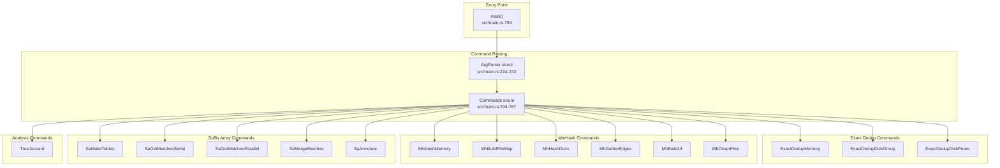
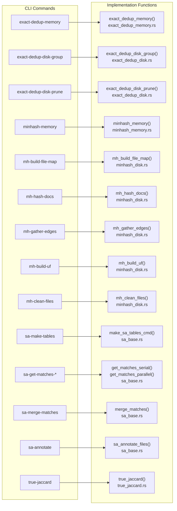

<!-- source: DeepWiki mcp.deepwiki.com · repo allenai/duplodocus · page 1 Overview · fetched 2026-10-26 -->

# Overview

<details>
<summary>Relevant source files</summary>

The following files were used as context for generating this wiki page:

- [Cargo.toml](Cargo.toml)
- [README.md](README.md)
- [src/main.rs](src/main.rs)

</details>


This document provides a high-level introduction to Duplodocus, a high-performance document deduplication tool implemented in Rust. It covers the three primary deduplication strategies (Exact, MinHash, and Suffix Array), the distinction between memory-based and disk-based processing modes, and how the CLI routes commands to their implementations.

For detailed installation and usage instructions, see [Getting Started](#1.1). For architectural details about data flow and module organization, see [Architecture Overview](#1.2).

## What is Duplodocus?

Duplodocus is a command-line tool for deduplicating large-scale JSONL datasets. It provides three distinct approaches to identifying duplicate or near-duplicate content:

| Strategy | Purpose | Scale |
|----------|---------|-------|
| **Exact** | Removes documents with identical content using hash-based matching | Any size |
| **MinHash** | Finds near-duplicate documents using Locality-Sensitive Hashing (LSH) | Any size |
| **Suffix Array** | Identifies repeated substring sequences within and across documents | Any size |

Each strategy is available in both memory-based and disk-based variants, allowing users to select the appropriate implementation based on dataset size and available resources.

**Sources:** [README.md:1-36](), [src/main.rs:1-87]()

## Deduplication Strategies

### Exact Deduplication

Exact deduplication removes documents that are byte-for-byte identical. The tool computes a hash (default: 128-bit) of each document's content and uses this hash to identify duplicates. Documents with identical hashes are considered duplicates, and only one copy is retained.

**Implementation modules:**
- `exact_dedup_memory` - Single-pass in-memory implementation
- `exact_dedup_disk` - Two-phase disk-based implementation (group → prune)

### MinHash Fuzzy Deduplication

MinHash deduplication identifies near-duplicates based on Jaccard similarity using the MinHash LSH algorithm from [Lee et al. 2021](https://arxiv.org/abs/2107.06499). Documents are represented as sets of n-grams (shingles), and MinHash signatures approximate their pairwise Jaccard similarity. LSH banding groups similar documents into candidate pairs, and Union-Find constructs connected components of duplicates.

**Implementation modules:**
- `minhash_memory` - All-in-one in-memory pipeline
- `minhash_disk` - Five-stage distributed pipeline (file map → hash docs → gather edges → build Union-Find → clean files)
- `minhash_base` - Core MinHash algorithms shared by both variants
- `uf_rush2` - Union-Find data structure for connected components

For comprehensive information about MinHash theory and implementation, see [MinHash Fuzzy Deduplication](#3).

### Suffix Array Substring Deduplication

The Suffix Array system identifies repeated substring sequences of configurable length (default: 500 tokens). It constructs suffix arrays from the concatenated text of all documents, then performs efficient k-way merging to find all repeated sequences. These matches are consolidated into intervals and annotated back onto the original documents.

**Implementation modules:**
- `sa_base` - Four-stage pipeline orchestration
- `sa_utils` - Streaming, merging, and I/O utilities
- `table_generic` - Generic suffix table with SAIS algorithm
- `compact_uint` - Memory-efficient integer types for indices

For detailed information about the SA pipeline, see [Suffix Array System](#2).

**Sources:** [src/main.rs:16-24,123-138](), [README.md:18-35]()

## Processing Modes

### Memory-Based Processing

Memory-based methods store all intermediate data structures in RAM. They are simpler to use (single command execution) and require no setup, but are limited by available memory. These methods are suitable for datasets under approximately 10GB for MinHash and 100GB for exact deduplication.

**Characteristics:**
- Single command execution
- No distributed coordination required
- Limited by system RAM
- Faster execution for small datasets

### Disk-Based Processing

Disk-based methods store intermediate results on disk, enabling processing of arbitrarily large datasets. They are designed for distributed execution across multiple machines, with each machine processing a subset of the data. Fast local storage (NVMe, SSD) is strongly recommended for optimal performance.

**Characteristics:**
- Multi-stage execution with intermediate files
- Supports distributed parallel processing
- Requires 3-5x input size in storage space
- Enables horizontal scaling

| Method | Memory Variant | Disk Variant Stages |
|--------|----------------|---------------------|
| Exact | 1 stage | 2 stages (group, prune) |
| MinHash | 1 stage | 5 stages (file map, hash docs, gather edges, build UF, clean files) |
| Suffix Array | N/A (always disk-backed) | 4 stages (make tables, get matches, merge matches, annotate) |

**Sources:** [src/main.rs:25-32,132-138](), [README.md:299-316]()

## CLI Command Structure



**Diagram: CLI Command Structure and Routing**

The CLI uses `clap` for argument parsing, with each deduplication method exposed as a separate subcommand. The `Commands` enum at [src/main.rs:234-787]() defines all available subcommands with their parameters, and the `main()` function at [src/main.rs:794-1036]() dispatches each command to its implementation function.

**Sources:** [src/main.rs:88-104,224-787,794-1036]()

## Implementation Mapping



**Diagram: Command to Implementation Mapping**

Each CLI command maps to a specific implementation function in its respective module. The `main()` function performs this routing using a match statement at [src/main.rs:801-1034]().

**Sources:** [src/main.rs:95-103,801-1034]()

## Module Organization

The codebase is organized into modules by deduplication strategy and supporting infrastructure:

| Module | Purpose | Key Exports |
|--------|---------|-------------|
| `main` | CLI entry point and command routing | `main()`, `ArgParser`, `Commands` |
| `exact_dedup_memory` | In-memory exact deduplication | `exact_dedup_memory()` |
| `exact_dedup_disk` | Disk-based exact deduplication | `exact_dedup_disk_group()`, `exact_dedup_disk_prune()` |
| `minhash_memory` | In-memory MinHash pipeline | `minhash_memory()` |
| `minhash_disk` | Disk-based MinHash pipeline | `mh_build_file_map()`, `mh_hash_docs()`, `mh_gather_edges()`, `mh_build_uf()`, `mh_clean_files()` |
| `minhash_base` | Core MinHash algorithms | Shared MinHash implementation |
| `minhash_config` | MinHash configuration management | Configuration structures |
| `sa_base` | Suffix Array pipeline orchestration | `make_sa_tables_cmd()`, `get_matches_serial()`, `get_matches_parallel()`, `merge_matches()`, `sa_annotate_files()` |
| `sa_utils` | SA streaming and merging utilities | `SAStream`, `LoserTree`, `MatchWriter` |
| `table_generic` | Suffix table with SAIS | `DynamicSuffixTable` |
| `table_old` | Legacy suffix table implementation | Historical reference |
| `compact_uint` | Memory-efficient integer types | `CompactUint`, `U40` |
| `sa_config` | SA configuration management | `SAConfig` |
| `uf_rush2` | Union-Find data structure | `UnionFind` |
| `true_jaccard` | True Jaccard similarity calculation | `true_jaccard()` |
| `utils` | Shared utilities | Helper functions |
| `storage` | Generic file I/O abstractions | `GenWriter` |

**Sources:** [src/main.rs:105-122]()

## Input and Output Format

### Input Requirements

Duplodocus expects input data as **JSONL** (JSON Lines) files, where each line is a valid JSON document. Files should be located in a single input directory and must have unique basenames.

**Example input document:**
```json
{"id": "doc123", "text": "This is the document content.", "metadata": {}}
```

### Output Formats

The tool supports two output modes:

1. **Removal Mode** (default): Duplicate documents are removed, and only unique documents are written to the output directory.

2. **Annotation Mode**: All documents are retained, but duplicates are annotated with metadata indicating their duplicate status and cluster ID. This mode is enabled by specifying an `--annotate-key` parameter.

**Example annotated document:**
```json
{
  "id": "doc123",
  "text": "This is the document content.",
  "metadata": {},
  "dedup_info": {
    "is_duplicate": true,
    "cluster_id": 42,
    "kept_document": false
  }
}
```

### Text Extraction

All deduplication methods require a `--text-key` parameter (default: `"text"`) that specifies which JSON field contains the document text to be deduplicated. Nested keys are supported using dot notation (e.g., `"content.body"`).

**Sources:** [src/main.rs:252-277,379-381](), [README.md:96-104]()

## Design Principles

### No Remote I/O in Rust

Duplodocus does not perform S3 or other remote storage operations directly. All S3 interaction is expected to happen outside the Rust codebase using tools like `s5cmd` or `boto3`. The tool operates exclusively on local filesystem paths.

### Fast Local Storage Assumption

The disk-based methods assume fast local storage (NVMe, SSD) for intermediate files. Using network-attached storage or slow disks will significantly degrade performance.

### Small File Assumption

Individual JSONL input files are expected to fit in memory. The tool reads entire files into memory for processing, then writes output files atomically.

### Unique Basename Requirement

All input files within a directory must have unique basenames. The tool uses basenames as identifiers in intermediate file mapping.

**Sources:** [README.md:317-323]()

## System Requirements

| Variant | RAM | Storage | Best For |
|---------|-----|---------|----------|
| Exact + Memory | Dataset size + 2-3GB | Input + output size | < 100GB datasets |
| Exact + Disk | 8-16GB minimum | 3-5x input size | > 100GB datasets |
| MinHash + Memory | Dataset size + 5-10GB | Input + output size | < 10GB datasets |
| MinHash + Disk | 8-16GB minimum | 3-5x input size | > 10GB datasets |
| Suffix Array | 16-32GB minimum | 3-5x input size | Any size, substring matching |

The tool leverages the `rayon` crate for parallelism within a single machine. Thread count can be controlled via the `--threads` parameter or the `RAYON_NUM_THREADS` environment variable.

**Sources:** [README.md:299-316](), [src/main.rs:796-799](), [Cargo.toml:26]()

## Dependencies

Key external dependencies include:

| Crate | Purpose | Version |
|-------|---------|---------|
| `clap` | Command-line argument parsing | 4.1.11 |
| `serde` / `serde_json` | JSON serialization | 1.0 |
| `rayon` | Data parallelism | 1.10.0 |
| `tiktoken-rs` | OpenAI tokenizers (cl100k, p50k) | 0.5.8 |
| `unicode-segmentation` | Unicode grapheme tokenizer | 1.12.0 |
| `dashmap` | Concurrent hash map | 5.5.3 |
| `memmap2` | Memory-mapped file I/O | 0.9.9 |
| `xxhash-rust` | Fast non-cryptographic hashing | 0.8 |
| `sha2` | Cryptographic hashing | 0.9 |
| `zstd` | Compression for output files | 0.13.1 |
| `mj_io` | JSONL I/O utilities | 0.1.7 |

**Sources:** [Cargo.toml:8-38]()

---

