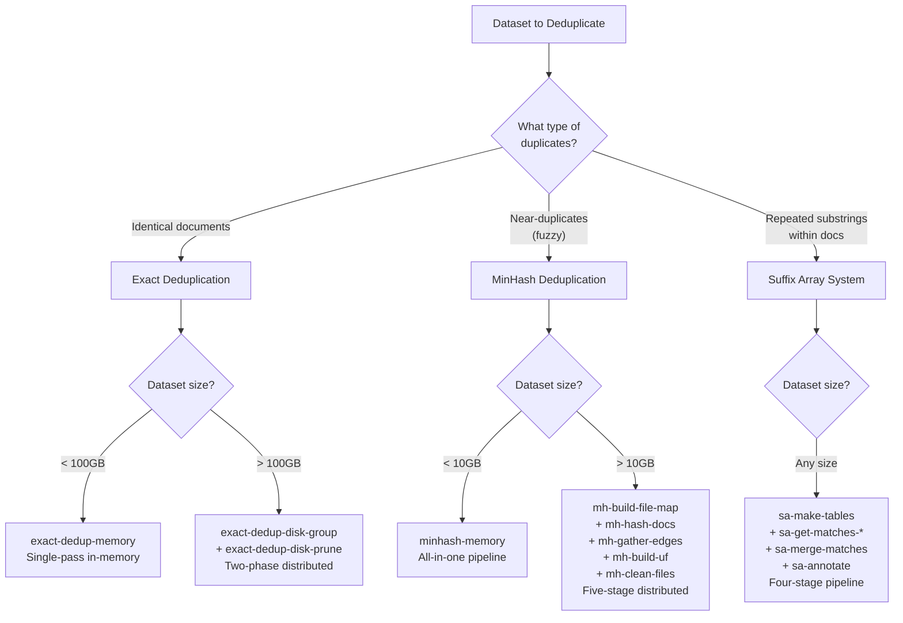
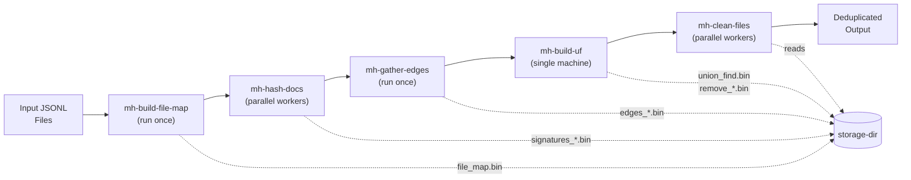

<!-- source: DeepWiki mcp.deepwiki.com · repo allenai/duplodocus · page 1.1 Getting Started · fetched 2026-10-26 -->

# Getting Started

<details>
<summary>Relevant source files</summary>

The following files were used as context for generating this wiki page:

- [README.md](README.md)
- [src/main.rs](src/main.rs)

</details>


## Purpose and Scope

This page provides installation instructions, basic CLI usage patterns, and guidance for selecting the appropriate deduplication method for your dataset. For comprehensive architecture details, see [Architecture Overview](#1.2). For detailed explanations of specific deduplication systems, see [Suffix Array System](#2), [MinHash Fuzzy Deduplication](#3), and [Exact Deduplication](#4).

## Prerequisites

### Required Software

| Component | Minimum Version | Purpose |
|-----------|----------------|---------|
| Rust toolchain | 1.70+ | Building from source |
| Git | Any recent version | Cloning repository |
| Cargo | Bundled with Rust | Build system and package manager |

### Optional Software

| Component | Purpose |
|-----------|---------|
| s5cmd | Fast S3 data transfers (recommended for cloud deployments) |
| AWS CLI | AWS credentials configuration |
| mdadm | RAID configuration on multi-NVMe instances |

**Sources:** [README.md:40-66]()

## Installation

### Build from Source

```bash
# Install Rust
curl --proto '=https' --tlsv1.2 -sSf https://sh.rustup.rs | sh
source ~/.bashrc

# Clone repository
git clone git@github.com:allenai/duplodocus.git
cd duplodocus

# Build release binary
cargo build --release
```

The compiled binary will be located at `./target/release/dedup-tool`.

**Sources:** [README.md:68-81]()

### AWS EC2 Setup (Optional)

For large-scale processing on i4i/i7i instances with NVMe drives:

```bash
# Configure RAID0 array from NVMe drives
sudo yum install mdadm -y
sudo mdadm --create /dev/md0 --level=0 --raid-devices=8 \
  /dev/nvme1n1 /dev/nvme2n1 /dev/nvme3n1 /dev/nvme4n1 \
  /dev/nvme5n1 /dev/nvme6n1 /dev/nvme7n1 /dev/nvme8n1
sudo mkfs.xfs /dev/md0
sudo mkdir /mnt/raid0
sudo mount /dev/md0 /mnt/raid0
sudo chown -R $USER /mnt/raid0

# Install build dependencies
sudo yum install gcc cmake openssl-devel g++ htop git -y

# Install s5cmd for fast S3 transfers
wget https://github.com/peak/s5cmd/releases/download/v2.2.2/s5cmd_2.2.2_Linux-64bit.tar.gz
tar -xvzf s5cmd_2.2.2_Linux-64bit.tar.gz
sudo mv s5cmd /usr/local/bin
```

**Sources:** [README.md:44-66]()

## Understanding the CLI Structure

### Command Hierarchy

Duplodocus uses a subcommand-based CLI where each operation is invoked as:

```bash
cargo run --release -- <subcommand> [options]
```

Or with the built binary:

```bash
./target/release/dedup-tool <subcommand> [options]
```

### Global Options

```bash
--threads <N>    Set RAYON_NUM_THREADS for parallel operations (default: 0 = auto)
```

**Diagram: CLI Command Structure**

```mermaid
graph TD
    CLI["dedup-tool CLI<br/>(main.rs::main)"]
    
    CLI --> ExactMem["exact-dedup-memory<br/>(Commands::ExactDedupMemory)"]
    CLI --> ExactGroup["exact-dedup-disk-group<br/>(Commands::ExactDedupDiskGroup)"]
    CLI --> ExactPrune["exact-dedup-disk-prune<br/>(Commands::ExactDedupDiskPrune)"]
    CLI --> MHMem["minhash-memory<br/>(Commands::MinhashMemory)"]
    CLI --> MHMap["mh-build-file-map<br/>(Commands::MhBuildFileMap)"]
    CLI --> MHHash["mh-hash-docs<br/>(Commands::MhHashDocs)"]
    CLI --> MHEdges["mh-gather-edges<br/>(Commands::MhGatherEdges)"]
    CLI --> MHUF["mh-build-uf<br/>(Commands::MhBuildUf)"]
    CLI --> MHClean["mh-clean-files<br/>(Commands::MhCleanFiles)"]
    CLI --> SAMake["sa-make-tables<br/>(Commands::SaMakeTables)"]
    CLI --> SASerial["sa-get-matches-serial<br/>(Commands::SaGetMatchesSerial)"]
    CLI --> SAParallel["sa-get-matches-parallel<br/>(Commands::SaGetMatchesParallel)"]
    CLI --> SAMerge["sa-merge-matches<br/>(Commands::SaMergeMatches)"]
    CLI --> SAAnnotate["sa-annotate<br/>(Commands::SaAnnotate)"]
    CLI --> TrueJacc["true-jaccard<br/>(Commands::TrueJaccard)"]
    
    ExactMem --> ExactMemFn["exact_dedup_memory()"]
    ExactGroup --> ExactGroupFn["exact_dedup_disk_group()"]
    ExactPrune --> ExactPruneFn["exact_dedup_disk_prune()"]
    MHMem --> MHMemFn["minhash_memory()"]
    MHMap --> MHMapFn["mh_build_file_map()"]
    MHHash --> MHHashFn["mh_hash_docs()"]
    MHEdges --> MHEdgesFn["mh_gather_edges()"]
    MHUF --> MHUFFn["mh_build_uf()"]
    MHClean --> MHCleanFn["mh_clean_files()"]
    SAMake --> SAMakeFn["make_sa_tables_cmd()"]
    SASerial --> SASerialFn["get_matches_serial()"]
    SAParallel --> SAParallelFn["get_matches_parallel()"]
    SAMerge --> SAMergeFn["merge_matches()"]
    SAAnnotate --> SAAnnotateFn["sa_annotate_files()"]
    TrueJacc --> TrueJaccFn["true_jaccard()"]
```



**Sources:** [src/main.rs:89-103](), [src/main.rs:224-787](), [src/main.rs:794-1036]()

## Choosing a Deduplication Method

### Decision Tree

**Diagram: Method Selection Decision Tree**



### Method Comparison Table

| Method | Use Case | Dataset Size | Parallelizable | Stages |
|--------|----------|--------------|----------------|--------|
| `exact-dedup-memory` | Identical documents | < 100GB | Single-threaded | 1 |
| `exact-dedup-disk-*` | Identical documents | Any size | Multi-node | 2 |
| `minhash-memory` | Near-duplicates | < 10GB | Single-node | 1 |
| `mh-*` (disk) | Near-duplicates | Any size | Multi-node | 5 |
| `sa-*` | Repeated substrings | Any size | Multi-node | 4 |

**Sources:** [src/main.rs:7-14](), [README.md:20-28]()

## Basic Examples

### Exact Deduplication (Memory-Based)

For small datasets where identical documents should be removed:

```bash
cargo run --release -- exact-dedup-memory \
  --input-dir /data/documents \
  --output-dir /data/unique \
  --text-key "content"
```

**Required Parameters:**
- `--input-dir`: Directory containing JSONL files
- `--output-dir`: Directory for deduplicated output
- `--text-key`: JSON field containing document text

**Optional Parameters:**
- `--hash-key`: Use existing hash field instead of computing hash
- `--hash-bits`: Hash size in bits (default: 128)
- `--annotate-key`: Add duplicate metadata instead of removing documents

**Sources:** [src/main.rs:239-277](), [README.md:96-104]()

### Exact Deduplication (Disk-Based)

For large datasets requiring distributed processing:

**Step 1: Group by hash**
```bash
cargo run --release -- exact-dedup-disk-group \
  --input-dir /data/documents \
  --storage-dir /scratch/work \
  --hash-key "doc_id" \
  --num-bins 100
```

**Step 2: Prune duplicates**
```bash
cargo run --release -- exact-dedup-disk-prune \
  --storage-dir /scratch/work \
  --output-dir /data/unique \
  --hash-key "doc_id"
```

**Sources:** [src/main.rs:279-345](), [README.md:143-162]()

### MinHash Fuzzy Deduplication (Memory-Based)

For small datasets where near-duplicates should be identified:

```bash
cargo run --release -- minhash-memory \
  --input-dir /data/documents \
  --storage-dir /tmp/work \
  --output-dir /data/deduped \
  --text-key "text" \
  --num-buckets 20 \
  --bucket-size 5 \
  --remove-duplicates true \
  --cleanup-storage
```

**Key Parameters:**
- `--num-buckets`: Number of LSH bands (higher = stricter matching)
- `--bucket-size`: Signatures per band (higher = stricter matching)
- `--ngram-size`: N-gram size for shingling (default: 5)
- `--tokenizer`: Options: `"cl100k"`, `"p50k"`, `"uniseg"`, or character-level

**Sources:** [src/main.rs:350-430](), [README.md:106-120]()

### MinHash Fuzzy Deduplication (Disk-Based)

For large-scale distributed processing:

**Diagram: MinHash Disk Pipeline Flow**



**Step 1: Build file map** (run once)
```bash
cargo run --release -- mh-build-file-map \
  --input-dir /data/documents \
  --storage-dir /shared/work
```

**Step 2: Hash documents** (parallel across workers)
```bash
# Worker 0
cargo run --release -- mh-hash-docs \
  --local-input /data/documents \
  --storage-dir /shared/work \
  --text-key "text" \
  --path-chunk 0 \
  --num-path-chunks 10 \
  --num-buckets 20 \
  --bucket-size 5
```

Repeat for workers 1-9 with different `--path-chunk` values.

**Step 3: Gather edges** (run once)
```bash
cargo run --release -- mh-gather-edges \
  --storage-dir /shared/work
```

**Step 4: Build Union-Find** (must run on single machine)
```bash
cargo run --release -- mh-build-uf \
  --storage-dir /shared/work \
  --num-path-chunks 10
```

**Step 5: Clean files** (parallel across workers)
```bash
# Worker 0
cargo run --release -- mh-clean-files \
  --input-dir /data/documents \
  --storage-dir /shared/work \
  --output-dir /data/deduped \
  --path-chunk 0 \
  --num-path-chunks 10 \
  --remove-duplicates true
```

Repeat for workers 1-9 with different `--path-chunk` values.

**Sources:** [src/main.rs:432-644](), [README.md:191-251]()

### Suffix Array Pipeline

For finding repeated substrings within and across documents:

**Step 1: Make suffix array tables**
```bash
cargo run --release -- sa-make-tables \
  --input-dir /data/documents \
  --output-dir /scratch/sa_work \
  --text-key "text"
```

**Step 2: Find matches** (choose serial or parallel)
```bash
# Serial (simpler)
cargo run --release -- sa-get-matches-serial \
  --storage-dir /scratch/sa_work \
  --match-length 500

# Or parallel (faster)
cargo run --release -- sa-get-matches-parallel \
  --storage-dir /scratch/sa_work \
  --match-length 500
```

**Step 3: Merge matches**
```bash
cargo run --release -- sa-merge-matches \
  --storage-dir /scratch/sa_work
```

**Step 4: Annotate documents**
```bash
cargo run --release -- sa-annotate \
  --input-dir /data/documents \
  --storage-dir /scratch/sa_work \
  --output-dir /data/annotated \
  --annotate-key "repeated_text"
```

**Sources:** [src/main.rs:704-786](), [src/main.rs:990-1031]()

## Common Parameters and Patterns

### Input/Output Parameters

| Parameter | Description | Used By |
|-----------|-------------|---------|
| `--input-dir` | Directory containing input JSONL files | Most commands |
| `--output-dir` | Directory for output files | Final-stage commands |
| `--storage-dir` | Working directory for intermediate files | Disk-based methods |
| `--text-key` | JSON field containing document text | Most commands |

### Parallelization Parameters

| Parameter | Description | Used By |
|-----------|-------------|---------|
| `--path-chunk` | This worker's chunk ID (0 to N-1) | `mh-hash-docs`, `mh-clean-files` |
| `--num-path-chunks` | Total number of parallel chunks | `mh-hash-docs`, `mh-build-uf`, `mh-clean-files` |
| `--threads` | Number of threads (global option) | All commands |

### Configuration Options

| Parameter | Description | Used By |
|-----------|-------------|---------|
| `--config` | Path to YAML configuration file | MinHash, SA, TrueJaccard |
| `--annotate-key` | JSON field for duplicate metadata | Most commands (optional) |
| `--remove-duplicates` | Remove duplicates vs. annotate only | MinHash, Exact |

**Sources:** [src/main.rs:252-277](), [src/main.rs:366-430](), [src/main.rs:467-524]()

## Data Format Requirements

### Input Format

All methods expect JSONL (JSON Lines) format:

```json
{"text": "Document content here...", "id": "doc_001"}
{"text": "Another document...", "id": "doc_002"}
```

### Directory Structure Requirements

- All input files must have **unique basenames** within `--input-dir`
- Input files should fit in memory individually (multi-GB files are supported, but may slow processing)
- Shared `--storage-dir` must be accessible to all workers in distributed setups

**Sources:** [README.md:319-323]()

## System Requirements

### Memory-Based Methods

| Resource | Requirement |
|----------|-------------|
| RAM | Dataset size + 2-3GB overhead |
| Storage | Input size + output size |
| Best for | Datasets < 10-100GB |

### Disk-Based Methods

| Resource | Requirement |
|----------|-------------|
| RAM | 8-16GB minimum |
| Storage | 3-5x input size (for intermediate files) |
| Storage Type | Fast local storage (NVMe/SSD) strongly recommended |
| Best for | Datasets > 100GB or distributed processing |

**Sources:** [README.md:299-316]()

## Next Steps

- For detailed architecture information, see [Architecture Overview](#1.2)
- For suffix array internals, see [Suffix Array System](#2)
- For MinHash algorithm details, see [MinHash Fuzzy Deduplication](#3)
- For exact deduplication details, see [Exact Deduplication](#4)
- For analysis tools, see [Advanced Analysis Tools](#5)

---

