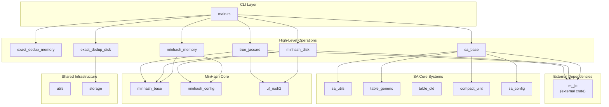
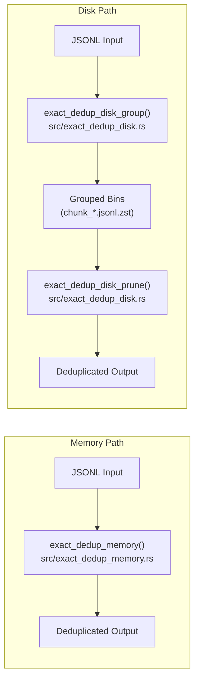
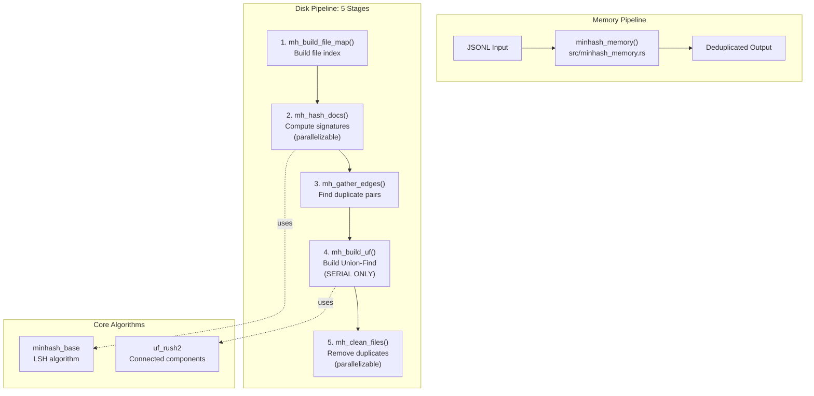
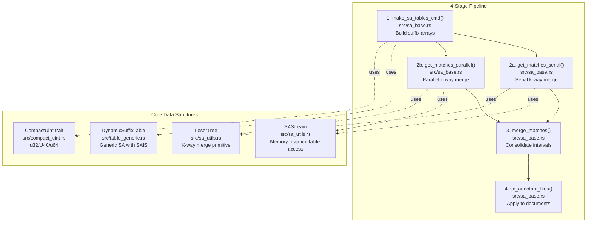
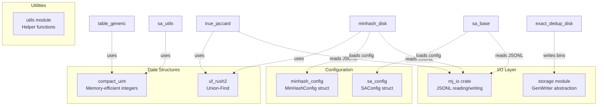
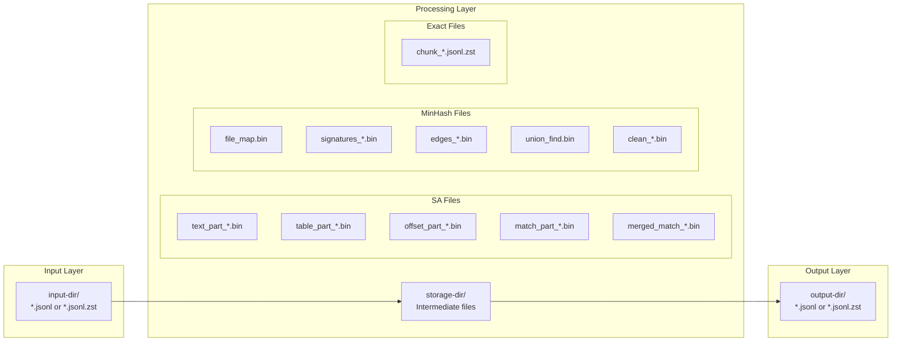
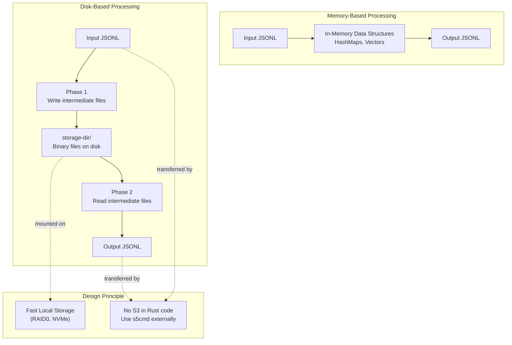
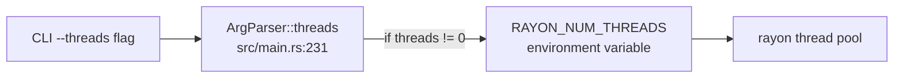

<!-- source: DeepWiki mcp.deepwiki.com · repo allenai/duplodocus · page 1.2 Architecture Overview · fetched 2026-10-26 -->

# Architecture Overview

Relevant source files

The following files were used as context for generating this wiki page:

- [Cargo.toml](Cargo.toml)
- [src/main.rs](src/main.rs)

This document describes the high-level architecture of Duplodocus, including its module organization, subsystem boundaries, and data flow patterns. It provides a structural understanding of how the three deduplication strategies (Exact, MinHash, and Suffix Array) are implemented and how they share common infrastructure.

For detailed information on specific subsystems, see [Suffix Array System](#2), [MinHash Fuzzy Deduplication](#3), and [Exact Deduplication](#4). For building and dependency information, see [Building and Dependencies](#7.1).

---

## System Layers

Duplodocus follows a layered architecture where the CLI dispatches commands to specialized subsystems that share common infrastructure.

### CLI Entry Point and Command Routing

```mermaid
graph TB
    Main["main.rs::main()"]
    Parser["ArgParser<br/>(clap)"]
    Commands["Commands enum"]
    
    Main --> Parser
    Parser --> Commands
    
    subgraph "Exact Deduplication"
        ExactMem["exact_dedup_memory()"]
        ExactGroup["exact_dedup_disk_group()"]
        ExactPrune["exact_dedup_disk_prune()"]
    end
    
    subgraph "MinHash Deduplication"
        MHMem["minhash_memory()"]
        MHFileMap["mh_build_file_map()"]
        MHHash["mh_hash_docs()"]
        MHGather["mh_gather_edges()"]
        MHUf["mh_build_uf()"]
        MHClean["mh_clean_files()"]
    end
    
    subgraph "Suffix Array Pipeline"
        SAMake["make_sa_tables_cmd()"]
        SASerial["get_matches_serial()"]
        SAParallel["get_matches_parallel()"]
        SAMerge["merge_matches()"]
        SAAnnotate["sa_annotate_files()"]
    end
    
    subgraph "Analysis Tools"
        TrueJacc["true_jaccard()"]
    end
    
    Commands -->|"ExactDedupMemory"| ExactMem
    Commands -->|"ExactDedupDiskGroup"| ExactGroup
    Commands -->|"ExactDedupDiskPrune"| ExactPrune
    
    Commands -->|"MinhashMemory"| MHMem
    Commands -->|"MhBuildFileMap"| MHFileMap
    Commands -->|"MhHashDocs"| MHHash
    Commands -->|"MhGatherEdges"| MHGather
    Commands -->|"MhBuildUf"| MHUf
    Commands -->|"MhCleanFiles"| MHClean
    
    Commands -->|"SaMakeTables"| SAMake
    Commands -->|"SaGetMatchesSerial"| SASerial
    Commands -->|"SaGetMatchesParallel"| SAParallel
    Commands -->|"SaMergeMatches"| SAMerge
    Commands -->|"SaAnnotate"| SAAnnotate
    
    Commands -->|"TrueJaccard"| TrueJacc
```

**Sources:** [src/main.rs:224-787](), [src/main.rs:793-1036]()

The `main()` function uses the `clap` crate to parse commands and dispatches to one of 21 subcommands. The `Commands` enum at [src/main.rs:234-787]() defines all available operations, grouped into four categories: Exact Deduplication (3 commands), MinHash Deduplication (6 commands), Suffix Array operations (5 commands), and Analysis Tools (1 command).

---

## Module Organization

### Module Declaration and Dependencies

**Sources:** [src/main.rs:105-122]()

Duplodocus is organized into 16 internal modules declared at [src/main.rs:105-122](). The module structure creates clear subsystem boundaries:

| Module | Purpose | Key Dependencies |
|--------|---------|------------------|
| `exact_dedup_memory` | In-memory exact deduplication | `utils` |
| `exact_dedup_disk` | Disk-based exact deduplication | `storage` |
| `minhash_memory` | In-memory MinHash pipeline | `minhash_base`, `minhash_config` |
| `minhash_disk` | Distributed MinHash pipeline | `minhash_base`, `uf_rush2`, `mj_io` |
| `sa_base` | SA pipeline orchestration | `sa_utils`, `table_generic`, `compact_uint`, `sa_config` |
| `sa_utils` | SA streaming and merging | `compact_uint` |
| `table_generic` | Generic suffix array implementation | `compact_uint` |
| `table_old` | Legacy suffix array (reference) | - |
| `compact_uint` | Memory-efficient integer types | - |
| `sa_config` | SA configuration management | - |
| `minhash_base` | Core MinHash algorithms | `minhash_config` |
| `minhash_config` | MinHash configuration | - |
| `uf_rush2` | Union-Find data structure | - |
| `true_jaccard` | Exact similarity computation | `minhash_base`, `uf_rush2` |
| `utils` | Shared utilities | - |
| `storage` | Disk I/O utilities | - |

**Sources:** [src/main.rs:105-122]()

---

## Deduplication Subsystems

### Exact Deduplication Architecture

**Sources:** [src/main.rs:96-97](), [src/main.rs:802-839]()

The exact deduplication subsystem provides two implementations:

- **Memory-based** ([src/main.rs:802-816]()): Single-pass hash-based deduplication using in-memory hash maps. Invoked via `ExactDedupMemory` command.
- **Disk-based** ([src/main.rs:818-839]()): Two-phase distributed pipeline. Phase 1 (`exact_dedup_disk_group`) groups documents by hash into bins. Phase 2 (`exact_dedup_disk_prune`) removes duplicates from each bin independently.

### MinHash Deduplication Architecture

**Sources:** [src/main.rs:98-101](), [src/main.rs:841-957]()

The MinHash subsystem implements fuzzy deduplication using Locality-Sensitive Hashing (LSH):

- **Memory pipeline** ([src/main.rs:841-875]()): Single command `minhash_memory()` executes all five phases sequentially in memory.
- **Disk pipeline** ([src/main.rs:877-957]()): Five separate commands for distributed processing:
  - `mh_build_file_map()`: Creates file path index
  - `mh_hash_docs()`: Computes MinHash signatures (parallel across path chunks)
  - `mh_gather_edges()`: Groups documents with matching signatures
  - `mh_build_uf()`: Builds global Union-Find structure (must run on single machine)
  - `mh_clean_files()`: Applies deduplication decisions (parallel across path chunks)

Core algorithms are centralized in `minhash_base` for LSH operations and `uf_rush2` for connected component identification.

**Sources:** [src/main.rs:841-957]()

### Suffix Array Architecture

**Sources:** [src/main.rs:102](), [src/main.rs:990-1031]()

The Suffix Array subsystem is the most complex, implementing a four-stage pipeline orchestrated by `sa_base`:

1. **Make Tables** ([src/main.rs:990-1008]()): `make_sa_tables_cmd()` loads documents, chunks them adaptively for memory constraints, and builds suffix arrays using `DynamicSuffixTable` from `table_generic`.

2. **Match Finding** ([src/main.rs:1010-1018]()): Two strategies for finding repeated sequences:
   - `get_matches_serial()`: Single-threaded k-way merge
   - `get_matches_parallel()`: Multi-threaded with alphabet space partitioning
   
   Both use `SAStream` for memory-mapped access and `LoserTree` for efficient k-way merging.

3. **Merge Matches** ([src/main.rs:1020-1022]()): `merge_matches()` consolidates raw matches into document-relative intervals.

4. **Annotate** ([src/main.rs:1024-1030]()): `sa_annotate_files()` applies interval metadata to original documents.

The system uses specialized data structures from `sa_utils`, `table_generic`, and `compact_uint` for memory efficiency and performance.

**Sources:** [src/main.rs:102](), [src/main.rs:990-1031]()

---

## Shared Infrastructure

### Cross-Cutting Concerns

**Sources:** [src/main.rs:105-122](), [Cargo.toml:1-45]()

Duplodocus shares several cross-cutting infrastructure components:

| Component | Type | Users | Purpose |
|-----------|------|-------|---------|
| `mj_io` | External crate | `sa_base`, `minhash_disk`, `true_jaccard` | Efficient JSONL I/O |
| `storage` | Internal module | `exact_dedup_disk` | `GenWriter` abstraction for file output |
| `utils` | Internal module | Multiple | Shared utility functions |
| `compact_uint` | Internal module | `sa_utils`, `table_generic` | Memory-efficient integer storage (U40) |
| `uf_rush2` | Internal module | `minhash_disk`, `true_jaccard` | Union-Find for connected components |
| `sa_config` | Internal module | `sa_base` | SA configuration management |
| `minhash_config` | Internal module | `minhash_base`, `minhash_disk` | MinHash parameter configuration |

**Sources:** [src/main.rs:105-122](), [Cargo.toml:8-38]()

### External Dependencies

Key external dependencies from [Cargo.toml:8-38]():

| Dependency | Version | Purpose |
|------------|---------|---------|
| `clap` | 4.1.11 | CLI argument parsing with derive macros |
| `serde_json` | 1.0.97 | JSON parsing and serialization |
| `zstd` | 0.13.1 | Compression for intermediate files |
| `mj_io` | 0.1.7 | High-performance JSONL I/O |
| `rayon` | 1.10.0 | Data parallelism for CPU-bound tasks |
| `memmap2` | 0.9.9 | Memory-mapped file access (SA tables) |
| `tiktoken-rs` | 0.5.8 | OpenAI tokenizers for text processing |
| `sha2` | 0.9 | Hashing for exact deduplication |
| `xxhash-rust` | 0.8 | Fast hashing for MinHash |

**Sources:** [Cargo.toml:8-38]()

---

## Data Flow Patterns

### Input/Output Structure

All three deduplication strategies follow a common I/O pattern:

**Sources:** [src/main.rs:36-86](), [src/main.rs:234-787]()

### Processing Models

**Sources:** [src/main.rs:7-32](), [src/main.rs:123-218]()

Duplodocus implements two processing models:

### Memory-Based Processing
- All data structures reside in RAM
- Single-pass processing
- Best for datasets under ~10GB
- Simpler deployment (no storage directory setup)
- Examples: `ExactDedupMemory`, `MinhashMemory`

### Disk-Based Processing  
- Intermediate results stored on local disk
- Multi-phase pipelines with explicit file dependencies
- Supports datasets larger than memory
- Enables distributed processing across multiple machines
- Examples: `ExactDedupDisk*`, `MhHash*`, SA pipeline

**Key Design Principle** ([src/main.rs:207-210]()): The Rust code never touches S3 directly. All S3 transfers are handled externally (e.g., using `s5cmd`). Disk-based processing operates on fast local storage (RAID0 NVMe arrays) to maximize I/O throughput.

**Sources:** [src/main.rs:7-32](), [src/main.rs:123-218]()

---

## Thread Pool Configuration

**Sources:** [src/main.rs:224-232](), [src/main.rs:795-799]()

Duplodocus supports global thread pool configuration through the `--threads` flag ([src/main.rs:230-231]()). If specified and non-zero, the value is set in the `RAYON_NUM_THREADS` environment variable ([src/main.rs:797-799]()), which controls the size of the `rayon` parallel executor thread pool used throughout the codebase.

**Sources:** [src/main.rs:224-232](), [src/main.rs:795-799]()

---

## Command Groups and Naming Conventions

Commands follow a consistent naming pattern that reflects their subsystem and processing model:

| Prefix | Processing Model | Example Commands |
|--------|------------------|------------------|
| `exact-dedup-memory` | Exact, Memory | `ExactDedupMemory` |
| `exact-dedup-disk-*` | Exact, Disk | `ExactDedupDiskGroup`, `ExactDedupDiskPrune` |
| `minhash-memory` | MinHash, Memory | `MinhashMemory` |
| `mh-*` | MinHash, Disk | `MhBuildFileMap`, `MhHashDocs`, `MhGatherEdges`, `MhBuildUf`, `MhCleanFiles` |
| `sa-*` | Suffix Array | `SaMakeTables`, `SaGetMatchesSerial`, `SaGetMatchesParallel`, `SaMergeMatches`, `SaAnnotate` |

**Sources:** [src/main.rs:234-787]()

This naming scheme makes it easy to identify the subsystem and whether a command is part of a distributed pipeline. Disk-based commands with multiple phases use ordinal numbers in their descriptions (e.g., "step 1/5", "step 2/5") to clarify execution order.

**Sources:** [src/main.rs:234-787]()

---

