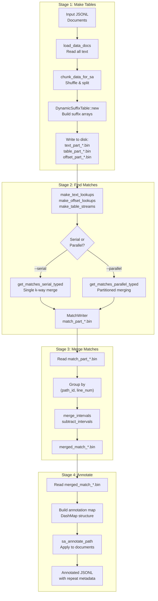
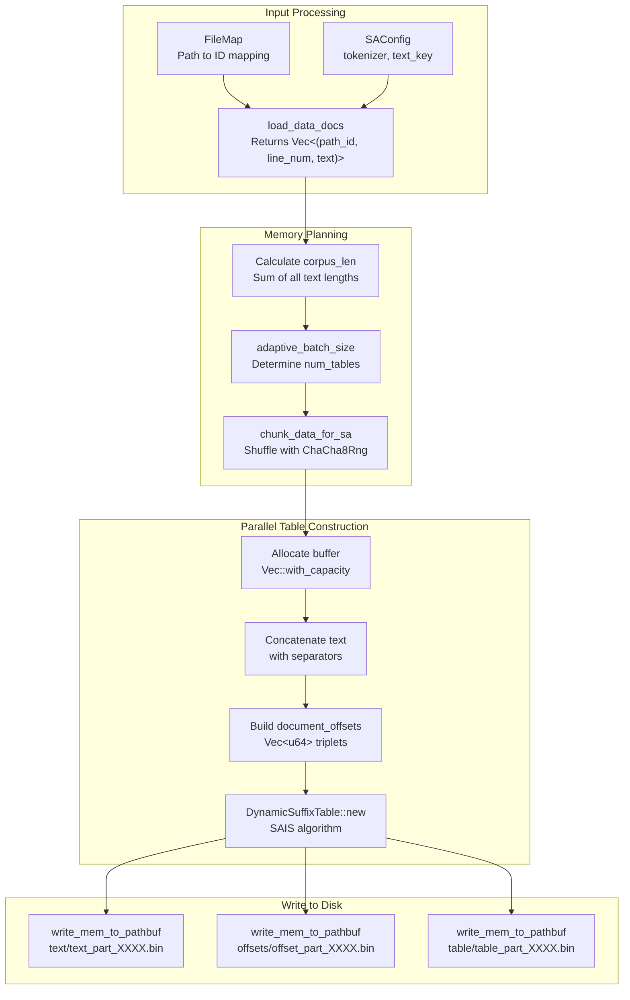
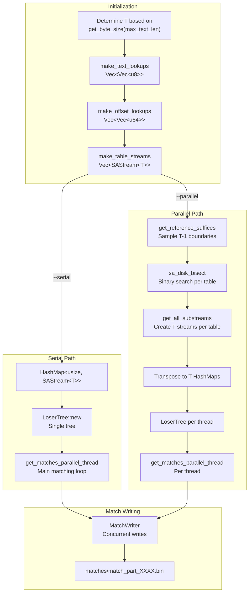
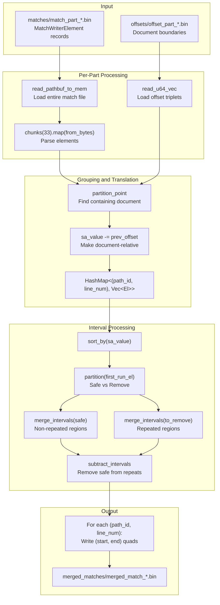
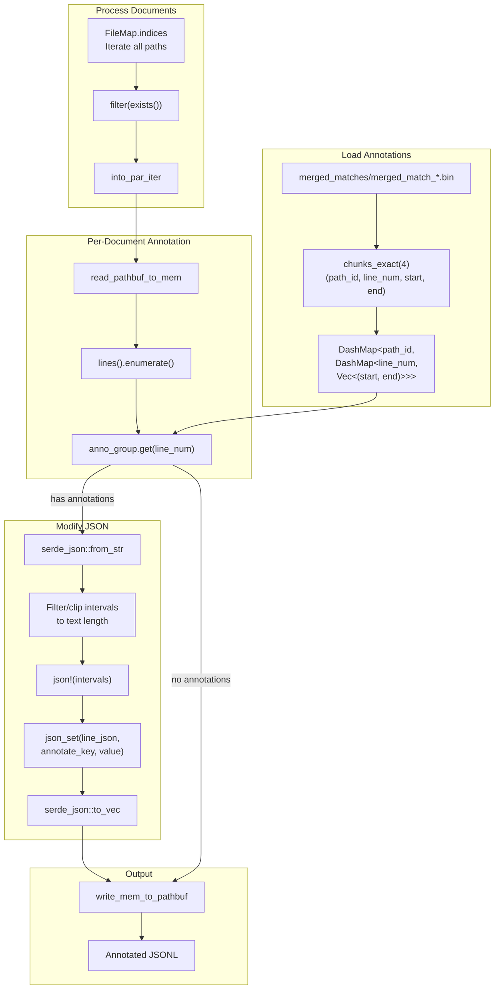
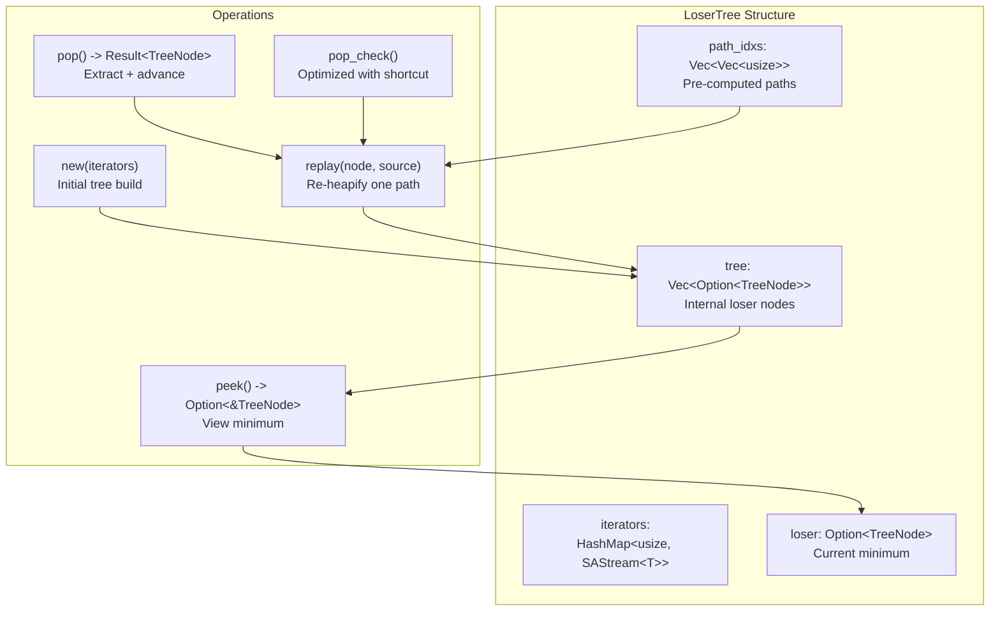

<!-- source: DeepWiki mcp.deepwiki.com · repo allenai/duplodocus · page 2 Suffix Array System · fetched 2026-10-26 -->

# Suffix Array System

<details>
<summary>Relevant source files</summary>

The following files were used as context for generating this wiki page:

- [src/sa_base.rs](src/sa_base.rs)
- [src/sa_utils.rs](src/sa_utils.rs)

</details>


## Purpose and Scope

The Suffix Array System is the most complex and important subsystem in Duplodocus (importance score: 49.27), designed to identify and annotate repeated text sequences (substrings) across large document corpora. Unlike exact and fuzzy deduplication methods that operate at the document level, the suffix array approach finds all repeated sequences of a configurable minimum length within and across documents.

This page covers the complete suffix array pipeline including table construction, match finding, match consolidation, and document annotation. For information about suffix table implementation details, see [Suffix Table Implementation](#2.3). For compact integer storage used by suffix arrays, see [Compact Integer Types](#2.4). For configuration management, see [SA Configuration](#2.5).

**Sources:** [src/sa_base.rs:1-90]()

## System Overview

The suffix array system operates through a four-stage pipeline that processes documents from input to annotated output. The system is designed to handle datasets larger than available memory through adaptive chunking and disk-backed storage.



**Diagram: Complete Suffix Array Pipeline Flow**

The pipeline is orchestrated through CLI commands that invoke functions in `sa_base.rs`, with supporting utilities in `sa_utils.rs` providing core data structures for streaming, merging, and writing operations.

**Sources:** [src/sa_base.rs:41-88](), [src/sa_base.rs:98-264](), [src/sa_base.rs:347-506](), [src/sa_base.rs:887-936](), [src/sa_base.rs:1081-1197]()

## File Storage Layout

The suffix array system creates a structured directory hierarchy for intermediate and final results:

| Directory | File Pattern | Contents | Byte Layout |
|-----------|-------------|----------|-------------|
| `file_map.json.gz` | Single file | Path to index mapping | JSON compressed |
| `text/` | `text_part_XXXX.bin` | Concatenated document text | `<text>\xff\xff<path_id:u64><line_num:u64>` repeated |
| `table/` | `table_part_XXXX.bin` | Suffix array indices | Array of `u32`, `U40`, or `u64` |
| `offsets/` | `offset_part_XXXX.bin` | Document boundaries | Triplets: `<path_id:u64><line_num:u64><end_offset:u64>` |
| `matches/` | `match_part_XXXX.bin` | Raw match data | `MatchWriterElement` (33 bytes each) |
| `merged_matches/` | `merged_match_*.bin` | Consolidated intervals | Quads: `<path_id:u64><line_num:u64><start:u64><end:u64>` |

The `XXXX` suffix in filenames represents the part number (e.g., `0000`, `0001`), allowing the system to partition large datasets across multiple files. The number of parts is determined adaptively by `adaptive_batch_size` based on available system memory.

**Sources:** [src/sa_base.rs:41-88](), [src/sa_base.rs:216-237](), [src/sa_utils.rs:384-420]()

## Stage 1: Make Tables

### Overview

Stage 1 transforms input documents into suffix array tables with supporting metadata. This stage is invoked through `make_sa_tables_cmd` which loads documents, chunks them for memory efficiency, constructs suffix arrays, and writes everything to disk.



**Diagram: Stage 1 Data Flow and Processing Steps**

### Document Loading and Chunking

The `load_data_docs` function reads all documents from the input directory, extracting text using the configured `text_key` from JSONL records. Documents are represented as tuples `(path_id, line_num, text)` where `path_id` comes from the `FileMap`.

To handle memory constraints, `chunk_data_for_sa` shuffles documents using a seeded PRNG (`ChaCha8Rng`) and distributes them across multiple chunks. The number of chunks (`num_tables`) is determined by:

1. If `batch_size` parameter is 0: Use `adaptive_batch_size` which analyzes available RAM
2. Otherwise: Use `rayon::current_num_threads() * batch_size`

**Sources:** [src/sa_base.rs:266-295](), [src/sa_base.rs:310-339](), [src/sa_utils.rs:52-83]()

### Text Buffer Construction

For each chunk, the system builds a contiguous byte buffer with special structure:

```
<document_1_text>\xff\xff<path_id:u64><line_num:u64>
<document_2_text>\xff\xff<path_id:u64><line_num:u64>
...
```

The `\xff\xff` sentinel ensures suffixes starting at document boundaries don't match across documents. The `path_id` and `line_num` are stored as little-endian `u64` values for later reconstruction.

Simultaneously, `document_offsets` is built as a `Vec<u64>` containing triplets: `[path_id, line_num, offset]` where `offset` is the byte position after each document's separator.

**Sources:** [src/sa_base.rs:186-203]()

### Suffix Array Construction

Each buffer is passed to `DynamicSuffixTable::new` which constructs the suffix array using the SAIS (Suffix Array Induced Sorting) algorithm. The table type (`u32`, `U40`, or `u64`) is selected based on buffer size:

- Text ≤ 2^32 bytes: Use `u32` (4 bytes per index)
- Text ≤ 2^40 bytes: Use `U40` (5 bytes per index) 
- Text > 2^40 bytes: Use `u64` (8 bytes per index)

This adaptive sizing minimizes memory overhead while supporting arbitrarily large corpora.

**Sources:** [src/sa_base.rs:206-209](), [src/sa_utils.rs:28-37](), [src/table_generic.rs]()

### Parallel Execution

The entire chunking and table-building process runs in parallel using `rayon::into_par_iter()`, with each thread handling one chunk independently. Timing statistics for allocation, buffer building, suffix array construction, and disk writes are collected and averaged across all threads.

**Sources:** [src/sa_base.rs:176-246]()

## Stage 2: Find Matches

### Overview

Stage 2 identifies all repeated sequences by performing a k-way merge across all suffix array tables. The system supports two modes:

1. **Serial Mode** (`get_matches_serial`): Single-threaded merge of all tables
2. **Parallel Mode** (`get_matches_parallel`): Multi-threaded with alphabet space partitioning



**Diagram: Stage 2 Serial vs Parallel Processing**

### Serial Processing

In serial mode, all suffix array tables are loaded as `SAStream` instances and placed into a single `HashMap<usize, SAStream<T>>` keyed by part number. A single `LoserTree` performs k-way merging across all streams.

The `get_matches_parallel_thread` function (despite its name, used in both modes) implements the core matching logic:

1. Pop minimum suffix from `LoserTree`
2. Compare with previous suffix using `cmp_eq` (first `match_length` bytes)
3. If matching, compute LCP (longest common prefix) and write to `MatchWriter`
4. Track runs to avoid duplicate writes
5. Filter out subsumed matches using `prev_char_same`

**Sources:** [src/sa_base.rs:347-389](), [src/sa_base.rs:776-876]()

### Parallel Processing

Parallel mode partitions the suffix array space across threads to enable concurrent processing:

#### Boundary Sampling

`get_reference_suffices` selects `T-1` evenly-spaced suffixes from one reference table (where `T` = thread count). These boundaries define partition points in alphabetical order across the suffix space.

**Sources:** [src/sa_base.rs:559-606]()

#### Binary Search Partitioning

For each suffix array table, `sa_disk_bisect` performs binary search to find the indices where each boundary occurs. This creates `T` non-overlapping ranges per table. Ranges are dilated by ±1 to ensure overlap and catch all matches.

The bisection function reads suffix array elements directly from disk using `Seek` operations, comparing the pointed-to text against boundary strings.

**Sources:** [src/sa_base.rs:725-774](), [src/sa_base.rs:647-723]()

#### Stream Creation and Transposition

`get_all_substreams` creates `SAStream` instances using `MmapRangeReader::from_range` to memory-map only the relevant portions of each table file. The resulting `Vec<Vec<SAStream>>` is transposed so each thread receives one stream per table, all covering the same alphabetical range.

**Sources:** [src/sa_base.rs:608-645]()

#### Parallel Execution

Each thread runs `get_matches_parallel_thread` with its own `LoserTree` and subset of streams. A single shared `MatchWriter` handles concurrent writes through interior mutability (`DashMap` + `Arc<Mutex<BufWriter>>`).

**Sources:** [src/sa_base.rs:508-556]()

### Match Detection Logic

The core matching algorithm in `get_matches_parallel_thread` implements sophisticated duplicate detection:

```
prev_min = initial minimum
currently_in_a_run = false
prev_lcp = None

for cur_min in loser_tree:
    if cur_min.cmp_eq(prev_min):  # First match_length bytes identical
        cur_lcp = cur_min.lcp(prev_min, match_length)
        prev_char_same = cur_min.prev_char_same(prev_min)
        
        if not prev_char_same:  # Not subsumed by larger match
            if not currently_in_a_run:
                write(prev_min, max(prev_lcp, cur_lcp), first=true)
            else:
                write(prev_min, max(prev_lcp, cur_lcp), first=false)
            currently_in_a_run = true
        
        prev_lcp = cur_lcp
    else:
        if currently_in_a_run and not prev_char_same:
            write(prev_min, prev_lcp, first=false)
        currently_in_a_run = false
        prev_lcp = None
    
    prev_min = cur_min
```

This logic ensures:
- Each run of matches is written with proper LCP values
- The `first_run_el` flag distinguishes run starts for later processing
- Subsumed matches (same suffix but preceded by same character) are filtered

**Sources:** [src/sa_base.rs:808-876]()

## Stage 3: Merge Matches

### Overview

Stage 3 consolidates raw match data from Stage 2 into cleaned, document-relative intervals. The `merge_matches` function processes each `match_part_*.bin` file in parallel, grouping matches by document and merging overlapping intervals.



**Diagram: Stage 3 Match Merging and Interval Consolidation**

### Document Boundary Resolution

Each `MatchWriterElement` contains `sa_value` as a global offset into the concatenated text buffer. The system uses binary search (`partition_point`) on the offset triplets to find which document contains each match:

```rust
let offset_index = offset_trips.partition_point(|&(_, _, document_end)| document_end <= el.sa_value);
let (path_id, line_num, _) = offset_trips[offset_index];
let prev_offset_start = offset_trips[offset_index - 1].2;
el.sa_value -= prev_offset_start;  // Now document-relative
```

**Sources:** [src/sa_base.rs:938-976]()

### Interval Merging

The `merge_intervals` function takes a sorted sequence of `(start, lcp)` pairs and produces non-overlapping intervals:

1. Initialize with first element: `(start, start + lcp)`
2. For each subsequent element:
   - If `start > current_end`: Close current interval, start new one
   - Otherwise: Extend current interval: `current_end = max(current_end, start + lcp)`

This consolidates overlapping or adjacent repeated regions into minimal covering intervals.

**Sources:** [src/sa_base.rs:1017-1036]()

### Safe Region Subtraction

Elements marked with `first_run_el=true` indicate suffixes that begin new repeated sequences. These are treated as "safe" regions that should not be marked as repeats (to avoid false positives). The `subtract_intervals` function removes safe intervals from the repeat intervals:

```
result = []
for each interval_a in vec_a:  # Repeats
    current_start = a_start
    for each overlapping interval_b in vec_b:  # Safe regions
        if current_start < b_start:
            result.append((current_start, b_start))
        current_start = max(current_start, b_end)
    if current_start < a_end:
        result.append((current_start, a_end))
```

**Sources:** [src/sa_base.rs:1038-1071](), [src/sa_base.rs:982-1007]()

## Stage 4: Annotate Files

### Overview

Stage 4 applies the merged intervals to original documents, adding repeat metadata. The `sa_annotate_files` function coordinates parallel processing of all input files, using a `DashMap` to organize intervals by document.



**Diagram: Stage 4 Document Annotation Flow**

### Annotation Map Construction

The function first loads all merged match files and builds a nested map structure:

```
DashMap<usize, DashMap<usize, Vec<(u64, u64)>>>
   ^           ^           ^
   path_id     line_num    (start, end) intervals
```

This three-level structure allows efficient lookup during document processing. The outer `DashMap` enables parallel access across paths.

**Sources:** [src/sa_base.rs:1081-1124]()

### Document Processing

Each input path is processed in parallel. For each line (document) in the file:

1. Check if annotations exist for `(path_id, line_num)`
2. If none: Write line unchanged
3. If present:
   - Parse JSONL into `serde_json::Value`
   - Extract text length using `json_get(text_key)`
   - Filter intervals to clip at text boundaries
   - Create JSON array: `json!(vec![(start, end), ...])`
   - Insert into document: `json_set(&mut line_json, annotate_key, anno_val)`
   - Serialize and write

**Sources:** [src/sa_base.rs:1126-1152](), [src/sa_base.rs:1154-1197]()

### Interval Clipping

The annotation process filters intervals to ensure they don't extend beyond document boundaries:

```rust
let anno_val: Vec<(u64, u64)> = anno_val.iter().filter_map(|(l, r)| {
    let l2 = l.min(&text_len);
    let r2 = r.min(&text_len);
    if l2 == r2 { None } else { Some((*l2, *r2)) }
}).collect();
```

This handles edge cases where suffix array matches might reference positions beyond the actual document length due to the separator bytes.

**Sources:** [src/sa_base.rs:1176-1184]()

## Core Data Structures

### SAStream

`SAStream<'a, T: CompactUint>` provides streaming access to suffix array tables with automatic filtering of invalid suffixes.

**Key Components:**

| Field | Type | Purpose |
|-------|------|---------|
| `reader` | `MmapRangeReader` | Memory-mapped access to table file |
| `text` | `&'a [u8]` | Reference to concatenated text buffer |
| `offset` | `&'a [u64]` | Document boundary triplets |
| `source` | `usize` | Table part number (0, 1, 2, ...) |
| `min_len` | `usize` | Minimum match length to consider |
| `batch_buffer` | `Vec<T>` | Internal buffer for batched reads (8192 elements) |

**Iterator Protocol:**

The `Iterator` implementation yields `Result<(u64, Option<TreeNode>), Error>` where the `u64` represents loop iterations (for progress tracking) and `TreeNode` contains:

```rust
pub struct TreeNode<'a> {
    pub sa_idx: u64,           // Index in suffix array
    pub sa_value: u64,         // Text offset (suffix start)
    pub cmp_bytes: &'a [u8],   // First min_len bytes
    pub source: usize,         // Stream source ID
    pub prev_char: Option<u8>, // Character before suffix
    pub rest_of_doc: &'a [u8], // Remaining document text
}
```

**Filtering Logic:**

The iterator automatically skips suffixes that:
1. Overrun the text buffer: `next_idx + min_len > text.len()`
2. Extend past document end: `next_eos(next_idx) < next_idx + min_len`

This ensures only valid, document-internal suffixes are considered for matching.

**Sources:** [src/sa_utils.rs:211-365](), [src/sa_utils.rs:500-560]()

### LoserTree

`LoserTree<'a, T: CompactUint>` implements efficient k-way merging using the loser tree data structure, which maintains O(log k) time complexity for extracting the minimum element from k sorted streams.

**Architecture:**



**Diagram: LoserTree Data Structure and Operations**

**Tree Layout:**

The tree is stored as a flat vector with size `sum((k + 1) / 2^i)` for i=1 to log(k). Internal nodes store "losers" (larger elements that lost comparisons during tree construction).

**Optimized Pop:**

`pop_check` implements a fast path: if the replacement element is smaller than the second minimum (stored at `tree.last()`), it immediately becomes the new winner without full replay. This optimization is tracked via `shortcut_count`.

**Replay Algorithm:**

When a stream advances, `replay` walks up the pre-computed path, comparing the new element against stored losers. Swaps occur when the new element is larger (loses):

```rust
for &idx in path {
    match (&current, &self.tree[idx]) {
        (Some(curr), Some(loser)) => {
            if curr > loser {
                std::mem::swap(&mut self.tree[idx], &mut current);
            }
        }
        (None, Some(_)) => {
            std::mem::swap(&mut self.tree[idx], &mut current);
        }
        _ => {}
    }
}
```

**Sources:** [src/sa_utils.rs:565-843]()

### MatchWriter

`MatchWriter` provides thread-safe, concurrent writing of match records to disk using a `DashMap<usize, Arc<Mutex<BufWriter<File>>>>` structure.

**Concurrency Model:**

- Outer `DashMap`: Allows lock-free lookup of writers by source ID
- Inner `Arc<Mutex<BufWriter>>`: Serializes writes to individual files
- Lazy initialization: Writers created on first access per source

**Match Element Format:**

`MatchWriterElement` serializes to 33 bytes:

| Offset | Size | Field | Description |
|--------|------|-------|-------------|
| 0-7 | 8 | `part_num` | Processing part/thread ID |
| 8-15 | 8 | `sa_idx` | Suffix array index |
| 16-23 | 8 | `sa_value` | Text offset |
| 24-31 | 8 | `lcp` | Longest common prefix length |
| 32 | 1 | `first_run_el` | Boolean flag (0 or 1) |

The `source` field is not serialized but used as the key for determining which file to write to (`match_part_{source:04}.bin`).

**Sources:** [src/sa_utils.rs:374-483]()

### MmapRangeReader

`MmapRangeReader` wraps `memmap2::Mmap` to provide efficient, zero-copy access to file regions.

**Key Features:**

1. **Full File Mapping:** `MmapRangeReader::new(file)` maps entire file
2. **Range Mapping:** `from_range(file, offset, length)` maps specific region
3. **Read Trait:** Implements `std::io::Read` for compatibility
4. **Slice Access:** `as_slice()` provides direct byte array access

**Usage in SAStream:**

Tables are memory-mapped using range mapping, allowing parallel threads to each access non-overlapping portions without loading the entire file. The `read_next_batch` function reads directly from the memory-mapped slice:

```rust
let byte_offset = position * T::BYTE_SIZE;
let bytes_to_read = to_read * T::BYTE_SIZE;
let slice = &reader.as_slice()[byte_offset..byte_offset + bytes_to_read];
```

**Sources:** [src/sa_utils.rs:136-199]()

## Memory Management

### Adaptive Batch Sizing

The `adaptive_batch_size` function dynamically determines how many suffix array tables to create based on available system memory:

**Memory Model:**

```
Total Available = total_memory × safety_margin
Text Memory = corpus_len × 1.25
Table Memory = corpus_len × byte_size / batch_size

where byte_size = ceil(log₂(corpus_len / (threads × batch_size)) / 8)
```

The function iterates through batch sizes (1 to 32), computing the resulting table memory for each. It selects the smallest batch size where:

```
text_memory + table_memory < total_available
```

**Sources:** [src/sa_utils.rs:52-83]()

### Byte Size Selection

Integer type selection is based on maximum representable value:

```rust
pub fn get_byte_size(num_bytes: usize) -> usize {
    if num_bytes <= u32::MAX as usize {
        4  // u32
    } else if num_bytes <= (1u64 << 40 - 1) as usize {
        5  // U40 (custom 5-byte type)
    } else {
        8  // u64
    }
}
```

This allows processing corpora up to:
- 4 GB: 4 bytes per index
- 1 TB: 5 bytes per index  
- Unlimited: 8 bytes per index

**Sources:** [src/sa_utils.rs:28-37]()

### Document Shuffling

To balance load across chunks, `chunk_data_for_sa` shuffles documents using a deterministic PRNG:

```rust
let mut indexed: Vec<(u64, (usize, usize, String))> = data_docs
    .into_par_iter()
    .enumerate()
    .map(|(i, item)| {
        let mut rng = ChaCha8Rng::seed_from_u64(config.random_seed.wrapping_add(i as u64));
        (rng.gen(), item)
    })
    .collect();

indexed.par_sort_unstable_by_key(|(key, _)| *key);
```

Each document gets a unique random key, ensuring reproducible shuffling across runs while distributing documents uniformly.

**Sources:** [src/sa_base.rs:316-327]()

## Processing Performance

### Progress Tracking

Both processing modes use `indicatif::ProgressBar` for progress visualization:

- **Stage 1:** Tracks table construction with `total_pbar` covering allocation, building, and writing
- **Stage 2:** Random thread displays merge progress, incrementing by batch reads
- **Stage 3:** Optionally displays match processing and interval merging
- **Stage 4:** Tracks annotation of input paths

**Sources:** [src/sa_base.rs:184](), [src/sa_base.rs:542-551](), [src/sa_base.rs:954-958](), [src/sa_base.rs:1131]()

### Timing Instrumentation

Stage 1 collects detailed timing per chunk:

```rust
let phase_times = Arc::new(Mutex::new(Vec::new()));
// ... in parallel closure:
phase_times.lock().unwrap().push((
    table_idx, 
    alloc_time.as_millis(),
    build_time.as_millis(),
    sa_time.as_millis(),
    write_time.as_millis()
));
```

Average timings are printed at completion, helping identify bottlenecks.

**Sources:** [src/sa_base.rs:186](), [src/sa_base.rs:240-254]()

## Integration with Other Systems

### FileMap Dependency

The suffix array system reuses `FileMap` from the MinHash subsystem to maintain consistent path-to-index mappings:

```rust
use crate::minhash_base::FileMap;

let file_map = if let Some(file_map_name) = file_map_opt {
    FileMap::load(&file_map_name).unwrap()
} else {
    let file_map = FileMap::new(input_dir, &None).unwrap();
    file_map.save(&(output_dir.join("file_map.json.gz"))).unwrap();
    file_map
};
```

This ensures compatibility when running multiple deduplication strategies on the same dataset.

**Sources:** [src/sa_base.rs:7](), [src/sa_base.rs:108-116]()

### Configuration System

The `SAConfig` structure (detailed in [SA Configuration](#2.5)) provides centralized parameter management including:

- `tokenizer`: Optional tokenization method
- `text_key`: JSONL field containing document text
- `max_lines_per_path`: Limit on documents per file
- `random_seed`: Seed for reproducible shuffling

**Sources:** [src/sa_base.rs:38](), [src/sa_base.rs:118-125]()

### Utility Functions

Shared utilities from `mj_io` handle common I/O operations:

- `read_pathbuf`: Read file with optional compression detection
- `read_pathbuf_to_mem`: Load entire file into memory
- `write_mem_to_pathbuf`: Write bytes to file with directory creation
- `build_pbar`: Create progress bars with consistent styling
- `get_output_filename`: Maintain directory structure in output

**Sources:** [src/sa_base.rs:28-30]()

---

**Sources for entire page:** [src/sa_base.rs:1-1199](), [src/sa_utils.rs:1-844]()

---

