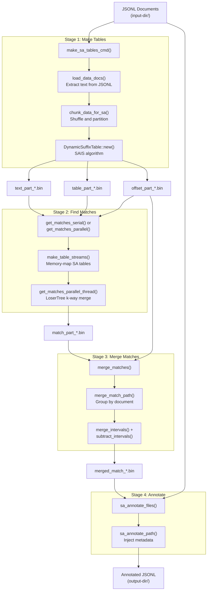
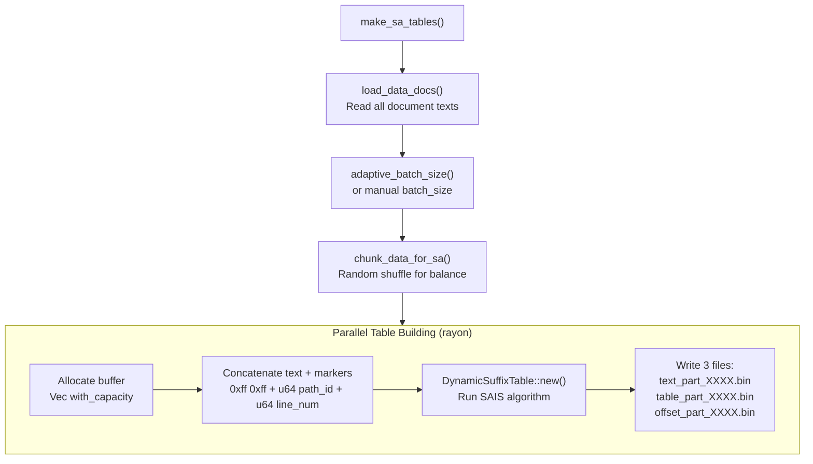
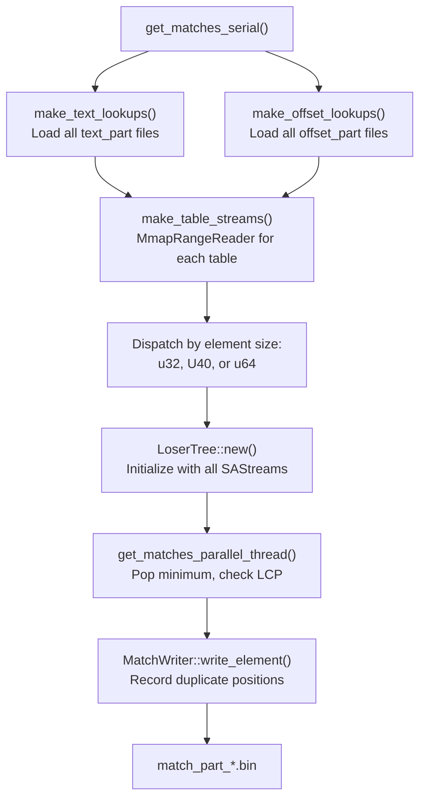
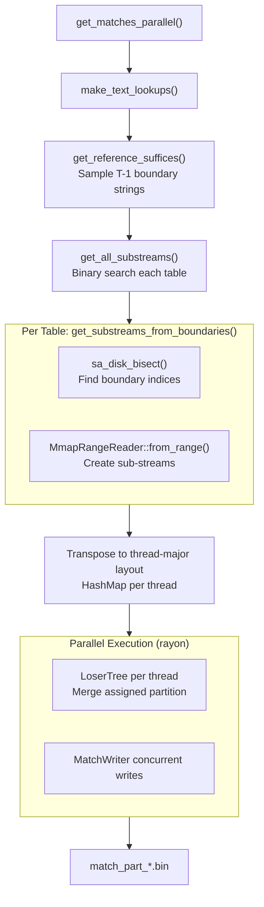
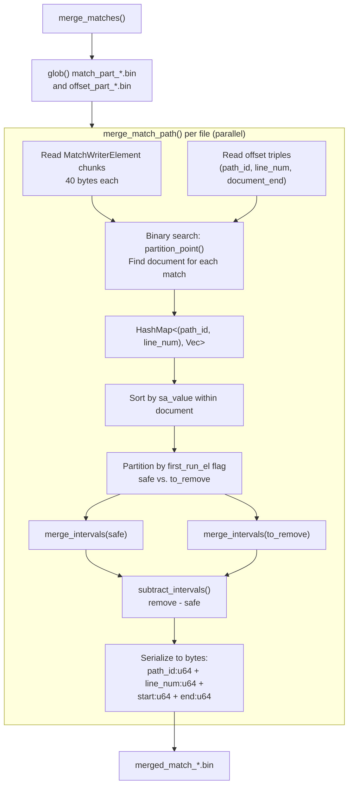
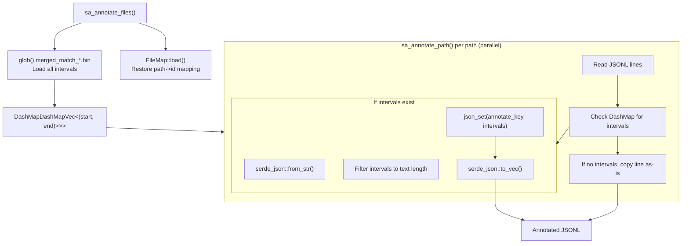

<!-- source: DeepWiki mcp.deepwiki.com · repo allenai/duplodocus · page 2.1 SA Pipeline Stages · fetched 2026-10-26 -->

# SA Pipeline Stages

<details>
<summary>Relevant source files</summary>

The following files were used as context for generating this wiki page:

- [src/sa_base.rs](src/sa_base.rs)

</details>


## Purpose and Scope

This document details the four-stage Suffix Array (SA) pipeline that identifies repeated substrings across a corpus of documents. The pipeline transforms raw text documents into annotated outputs marking duplicate text regions, handling datasets larger than available memory through adaptive chunking and disk-backed suffix arrays.

The four stages are:
1. **Make Tables**: Build suffix array tables from input documents
2. **Find Matches**: Identify repeated sequences through k-way merge
3. **Merge Matches**: Consolidate raw matches into document-relative intervals
4. **Annotate**: Apply repeat annotations to original documents

For information on the core data structures used by this pipeline (SAStream, LoserTree, MatchWriter), see [SA Utilities and Data Structures](#2.2). For details on the suffix array implementation itself, see [Suffix Table Implementation](#2.3). For configuration management, see [SA Configuration](#2.5).

---

## Pipeline Overview

The SA pipeline executes as a sequence of independent stages, each consuming the outputs of the previous stage. This design enables processing datasets larger than memory by writing intermediate results to disk.

### Four-Stage Architecture



**Sources:** [src/sa_base.rs:98-264](), [src/sa_base.rs:347-556](), [src/sa_base.rs:887-1071](), [src/sa_base.rs:1081-1197]()

---

## Stage 1: Make Tables

### Purpose

Stage 1 transforms raw JSONL documents into suffix array tables that enable efficient substring search. This stage handles memory constraints by adaptively chunking the corpus into multiple suffix arrays, each sized to fit comfortably in available memory.

### Key Functions

| Function | Location | Purpose |
|----------|----------|---------|
| `make_sa_tables_cmd()` | [src/sa_base.rs:98-128]() | CLI entry point, loads FileMap and configuration |
| `make_sa_tables()` | [src/sa_base.rs:130-264]() | Main orchestration of table building |
| `load_data_docs()` | [src/sa_base.rs:266-295]() | Extracts text from JSONL using FileMap |
| `chunk_data_for_sa()` | [src/sa_base.rs:310-339]() | Partitions documents into balanced chunks |
| `adaptive_batch_size()` | [src/sa_utils.rs]() | Calculates optimal number of tables |

### Process Flow



### Data Format

Each table index `XXXX` produces three synchronized files:

**text_part_XXXX.bin**: Concatenated text buffer
```
<doc1_text>\xff\xff<path_id:u64><line_num:u64><doc2_text>\xff\xff<path_id:u64><line_num:u64>...
```

**table_part_XXXX.bin**: Suffix array indices
```
Array of CompactUint (u32, U40, or u64) pointing into text_part
```

**offset_part_XXXX.bin**: Document boundaries
```
[u64::MAX, u64::MAX, 0, path_id_1, line_num_1, offset_1, path_id_2, line_num_2, offset_2, ...]
```

### Memory Management

The system uses a safety margin of 90% (`MEMORY_SAFETY_MARGIN = 0.90`) when calculating table sizes. The number of tables is determined by:

```
corpus_bytes_with_metadata / (available_memory * 0.9 / 9)
```

The factor of 9 accounts for: 1 byte text + 8 bytes worst-case suffix array storage (though 4 or 5 bytes is typical with compression).

**Sources:** [src/sa_base.rs:95-264](), [src/sa_base.rs:310-339]()

---

## Stage 2: Find Matches

### Purpose

Stage 2 identifies all repeated substrings of length ≥ `match_length` by performing a k-way merge across all suffix array tables. The stage supports both serial (single-threaded) and parallel (multi-threaded) execution modes.

### Execution Modes

| Mode | Entry Function | Location | Parallelization Strategy |
|------|---------------|----------|--------------------------|
| Serial | `get_matches_serial()` | [src/sa_base.rs:347-373]() | Single LoserTree merging all tables |
| Parallel | `get_matches_parallel()` | [src/sa_base.rs:481-506]() | Multiple LoserTrees, each handling alphabet partition |

### Serial Mode Flow



### Parallel Mode Flow

The parallel mode partitions the suffix array space into `T` threads by sampling boundary suffixes:



### Match Detection Algorithm

The core matching logic in `get_matches_parallel_thread()` uses a stateful loop:

1. **Pop minimum** from LoserTree
2. **Compare** with previous element using `cmp_eq()` (checks first `match_length` bytes)
3. **If match found:**
   - Calculate LCP (Longest Common Prefix) using `lcp()`
   - Check `prev_char_same()` to avoid subsumed matches
   - Write to MatchWriter with `first_run_el` flag
4. **Track run state** to properly close duplicate sequences

This algorithm ensures that only the maximal repeated regions are recorded, filtering out subsumed substrings.

**Sources:** [src/sa_base.rs:347-556](), [src/sa_base.rs:559-774](), [src/sa_base.rs:776-876]()

---

## Stage 3: Merge Matches

### Purpose

Stage 3 converts raw match records (which reference positions in concatenated text buffers) into document-relative intervals, merging overlapping regions and applying filtering rules to produce final deduplicated intervals.

### Key Functions

| Function | Location | Purpose |
|----------|----------|---------|
| `merge_matches()` | [src/sa_base.rs:887-936]() | Orchestrates parallel merging of all match files |
| `merge_match_path()` | [src/sa_base.rs:938-1015]() | Processes single match file |
| `merge_intervals()` | [src/sa_base.rs:1017-1036]() | Combines overlapping intervals |
| `subtract_intervals()` | [src/sa_base.rs:1038-1071]() | Removes safe regions from duplicate regions |

### Processing Pipeline



### Match Element Structure

Each `MatchWriterElement` (40 bytes) contains:

| Field | Type | Bytes | Description |
|-------|------|-------|-------------|
| `source` | u64 | 8 | Table index (text_part_XXXX) |
| `part_num` | u64 | 8 | Thread/partition number |
| `sa_idx` | u64 | 8 | Index in suffix array |
| `sa_value` | u64 | 8 | Position in text buffer |
| `lcp` | u64 | 8 | Length of repeated region |
| `first_run_el` | bool | Packed in flags | Marks start of duplicate run |

### Interval Filtering Logic

The `subtract_intervals()` function implements a critical filtering step:

1. **Safe intervals**: Marked by `first_run_el=true`, these are the first occurrence of a repeated sequence
2. **To-remove intervals**: Subsequent occurrences of the same sequence
3. **Subtraction**: Remove any overlap with safe intervals to avoid false positives

This ensures that legitimate repeated text (e.g., common function signatures) is not incorrectly flagged if it appears first in a "safe" context.

**Sources:** [src/sa_base.rs:887-1071]()

---

## Stage 4: Annotate

### Purpose

Stage 4 applies the computed duplicate intervals back to the original JSONL documents, injecting metadata that marks which byte ranges contain repeated text.

### Key Functions

| Function | Location | Purpose |
|----------|----------|---------|
| `sa_annotate_files()` | [src/sa_base.rs:1081-1152]() | Orchestrates parallel annotation across all files |
| `sa_annotate_path()` | [src/sa_base.rs:1154-1197]() | Annotates single file |

### Annotation Flow



### Annotation Format

Given an input document:
```json
{"text": "This is sample text with duplicates.", "id": "doc123"}
```

With intervals `[(5, 15), (20, 30)]`, the output becomes:
```json
{"text": "This is sample text with duplicates.", "id": "doc123", "sa_duplicates": [[5, 15], [20, 30]]}
```

The annotation key (default: `"sa_duplicates"`) is configurable via the `--annotate-key` parameter.

### Bounds Checking

The annotation process clips intervals to the actual text length [src/sa_base.rs:1176-1184]():
```rust
let anno_val: Vec<(u64, u64)> = anno_val.iter().filter_map(|(l, r)| {
    let l2 = l.min(&text_len);
    let r2 = r.min(&text_len);
    if l2 == r2 { None } else { Some((*l2, *r2)) }
}).collect();
```

This handles edge cases where matches extend beyond document boundaries due to marker bytes or suffix array artifacts.

**Sources:** [src/sa_base.rs:1081-1197]()

---

## Inter-Stage Data Dependencies

The following table summarizes the data flow between stages:

| Stage | Inputs | Outputs | Consumed By |
|-------|--------|---------|-------------|
| Make Tables | JSONL documents<br/>FileMap | `text_part_*.bin`<br/>`table_part_*.bin`<br/>`offset_part_*.bin` | Find Matches |
| Find Matches | All Stage 1 outputs | `match_part_*.bin` | Merge Matches |
| Merge Matches | `match_part_*.bin`<br/>`offset_part_*.bin` | `merged_match_*.bin` | Annotate |
| Annotate | `merged_match_*.bin`<br/>Original JSONL<br/>FileMap | Annotated JSONL | (Final output) |

All intermediate files are stored in the `storage-dir/` directory, organized by subdirectory (`text/`, `table/`, `offsets/`, `matches/`, `merged_matches/`).

**Sources:** [src/sa_base.rs:40-88]() (comments documenting file formats)

---

## Performance Characteristics

### Stage Timing

Typical relative execution times for a 1TB corpus:

| Stage | Relative Time | Bottleneck |
|-------|---------------|------------|
| Make Tables | 40% | SAIS algorithm CPU + disk writes |
| Find Matches | 45% | K-way merge I/O + comparison operations |
| Merge Matches | 10% | Binary search + interval merging |
| Annotate | 5% | JSON parsing + serialization |

### Parallelization Strategies

- **Make Tables**: Parallelizes across chunks (rayon), limited by number of chunks
- **Find Matches (Serial)**: Single-threaded, suitable for small datasets
- **Find Matches (Parallel)**: Parallelizes across alphabet space, optimal for large datasets
- **Merge Matches**: Parallelizes across match files (DashMap)
- **Annotate**: Parallelizes across input files

**Sources:** [src/sa_base.rs:95-264](), [src/sa_base.rs:481-556]()

---

