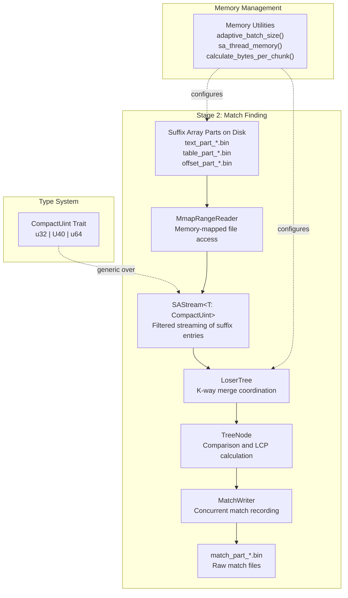
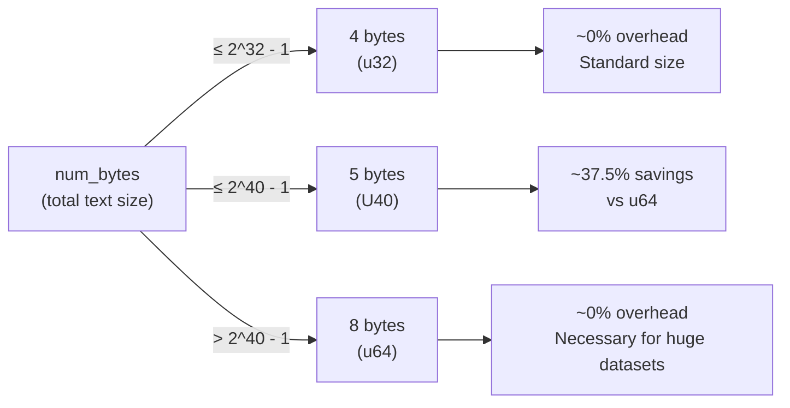
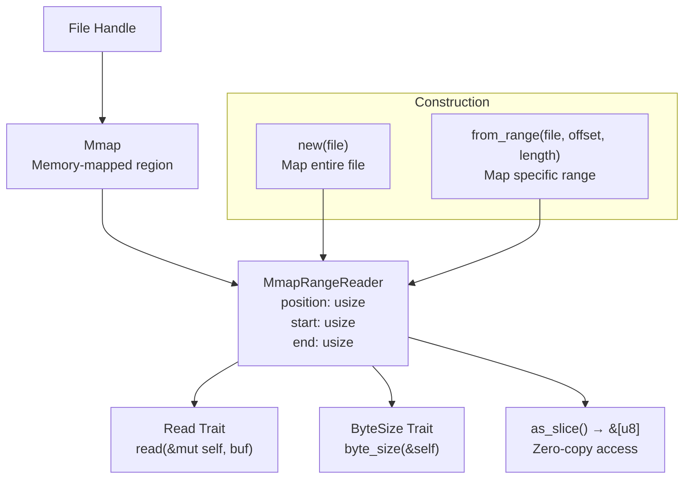
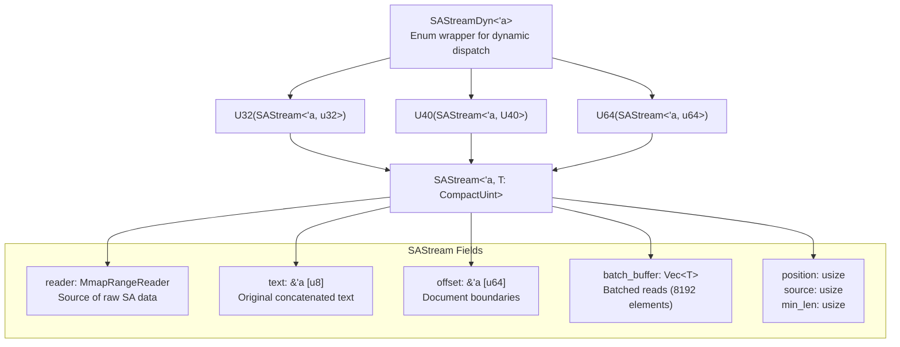
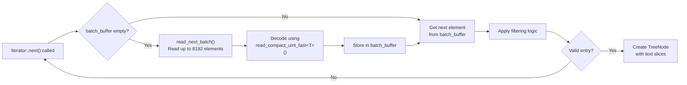
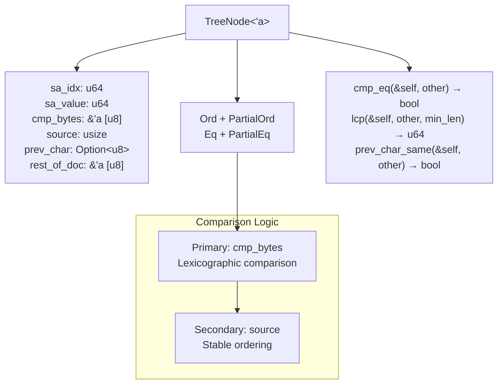
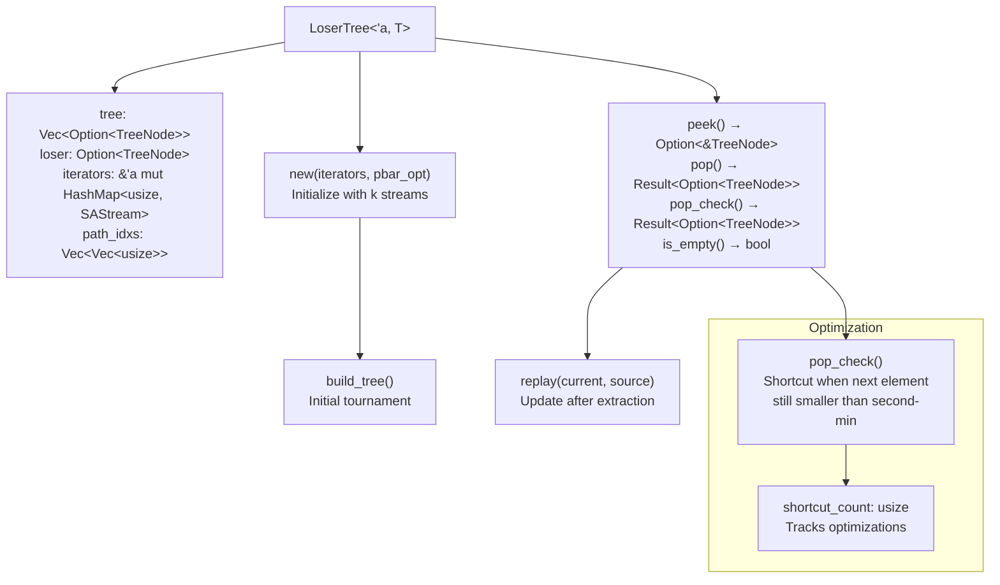
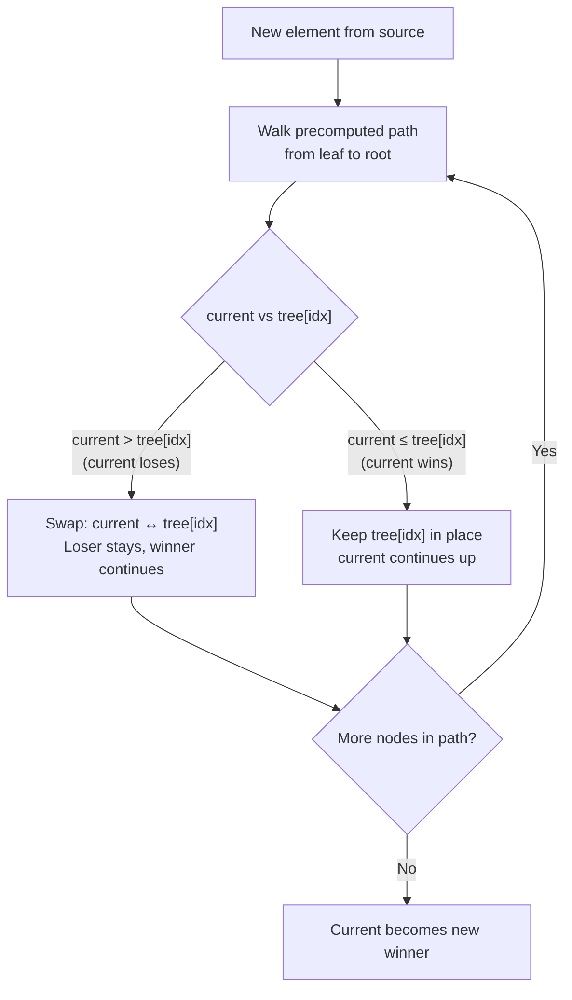
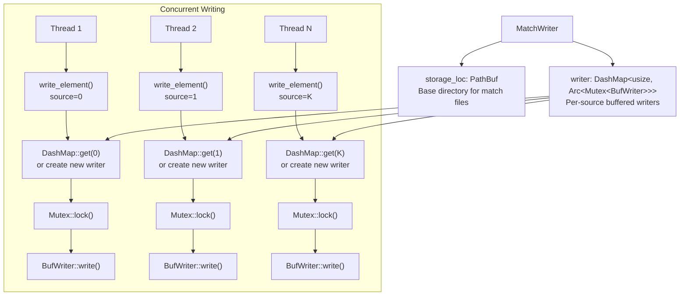
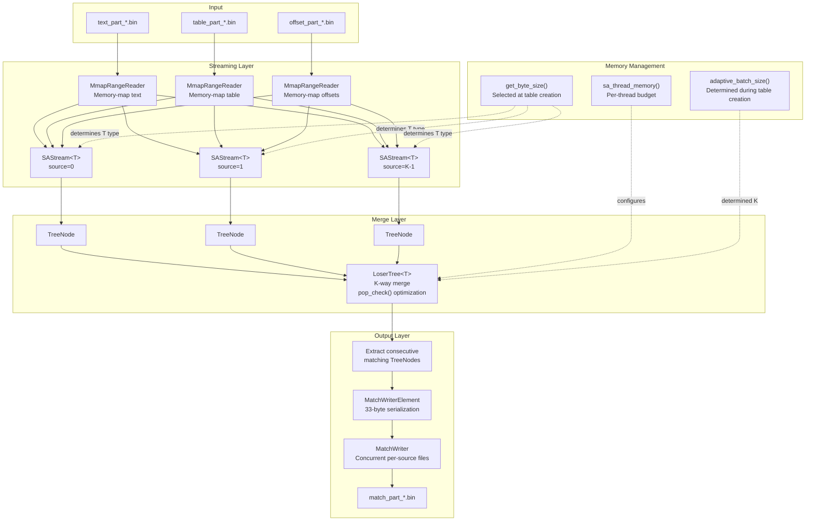

<!-- source: DeepWiki mcp.deepwiki.com · repo allenai/duplodocus · page 2.2 SA Utilities and Data Structures · fetched 2026-10-26 -->

# SA Utilities and Data Structures

<details>
<summary>Relevant source files</summary>

The following files were used as context for generating this wiki page:

- [src/compact_uint.rs](src/compact_uint.rs)
- [src/sa_utils.rs](src/sa_utils.rs)

</details>


This page documents the core utilities and data structures used throughout the Suffix Array (SA) pipeline. These components provide memory-efficient streaming, k-way merging, concurrent I/O, and adaptive memory management.

For information about the SA pipeline stages that use these utilities, see [SA Pipeline Stages](#2.1). For details on suffix table construction, see [Suffix Table Implementation](#2.3). For the compact integer types used as suffix array indices, see [Compact Integer Types](#2.4).

## Overview

The SA utilities support three critical requirements of the suffix array pipeline:

1. **Memory efficiency**: Process datasets larger than RAM through streaming and memory mapping
2. **Performance**: Enable parallel k-way merging with minimal overhead
3. **Correctness**: Ensure thread-safe concurrent writes and accurate filtering of invalid matches

The following diagram shows how these utilities work together in the match finding stage:



**Sources:** [src/sa_utils.rs:1-844]()

## Memory Management Functions

The SA pipeline must adapt to available system memory to avoid out-of-memory errors while maximizing throughput. These functions calculate appropriate chunk sizes, batch sizes, and thread allocations.

### Function Overview

| Function | Purpose | Returns | Usage Context |
|----------|---------|---------|---------------|
| `get_byte_size()` | Select integer size for SA indices | 4, 5, or 8 bytes | Table construction |
| `adaptive_batch_size()` | Calculate safe batch size for chunking | Number of documents per batch | Make tables stage |
| `sa_safety_check()` | Verify sufficient RAM available | Boolean | Pre-flight check |
| `sa_thread_memory()` | Compute max memory per thread | Bytes per thread | Parallel processing |
| `calculate_bytes_per_chunk()` | Determine chunk size for text | Bytes per chunk | Chunking documents |

### Integer Size Selection

The `get_byte_size()` function determines the appropriate byte width for suffix array indices based on total text size:



The function implements this decision at [src/sa_utils.rs:28-37](). For datasets between 4GB and 1TB, using U40 provides significant memory savings compared to u64.

### Adaptive Batch Sizing

The `adaptive_batch_size()` function calculates how many documents can be safely processed in parallel without exceeding memory limits:

**Memory Model:**
```
total_memory_usage = text_memory + table_memory
text_memory ≈ corpus_len × 1.25
table_memory ≈ corpus_len × byte_size / batch_size
```

The function iterates through batch sizes 1-32, selecting the smallest batch size where `total_memory_usage < total_memory × safety_margin`. Implementation at [src/sa_utils.rs:52-83]().

### Thread Memory Allocation

Two functions manage per-thread memory budgets:

- **`sa_thread_memory()`** [src/sa_utils.rs:101-109](): Calculates maximum memory each thread should use, given total threads and a safety margin
- **`calculate_bytes_per_chunk()`** [src/sa_utils.rs:112-127](): Determines text chunk size, accounting for the ~11× overhead of suffix array construction

**Sources:** [src/sa_utils.rs:28-127]()

## MmapRangeReader

`MmapRangeReader` provides memory-mapped file access with support for reading specific byte ranges. This enables efficient random access to large files without loading them entirely into RAM.

### Architecture



### Key Features

1. **Zero-copy access**: `as_slice()` [src/sa_utils.rs:176-178]() returns a direct slice into the memory-mapped region
2. **Range support**: `from_range()` [src/sa_utils.rs:155-170]() maps only a specific byte range, useful for parallel processing
3. **Read trait**: Implements `std::io::Read` [src/sa_utils.rs:182-193]() for compatibility with standard I/O interfaces
4. **Remaining bytes**: `remaining()` [src/sa_utils.rs:172-174]() efficiently tracks unread data

### Usage Pattern

The SA pipeline uses `MmapRangeReader` in two modes:

- **Full file**: Load entire suffix array part for serial processing
- **Byte range**: Load specific range for parallel processing (each thread gets a range)

**Sources:** [src/sa_utils.rs:132-199]()

## SAStream

`SAStream<'a, T: CompactUint>` is a generic streaming reader for suffix arrays. It filters and transforms raw suffix array indices into `TreeNode` entries suitable for k-way merging.

### Type Structure



### Filtering Logic

`SAStream` performs two critical filtering operations to eliminate invalid suffix array entries:

1. **End-of-text check** [src/sa_utils.rs:332-334](): Skip if `next_idx + min_len > text.len()`
2. **End-of-document check** [src/sa_utils.rs:336-340](): Skip if remainder of document is shorter than `min_len`

The `next_eos()` method [src/sa_utils.rs:294-312]() uses binary search on the offset array to find document boundaries.

### Batch Reading

For performance, `SAStream` reads suffix array indices in batches of 8192 elements:



The `read_next_batch()` static method [src/sa_utils.rs:252-273]() reads raw bytes and decodes them using `read_compact_uint_fast()` from the compact_uint module.

### TreeNode Construction

When a valid suffix array entry is found, `SAStream` constructs a `TreeNode` with:

- `sa_idx`: Position in the suffix array
- `sa_value`: Text offset the suffix points to
- `cmp_bytes`: First `min_len` bytes for comparison
- `rest_of_doc`: Remaining bytes in the document (for LCP calculation)
- `prev_char`: Byte preceding this suffix (for filtering same-character runs)
- `source`: Which suffix array part this came from

Construction at [src/sa_utils.rs:353-360]().

**Sources:** [src/sa_utils.rs:203-365](), [src/compact_uint.rs:1-206]()

## TreeNode

`TreeNode<'a>` represents a suffix array entry during k-way merging. It contains the information needed for comparison, LCP calculation, and match recording.

### Structure



### Comparison Implementation

The `Ord` implementation [src/sa_utils.rs:523-531]() uses a two-level comparison:

1. **Primary**: Compare `cmp_bytes` lexicographically
2. **Secondary**: If `cmp_bytes` are equal, compare `source` to ensure stable ordering

This ensures deterministic behavior in the LoserTree when multiple suffixes share the same prefix.

### LCP Calculation

The `lcp()` method [src/sa_utils.rs:554-559]() calculates the Longest Common Prefix between two TreeNodes:

```
lcp_length = min_len + count(matching bytes in rest_of_doc)
```

This is used during match recording to determine how much text actually matches between two suffix occurrences.

### Previous Character Filtering

The `prev_char_same()` method [src/sa_utils.rs:510-521]() checks if two TreeNodes have the same preceding character. This is used to filter out false positive matches that extend beyond word boundaries (e.g., matching "the" in both "the" and "other").

**Sources:** [src/sa_utils.rs:500-560]()

## LoserTree

`LoserTree<'a, T: CompactUint>` implements an efficient k-way merge using a tournament tree structure. This is the core algorithm for finding repeated sequences across multiple suffix array parts.

### Architecture



### Tournament Structure

The loser tree organizes k input streams into a binary tournament where "losers" (larger elements) are stored in internal nodes, and the "winner" (smallest element) is stored separately.

**Tree size calculation** [src/sa_utils.rs:826-836]():
```
For k inputs:
  level_size[0] = k
  level_size[i+1] = ⌈level_size[i] / 2⌉
  total_nodes = Σ ⌈level_size[i] / 2⌉
```

**Path indices** [src/sa_utils.rs:809-825](): Each leaf has a precomputed path to the root, stored in `path_idxs`. This enables O(log k) replay operations.

### Replay Algorithm

After extracting the minimum element with `pop()`, the tree must be updated. The `replay()` method [src/sa_utils.rs:782-806]() walks the precomputed path from the affected leaf to the root:



### Pop Optimization

The `pop_check()` method [src/sa_utils.rs:699-732]() implements an important optimization: if the next element from the winner's stream is still smaller than the second-smallest element (stored in `tree.last()`), we can avoid a full replay:

```
if next_element < tree.last():
    # Shortcut: next_element is still the minimum
    loser = next_element
    return previous_winner
else:
    # Full replay needed
    replay(next_element, source)
```

This optimization is tracked via `shortcut_count` [src/sa_utils.rs:569]() and can significantly reduce tree operations when input streams have long runs of consecutive values.

**Sources:** [src/sa_utils.rs:565-843]()

## MatchWriter

`MatchWriter` provides thread-safe concurrent writing of match results to disk. Each source (suffix array part) gets its own output file, and multiple threads can write matches simultaneously.

### Architecture



### MatchWriterElement Serialization

`MatchWriterElement` [src/sa_utils.rs:375-420]() represents a single match and is serialized to 33 bytes:

| Offset | Size | Field | Description |
|--------|------|-------|-------------|
| 0 | 8 | `part_num` | Document part number |
| 8 | 8 | `sa_idx` | Suffix array index |
| 16 | 8 | `sa_value` | Text offset |
| 24 | 8 | `lcp` | Match length |
| 32 | 1 | `first_run_el` | Boolean flag |

**Serialization** [src/sa_utils.rs:387-395](): Uses `copy_from_slice()` with `to_le_bytes()` for little-endian encoding.

**Deserialization** [src/sa_utils.rs:404-419](): Uses unsafe pointer casts for maximum performance, avoiding bounds checks.

### Thread Safety

Thread safety is achieved through two levels:

1. **DashMap**: Lock-free concurrent hash map maps source → writer
2. **Mutex**: Each writer is wrapped in a Mutex for exclusive write access

This design minimizes contention: threads writing to different sources never block each other, and threads writing to the same source are serialized only at the buffer write level.

### File Management

Files are created lazily on first write via `make_new_writer()` [src/sa_utils.rs:443-454]():

- Opens file in append mode (`OpenOptions::append()`)
- Sets permissions to 0o644
- Wraps in `BufWriter` for efficient I/O
- Stores in `Arc<Mutex<>>` for sharing

File naming: `match_part_{source:04}.bin` at [src/sa_utils.rs:478-482]().

**Flush**: The `finish()` method [src/sa_utils.rs:471-476]() uses rayon to flush all writers in parallel.

**Sources:** [src/sa_utils.rs:374-483]()

## Integration with Pipeline

The following diagram shows how these utilities integrate into the complete match finding workflow:



**Sources:** [src/sa_utils.rs:1-844]()

## Performance Characteristics

### Memory Usage

| Component | Memory Cost | Notes |
|-----------|-------------|-------|
| `MmapRangeReader` | ~0 bytes | OS manages pages, not RSS |
| `SAStream<T>` | ~64 KB per stream | 8192-element batch buffer |
| `TreeNode` | ~80 bytes | Holds slices, not copies |
| `LoserTree` | k × 80 bytes | One TreeNode per stream |
| `MatchWriter` | ~8 KB × k | One BufWriter per source |

### Time Complexity

| Operation | Complexity | Dominant Factor |
|-----------|------------|-----------------|
| `SAStream::next()` | O(1) amortized | Batch reading |
| `LoserTree::peek()` | O(1) | Direct access to winner |
| `LoserTree::pop()` | O(log k) | Path replay |
| `LoserTree::pop_check()` | O(1) or O(log k) | Shortcut when possible |
| `TreeNode::lcp()` | O(m) | m = match length |
| `MatchWriter::write_element()` | O(1) amortized | Buffered I/O |

### I/O Patterns

- **Sequential reads**: `SAStream` reads suffix arrays sequentially via memory mapping
- **Random access**: Text and offset arrays accessed randomly via zero-copy slices
- **Sequential writes**: `MatchWriter` appends matches sequentially, buffered
- **Parallel I/O**: Multiple threads writing to different files simultaneously

**Sources:** [src/sa_utils.rs:1-844]()

---

