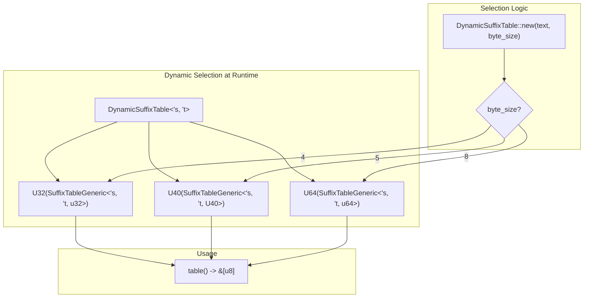
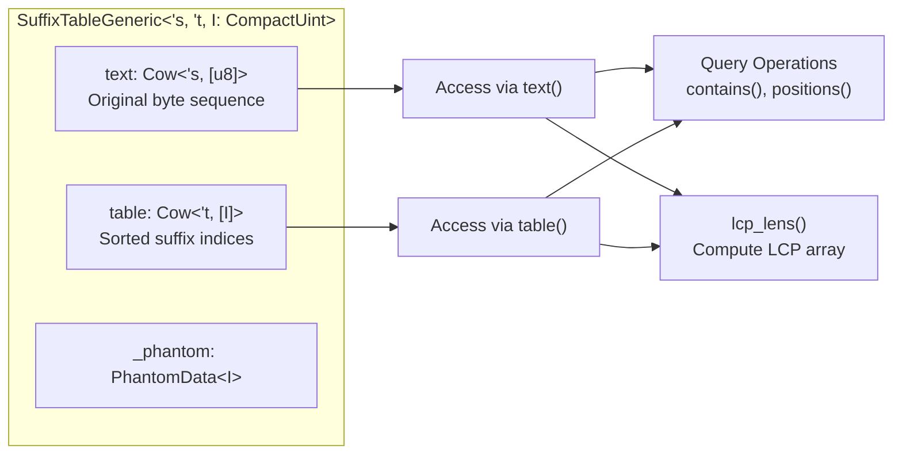
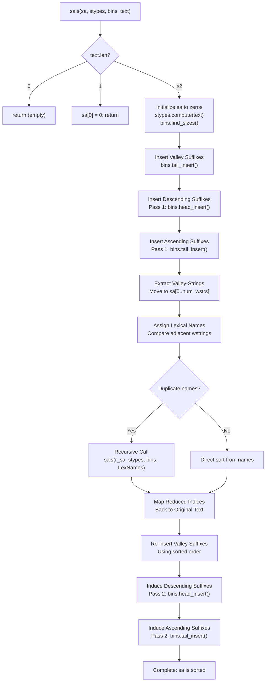
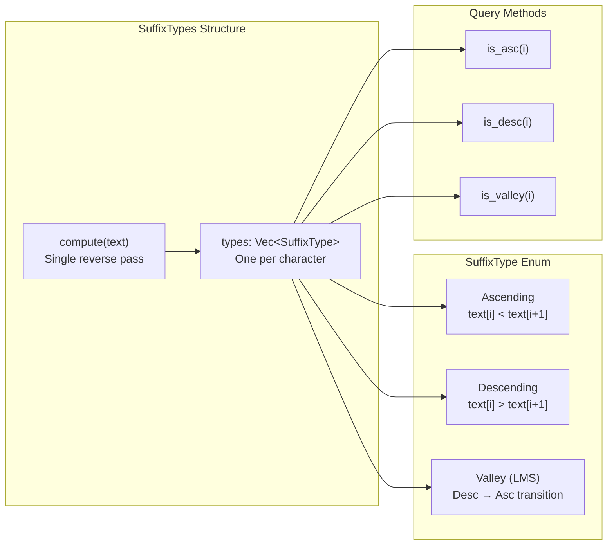
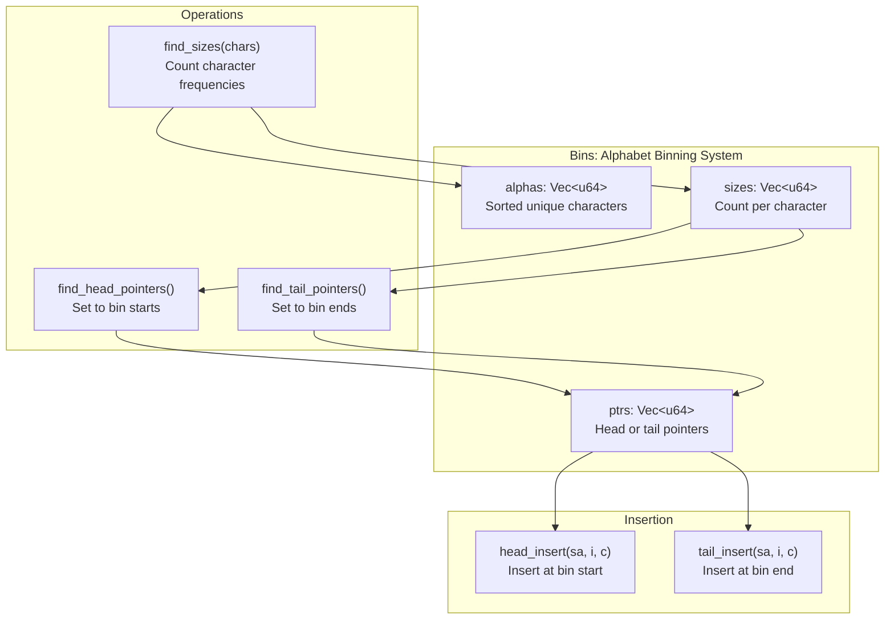
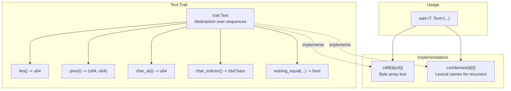
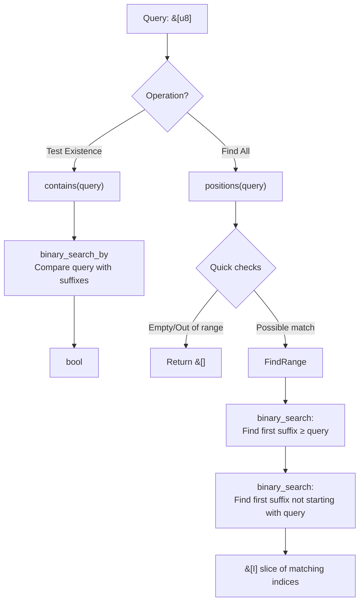
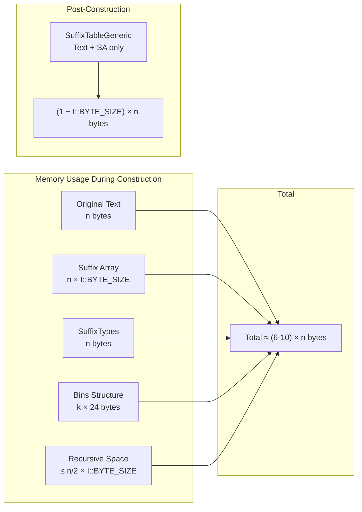

<!-- source: DeepWiki mcp.deepwiki.com · repo allenai/duplodocus · page 2.3 Suffix Table Implementation · fetched 2026-10-26 -->

# Suffix Table Implementation

<details>
<summary>Relevant source files</summary>

The following files were used as context for generating this wiki page:

- [src/compact_uint.rs](src/compact_uint.rs)
- [src/table_generic.rs](src/table_generic.rs)

</details>


## Purpose and Scope

This page documents the core suffix table implementation in Duplodocus, which provides efficient construction and querying of suffix arrays using the SAIS (Suffix Array - Induced Sorting) algorithm. The implementation is generic over different integer sizes to enable memory-efficient indexing of texts from megabytes to terabytes.

For information about the compact integer types (`u32`, `U40`, `u64`) used as indices, see [Compact Integer Types](#2.4). For details on how suffix tables are used in the SA pipeline, see [SA Pipeline Stages](#2.1) and [SA Utilities and Data Structures](#2.2).

**Sources:** [src/table_generic.rs:1-997]()

## Suffix Table Overview

A suffix table is a lexicographically sorted array of all suffixes in a text, represented as byte indices into the original text. For a text of length `n`, the suffix table contains `n` integers, each pointing to the start position of a suffix. This data structure enables efficient substring search, pattern matching, and duplicate detection.

Unlike enhanced suffix arrays that include auxiliary data (inverse suffix array, LCP array), this implementation stores only the sorted suffix indices, minimizing memory usage to the size of the index type multiplied by text length.

### Key Design Trade-offs

| Aspect | Choice | Rationale |
|--------|--------|-----------|
| **Index Representation** | Integer offsets only | 4-8 bytes per character vs 12+ bytes for enhanced structures |
| **Construction Algorithm** | SAIS (Linear time) | `O(n)` time, `O(kn)` space where `k` is alphabet size |
| **Integer Size** | Generic (`u32`, `U40`, `u64`) | Memory efficiency: 4 bytes for ≤4GB, 5 bytes for ≤1TB, 8 bytes for larger |
| **Text Representation** | Byte arrays (`[u8]`) | Works with any tokenized text, not limited to UTF-8 strings |

**Sources:** [src/table_generic.rs:44-87](), [src/table_generic.rs:121-126]()

## Type Hierarchy and Dynamic Dispatch

### DynamicSuffixTable Enum



The `DynamicSuffixTable` enum provides runtime selection of index size based on text length:

```rust
// From src/table_generic.rs
pub enum DynamicSuffixTable<'s, 't> {
    U32(SuffixTableGeneric<'s, 't, u32>),
    U40(SuffixTableGeneric<'s, 't, U40>),
    U64(SuffixTableGeneric<'s, 't, u64>),
}
```

The `new()` method selects the appropriate variant based on the `byte_size` parameter (4, 5, or 8), which is determined by the SA pipeline based on the total text size being processed.

**Sources:** [src/table_generic.rs:90-118]()

## SuffixTableGeneric Structure

### Core Components



The generic structure uses `Cow` (Clone-on-Write) to allow both owned and borrowed data:

| Field | Type | Purpose |
|-------|------|---------|
| `text` | `Cow<'s, [u8]>` | Original byte sequence, borrowed or owned |
| `table` | `Cow<'t, [I]>` | Suffix indices, where `I` is `u32`, `U40`, or `u64` |
| `_phantom` | `PhantomData<I>` | Zero-size marker to satisfy type system |

**Sources:** [src/table_generic.rs:121-126]()

### Construction Methods

```mermaid
graph TD
    Input["Input Text: &[u8]"] --> Method{Construction Method}
    
    Method -->|Production| SAIS["new(text)<br/>SuffixTableGeneric::new"]
    Method -->|Testing/Small| Naive["new_naive(text)<br/>O(n² log n) sorting"]
    Method -->|Pre-computed| Parts["from_parts(text, table)<br/>No validation"]
    
    SAIS --> Check{text.len() &lt;= I::max_value?}
    Check -->|Yes| Construct["sais_table_generic&lt;I&gt;(text)"]
    Check -->|No| Error["Err('Text too large')"]
    
    Construct --> Result["SuffixTableGeneric&lt;'s, 't, I&gt;"]
    Naive --> Result
    Parts --> Result
```

**Sources:** [src/table_generic.rs:146-208]()

## SAIS Algorithm Implementation

### Algorithm Overview

SAIS (Suffix Array - Induced Sorting) constructs suffix arrays in `O(n)` time using a "reduce and conquer" approach. The algorithm classifies suffixes, recursively solves a reduced problem, and induces the final sort.

**Key References:**
- Original paper: [Nong et al., 2009](https://local.ugene.unipro.ru/tracker/secure/attachment/12144/Linear%20Suffix%20Array%20Construction%20by%20Almost%20Pure%20Induced-Sorting.pdf)
- Accessible description: [Shrestha et al., 2014](http://bib.oxfordjournals.org/content/15/2/138.full.pdf)

**Sources:** [src/table_generic.rs:59-89]()

### SAIS Algorithm Flow



**Sources:** [src/table_generic.rs:449-641]()

### Suffix Type Classification



The algorithm classifies each suffix position as:
- **Ascending**: Starts with a character less than the next
- **Descending**: Starts with a character greater than the next
- **Valley (LMS)**: Leftmost S-type, where a descending suffix is followed by ascending

Valley suffixes are critical anchor points that divide the problem space and enable the recursive reduction.

**Sources:** [src/table_generic.rs:643-708]()

## Supporting Data Structures

### Bins Structure



The `Bins` structure manages bins for each unique character in the alphabet:

| Method | Purpose | Pointer Movement |
|--------|---------|------------------|
| `find_sizes()` | Count character frequencies | N/A |
| `find_head_pointers()` | Position at bin starts | Left to right |
| `find_tail_pointers()` | Position at bin ends | Right to left |
| `head_insert()` | Insert at current head, increment | Forward |
| `tail_insert()` | Insert at current tail, decrement | Backward |

**Sources:** [src/table_generic.rs:752-831]()

### Text Trait Abstraction



The `Text` trait enables the SAIS algorithm to work on both:
1. **Original text** (`Utf8(&[u8])`): Byte sequences from input documents
2. **Reduced text** (`LexNames(&[I])`): Lexical names during recursive calls

This abstraction allows the same algorithm code to handle both the initial problem and subproblems without duplication.

**Sources:** [src/table_generic.rs:833-947]()

## Query Operations

### Binary Search-Based Queries



| Operation | Time Complexity | Description |
|-----------|-----------------|-------------|
| `contains(query)` | `O(m log n)` | Returns true if query exists in text |
| `positions(query)` | `O(m log n)` | Returns slice of all positions where query starts |

Where `m = query.len()` and `n = text.len()`.

**Sources:** [src/table_generic.rs:272-359]()

### LCP Array Computation

```rust
// Available but not used in main pipeline
pub fn lcp_lens(&self) -> Vec<u64>
```

Computes the Longest Common Prefix array using a quadratic algorithm (linear-time algorithm commented out due to Unicode issues). The LCP array `lcp[i]` stores the length of the longest common prefix between suffixes at ranks `i-1` and `i`.

**Sources:** [src/table_generic.rs:218-428]()

## Memory and Performance Characteristics

### Space Complexity



| Component | Size | Notes |
|-----------|------|-------|
| Text | `n` bytes | Input byte sequence |
| Suffix Array | `n × 4/5/8` bytes | Depends on index type |
| SuffixTypes | `n` bytes | Temporary during construction |
| Bins | `k × 24` bytes | `k` = alphabet size |
| Recursive | `≤ n/2 × 4/5/8` bytes | Temporary during recursion |

**Optimal Configuration:**

| Text Size | Index Type | SA Memory | Total (with text) |
|-----------|-----------|-----------|-------------------|
| ≤ 4 GB | `u32` | 4n bytes | 5n bytes |
| 4 GB - 1 TB | `U40` | 5n bytes | 6n bytes |
| > 1 TB | `u64` | 8n bytes | 9n bytes |

**Sources:** [src/table_generic.rs:78-89]()

### Time Complexity

| Operation | Complexity | Notes |
|-----------|------------|-------|
| Construction (SAIS) | `O(n)` | Linear in text length |
| Construction (Naive) | `O(n² log n)` | Only for testing small texts |
| Substring Search | `O(m log n)` | `m` = query length |
| LCP Computation | `O(n²)` | Quadratic implementation |

The SAIS algorithm achieves linear time through:
1. Single-pass suffix type classification
2. Recursive reduction to at most half the problem size
3. Linear-time induced sorting in each recursive level

Cache performance is critical - the algorithm makes multiple linear passes over the data, favoring smaller index types for better cache locality.

**Sources:** [src/table_generic.rs:57-77](), [src/table_generic.rs:129-145]()

## Integration with SA Pipeline

The suffix table implementation integrates into the SA pipeline through:

1. **Construction**: Called by `sa_base.rs` during the "Make Tables" stage for each text chunk
2. **Index Type Selection**: Pipeline determines appropriate byte size (4, 5, or 8) based on total corpus size
3. **Serialization**: The `table()` method returns `&[u8]` for writing to disk via `bytemuck::cast_slice()`
4. **Memory Management**: `Cow` types allow zero-copy operation when memory-mapping tables from disk

For details on how these tables are used for matching, see [Match Finding Stage](#2.1.2).

**Sources:** [src/table_generic.rs:111-118](), [src/table_generic.rs:214-216]()

---

