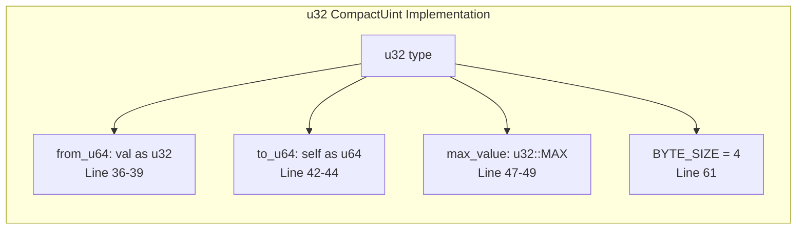
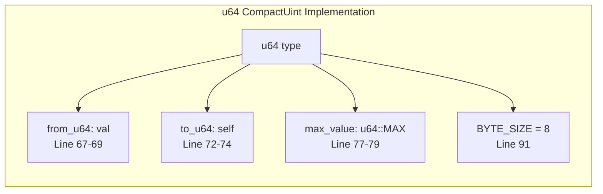
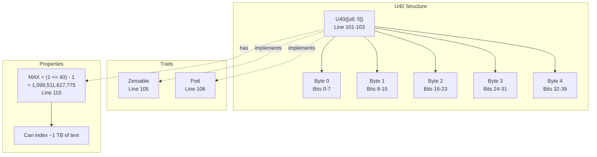
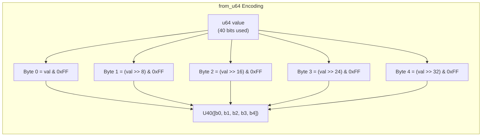
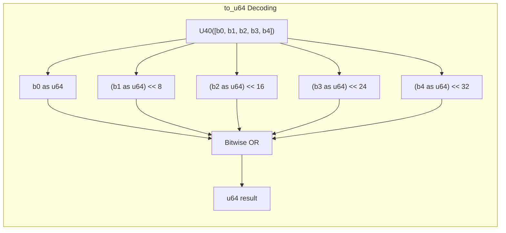
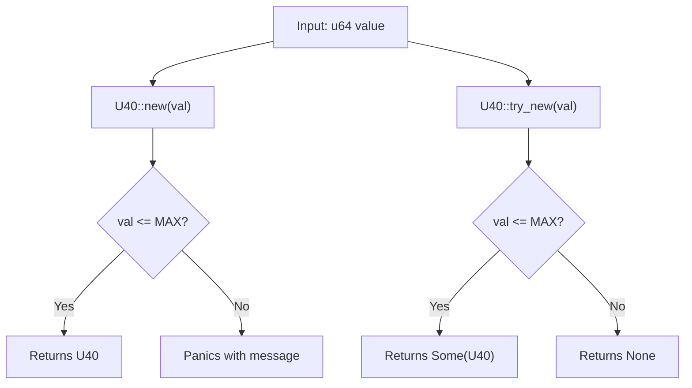
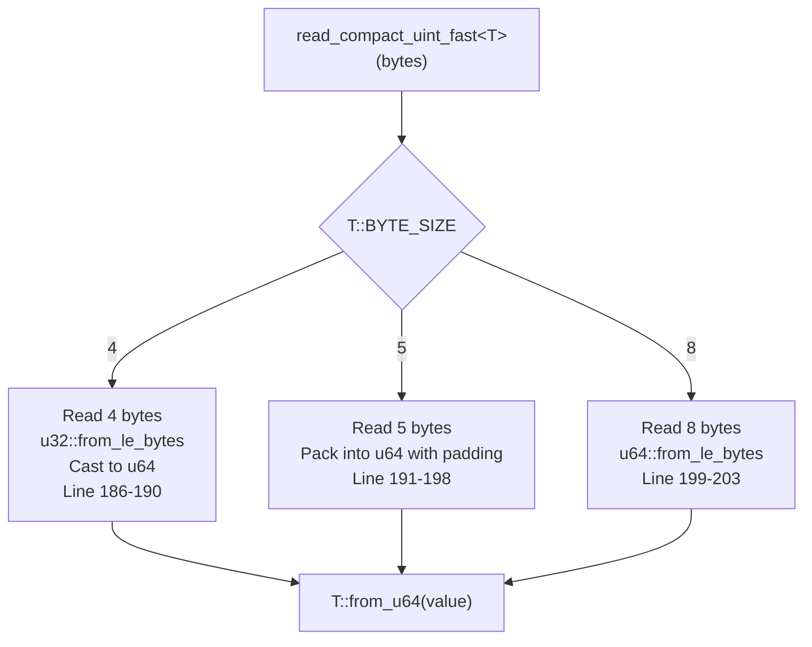
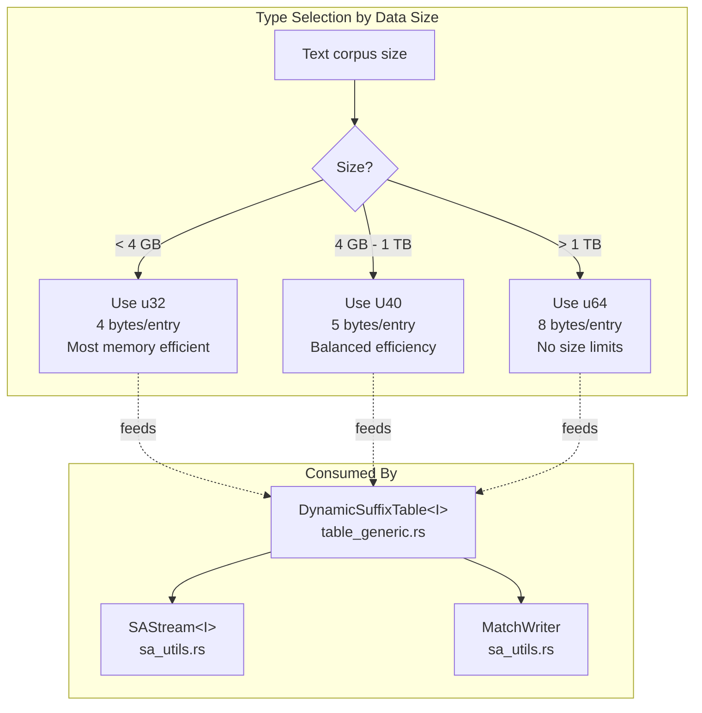

<!-- source: DeepWiki mcp.deepwiki.com · repo allenai/duplodocus · page 2.4 Compact Integer Types · fetched 2026-10-26 -->

# Compact Integer Types

Relevant source files

The following files were used as context for generating this wiki page:

- [src/compact_uint.rs](src/compact_uint.rs)

## Purpose and Scope

This document describes the compact integer type system used by the suffix array implementation to optimize memory usage. The `CompactUint` trait and its implementations (`u32`, `u64`, `U40`) allow suffix arrays to work with different integer sizes, trading off between memory efficiency and maximum addressable text size.

For the broader suffix array system that uses these types, see [Suffix Array System](#2). For the specific suffix table implementation that depends on these types, see [Suffix Table Implementation](#2.3).

Sources: [src/compact_uint.rs:1-31]()

---

## Overview

The suffix array system requires storing large arrays of integer indices that point into text data. For datasets ranging from megabytes to terabytes, the choice of integer size directly impacts memory consumption:

| Type | Bytes | Max Value | Addressable Text Size |
|------|-------|-----------|----------------------|
| `u32` | 4 | ~4.3 billion | ~4 GB |
| `U40` | 5 | ~1.1 trillion | ~1 TB |
| `u64` | 8 | ~18 quintillion | ~16 EB |

The `U40` type provides a 37.5% memory reduction compared to `u64` while supporting datasets up to 1 TB, which covers most practical use cases. The `CompactUint` trait abstracts over these types, allowing the suffix array implementation to be generic.

Sources: [src/compact_uint.rs:94-101]()

---

## The CompactUint Trait

The `CompactUint` trait defines the interface that all compact integer types must implement to be usable as suffix array indices.

```mermaid
graph TB
    subgraph "CompactUint Trait Interface"
        Trait["CompactUint trait<br/>(src/compact_uint.rs:8-31)"]
        
        FromU64["from_u64(val: u64) -> Self<br/>Convert from u64"]
        ToU64["to_u64(self) -> u64<br/>Convert to u64"]
        MaxValue["max_value() -> u64<br/>Maximum representable value"]
        Zero["zero() -> Self<br/>Return zero"]
        MaxI["max_i() -> Self<br/>Return maximum as Self"]
        ByteSize["BYTE_SIZE: usize<br/>Size in bytes"]
        
        Trait --> FromU64
        Trait --> ToU64
        Trait --> MaxValue
        Trait --> Zero
        Trait --> MaxI
        Trait --> ByteSize
    end
    
    subgraph "Trait Bounds"
        Copy["Copy"]
        Clone["Clone"]
        Ord["Ord"]
        Eq["Eq"]
        Debug["Debug"]
        Send["Send"]
        Sync["Sync"]
        Static["'static"]
    end
    
    Trait -.requires.-> Copy
    Trait -.requires.-> Clone
    Trait -.requires.-> Ord
    Trait -.requires.-> Eq
    Trait -.requires.-> Debug
    Trait -.requires.-> Send
    Trait -.requires.-> Sync
    Trait -.requires.-> Static
```

### Trait Definition

The trait requires implementors to be:
- **Copy/Clone**: Cheap to pass by value
- **Ord/Eq**: Sortable and comparable for suffix array algorithms
- **Debug**: Debuggable for development
- **Send/Sync**: Safe for concurrent use in parallel algorithms
- **'static**: No lifetime constraints

The core methods provide conversions to/from `u64` and metadata about the type's range:

- **`from_u64`**: Converts a `u64` to the compact type, with debug assertions to check bounds
- **`to_u64`**: Converts back to `u64` for use in algorithms
- **`max_value`**: Returns the maximum representable value as `u64`
- **`zero`** and **`max_i`**: Provide constant values for initialization
- **`BYTE_SIZE`**: Compile-time constant for memory calculations

Sources: [src/compact_uint.rs:4-31]()

---

## Standard Implementations

### u32 Implementation

The `u32` implementation provides the most compact representation, suitable for suffix arrays over text up to 4 GB.

The implementation uses simple casts with debug assertions to verify that values fit within the `u32` range. All methods are marked `#[inline(always)]` for performance.

**Key characteristics:**
- Maximum value: 4,294,967,295 (2³² - 1)
- Storage: 4 bytes per entry
- Use case: Datasets under 4 GB

Sources: [src/compact_uint.rs:33-62]()

### u64 Implementation

The `u64` implementation provides the widest range, with essentially unlimited addressable text size for practical purposes.

Conversion methods are trivial (identity functions) since the internal representation is already `u64`.

**Key characteristics:**
- Maximum value: 18,446,744,073,709,551,615 (2⁶⁴ - 1)
- Storage: 8 bytes per entry
- Use case: Very large datasets (> 1 TB), or when memory is not a constraint

Sources: [src/compact_uint.rs:64-92]()

---

## U40: The 40-bit Integer Type

### Structure and Memory Layout

`U40` is a custom 40-bit unsigned integer type that strikes a balance between memory efficiency and addressable range. It is stored as an array of 5 bytes with `#[repr(C)]` for consistent memory layout.

The `U40` type implements `bytemuck::Zeroable` and `bytemuck::Pod`, which allow for safe zero-initialization and direct byte-level operations. This is critical for efficient memory-mapped I/O operations in the suffix array system.

**Design rationale:**
- 40 bits = 5 bytes provides 2⁴⁰ = 1,099,511,627,776 distinct values
- Can address up to 1 TB of text data
- Saves 3 bytes per entry compared to `u64` (37.5% memory reduction)
- For a suffix array over 100 GB of text, this saves ~30 GB of memory

Sources: [src/compact_uint.rs:94-106]()

### Conversion Methods

#### Encoding: u64 to U40

The `from_u64` method extracts 5 bytes from the lower 40 bits of the input value using bitwise operations. A debug assertion verifies that the value doesn't exceed `U40::MAX`.

Sources: [src/compact_uint.rs:131-141]()

#### Decoding: U40 to u64

The `to_u64` method reconstructs the full 64-bit value by casting each byte to `u64`, shifting to the appropriate bit position, and combining with bitwise OR.

Sources: [src/compact_uint.rs:143-150]()

### Construction Methods

The `U40` type provides two constructors:

| Method | Behavior | Use Case |
|--------|----------|----------|
| `new(val: u64)` | Panics if `val > U40::MAX` | When the caller guarantees valid values |
| `try_new(val: u64)` | Returns `Option<Self>` | When validation is needed |

Sources: [src/compact_uint.rs:112-128]()

---

## Fast Reading Helper

The `read_compact_uint_fast` function provides optimized byte-level reading for all `CompactUint` types. It uses compile-time dispatch based on `BYTE_SIZE` to select the most efficient implementation.

**Implementation details:**
- **u32 case**: Uses `u32::from_le_bytes` for direct 4-byte read
- **U40 case**: Reads 5 bytes and pads with zeros to create a `u64` before conversion
- **u64 case**: Uses `u64::from_le_bytes` for direct 8-byte read
- All branches use little-endian byte order for cross-platform consistency

This function is critical for performance in the suffix array matching stage, where millions of indices are read from disk.

Sources: [src/compact_uint.rs:183-206]()

---

## Usage in Suffix Array System

### Type Selection Strategy

The suffix array implementation uses these types through generic programming:

**Integration points:**

1. **DynamicSuffixTable**: The suffix table implementation is generic over `CompactUint`, storing arrays of type `Vec<I>` where `I: CompactUint`. See [Suffix Table Implementation](#2.3).

2. **SAStream**: The streaming reader for suffix arrays uses `CompactUint` to deserialize indices from memory-mapped files.

3. **MatchWriter**: The match writing system uses `read_compact_uint_fast` when processing suffix array data.

4. **sa_base.rs**: The main pipeline orchestration code selects the appropriate type based on input size, instantiating the generic implementations with concrete types.

Sources: [src/compact_uint.rs:4-31]()

### Memory Impact

For a concrete example, consider a suffix array over 100 GB of text:

| Type | Array Size (entries) | Memory per Array | Memory Savings vs u64 |
|------|---------------------|------------------|----------------------|
| `u32` | N/A (exceeds range) | N/A | N/A |
| `U40` | ~100 billion | ~500 GB | ~300 GB (37.5%) |
| `u64` | ~100 billion | ~800 GB | 0 GB (baseline) |

This memory reduction is compounded because the suffix array system stores multiple arrays (suffix array, LCP array, document offsets), making the choice of compact type critical for large-scale processing.

Sources: [src/compact_uint.rs:94-101]()

---

## Testing and Validation

The module includes comprehensive tests covering:

| Test | Purpose |
|------|---------|
| `test_u40_basic` | Zero, max, and mid-range values |
| `test_u40_roundtrip` | Conversion correctness for various values |
| `test_u40_ordering` | Comparison operators (`<`, `>`, `==`) |
| `test_u40_overflow_new` | Panic on overflow with `new()` |
| `test_u40_try_new` | Optional return with `try_new()` |
| `test_compact_uint_trait` | Generic trait interface for all types |

The test suite validates that:
- Conversions are lossless within the valid range
- Ordering operations work correctly
- Overflow is properly detected
- The trait abstraction works uniformly across all implementations

Sources: [src/compact_uint.rs:210-289]()

---

## Performance Considerations

### Inline Annotations

All conversion methods are marked `#[inline(always)]` to ensure zero-cost abstraction. The compiler will inline these methods at call sites, eliminating function call overhead.

### Cache Line Efficiency

The `U40` struct uses `#[repr(C)]` to ensure consistent layout. While not explicitly aligned to 8 bytes (a single cache line is typically 64 bytes), the deterministic layout helps with predictable memory access patterns.

### Memory Bandwidth

The primary performance benefit comes from reduced memory bandwidth:
- Smaller integers mean more indices fit in CPU cache
- Fewer cache misses during suffix array traversal
- Reduced I/O bandwidth when streaming from disk

For the match-finding stage, which processes billions of suffix array entries, the 37.5% memory reduction translates directly to reduced I/O and improved throughput.

Sources: [src/compact_uint.rs:36-168]()

---

## Summary

The compact integer type system provides:

1. **Memory efficiency**: Up to 37.5% reduction in suffix array memory consumption
2. **Flexibility**: Generic trait allows algorithm code to be type-agnostic
3. **Safety**: Debug assertions and optional constructors prevent overflow
4. **Performance**: Inline methods and optimized reading ensure zero overhead
5. **Practicality**: `U40` covers the vast majority of real-world datasets (up to 1 TB)

This abstraction is foundational to making the suffix array system scalable to terabyte-scale datasets while maintaining reasonable memory requirements.

Sources: [src/compact_uint.rs:1-289]()

---

