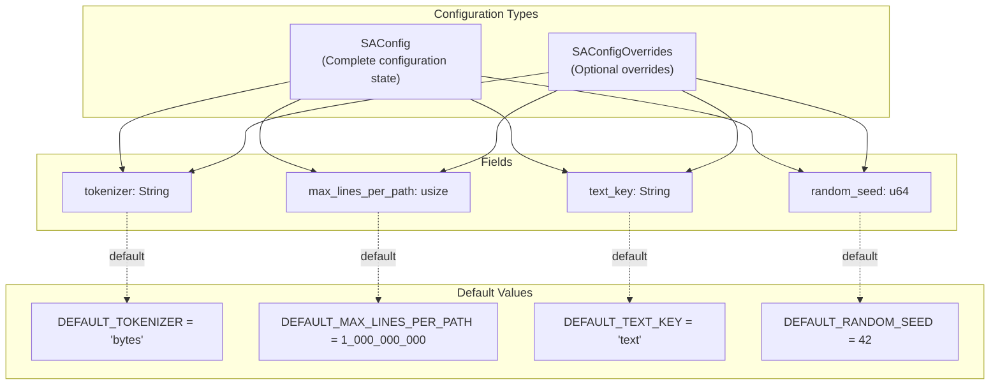
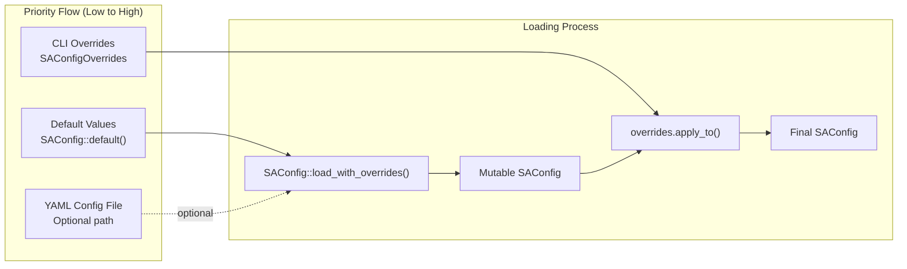
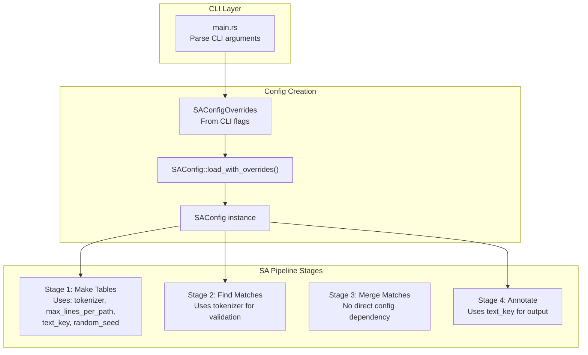

<!-- source: DeepWiki mcp.deepwiki.com · repo allenai/duplodocus · page 2.5 SA Configuration · fetched 2026-10-26 -->

# SA Configuration

<details>
<summary>Relevant source files</summary>

The following files were used as context for generating this wiki page:

- [src/sa_config.rs](src/sa_config.rs)

</details>


## Purpose and Scope

This document describes the configuration management system for Suffix Array operations in Duplodocus. The `SAConfig` structure controls fundamental parameters that affect how documents are processed, tokenized, and partitioned during the SA pipeline stages.

For information about how these configuration values are used during SA processing, see [SA Pipeline Stages](#2.1). For details on the data structures that implement the suffix array operations, see [Suffix Table Implementation](#2.3).

**Sources:** [src/sa_config.rs:1-77]()

---

## Configuration Structure

The SA configuration system is implemented through two primary structures in `sa_config.rs`: `SAConfig` for storing configuration values and `SAConfigOverrides` for selectively overriding them.



**Diagram: SAConfig structure and default values**

The `SAConfig` struct [src/sa_config.rs:13-21]() is serializable via `serde` and contains four fields that control document processing behavior. All fields have sensible defaults defined as constants [src/sa_config.rs:8-11]().

**Sources:** [src/sa_config.rs:8-21](), [src/sa_config.rs:23-32]()

---

## Configuration Parameters

### tokenizer

| Property | Value |
|----------|-------|
| Type | `String` |
| Default | `"bytes"` |
| Purpose | Specifies how text should be tokenized before building suffix arrays |

The tokenizer determines the atomic units used for substring matching. The default `"bytes"` tokenizer treats each byte as a separate token, enabling exact byte-level matching regardless of character encoding. Alternative tokenizers may be implemented to support whitespace-delimited tokens, character-based tokenization, or other schemes.

### max_lines_per_path

| Property | Value |
|----------|-------|
| Type | `usize` |
| Default | `1_000_000_000` |
| Purpose | Maximum number of document lines to process from a single input file path |

This parameter controls memory usage and parallelization granularity. During the Make Tables stage (see [Make Tables Stage](#2.1.1)), documents are chunked adaptively to fit within memory constraints. This limit prevents a single large file from dominating a processing chunk, improving load balancing across parallel workers.

### text_key

| Property | Value |
|----------|-------|
| Type | `String` |
| Default | `"text"` |
| Purpose | JSON field name containing the document text to process |

Input documents are expected in JSONL format (one JSON object per line). This parameter specifies which field in each JSON object contains the actual text content to deduplicate. For example, with the default `"text"`, the system expects documents like:

```json
{"text": "document content here", "id": "doc123", "metadata": {...}}
```

### random_seed

| Property | Value |
|----------|-------|
| Type | `u64` |
| Default | `42` |
| Purpose | Seed for random number generation during document shuffling |

During the Make Tables stage, documents are shuffled to ensure balanced distribution across suffix array chunks. This seed ensures reproducible shuffling behavior across runs, which is critical for debugging and deterministic pipeline execution.

**Sources:** [src/sa_config.rs:13-21](), [src/sa_config.rs:8-11]()

---

## Configuration Loading and Override Hierarchy

The SA configuration system supports a three-tier hierarchy: defaults → YAML file → command-line overrides.



**Diagram: Configuration loading and override hierarchy**

### Loading Mechanism

The `load_with_overrides` method [src/sa_config.rs:62-76]() implements the configuration loading logic:

1. **Initialize with defaults**: Creates a `SAConfig` instance using `Default::default()` [src/sa_config.rs:66]()
2. **Load from file (optional)**: If a `config_path` is provided, reads and deserializes YAML content using `serde_yaml` [src/sa_config.rs:67-71]()
3. **Apply overrides**: Calls `apply_to()` on the `SAConfigOverrides` to selectively replace field values [src/sa_config.rs:73]()

### Override Application

The `SAConfigOverrides` struct [src/sa_config.rs:34-39]() contains `Option<T>` fields for each configuration parameter. The `apply_to` method [src/sa_config.rs:42-58]() uses pattern matching to selectively override only the fields that are explicitly set:

```rust
// Pseudocode representation
if overrides.tokenizer is Some(value):
    config.tokenizer = value
if overrides.max_lines_per_path is Some(value):
    config.max_lines_per_path = value
// ... etc
```

This design allows CLI arguments to override specific parameters without requiring all parameters to be specified.

**Sources:** [src/sa_config.rs:34-76]()

---

## YAML Configuration Format

When loading configuration from a file, `SAConfig` expects YAML format compatible with `serde_yaml` deserialization [src/sa_config.rs:69](). 

### Example Configuration File

```yaml
tokenizer: bytes
max_lines_per_path: 500000000
text_key: content
random_seed: 12345
```

### Serialization Support

The `SAConfig` struct derives both `Serialize` and `Deserialize` [src/sa_config.rs:13](), enabling:
- Reading configuration from YAML files
- Writing configuration to YAML files (for documentation or reproduction)
- Passing configuration through serialization-based channels if needed

**Sources:** [src/sa_config.rs:2-3](), [src/sa_config.rs:13](), [src/sa_config.rs:68-70]()

---

## Integration with SA Pipeline

The `SAConfig` structure is consumed by various stages of the SA pipeline to control processing behavior.



**Diagram: SAConfig usage across pipeline stages**

### Configuration Usage by Stage

| Pipeline Stage | Configuration Parameters Used | Purpose |
|----------------|-------------------------------|---------|
| **Make Tables** (see [Make Tables Stage](#2.1.1)) | `tokenizer`, `max_lines_per_path`, `text_key`, `random_seed` | Controls how documents are loaded, tokenized, shuffled, and chunked |
| **Find Matches** (see [Match Finding Stage](#2.1.2)) | `tokenizer` (validation) | Ensures match finding uses same tokenization as table construction |
| **Merge Matches** (see [Merge and Annotate Stages](#2.1.3)) | None | Operates on pre-processed match data |
| **Annotate** (see [Merge and Annotate Stages](#2.1.3)) | `text_key` | Determines which JSON field to annotate in output documents |

### Key Invariants

1. **Tokenizer consistency**: The same `tokenizer` value must be used across all stages for a given SA pipeline execution
2. **Text key consistency**: The `text_key` must match the actual structure of input JSONL documents
3. **Seed reproducibility**: The `random_seed` ensures that repeated runs with the same input produce identical suffix array chunking

**Sources:** [src/sa_config.rs:14-21]()

---

## Configuration in Production

### Recommended Settings

| Use Case | Tokenizer | max_lines_per_path | Notes |
|----------|-----------|-------------------|-------|
| **General text deduplication** | `bytes` | `1_000_000_000` | Default settings work well |
| **Memory-constrained environments** | `bytes` | `100_000_000` | Reduce chunk size to fit available RAM |
| **Large document collections** | `bytes` | `500_000_000` | Balance between memory and I/O |

### Common Override Patterns

**Override from CLI**: Command-line arguments take precedence, useful for experimentation:
```bash
duplodocus sa-make-tables \
    --tokenizer bytes \
    --max-lines-per-path 500000000 \
    --text-key content
```

**Configuration file**: For reproducible production runs, use a YAML file:
```bash
duplodocus sa-make-tables --config production-sa.yaml
```

**Hybrid approach**: Base configuration in file, selective CLI overrides:
```bash
duplodocus sa-make-tables \
    --config base-sa.yaml \
    --random-seed 99999
```

**Sources:** [src/sa_config.rs:1-77]()

---

## Summary

The `SAConfig` system provides a flexible, hierarchical configuration mechanism for SA pipeline operations:

| Component | Purpose | Location |
|-----------|---------|----------|
| `SAConfig` | Complete configuration state | [src/sa_config.rs:13-21]() |
| `SAConfigOverrides` | Selective field overrides | [src/sa_config.rs:34-39]() |
| `load_with_overrides()` | Configuration loading logic | [src/sa_config.rs:62-76]() |
| `apply_to()` | Override application | [src/sa_config.rs:42-58]() |
| Default constants | Sensible default values | [src/sa_config.rs:8-11]() |

The three-tier hierarchy (defaults → YAML → CLI) enables both convenient defaults for common use cases and precise control for specialized applications. All configuration parameters directly impact the behavior of the Make Tables stage and subsequent SA pipeline operations.

**Sources:** [src/sa_config.rs:1-77]()

---

