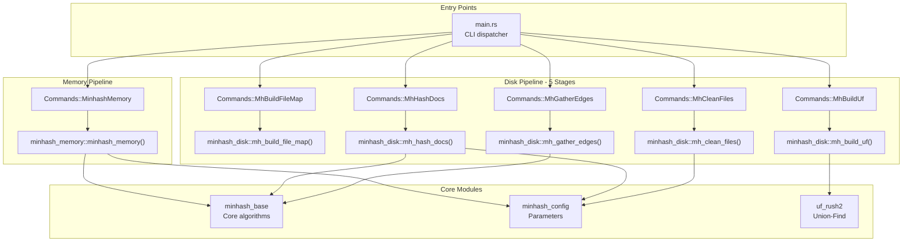
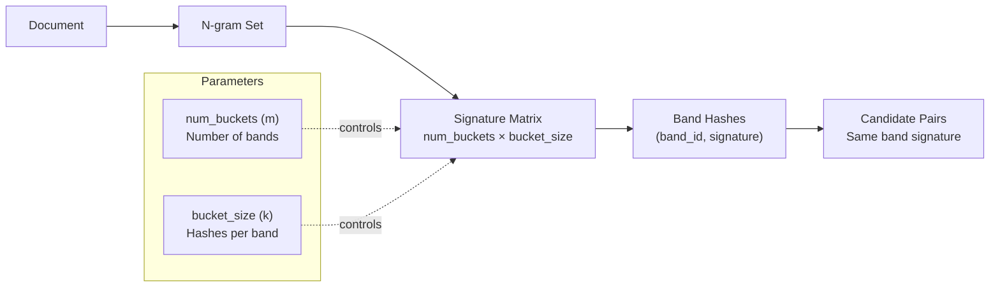
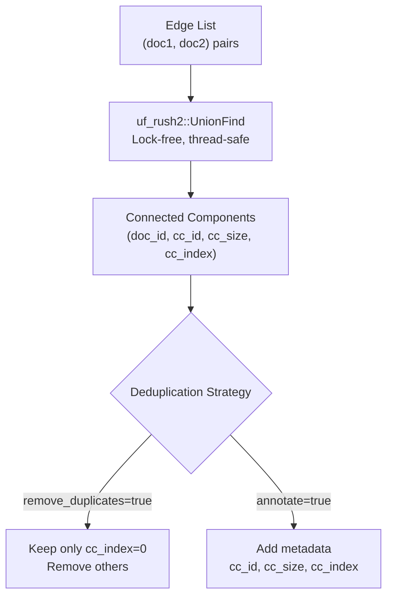
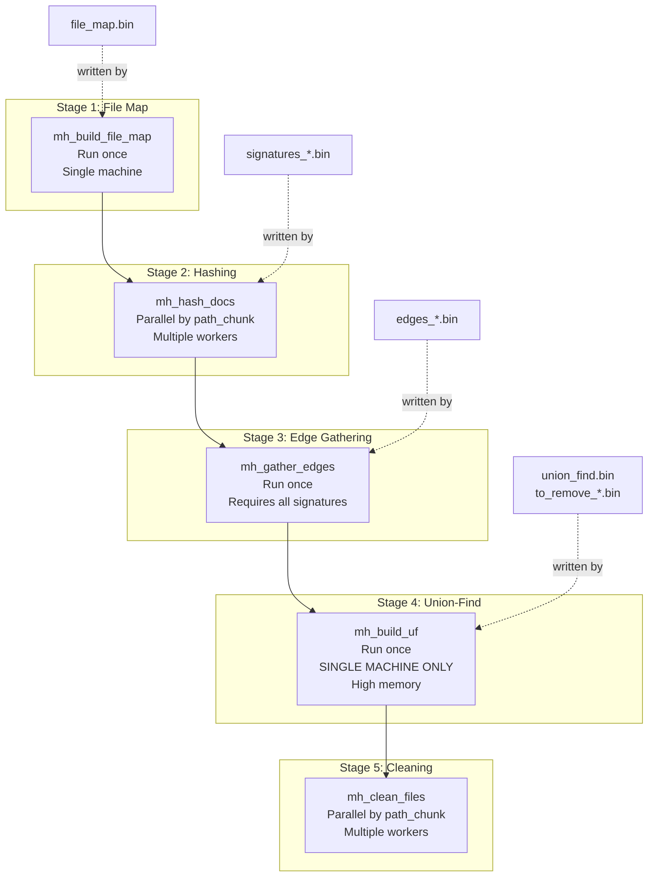
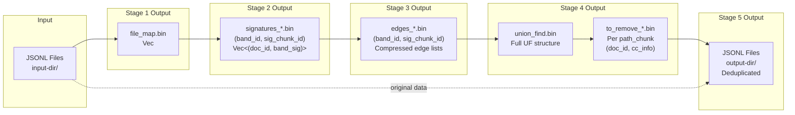

<!-- source: DeepWiki mcp.deepwiki.com · repo allenai/duplodocus · page 3 MinHash Fuzzy Deduplication · fetched 2026-10-26 -->

# MinHash Fuzzy Deduplication

<details>
<summary>Relevant source files</summary>

The following files were used as context for generating this wiki page:

- [README.md](README.md)
- [primer.md](primer.md)
- [src/main.rs](src/main.rs)

</details>


## Purpose and Scope

This page provides an overview of MinHash fuzzy deduplication in Duplodocus, a technique for identifying and removing near-duplicate documents based on Jaccard similarity. Unlike exact deduplication which only matches identical content, fuzzy deduplication identifies documents that are substantially similar but not necessarily identical.

This page covers the high-level architecture, core concepts, and implementation variants. For detailed information on specific topics:
- Mathematical foundations and algorithm details: see [MinHash Theory and Algorithm](#3.1)
- Memory-based implementation: see [MinHash Memory Pipeline](#3.2)
- Distributed disk-based implementation: see [MinHash Disk Pipeline](#3.3)
- Exact deduplication methods: see [Exact Deduplication](#4)

## Overview

MinHash fuzzy deduplication uses Locality-Sensitive Hashing (LSH) to efficiently identify near-duplicate documents in large text corpora. The implementation follows the algorithm described in [Lee et al. 2021](https://arxiv.org/abs/2107.06499) and is designed for scalability to datasets containing billions of documents.

The core idea is to:
1. Convert each document into a set of n-grams (shingling)
2. Generate MinHash signatures that preserve Jaccard similarity
3. Use LSH banding to efficiently find candidate duplicate pairs
4. Build connected components to group all related duplicates
5. Remove or annotate duplicates based on user preferences

**Key Characteristics:**
- **Fuzzy matching**: Finds documents with high Jaccard similarity (e.g., >80%)
- **Configurable threshold**: Adjust `num_buckets` and `bucket_size` to control strictness
- **Approximate algorithm**: Trades perfect accuracy for massive scalability
- **Graph-based clustering**: Uses Union-Find for connected component identification

Sources: [main.rs:16-24](), [README.md:29-34](), [primer.md:1-14]()

## Architecture Overview

Duplodocus provides two MinHash implementations optimized for different dataset sizes:

| Variant | Best For | Memory Requirement | Parallelization |
|---------|----------|-------------------|-----------------|
| **MinHash Memory** | Datasets <10GB | All data + structures in RAM | Single machine, multi-threaded |
| **MinHash Disk** | Datasets >10GB | Minimal (~8-16GB) | Distributed across cluster |

### High-Level System Architecture



Sources: [main.rs:98-101](), [main.rs:350-644](), [main.rs:105-114]()

## Core Concepts

### Jaccard Similarity and Shingling

MinHash operates on documents represented as sets. For text documents, this is achieved through **n-gram shingling**:

**Document → Set Transformation:**
1. Tokenize document: `[token1, token2, ..., tokenN]`
2. Extract overlapping n-grams: `{token1:n+1, token2:n+2, ..., tokenN-n:N}`
3. Each n-gram becomes a set element

**Jaccard Similarity:**
```
J(A, B) = |A ∩ B| / |A ∪ B|
```

Two documents are considered near-duplicates if their Jaccard similarity exceeds a threshold (typically 0.8-0.9).

### LSH Banding Strategy

MinHash generates signature matrices to enable efficient similarity search:



**Key Parameters:**
- `num_buckets` (m): Number of LSH bands - more bands = stricter matching
- `bucket_size` (k): Hash values per band - larger bands = stricter matching
- Collision probability: `P = 1 - (1 - J^k)^m` where J is Jaccard similarity

Sources: [primer.md:33-48](), [main.rs:387-393]()

### Union-Find for Connected Components

Duplicate candidates form a graph where documents are nodes and edges connect similar pairs. The Union-Find data structure efficiently computes connected components:



Sources: [main.rs:114](), [primer.md:105-109]()

## Implementation Variants

### Memory-Based Pipeline

The memory-based pipeline executes all five stages sequentially in a single command:

**Execution Flow:**
```
minhash_memory() in src/minhash_memory.rs
  ↓
1. Build file map (in-memory)
2. Hash documents → signatures (in-memory)
3. Gather edges from signatures
4. Build Union-Find structure
5. Clean/annotate files
```

**Characteristics:**
- Single command: `minhash-memory`
- All intermediate structures in RAM
- Automatic cleanup with `--cleanup-storage`
- Best for datasets that fit in available memory

Sources: [main.rs:350-430](), [main.rs:841-875]()

### Disk-Based Distributed Pipeline

The disk-based pipeline separates stages for distributed execution across a cluster:



**Parallelization Pattern:**
- **Stages 1, 3, 4**: Global, single execution
- **Stages 2, 5**: Distributed via `path_chunk` parameter
- **Stage 4 Constraint**: Must run on single machine with sufficient memory for entire graph

**File Organization:**
```
storage_dir/
├── file_map.bin                    # Stage 1 output
├── signatures_*.bin                # Stage 2 output (many files)
├── edges_*.bin                     # Stage 3 output (many files)
├── union_find.bin                  # Stage 4 output
└── to_remove_{path_chunk}.bin      # Stage 4 output (per chunk)
```

Sources: [main.rs:432-644](), [primer.md:82-114](), [main.rs:140-218]()

## Module Organization

### Core MinHash Modules

```mermaid
graph TB
    subgraph "minhash_base Module"
        HashFn["compute_minhash()<br/>Generate signatures"]
        NGram["extract_ngrams()<br/>Tokenization & shingling"]
        Tokenizers["Tokenizer trait<br/>cl100k, p50k, uniseg, char"]
    end
    
    subgraph "minhash_config Module"
        MHParams["MinHashParams<br/>num_buckets, bucket_size<br/>ngram_size, seed"]
        EngParams["EngineeringParams<br/>num_docs, max_lines<br/>num_sig_chunks"]
        OutParams["OutputParams<br/>annotate, remove_duplicates"]
        ConfigLoad["load_from_yaml()"]
    end
    
    subgraph "uf_rush2 Module"
        UFStruct["UnionFind struct<br/>Lock-free implementation"]
        UnionOp["union(a, b)"]
        FindOp["find(x)"]
        CompressOp["compress_all()"]
    end
    
    subgraph "minhash_memory Module"
        MemMain["minhash_memory()<br/>Orchestrates all stages"]
    end
    
    subgraph "minhash_disk Module"
        DiskFileMap["mh_build_file_map()"]
        DiskHash["mh_hash_docs()"]
        DiskEdges["mh_gather_edges()"]
        DiskUF["mh_build_uf()"]
        DiskClean["mh_clean_files()"]
    end
    
    MemMain --> HashFn
    MemMain --> MHParams
    MemMain --> UFStruct
    
    DiskHash --> HashFn
    DiskHash --> MHParams
    DiskUF --> UFStruct
    DiskClean --> OutParams
```



Sources: [main.rs:107-114]()

## Configuration Parameters

MinHash behavior is controlled through three parameter groups:

### MinHash Parameters (Algorithm Tuning)

| Parameter | Type | Default | Effect |
|-----------|------|---------|--------|
| `num_buckets` | usize | 20 | Number of LSH bands (m) - more = stricter |
| `bucket_size` | usize | 5 | Hashes per band (k) - more = stricter |
| `ngram_size` | usize | 5 | N-gram size for shingling |
| `permutation_seed` | u64 | random | Random seed for reproducibility |
| `tokenizer` | String | "char" | Tokenizer: cl100k, p50k, uniseg, char |

**Threshold Tuning:**
- For 80% Jaccard threshold: `num_buckets=20, bucket_size=5`
- For 90% Jaccard threshold: `num_buckets=26, bucket_size=11`
- Collision probability curve: `P = 1 - (1 - J^bucket_size)^num_buckets`

Sources: [main.rs:387-409](), [README.md:183-188]()

### Engineering Parameters (Performance Tuning)

| Parameter | Type | Default | Effect |
|-----------|------|---------|--------|
| `num_docs` | Option<usize> | None | Expected total documents (affects encoding) |
| `max_lines_per_path` | Option<usize> | None | Max lines per file (affects encoding) |
| `num_sig_chunks` | Option<usize> | 8 | Signature distribution chunks |
| `num_path_chunks` | usize | - | Parallel worker count (disk only) |

Sources: [main.rs:514-523]()

### Output Parameters (Behavior Control)

| Parameter | Type | Default | Effect |
|-----------|------|---------|--------|
| `annotate` | Option<bool> | false | Add metadata instead of removing |
| `annotate_key` | Option<String> | None | JSON key for metadata |
| `remove_duplicates` | Option<bool> | true | Keep only first occurrence |
| `delete_while_cleaning` | Option<bool> | false | Delete input files after processing |
| `cleanup_storage` | bool | false | Delete storage directory after completion |

Sources: [main.rs:412-429](), [main.rs:624-643]()

## Data Flow and File Formats

### Disk-Based Data Flow



**Signature File Organization:**
```
storage_dir/
├── signatures/
│   ├── band_0/
│   │   ├── sigchunk_0/
│   │   │   ├── pathchunk_0.sig.bin
│   │   │   ├── pathchunk_1.sig.bin
│   │   │   └── ...
│   │   ├── sigchunk_1/
│   │   └── ...
│   ├── band_1/
│   └── ...
```

Sources: [primer.md:88-102]()

## Command-Line Interface

### Memory-Based Usage

```bash
# Single command for complete pipeline
duplodocus minhash-memory \
  --input-dir /data/docs \
  --storage-dir /tmp/work \
  --output-dir /data/deduped \
  --text-key "text" \
  --num-buckets 20 \
  --bucket-size 5 \
  --ngram-size 5 \
  --tokenizer "cl100k" \
  --remove-duplicates true \
  --cleanup-storage
```

Sources: [main.rs:366-430](), [README.md:167-181]()

### Disk-Based Usage (Distributed)

```bash
# Step 1: Build file map (once, single machine)
duplodocus mh-build-file-map \
  --input-dir /data/docs \
  --storage-dir /shared/work

# Step 2: Hash documents (parallel workers, each with different path-chunk)
# Worker 0:
duplodocus mh-hash-docs \
  --local-input /data/docs \
  --storage-dir /shared/work \
  --text-key "text" \
  --path-chunk 0 \
  --num-path-chunks 10 \
  --num-buckets 20 \
  --bucket-size 5

# Step 3: Gather edges (once, requires all signatures)
duplodocus mh-gather-edges \
  --storage-dir /shared/work

# Step 4: Build Union-Find (once, SINGLE MACHINE with high memory)
duplodocus mh-build-uf \
  --storage-dir /shared/work \
  --num-path-chunks 10

# Step 5: Clean files (parallel workers)
# Worker 0:
duplodocus mh-clean-files \
  --input-dir /data/docs \
  --storage-dir /shared/work \
  --output-dir /data/deduped \
  --path-chunk 0 \
  --num-path-chunks 10 \
  --remove-duplicates true
```

Sources: [main.rs:54-86](), [README.md:192-251]()

## Performance Characteristics

### Computational Complexity

| Stage | Time Complexity | Space Complexity | Parallelizable |
|-------|----------------|------------------|----------------|
| Shingling | O(n × doc_len) | O(n × ngrams) | Yes (by document) |
| Hashing | O(n × ngrams × buckets × bucket_size) | O(n × buckets) | Yes (by path_chunk) |
| Edge Gathering | O(sigs × log(sigs)) | O(edges) | Yes (by band/sigchunk) |
| Union-Find | O(n × α(n)) | O(n) | No (single machine) |
| Cleaning | O(n) | O(n) | Yes (by path_chunk) |

Where:
- n = number of documents
- α(n) = inverse Ackermann function (effectively constant)
- sigs = total signatures across all documents

### Memory Requirements

**Memory-Based:**
- ~3-5x input dataset size in RAM
- All signatures + Union-Find structure in memory

**Disk-Based:**
- Stage 4 bottleneck: ~20-40 bytes per document for Union-Find
- Example: 1 billion documents ≈ 20-40 GB RAM requirement for Stage 4

Sources: [README.md:299-316](), [primer.md:105-110]()

## Related Pages

- **Theory and Mathematical Foundations**: See [MinHash Theory and Algorithm](#3.1) for detailed explanation of Jaccard similarity, LSH banding, and hash function properties
- **Memory Pipeline Implementation**: See [MinHash Memory Pipeline](#3.2) for the all-in-one memory-based approach
- **Distributed Pipeline Implementation**: See [MinHash Disk Pipeline](#3.3) for the 5-stage distributed architecture
- **Exact Deduplication**: See [Exact Deduplication](#4) for hash-based duplicate removal
- **True Jaccard Validation**: See [True Jaccard Calculation](#5.1) for validating MinHash results with exact Jaccard computation
- **Getting Started**: See [Getting Started](#1.1) for installation and basic usage patterns

---

