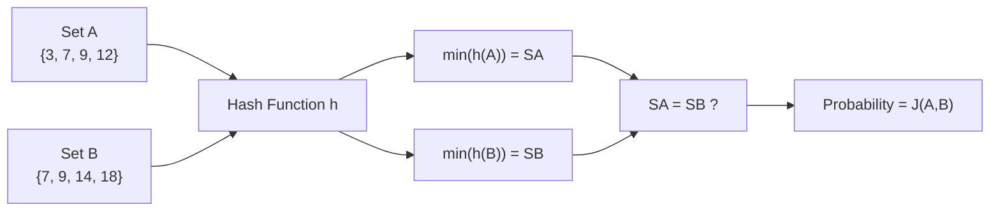
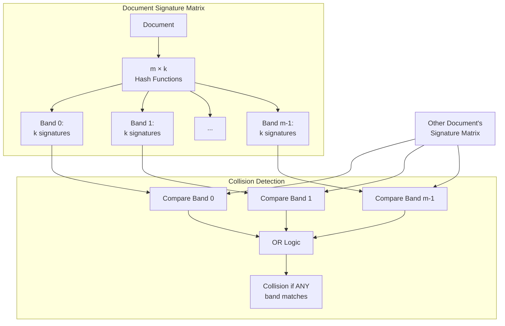
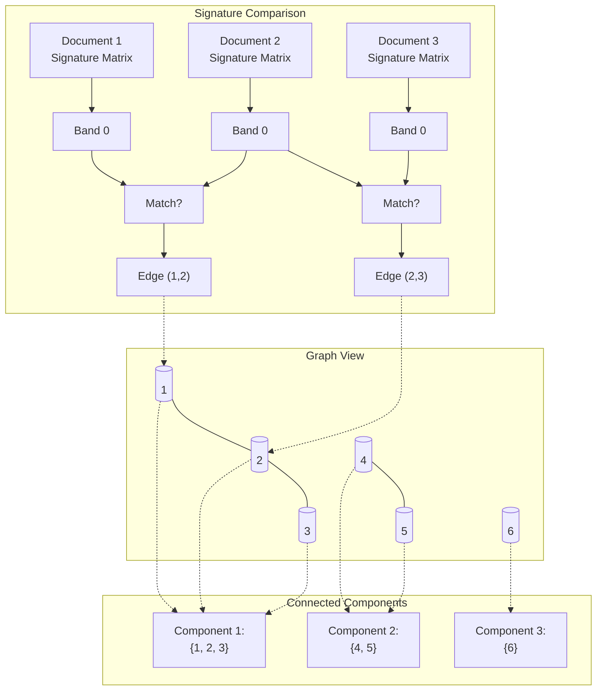
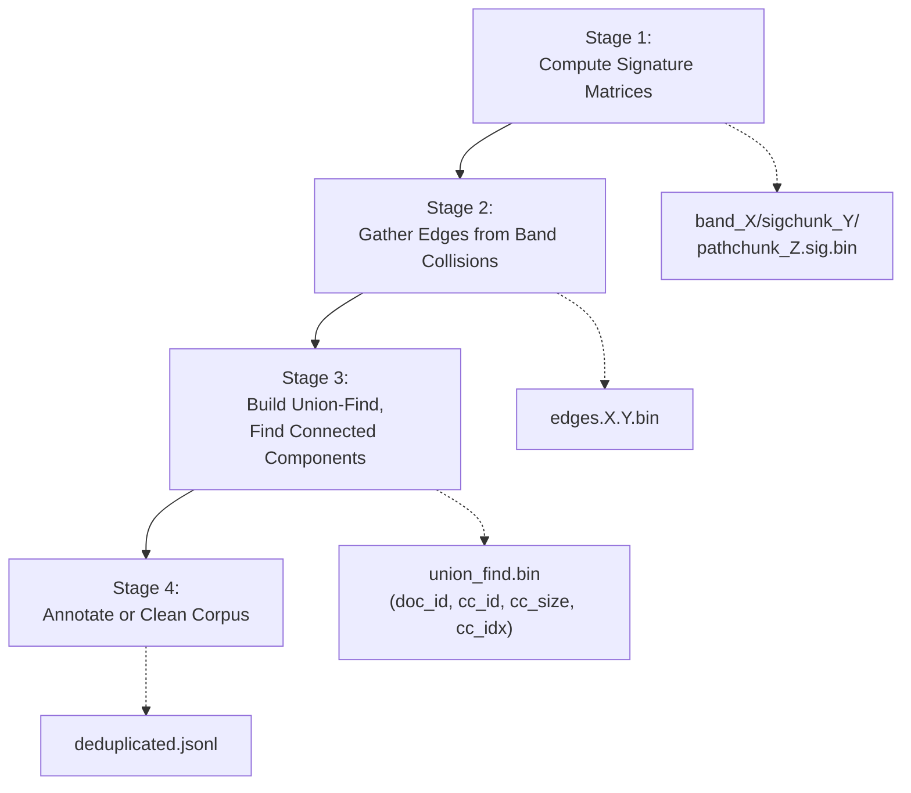
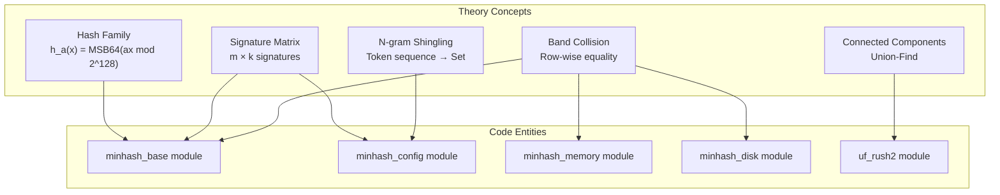

<!-- source: DeepWiki mcp.deepwiki.com · repo allenai/duplodocus · page 3.1 MinHash Theory and Algorithm · fetched 2026-10-26 -->

# MinHash Theory and Algorithm

Relevant source files

The following files were used as context for generating this wiki page:

- [primer.md](primer.md)

## Purpose and Scope

This page provides the mathematical and algorithmic foundations for MinHash-based fuzzy deduplication in Duplodocus. It covers the core MinHash algorithm, Jaccard similarity estimation, LSH banding for signal amplification, and the graph-theoretic interpretation used for finding near-duplicate clusters.

For implementation details of the memory-based pipeline, see [MinHash Memory Pipeline](#3.2). For the distributed disk-based pipeline, see [MinHash Disk Pipeline](#3.3). For validation and exact similarity computation, see [True Jaccard Calculation](#5.1).

---

## Jaccard Similarity and Fuzzy Duplicates

MinHash operates on **sets** to determine their similarity. The Jaccard similarity of two sets A and B measures the overlap between them:

$$J(A,B) := \frac{|A \cap B|}{|A \cup B|}$$

This metric ranges from 0.0 (disjoint sets) to 1.0 (identical sets). **Duplodocus defines two documents as fuzzy duplicates if their Jaccard similarity exceeds a configured threshold T**.

| Jaccard Value | Interpretation | Example |
|--------------|----------------|---------|
| 1.0 | Identical sets | Same document |
| 0.7-0.99 | Near-duplicates | Minor edits, formatting changes |
| 0.3-0.69 | Partial overlap | Shared sections |
| 0.0-0.29 | Minimal similarity | Unrelated content |

**Sources:** [primer.md:8-14]()

---

## Single Hash MinHash

The fundamental MinHash property provides a collision probability equal to Jaccard similarity:

$$P[S_A = S_B] = J(A,B)$$

where $S_A$ and $S_B$ are MinHash signatures derived from a hash function $h: X \rightarrow U$ mapping set elements to an ordered universe (integers):

$$S_A := \min_{x \in A} h(x)$$

### Why This Works

The signature $S_A$ equals $S_B$ if and only if the minimum element across $A \cup B$ belongs to $A \cap B$, which occurs with probability $J(A,B)$.

**Diagram:** Single Hash MinHash Process

**Sources:** [primer.md:16-30]()

---

## Signal Amplification with LSH Banding

A single hash provides high variance. To create a sharper decision boundary at threshold T, Duplodocus uses **Locality-Sensitive Hashing (LSH) banding**:

### The Banding Scheme

MinHash generates a signature matrix of size $m \times k$ for each document:
- **m** = number of bands (rows)
- **k** = signatures per band (columns)

Two documents collide if **any complete band matches**:

$$P[\text{collision}] = 1 - (1 - J(A,B)^k)^m$$

This creates an S-curve that approximates a step function at the desired threshold.

**Diagram:** LSH Banding Architecture

### Parameter Selection

| Parameter | Symbol | Effect on Curve |
|-----------|--------|-----------------|
| Signatures per band | k | Increases sharpness (steeper S-curve) |
| Number of bands | m | Shifts curve left (lowers threshold) |
| Threshold | T | Target Jaccard for separation |

Typical configuration: $m \times k$ ranges from 128 to 512 total hash functions.

**Sources:** [primer.md:34-48]()

---

## Hash Family Implementation

Duplodocus uses a computationally efficient hash family that provides approximate min-wise independence:

$$h_a(x) := \text{MSB}_{64}(ax \mod 2^{128})$$

where:
- $a$ is an odd 128-bit integer
- $\text{MSB}_{64}$ extracts the 64 most significant bits
- No additive constant $b$ is needed (only relative ordering matters)

### Properties

This hash family is **2-universal**, meaning for distinct $x, y$:

$$P_a[h_a(x) = h_a(y)] \leq 2^{-64}$$

It provides **approximate min-wise independence** for a set $S$ with $|S| = k$:

$$|P_h[h(x) = \min_{x' \in S} h(x')] - \frac{1}{k}| = O(\frac{k^2}{M})$$

where $M = 2^{64}$ is the output range. MinHash is robust to this approximation.

### Implementation Advantages

The hash function requires only:
1. One 128-bit multiplication
2. One bitwise shift operation

This makes it extremely fast for hashing millions of n-grams per second.

**Sources:** [primer.md:56-68]()

---

## Text to Sets: N-gram Shingling

Text documents must be converted to sets before applying MinHash. Duplodocus uses **n-gram shingling**:

### Process

1. **Tokenization**: Document → sequence of tokens $[x_1, x_2, ..., x_m]$
2. **Shingling**: Extract all n-grams → $\{x_{1:n+1}, x_{2:n+2}, ..., x_{m-n:m}\}$

**Diagram:** Document to Set Conversion

### Configuration

| Parameter | Typical Value | Purpose |
|-----------|--------------|---------|
| N-gram size | 5-13 | Balance granularity vs. sensitivity |
| Tokenizer | Character, word, or custom | Define token boundaries |

Larger n-grams make the similarity measure stricter (exact substring matches required), while smaller n-grams are more forgiving to word reordering.

**Sources:** [primer.md:70-71]()

---

## Graph-Theoretic Interpretation

MinHash deduplication operates on a **document similarity graph**:

### Graph Construction

- **Nodes**: Documents in the corpus
- **Edges**: Exist if documents share at least one matching band
- **Connected Components**: Represent fuzzy duplicate clusters

**Diagram:** Graph-Based Fuzzy Duplicate Clustering

### Non-Transitivity Caveat

Jaccard similarity is **not transitive**: If $J(A,B) \geq T$ and $J(B,C) \geq T$, it does not follow that $J(A,C) \geq T$.

This means connected components can contain documents where not all pairs exceed threshold T. However, this is acceptable because:
1. It ensures no duplicate cluster is split across components
2. Post-processing can compute exact Jaccard within components if needed (see [True Jaccard Calculation](#5.1))

**Sources:** [primer.md:49-54]()

---

## Four-Stage MinHash Pipeline

The theory translates into a practical four-stage algorithm:

**Diagram:** End-to-End MinHash Pipeline

### Stage Details

| Stage | Input | Output | Parallelizable? |
|-------|-------|--------|-----------------|
| 1. Compute Signatures | Documents | Signature files grouped by (band, sigchunk, pathchunk) | Yes - embarrassingly parallel |
| 2. Gather Edges | Signatures | Edge lists per (band, sigchunk) | Yes - parallel per band/sigchunk |
| 3. Build Union-Find | Edge lists | Connected component assignments | **No - single machine required** |
| 4. Clean Corpus | Documents + CC assignments | Deduplicated documents | Yes - parallel per file |

### Critical Bottleneck: Union-Find

Stage 3 **cannot be distributed** across multiple machines. It requires sufficient memory to hold the entire Union-Find data structure for all documents. This is the primary scaling limitation of MinHash deduplication.

**Sources:** [primer.md:82-114]()

---

## Code Mapping

The theory described above maps to the following code modules:

**Diagram:** Theory to Implementation Mapping

### Module Responsibilities

| Module | Theory Implementation |
|--------|----------------------|
| `minhash_base` | Hash function, signature computation, band collision logic |
| `minhash_config` | Parameters (m, k, threshold T), tokenizer configuration, n-gram size |
| `minhash_memory` | Single-machine pipeline for small datasets (< 10GB) |
| `minhash_disk` | Five-stage distributed pipeline for large datasets |
| `uf_rush2` | Union-Find data structure for connected components |

### File Storage Conventions

The pipeline stores intermediate files following this naming convention:

- **Signature files**: `band_X/sigchunk_Y/pathchunk_Z.sig.bin`
  - `X`: Band index (0 to m-1)
  - `Y`: Signature prefix chunk for load balancing
  - `Z`: Source document chunk
  
- **Edge files**: `edges.X.Y.bin`
  - Contains document ID sequences separated by special tokens
  
- **Union-Find output**: `union_find.bin`
  - Stores `(document_id, connected_component_id, connected_component_size, connected_component_index)` tuples

**Sources:** [primer.md:90-114](), Diagrams 4 and 5 from high-level architecture

---

## Summary

MinHash provides efficient fuzzy deduplication by:

1. Converting documents to n-gram sets
2. Hashing sets with m × k hash functions to create signature matrices
3. Detecting band collisions to form a similarity graph
4. Computing connected components via Union-Find
5. Removing duplicates within each component

The key insight is that $P[\text{band collision}] = 1 - (1 - J(A,B)^k)^m$ approximates a step function at threshold T, enabling large-scale near-duplicate detection with tunable precision.

For implementation specifics, see [MinHash Memory Pipeline](#3.2) and [MinHash Disk Pipeline](#3.3).

**Sources:** [primer.md:1-115]()

---

