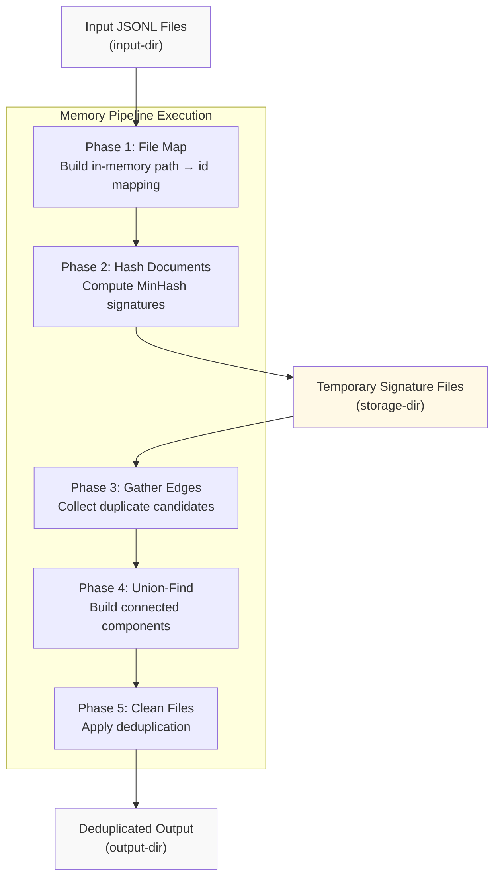
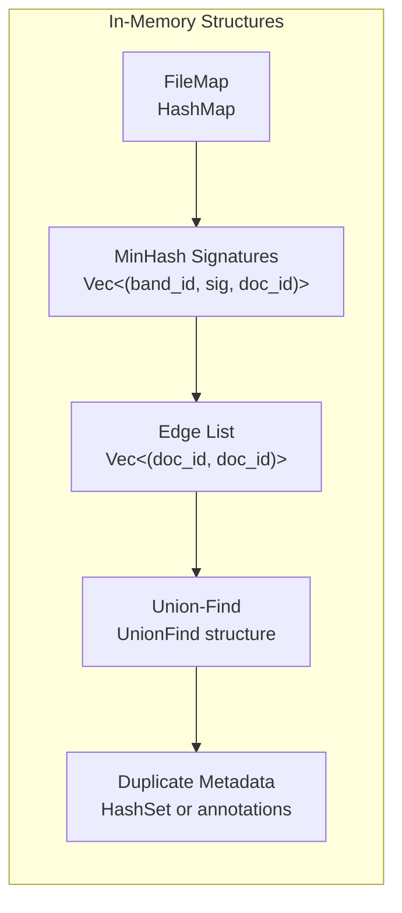
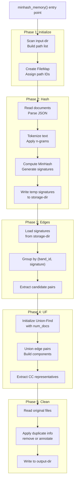
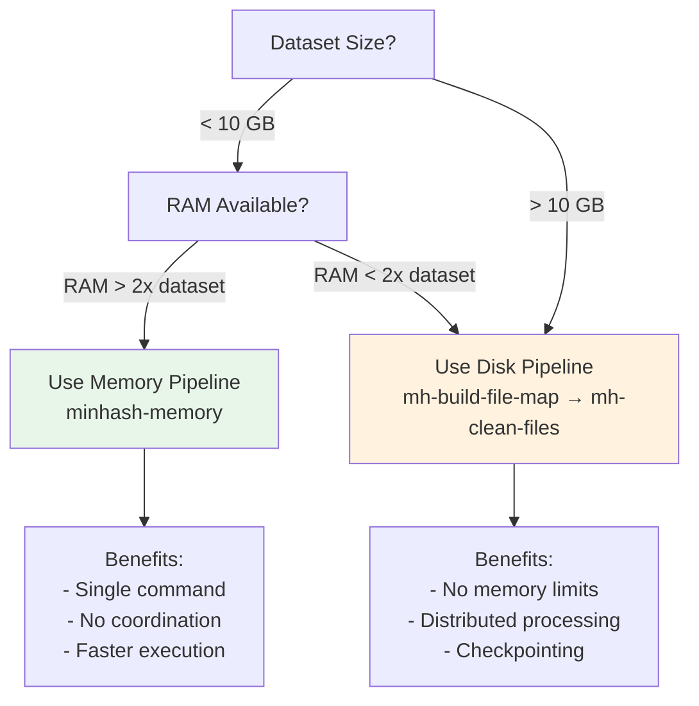
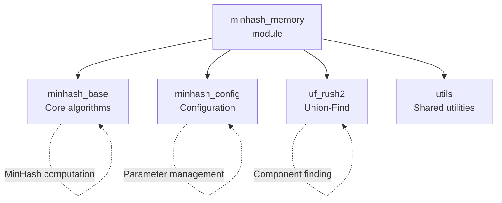

<!-- source: DeepWiki mcp.deepwiki.com · repo allenai/duplodocus · page 3.2 MinHash Memory Pipeline · fetched 2026-10-26 -->

# MinHash Memory Pipeline

<details>
<summary>Relevant source files</summary>

The following files were used as context for generating this wiki page:

- [README.md](README.md)
- [src/main.rs](src/main.rs)

</details>


## Purpose and Scope

The MinHash Memory Pipeline provides an all-in-one, in-memory implementation of MinHash LSH fuzzy deduplication for datasets under approximately 10GB. This pipeline executes all five phases of MinHash deduplication (file mapping, signature computation, edge gathering, Union-Find clustering, and file cleaning) in a single command without intermediate disk files.

For the mathematical foundations of MinHash and LSH, see [MinHash Theory and Algorithm](#3.1). For large-scale distributed deduplication requiring multi-stage processing, see [MinHash Disk Pipeline](#3.3).

**Sources:** [src/main.rs:350-430]()

---

## Overview

The memory pipeline collapses the five-stage disk-based MinHash workflow into a single execution unit that maintains all intermediate data structures in RAM. This design eliminates the need for disk I/O coordination and simplifies the user experience at the cost of memory capacity constraints.

### Key Characteristics

| Aspect | Memory Pipeline |
|--------|----------------|
| **Execution Model** | Single command, one process |
| **Data Storage** | All structures in RAM |
| **Dataset Limit** | ~10GB (depends on available memory) |
| **Parallelism** | Thread-level via Rayon |
| **Setup Complexity** | Minimal (no coordination required) |
| **Intermediate Files** | Temporary signature files only |

**Sources:** [src/main.rs:350-365](), [README.md:167-181]()

---

## Command Interface

### CLI Command Structure

The memory pipeline is invoked through the `minhash-memory` subcommand:

```bash
cargo run --release -- minhash-memory \
  --input-dir <PATH> \
  --storage-dir <PATH> \
  --output-dir <PATH> \
  --text-key <KEY> \
  [OPTIONS]
```

### Required Parameters

| Parameter | Type | Description |
|-----------|------|-------------|
| `--input-dir` | PathBuf | Directory containing input JSONL files |
| `--storage-dir` | PathBuf | Working directory for temporary signature files |
| `--output-dir` | PathBuf | Destination for deduplicated output |
| `--text-key` | String | JSON key containing document text (default: "text") |

### MinHash Algorithm Parameters

| Parameter | Type | Default | Description |
|-----------|------|---------|-------------|
| `--num-buckets` | usize | 20 | Number of LSH bands (stricter with more) |
| `--bucket-size` | usize | 5 | Hash values per band (stricter with more) |
| `--ngram-size` | usize | 5 | N-gram size for document shingling |
| `--permutation-seed` | u64 | - | Random seed for reproducibility |
| `--tokenizer` | String | character | Options: "cl100k", "p50k", "uniseg", or character-level |

### Output Control Parameters

| Parameter | Type | Default | Description |
|-----------|------|---------|-------------|
| `--remove-duplicates` | bool | false | Remove duplicate documents (keep first only) |
| `--annotate` | bool | false | Add duplicate metadata instead of removing |
| `--annotate-key` | String | - | JSON key for annotation (e.g., "dedup_info") |
| `--delete-while-cleaning` | bool | false | Delete input files during processing |
| `--cleanup-storage` | bool | false | Delete storage directory after completion |

### Configuration File

Instead of individual parameters, a YAML configuration file can be provided:

```bash
--config minhash_config.yaml
```

**Sources:** [src/main.rs:366-430](), [src/main.rs:841-875]()

---

## Architecture and Data Flow

### Conceptual Pipeline Stages



**Sources:** [src/main.rs:123-218]()

### Data Structure Flow

The pipeline maintains intermediate data structures entirely in memory:



Unlike the disk pipeline, these structures are not persisted between phases except for temporary signature files written to `storage-dir` during processing.

**Sources:** [src/main.rs:140-218]()

---

## Internal Execution Flow

### Function Entry Point

The `minhash_memory` function is invoked from the CLI dispatcher:

```
main.rs:858 → minhash_memory(
    input_dir, storage_dir, output_dir,
    text_key, config, num_buckets, bucket_size,
    ngram_size, permutation_seed, num_sig_chunks,
    tokenizer, annotate, annotate_key,
    delete_while_cleaning, remove_duplicates,
    cleanup_storage
)
```

### Phase Integration



**Sources:** [src/main.rs:858-875]()

---

## Configuration Management

### YAML Configuration Format

The memory pipeline accepts the same configuration format as the disk pipeline:

```yaml
minhash_params:
  num_buckets: 20           # LSH bands
  bucket_size: 5            # Hashes per band
  ngram_size: 5             # N-gram size
  permutation_seed: 42      # Random seed
  tokenizer: "cl100k_base"  # Tokenizer type

eng_params:
  num_sig_chunks: 8         # Signature file chunks

output_params:
  annotate: false           # Add metadata
  annotate_key: "metadata.minhash"
  remove_duplicates: true   # Remove or keep
  delete_while_cleaning: false
```

### Parameter Precedence

Configuration sources are applied in order:
1. YAML config file (if `--config` provided)
2. Command-line arguments override YAML values
3. Default values for unspecified parameters

**Sources:** [src/main.rs:383-417](), [README.md:269-286]()

---

## Memory Requirements

### Memory Footprint Estimation

The memory pipeline's RAM usage consists of:

| Component | Size Estimate |
|-----------|--------------|
| **Input documents** | ~1x dataset size (during reading) |
| **MinHash signatures** | `num_docs × num_buckets × bucket_size × 12 bytes` |
| **Edge list** | `num_candidate_pairs × 16 bytes` |
| **Union-Find structure** | `num_docs × 8 bytes` |
| **Document metadata** | `num_docs × 32 bytes` (overhead) |
| **Working buffers** | ~2-3 GB |

### Practical Limits

For typical configurations (`num_buckets=20`, `bucket_size=5`):
- **1M documents, 500 bytes average**: ~4-6 GB RAM
- **10M documents, 500 bytes average**: ~40-60 GB RAM
- **100M documents**: Exceeds memory pipeline capacity, use disk pipeline

### Storage Directory Usage

The `storage-dir` is used for temporary signature files:
- Size: ~`num_docs × num_buckets × bucket_size × 16 bytes`
- Automatically cleaned if `--cleanup-storage` is set
- Can be on slower storage since it's only accessed once

**Sources:** [src/main.rs:350-365](), [README.md:301-310]()

---

## Usage Examples

### Basic Deduplication

Remove near-duplicates with default parameters:

```bash
cargo run --release -- minhash-memory \
  --input-dir /data/documents \
  --storage-dir /tmp/minhash_work \
  --output-dir /data/deduped \
  --text-key "text" \
  --remove-duplicates true \
  --cleanup-storage
```

### Annotation Mode

Add duplicate metadata without removing documents:

```bash
cargo run --release -- minhash-memory \
  --input-dir /data/documents \
  --storage-dir /tmp/minhash_work \
  --output-dir /data/annotated \
  --text-key "content" \
  --annotate true \
  --annotate-key "metadata.duplicates" \
  --cleanup-storage
```

### Strict Matching

Increase matching strictness with more bands and larger bucket size:

```bash
cargo run --release -- minhash-memory \
  --input-dir /data/documents \
  --storage-dir /tmp/minhash_work \
  --output-dir /data/deduped \
  --text-key "text" \
  --num-buckets 30 \
  --bucket-size 7 \
  --remove-duplicates true \
  --cleanup-storage
```

### With Configuration File

```bash
cargo run --release -- minhash-memory \
  --input-dir /data/documents \
  --storage-dir /tmp/minhash_work \
  --output-dir /data/deduped \
  --text-key "text" \
  --config minhash_config.yaml \
  --cleanup-storage
```

**Sources:** [README.md:167-181](), [src/main.rs:355-365]()

---

## Comparison with Disk Pipeline

### When to Use Memory vs Disk Pipeline



### Feature Comparison

| Feature | Memory Pipeline | Disk Pipeline |
|---------|----------------|---------------|
| **Command count** | 1 | 5 (separate stages) |
| **Parallelism** | Thread-level (Rayon) | Multi-machine distributed |
| **Intermediate files** | Temporary signatures only | Full state persisted |
| **Restart capability** | No (must rerun from start) | Yes (per stage) |
| **Memory requirement** | ~2-3x dataset size | ~8-16 GB fixed |
| **Setup complexity** | Minimal | Requires coordination |
| **Suitable for** | Small datasets, development | Production, large scale |

### Execution Model Differences

**Memory Pipeline:**
```
minhash-memory → [All phases in memory] → Output
```

**Disk Pipeline:**
```
mh-build-file-map → 
mh-hash-docs (parallel) → 
mh-gather-edges → 
mh-build-uf → 
mh-clean-files (parallel) → Output
```

**Sources:** [src/main.rs:432-643](), [README.md:167-251]()

---

## Thread-Level Parallelism

### Rayon Integration

The memory pipeline uses Rayon for thread-level parallelism during:
- Document reading and parsing
- MinHash signature computation
- Edge list processing
- File cleaning operations

Thread count is controlled by the global `--threads` flag:

```bash
cargo run --release -- --threads 16 minhash-memory \
  --input-dir /data/documents \
  --storage-dir /tmp/work \
  --output-dir /data/deduped \
  --text-key "text"
```

If `--threads` is 0 or not specified, Rayon uses the default (typically number of CPU cores).

**Sources:** [src/main.rs:230-232](), [src/main.rs:796-799]()

---

## Cleanup and Temporary Files

### Storage Directory Management

The `storage-dir` contains temporary files during execution:
- `signatures_*.bin`: Signature chunks
- Automatically cleaned if `--cleanup-storage` is set to `true`

### Safe Cleanup Practices

**Recommended:**
```bash
# Clean storage after successful run
--cleanup-storage
```

**Not recommended:**
```bash
# Don't clean if you may need to debug or rerun
--cleanup-storage false
```

The `--delete-while-cleaning` flag controls whether input files are deleted during processing. Use with caution:

```bash
# Only use if you're sure about removal
--delete-while-cleaning true
```

**Sources:** [src/main.rs:419-429](), [src/main.rs:641-643]()

---

## Error Handling and Validation

### Common Failure Modes

| Error Type | Cause | Solution |
|------------|-------|----------|
| **Out of Memory** | Dataset too large for RAM | Use disk pipeline instead |
| **Missing text_key** | JSON field not found | Verify `--text-key` matches your data |
| **Invalid storage-dir** | Permission issues | Ensure write access to storage directory |
| **Empty input-dir** | No JSONL files found | Check input directory contains .jsonl files |

### Input Validation

The pipeline expects:
- Input files in JSONL format (one JSON object per line)
- Each document contains the field specified by `--text-key`
- File basenames are unique within `input-dir`

**Sources:** [README.md:318-323](), [src/main.rs:252-277]()

---

## Integration with Other Components

### Shared Components

The memory pipeline uses shared modules:



These modules are shared with:
- [MinHash Disk Pipeline](#3.3) for distributed processing
- [True Jaccard Calculation](#5.1) for validation

**Sources:** [src/main.rs:107-114]()

---

## Performance Characteristics

### Throughput Estimates

Typical processing speeds on modern hardware (16-core CPU, NVMe storage):

| Dataset Size | Documents | Processing Time | Memory Usage |
|--------------|-----------|-----------------|--------------|
| 1 GB | ~1M | 5-10 minutes | 4-6 GB |
| 5 GB | ~5M | 25-50 minutes | 20-30 GB |
| 10 GB | ~10M | 60-120 minutes | 40-60 GB |

### Bottleneck Stages

1. **Signature computation** (40% of runtime): CPU-bound
2. **Edge gathering** (30% of runtime): Memory bandwidth
3. **Union-Find** (15% of runtime): Cache-bound
4. **File I/O** (15% of runtime): Disk-bound

**Sources:** [README.md:324-330]()

---

