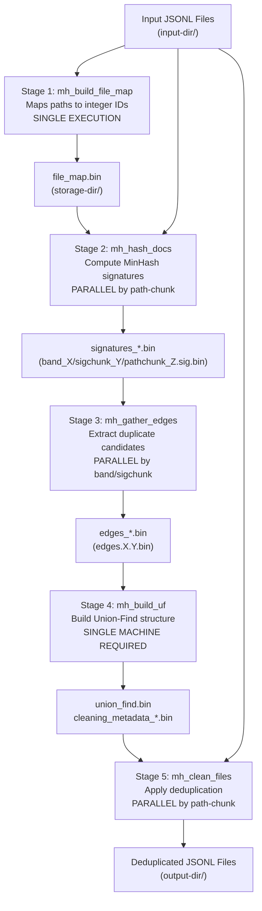
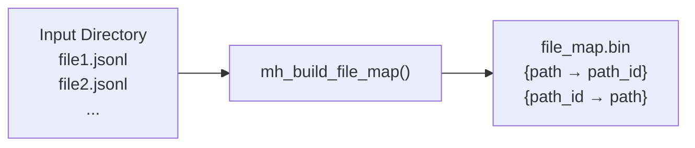
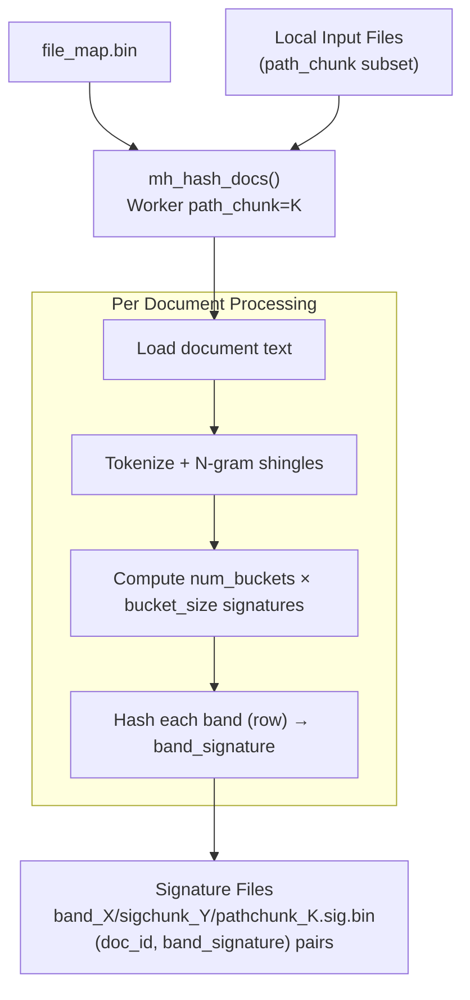
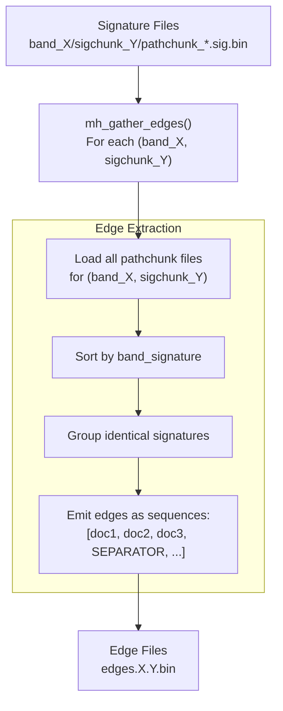
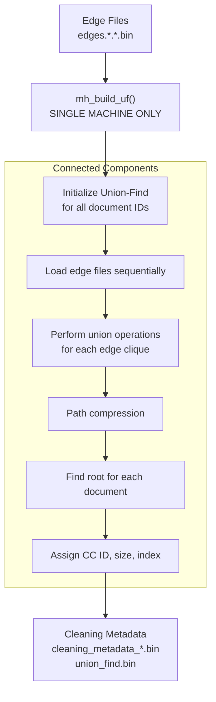
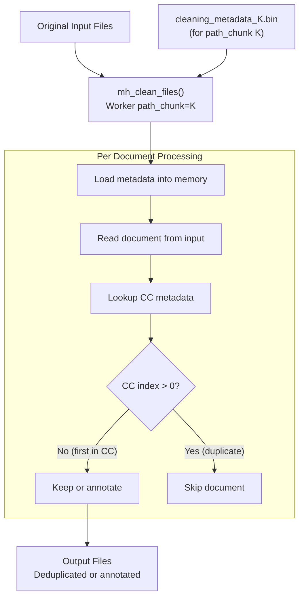
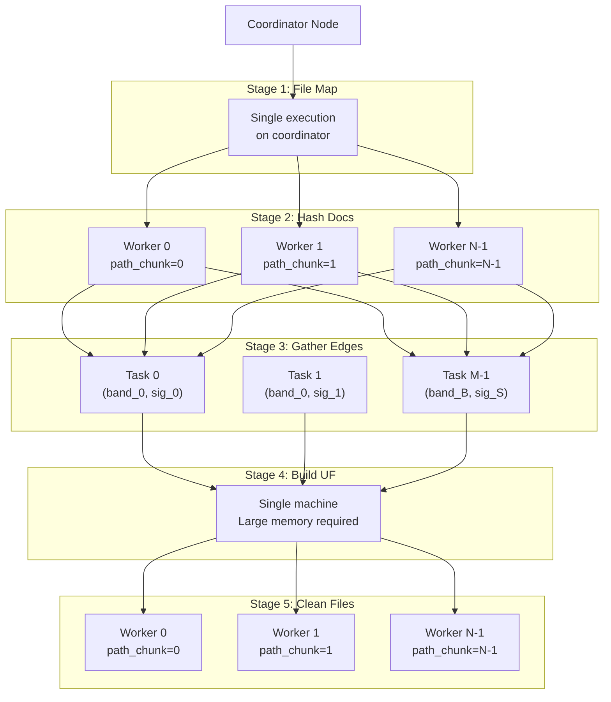

<!-- source: DeepWiki mcp.deepwiki.com · repo allenai/duplodocus · page 3.3 MinHash Disk Pipeline · fetched 2026-10-26 -->

# MinHash Disk Pipeline

<details>
<summary>Relevant source files</summary>

The following files were used as context for generating this wiki page:

- [README.md](README.md)
- [primer.md](primer.md)
- [src/main.rs](src/main.rs)

</details>


## Purpose and Scope

The MinHash Disk Pipeline implements a five-stage distributed deduplication system for large-scale datasets that exceed available memory. It identifies near-duplicate documents using MinHash Locality-Sensitive Hashing (LSH) and can process datasets across multiple machines through coordinated parallel execution.

This page covers the disk-based implementation. For memory-based fuzzy deduplication on smaller datasets, see [MinHash Memory Pipeline](#3.2). For the underlying MinHash algorithm and theory, see [MinHash Theory and Algorithm](#3.1).

**Sources:** [src/main.rs:1-219](), [README.md:191-251](), [primer.md:73-114]()

---

## Pipeline Overview

The MinHash Disk Pipeline operates in five sequential stages, each with different parallelization characteristics:



**Parallelization Summary:**

| Stage | Parallelization | Synchronization Required |
|-------|----------------|-------------------------|
| 1. File Map | Run once | Completes before Stage 2 |
| 2. Hash Docs | `num_path_chunks` workers | All signatures complete before Stage 3 |
| 3. Gather Edges | `num_buckets × num_sig_chunks` groups | All edges complete before Stage 4 |
| 4. Build UF | **Single machine only** | Completes before Stage 5 |
| 5. Clean Files | `num_path_chunks` workers | Independent execution |

**Sources:** [src/main.rs:140-218](), [README.md:191-251](), [primer.md:82-113]()

---

## Stage 1: Build File Map

### Purpose

The `mh_build_file_map` stage creates a bidirectional mapping between file paths and compact integer identifiers. This enables documents to be uniquely identified by `(path_id, line_number)` tuples, which use less storage than full paths.



### Execution

**Command:**
```bash
cargo run --release -- mh-build-file-map \
  --input-dir /data/documents \
  --storage-dir /shared/work
```

**CLI Arguments:**
- `--input-dir`: Directory containing input JSONL files
- `--storage-dir`: Working directory for output file map

**Output:**
- `{storage-dir}/file_map.bin`: Serialized bidirectional path mapping

### Implementation Details

The file map must be created before any other stages and is typically run once from a single machine. It discovers all input files with unique basenames and assigns sequential integer IDs.

**Sources:** [src/main.rs:432-450](), [src/main.rs:877-880](), [README.md:194-199]()

---

## Stage 2: Hash Documents

### Purpose

The `mh_hash_docs` stage computes MinHash signatures for each document and organizes them for efficient similarity comparison. This is the most computationally intensive stage and supports distributed execution across multiple workers.



### Execution

**Command (Worker 0 of 10):**
```bash
cargo run --release -- mh-hash-docs \
  --local-input /data/documents \
  --storage-dir /shared/work \
  --text-key "text" \
  --path-chunk 0 \
  --num-path-chunks 10 \
  --num-buckets 20 \
  --bucket-size 5 \
  --ngram-size 5 \
  --tokenizer "cl100k"
```

**CLI Arguments:**
- `--local-input`: Directory containing input files to process
- `--storage-dir`: Working directory containing `file_map.bin`
- `--text-key`: JSON key containing document text (default: "text")
- `--path-chunk`: This worker's chunk ID (0 to `num_path_chunks - 1`)
- `--num-path-chunks`: Total number of parallel workers
- `--num-buckets`: Number of LSH bands (default from config)
- `--bucket-size`: Hash values per band (default from config)
- `--ngram-size`: N-gram size for shingling (default: 5)
- `--tokenizer`: Options: "cl100k", "p50k", "uniseg", or character-level
- `--num-sig-chunks`: Number of signature prefix groups for distribution
- `--num-docs`: Expected total documents (affects encoding)
- `--max-lines-per-path`: Maximum lines per file (affects encoding)

### Output Structure

Signatures are organized in a three-level hierarchy:

```
storage-dir/
  band_0/
    sigchunk_0/
      pathchunk_0.sig.bin
      pathchunk_1.sig.bin
      ...
    sigchunk_1/
      pathchunk_0.sig.bin
      ...
  band_1/
    ...
```

Each `.sig.bin` file contains a list of `(document_id, band_signature)` pairs as binary data.

### Parallelization

Each worker processes a subset of files determined by `path_chunk`:
- Worker K processes files where `path_id % num_path_chunks == K`
- All workers must complete before Stage 3 begins
- Workers write to disjoint output files, avoiding coordination

**Sources:** [src/main.rs:452-524](), [src/main.rs:882-912](), [primer.md:90-98](), [README.md:201-224]()

---

## Stage 3: Gather Edges

### Purpose

The `mh_gather_edges` stage identifies candidate duplicate pairs by grouping documents with identical band signatures. Documents sharing a signature in any band are connected by an edge, forming a similarity graph.



### Execution

**Command:**
```bash
cargo run --release -- mh-gather-edges \
  --storage-dir /shared/work \
  --num-docs 1000000 \
  --max-lines-per-path 100000
```

**CLI Arguments:**
- `--storage-dir`: Working directory containing signature files
- `--config`: Optional YAML configuration file
- `--num-docs`: Expected total documents (must match Stage 2)
- `--max-lines-per-path`: Maximum lines per file (must match Stage 2)

### Output Structure

```
storage-dir/
  edges.0.0.bin
  edges.0.1.bin
  ...
  edges.{num_buckets-1}.{num_sig_chunks-1}.bin
```

Each edge file represents edges discovered within one `(band_id, sigchunk_id)` combination.

### Edge Representation

Instead of storing explicit pairs `(doc1, doc2)`, edges are compressed as sequences:
- If documents `[A, B, C, D]` all share a signature, store: `[A, B, C, D, SEPARATOR]`
- This forms a clique where all pairs are implicitly connected
- Reduces storage and speeds up Union-Find construction

### Parallelization

This stage can be parallelized across `num_buckets × num_sig_chunks` independent tasks:
- Each task processes one `(band_id, sigchunk_id)` combination
- All edge files must be complete before Stage 4 begins

**Sources:** [src/main.rs:526-551](), [src/main.rs:914-919](), [primer.md:100-103](), [README.md:226-230]()

---

## Stage 4: Build Union-Find

### Purpose

The `mh_build_uf` stage constructs a global Union-Find data structure to identify connected components in the duplicate graph. This determines which documents belong to the same duplicate cluster.



### Execution

**Command:**
```bash
cargo run --release -- mh-build-uf \
  --storage-dir /shared/work \
  --num-path-chunks 10 \
  --max-lines-per-path 100000
```

**CLI Arguments:**
- `--storage-dir`: Working directory containing edge files
- `--num-path-chunks`: Number of output metadata chunks (should match Stage 5)
- `--max-lines-per-path`: Maximum lines per file
- `--config`: Optional YAML configuration file

### Output Structure

```
storage-dir/
  union_find.bin                    # Full Union-Find structure
  cleaning_metadata_0.bin           # Metadata for path_chunk 0
  cleaning_metadata_1.bin           # Metadata for path_chunk 1
  ...
  cleaning_metadata_{num_path_chunks-1}.bin
```

Each `cleaning_metadata_*.bin` file contains for each document:
- `document_id`: `(path_id, line_number)`
- `connected_component_id`: Root of the CC in Union-Find
- `connected_component_size`: Number of documents in CC
- `connected_component_index`: Position within CC (0 = kept, >0 = duplicate)

### Critical Constraint

**This stage MUST run on a single machine with sufficient memory.** It cannot be parallelized across multiple machines because:
- Union-Find requires global state
- All documents must be unified into a single connected component structure
- Memory requirement: ~24 bytes per document + edge storage

For extremely large datasets (billions of documents), this becomes the primary bottleneck.

**Sources:** [src/main.rs:553-580](), [src/main.rs:921-931](), [primer.md:105-110](), [README.md:232-237]()

---

## Stage 5: Clean Files

### Purpose

The `mh_clean_files` stage applies deduplication by either removing duplicate documents or annotating them with metadata. This stage uses the connected component information from Stage 4.



### Execution

**Command (Worker 0 of 10):**
```bash
cargo run --release -- mh-clean-files \
  --input-dir /data/documents \
  --storage-dir /shared/work \
  --output-dir /data/deduped \
  --path-chunk 0 \
  --num-path-chunks 10 \
  --remove-duplicates true \
  --annotate true \
  --annotate-key "minhash_info"
```

**CLI Arguments:**
- `--input-dir`: Directory containing original input files
- `--storage-dir`: Working directory containing cleaning metadata
- `--output-dir`: Directory for output files
- `--path-chunk`: This worker's chunk ID
- `--num-path-chunks`: Total number of workers
- `--remove-duplicates`: If true, remove documents with CC index > 0
- `--annotate`: If true, add CC metadata to documents
- `--annotate-key`: JSON key for metadata (e.g., "minhash_info")
- `--delete-while-cleaning`: Delete input files after processing
- `--cleanup-storage`: Delete storage directory (use only on final worker)

### Behavior Modes

| `remove_duplicates` | `annotate` | Behavior |
|---------------------|-----------|----------|
| `false` | `false` | Copy all documents unchanged |
| `true` | `false` | Keep only first document per CC |
| `false` | `true` | Keep all, add CC metadata |
| `true` | `true` | Keep only first per CC, add metadata |

### Annotation Format

When `--annotate true`, documents receive metadata like:
```json
{
  "text": "document content...",
  "minhash_info": {
    "connected_component_id": 12345,
    "connected_component_size": 5,
    "connected_component_index": 0
  }
}
```

### Parallelization

Similar to Stage 2, workers process files where `path_id % num_path_chunks == K`. Each worker:
- Loads only its corresponding metadata chunk
- Reads and processes only its assigned files
- Writes output independently

**Sources:** [src/main.rs:582-644](), [src/main.rs:933-957](), [primer.md:112-114](), [README.md:239-251]()

---

## Data Structures and File Organization

### File Map Structure

The `file_map.bin` contains:
- **Forward map**: `HashMap<PathBuf, usize>` (path → path_id)
- **Reverse map**: `Vec<PathBuf>` (path_id → path)

### Document ID Encoding

Documents are identified by `(path_id, line_number)` and encoded as:
- Compact integer representation based on `max_lines_per_path`
- If `max_lines_per_path < 2^32`, use u32 or u40 encoding
- Allows efficient binary storage and lookups

### Signature File Format

Each `band_X/sigchunk_Y/pathchunk_Z.sig.bin` contains:
- Binary stream of `(document_id, band_signature)` pairs
- `document_id`: Encoded as compact integer
- `band_signature`: 16-byte hash digest of the band row

### Edge File Format

Each `edges.X.Y.bin` contains:
- Sequences of document IDs representing cliques
- Special separator value (typically `usize::MAX`) between cliques
- Example: `[doc1, doc2, doc3, SEP, doc4, doc5, SEP, ...]`

### Cleaning Metadata Format

Each `cleaning_metadata_K.bin` contains:
- Map from `document_id` to `(cc_id, cc_size, cc_index)`
- Serialized using binary format for efficient loading

**Sources:** [src/main.rs:140-218](), [primer.md:90-98]()

---

## Distributed Execution Pattern

### Workflow Coordination



### Synchronization Points

1. **After Stage 1**: All workers need `file_map.bin`
2. **After Stage 2**: All signature files must exist before Stage 3
3. **After Stage 3**: All edge files must exist before Stage 4
4. **After Stage 4**: All metadata files must exist before Stage 5

### Network Shuffle Operations

The pipeline includes two implicit shuffle operations:

**Shuffle 1 (Stage 2 → Stage 3):**
- Signatures generated by path_chunk must be reorganized by (band, sigchunk)
- Typically handled by shared filesystem (NFS, S3, etc.)
- No explicit data movement in code

**Shuffle 2 (Stage 4 → Stage 5):**
- Cleaning metadata partitioned by path_chunk
- Stage 4 writes separate files for each path_chunk
- Workers read their corresponding chunk

### Path Chunking Strategy

The `--num-path-chunks` parameter determines parallelism for Stages 2 and 5:
- More chunks = more parallelism but more coordination
- Typical values: 10-100 for large datasets
- Each worker processes `total_files / num_path_chunks` files

**Sources:** [src/main.rs:200-206](), [README.md:191-251](), [primer.md:98-113]()

---

## Configuration Parameters

### MinHash Parameters

These control the similarity detection behavior:

| Parameter | CLI Flag | Config Key | Default | Description |
|-----------|----------|-----------|---------|-------------|
| Num Buckets | `--num-buckets` | `minhash_params.num_buckets` | 20 | Number of LSH bands (more = stricter) |
| Bucket Size | `--bucket-size` | `minhash_params.bucket_size` | 5 | Hash values per band (more = stricter) |
| N-gram Size | `--ngram-size` | `minhash_params.ngram_size` | 5 | N-gram size for shingling |
| Seed | `--permutation-seed` | `minhash_params.permutation_seed` | Random | Random seed for reproducibility |
| Tokenizer | `--tokenizer` | `minhash_params.tokenizer` | Character | Options: "cl100k", "p50k", "uniseg" |

### Engineering Parameters

These control storage and encoding:

| Parameter | CLI Flag | Config Key | Description |
|-----------|----------|-----------|-------------|
| Num Docs | `--num-docs` | `eng_params.num_docs` | Expected total documents (affects encoding) |
| Max Lines | `--max-lines-per-path` | `eng_params.max_lines_per_path` | Maximum lines per file (affects encoding) |
| Sig Chunks | `--num-sig-chunks` | `eng_params.num_sig_chunks` | Signature prefix groups for distribution |

### Output Parameters

These control deduplication behavior:

| Parameter | CLI Flag | Config Key | Description |
|-----------|----------|-----------|-------------|
| Annotate | `--annotate` | `output_params.annotate` | Add metadata to documents |
| Annotate Key | `--annotate-key` | `output_params.annotate_key` | JSON key for metadata |
| Remove Duplicates | `--remove-duplicates` | `output_params.remove_duplicates` | Delete duplicates instead of keeping |
| Delete Input | `--delete-while-cleaning` | `output_params.delete_while_cleaning` | Delete input files after processing |

### YAML Configuration Example

```yaml
minhash_params:
  num_buckets: 26
  bucket_size: 11
  ngram_size: 5
  permutation_seed: 42
  tokenizer: "cl100k_base"

eng_params:
  num_docs: 1000000
  max_lines_per_path: 100000
  num_sig_chunks: 8

output_params:
  annotate: true
  annotate_key: "metadata.minhash"
  remove_duplicates: true
  delete_while_cleaning: false
```

**Sources:** [src/main.rs:385-524](), [README.md:265-296]()

---

## Usage Examples

### Multi-Node Distributed Example

For a dataset with 10 million documents across 100 files on a cluster:

```bash
# === Coordinator Node ===

# Stage 1: Build file map (run once)
cargo run --release -- mh-build-file-map \
  --input-dir /shared/input \
  --storage-dir /shared/work

# Wait for Stage 1 to complete, then launch Stage 2 workers...

# === Worker Nodes (10 workers) ===

# Stage 2: Hash documents (each worker)
# Worker 0:
cargo run --release -- mh-hash-docs \
  --local-input /shared/input \
  --storage-dir /shared/work \
  --text-key "text" \
  --path-chunk 0 \
  --num-path-chunks 10 \
  --num-buckets 20 \
  --bucket-size 5 \
  --num-docs 10000000 \
  --max-lines-per-path 100000

# Worker 1-9: Same command with path-chunk=1-9

# Wait for all Stage 2 workers to complete...

# === Coordinator Node ===

# Stage 3: Gather edges (run once)
cargo run --release -- mh-gather-edges \
  --storage-dir /shared/work \
  --num-docs 10000000 \
  --max-lines-per-path 100000

# Wait for Stage 3 to complete...

# Stage 4: Build Union-Find (SINGLE MACHINE with enough memory)
cargo run --release -- mh-build-uf \
  --storage-dir /shared/work \
  --num-path-chunks 10 \
  --max-lines-per-path 100000

# Wait for Stage 4 to complete, then launch Stage 5 workers...

# === Worker Nodes (10 workers) ===

# Stage 5: Clean files (each worker)
# Worker 0:
cargo run --release -- mh-clean-files \
  --input-dir /shared/input \
  --storage-dir /shared/work \
  --output-dir /shared/output \
  --path-chunk 0 \
  --num-path-chunks 10 \
  --remove-duplicates true \
  --annotate true \
  --annotate-key "minhash_metadata"

# Worker 1-9: Same command with path-chunk=1-9

# Final worker can optionally set --cleanup-storage
```

### Single-Node Example with Configuration File

For a smaller dataset on a single machine with 16 cores:

```bash
# Create config file
cat > minhash_config.yaml << EOF
minhash_params:
  num_buckets: 20
  bucket_size: 5
  ngram_size: 5
  tokenizer: "cl100k_base"
eng_params:
  num_docs: 500000
  max_lines_per_path: 50000
  num_sig_chunks: 4
output_params:
  annotate: false
  remove_duplicates: true
EOF

# Stage 1: File map
cargo run --release -- mh-build-file-map \
  --input-dir /data/input \
  --storage-dir /data/work

# Stage 2: Hash docs (4 parallel processes)
for i in {0..3}; do
  cargo run --release -- mh-hash-docs \
    --local-input /data/input \
    --storage-dir /data/work \
    --text-key "text" \
    --path-chunk $i \
    --num-path-chunks 4 \
    --config minhash_config.yaml &
done
wait

# Stage 3: Gather edges
cargo run --release -- mh-gather-edges \
  --storage-dir /data/work \
  --config minhash_config.yaml

# Stage 4: Build UF
cargo run --release -- mh-build-uf \
  --storage-dir /data/work \
  --num-path-chunks 4 \
  --config minhash_config.yaml

# Stage 5: Clean files (4 parallel processes)
for i in {0..3}; do
  cargo run --release -- mh-clean-files \
    --input-dir /data/input \
    --storage-dir /data/work \
    --output-dir /data/output \
    --path-chunk $i \
    --num-path-chunks 4 \
    --config minhash_config.yaml &
done
wait

# Cleanup
rm -rf /data/work
```

**Sources:** [src/main.rs:54-86](), [README.md:191-251]()

---

## Performance Considerations

### Memory Requirements

**Stage 2 (Hash Docs):**
- Memory per worker: ~2-4GB + size of largest input file
- Processes one file at a time

**Stage 3 (Gather Edges):**
- Memory per task: Proportional to signatures per (band, sigchunk)
- Typically 1-8GB per task

**Stage 4 (Build UF):**
- **Critical bottleneck**: ~24 bytes per document
- 100M documents ≈ 2.4GB minimum
- 1B documents ≈ 24GB minimum
- Additional memory for edge processing

**Stage 5 (Clean Files):**
- Memory per worker: ~1GB + metadata for assigned path_chunk
- Processes one file at a time

### Storage Requirements

Intermediate files can be 3-5x the input dataset size:
- Signature files: ~1-2x input size
- Edge files: ~0.5-1x input size
- Union-Find + metadata: ~0.5x input size

Use fast local storage (NVMe SSD) for best performance.

### Tuning Parameters

**For high precision (fewer false positives):**
- Increase `--num-buckets` (e.g., 30-50)
- Increase `--bucket-size` (e.g., 8-12)

**For high recall (catch more near-duplicates):**
- Decrease `--num-buckets` (e.g., 10-15)
- Decrease `--bucket-size` (e.g., 3-4)

**For faster processing:**
- Increase `--num-sig-chunks` to parallelize Stage 3
- Use more workers with higher `--num-path-chunks`

**Sources:** [README.md:299-330](), [primer.md:34-48]()

---

