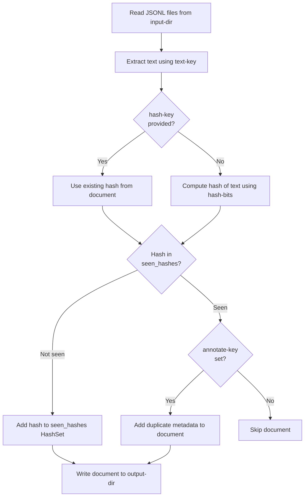
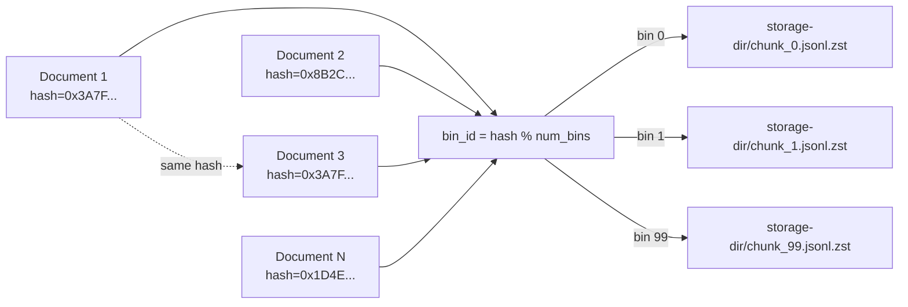
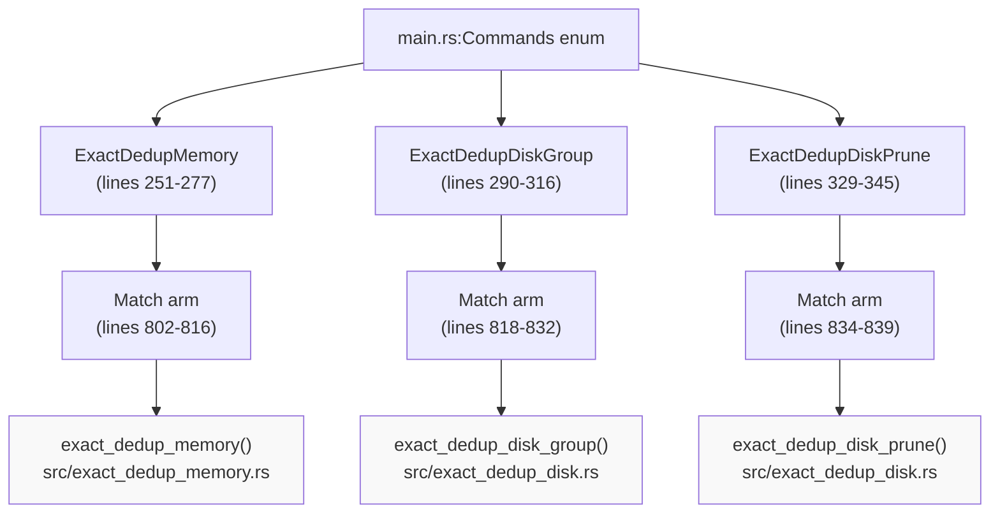

<!-- source: DeepWiki mcp.deepwiki.com · repo allenai/duplodocus · page 4 Exact Deduplication · fetched 2026-10-26 -->

# Exact Deduplication

<details>
<summary>Relevant source files</summary>

The following files were used as context for generating this wiki page:

- [README.md](README.md)
- [src/main.rs](src/main.rs)

</details>


## Purpose and Scope

This document describes the exact deduplication system in Duplodocus, which removes documents with identical content using hash-based matching. Exact deduplication finds only perfect duplicates - documents that hash to the same value - and is faster and more deterministic than fuzzy deduplication methods.

For near-duplicate detection using Jaccard similarity, see [MinHash Fuzzy Deduplication](#3). For substring-level repeat detection, see [Suffix Array System](#2).

**Sources:** [README.md:30-31](), [main.rs:16-19]()

---

## Overview

Exact deduplication identifies documents with identical content by computing a hash of each document's text. Documents with matching hashes are considered duplicates, and all but one occurrence are either removed or annotated with duplicate metadata.

The system provides two implementations optimized for different dataset scales:

| Method | Scale | Processing Model | Best For |
|--------|-------|------------------|----------|
| **Memory-Based** | < 100GB | Single-pass, all in RAM | Simple workflows, medium datasets |
| **Disk-Based** | Unlimited | Two-phase, distributed | Large datasets, multi-node clusters |

Both methods support:
- Custom hash keys (use pre-computed hashes from documents)
- Automatic text hashing (compute hashes on-the-fly)
- Configurable hash bit size (default: 128 bits)
- Duplicate annotation mode (add metadata instead of removing)

**Sources:** [main.rs:11-14](), [README.md:124-162]()

---

## Architecture Comparison


**Diagram: Memory vs. Disk Processing Models**

The memory-based method processes documents in a single pass with an in-memory `HashSet`, while the disk-based method separates grouping (phase 1) from pruning (phase 2), enabling distributed processing across multiple workers.

**Sources:** [main.rs:239-277](), [main.rs:279-345]()

---

## Memory-Based Exact Deduplication

### Command Interface

The `exact-dedup-memory` command performs single-pass exact deduplication entirely in memory:

```bash
cargo run --release -- exact-dedup-memory \
  --input-dir /data/documents \
  --output-dir /data/unique \
  --text-key "content" \
  --hash-key "doc_id" \
  --hash-bits 128 \
  --annotate-key "duplicate_info"
```

**Sources:** [main.rs:239-277]()

### Parameters

| Parameter | Required | Default | Description |
|-----------|----------|---------|-------------|
| `--input-dir` | Yes | - | Directory containing input JSONL files |
| `--output-dir` | Yes | - | Directory for deduplicated output |
| `--text-key` | No | `"text"` | JSON key containing document text |
| `--hash-key` | No | None | JSON key with pre-computed hash; if absent, text is hashed |
| `--hash-bits` | No | `128` | Hash size (32, 64, 128, or 256 bits) |
| `--annotate-key` | No | None | If set, adds duplicate metadata instead of removing documents |

**Sources:** [main.rs:252-276]()

### Algorithm Flow



**Diagram: exact-dedup-memory Processing Logic**

The algorithm maintains a single `HashSet<Hash>` in memory. Each document is checked against this set; first-occurrence documents are written to output, while duplicates are either skipped or annotated based on configuration.

**Sources:** [main.rs:802-816](), [src/exact_dedup_memory.rs]() (function call)

### Memory Requirements

The memory footprint is dominated by the hash set:

- **Hash storage**: `num_documents * hash_size_bytes` 
  - 128-bit hashes: ~16 bytes per document
  - For 10M documents: ~160 MB
- **Document buffers**: Temporary storage for JSONL parsing/writing
- **Overhead**: Rust `HashSet` overhead (~1.5x raw size)

**Typical requirement**: Dataset size + 2-3 GB overhead for a 128-bit hash configuration.

**Sources:** [README.md:302-304]()

---

## Disk-Based Exact Deduplication

The disk-based method splits processing into two phases that can run on separate machines, enabling horizontal scaling for arbitrarily large datasets.

### Phase 1: Group by Hash

The `exact-dedup-disk-group` command partitions documents into bins based on their hash value:

```bash
cargo run --release -- exact-dedup-disk-group \
  --input-dir /data/documents \
  --storage-dir /scratch/work \
  --text-key "content" \
  --hash-key "doc_id" \
  --hash-bits 128 \
  --num-bins 100
```

**Sources:** [main.rs:279-316]()

#### Phase 1 Parameters

| Parameter | Required | Default | Description |
|-----------|----------|---------|-------------|
| `--input-dir` | Yes | - | Directory containing input JSONL files |
| `--storage-dir` | Yes | - | Working directory for intermediate bin files |
| `--text-key` | No | `"text"` | JSON key containing document text |
| `--hash-key` | Yes | - | JSON key where hash is stored in documents |
| `--hash-bits` | No | `128` | Hash size (affects hash computation if needed) |
| `--num-bins` | Yes | - | Number of bins to partition documents into |

**Sources:** [main.rs:291-315]()

#### Binning Strategy



**Diagram: Hash-Based Binning in Phase 1**

Documents with the same hash always go to the same bin (due to modulo operation), ensuring duplicates are co-located for phase 2 processing. Each bin is written as a compressed JSONL file.

**Sources:** [main.rs:818-832](), [main.rs:310-315]()

#### Output Files

Phase 1 produces `num_bins` files in the storage directory:
- `chunk_0.jsonl.zst`
- `chunk_1.jsonl.zst`
- ...
- `chunk_{num_bins-1}.jsonl.zst`

Each file contains documents whose hash maps to that bin index. Files are compressed with zstd.

**Sources:** [main.rs:279-316]()

### Phase 2: Prune Duplicates

The `exact-dedup-disk-prune` command processes each bin independently, removing duplicates within each bin:

```bash
cargo run --release -- exact-dedup-disk-prune \
  --storage-dir /scratch/work \
  --output-dir /data/unique \
  --hash-key "doc_id" \
  --annotate-key "duplicate_info"
```

**Sources:** [main.rs:318-345]()

#### Phase 2 Parameters

| Parameter | Required | Default | Description |
|-----------|----------|---------|-------------|
| `--storage-dir` | Yes | - | Working directory containing bin files from phase 1 |
| `--output-dir` | Yes | - | Directory where deduplicated files will be written |
| `--hash-key` | Yes | - | JSON key for hash (must match phase 1) |
| `--annotate-key` | No | None | If set, annotates duplicates instead of removing |

**Sources:** [main.rs:329-344]()

#### Per-Bin Processing

```mermaid
graph TB
    subgraph "Worker 1: Bins 0-24"
        Bin0["chunk_0.jsonl.zst"]
        Bin24["chunk_24.jsonl.zst"]
        Set1["HashSet (bin 0-24 only)"]
        Out1["output-dir/chunk_0-24.jsonl"]
    end
    
    subgraph "Worker 2: Bins 25-49"
        Bin25["chunk_25.jsonl.zst"]
        Bin49["chunk_49.jsonl.zst"]
        Set2["HashSet (bin 25-49 only)"]
        Out2["output-dir/chunk_25-49.jsonl"]
    end
    
    subgraph "Worker 3: Bins 50-74"
        Bin50["chunk_50.jsonl.zst"]
        Bin74["chunk_74.jsonl.zst"]
        Set3["HashSet (bin 50-74 only)"]
        Out3["output-dir/chunk_50-74.jsonl"]
    end
    
    subgraph "Worker 4: Bins 75-99"
        Bin75["chunk_75.jsonl.zst"]
        Bin99["chunk_99.jsonl.zst"]
        Set4["HashSet (bin 75-99 only)"]
        Out4["output-dir/chunk_75-99.jsonl"]
    end
    
    Bin0 --> Set1
    Bin24 --> Set1
    Set1 --> Out1
    
    Bin25 --> Set2
    Bin49 --> Set2
    Set2 --> Out2
    
    Bin50 --> Set3
    Bin74 --> Set3
    Set3 --> Out3
    
    Bin75 --> Set4
    Bin99 --> Set4
    Set4 --> Out4
```



**Diagram: Parallelized Phase 2 Processing**

Phase 2 can be parallelized across multiple workers. Each worker processes a subset of bins independently since duplicates cannot span bins. Each worker maintains only the hashes for its assigned bins in memory.

**Sources:** [main.rs:834-839]()

### Distributed Execution

The two-phase design enables distributed processing:

1. **Phase 1 parallelization**: Multiple workers can run `exact-dedup-disk-group` on different input file subsets, all writing to a shared storage directory. The binning ensures documents with the same hash end up in the same bin regardless of which worker processes them.

2. **Network shuffle**: Between phases, bin files may need to be redistributed across workers if input and processing nodes differ. Tools like `s5cmd` handle this outside the Rust code.

3. **Phase 2 parallelization**: Multiple workers run `exact-dedup-disk-prune` on disjoint bin ranges, producing independent output files.

**Sources:** [README.md:143-162](), [main.rs:194-210]()

---

## Implementation Code Mapping



**Diagram: Code Structure for Exact Deduplication**

The CLI command enum definitions ([main.rs:234-345]()) map to match arms in `main()` ([main.rs:801-839]()) which call implementation functions in the `exact_dedup_memory` and `exact_dedup_disk` modules ([main.rs:96-97]()).

**Sources:** [main.rs:96-97](), [main.rs:234-345](), [main.rs:801-839]()

---

## Configuration and Options

### Hash Computation

When `--hash-key` is not provided (memory method only), the system computes a hash from the document's text:

- **32-bit**: Fast, risk of collisions on large datasets
- **64-bit**: Balanced performance and collision resistance  
- **128-bit**: Default, very low collision probability
- **256-bit**: Maximum collision resistance for critical applications

**Hash algorithm**: The implementation uses a cryptographic-quality hash function suitable for deduplication.

**Sources:** [main.rs:270-271](), [main.rs:309-310]()

### Annotation Mode

Setting `--annotate-key` changes behavior from removal to annotation:

```json
// Without --annotate-key: duplicate document is removed

// With --annotate-key "duplicate_info":
{
  "text": "Document content...",
  "duplicate_info": {
    "is_duplicate": true,
    "hash": "a3f7c29e..."
  }
}
```

For nested keys, use dot notation: `--annotate-key "metadata.dedup.exact"`

**Sources:** [main.rs:275-276](), [main.rs:342-344]()

### Choosing num-bins

The `--num-bins` parameter in disk-based deduplication affects:

- **Parallelism**: More bins = finer-grained distribution across workers
- **Memory per worker**: More bins = smaller bins = less memory per worker in phase 2
- **File overhead**: More bins = more files to manage

**Recommendation**: 
- Small clusters (1-4 nodes): 50-100 bins
- Large clusters (10+ nodes): 200-1000 bins
- Rule of thumb: 10-50 bins per worker for balanced distribution

**Sources:** [main.rs:312-315](), [README.md:143-162]()

---

## Performance Characteristics

### Memory Method

| Aspect | Performance |
|--------|-------------|
| **Time complexity** | O(n) where n = number of documents |
| **Space complexity** | O(n) for hash set |
| **I/O pattern** | Sequential read → Sequential write |
| **Parallelism** | Single-threaded (can run multiple instances on different input directories) |

### Disk Method

| Aspect | Phase 1 (Group) | Phase 2 (Prune) |
|--------|-----------------|-----------------|
| **Time complexity** | O(n) | O(n) |
| **Space complexity** | O(num_bins) writers | O(unique_hashes_per_bin) |
| **I/O pattern** | Sequential read → Random write (bins) | Sequential read per bin → Sequential write |
| **Parallelism** | Fully parallel across input chunks | Fully parallel across bin ranges |

**Sources:** [main.rs:11-14](), [README.md:302-310]()

---

## Usage Recommendations

### Use Memory-Based When:
- Dataset fits in available RAM with 2-3 GB overhead
- Simple, one-off deduplication tasks
- Interactive workflows requiring fast turnaround
- No distributed infrastructure available

### Use Disk-Based When:
- Dataset exceeds available memory
- Running on a compute cluster with shared storage
- Need to checkpoint between phases (fault tolerance)
- Processing data in batches over time

### Best Practices

1. **Fast local storage**: Use NVMe or SSD for `storage-dir` in disk-based method
2. **Pre-compute hashes**: If running multiple deduplication passes, compute hashes once and use `--hash-key`
3. **Monitor disk space**: Disk-based method requires ~2x input size for bin files
4. **Test with subsets**: Validate parameters on a small data subset before processing full dataset
5. **Consistent hash-key**: Phase 2 must use the same `--hash-key` as phase 1

**Sources:** [README.md:318-330]()

---

## Related Operations

For working with deduplicated data:

- **MinHash fuzzy deduplication**: See [MinHash Memory Pipeline](#3.2) and [MinHash Disk Pipeline](#3.3)
- **Suffix array deduplication**: See [Suffix Array System](#2)
- **Validation**: Use [True Jaccard Calculation](#5.1) to verify similarity of documents marked as duplicates

**Sources:** [main.rs:1-137]()

---

