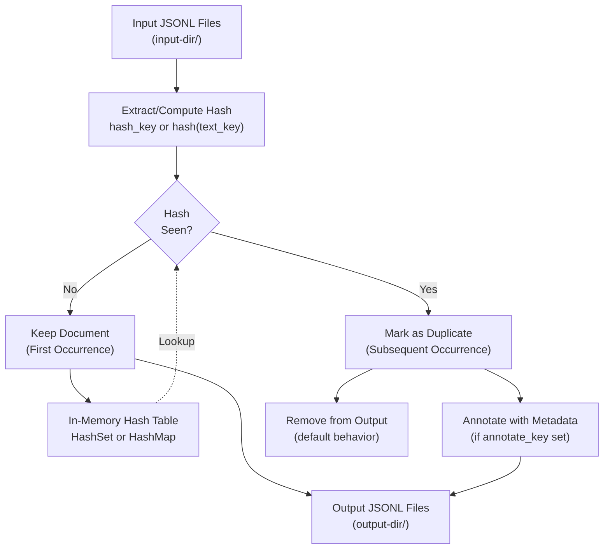
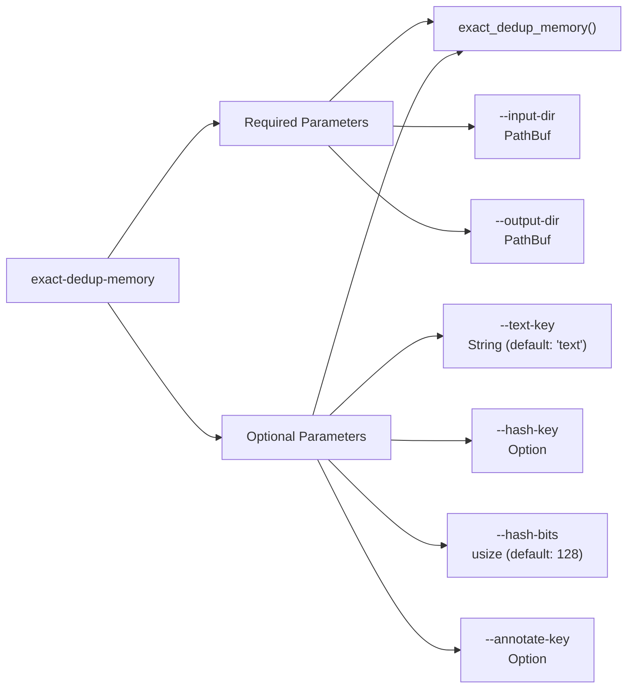
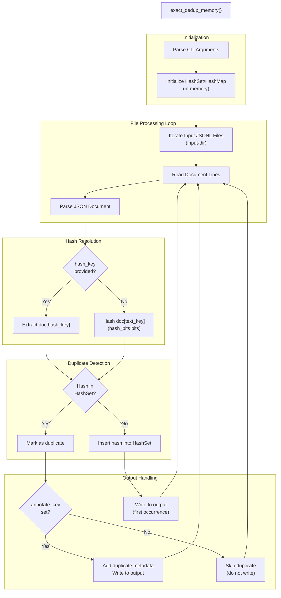
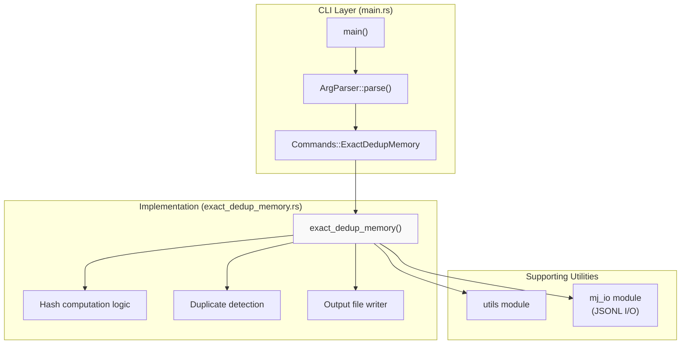
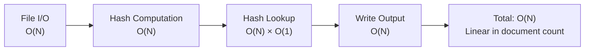

<!-- source: DeepWiki mcp.deepwiki.com · repo allenai/duplodocus · page 4.1 Exact Memory-Based Deduplication · fetched 2026-10-26 -->

# Exact Memory-Based Deduplication

<details>
<summary>Relevant source files</summary>

The following files were used as context for generating this wiki page:

- [README.md](README.md)
- [src/main.rs](src/main.rs)

</details>


## Purpose and Scope

This page documents the memory-based exact deduplication system in Duplodocus. This method removes documents with identical content using hash-based matching in a single in-memory pass. It is designed for datasets under 100GB where simplicity and speed are priorities.

For large-scale exact deduplication requiring distributed processing, see [Exact Disk-Based Deduplication](#4.2). For fuzzy (near-duplicate) matching, see [MinHash Fuzzy Deduplication](#3).

## Algorithm Overview

The exact memory-based deduplication algorithm follows a simple single-pass strategy:

1. **Hash Computation**: Each document is hashed to produce a fixed-size identifier. The hash can be pre-computed and provided via a JSON field, or generated on-the-fly from the document text.

2. **Duplicate Detection**: A hash table tracks which documents have been seen. When a duplicate hash is encountered, the document is marked for removal or annotation.

3. **Output Generation**: Documents are written to the output directory, either filtered (duplicates removed) or annotated (duplicates marked with metadata).

The entire process maintains all necessary data structures in RAM, enabling fast single-pass processing without intermediate file I/O.

**Key Characteristics:**
- **Time Complexity**: O(n) for n documents (single pass with hash lookups)
- **Space Complexity**: O(n) for hash table storage
- **Determinism**: First occurrence of each hash is kept; subsequent duplicates are removed
- **Ordering**: Processing order determines which document is retained

Sources: [src/main.rs:11-41](), [src/main.rs:239-277]()

## Data Flow Architecture



**Figure 1: Memory-Based Exact Deduplication Data Flow**

The hash table grows linearly with the number of unique documents encountered. Once a hash is in the table, subsequent matches are immediately identified as duplicates.

Sources: [src/main.rs:36-41](), [src/main.rs:251-277]()

## CLI Interface and Parameters

The memory-based exact deduplication is exposed via the `ExactDedupMemory` command:



**Figure 2: CLI Parameter Mapping to Function Call**

Sources: [src/main.rs:251-277](), [src/main.rs:802-816]()

### Parameter Reference

| Parameter | Type | Default | Description |
|-----------|------|---------|-------------|
| `--input-dir` | PathBuf | *required* | Directory containing input JSONL files |
| `--output-dir` | PathBuf | *required* | Directory where deduplicated files will be written |
| `--text-key` | String | `"text"` | JSON key containing document text for hashing |
| `--hash-key` | Option<String> | None | Optional pre-computed hash field; if absent, text is hashed automatically |
| `--hash-bits` | usize | 128 | Number of bits for hash computation (only used if hash-key not provided) |
| `--annotate-key` | Option<String> | None | If set, adds duplicate metadata instead of removing documents; supports nested keys (e.g., `"metadata.duplicates"`) |

Sources: [src/main.rs:251-277]()

## Processing Pipeline



**Figure 3: Detailed Processing Pipeline**

The pipeline processes documents sequentially, maintaining the hash set state across all files. The first document with each unique hash is always retained; subsequent duplicates are either annotated or skipped.

Sources: [src/main.rs:239-277](), [src/main.rs:802-816]()

## Code Structure Mapping

The memory-based exact deduplication implementation follows this module structure:



**Figure 4: Module Dependencies for Exact Memory Deduplication**

### Function Signature

The main entry point is invoked from the CLI dispatcher:

```
exact_dedup_memory(
    input_dir: &PathBuf,
    output_dir: &PathBuf,
    text_key: &str,
    hash_key: Option<String>,
    hash_bits: usize,
    annotate_key: Option<String>,
) -> Result<(), Box<dyn Error>>
```

Sources: [src/main.rs:97](), [src/main.rs:809-816]()

## Hash Computation Strategy

The system supports two hash computation strategies:

### Strategy 1: Pre-computed Hash Field

When `--hash-key` is provided, the system extracts the hash value directly from the JSON document:

```
Document: {"id": "doc1", "text": "...", "content_hash": "abc123..."}
Command:  --hash-key "content_hash"
Result:   Uses "abc123..." as the hash
```

**Use Cases:**
- Dataset already includes document identifiers
- Consistent hashing across multiple deduplication runs
- Custom hash functions applied during data preparation

### Strategy 2: On-the-Fly Text Hashing

When `--hash-key` is not provided, the system hashes the content of the `text_key` field:

```
Document: {"id": "doc1", "text": "Hello world..."}
Command:  --text-key "text" --hash-bits 128
Result:   Computes 128-bit hash of "Hello world..."
```

**Hash Algorithm Characteristics:**
- Configurable bit width via `--hash-bits` (default: 128)
- Deterministic: same text produces same hash
- Fast computation suitable for single-pass processing

Sources: [src/main.rs:260-271]()

## Output Modes

The system supports two output modes controlled by the `--annotate-key` parameter:

### Removal Mode (Default)

When `annotate_key` is `None`, duplicates are removed from the output:

| Input Documents | Hash | Action | Output |
|-----------------|------|--------|--------|
| doc1.jsonl, line 1 | h1 | Keep (first) | ✓ Written |
| doc1.jsonl, line 2 | h2 | Keep (first) | ✓ Written |
| doc2.jsonl, line 1 | h1 | Duplicate | ✗ Skipped |
| doc2.jsonl, line 2 | h3 | Keep (first) | ✓ Written |
| doc3.jsonl, line 1 | h2 | Duplicate | ✗ Skipped |

**Result:** Only first occurrence of each hash is written to output.

### Annotation Mode

When `annotate_key` is set, all documents are written but duplicates receive metadata:

```
Command: --annotate-key "metadata.duplicate_info"

Output for first occurrence:
{
  "text": "...",
  "metadata": {
    "duplicate_info": {
      "is_duplicate": false,
      "occurrence": "first"
    }
  }
}

Output for duplicate:
{
  "text": "...",
  "metadata": {
    "duplicate_info": {
      "is_duplicate": true,
      "occurrence": "duplicate"
    }
  }
}
```

**Features:**
- Nested key support: `"metadata.duplicates"` creates nested JSON structure
- Preserves all documents for downstream analysis
- Enables custom filtering or processing based on duplicate status

Sources: [src/main.rs:274-276]()

## Memory Considerations

### Memory Usage Formula

For a dataset with `N` total documents and `U` unique documents:

```
Memory ≈ U × (hash_size + pointer_overhead) + document_buffer
       ≈ U × (16 bytes + 8 bytes) + ~1MB
       ≈ 24 × U bytes + 1MB
```

**Example Calculations:**

| Dataset Size | Unique Docs | Estimated RAM | Safe Threshold |
|--------------|-------------|---------------|----------------|
| 1M documents | 900K unique | ~21 MB | ✓ Safe |
| 10M documents | 8M unique | ~192 MB | ✓ Safe |
| 100M documents | 70M unique | ~1.6 GB | ✓ Safe |
| 1B documents | 500M unique | ~11.2 GB | ⚠ Marginal |
| 10B documents | 5B unique | ~112 GB | ✗ Use disk-based |

### Memory Limits

The in-memory approach has practical limits:

**Hard Limit:** Available system RAM minus OS/process overhead

**Soft Limit:** ~100GB dataset size (as documented in README)

**Recommendation:** For datasets over 10GB or with high uniqueness ratios, consider [Exact Disk-Based Deduplication](#4.2) which partitions the hash space across files.

Sources: [src/main.rs:11-14](), [README.md:23-27](), [README.md:299-310]()

## Performance Characteristics

### Time Complexity



**Figure 5: Time Complexity Components**

### Throughput Estimates

Typical processing rates (single thread):

| Document Size | Processing Rate | Bottleneck |
|---------------|----------------|------------|
| Small (< 1KB) | 50K-100K docs/sec | Hash computation |
| Medium (1-10KB) | 10K-50K docs/sec | I/O + hashing |
| Large (> 10KB) | 1K-10K docs/sec | File I/O |

**Optimization Notes:**
- SSD/NVMe storage significantly improves I/O throughput
- Pre-computed hashes eliminate hash computation overhead
- Rayon threading (via `--threads` flag) can parallelize file processing

Sources: [src/main.rs:230-232](), [README.md:324-330]()

## Usage Examples

### Basic Exact Deduplication

Remove duplicate documents from a dataset:

```bash
cargo run --release -- exact-dedup-memory \
  --input-dir /data/documents \
  --output-dir /data/unique \
  --text-key "content"
```

**Input:** JSONL files with `{"content": "document text"}`  
**Output:** Deduplicated JSONL files with duplicates removed

### Using Pre-computed Hashes

Leverage existing document identifiers:

```bash
cargo run --release -- exact-dedup-memory \
  --input-dir /data/documents \
  --output-dir /data/unique \
  --hash-key "doc_id" \
  --text-key "content"
```

**Use Case:** Documents already have unique IDs; use these for deduplication without re-hashing.

### Annotation Mode

Keep all documents but mark duplicates:

```bash
cargo run --release -- exact-dedup-memory \
  --input-dir /data/documents \
  --output-dir /data/annotated \
  --text-key "content" \
  --annotate-key "duplicate_info"
```

**Output:** All documents written with duplicate status metadata at `duplicate_info` key.

### Custom Hash Bit Width

Adjust collision probability for extremely large datasets:

```bash
cargo run --release -- exact-dedup-memory \
  --input-dir /data/documents \
  --output-dir /data/unique \
  --text-key "content" \
  --hash-bits 256
```

**Note:** 256-bit hashes reduce collision probability at cost of increased memory usage.

Sources: [src/main.rs:244-250](), [README.md:95-104](), [README.md:127-142]()

## Comparison with Disk-Based Method

| Aspect | Memory-Based | Disk-Based |
|--------|--------------|------------|
| **Setup Complexity** | Simple (single command) | Complex (2-phase pipeline) |
| **Dataset Size Limit** | ~100GB | Unlimited |
| **Processing Speed** | Fast (single pass) | Slower (multiple I/O passes) |
| **Memory Requirements** | O(unique_docs) | O(bin_size) |
| **Distributed Processing** | No | Yes (via binning) |
| **Intermediate Files** | None | Hash bins on disk |
| **Use Case** | Small to medium datasets | Large datasets, distributed systems |

**Decision Rule:**
- Dataset < 100GB AND fits in available RAM → Use memory-based
- Dataset ≥ 100GB OR distributed processing needed → Use [disk-based](#4.2)

Sources: [src/main.rs:11-32](), [README.md:22-28]()

## Error Handling

Common error scenarios:

### Out of Memory

**Symptom:** Process killed by OS or allocation failure  
**Cause:** Dataset larger than available RAM  
**Solution:** Use [Exact Disk-Based Deduplication](#4.2)

### Missing Input Directory

**Symptom:** "No such file or directory" error  
**Cause:** `--input-dir` path does not exist  
**Solution:** Verify path and ensure directory exists

### Invalid JSON

**Symptom:** Parse errors during processing  
**Cause:** Malformed JSONL in input files  
**Solution:** Validate input JSONL format; each line must be valid JSON

### Missing Text Key

**Symptom:** Key not found in document  
**Cause:** Specified `--text-key` or `--hash-key` not present in JSON  
**Solution:** Verify key names match document structure

Sources: [src/main.rs:251-277]()

## Integration with Other Systems

The memory-based exact deduplication is independent but can be combined with:

- **MinHash Fuzzy Deduplication** ([Section 3](#3)): Run exact dedup first to remove identical copies, then fuzzy dedup for near-duplicates
- **Suffix Array Analysis** ([Section 2](#2)): Use exact dedup as preprocessing to reduce dataset size before SA analysis
- **True Jaccard Calculation** ([Section 5.1](#5.1)): Validate deduplication quality by computing exact similarity

Sources: [src/main.rs:88-103]()

---

