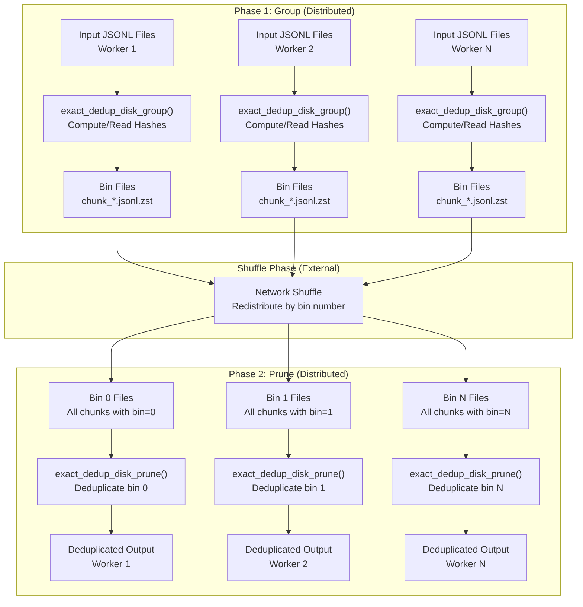
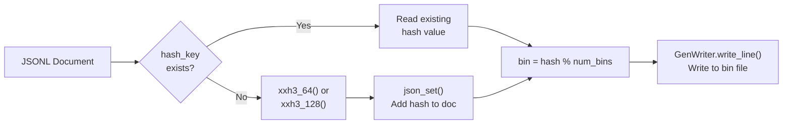
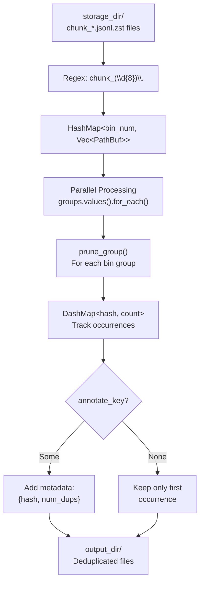
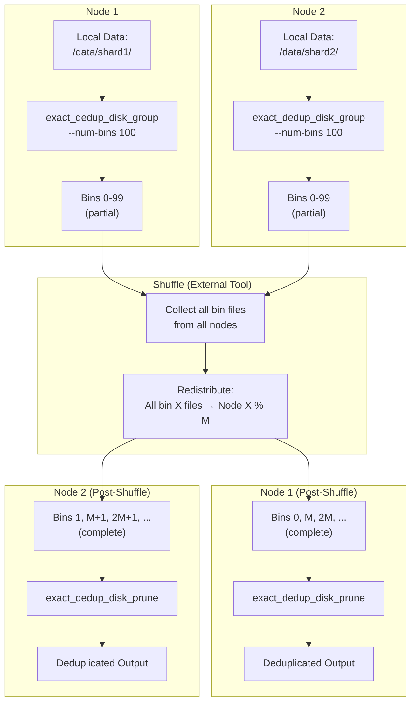
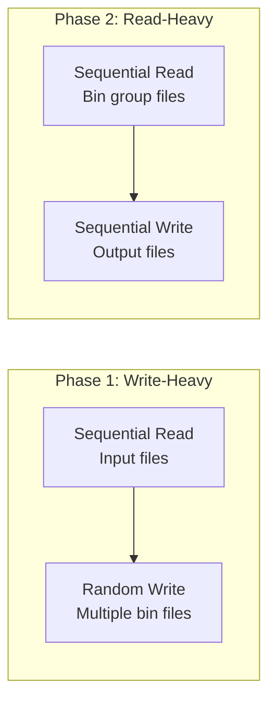

<!-- source: DeepWiki mcp.deepwiki.com · repo allenai/duplodocus · page 4.2 Exact Disk-Based Deduplication · fetched 2026-10-26 -->

# Exact Disk-Based Deduplication

<details>
<summary>Relevant source files</summary>

The following files were used as context for generating this wiki page:

- [src/exact_dedup_disk.rs](src/exact_dedup_disk.rs)
- [src/main.rs](src/main.rs)

</details>


## Purpose and Scope

This page describes the disk-based exact deduplication system for datasets that do not fit in memory. This implementation enables distributed processing across multiple machines through a two-phase MapReduce-style pipeline.

For small datasets that fit in memory (< 10GB), see [Exact Memory-Based Deduplication](#4.1). For near-duplicate detection, see [MinHash Fuzzy Deduplication](#3).

**Sources:** [src/exact_dedup_disk.rs:1-52]()

---

## Architecture Overview

The disk-based exact deduplication system implements a two-phase approach that partitions work across machines:



**Guarantee:** All documents with identical hash values are routed to the same bin number (`hash % num_bins`), ensuring complete deduplication when bins are processed independently.

**Sources:** [src/exact_dedup_disk.rs:1-52](), [src/main.rs:279-345]()

---

## Phase 1: Group (Partitioning)

### Function: `exact_dedup_disk_group`

The grouping phase reads documents from `input_dir`, computes or reads hash values, and partitions documents into bins based on their hash modulo the number of bins.

#### CLI Command

```bash
cargo run --release -- exact-dedup-disk-group \
  --input-dir /data/documents \
  --storage-dir /scratch/work \
  --text-key "text" \
  --hash-key "doc_hash" \
  --hash-bits 128 \
  --num-bins 100
```

**Sources:** [src/main.rs:279-316]()

#### Processing Pipeline



**Sources:** [src/exact_dedup_disk.rs:210-273]()

#### Hash Computation

| Hash Bits | Algorithm | JSON Format | Bin Calculation |
|-----------|-----------|-------------|-----------------|
| 64 | `xxh3_64()` | JSON number | `hash as usize % num_bins` |
| 128 | `xxh3_128()` | JSON string (decimal) | `(hash as u128 % num_bins) as usize` |

**Hash Key Behavior:**
- If document contains `hash_key`: Use existing value, no modification
- If `hash_key` missing: Compute from `text_key` content and add to document

**Sources:** [src/exact_dedup_disk.rs:224-264]()

#### Output File Structure

The `GenWriter` creates files in `storage_dir` with the naming pattern:

```
storage_dir/
├── chunk_00000000.{run_id}.jsonl.zst
├── chunk_00000001.{run_id}.jsonl.zst
├── chunk_00000002.{run_id}.jsonl.zst
└── ...
```

Where `run_id = "{hash_fingerprint:08x}_{salt}"` provides uniqueness based on input files.

**File Splitting:** Files exceeding `MAX_SIZE` (256MB) are automatically split into multiple parts by `GenWriter`.

**Sources:** [src/exact_dedup_disk.rs:74-182](), [src/exact_dedup_disk.rs:153-201]()

#### Parallelism

The function processes input files in parallel using Rayon:

```rust
input_paths.into_par_iter().for_each(|p| {
    docs_seen.fetch_add(
        group_docs(&p, text_key, hash_key, hash_bits, &gen_writer, num_bins).unwrap(),
        Ordering::Relaxed,
    );
    pbar.inc(1);
});
```

Multiple workers on different machines can run `exact_dedup_disk_group` concurrently, each processing their local data, as long as they use the same `num_bins` value.

**Sources:** [src/exact_dedup_disk.rs:185-191]()

---

## Phase 2: Prune (Deduplication)

### Function: `exact_dedup_disk_prune`

The pruning phase reads bin files from `storage_dir`, groups them by bin number, and deduplicates each group independently.

#### CLI Command

```bash
cargo run --release -- exact-dedup-disk-prune \
  --storage-dir /scratch/work \
  --output-dir /data/deduplicated \
  --hash-key "doc_hash" \
  --annotate-key "duplicate_info"  # Optional
```

**Sources:** [src/main.rs:318-345]()

#### Bin Grouping and Processing



**Sources:** [src/exact_dedup_disk.rs:347-395]()

#### Algorithm Details

The `prune_group` function handles each bin independently:

**Step 1: Optional Pre-counting (if annotating)**
```rust
if let Some(_anno) = annotate_key {
    vlist.par_iter().for_each(|p| {
        // Count occurrences of each hash
        counter.entry(hash_val.clone())
               .and_modify(|c| *c += 1)
               .or_insert(1);
    })
}
```

**Step 2: Process and write**
- If `annotate_key` is `None`: Write only first occurrence of each hash
- If `annotate_key` is `Some`: Write all documents with duplicate metadata

**Sources:** [src/exact_dedup_disk.rs:413-469]()

#### Annotation Format

When `annotate_key` is provided, each document receives metadata:

```json
{
  "your_annotation_key": {
    "hash": "12345678901234567890",
    "num_dups": 3
  }
}
```

This preserves all documents for analysis while marking duplicates.

**Sources:** [src/exact_dedup_disk.rs:444-450]()

---

## File Organization and Naming

### Phase 1 Output

Pattern: `chunk_{bin_number:08}.{run_id}.jsonl.zst`

Example:
```
chunk_00000000.a3f2bc01_4f.jsonl.zst
chunk_00000000.a3f2bc01_4f.jsonl.zst.1
chunk_00000001.a3f2bc01_4f.jsonl.zst
```

The `run_id` consists of:
- 8-character hash fingerprint of input file paths
- 2-character random salt

This ensures files from different grouping runs don't collide.

**Sources:** [src/exact_dedup_disk.rs:167-182]()

### Bin Number Extraction

Phase 2 uses regex to group files by bin number:

```rust
let re = Regex::new(r"chunk_(\d{8})\.").unwrap();
let bin_num = re.captures(base_name)
                .unwrap()
                .get(1)
                .unwrap()
                .as_str()
                .parse::<usize>()
                .unwrap();
```

**Sources:** [src/exact_dedup_disk.rs:359-370]()

---

## Distributed Processing Workflow

### Complete Multi-Node Example



### Shuffle Strategy

The shuffle phase is performed **outside the Rust code** using tools like:
- `rsync`
- `s5cmd` (for S3)
- Distributed filesystems (NFS, GlusterFS)

**Critical requirement:** After shuffling, each machine must have **all** files for its assigned bins.

**Sources:** [src/exact_dedup_disk.rs:40-46](), [src/main.rs:207-209]()

---

## Configuration Parameters

### Grouping Phase Parameters

| Parameter | Type | Description | Considerations |
|-----------|------|-------------|----------------|
| `input_dir` | PathBuf | Directory with input JSONL files | Can be local to each worker |
| `storage_dir` | PathBuf | Working directory for bins | Should be shared or collected later |
| `text_key` | String | JSON key for document text | Used if hash not present |
| `hash_key` | String | JSON key for hash value | Added to document if missing |
| `hash_bits` | usize | 64 or 128 | 128 recommended for > 10B docs |
| `num_bins` | usize | Number of partitions | Trade-off: parallelism vs. memory |

**Sources:** [src/main.rs:279-316](), [src/exact_dedup_disk.rs:153-160]()

### Pruning Phase Parameters

| Parameter | Type | Description | Default |
|-----------|------|-------------|---------|
| `storage_dir` | PathBuf | Directory with bin files | Must contain grouped files |
| `output_dir` | PathBuf | Deduplicated output location | - |
| `hash_key` | String | JSON key for hash (must match Phase 1) | - |
| `annotate_key` | Option\<String\> | Key for duplicate metadata | None (remove duplicates) |

**Sources:** [src/main.rs:318-345](), [src/exact_dedup_disk.rs:347-352]()

### Choosing `num_bins`

**Guidelines:**
- Each bin should fit in memory during Phase 2 pruning
- More bins = better load balancing but more files
- **Recommended:** 100-1000 bins for datasets > 100GB
- **Formula:** `num_bins ≥ dataset_size_GB / target_bin_size_GB`

**Example:** For a 1TB dataset with 2GB target bin size:
```
num_bins ≥ 1000 / 2 = 500 bins
```

**Sources:** [src/exact_dedup_disk.rs:47-51]()

---

## Implementation Details

### GenWriter Class

The `GenWriter` utility handles concurrent writing to multiple bin files:

```rust
let gen_writer = GenWriter::new(
    storage_dir,
    num_bins,
    &run_id,
    &Some(String::from("jsonl.zst")),
    true,              // use_zstd
    Some(MAX_SIZE),    // 256MB max file size
);
```

**Key features:**
- Thread-safe writing via internal locks
- Automatic file splitting at `MAX_SIZE`
- Compression with Zstandard

**Sources:** [src/exact_dedup_disk.rs:175-182](), [src/storage.rs]()

### DashMap for Concurrent Counting

Phase 2 uses `DashMap` for thread-safe hash counting:

```rust
let counter: DashMap<Value, usize> = DashMap::new();
counter.entry(hash_val.clone())
       .and_modify(|c| *c += 1)
       .or_insert(1);
```

This allows parallel processing of input files while safely tracking hash occurrences.

**Sources:** [src/exact_dedup_disk.rs:420-433]()

### Hash Functions

| Function | Size | Use Case |
|----------|------|----------|
| `xxh3_64()` | 64-bit | Datasets < 10B documents |
| `xxh3_128()` | 128-bit | Datasets ≥ 10B documents |

Both are provided by the `xxhash_rust` crate and offer excellent performance and collision resistance.

**Sources:** [src/exact_dedup_disk.rs:68](), [src/exact_dedup_disk.rs:247-254]()

---

## Performance Characteristics

### Memory Usage

| Phase | Per-Worker Memory | Scaling |
|-------|-------------------|---------|
| Group | O(num_bins × buffer_size) | Constant |
| Prune | O(bin_size) | Linear with largest bin |

**Critical:** Each bin must fit in memory during pruning. If pruning fails with OOM, increase `num_bins` and rerun Phase 1.

### Parallelism

**Phase 1 (Group):**
- File-level parallelism within each worker
- Worker-level parallelism across machines
- No synchronization required between workers

**Phase 2 (Prune):**
- Bin-level parallelism across workers
- File-level parallelism within each bin group
- Requires complete bin files on each machine

**Sources:** [src/exact_dedup_disk.rs:185-191](), [src/exact_dedup_disk.rs:374-380]()

### I/O Patterns



**Optimization:** Use fast local storage (NVMe, RAID0) for `storage_dir` to minimize I/O bottlenecks during bin writes.

**Sources:** Derived from [src/exact_dedup_disk.rs:210-273]() and [src/exact_dedup_disk.rs:435-464]()

---

## Error Handling

### Common Issues

| Issue | Cause | Solution |
|-------|-------|----------|
| OOM during pruning | Bin too large | Increase `num_bins`, rerun Phase 1 |
| Hash mismatch | `hash_bits` differs between phases | Use consistent parameters |
| Missing bin files | Incomplete shuffle | Verify all bins transferred |
| Bin number mismatch | Regex extraction failed | Check filename format |

### Validation

The system relies on correct bin assignment. To verify:

```bash
# Check bin distribution
ls -lh storage_dir/chunk_*.jsonl.zst | wc -l

# Verify bin numbers are consecutive
ls storage_dir/ | grep -oP 'chunk_\K\d{8}' | sort -u
```

**Sources:** [src/exact_dedup_disk.rs:359-372]()

---

