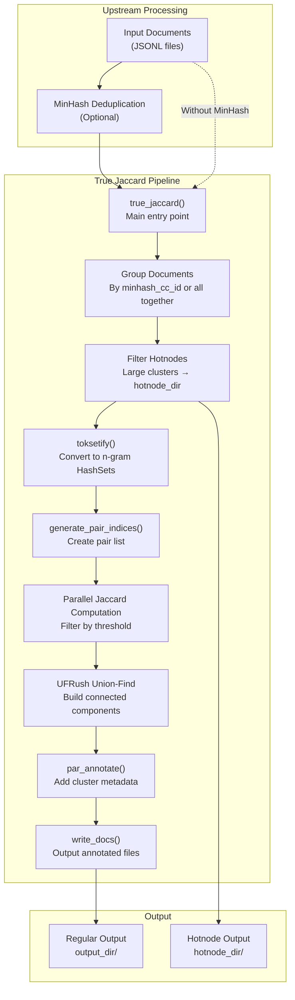
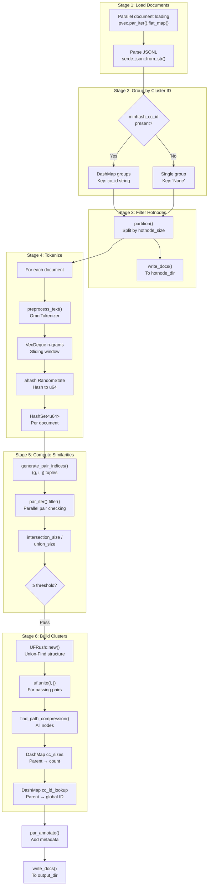
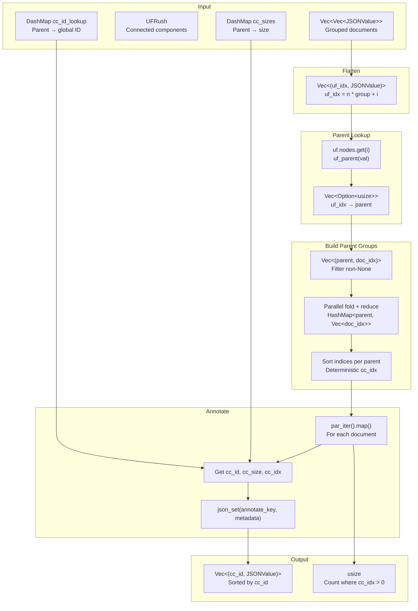
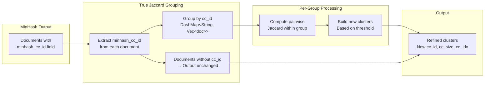
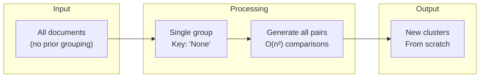
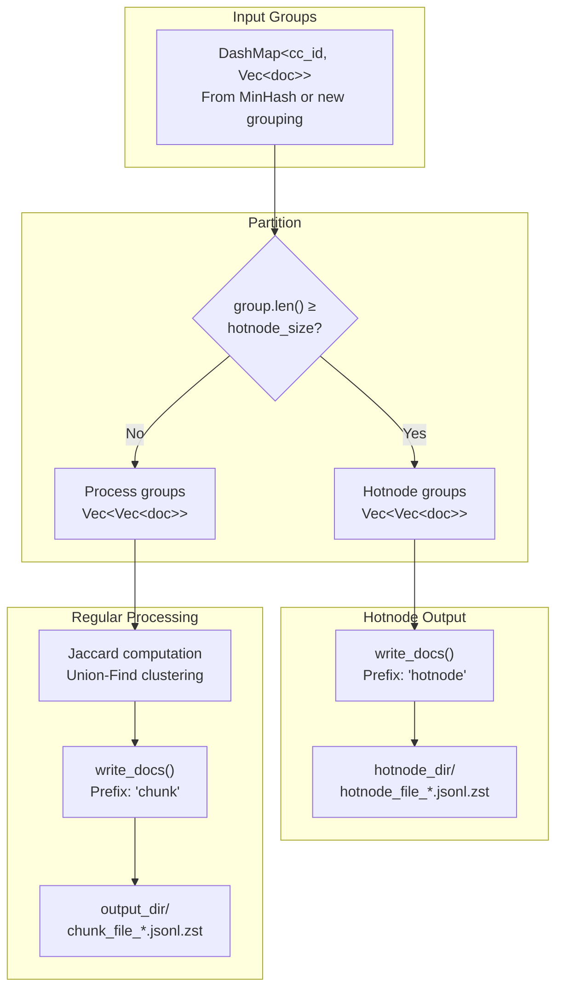
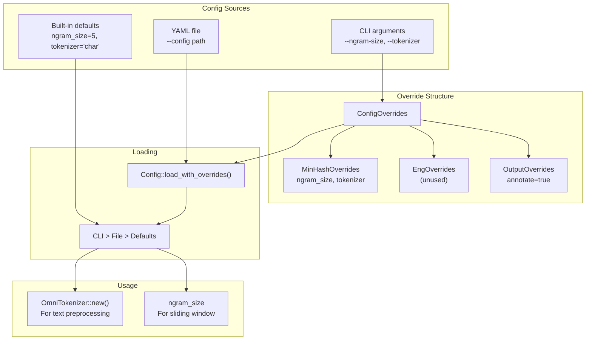
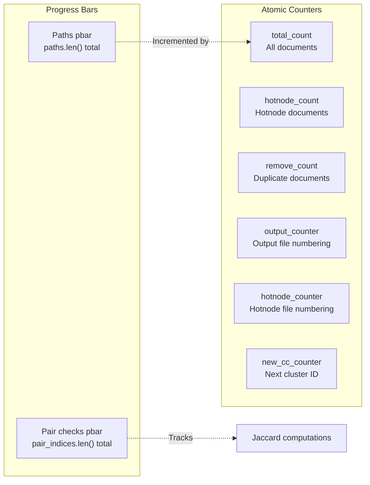
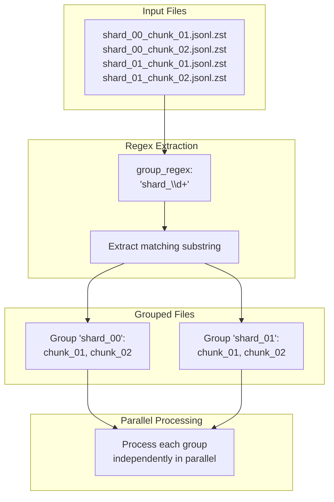

<!-- source: DeepWiki mcp.deepwiki.com · repo allenai/duplodocus · page 5 Advanced Analysis Tools · fetched 2026-10-26 -->

# Advanced Analysis Tools

<details>
<summary>Relevant source files</summary>

The following files were used as context for generating this wiki page:

- [src/main.rs](src/main.rs)
- [src/true_jaccard.rs](src/true_jaccard.rs)

</details>


## Purpose and Scope

Advanced Analysis Tools provide supplementary capabilities for analyzing and validating deduplication results. The primary tool in this category is the True Jaccard calculator, which computes exact pairwise Jaccard similarity between documents. This differs from the approximate MinHash-based fuzzy deduplication ([see page 3](#3)) by calculating precise similarity scores rather than probabilistic estimates.

True Jaccard is typically used for:
- **Validation**: Verifying the accuracy of MinHash deduplication results
- **Refinement**: Applying stricter similarity thresholds to existing clusters
- **Analysis**: Understanding the true similarity distribution within document groups

For the actual deduplication methods (exact, fuzzy, and suffix array), see pages [2](#2), [3](#3), and [4](#4).

**Sources:** [src/main.rs:646-703](), [src/true_jaccard.rs:1-50]()

---

## Overview and Architecture

### System Position

True Jaccard analysis sits downstream of other deduplication methods, particularly MinHash fuzzy deduplication. It operates on documents that may already have cluster annotations and produces refined similarity metrics.



**Sources:** [src/true_jaccard.rs:28-148](), [src/main.rs:959-989]()

---

## Command-Line Interface

### CLI Parameters

The `TrueJaccard` command provides extensive configurability:

| Parameter | Type | Required | Purpose |
|-----------|------|----------|---------|
| `--input-dir` | PathBuf | Yes | Directory containing input JSONL files |
| `--output-dir` | PathBuf | Yes | Directory for annotated output files |
| `--jaccard-threshold` | f64 | Yes | Minimum similarity to consider duplicates (0.0-1.0) |
| `--annotate-key` | String | Yes | JSON key for cluster metadata output |
| `--minhash-cc-id` | String | No | Key containing existing MinHash cluster IDs |
| `--group-regex` | String | No | Regex for grouping files for parallel processing |
| `--config` | PathBuf | No | YAML configuration file path |
| `--ngram-size` | usize | No | N-gram size for shingling (default from config) |
| `--tokenizer` | String | No | Tokenizer type: "cl100k", "p50k", "uniseg", or character |
| `--hotnode-size` | usize | No | Cluster size threshold for hotnode filtering (default: usize::MAX) |
| `--hotnode-dir` | PathBuf | No | Output directory for hotnode documents (default: output_dir) |
| `--parallel-nest` | usize | No | Parallelization factor (default: 4) |
| `--id-offset` | usize | No | Starting ID for cluster numbering (default: 0) |
| `--delete-while-cleaning` | bool | No | Delete input files after processing |

**Sources:** [src/main.rs:646-703]()

### Example Usage

```bash
# Validate MinHash results with 0.8 threshold
cargo run --release -- true-jaccard \
  --input-dir /data/minhash_output \
  --output-dir /data/validated \
  --minhash-cc-id "dedup_info.cc_id" \
  --jaccard-threshold 0.8 \
  --annotate-key "true_jacc_info" \
  --hotnode-size 100 \
  --hotnode-dir /data/hotnodes

# Standalone pairwise comparison (no MinHash grouping)
cargo run --release -- true-jaccard \
  --input-dir /data/docs \
  --output-dir /data/analyzed \
  --jaccard-threshold 0.9 \
  --annotate-key "similarity_info" \
  --ngram-size 5 \
  --tokenizer "cl100k"
```

**Sources:** [src/main.rs:959-989]()

---

## Core Algorithm

### Processing Pipeline

The true Jaccard computation follows a six-stage pipeline implemented in `true_jacc_group()`:



**Sources:** [src/true_jaccard.rs:150-307]()

---

## Key Data Structures and Functions

### Document Processing

#### text_2_tokset

Converts document text to a set of n-gram hashes:

| Component | Type | Purpose |
|-----------|------|---------|
| Input | `String`, `OmniTokenizer`, `ngram_size: usize` | Document text and tokenization params |
| Tokens | `Vec<usize>` | Token IDs from `preprocess_text()` |
| N-gram Buffer | `VecDeque<usize>` | Sliding window of size `ngram_size` |
| Hasher | `ahash::RandomState` | Deterministic hasher with seeds (1,2,3,4) |
| Output | `HashSet<u64>` | Set of unique n-gram hashes |

**Algorithm:**
1. Tokenize text using `preprocess_text()` ([src/minhash_base.rs]())
2. Build sliding window of `ngram_size` tokens
3. Hash each n-gram using `ahash` with fixed seeds
4. Insert hash into `HashSet<u64>`
5. Handle edge case: if no n-grams formed, hash entire token sequence

**Sources:** [src/true_jaccard.rs:309-340]()

#### toksetify

Parallelizes `text_2_tokset` across multiple document groups:

```mermaid
graph LR
    subgraph "Input Structure"
        Groups["Vec&lt;Vec&lt;JSONValue&gt;&gt;<br/>Grouped documents"]
    end
    
    subgraph "Parallel Processing"
        Flatten["flat_with_indices<br/>(group_idx, &JSONValue)"]
        MapPar["par_iter().map()<br/>text_2_tokset per doc"]
        Collect["Vec&lt;(group_idx, HashSet)&gt;"]
    end
    
    subgraph "Reconstruction"
        Init["vec![Vec::new(); n_groups]"]
        Push["result[group_idx].push()"]
    end
    
    subgraph "Output Structure"
        Output["Vec&lt;Vec&lt;HashSet&lt;u64&gt;&gt;&gt;<br/>Same structure as input"]
    end
    
    Groups --> Flatten
    Flatten --> MapPar
    MapPar --> Collect
    Collect --> Init
    Init --> Push
    Push --> Output
```



**Sources:** [src/true_jaccard.rs:342-373]()

---

### Jaccard Similarity Computation

#### Optimized Intersection Calculation

The Jaccard similarity computation uses an optimized algorithm that minimizes comparisons:

```
intersection_size = count { x ∈ smaller_set : x ∈ larger_set }
union_size = |smaller_set| - intersection_size + |larger_set|
jaccard = intersection_size / union_size
```

**Key optimization:** Always iterate over the smaller set for intersection testing, reducing average-case complexity.

**Sources:** [src/true_jaccard.rs:240-264]()

#### generate_pair_indices

Creates all pairs within each group for comparison:

| Input | Output | Example |
|-------|--------|---------|
| `Vec<Vec<T>>` | `Vec<(group_idx, i, j)>` | `[[A,B,C], [D,E]]` → `[(0,0,1), (0,0,2), (0,1,2), (1,0,1)]` |

**Algorithm:**
- For each group `g` with `n` elements
- Generate all pairs `(g, i, j)` where `0 ≤ i < j < n`
- Produces `∑(n_g * (n_g - 1) / 2)` pairs across all groups

**Sources:** [src/true_jaccard.rs:538-549]()

---

### Cluster Construction

#### Union-Find with UFRush

True Jaccard uses the `UFRush` data structure for efficient connected component discovery:

| Component | Type | Purpose |
|-----------|------|---------|
| `UFRush::new()` | `UFRush` | Thread-safe Union-Find with DashMap backend |
| `uf.unite(i, j)` | Unit | Connect two documents |
| `find_path_compression(k)` | Unit | Compress paths for faster queries |
| `uf.nodes` | `DashMap<usize, AtomicUsize>` | Node ID → encoded parent/rank |

**Two-pass algorithm:**
1. **Union phase:** Parallel insertion of edges from passing pairs
2. **Compression phase:** Parallel path compression for all nodes

**Sources:** [src/true_jaccard.rs:269-280](), [src/uf_rush2.rs]()

#### par_annotate

Converts Union-Find structure to annotated JSON documents:



**Annotation format:**
```json
{
  "text": "...",
  "annotate_key": {
    "cc_id": 12345,
    "cc_size": 8,
    "cc_idx": 0
  }
}
```

Where:
- `cc_id`: Global cluster identifier
- `cc_size`: Number of documents in cluster
- `cc_idx`: Position within cluster (0 = cluster representative, >0 = duplicate)

**Sources:** [src/true_jaccard.rs:375-475]()

---

### Output Management

#### write_docs

Handles parallel serialization and writing of documents with cluster-aware chunking:

| Stage | Details |
|-------|---------|
| **Serialization** | Parallel: `into_par_iter().map()` converts each `JSONValue` to bytes with newline |
| **Chunking** | Sequential: Groups documents into ~256MB chunks, respecting `cc_id` boundaries |
| **Writing** | Parallel: Each chunk written to separate `.jsonl.zst` file via `write_mem_to_pathbuf()` |

**Key constraint:** Documents with the same `cc_id` must appear in the same output file to maintain cluster integrity.

**File naming:**
```
{prefix}_file_{counter:08}.jsonl.zst
```
Where `prefix` is either "chunk" (regular) or "hotnode" (large clusters).

**Sources:** [src/true_jaccard.rs:477-536](), [src/true_jaccard.rs:26]()

---

## Integration with MinHash

### Two Operating Modes

#### Mode 1: Post-MinHash Validation

When `--minhash-cc-id` is provided, True Jaccard refines existing MinHash clusters:



**Use case:** Verify that documents grouped by MinHash LSH truly exceed a specific Jaccard threshold.

**Sources:** [src/true_jaccard.rs:195-212]()

#### Mode 2: Standalone Analysis

When `--minhash-cc-id` is omitted, all documents are compared pairwise:



**Warning:** This mode has O(n²) complexity and is only practical for small document sets or when using aggressive `--hotnode-size` filtering.

**Sources:** [src/true_jaccard.rs:208-212]()

---

## Hotnode Management

### Purpose

Large clusters (e.g., boilerplate text appearing in thousands of documents) can dominate processing time due to O(n²) pairwise comparisons within each cluster. The hotnode system separates these for special handling.

### Filtering Strategy



**Default behavior:** `hotnode_size = usize::MAX` (no filtering), all groups processed normally.

**Typical value:** `--hotnode-size 100` separates clusters with 100+ documents.

**Sources:** [src/true_jaccard.rs:71-72](), [src/true_jaccard.rs:227-233]()

---

## Parallelization Strategy

### Multi-Level Parallelism

True Jaccard employs parallel processing at multiple levels:

| Level | Component | Parallelism Type |
|-------|-----------|------------------|
| **File groups** | `input_groups.par_chunks()` | Split by `parallel_nest` parameter |
| **Document loading** | `pvec.par_iter().flat_map()` | Rayon parallel iterator |
| **Tokenization** | `flat_with_indices.par_iter().map()` | Parallel `text_2_tokset()` calls |
| **Pair checking** | `pair_indices.par_iter().filter()` | Parallel Jaccard computation |
| **Union-Find** | `passing_pairs.into_par_iter()` | Parallel `uf.unite()` calls |
| **Path compression** | `keys.into_par_iter()` | Parallel compression |
| **Annotation** | `flat_with_indices.into_par_iter()` | Parallel `json_set()` calls |
| **Serialization** | `docs.into_par_iter().map()` | Parallel JSON serialization |
| **File writing** | `idx_groups.into_par_iter()` | Parallel file I/O |

**Key insight:** The `parallel_nest` parameter controls the outermost level, allowing users to balance parallelism with memory pressure. Higher values increase throughput but require more RAM for concurrent group processing.

**Sources:** [src/true_jaccard.rs:105-130]()

---

## Configuration

### Config Integration

True Jaccard reuses the `Config` system from MinHash for tokenization parameters:



**Sources:** [src/true_jaccard.rs:48-77](), [src/minhash_config.rs]()

---

## Performance Characteristics

### Computational Complexity

| Operation | Complexity | Notes |
|-----------|-----------|-------|
| **Document loading** | O(n × m) | n = docs, m = avg doc size |
| **Tokenization** | O(n × m) | Linear in total text size |
| **Pair generation** | O(∑ c_i²) | c_i = size of cluster i |
| **Jaccard per pair** | O(min(\|A\|, \|B\|)) | Optimized intersection |
| **Union-Find** | O(α(n) × edges) | Nearly constant with path compression |
| **Annotation** | O(n) | Linear in document count |

**Critical factor:** The number of pairs grows quadratically within each cluster. For a cluster of size c, there are c(c-1)/2 pairs to check.

**Example:**
- 1,000 documents in 10 clusters of 100 each: 10 × 100×99/2 = 49,500 pairs
- 1,000 documents in 1 cluster of 1,000: 1,000×999/2 = 499,500 pairs (10× more)

**Mitigation:** Use `--hotnode-size` to cap cluster sizes, or provide `--minhash-cc-id` to pre-group documents.

**Sources:** [src/true_jaccard.rs:240-264](), [src/true_jaccard.rs:538-549]()

### Memory Requirements

| Component | Memory Usage | Details |
|-----------|--------------|---------|
| **Document cache** | O(n × m) | All documents loaded into `Vec<JSONValue>` |
| **Token sets** | O(n × s) | s = avg unique n-grams per doc (~1-10K per doc) |
| **Pair indices** | O(∑ c_i²) | 3 × usize per pair (~24 bytes) |
| **Union-Find** | O(n) | DashMap with AtomicUsize values |
| **CC metadata** | O(k) | k = number of clusters |

**Peak memory occurs during pair checking:** All token sets and pair indices held simultaneously.

**Example estimate for 100K documents:**
- Documents: 100K × 5KB = 500MB
- Token sets: 100K × 5K × 8 bytes = 4GB
- Pair indices (1% similar): 100K × 0.01 × 24 bytes = 24MB
- Union-Find: 100K × 16 bytes = 1.6MB
- **Total: ~5GB**

**Sources:** [src/true_jaccard.rs:170-213](), [src/true_jaccard.rs:342-373]()

---

## Metrics and Diagnostics

### Output Statistics

True Jaccard reports comprehensive statistics at completion:

```
Finished true jaccard checks in 1234 secs
Saw 50000 docs | Removed 2000 hotnode docs | Removed 15000 docs | Removal rate would 31.25%
```

| Metric | Calculation | Interpretation |
|--------|-------------|----------------|
| **Total docs** | `total_count` | All documents processed |
| **Hotnode docs** | `hotnode_count` | Documents in clusters ≥ `hotnode_size` |
| **Removed docs** | `remove_count` | Documents with `cc_idx > 0` (duplicates) |
| **Removal rate** | `remove_count / (total_count - hotnode_count)` | Percentage of non-hotnode duplicates |

**Sources:** [src/true_jaccard.rs:136-146]()

### Progress Tracking



All counters use `AtomicUsize` with `Ordering::SeqCst` for thread-safe updates across parallel workers.

**Sources:** [src/true_jaccard.rs:96-134](), [src/true_jaccard.rs:239]()

---

## Advanced Features

### Group-Based Parallelism

The `--group-regex` parameter enables intelligent file grouping for better parallelization:



**Use case:** When documents are already partitioned (e.g., by data source or time period), process each partition separately to maximize parallelism and cache locality.

**Sources:** [src/true_jaccard.rs:80-94]()

### ID Offset for Multi-Node Execution

The `--id-offset` parameter enables coordination across multiple machines:

```
Machine 1: --id-offset 0        → cc_id range: [0, 10000)
Machine 2: --id-offset 10000    → cc_id range: [10000, 20000)
Machine 3: --id-offset 20000    → cc_id range: [20000, 30000)
```

Each machine processes a different subset of input files and assigns globally unique cluster IDs.

**Requirements:**
1. Each machine processes disjoint file sets
2. Offset values must not overlap (allocate sufficient range per machine)
3. No coordination required during execution (embarrassingly parallel)

**Sources:** [src/true_jaccard.rs:73](), [src/true_jaccard.rs:296]()

---

## Comparison with MinHash

### True Jaccard vs. MinHash Similarity

| Aspect | MinHash | True Jaccard |
|--------|---------|--------------|
| **Accuracy** | Probabilistic estimate | Exact calculation |
| **Speed** | O(k) per pair (k = signature size) | O(min(\|A\|, \|B\|)) per pair |
| **Memory** | O(n × k) signatures | O(n × s) token sets |
| **Scalability** | Excellent (LSH avoids most comparisons) | Limited (must check all pairs) |
| **Use case** | Large-scale deduplication | Validation and analysis |

**Typical workflow:**
1. Run MinHash with threshold 0.7 to find candidate clusters
2. Run True Jaccard with threshold 0.8 on MinHash output to refine
3. Analyze distribution of true similarities within clusters

**Sources:** [src/minhash_base.rs](), [src/true_jaccard.rs:240-264]()

---

## File Format Specifications

### Input Format

True Jaccard accepts standard JSONL files:

```json
{"text": "document content here", "other_field": "value"}
{"text": "another document", "minhash_cc_id": 42}
```

Optional field when using `--minhash-cc-id`:
- The specified key (e.g., `minhash_cc_id`) should contain an integer or string cluster identifier
- Documents without this field are written to output unchanged

### Output Format

Annotated documents include cluster metadata:

```json
{
  "text": "document content",
  "true_jacc_info": {
    "cc_id": 1001,
    "cc_size": 5,
    "cc_idx": 0
  }
}
```

Where the key name is specified by `--annotate-key`.

**Field semantics:**
- `cc_id`: Globally unique cluster identifier
- `cc_size`: Total documents in cluster
- `cc_idx`: 0-indexed position (0 = representative, 1+ = duplicates)

**Sources:** [src/true_jaccard.rs:458-463]()

---

## Error Handling and Edge Cases

### Empty Document Handling

Documents with no tokens (after preprocessing) receive a hash of their empty n-gram buffer:

```rust
if ngram_count == 0 {
    let builder = RandomState::with_seeds(1, 2, 3, 4);
    let mut hasher = builder.build_hasher();
    ngram.hash(&mut hasher);
    let hash_val = hasher.finish();
    tokset.insert(hash_val);
}
```

This ensures every document has at least one hash value, avoiding division by zero in Jaccard calculations.

**Sources:** [src/true_jaccard.rs:331-337]()

### Missing MinHash CC ID

When `--minhash-cc-id` is specified but a document lacks this field:

```rust
if let Some(cc_id) = cc_id_response {
    groups.entry(cc_id.to_string()).or_default().push(v);
} else {
    // Write unchanged
    let mut output_guard = output_docs.lock().unwrap();
    output_guard.push((None, v));
}
```

These documents bypass Jaccard checking and appear in output without new annotations.

**Sources:** [src/true_jaccard.rs:199-206]()

---

## Limitations and Considerations

### Scalability Constraints

| Constraint | Impact | Mitigation |
|------------|--------|------------|
| **O(n²) pairs within cluster** | Becomes intractable for clusters > 1000 | Use `--hotnode-size` |
| **All documents in memory** | RAM limit on dataset size | Split into smaller groups with `--group-regex` |
| **Serial chunking during write** | Slight bottleneck at end | Minimal impact in practice |

### When NOT to Use True Jaccard

- **Large-scale deduplication:** Use MinHash disk pipeline ([see page 3.3](#3.3)) instead
- **Approximate similarity acceptable:** MinHash is much faster with similar results
- **Memory-constrained environments:** Token sets require substantial RAM

### When TO Use True Jaccard

- **Validating MinHash parameters:** Measure precision/recall of MinHash thresholds
- **High-precision requirements:** Need exact similarity scores for analysis
- **Small document sets:** < 100K documents with reasonable cluster sizes
- **Research and auditing:** Understanding true similarity distributions

**Sources:** [src/true_jaccard.rs:240-264](), [src/minhash_base.rs]()

---

