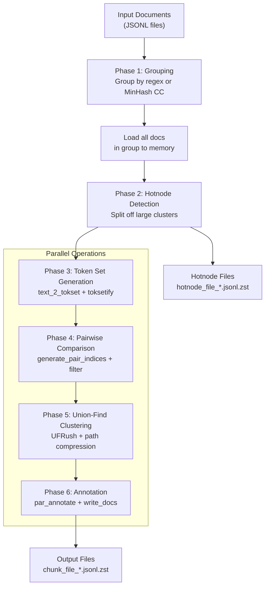
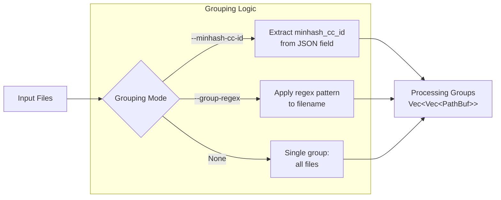
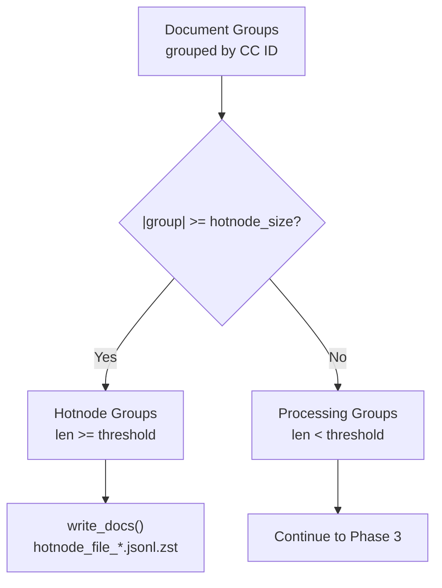
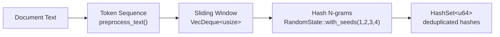
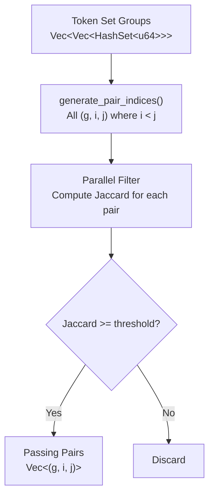
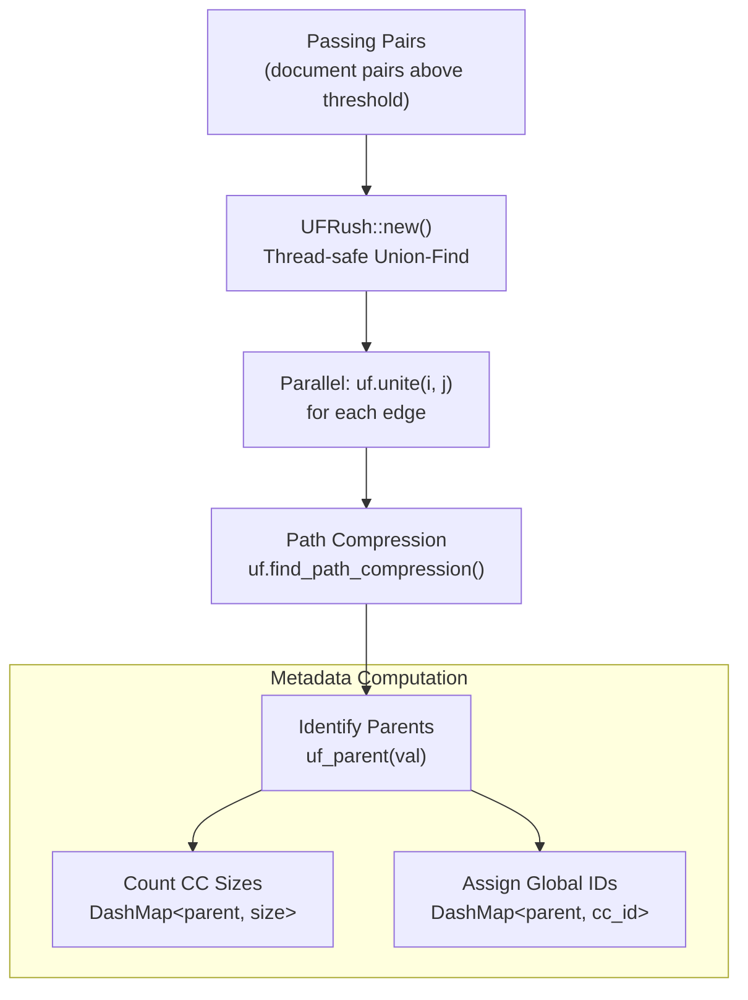
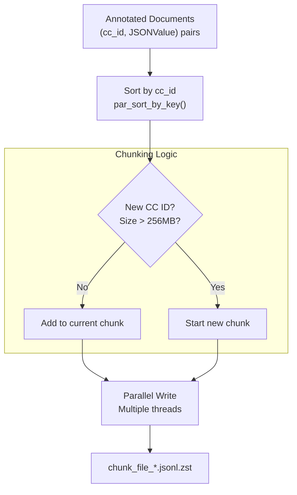
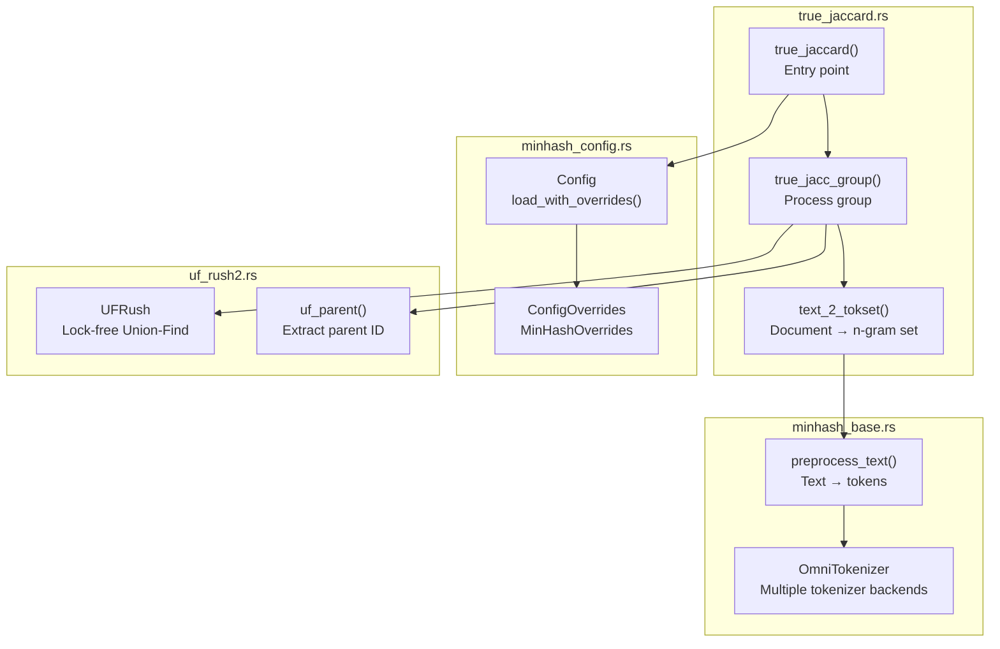
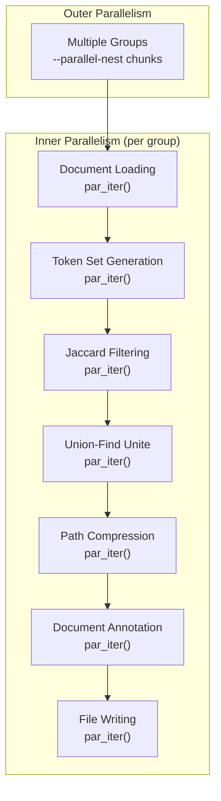

<!-- source: DeepWiki mcp.deepwiki.com · repo allenai/duplodocus · page 5.1 True Jaccard Calculation · fetched 2026-10-26 -->

# True Jaccard Calculation

<details>
<summary>Relevant source files</summary>

The following files were used as context for generating this wiki page:

- [src/true_jaccard.rs](src/true_jaccard.rs)

</details>


## Purpose and Scope

The True Jaccard Calculation system computes exact pairwise Jaccard similarity between documents to identify near-duplicates with high precision. Unlike the approximate MinHash algorithm (see [MinHash Fuzzy Deduplication](#3)), this system performs exhaustive pairwise comparisons within document groups to calculate true Jaccard coefficients based on n-gram overlap.

This tool is primarily used for:
- **Validation**: Verifying the accuracy of MinHash clustering results
- **Refinement**: Computing exact similarities within approximate MinHash clusters
- **Analysis**: Understanding the true similarity distribution in a dataset

The system operates on pre-clustered or pre-grouped documents, making it computationally feasible for large datasets by limiting the comparison space.

**Sources:** [src/true_jaccard.rs:1-50]()

---

## System Overview

The True Jaccard system implements a six-phase pipeline that processes documents in parallel, computing exact Jaccard similarities and clustering documents that exceed a configurable threshold. The system integrates with the MinHash configuration and Union-Find clustering infrastructure to maintain compatibility with other deduplication workflows.



**Sources:** [src/true_jaccard.rs:28-148](), [src/true_jaccard.rs:150-307]()

---

## Core Processing Pipeline

### Phase 1: Document Loading and Grouping

Documents are loaded from the input directory and organized into processing groups. The grouping strategy determines which documents are compared against each other.

#### Grouping Strategies

| Strategy | Parameter | Behavior |
|----------|-----------|----------|
| **MinHash CC Grouping** | `--minhash-cc-id` | Groups documents by existing MinHash cluster ID field in JSON |
| **Regex Grouping** | `--group-regex` | Groups files by matching regex pattern against filename |
| **No Grouping** | Neither parameter | All documents form a single group |

The `true_jaccard` function processes groups in parallel chunks based on the `--parallel-nest` parameter.



**Sources:** [src/true_jaccard.rs:78-94](), [src/true_jaccard.rs:170-212]()

---

### Phase 2: Hotnode Detection

"Hotnodes" are clusters that exceed the `--hotnode-size` threshold (default: unlimited). These are separated early to avoid the quadratic explosion of pairwise comparisons in very large clusters.



Hotnode documents are written immediately without further processing. This is critical for scalability, as a cluster of 10,000 documents would require ~50 million pairwise comparisons.

**Sources:** [src/true_jaccard.rs:227-233]()

---

### Phase 3: Token Set Generation

Each document is converted into a set of n-gram hashes for efficient Jaccard computation. This transformation is performed in parallel across all documents.

#### `text_2_tokset` Function

The core transformation logic:

1. **Tokenization**: Uses `OmniTokenizer` (from MinHash system) to split text
2. **N-gram Creation**: Generates overlapping n-grams via sliding window
3. **Hashing**: Hashes each n-gram to a 64-bit integer using `ahash::RandomState`
4. **Deduplication**: Stores hashes in `HashSet<u64>` for efficient lookup



Special case: Documents with fewer than `ngram_size` tokens still produce one hash (the hash of all available tokens) to avoid empty sets.

**Sources:** [src/true_jaccard.rs:309-340]()

#### `toksetify` Function

Converts entire groups of documents to token sets in parallel using Rayon's parallel iterators. The function maintains group structure while leveraging full CPU parallelism.

**Sources:** [src/true_jaccard.rs:342-373]()

---

### Phase 4: Pairwise Similarity Computation

The system generates all pairwise indices within each group and filters them based on true Jaccard similarity.

#### Pair Generation

The `generate_pair_indices` function creates tuples `(group_id, i, j)` for all pairs where `i < j` within each group.



**Sources:** [src/true_jaccard.rs:538-549](), [src/true_jaccard.rs:238-265]()

#### Jaccard Computation

For each pair of token sets, the exact Jaccard coefficient is computed:

```
intersection_size = count(elements in both sets)
union_size = |set_i| + |set_j| - intersection_size
jaccard = intersection_size / union_size
```

**Optimization**: The smaller set is always iterated to minimize comparisons. For sets of sizes m and n where m ≤ n, this requires m lookups instead of n.

**Sources:** [src/true_jaccard.rs:240-265]()

---

### Phase 5: Clustering via Union-Find

Passing pairs (edges where Jaccard ≥ threshold) are fed into a `UFRush` Union-Find data structure to compute connected components.



#### Key Data Structures

| Structure | Type | Purpose |
|-----------|------|---------|
| `uf` | `UFRush` | Lock-free Union-Find from `uf_rush2` module |
| `cc_sizes` | `DashMap<usize, usize>` | Maps parent ID → cluster size |
| `cc_id_lookup` | `DashMap<usize, usize>` | Maps parent ID → global cluster ID |

The global cluster IDs are assigned atomically using `new_cc_counter.fetch_add()`, ensuring unique IDs across all processing groups when using `--id-offset`.

**Sources:** [src/true_jaccard.rs:269-298]()

---

### Phase 6: Annotation and Output

The `par_annotate` function adds cluster metadata to documents and writes them to output files.

#### Annotation Format

Each document in a cluster receives the following JSON field (key specified by `--annotate-key`):

```json
{
  "cc_id": 12345,      // Global cluster identifier
  "cc_size": 8,        // Total documents in cluster
  "cc_idx": 0          // Position in cluster (0 = kept, >0 = duplicate)
}
```

Documents with `cc_idx > 0` are marked for removal in typical deduplication workflows.

#### Output File Organization



**Critical Feature**: Output files never split a cluster across file boundaries. This ensures that all documents in a connected component appear in the same output file, simplifying downstream processing.

**Sources:** [src/true_jaccard.rs:375-475](), [src/true_jaccard.rs:477-536]()

---

## Configuration and Parameters

The True Jaccard system uses the MinHash configuration system for consistency with other deduplication methods.

### CLI Parameters

| Parameter | Type | Default | Description |
|-----------|------|---------|-------------|
| `--input-dir` | PathBuf | Required | Directory containing input JSONL files |
| `--output-dir` | PathBuf | Required | Directory for output files |
| `--minhash-cc-id` | String | None | JSON field containing MinHash cluster ID |
| `--group-regex` | String | None | Regex to group files for processing |
| `--config` | PathBuf | None | Config file for tokenizer/n-gram settings |
| `--jaccard-threshold` | f64 | Required | Minimum Jaccard for clustering (0.0-1.0) |
| `--ngram-size` | usize | Config default | Size of n-grams for comparison |
| `--tokenizer` | String | Config default | Tokenizer name (e.g., "character", "gpt2") |
| `--annotate-key` | String | "true_jaccard" | JSON field for cluster metadata |
| `--hotnode-size` | usize | usize::MAX | Max cluster size before hotnode separation |
| `--hotnode-dir` | PathBuf | output_dir | Directory for hotnode output |
| `--parallel-nest` | usize | 1 | Number of group chunks processed in parallel |
| `--id-offset` | usize | 0 | Starting value for global cluster IDs |
| `--delete-while-cleaning` | bool | false | Delete input files after processing |

**Sources:** [src/true_jaccard.rs:28-74]()

---

## Integration with MinHash System

True Jaccard leverages several components from the MinHash fuzzy deduplication system:



### Shared Components

- **`OmniTokenizer`**: Provides consistent tokenization across MinHash and True Jaccard
- **`preprocess_text()`**: Standardized text preprocessing (lowercasing, etc.)
- **`UFRush`**: Thread-safe Union-Find for clustering
- **`Config`**: Unified configuration system with override support
- **`mj_io`**: File I/O utilities (`read_pathbuf_to_mem`, `write_mem_to_pathbuf`)

**Sources:** [src/true_jaccard.rs:19-24]()

---

## Performance Characteristics

### Computational Complexity

For a group with N documents:
- **Token set generation**: O(N × D) where D is average document length
- **Pair generation**: O(N²) pairs
- **Jaccard computation**: O(N² × M) where M is average set size
- **Union-Find**: O(N × α(N)) ≈ O(N) where α is inverse Ackermann

The quadratic pairwise comparison makes this unsuitable for very large clusters, hence the hotnode mechanism.

### Memory Requirements

| Component | Memory Usage |
|-----------|--------------|
| Document loading | All documents in group loaded into RAM |
| Token sets | ~8 bytes per unique n-gram × N documents |
| Pair indices | ~24 bytes per pair (before filtering) |
| Union-Find | ~16 bytes per document |
| Output buffer | Up to 256 MB per output chunk |

### Parallelization Strategy



Nearly all operations are parallelized using Rayon, except for the sequential chunking logic in `write_docs` that respects cluster boundaries.

**Sources:** [src/true_jaccard.rs:107-130](), [src/true_jaccard.rs:170-183](), [src/true_jaccard.rs:240-265](), [src/true_jaccard.rs:271-280](), [src/true_jaccard.rs:447-470]()

---

## Usage Examples

### Example 1: Validating MinHash Clusters

Compute true Jaccard within MinHash-generated clusters:

```bash
duplodocus true-jaccard \
  --input-dir ./minhash_output \
  --output-dir ./validated_output \
  --minhash-cc-id "minhash_dedup" \
  --jaccard-threshold 0.8 \
  --ngram-size 5 \
  --tokenizer "gpt2"
```

This processes each MinHash cluster independently, computing exact similarities only within clusters.

### Example 2: Analyzing File Groups

Group files by prefix and analyze within groups:

```bash
duplodocus true-jaccard \
  --input-dir ./corpus \
  --output-dir ./analysis \
  --group-regex "^(.{10})" \
  --jaccard-threshold 0.9 \
  --hotnode-size 1000 \
  --hotnode-dir ./large_clusters
```

Files matching the same 10-character prefix are compared against each other. Clusters exceeding 1000 documents are written to a separate directory.

### Example 3: Full Corpus Analysis

Compare all documents without grouping (use with caution on large datasets):

```bash
duplodocus true-jaccard \
  --input-dir ./small_corpus \
  --output-dir ./deduped \
  --jaccard-threshold 0.95 \
  --parallel-nest 8
```

Processes documents in 8 parallel chunks for better CPU utilization.

**Sources:** [src/true_jaccard.rs:28-148]()

---

