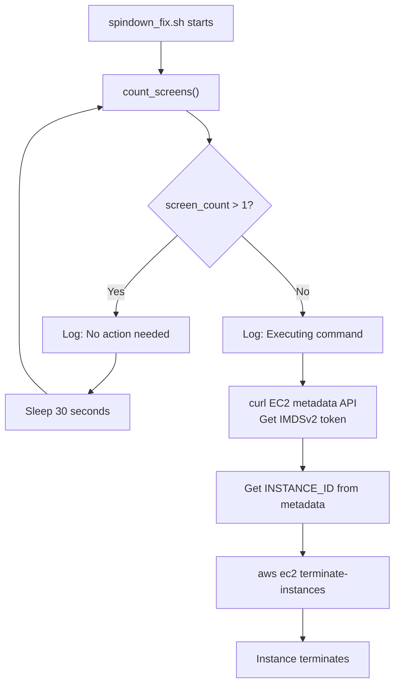
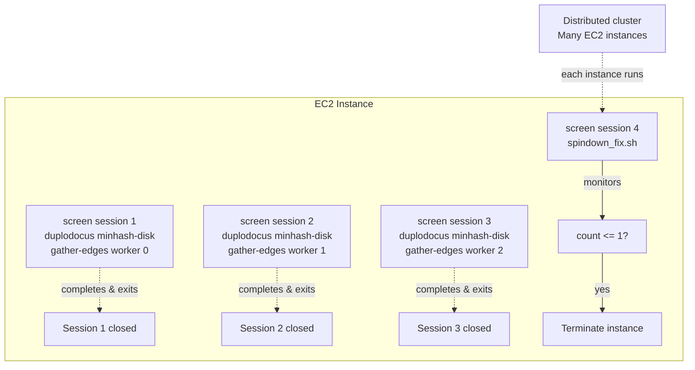
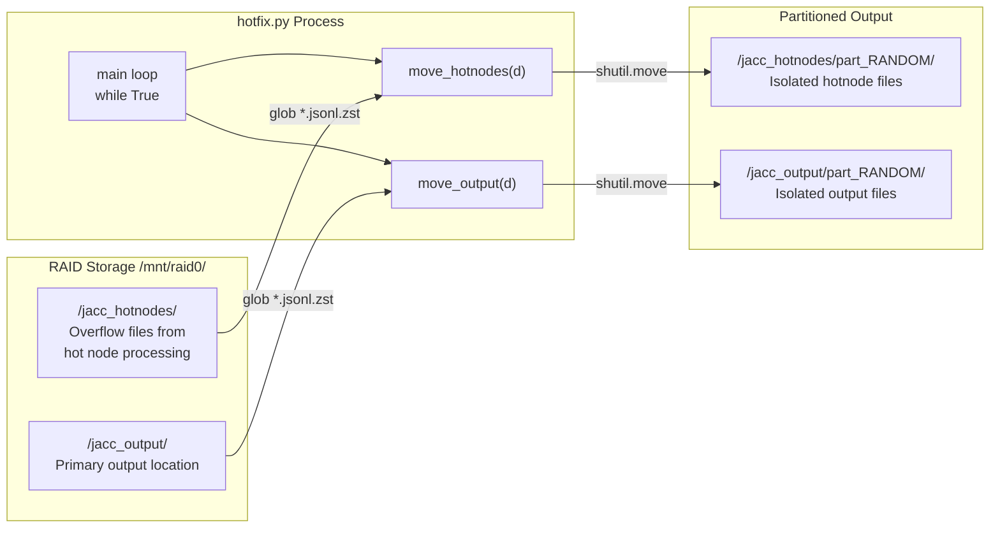
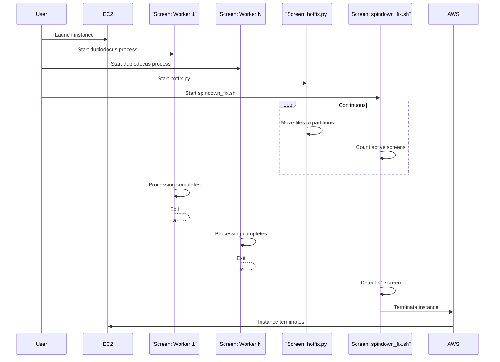

<!-- source: DeepWiki mcp.deepwiki.com · repo allenai/duplodocus · page 6 Operational Tools · fetched 2026-10-26 -->

# Operational Tools

<details>
<summary>Relevant source files</summary>

The following files were used as context for generating this wiki page:

- [src/hotfix.py](src/hotfix.py)
- [src/spindown_fix.sh](src/spindown_fix.sh)

</details>


## Purpose and Scope

This page documents supporting scripts and utilities for managing Duplodocus in production environments. These tools address operational concerns such as resource management on cloud infrastructure and handling distributed processing edge cases.

For information about the core deduplication algorithms and pipelines, see [Suffix Array System](#2), [MinHash Fuzzy Deduplication](#3), and [Exact Deduplication](#4). For analysis and validation tools, see [Advanced Analysis Tools](#5).

---

## Overview

Duplodocus includes two operational utilities that complement the core deduplication functionality:

| Tool | Purpose | Environment |
|------|---------|-------------|
| `spindown_fix.sh` | Automatic EC2 instance termination based on active work detection | AWS EC2 with screen sessions |
| `hotfix.py` | Relocates intermediate files during distributed processing to prevent hotspot issues | Distributed compute nodes with local RAID storage |

These tools are designed for specific operational scenarios that arise when running large-scale deduplication jobs across cloud infrastructure.

**Sources:** [src/spindown_fix.sh:1-28](), [src/hotfix.py:1-30]()

---

## EC2 Auto-Termination Tool

### Purpose

The `spindown_fix.sh` script provides automatic cost control for EC2 instances running Duplodocus jobs. It monitors active `screen` sessions and terminates the instance when work completes, preventing unnecessary compute charges.

### Architecture



**Diagram: Auto-termination workflow using screen session monitoring**

**Sources:** [src/spindown_fix.sh:6-28]()

### Implementation Details

The script operates in a continuous monitoring loop with the following logic:

1. **Screen Session Counting**: The `count_screens()` function uses `screen -ls` to count active sessions, filtering for lines matching the pattern `^\s*[0-9]+\.` to identify actual session entries [src/spindown_fix.sh:6-9]().

2. **Threshold Logic**: The script checks if more than 1 screen session exists. The threshold of `> 1` (rather than `> 0`) accounts for the monitoring script itself potentially running in a screen session [src/spindown_fix.sh:20-25]().

3. **Termination Process**: When the threshold is not met, the script:
   - Retrieves an IMDSv2 token from the EC2 metadata service with 6-hour TTL
   - Queries the instance ID from metadata
   - Executes `aws ec2 terminate-instances` to shut down the instance
   
   All in a single command chain [src/spindown_fix.sh:24]().

4. **Polling Interval**: The script checks every 30 seconds, providing a balance between responsiveness and system overhead [src/spindown_fix.sh:27]().

### Usage Pattern

This script is typically deployed in scenarios where:

- Multiple Duplodocus processes run in separate `screen` sessions
- Each process handles a portion of a distributed workload
- Cost optimization requires immediate termination when all work completes
- Manual intervention to shut down instances is impractical

**Operational Context:**



**Diagram: Typical deployment pattern for auto-termination across distributed workers**

**Sources:** [src/spindown_fix.sh:1-28]()

---

## Hotnode File Management

### Purpose

The `hotfix.py` script addresses a specific operational issue that can occur during distributed MinHash or Exact deduplication: certain output bins or intermediate files may accumulate disproportionately on specific nodes, creating I/O bottlenecks and uneven disk usage.

### Problem Context

During the shuffle phase of disk-based deduplication (see [MinHash Disk Pipeline](#3.3) and [Exact Disk-Based Deduplication](#4.2)), files are redistributed across nodes based on hash partitioning. When data distribution is skewed:

- Some nodes receive many more files than others ("hot nodes")
- Local storage fills up on hot nodes while other nodes are underutilized
- Processing stalls or fails due to disk space exhaustion

### Architecture



**Diagram: File relocation mechanism to prevent hotspot accumulation**

**Sources:** [src/hotfix.py:1-30]()

### Implementation Details

The script uses a continuous relocation strategy:

1. **Partition Creation**: On startup, creates unique subdirectories with random 64-bit suffixes:
   - `/mnt/raid0/jacc_hotnodes/part_<random>`
   - `/mnt/raid0/jacc_output/part_<random>`
   
   [src/hotfix.py:22-26]()

2. **File Discovery**: Two functions scan for compressed JSONL files:
   - `move_hotnodes()`: Searches `/mnt/raid0/jacc_hotnodes/*.jsonl.zst` [src/hotfix.py:7-11]()
   - `move_output()`: Searches `/mnt/raid0/jacc_output/*.jsonl.zst` [src/hotfix.py:14-18]()

3. **Atomic Relocation**: Uses `shutil.move()` for atomic file transfers to partition subdirectories, preventing race conditions with other processes writing to the same locations [src/hotfix.py:11,18]()

4. **Continuous Operation**: Runs in an infinite loop, continuously monitoring and relocating files [src/hotfix.py:27-29]()

### Usage Pattern

This script addresses the "True Jaccard" use case mentioned in the codebase (see [True Jaccard Calculation](#5.1)), where:

- Large similarity clusters require pairwise Jaccard computation
- Output files accumulate rapidly in shared directories
- Manual file management across distributed nodes is impractical

**Operational Integration:**

| Component | Responsibility |
|-----------|----------------|
| Core Duplodocus process | Writes `.jsonl.zst` files to standard output paths |
| `hotfix.py` | Continuously relocates files to partitioned directories |
| Downstream consumers | Read from partitioned directories instead of flat structure |

**Sources:** [src/hotfix.py:1-30]()

---

## Deployment Recommendations

### EC2 Auto-Termination Setup

To deploy `spindown_fix.sh` on compute nodes:

1. **IAM Permissions**: Ensure the EC2 instance role includes `ec2:TerminateInstances` permission for self-termination

2. **Start in Background**: Launch the monitor in a dedicated screen session or as a systemd service

3. **Work Session Isolation**: Run each Duplodocus worker in its own named screen session for clear tracking

4. **Logging**: Redirect script output to a log file for debugging terminated instances

### Hotnode Management Setup

To deploy `hotfix.py` for handling file distribution issues:

1. **Local Storage**: Ensure `/mnt/raid0` is mounted with sufficient capacity (see [Data Storage and Flow Patterns](#1.2) for RAID0 setup)

2. **Process Isolation**: Run `hotfix.py` in a separate screen session from deduplication workers

3. **Partition Cleanup**: Implement post-processing to consolidate partitioned outputs:
   ```
   find /mnt/raid0/jacc_output/part_*/  -name "*.jsonl.zst" -exec mv {} /final/output/ \;
   ```

4. **Monitoring**: Track partition count and file distribution to detect if hotspot issues persist

### Combined Operational Workflow



**Diagram: Complete operational workflow with monitoring and file management**

**Sources:** [src/spindown_fix.sh:1-28](), [src/hotfix.py:1-30]()

---

## Limitations and Considerations

### Auto-Termination Script

- **Single Machine Only**: The script terminates the instance it runs on; does not coordinate across a cluster
- **Screen Dependency**: Assumes `screen` is the session manager; incompatible with `tmux` or systemd services without modification
- **No Grace Period**: Immediate termination without allowing processes to clean up temporary files
- **AWS Specific**: Relies on EC2 metadata service and AWS CLI; not portable to other cloud providers

### Hotnode Management Script

- **Hard-Coded Paths**: Uses fixed directory paths `/mnt/raid0/jacc_hotnodes/` and `/mnt/raid0/jacc_output/` [src/hotfix.py:8,15]()
- **No Configuration**: Cannot adjust source/destination paths without modifying the script
- **Continuous Execution**: Runs indefinitely without termination logic; must be manually killed
- **Race Condition Potential**: While `shutil.move()` is atomic, multiple instances of the script could conflict

### Production Hardening

For production deployments, consider:

1. **Configuration Files**: Replace hard-coded paths with environment variables or configuration files
2. **Error Handling**: Add exception handling for network failures, permission errors, and disk full conditions
3. **Metrics**: Instrument with CloudWatch or Prometheus metrics for file counts, move operations, and error rates
4. **Graceful Shutdown**: Implement signal handlers for clean termination (e.g., SIGTERM, SIGINT)

**Sources:** [src/spindown_fix.sh:1-28](), [src/hotfix.py:1-30]()

---

