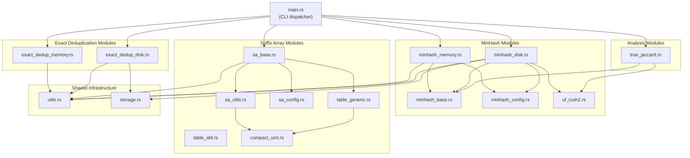
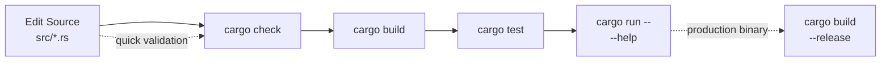
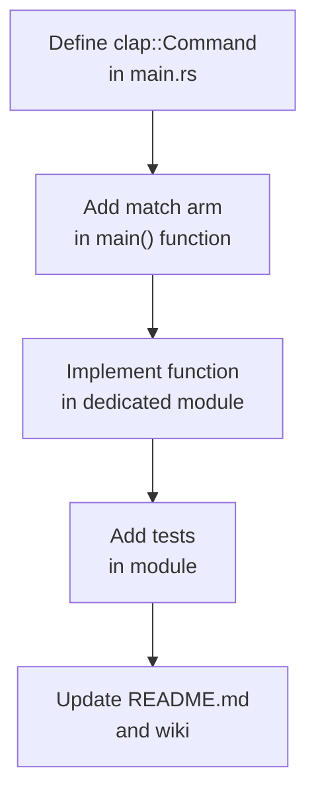
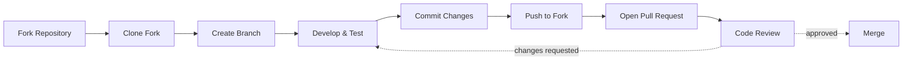

<!-- source: DeepWiki mcp.deepwiki.com · repo allenai/duplodocus · page 7 Development Guide · fetched 2026-10-26 -->

# Development Guide

<details>
<summary>Relevant source files</summary>

The following files were used as context for generating this wiki page:

- [Cargo.toml](Cargo.toml)
- [README.md](README.md)

</details>


This document provides essential information for developers working on the Duplodocus codebase. It covers project structure, build configuration, development workflows, and contributing guidelines.

For detailed dependency information and build configuration, see [Building and Dependencies](#7.1). For the automated release process, see [Release Process](#7.2).

---

## Project Structure

Duplodocus is organized as a single Rust binary crate with a modular architecture separating the three main deduplication strategies and their supporting infrastructure.

### Directory Layout

```
duplodocus/
├── Cargo.toml              # Project configuration and dependencies
├── src/
│   ├── main.rs             # CLI entry point with clap command parsing
│   ├── exact_dedup_memory.rs
│   ├── exact_dedup_disk.rs
│   ├── minhash_memory.rs
│   ├── minhash_disk.rs
│   ├── minhash_base.rs     # Core MinHash algorithms
│   ├── minhash_config.rs
│   ├── sa_base.rs          # Suffix Array pipeline orchestration
│   ├── sa_utils.rs         # SA data structures (SAStream, LoserTree)
│   ├── sa_config.rs
│   ├── table_generic.rs    # Generic suffix array with SAIS
│   ├── table_old.rs        # Legacy implementation
│   ├── compact_uint.rs     # U40 and CompactUint trait
│   ├── true_jaccard.rs     # Exact similarity calculation
│   ├── uf_rush2.rs         # Union-Find data structure
│   ├── utils.rs            # Shared utilities
│   └── storage.rs          # GenWriter for output
├── examples/               # Usage examples for each method
├── scripts/                # Operational utilities
└── README.md
```

### Module Architecture

The following diagram shows the actual module structure and import relationships in the codebase:

**Diagram: Rust Module Structure**



Sources: [Cargo.toml:1-45](), [README.md:1-70]()

---

## Development Environment Setup

### Prerequisites

| Requirement | Version | Purpose |
|------------|---------|---------|
| Rust toolchain | 1.70+ | Core language and tooling |
| Cargo | (bundled) | Build system and package manager |
| Git | Any recent | Version control |

### Local Development Setup

```bash
# Install Rust (if not already installed)
curl --proto '=https' --tlsv1.2 -sSf https://sh.rustup.rs | sh
source ~/.bashrc

# Clone repository
git clone https://github.com/allenai/duplodocus.git
cd duplodocus

# Build in debug mode (faster compilation)
cargo build

# Build in release mode (optimized)
cargo build --release

# Run tests
cargo test

# Check code without building
cargo check
```

Sources: [README.md:68-81]()

### AWS EC2 Development Environment

For testing large-scale operations, the project is designed for AWS i4i/i7i instances with NVMe RAID arrays:

```bash
# Configure RAID0 from NVMe drives
sudo yum install mdadm -y
sudo mdadm --create /dev/md0 --level=0 --raid-devices=8 \
  /dev/nvme1n1 /dev/nvme2n1 /dev/nvme3n1 /dev/nvme4n1 \
  /dev/nvme5n1 /dev/nvme6n1 /dev/nvme7n1 /dev/nvme8n1
sudo mkfs.xfs /dev/md0
sudo mkdir /mnt/raid0
sudo mount /dev/md0 /mnt/raid0
sudo chown -R $USER /mnt/raid0

# Install build dependencies
sudo yum install gcc cmake openssl-devel g++ htop git -y
```

Sources: [README.md:44-66]()

---

## Core Dependencies

The project uses carefully selected dependencies for performance and functionality. The following table summarizes key dependencies and their roles:

| Dependency | Version | Purpose |
|-----------|---------|---------|
| `clap` | 4.1.11 | CLI argument parsing with derive macros |
| `serde` / `serde_json` | 1.0 | JSON serialization/deserialization |
| `zstd` | 0.13.1 | Compressed file I/O |
| `rayon` | 1.10.0 | Data parallelism |
| `dashmap` | 5.5.3 | Concurrent hash map for parallel dedup |
| `memmap2` | 0.9.9 | Memory-mapped file access for SA |
| `tiktoken-rs` | 0.5.8 | OpenAI tokenizer support |
| `unicode-segmentation` | 1.12.0 | Unicode grapheme segmentation |
| `xxhash-rust` | 0.8 | Fast non-cryptographic hashing |
| `sha2` | 0.9 | SHA-256 for exact deduplication |
| `rustc-hash` | 1.1.0 | FxHasher for fast hash collections |
| `ahash` | 0.8.11 | Fast hashing algorithm |
| `mj_io` | 0.1.7 | Multi-format file I/O utilities |
| `bytemuck` | 1.16.0 | Zero-copy casting for compact types |
| `num-traits` | 0.2.19 | Numeric trait abstractions for CompactUint |

Sources: [Cargo.toml:8-38]()

---

## Build Configuration

### Cargo Profiles

The project defines two primary build profiles:

**Debug Profile (default)**
- Fast compilation
- Includes debug symbols
- No optimizations
- Used for: `cargo build`, `cargo test`, development iteration

**Release Profile**
- Full optimizations (`-O3`)
- Used for: `cargo build --release`, production binaries
- Binary location: `target/release/duplodocus`

**Distribution Profile**
- Inherits from release
- Enables thin LTO for smaller binaries
- Used by automated release process
- Configuration: [Cargo.toml:41-44]()

```toml
[profile.dist]
inherits = "release"
lto = "thin"
```

Sources: [Cargo.toml:41-44]()

---

## Common Development Workflows

### Building and Running

**Diagram: Development Build Workflow**



### Quick Commands Reference

| Task | Command | Notes |
|------|---------|-------|
| Check compilation | `cargo check` | Fast, no binary |
| Build debug | `cargo build` | Binary at `target/debug/duplodocus` |
| Build release | `cargo build --release` | Binary at `target/release/duplodocus` |
| Run tests | `cargo test` | All unit tests |
| Run specific test | `cargo test test_name` | Filter tests by name |
| Run with args | `cargo run --release -- exact-dedup-memory --help` | `--` separates cargo args from binary args |
| Format code | `cargo fmt` | Auto-format all source |
| Lint code | `cargo clippy` | Static analysis |

### Testing the CLI

```bash
# Test exact memory deduplication
cargo run --release -- exact-dedup-memory \
  --input-dir ./examples/exact_simple/input \
  --output-dir /tmp/output \
  --text-key "text"

# Test with sample data
mkdir -p /tmp/test_input
echo '{"text": "hello world"}' > /tmp/test_input/doc1.jsonl
echo '{"text": "hello world"}' > /tmp/test_input/doc2.jsonl
echo '{"text": "different"}' > /tmp/test_input/doc3.jsonl

cargo run --release -- exact-dedup-memory \
  --input-dir /tmp/test_input \
  --output-dir /tmp/test_output \
  --text-key "text"
```

Sources: [README.md:70-104]()

---

## Code Organization Principles

The codebase follows several architectural principles that developers should maintain:

### 1. Separation of Concerns

Each deduplication strategy is self-contained in dedicated modules:
- **Exact**: `exact_dedup_memory.rs`, `exact_dedup_disk.rs`
- **MinHash**: `minhash_memory.rs`, `minhash_disk.rs`, `minhash_base.rs`
- **Suffix Array**: `sa_base.rs`, `sa_utils.rs`, `table_generic.rs`

### 2. Memory vs. Disk Variants

Each strategy provides two variants:
- **Memory**: Simple, single-pass, all data in RAM
- **Disk**: Multi-stage, distributed-capable, intermediate files on disk

### 3. No Remote I/O in Rust

Design principle documented in [README.md:317-320]():
- All S3/remote storage interaction happens outside the Rust binary
- Use external tools like `s5cmd` for data transfer
- Rust code operates on local filesystems only
- This simplifies error handling and improves performance

### 4. Shared Infrastructure

Common utilities are factored into shared modules:
- `utils.rs`: File discovery, path handling, progress bars
- `storage.rs`: Unified output writing with compression
- `mj_io`: External crate for multi-format I/O

Sources: [README.md:317-323]()

---

## Adding New Features

### Adding a New CLI Command

**Diagram: CLI Command Flow**



Steps:
1. Define command structure using `clap` derive macros in `main.rs`
2. Add match arm in `main()` function to dispatch to implementation
3. Implement logic in appropriate module (new or existing)
4. Add unit tests within the module
5. Update `README.md` with usage examples

### Adding a New Deduplication Strategy

If implementing a fundamentally new deduplication algorithm:

1. **Create new module**: `src/new_strategy.rs`
2. **Follow naming pattern**: `{strategy}_memory.rs` and `{strategy}_disk.rs`
3. **Define CLI commands**: Add to `main.rs` clap enum
4. **Implement core logic**: Keep memory and disk variants separate
5. **Use shared infrastructure**: Import from `utils.rs`, `storage.rs`
6. **Add configuration**: Create `{strategy}_config.rs` if needed
7. **Document thoroughly**: Add to wiki and README

Sources: [Cargo.toml:1-45]()

---

## Testing Strategy

### Current Test Coverage

The codebase includes unit tests embedded within modules. Key areas:

- **Suffix Array**: Tests in `table_generic.rs` for SAIS algorithm correctness
- **Compact Types**: Tests in `compact_uint.rs` for U40 arithmetic and conversions
- **MinHash**: Tests in `minhash_base.rs` for signature generation
- **Union-Find**: Tests in `uf_rush2.rs` for disjoint set operations

### Running Tests

```bash
# Run all tests
cargo test

# Run tests for specific module
cargo test compact_uint

# Run with output visible
cargo test -- --nocapture

# Run tests in release mode (faster)
cargo test --release
```

### Integration Testing

Integration tests use the `examples/` directory:

```bash
# Test exact deduplication
cd examples/exact_simple
./run.sh

# Test fuzzy deduplication
cd examples/fuzzy_simple
./run.sh
```

Each example directory contains:
- `input/`: Sample JSONL files
- `run.sh`: Script that executes the deduplication command
- Expected behavior documented in comments

Sources: [README.md:253-262]()

---

## Performance Profiling

### Recommended Tools

| Tool | Purpose | Command |
|------|---------|---------|
| `perf` | CPU profiling | `perf record -g ./target/release/duplodocus ...` |
| `heaptrack` | Memory profiling | `heaptrack ./target/release/duplodocus ...` |
| `cargo flamegraph` | Flame graph generation | `cargo install flamegraph` |
| `hyperfine` | Benchmark comparison | `hyperfine 'cargo run --release -- ...'` |

### Profiling Example

```bash
# Install flamegraph support
cargo install flamegraph

# Build with debug symbols in release mode
CARGO_PROFILE_RELEASE_DEBUG=true cargo build --release

# Generate flame graph
cargo flamegraph --release -- exact-dedup-memory \
  --input-dir /data/test \
  --output-dir /tmp/out \
  --text-key "text"
```

### Performance Hotspots

Based on the architecture, performance-critical areas include:

1. **Suffix Array Construction**: [table_generic.rs]() - SAIS algorithm
2. **K-way Merge**: [sa_utils.rs]() - LoserTree implementation
3. **MinHash Signature Generation**: [minhash_base.rs]() - Tokenization and hashing
4. **Union-Find Operations**: [uf_rush2.rs]() - Path compression

---

## Code Style Guidelines

### Rust Conventions

Follow standard Rust conventions:
- Use `cargo fmt` for automatic formatting
- Use `cargo clippy` for linting
- Prefer explicit types where clarity matters
- Use descriptive variable names, especially in complex algorithms

### Documentation

- Add doc comments (`///`) to all public functions and types
- Include examples in doc comments where helpful
- Document panics, errors, and safety invariants
- Keep inline comments focused on "why" not "what"

### Error Handling

- Use `anyhow::Result` for functions that may fail
- Add context to errors: `context("Failed to read file")?`
- Propagate errors with `?` operator
- Only unwrap when truly infallible

### Example

```rust
/// Loads documents from JSONL file and extracts text field.
///
/// # Arguments
/// * `path` - Path to JSONL file
/// * `text_key` - JSON key to extract text from
///
/// # Errors
/// Returns error if file cannot be read or JSON is malformed
fn load_documents(path: &Path, text_key: &str) -> anyhow::Result<Vec<String>> {
    let file = File::open(path)
        .with_context(|| format!("Failed to open {}", path.display()))?;
    // ...
}
```

---

## Contributing Guidelines

### Contribution Workflow

**Diagram: Contribution Process**



### Pull Request Checklist

Before submitting a pull request:

- [ ] Code builds without warnings: `cargo build --release`
- [ ] All tests pass: `cargo test`
- [ ] Code is formatted: `cargo fmt`
- [ ] Clippy checks pass: `cargo clippy`
- [ ] New functionality has tests
- [ ] Documentation updated (README, wiki if applicable)
- [ ] Commit messages are descriptive
- [ ] Changes are focused on a single concern

### Commit Message Format

Use descriptive commit messages:

```
Brief summary (50 chars or less)

More detailed explanation if needed. Wrap at 72 characters.
Explain what changed and why, not how (code shows how).

- Bullet points are okay
- Reference issues: Fixes #123
```

---

## Debugging Tips

### Common Issues

**Issue: Out of Memory**
- Symptom: Process killed by OOM killer
- Solution: Use disk-based methods instead of memory-based
- Check: System memory with `free -h` before running

**Issue: Slow Performance**
- Check: Are you using `--release` build?
- Check: Is storage on fast local disk (NVMe/SSD)?
- Profile: Use `perf` or `flamegraph` to identify bottlenecks

**Issue: Binary Too Large**
- Solution: The `dist` profile uses thin LTO to reduce size
- Check: `strip target/release/duplodocus` to remove debug symbols

### Logging and Debugging

The codebase uses `println!` and progress bars for output. To add debug output during development:

```rust
// Temporary debug output
eprintln!("DEBUG: Processing {} documents", count);

// For production, use progress indicators
use indicatif::{ProgressBar, ProgressStyle};
let pb = ProgressBar::new(total as u64);
pb.set_style(ProgressStyle::default_bar()
    .template("[{elapsed_precise}] {bar:40} {pos}/{len} {msg}"));
```

---

## Release and Distribution

For information on the automated release process using `cargo-dist` and GitHub Actions, see [Release Process](#7.2).

Key points:
- Releases are automated via GitHub Actions
- Binary artifacts are built for Linux x64
- Distribution profile optimizes for binary size
- Version is managed in [Cargo.toml:3]()

Sources: [Cargo.toml:41-44]()

---

## Additional Resources

### Related Documentation

- **Architecture Overview**: See [Architecture Overview](#1.2) for system design
- **Suffix Array Details**: See [Suffix Array System](#2) for SA implementation
- **MinHash Details**: See [MinHash Fuzzy Deduplication](#3) for MinHash algorithms
- **Building Details**: See [Building and Dependencies](#7.1) for dependency information
- **Release Process**: See [Release Process](#7.2) for CI/CD pipeline

### External Resources

- Rust documentation: https://doc.rust-lang.org
- Cargo book: https://doc.rust-lang.org/cargo/
- Repository: https://github.com/allenai/duplodocus

Sources: [Cargo.toml:5](), [README.md:1-5]()

---

