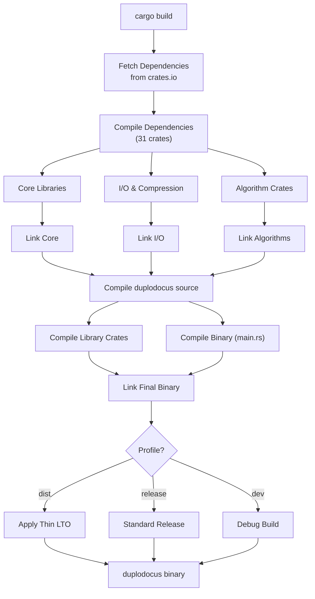

<!-- source: DeepWiki mcp.deepwiki.com · repo allenai/duplodocus · page 7.1 Building and Dependencies · fetched 2026-10-26 -->

# Building and Dependencies

<details>
<summary>Relevant source files</summary>

The following files were used as context for generating this wiki page:

- [Cargo.toml](Cargo.toml)

</details>


This document describes the build system, dependency structure, and compilation configuration for Duplodocus. It covers the Rust toolchain requirements, external crate dependencies categorized by function, and build profiles used for development and distribution.

For information about the automated release process and GitHub Actions workflows, see [Release Process](#7.2). For details on the overall system architecture, see [Architecture Overview](#1.2).

## Project Overview

Duplodocus is a Rust project using Cargo as its build system and package manager. The project is configured as a single binary crate named `duplodocus` with Rust edition 2021. All build configuration and dependencies are defined in [Cargo.toml:1-45]().

### Package Metadata

| Property | Value |
|----------|-------|
| **Package Name** | `duplodocus` |
| **Version** | `0.1.0` |
| **Edition** | `2021` |
| **Repository** | `https://github.com/allenai/duplodocus` |

Sources: [Cargo.toml:1-6]()

## Core Dependencies

The project has 31 direct dependencies, each serving specific roles in the deduplication pipeline. The following sections categorize these dependencies by their primary function within the system.

### CLI and User Interface Dependencies

These dependencies support command-line argument parsing and progress visualization:

| Crate | Version | Purpose |
|-------|---------|---------|
| `clap` | `4.1.11` | Command-line argument parsing with derive macros |
| `indicatif` | `0.17.8` | Progress bars and spinners for long-running operations |

The `clap` crate is used with the `derive` feature flag [Cargo.toml:14](), enabling declarative CLI definition through procedural macros. This is utilized by the main CLI entry point in `main.rs` to route commands to specific deduplication strategies.

Sources: [Cargo.toml:14-15]()

### Data Processing and Algorithm Dependencies

Core algorithmic dependencies supporting the three main deduplication strategies:

| Crate | Version | Features | Purpose in System |
|-------|---------|----------|-------------------|
| `tiktoken-rs` | `0.5.8` | - | BPE tokenization for Suffix Array system |
| `regex` | `1.10.4` | - | Pattern matching for document filtering |
| `ndarray` | `0.15.6` | - | Multi-dimensional arrays for LSH operations |
| `unicode-segmentation` | `1.12.0` | - | Unicode grapheme cluster handling |
| `gjson` | `0.8.1` | - | Fast JSON path queries for document extraction |
| `num-traits` | `0.2.19` | - | Generic numeric traits for CompactUint |

The `tiktoken-rs` crate provides tokenization used in the SA pipeline (see [SA Pipeline Stages](#2.1)). The `ndarray` crate supports MinHash signature operations (see [MinHash Theory and Algorithm](#3.1)).

Sources: [Cargo.toml:18-36]()

### Hashing and Cryptography

Hash functions are critical for both exact deduplication and MinHash LSH:

| Crate | Version | Features | Hash Family | Used By |
|-------|---------|----------|-------------|---------|
| `sha2` | `0.9` | - | SHA-256 | Exact deduplication content hashing |
| `xxhash-rust` | `0.8` | `xxh3` | XXH3 | Fast non-cryptographic hashing |
| `rustc-hash` | `1.1.0` | - | FxHash | HashMap keys in hot paths |
| `ahash` | `0.8.11` | - | AHash | DashMap hashing |

The `sha2` crate provides SHA-256 for content-based hashing in exact deduplication (see [Exact Deduplication](#4)). The `xxhash-rust` crate with `xxh3` feature provides fast hashing for MinHash operations. `rustc-hash` (FxHash) and `ahash` are used for in-memory hash table operations where cryptographic properties are not required.

Sources: [Cargo.toml:19-34]()

### Concurrency and Parallelism

Dependencies enabling high-performance parallel processing:

| Crate | Version | Features | Purpose |
|-------|---------|----------|---------|
| `rayon` | `1.10.0` | - | Data parallelism for batch operations |
| `dashmap` | `5.5.3` | `rayon` | Concurrent hash map with rayon integration |

The `rayon` crate is used extensively throughout all deduplication strategies for parallel document processing. It powers parallel table construction in the SA pipeline [sa_base.rs]() and parallel signature computation in MinHash operations. The `dashmap` crate with `rayon` feature enables concurrent access to shared state during parallel processing.

Sources: [Cargo.toml:25-26]()

### I/O and Compression

File format support and compression for handling large datasets:

| Crate | Version | Purpose |
|-------|---------|---------|
| `zstd` | `0.13.1` | Zstandard compression for intermediate files |
| `flate2` | `1.0` | Gzip compression/decompression |
| `glob` | `0.3.1` | File path pattern matching |
| `memmap2` | `0.9.9` | Memory-mapped file I/O for SA tables |
| `mj_io` | `0.1.7` | Multi-format JSON Lines I/O utilities |

The `zstd` crate provides fast compression for chunked data files in disk-based pipelines. The `memmap2` crate is critical for the SA system, enabling efficient random access to large suffix array tables without loading them entirely into memory (see [SA Utilities and Data Structures](#2.2)). The `mj_io` crate handles JSONL file reading and writing across all deduplication methods.

Sources: [Cargo.toml:11-37]()

### Serialization

Structured data serialization for configuration and intermediate formats:

| Crate | Version | Features | Purpose |
|-------|---------|----------|---------|
| `serde` | `1.0.198` | `derive` | Serialization framework |
| `serde_json` | `1.0.97` | - | JSON serialization for documents |
| `serde_yaml` | `0.9.34` | - | YAML configuration files |

The `serde` ecosystem is used throughout the codebase. The `derive` feature enables automatic serialization for configuration structs like `SAConfig` (see [SA Configuration](#2.5)) and document structures.

Sources: [Cargo.toml:10-28]()

### Low-Level Utilities

Memory management and byte manipulation:

| Crate | Version | Features | Purpose |
|-------|---------|----------|---------|
| `bytemuck` | `1.16.0` | `extern_crate_alloc` | Safe transmutation for binary I/O |
| `byteorder` | `1.5.0` | - | Explicit endianness control |
| `smallvec` | `1.15.1` | - | Stack-allocated vectors for small data |

The `bytemuck` crate enables safe binary serialization of suffix array indices and offsets. The `extern_crate_alloc` feature is required for heap-allocated types. This is used extensively in the SA table persistence layer [table_generic.rs]().

Sources: [Cargo.toml:24-35]()

### Randomness and System Information

| Crate | Version | Purpose |
|-------|---------|---------|
| `rand` | `0.8` | Random number generation for MinHash |
| `rand_chacha` | `0.3.1` | ChaCha RNG for deterministic hashing |
| `sysinfo` | `0.37.2` | System memory queries for adaptive batching |

The `rand` and `rand_chacha` crates provide random number generation for MinHash signature creation with deterministic seeds. The `sysinfo` crate enables memory-aware chunking in the SA pipeline, allowing adaptive batch sizing based on available RAM.

Sources: [Cargo.toml:13-36]()

### Error Handling

| Crate | Version | Purpose |
|-------|---------|---------|
| `anyhow` | `1.0` | Ergonomic error handling with context |
| `src` | `0.0.6` | Source location tracking for errors |

The `anyhow` crate provides the standard error type (`anyhow::Result<T>`) used throughout the codebase, enabling error context propagation without explicit error type definitions.

Sources: [Cargo.toml:9-38]()

## Dependency Architecture

The following diagram maps dependencies to the systems they support, connecting the abstract system names to concrete crate dependencies.

```mermaid
graph TB
    subgraph "Suffix Array System"
        SA["SA Pipeline<br/>(sa_base.rs)"]
        SATable["Suffix Tables<br/>(table_generic.rs)"]
        SAUtils["SA Utilities<br/>(sa_utils.rs)"]
    end
    
    subgraph "MinHash System"
        MH["MinHash Base<br/>(minhash_base)"]
        MHMem["MinHash Memory<br/>(minhash_memory)"]
        MHDisk["MinHash Disk<br/>(minhash_disk)"]
    end
    
    subgraph "Exact Deduplication"
        ExMem["Exact Memory<br/>(exact_dedup_memory)"]
        ExDisk["Exact Disk<br/>(exact_dedup_disk)"]
    end
    
    subgraph "CLI Layer"
        CLI["main.rs"]
    end
    
    subgraph "Tokenization & Text"
        tiktoken["tiktoken-rs"]
        unicode["unicode-segmentation"]
        regex["regex"]
    end
    
    subgraph "Hashing"
        sha2["sha2"]
        xxhash["xxhash-rust"]
        rustchash["rustc-hash"]
        ahash["ahash"]
    end
    
    subgraph "Parallelism"
        rayon["rayon"]
        dashmap["dashmap"]
    end
    
    subgraph "I/O & Compression"
        zstd["zstd"]
        flate2["flate2"]
        memmap2["memmap2"]
        mj_io["mj_io"]
        glob["glob"]
    end
    
    subgraph "Serialization"
        serde["serde"]
        serde_json["serde_json"]
        serde_yaml["serde_yaml"]
        gjson["gjson"]
    end
    
    subgraph "Algorithms"
        ndarray["ndarray"]
        rand["rand + rand_chacha"]
    end
    
    subgraph "Low-Level"
        bytemuck["bytemuck"]
        byteorder["byteorder"]
        smallvec["smallvec"]
        numtraits["num-traits"]
    end
    
    subgraph "UI & System"
        clap["clap"]
        indicatif["indicatif"]
        sysinfo["sysinfo"]
        anyhow["anyhow"]
    end
    
    SA --> tiktoken
    SA --> memmap2
    SA --> rayon
    SA --> sysinfo
    SATable --> bytemuck
    SATable --> numtraits
    SAUtils --> memmap2
    SAUtils --> byteorder
    
    MH --> rand
    MH --> ndarray
    MH --> xxhash
    MHMem --> dashmap
    MHMem --> rayon
    MHDisk --> mj_io
    MHDisk --> zstd
    
    ExMem --> sha2
    ExMem --> rustchash
    ExDisk --> sha2
    ExDisk --> zstd
    
    CLI --> clap
    CLI --> indicatif
    CLI --> anyhow
    
    SA --> mj_io
    SA --> serde_yaml
    SA --> glob
    MH --> serde_json
    ExMem --> serde_json
    ExDisk --> serde_json
    
    SA --> unicode
    SA --> regex
    MH --> ahash
```



**Diagram: Dependency Usage by System Component**

This diagram illustrates how each major system component depends on specific external crates. The Suffix Array system has the most diverse dependency profile, requiring tokenization, memory mapping, and parallel processing. MinHash operations rely heavily on hashing and array libraries. Exact deduplication has the simplest dependency footprint, primarily requiring SHA-256 hashing and compression.

Sources: [Cargo.toml:8-38]()

## Dependency Categories by Processing Stage

The following table organizes dependencies by their role in the data processing pipeline:

| Stage | Dependencies | Purpose |
|-------|--------------|---------|
| **Document Loading** | `mj_io`, `glob`, `flate2`, `zstd`, `gjson` | Reading JSONL files with compression support |
| **Text Processing** | `tiktoken-rs`, `unicode-segmentation`, `regex` | Tokenization and text normalization |
| **Hash Computation** | `sha2`, `xxhash-rust`, `ahash`, `rustc-hash` | Content fingerprinting |
| **Signature Generation** | `rand`, `rand_chacha`, `ndarray` | MinHash signature creation |
| **Parallel Processing** | `rayon`, `dashmap` | Multi-threaded batch operations |
| **Data Structures** | `bytemuck`, `byteorder`, `smallvec`, `num-traits` | Memory-efficient storage |
| **File I/O** | `memmap2`, `zstd`, `mj_io` | Disk-backed data access |
| **Configuration** | `serde`, `serde_json`, `serde_yaml` | Config file parsing |
| **User Interface** | `clap`, `indicatif` | CLI and progress display |
| **System Queries** | `sysinfo` | Memory-aware adaptive sizing |

Sources: [Cargo.toml:8-38]()

## Build Configuration

### Release Profile

Duplodocus defines a custom `dist` profile for distribution builds [Cargo.toml:42-44]():

```toml
[profile.dist]
inherits = "release"
lto = "thin"
```

This profile enables thin Link-Time Optimization (LTO), which provides a balance between compilation time and runtime performance. The `dist` profile is used by the automated release workflow managed by `cargo-dist` (see [Release Process](#7.2)).

| Setting | Value | Effect |
|---------|-------|--------|
| `inherits` | `"release"` | Starts with release optimizations |
| `lto` | `"thin"` | Cross-crate optimizations without full LTO overhead |

Thin LTO is particularly beneficial for Duplodocus because the codebase has many small, hot functions (like hash computation and suffix array traversal) that benefit from inlining across crate boundaries, but full LTO would significantly increase build times.

Sources: [Cargo.toml:41-44]()

## Building the Project

### Prerequisites

1. **Rust Toolchain**: Rust 1.65.0 or later (due to edition 2021 features)
2. **Cargo**: Included with Rust installation
3. **System Requirements**: Varies by deduplication method (see system-specific documentation)

### Standard Build Commands

**Development build** (with debug symbols):
```bash
cargo build
```

**Release build** (optimized):
```bash
cargo build --release
```

**Distribution build** (with thin LTO):
```bash
cargo build --profile dist
```

The compiled binary will be located at:
- Development: `target/debug/duplodocus`
- Release: `target/release/duplodocus`
- Distribution: `target/dist/duplodocus`

### Running Tests

```bash
cargo test
```

### Build Artifacts

The build process generates the following artifacts:

| Artifact Type | Location | Purpose |
|---------------|----------|---------|
| Binary | `target/{profile}/duplodocus` | Main executable |
| Incremental Cache | `target/{profile}/incremental/` | Speeds up rebuilds |
| Dependencies | `target/{profile}/deps/` | Compiled dependency crates |
| Build Scripts | `target/{profile}/build/` | Build script outputs |

Sources: [Cargo.toml:1-45]()

## Dependency Build Flow



**Diagram: Cargo Build Process for Duplodocus**

The build process first fetches and compiles all 31 dependencies, organizing them by category. The duplodocus source code is then compiled, linking against the dependency crates. Finally, the profile-specific optimizations are applied: the `dist` profile applies thin LTO for distribution builds, while `release` skips LTO for faster local builds.

Sources: [Cargo.toml:1-45]()

## Version Management

Duplodocus uses semantic versioning with the current version `0.1.0` [Cargo.toml:3](). The version is automatically synchronized with Git tags during the release process. All dependencies are specified with caret requirements (e.g., `"1.0"` means `>=1.0.0, <2.0.0`), allowing compatible updates while preventing breaking changes.

### Dependency Update Strategy

| Update Type | Version Change | Safety |
|-------------|---------------|--------|
| **Patch** | `1.0.0` → `1.0.1` | Safe (bug fixes only) |
| **Minor** | `1.0.0` → `1.1.0` | Generally safe (new features, no breaks) |
| **Major** | `1.0.0` → `2.0.0` | Breaking changes (requires testing) |

The caret requirement `"1.0"` allows patch and minor updates but blocks major version changes that could introduce incompatibilities.

Sources: [Cargo.toml:3-38]()

## Critical Dependency Notes

### Memory-Mapped I/O

The `memmap2` crate [Cargo.toml:37]() is critical for SA pipeline performance. It enables zero-copy access to multi-gigabyte suffix array tables by mapping them directly into the process address space. This dependency must remain stable as changes could affect correctness of concurrent read access patterns in [sa_utils.rs]().

### Tokenization Stability

The `tiktoken-rs` crate [Cargo.toml:18]() version is pinned to ensure consistent tokenization across runs. Different tokenizer versions would produce different suffix arrays for the same input text, breaking reproducibility of SA deduplication results.

### Hashing Algorithms

The hash function implementations (`sha2`, `xxhash-rust`, `ahash`) must maintain output stability. Changing hash algorithm versions could invalidate cached signatures and require reprocessing entire datasets.

Sources: [Cargo.toml:18-37]()

## Optional Feature Flags

Currently, Duplodocus uses feature flags only for specific dependency capabilities:

| Dependency | Feature | Purpose |
|------------|---------|---------|
| `clap` | `derive` | Procedural macro for CLI definition |
| `serde` | `derive` | Procedural macro for serialization |
| `dashmap` | `rayon` | Parallel iterator support |
| `xxhash-rust` | `xxh3` | XXH3 algorithm variant |
| `bytemuck` | `extern_crate_alloc` | Support for heap-allocated types |

These features enable specific functionality required by Duplodocus while avoiding unnecessary code compilation.

Sources: [Cargo.toml:14-24]()

---

