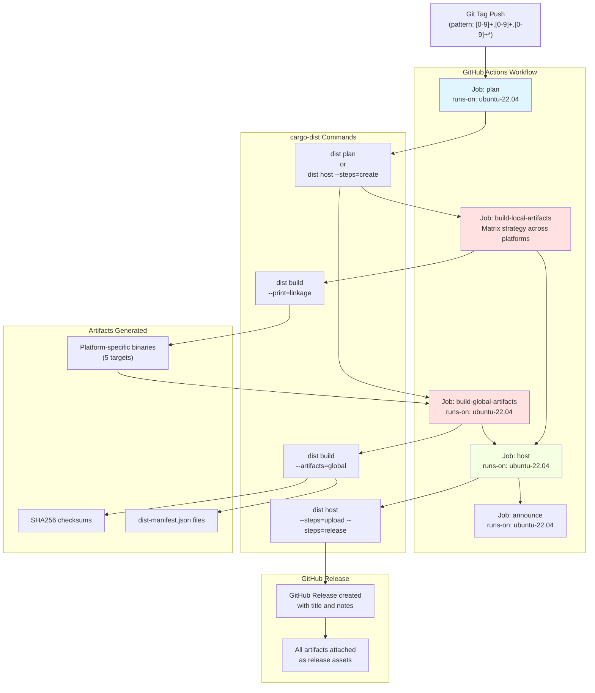
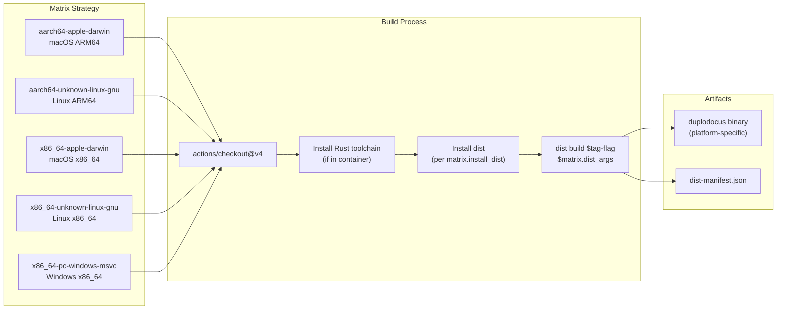
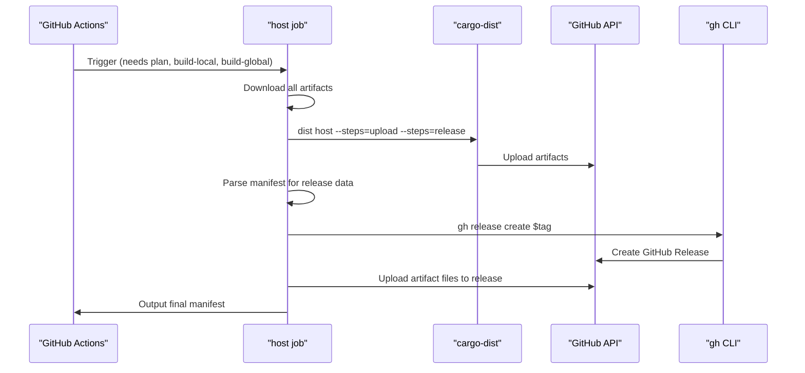
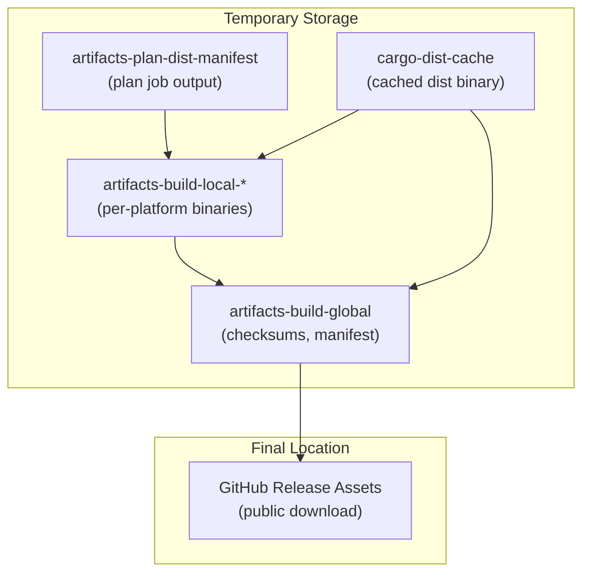

<!-- source: DeepWiki mcp.deepwiki.com · repo allenai/duplodocus · page 7.2 Release Process · fetched 2026-10-26 -->

# Release Process

<details>
<summary>Relevant source files</summary>

The following files were used as context for generating this wiki page:

- [.github/workflows/release.yml](.github/workflows/release.yml)
- [dist-workspace.toml](dist-workspace.toml)

</details>


## Purpose and Scope

This document describes the automated release workflow for Duplodocus, which uses `cargo-dist` and GitHub Actions to build platform-specific binaries and create GitHub Releases. The process is triggered by pushing Git tags and handles cross-compilation, artifact generation, and release publishing without manual intervention.

For information about building the project locally during development, see [Building and Dependencies](#7.1).

---

## Release System Overview

Duplodocus uses an automated release system based on two key components:

| Component | Purpose | Configuration File |
|-----------|---------|-------------------|
| **cargo-dist** | Cross-platform Rust binary distribution tool | [dist-workspace.toml:1-14]() |
| **GitHub Actions** | CI/CD automation platform | [.github/workflows/release.yml:1-297]() |

The release system automatically builds binaries for five target platforms, generates checksums, and publishes GitHub Releases with all artifacts attached. The entire workflow is declarative and requires no manual steps beyond pushing a version tag.

**Sources:** [.github/workflows/release.yml:1-297](), [dist-workspace.toml:1-14]()

---

## Release Workflow Architecture



The workflow consists of five sequential jobs with careful dependency management to ensure artifacts are available when needed.

**Sources:** [.github/workflows/release.yml:47-297]()

---

## Workflow Jobs

### Plan Job

The `plan` job analyzes the repository and Git tag to determine what needs to be built:

**Key Responsibilities:**
- Installs `cargo-dist` version 0.30.2 from the official installer
- Runs either `dist plan` (for PRs) or `dist host --steps=create` (for actual releases)
- Outputs a JSON manifest describing the build matrix
- Caches the `dist` binary for use by subsequent jobs

**Outputs:**
| Output | Description | Example |
|--------|-------------|---------|
| `val` | JSON manifest with build configuration | Matrix of targets, runners, dist-args |
| `tag` | Git tag name (empty for PRs) | `v1.2.3` |
| `tag-flag` | CLI flag for dist command | `--tag=v1.2.3` |
| `publishing` | Whether this is a real release | `true` or `false` |

**Sources:** [.github/workflows/release.yml:48-88]()

---

### Build Local Artifacts Job

The `build-local-artifacts` job runs in parallel across a matrix of target platforms:



Each matrix job builds the binary for its specific platform and uploads it as a GitHub Actions artifact with the naming pattern `artifacts-build-local-${{ join(matrix.targets, '_') }}`.

**Key Configuration Points:**
- Matrix is dynamically generated by the `plan` job
- Each platform uses an appropriate runner (e.g., `ubuntu-22.04` for Linux, `macos-latest` for macOS, `windows-latest` for Windows)
- Container images may be used for specific targets (e.g., cross-compilation)

**Sources:** [.github/workflows/release.yml:91-166](), [dist-workspace.toml:13]()

---

### Build Global Artifacts Job

The `build-global-artifacts` job creates platform-agnostic artifacts:

**Process:**
1. Downloads all platform-specific artifacts from the previous job
2. Runs `dist build --artifacts=global` to generate checksums and metadata
3. Uploads consolidated artifacts

**Generated Artifacts:**
- SHA256 checksum files for all binaries
- Global `dist-manifest.json` with complete release metadata

This job depends on `build-local-artifacts` completing successfully and runs on `ubuntu-22.04`.

**Sources:** [.github/workflows/release.yml:169-213]()

---

### Host Job

The `host` job publishes the release to GitHub:



**Key Steps:**
1. Fetches all artifacts from scratch storage
2. Runs `dist host` to upload artifacts and prepare release
3. Parses the manifest to extract:
   - Release title from `announcement_title`
   - Release notes from `announcement_github_body`
   - Prerelease flag from `announcement_is_prerelease`
4. Creates GitHub Release using `gh release create` with all artifacts attached

**Conditional Execution:**
This job only runs when `publishing == 'true'` and all build jobs succeeded or were skipped.

**Sources:** [.github/workflows/release.yml:215-279]()

---

### Announce Job

The `announce` job performs final post-release tasks:

**Responsibilities:**
- Waits for the `host` job to complete successfully
- Can be extended for additional announcements (e.g., posting to Discord, updating documentation sites)

Currently, this is a minimal step that serves as a hook for future announcement integrations.

**Sources:** [.github/workflows/release.yml:281-297]()

---

## Configuration Files

### dist-workspace.toml

The `dist-workspace.toml` file configures `cargo-dist` behavior:

| Setting | Value | Purpose |
|---------|-------|---------|
| `cargo-dist-version` | `"0.30.2"` | Pin dist version for reproducibility |
| `ci` | `"github"` | Generate GitHub Actions workflows |
| `installers` | `[]` | No custom installers (binaries only) |
| `targets` | 5 platforms | Cross-compilation targets |

**Target Platforms:**

| Target Triple | Platform | Architecture |
|--------------|----------|--------------|
| `aarch64-apple-darwin` | macOS | ARM64 (Apple Silicon) |
| `aarch64-unknown-linux-gnu` | Linux | ARM64 |
| `x86_64-apple-darwin` | macOS | x86_64 (Intel) |
| `x86_64-unknown-linux-gnu` | Linux | x86_64 |
| `x86_64-pc-windows-msvc` | Windows | x86_64 |

**Sources:** [dist-workspace.toml:1-14]()

---

## Triggering a Release

### Tag Format

The workflow triggers on Git tags matching the pattern `**[0-9]+.[0-9]+.[0-9]+*`:

**Valid Tag Examples:**
- `1.0.0` - Simple semantic version
- `v0.1.0` - Version with 'v' prefix
- `1.0.0-prerelease.1` - Prerelease with suffix
- `duplodocus/0.1.0` - Package-specific version
- `releases/v1.0.0` - Version in subdirectory

**Tag Parsing:**
The tag is parsed into two components:
- `VERSION`: Cargo-style SemVer version (major.minor.patch required)
- `PACKAGE_NAME` (optional): Name of a Cargo package in the workspace

If `PACKAGE_NAME` is specified, the release is for that specific package. Otherwise, it's for all dist-able packages with that version.

**Prerelease Detection:**
Tags with prerelease suffixes (e.g., `-alpha`, `-beta`, `-rc.1`) automatically mark the GitHub Release as a prerelease.

**Sources:** [.github/workflows/release.yml:20-45]()

---

### Release Procedure

To create a new release:

```bash
# 1. Update version in Cargo.toml
vim Cargo.toml

# 2. Commit the version change
git add Cargo.toml
git commit -m "chore: bump version to 1.2.3"

# 3. Create and push the tag
git tag v1.2.3
git push origin v1.2.3

# 4. Monitor the workflow
# Visit: https://github.com/allenai/duplodocus/actions
```

**Important Notes:**
- GitHub limits tag pushes to 3 per commit to prevent mistakes
- Multiple simultaneous tags create independent release workflows
- The workflow runs on both PRs (for testing) and tag pushes (for publishing)

**Sources:** [.github/workflows/release.yml:34-45]()

---

## Pull Request Testing

The workflow also runs on pull requests to validate changes:

**PR Behavior:**
- All jobs execute except `host` (no publishing occurs)
- Artifacts are uploaded to workflow storage for inspection
- `plan` job outputs `publishing: false`
- Release creation is skipped

This allows testing workflow changes without creating actual releases.

**Sources:** [.github/workflows/release.yml:42-43](), [.github/workflows/release.yml:53-55]()

---

## Artifact Storage



**Artifact Lifecycle:**
1. **During Workflow:** Artifacts stored in GitHub Actions workflow storage (90-day retention)
2. **After Release:** Artifacts attached to GitHub Release (permanent, unless release deleted)
3. **Manifest Files:** Granular manifests removed before release creation to avoid clutter

**Artifact Naming:**
- Platform binaries: `duplodocus-{version}-{target}.tar.gz` (or `.zip` for Windows)
- Checksums: `duplodocus-{version}-{target}.tar.gz.sha256`
- Manifest: `dist-manifest.json`

**Sources:** [.github/workflows/release.yml:84-88](), [.github/workflows/release.yml:160-166](), [.github/workflows/release.yml:259-279]()

---

## Workflow Permissions

The workflow requires specific GitHub token permissions:

| Permission | Scope | Purpose |
|------------|-------|---------|
| `contents` | `write` | Create releases and upload assets |

The `GITHUB_TOKEN` is automatically provided by GitHub Actions and has repository-scoped access. No additional secrets are required.

**Sources:** [.github/workflows/release.yml:17-18]()

---

## Maintenance Considerations

### Updating cargo-dist

To update the `cargo-dist` version:

1. Update `cargo-dist-version` in [dist-workspace.toml:7]()
2. Run `dist init` to regenerate [.github/workflows/release.yml]()
3. Review changes to the workflow file
4. Commit both files together

**Warning:** The release workflow is auto-generated. Manual edits will be overwritten. Use `dist-workspace.toml` for configuration changes.

### Adding New Target Platforms

To add a new target platform:

1. Add the target triple to `targets` array in [dist-workspace.toml:13]()
2. Regenerate the workflow with `dist init`
3. Test the new platform in a PR before releasing

**Sources:** [.github/workflows/release.yml:1-14](), [dist-workspace.toml:1-14]()

---

