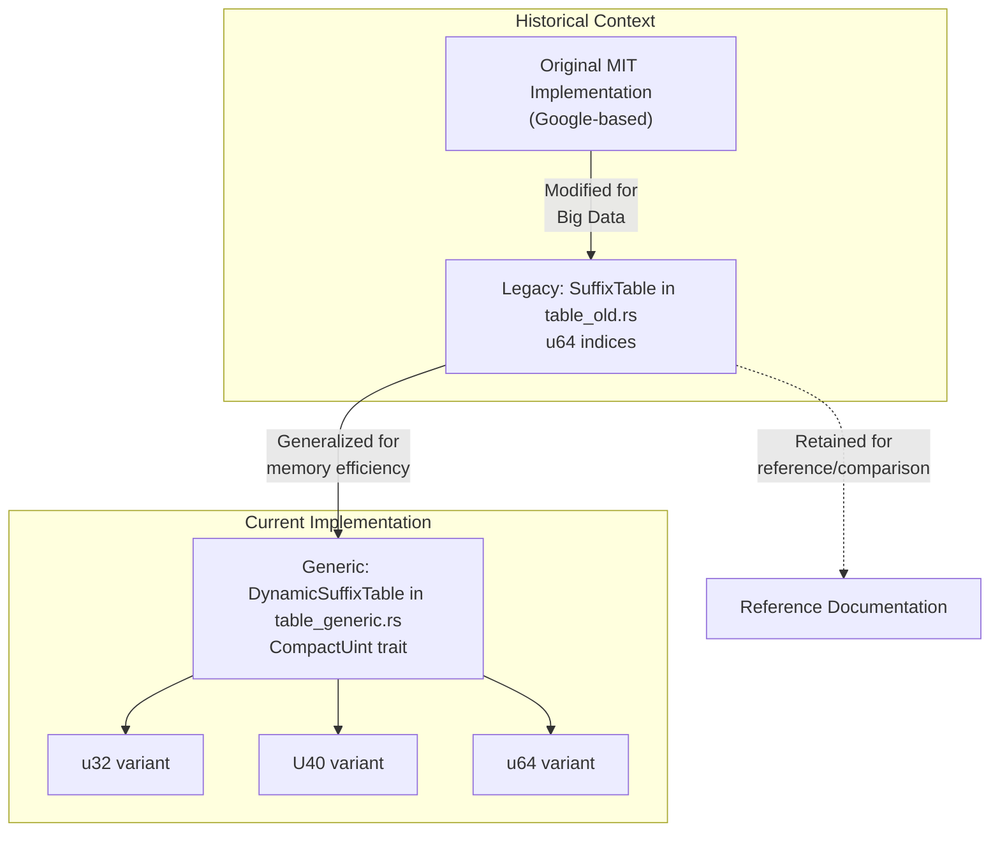
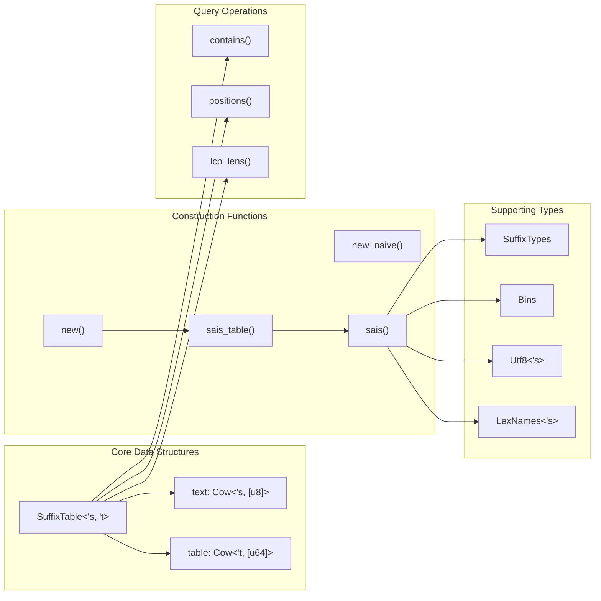
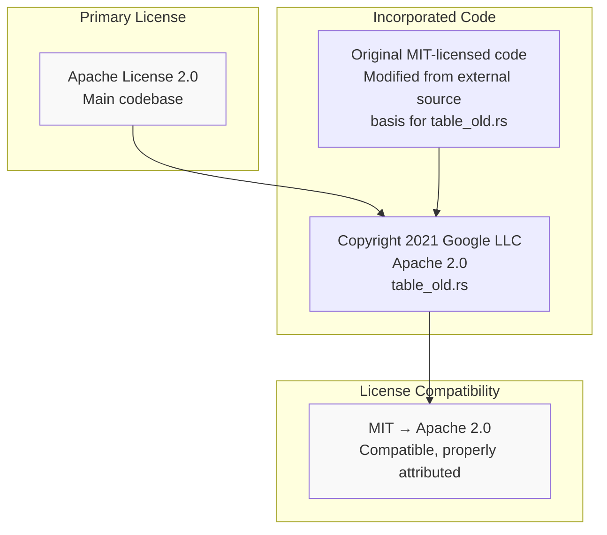

<!-- source: DeepWiki mcp.deepwiki.com · repo allenai/duplodocus · page 8 Reference · fetched 2026-10-26 -->

# Reference

Relevant source files

The following files were used as context for generating this wiki page:

- [LICENSE](LICENSE)
- [src/table_old.rs](src/table_old.rs)

This section provides supplementary reference material for the Duplodocus codebase. It includes historical implementation details that have been superseded but retained for comparison purposes, as well as licensing information.

## Purpose and Scope

This reference section documents:

1. **Legacy Implementation**: The original suffix table implementation ([src/table_old.rs]()), which predates the current generic implementation described in [Suffix Table Implementation](#2.3)
2. **Licensing**: Apache 2.0 license terms governing the use of Duplodocus

For current operational documentation, see:
- [Suffix Array System](#2) for the active SA pipeline
- [Suffix Table Implementation](#2.3) for the current generic suffix table
- [Development Guide](#7) for contributing guidelines

---

## Legacy vs. Current Implementation

The codebase maintains both a legacy suffix table implementation and a modern generic version. Understanding their relationship helps developers appreciate the evolution of the system and choose the appropriate implementation for specific use cases.

### Implementation Evolution

**Sources:** [src/table_old.rs:15-29]()

### Key Structural Differences

| Aspect | Legacy (`table_old.rs`) | Current (`table_generic.rs`) |
|--------|-------------------------|------------------------------|
| **Index Type** | Fixed `u64` | Generic `CompactUint` trait |
| **Memory Efficiency** | 8 bytes per suffix | 4-5 bytes per suffix (U40) |
| **Primary Struct** | `SuffixTable<'s, 't>` | `DynamicSuffixTable<I>` |
| **Construction** | `sais_table()` function | `DynamicSuffixTable::from_text()` |
| **Use Case** | Datasets > 4GB (u32 limit) | All sizes with optimal memory |
| **Status** | Deprecated, reference only | Active, production use |

**Sources:** [src/table_old.rs:86-124]()

### Code Entity Mapping: Legacy Implementation

**Sources:** [src/table_old.rs:86-124](), [src/table_old.rs:398-405](), [src/table_old.rs:407-598]()

### Major Implementation Components

#### SuffixTable Structure

The legacy implementation uses a straightforward two-field structure:

- **`text: Cow<'s, [u8]>`**: The original byte sequence, borrowed or owned
- **`table: Cow<'t, [u64]>`**: Lexicographically sorted suffix indices (8 bytes each)

This design prioritizes simplicity over memory efficiency, using fixed 64-bit indices throughout.

**Sources:** [src/table_old.rs:86-90]()

#### SAIS Algorithm Implementation

The Suffix Array Induced Sorting (SAIS) algorithm is implemented in the `sais()` function, following the approach described in [(Nong et al., 2009)](https://local.ugene.unipro.ru/tracker/secure/attachment/12144/Linear%20Suffix%20Array%20Construction%20by%20Almost%20Pure%20Induced-Sorting.pdf) with modifications for byte arrays instead of UTF-8 strings.

Key algorithm phases:
1. **Suffix Type Classification**: Ascending, Descending, Valley (`SuffixTypes`)
2. **Bin Construction**: Character frequency bins (`Bins`)
3. **Recursive Reduction**: Lexical naming and recursive sorting
4. **Induced Sorting**: Three-phase insertion (valley → descending → ascending)

**Sources:** [src/table_old.rs:407-598](), [src/table_old.rs:53-84]()

#### Query Methods

The legacy implementation provides standard suffix array queries:

| Method | Time Complexity | Purpose |
|--------|----------------|---------|
| `contains(query)` | O(m log n) | Test substring existence |
| `positions(query)` | O(m log n) | Find all occurrences |
| `lcp_lens()` | O(n²) | Compute LCP array (quadratic) |

where m = query length, n = text length.

**Sources:** [src/table_old.rs:230-317](), [src/table_old.rs:176-186]()

### Why the Legacy Implementation is Retained

The `table_old.rs` file serves several purposes despite being superseded:

1. **Historical Reference**: Documents the evolution from u32 → u64 indices, preserving the rationale for handling "Big Data" beyond 4GB
2. **Algorithm Clarity**: The non-generic implementation is sometimes easier to understand when learning SAIS
3. **Comparison Testing**: Enables validation of the generic implementation against a known baseline
4. **Copyright Preservation**: Maintains original attribution to Google LLC and MIT-licensed source code

**Sources:** [src/table_old.rs:1-29]()

---

## Licensing Structure

Duplodocus is distributed under the Apache License, Version 2.0. The codebase incorporates code from multiple sources with compatible licenses.

### Copyright and License Hierarchy

**Sources:** [LICENSE:1-201](), [src/table_old.rs:1-13](), [src/table_old.rs:15-29]()

### Key License Provisions

The Apache License 2.0 provides:

- **Permissive Use**: Commercial and non-commercial use permitted
- **Patent Grant**: Express patent license from contributors
- **Attribution Requirement**: Copyright notices must be retained
- **Modification Freedom**: Derivative works allowed under same license terms
- **No Trademark Rights**: License does not grant trademark use

**Important**: When using or distributing Duplodocus, ensure:
1. The LICENSE file is included in distributions
2. Copyright notices in source files are preserved
3. Modifications are clearly marked (Apache 2.0 Section 4(b))

**Sources:** [LICENSE:66-128]()

### Multi-Source Attribution

The codebase properly attributes incorporated code:

| File | Copyright Holder | License | Notes |
|------|------------------|---------|-------|
| Most files | Allen Institute for AI | Apache 2.0 | Primary codebase |
| `src/table_old.rs` | Google LLC (2021) | Apache 2.0 | Based on MIT code |
| Original suffix library | External (TODO in comments) | MIT | Not directly included |

The `table_old.rs` file header explicitly documents:
- Original MIT license basis
- Apache 2.0 relicensing (compatible)
- Modifications made (u32→u64, UTF-8→bytes)

**Sources:** [src/table_old.rs:1-29]()

---

## Sub-Pages

For detailed information, see:

- **[Legacy Suffix Table Implementation](#8.1)**: Complete technical documentation of `table_old.rs` including API reference, algorithm details, and usage examples
- **[License](#8.2)**: Full text of the Apache License 2.0

---

**Sources:** [src/table_old.rs](), [LICENSE]()

---

