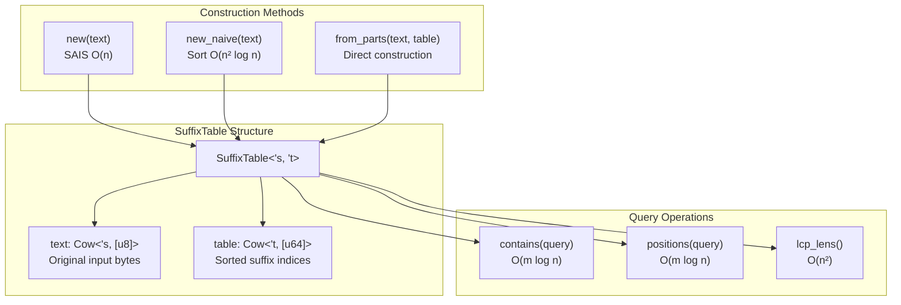
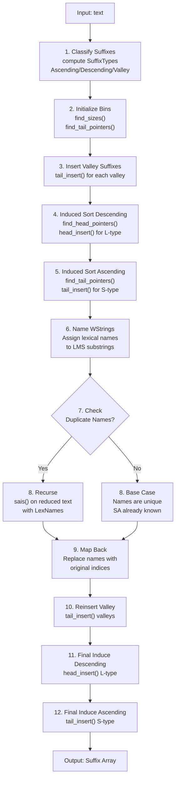
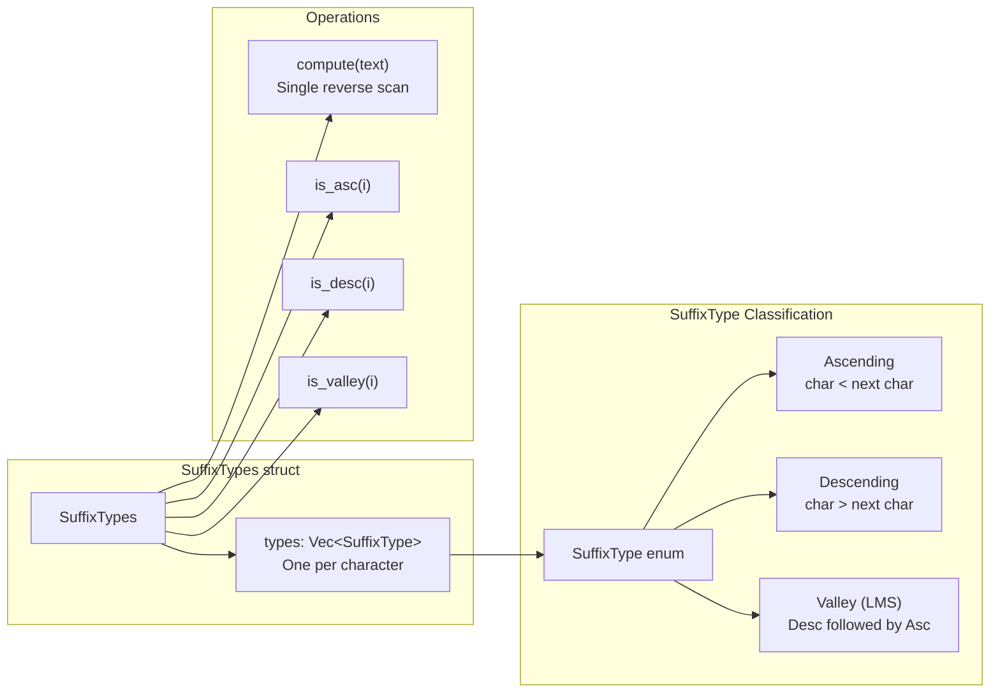
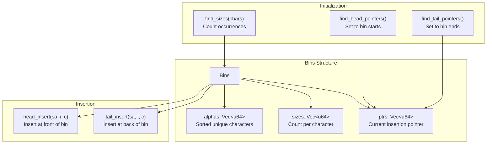
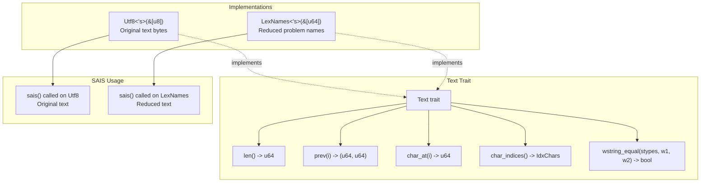
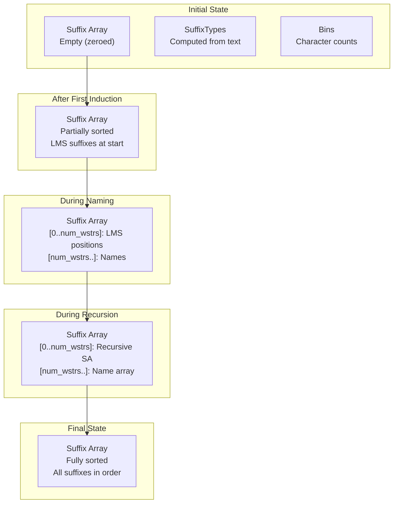
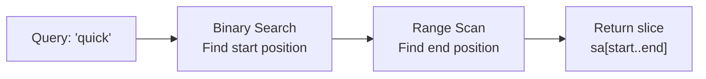
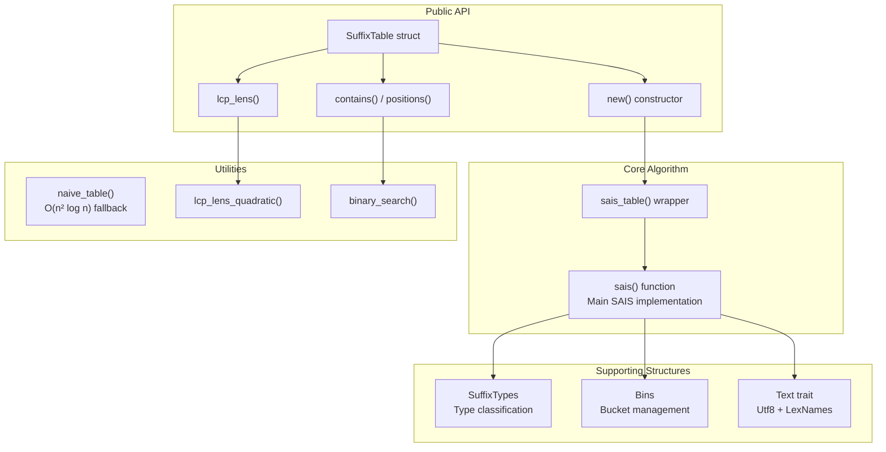

<!-- source: DeepWiki mcp.deepwiki.com · repo allenai/duplodocus · page 8.1 Legacy Suffix Table Implementation · fetched 2026-10-26 -->

# Legacy Suffix Table Implementation

<details>
<summary>Relevant source files</summary>

The following files were used as context for generating this wiki page:

- [src/table_old.rs](src/table_old.rs)

</details>


## Purpose and Scope

This document describes the original suffix table implementation in `src/table_old.rs`, which has been retained for reference and comparison purposes. This implementation uses fixed `u64` indices and implements the SAIS (Suffix Array Induced Sorting) algorithm for linear-time suffix array construction.

For the current generic suffix table implementation supporting multiple integer sizes, see [Suffix Table Implementation](#2.3). For the broader SA pipeline architecture, see [Suffix Array System](#2).

---

## Overview

The `table_old.rs` module contains a complete suffix array implementation based on external code (originally MIT licensed, now Apache 2.0). It was modified from the original to address two key requirements:

1. **Large Dataset Support**: Changed from `u32` to `u64` indices to handle datasets exceeding 4GB
2. **Byte Interface**: Removed UTF-8 string interface in favor of direct byte array manipulation

This implementation remains in the codebase as a reference point, but production code should use the generic implementation in `table_generic.rs` which provides better memory efficiency through adaptive integer sizing.

**Key Characteristics:**
- **Time Complexity**: O(n) construction using SAIS algorithm
- **Space Complexity**: O(kn) where k is alphabet size; approximately 6 bytes per character overhead
- **Fixed Representation**: Always uses `u64` for suffix indices
- **Self-Contained**: Includes full SAIS implementation with no external dependencies

Sources: [src/table_old.rs:1-85]()

---

## Core Data Structure

### SuffixTable

The `SuffixTable` struct is the primary interface for suffix array operations:

```rust
pub struct SuffixTable<'s, 't> {
    text: Cow<'s, [u8]>,
    table: Cow<'t, [u64]>,
}
```

**Components:**
| Field | Type | Purpose |
|-------|------|---------|
| `text` | `Cow<'s, [u8]>` | Original text as byte array, owned or borrowed |
| `table` | `Cow<'t, [u64]>` | Suffix array indices, lexicographically sorted |

**Public API Methods:**

| Method | Time Complexity | Description |
|--------|----------------|-------------|
| `new(text)` | O(n) | Constructs suffix table using SAIS |
| `new_naive(text)` | O(n² log n) | Simple sort-based construction |
| `contains(query)` | O(m log n) | Tests if query exists in text |
| `positions(query)` | O(m log n) | Returns all occurrences of query |
| `lcp_lens()` | O(n²) | Computes LCP array (quadratic version) |



Sources: [src/table_old.rs:86-124](), [src/table_old.rs:188-229]()

---

## SAIS Algorithm Architecture

The Suffix Array Induced Sorting (SAIS) algorithm is implemented in the `sais` function and supporting structures. The algorithm achieves linear time by recursively solving a reduced problem.

### Algorithm Flow



Sources: [src/table_old.rs:407-598]()

---

## Key Components

### SuffixTypes

The `SuffixTypes` structure classifies each character position as Ascending (S-type), Descending (L-type), or Valley (LMS - Leftmost S-type).



**Classification Rules:**
- **Descending (L-type)**: Suffix starting at position i is lexicographically larger than suffix at i+1
- **Ascending (S-type)**: Suffix at i is smaller than suffix at i+1
- **Valley (LMS)**: An S-type suffix immediately following an L-type suffix

The classification is computed in a single reverse scan through the text, comparing adjacent characters and inheriting types when characters are equal.

Sources: [src/table_old.rs:600-665]()

---

### Bins

The `Bins` structure manages bucket sort operations for each character in the alphabet. It tracks character counts and maintains pointers for head/tail insertion during the induced sorting phases.



**Key Operations:**
| Method | Purpose |
|--------|---------|
| `find_sizes()` | Counts occurrence of each character; identifies alphabet |
| `find_head_pointers()` | Sets pointers to start of each character's bin |
| `find_tail_pointers()` | Sets pointers to end of each character's bin |
| `head_insert()` | Inserts suffix at front of bin, increments pointer |
| `tail_insert()` | Inserts suffix at back of bin, decrements pointer |

The bins are reused across multiple phases of SAIS, with pointers reset by calling `find_head_pointers()` or `find_tail_pointers()` before each phase.

Sources: [src/table_old.rs:709-788]()

---

### Text Trait and Implementations

The `Text` trait provides a uniform interface for different text representations used during SAIS algorithm execution. This abstraction enables the algorithm to work both on the original byte array and on the reduced "lexical names" array during recursion.



**Implementation Details:**

| Type | Underlying Data | Character Representation |
|------|----------------|-------------------------|
| `Utf8<'s>` | `&'s [u8]` | Each byte as `u64` |
| `LexNames<'s>` | `&'s [u64]` | Lexical name integers |

Both implementations provide identical interfaces, allowing the SAIS algorithm to recurse seamlessly on the reduced problem without code duplication.

Sources: [src/table_old.rs:790-904]()

---

## Construction Process Details

### Phase-by-Phase Execution

The SAIS construction follows a specific sequence of operations:

1. **Classification Phase**: Compute suffix types (one reverse scan)
2. **Bin Initialization**: Count characters and initialize bins
3. **First Induced Sort**:
   - Insert valley (LMS) suffixes at bin tails
   - Induce L-type suffixes from left to right (head insert)
   - Induce S-type suffixes from right to left (tail insert)
4. **WString Naming**:
   - Extract LMS suffixes from suffix array
   - Assign lexical names to unique LMS substrings
   - Check for duplicate names
5. **Recursive Step** (if duplicates exist):
   - Create reduced text from lexical names
   - Recursively call SAIS on reduced text
   - Map result back to original indices
6. **Final Induced Sort**:
   - Reinsert valley suffixes using solved order
   - Final L-type and S-type induction

### Memory Layout During Construction



The algorithm cleverly reuses the suffix array buffer for multiple purposes during construction, storing temporary data in different regions to minimize memory allocation.

Sources: [src/table_old.rs:407-598]()

---

## Additional Features

### LCP Array Computation

The implementation includes longest common prefix (LCP) array computation, though it uses a quadratic-time algorithm rather than the optimal linear-time Kasai algorithm.

**Available Methods:**
- `lcp_lens()`: Public method returning `Vec<u64>` of LCP lengths
- `lcp_lens_quadratic()`: Implementation that compares adjacent suffixes pairwise
- `lcp_lens_linear()`: Commented out linear-time implementation (broken on Unicode)

The LCP array satisfies: `LCP[i] = length of common prefix between suffix[i-1] and suffix[i]`

### Search Operations

Two search methods are provided using binary search over the sorted suffix array:

| Method | Returns | Use Case |
|--------|---------|----------|
| `contains(query)` | `bool` | Fast existence check |
| `positions(query)` | `&[u64]` | All occurrence positions |

Both methods run in O(m log n) time where m is query length and n is text length. The implementation uses a custom binary search that finds the range of matching suffixes.



Sources: [src/table_old.rs:176-186](), [src/table_old.rs:230-317](), [src/table_old.rs:365-385]()

---

## Comparison with Modern Implementation

### Key Differences from `table_generic.rs`

| Aspect | Legacy (table_old.rs) | Modern (table_generic.rs) |
|--------|----------------------|--------------------------|
| **Integer Type** | Fixed `u64` | Generic `CompactUint` (u32/U40/u64) |
| **Memory Usage** | 8 bytes per index | 4-5-8 bytes (adaptive) |
| **API Surface** | Full SAIS + search + LCP | Minimal construction interface |
| **Dependencies** | Self-contained | Uses `compact_uint` module |
| **Status** | Legacy reference | Production use |
| **File Size** | 954 lines | More focused implementation |

### When to Use Each

**Use `table_old.rs`:**
- Reference implementation for understanding SAIS
- Comparison and benchmarking
- Educational purposes

**Use `table_generic.rs`:**
- Production SA pipeline (see [SA Pipeline Stages](#2.1))
- Memory-constrained environments
- Datasets with varying sizes requiring adaptive storage

### Migration Path

The modern implementation in `table_generic.rs` provides equivalent functionality with better memory efficiency. Code using `SuffixTable` from `table_old.rs` can migrate by:

1. Switching import from `table_old::SuffixTable` to `table_generic::DynamicSuffixTable`
2. Updating type signatures to use generic compact integer types
3. Adapting to the simplified construction API

Sources: [src/table_old.rs:1-954](), [src/table_generic.rs]() (implied by architecture)

---

## Implementation Notes

### Space Complexity Details

The implementation comment states approximately 6 bytes per character overhead:
- **4 bytes**: Suffix array itself (actually 8 bytes with u64)
- **1 byte**: Suffix type per character
- **~1 byte**: Bin boundary information (scales with alphabet size)

**Actual memory usage with u64:**
- 8 bytes per suffix index
- 1 byte per suffix type
- Variable bin storage (proportional to unique character count)
- **Total: ~9+ bytes per character**

### Performance Characteristics

The SAIS algorithm is sensitive to cache performance due to multiple linear scans:
- Text classification: reverse scan
- Bin counting: forward scan  
- Multiple induction phases: forward/reverse scans
- Recursive subproblem: additional scans

The choice of `u64` over `u32` trades cache efficiency for the ability to handle large datasets exceeding 4GB.

### Known Limitations

1. **LCP Linear Algorithm**: The linear-time LCP construction is commented out due to issues with Unicode handling
2. **No Sentinel**: Implementation avoids using a sentinel character, leading to additional edge case handling
3. **Memory Overhead**: Higher than optimal due to `u64` indices

Sources: [src/table_old.rs:15-85]()

---

## Code Organization Summary



**File Structure:**
- Lines 1-85: Documentation and overview
- Lines 86-329: `SuffixTable` struct and public API
- Lines 365-396: LCP and naive construction helpers
- Lines 398-598: Core SAIS algorithm implementation
- Lines 600-707: `SuffixTypes` enum and operations
- Lines 709-788: `Bins` bucket management
- Lines 790-904: `Text` trait and implementations
- Lines 906-954: Utility traits and functions

Sources: [src/table_old.rs:1-954]()

---

