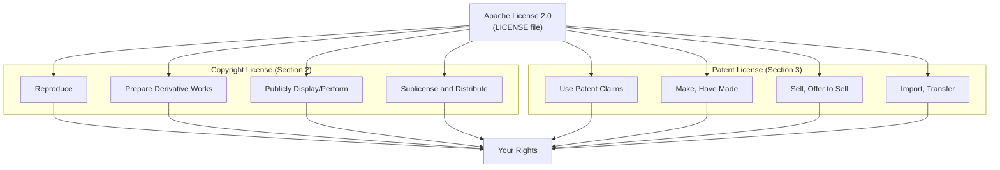
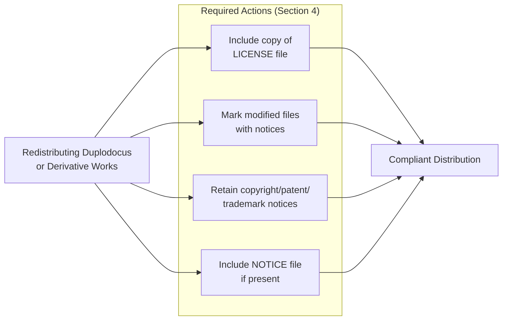
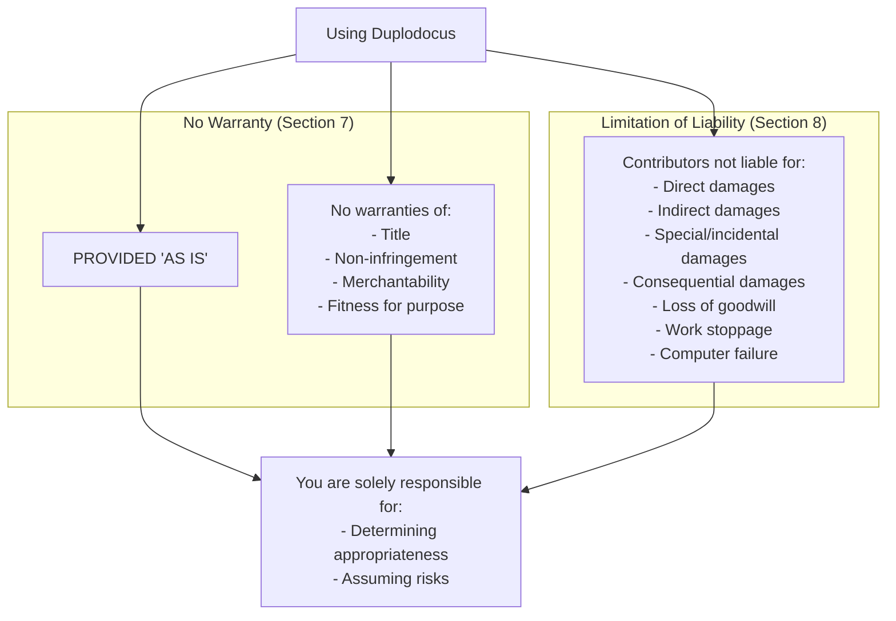
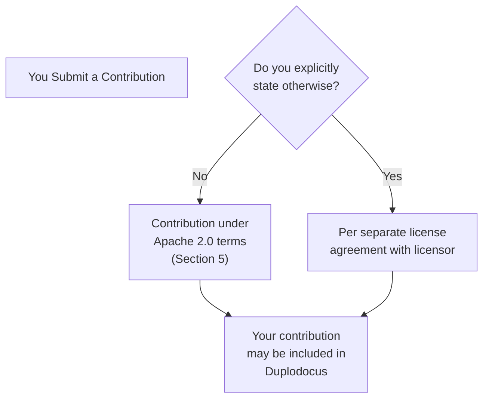

<!-- source: DeepWiki mcp.deepwiki.com · repo allenai/duplodocus · page 8.2 License · fetched 2026-10-26 -->

# License

Relevant source files

The following files were used as context for generating this wiki page:

- [LICENSE](LICENSE)

This page documents the licensing terms for Duplodocus. The project is released under the Apache License, Version 2.0, which governs how you may use, modify, and distribute the software.

## License Overview

Duplodocus is licensed under the **Apache License, Version 2.0** (January 2004). The full license text is available in [LICENSE:1-202]().

The Apache 2.0 license is a permissive open-source license that allows users to freely use, modify, and distribute the software for any purpose, including commercial applications, with minimal restrictions.

| License Property | Value |
|-----------------|-------|
| **License Type** | Apache License 2.0 |
| **License URL** | http://www.apache.org/licenses/LICENSE-2.0 |
| **Permissions** | Commercial use, modification, distribution, patent use, private use |
| **Conditions** | License and copyright notice, state changes |
| **Limitations** | Liability, warranty |

**Sources:** [LICENSE:1-3]()

## Permissions Granted

**Grant of Copyright License (Section 2)**

The license grants you a perpetual, worldwide, non-exclusive, no-charge, royalty-free, irrevocable copyright license to:

- **Reproduce** the work in Source or Object form
- **Prepare Derivative Works** based on Duplodocus
- **Publicly display and perform** the work
- **Sublicense and distribute** the work and derivative works

These rights apply to both Source form (the preferred form for making modifications, including source code and documentation) and Object form (compiled object code, generated documentation, and other transformed outputs).

**Grant of Patent License (Section 3)**

Contributors also grant you a patent license covering any patent claims necessarily infringed by their contributions. This patent license is irrevocable except if you initiate patent litigation claiming that Duplodocus infringes your patents.

**Sources:** [LICENSE:66-87]()

## Redistribution Requirements

When you redistribute Duplodocus or derivative works, you must comply with specific requirements:

### Specific Requirements

| Requirement | Description | Reference |
|------------|-------------|-----------|
| **License Copy** | You must provide recipients a copy of the Apache 2.0 License | [LICENSE:94-95]() |
| **Change Notices** | Modified files must carry prominent notices stating that you changed them | [LICENSE:97-98]() |
| **Retain Notices** | Keep all copyright, patent, trademark, and attribution notices from the original | [LICENSE:100-104]() |
| **NOTICE File** | If the work includes a NOTICE file, include its contents in your distribution | [LICENSE:106-121]() |

**Sources:** [LICENSE:89-128]()

## Key Definitions

The license defines several important terms that govern its interpretation:

### Work and Derivative Works

- **"Work"** means Duplodocus itself, whether in Source or Object form, as indicated by copyright notices ([LICENSE:35-38]())
- **"Derivative Works"** means any work based on or derived from Duplodocus that represents an original work of authorship ([LICENSE:40-46]())
- Works that merely link to Duplodocus interfaces are **not** considered Derivative Works

### Contribution

- **"Contribution"** means any work of authorship intentionally submitted to the project for inclusion ([LICENSE:48-60]())
- **"Contributor"** means any individual or Legal Entity that has made a Contribution ([LICENSE:62-64]())

**Sources:** [LICENSE:7-64]()

## Disclaimers and Limitations

### Disclaimer of Warranty (Section 7)

The work is provided on an **"AS IS" BASIS, WITHOUT WARRANTIES OR CONDITIONS OF ANY KIND**, either express or implied. This includes, but is not limited to, warranties of:

- Title
- Non-infringement  
- Merchantability
- Fitness for a particular purpose

You are solely responsible for determining the appropriateness of using or redistributing Duplodocus and assume any risks associated with exercising permissions under the license.

**Sources:** [LICENSE:143-151]()

### Limitation of Liability (Section 8)

Contributors are **not liable** for any damages arising from the use or inability to use Duplodocus, including:

- Direct, indirect, special, incidental, or consequential damages
- Loss of goodwill, work stoppage, computer failure or malfunction
- Any and all other commercial damages or losses

This limitation applies under any legal theory (tort, contract, or otherwise), even if the contributor has been advised of the possibility of such damages.

**Sources:** [LICENSE:153-163]()

## Trademark Limitations

The Apache 2.0 license **does not grant permission** to use:

- Trade names of the licensor
- Trademarks of the licensor
- Service marks of the licensor
- Product names of the licensor

Such use is only permitted for reasonable and customary purposes in describing the origin of the work and reproducing the content of the NOTICE file (if present).

**Sources:** [LICENSE:138-141]()

## Contribution Terms

Unless you explicitly state otherwise, any Contribution you intentionally submit for inclusion in Duplodocus is under the same Apache 2.0 terms and conditions, without any additional terms or conditions.

However, this does not supersede or modify any separate license agreement you may have executed with the licensor regarding your contributions.

**Sources:** [LICENSE:130-136]()

## Practical Guidance for Users

### You May

✓ **Use Duplodocus** for any purpose, including commercial applications  
✓ **Modify** the source code to suit your needs  
✓ **Distribute** original or modified versions  
✓ **Sublicense** your derivative works under different terms (with restrictions)  
✓ **Use patent claims** covered by the license  

### You Must

✓ **Include** a copy of [LICENSE:1-202]() with any distribution  
✓ **State changes** you made to modified files  
✓ **Preserve** copyright and attribution notices  
✓ **Include NOTICE** file contents if redistributing  

### You Cannot

✗ **Hold contributors liable** for damages  
✗ **Expect warranties** of any kind  
✗ **Use trademarks** without permission (beyond fair use)  
✗ **Claim your modifications** are endorsed by original contributors  

**Sources:** [LICENSE:1-202]()

## Accepting Additional Obligations

While redistributing Duplodocus or derivative works, you may choose to offer acceptance of support, warranty, indemnity, or other liability obligations for a fee. However:

- You may act **only on your own behalf** and **sole responsibility**
- You must **indemnify, defend, and hold harmless** each Contributor for any liability incurred by reason of your accepting such warranty or additional liability

**Sources:** [LICENSE:165-174]()

## License Compliance Checklist

When redistributing Duplodocus, verify compliance using this checklist:

| Item | Required? | Location |
|------|-----------|----------|
| Copy of Apache 2.0 License included | ✓ Yes | [LICENSE:1-202]() |
| Modified files marked with change notices | ✓ If modified | [LICENSE:97-98]() |
| Original copyright/patent/trademark notices retained | ✓ Yes | [LICENSE:100-104]() |
| NOTICE file contents included (if applicable) | ✓ If present | [LICENSE:106-121]() |
| Attribution to original work clear | ✓ Yes | [LICENSE:100-104]() |

**Sources:** [LICENSE:89-128]()

---

For information about contributing to Duplodocus development, see [Development Guide](#7). For the project's release process, see [Release Process](#7.2).