# Page: Overview

# Overview

<details>
<summary>Relevant source files</summary>

The following files were used as context for generating this wiki page:

- [Cargo.toml](Cargo.toml)
- [README.md](README.md)
- [src/main.rs](src/main.rs)

</details>


This document provides a high-level introduction to Duplodocus, a high-performance document deduplication tool implemented in Rust. It covers the three primary deduplication strategies (Exact, MinHash, and Suffix Array), the distinction between memory-based and disk-based processing modes, and how the CLI routes commands to their implementations.

For detailed installation and usage instructions, see [Getting Started](#1.1). For architectural details about data flow and module organization, see [Architecture Overview](#1.2).

## What is Duplodocus?

Duplodocus is a command-line tool for deduplicating large-scale JSONL datasets. It provides three distinct approaches to identifying duplicate or near-duplicate content:

| Strategy | Purpose | Scale |
|----------|---------|-------|
| **Exact** | Removes documents with identical content using hash-based matching | Any size |
| **MinHash** | Finds near-duplicate documents using Locality-Sensitive Hashing (LSH) | Any size |
| **Suffix Array** | Identifies repeated substring sequences within and across documents | Any size |

Each strategy is available in both memory-based and disk-based variants, allowing users to select the appropriate implementation based on dataset size and available resources.

**Sources:** [README.md:1-36](), [src/main.rs:1-87]()

## Deduplication Strategies

### Exact Deduplication

Exact deduplication removes documents that are byte-for-byte identical. The tool computes a hash (default: 128-bit) of each document's content and uses this hash to identify duplicates. Documents with identical hashes are considered duplicates, and only one copy is retained.

**Implementation modules:**
- `exact_dedup_memory` - Single-pass in-memory implementation
- `exact_dedup_disk` - Two-phase disk-based implementation (group → prune)

### MinHash Fuzzy Deduplication

MinHash deduplication identifies near-duplicates based on Jaccard similarity using the MinHash LSH algorithm from [Lee et al. 2021](https://arxiv.org/abs/2107.06499). Documents are represented as sets of n-grams (shingles), and MinHash signatures approximate their pairwise Jaccard similarity. LSH banding groups similar documents into candidate pairs, and Union-Find constructs connected components of duplicates.

**Implementation modules:**
- `minhash_memory` - All-in-one in-memory pipeline
- `minhash_disk` - Five-stage distributed pipeline (file map → hash docs → gather edges → build Union-Find → clean files)
- `minhash_base` - Core MinHash algorithms shared by both variants
- `uf_rush2` - Union-Find data structure for connected components

For comprehensive information about MinHash theory and implementation, see [MinHash Fuzzy Deduplication](#3).

### Suffix Array Substring Deduplication

The Suffix Array system identifies repeated substring sequences of configurable length (default: 500 tokens). It constructs suffix arrays from the concatenated text of all documents, then performs efficient k-way merging to find all repeated sequences. These matches are consolidated into intervals and annotated back onto the original documents.

**Implementation modules:**
- `sa_base` - Four-stage pipeline orchestration
- `sa_utils` - Streaming, merging, and I/O utilities
- `table_generic` - Generic suffix table with SAIS algorithm
- `compact_uint` - Memory-efficient integer types for indices

For detailed information about the SA pipeline, see [Suffix Array System](#2).

**Sources:** [src/main.rs:16-24,123-138](), [README.md:18-35]()

## Processing Modes

### Memory-Based Processing

Memory-based methods store all intermediate data structures in RAM. They are simpler to use (single command execution) and require no setup, but are limited by available memory. These methods are suitable for datasets under approximately 10GB for MinHash and 100GB for exact deduplication.

**Characteristics:**
- Single command execution
- No distributed coordination required
- Limited by system RAM
- Faster execution for small datasets

### Disk-Based Processing

Disk-based methods store intermediate results on disk, enabling processing of arbitrarily large datasets. They are designed for distributed execution across multiple machines, with each machine processing a subset of the data. Fast local storage (NVMe, SSD) is strongly recommended for optimal performance.

**Characteristics:**
- Multi-stage execution with intermediate files
- Supports distributed parallel processing
- Requires 3-5x input size in storage space
- Enables horizontal scaling

| Method | Memory Variant | Disk Variant Stages |
|--------|----------------|---------------------|
| Exact | 1 stage | 2 stages (group, prune) |
| MinHash | 1 stage | 5 stages (file map, hash docs, gather edges, build UF, clean files) |
| Suffix Array | N/A (always disk-backed) | 4 stages (make tables, get matches, merge matches, annotate) |

**Sources:** [src/main.rs:25-32,132-138](), [README.md:299-316]()

## CLI Command Structure

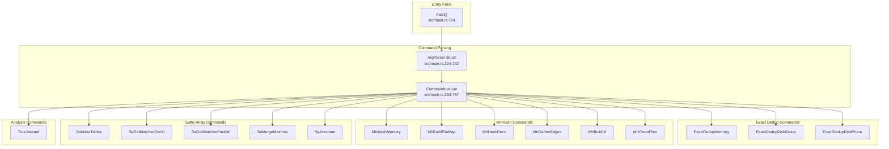

**Diagram: CLI Command Structure and Routing**

The CLI uses `clap` for argument parsing, with each deduplication method exposed as a separate subcommand. The `Commands` enum at [src/main.rs:234-787]() defines all available subcommands with their parameters, and the `main()` function at [src/main.rs:794-1036]() dispatches each command to its implementation function.

**Sources:** [src/main.rs:88-104,224-787,794-1036]()

## Implementation Mapping

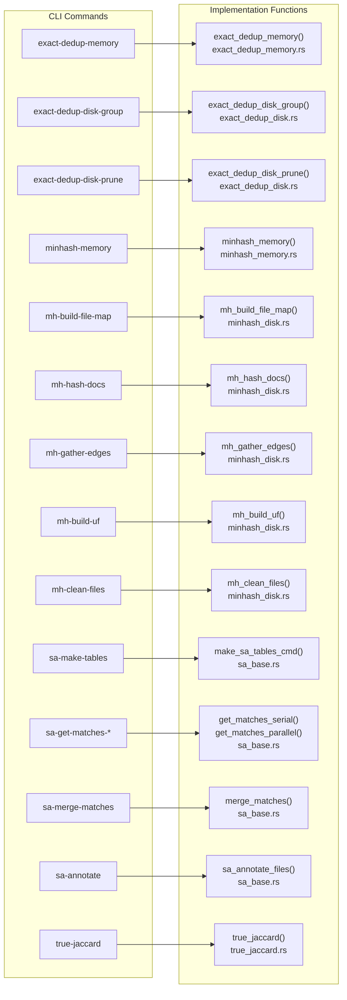

**Diagram: Command to Implementation Mapping**

Each CLI command maps to a specific implementation function in its respective module. The `main()` function performs this routing using a match statement at [src/main.rs:801-1034]().

**Sources:** [src/main.rs:95-103,801-1034]()

## Module Organization

The codebase is organized into modules by deduplication strategy and supporting infrastructure:

| Module | Purpose | Key Exports |
|--------|---------|-------------|
| `main` | CLI entry point and command routing | `main()`, `ArgParser`, `Commands` |
| `exact_dedup_memory` | In-memory exact deduplication | `exact_dedup_memory()` |
| `exact_dedup_disk` | Disk-based exact deduplication | `exact_dedup_disk_group()`, `exact_dedup_disk_prune()` |
| `minhash_memory` | In-memory MinHash pipeline | `minhash_memory()` |
| `minhash_disk` | Disk-based MinHash pipeline | `mh_build_file_map()`, `mh_hash_docs()`, `mh_gather_edges()`, `mh_build_uf()`, `mh_clean_files()` |
| `minhash_base` | Core MinHash algorithms | Shared MinHash implementation |
| `minhash_config` | MinHash configuration management | Configuration structures |
| `sa_base` | Suffix Array pipeline orchestration | `make_sa_tables_cmd()`, `get_matches_serial()`, `get_matches_parallel()`, `merge_matches()`, `sa_annotate_files()` |
| `sa_utils` | SA streaming and merging utilities | `SAStream`, `LoserTree`, `MatchWriter` |
| `table_generic` | Suffix table with SAIS | `DynamicSuffixTable` |
| `table_old` | Legacy suffix table implementation | Historical reference |
| `compact_uint` | Memory-efficient integer types | `CompactUint`, `U40` |
| `sa_config` | SA configuration management | `SAConfig` |
| `uf_rush2` | Union-Find data structure | `UnionFind` |
| `true_jaccard` | True Jaccard similarity calculation | `true_jaccard()` |
| `utils` | Shared utilities | Helper functions |
| `storage` | Generic file I/O abstractions | `GenWriter` |

**Sources:** [src/main.rs:105-122]()

## Input and Output Format

### Input Requirements

Duplodocus expects input data as **JSONL** (JSON Lines) files, where each line is a valid JSON document. Files should be located in a single input directory and must have unique basenames.

**Example input document:**
```json
{"id": "doc123", "text": "This is the document content.", "metadata": {}}
```

### Output Formats

The tool supports two output modes:

1. **Removal Mode** (default): Duplicate documents are removed, and only unique documents are written to the output directory.

2. **Annotation Mode**: All documents are retained, but duplicates are annotated with metadata indicating their duplicate status and cluster ID. This mode is enabled by specifying an `--annotate-key` parameter.

**Example annotated document:**
```json
{
  "id": "doc123",
  "text": "This is the document content.",
  "metadata": {},
  "dedup_info": {
    "is_duplicate": true,
    "cluster_id": 42,
    "kept_document": false
  }
}
```

### Text Extraction

All deduplication methods require a `--text-key` parameter (default: `"text"`) that specifies which JSON field contains the document text to be deduplicated. Nested keys are supported using dot notation (e.g., `"content.body"`).

**Sources:** [src/main.rs:252-277,379-381](), [README.md:96-104]()

## Design Principles

### No Remote I/O in Rust

Duplodocus does not perform S3 or other remote storage operations directly. All S3 interaction is expected to happen outside the Rust codebase using tools like `s5cmd` or `boto3`. The tool operates exclusively on local filesystem paths.

### Fast Local Storage Assumption

The disk-based methods assume fast local storage (NVMe, SSD) for intermediate files. Using network-attached storage or slow disks will significantly degrade performance.

### Small File Assumption

Individual JSONL input files are expected to fit in memory. The tool reads entire files into memory for processing, then writes output files atomically.

### Unique Basename Requirement

All input files within a directory must have unique basenames. The tool uses basenames as identifiers in intermediate file mapping.

**Sources:** [README.md:317-323]()

## System Requirements

| Variant | RAM | Storage | Best For |
|---------|-----|---------|----------|
| Exact + Memory | Dataset size + 2-3GB | Input + output size | < 100GB datasets |
| Exact + Disk | 8-16GB minimum | 3-5x input size | > 100GB datasets |
| MinHash + Memory | Dataset size + 5-10GB | Input + output size | < 10GB datasets |
| MinHash + Disk | 8-16GB minimum | 3-5x input size | > 10GB datasets |
| Suffix Array | 16-32GB minimum | 3-5x input size | Any size, substring matching |

The tool leverages the `rayon` crate for parallelism within a single machine. Thread count can be controlled via the `--threads` parameter or the `RAYON_NUM_THREADS` environment variable.

**Sources:** [README.md:299-316](), [src/main.rs:796-799](), [Cargo.toml:26]()

## Dependencies

Key external dependencies include:

| Crate | Purpose | Version |
|-------|---------|---------|
| `clap` | Command-line argument parsing | 4.1.11 |
| `serde` / `serde_json` | JSON serialization | 1.0 |
| `rayon` | Data parallelism | 1.10.0 |
| `tiktoken-rs` | OpenAI tokenizers (cl100k, p50k) | 0.5.8 |
| `unicode-segmentation` | Unicode grapheme tokenizer | 1.12.0 |
| `dashmap` | Concurrent hash map | 5.5.3 |
| `memmap2` | Memory-mapped file I/O | 0.9.9 |
| `xxhash-rust` | Fast non-cryptographic hashing | 0.8 |
| `sha2` | Cryptographic hashing | 0.9 |
| `zstd` | Compression for output files | 0.13.1 |
| `mj_io` | JSONL I/O utilities | 0.1.7 |

**Sources:** [Cargo.toml:8-38]()

---

# Page: Getting Started

# Getting Started

<details>
<summary>Relevant source files</summary>

The following files were used as context for generating this wiki page:

- [README.md](README.md)
- [src/main.rs](src/main.rs)

</details>


## Purpose and Scope

This page provides installation instructions, basic CLI usage patterns, and guidance for selecting the appropriate deduplication method for your dataset. For comprehensive architecture details, see [Architecture Overview](#1.2). For detailed explanations of specific deduplication systems, see [Suffix Array System](#2), [MinHash Fuzzy Deduplication](#3), and [Exact Deduplication](#4).

## Prerequisites

### Required Software

| Component | Minimum Version | Purpose |
|-----------|----------------|---------|
| Rust toolchain | 1.70+ | Building from source |
| Git | Any recent version | Cloning repository |
| Cargo | Bundled with Rust | Build system and package manager |

### Optional Software

| Component | Purpose |
|-----------|---------|
| s5cmd | Fast S3 data transfers (recommended for cloud deployments) |
| AWS CLI | AWS credentials configuration |
| mdadm | RAID configuration on multi-NVMe instances |

**Sources:** [README.md:40-66]()

## Installation

### Build from Source

```bash
# Install Rust
curl --proto '=https' --tlsv1.2 -sSf https://sh.rustup.rs | sh
source ~/.bashrc

# Clone repository
git clone git@github.com:allenai/duplodocus.git
cd duplodocus

# Build release binary
cargo build --release
```

The compiled binary will be located at `./target/release/dedup-tool`.

**Sources:** [README.md:68-81]()

### AWS EC2 Setup (Optional)

For large-scale processing on i4i/i7i instances with NVMe drives:

```bash
# Configure RAID0 array from NVMe drives
sudo yum install mdadm -y
sudo mdadm --create /dev/md0 --level=0 --raid-devices=8 \
  /dev/nvme1n1 /dev/nvme2n1 /dev/nvme3n1 /dev/nvme4n1 \
  /dev/nvme5n1 /dev/nvme6n1 /dev/nvme7n1 /dev/nvme8n1
sudo mkfs.xfs /dev/md0
sudo mkdir /mnt/raid0
sudo mount /dev/md0 /mnt/raid0
sudo chown -R $USER /mnt/raid0

# Install build dependencies
sudo yum install gcc cmake openssl-devel g++ htop git -y

# Install s5cmd for fast S3 transfers
wget https://github.com/peak/s5cmd/releases/download/v2.2.2/s5cmd_2.2.2_Linux-64bit.tar.gz
tar -xvzf s5cmd_2.2.2_Linux-64bit.tar.gz
sudo mv s5cmd /usr/local/bin
```

**Sources:** [README.md:44-66]()

## Understanding the CLI Structure

### Command Hierarchy

Duplodocus uses a subcommand-based CLI where each operation is invoked as:

```bash
cargo run --release -- <subcommand> [options]
```

Or with the built binary:

```bash
./target/release/dedup-tool <subcommand> [options]
```

### Global Options

```bash
--threads <N>    Set RAYON_NUM_THREADS for parallel operations (default: 0 = auto)
```

**Diagram: CLI Command Structure**

```mermaid
graph TD
    CLI["dedup-tool CLI<br/>(main.rs::main)"]
    
    CLI --> ExactMem["exact-dedup-memory<br/>(Commands::ExactDedupMemory)"]
    CLI --> ExactGroup["exact-dedup-disk-group<br/>(Commands::ExactDedupDiskGroup)"]
    CLI --> ExactPrune["exact-dedup-disk-prune<br/>(Commands::ExactDedupDiskPrune)"]
    CLI --> MHMem["minhash-memory<br/>(Commands::MinhashMemory)"]
    CLI --> MHMap["mh-build-file-map<br/>(Commands::MhBuildFileMap)"]
    CLI --> MHHash["mh-hash-docs<br/>(Commands::MhHashDocs)"]
    CLI --> MHEdges["mh-gather-edges<br/>(Commands::MhGatherEdges)"]
    CLI --> MHUF["mh-build-uf<br/>(Commands::MhBuildUf)"]
    CLI --> MHClean["mh-clean-files<br/>(Commands::MhCleanFiles)"]
    CLI --> SAMake["sa-make-tables<br/>(Commands::SaMakeTables)"]
    CLI --> SASerial["sa-get-matches-serial<br/>(Commands::SaGetMatchesSerial)"]
    CLI --> SAParallel["sa-get-matches-parallel<br/>(Commands::SaGetMatchesParallel)"]
    CLI --> SAMerge["sa-merge-matches<br/>(Commands::SaMergeMatches)"]
    CLI --> SAAnnotate["sa-annotate<br/>(Commands::SaAnnotate)"]
    CLI --> TrueJacc["true-jaccard<br/>(Commands::TrueJaccard)"]
    
    ExactMem --> ExactMemFn["exact_dedup_memory()"]
    ExactGroup --> ExactGroupFn["exact_dedup_disk_group()"]
    ExactPrune --> ExactPruneFn["exact_dedup_disk_prune()"]
    MHMem --> MHMemFn["minhash_memory()"]
    MHMap --> MHMapFn["mh_build_file_map()"]
    MHHash --> MHHashFn["mh_hash_docs()"]
    MHEdges --> MHEdgesFn["mh_gather_edges()"]
    MHUF --> MHUFFn["mh_build_uf()"]
    MHClean --> MHCleanFn["mh_clean_files()"]
    SAMake --> SAMakeFn["make_sa_tables_cmd()"]
    SASerial --> SASerialFn["get_matches_serial()"]
    SAParallel --> SAParallelFn["get_matches_parallel()"]
    SAMerge --> SAMergeFn["merge_matches()"]
    SAAnnotate --> SAAnnotateFn["sa_annotate_files()"]
    TrueJacc --> TrueJaccFn["true_jaccard()"]
```

**Sources:** [src/main.rs:89-103](), [src/main.rs:224-787](), [src/main.rs:794-1036]()

## Choosing a Deduplication Method

### Decision Tree

**Diagram: Method Selection Decision Tree**

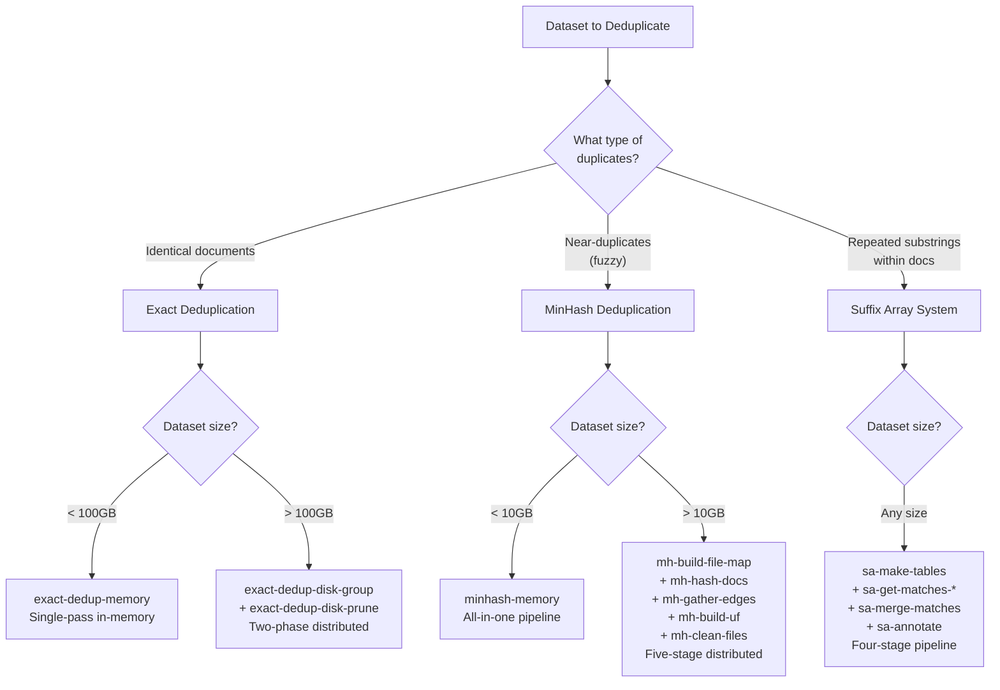

### Method Comparison Table

| Method | Use Case | Dataset Size | Parallelizable | Stages |
|--------|----------|--------------|----------------|--------|
| `exact-dedup-memory` | Identical documents | < 100GB | Single-threaded | 1 |
| `exact-dedup-disk-*` | Identical documents | Any size | Multi-node | 2 |
| `minhash-memory` | Near-duplicates | < 10GB | Single-node | 1 |
| `mh-*` (disk) | Near-duplicates | Any size | Multi-node | 5 |
| `sa-*` | Repeated substrings | Any size | Multi-node | 4 |

**Sources:** [src/main.rs:7-14](), [README.md:20-28]()

## Basic Examples

### Exact Deduplication (Memory-Based)

For small datasets where identical documents should be removed:

```bash
cargo run --release -- exact-dedup-memory \
  --input-dir /data/documents \
  --output-dir /data/unique \
  --text-key "content"
```

**Required Parameters:**
- `--input-dir`: Directory containing JSONL files
- `--output-dir`: Directory for deduplicated output
- `--text-key`: JSON field containing document text

**Optional Parameters:**
- `--hash-key`: Use existing hash field instead of computing hash
- `--hash-bits`: Hash size in bits (default: 128)
- `--annotate-key`: Add duplicate metadata instead of removing documents

**Sources:** [src/main.rs:239-277](), [README.md:96-104]()

### Exact Deduplication (Disk-Based)

For large datasets requiring distributed processing:

**Step 1: Group by hash**
```bash
cargo run --release -- exact-dedup-disk-group \
  --input-dir /data/documents \
  --storage-dir /scratch/work \
  --hash-key "doc_id" \
  --num-bins 100
```

**Step 2: Prune duplicates**
```bash
cargo run --release -- exact-dedup-disk-prune \
  --storage-dir /scratch/work \
  --output-dir /data/unique \
  --hash-key "doc_id"
```

**Sources:** [src/main.rs:279-345](), [README.md:143-162]()

### MinHash Fuzzy Deduplication (Memory-Based)

For small datasets where near-duplicates should be identified:

```bash
cargo run --release -- minhash-memory \
  --input-dir /data/documents \
  --storage-dir /tmp/work \
  --output-dir /data/deduped \
  --text-key "text" \
  --num-buckets 20 \
  --bucket-size 5 \
  --remove-duplicates true \
  --cleanup-storage
```

**Key Parameters:**
- `--num-buckets`: Number of LSH bands (higher = stricter matching)
- `--bucket-size`: Signatures per band (higher = stricter matching)
- `--ngram-size`: N-gram size for shingling (default: 5)
- `--tokenizer`: Options: `"cl100k"`, `"p50k"`, `"uniseg"`, or character-level

**Sources:** [src/main.rs:350-430](), [README.md:106-120]()

### MinHash Fuzzy Deduplication (Disk-Based)

For large-scale distributed processing:

**Diagram: MinHash Disk Pipeline Flow**

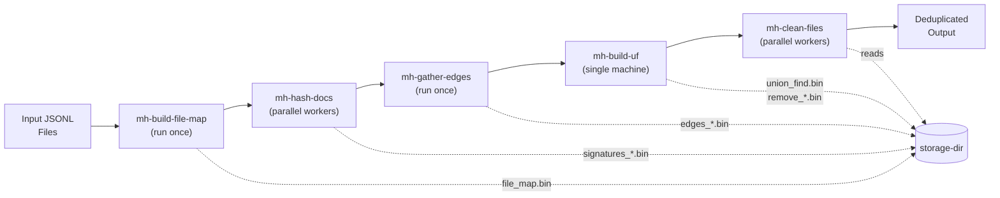

**Step 1: Build file map** (run once)
```bash
cargo run --release -- mh-build-file-map \
  --input-dir /data/documents \
  --storage-dir /shared/work
```

**Step 2: Hash documents** (parallel across workers)
```bash
# Worker 0
cargo run --release -- mh-hash-docs \
  --local-input /data/documents \
  --storage-dir /shared/work \
  --text-key "text" \
  --path-chunk 0 \
  --num-path-chunks 10 \
  --num-buckets 20 \
  --bucket-size 5
```

Repeat for workers 1-9 with different `--path-chunk` values.

**Step 3: Gather edges** (run once)
```bash
cargo run --release -- mh-gather-edges \
  --storage-dir /shared/work
```

**Step 4: Build Union-Find** (must run on single machine)
```bash
cargo run --release -- mh-build-uf \
  --storage-dir /shared/work \
  --num-path-chunks 10
```

**Step 5: Clean files** (parallel across workers)
```bash
# Worker 0
cargo run --release -- mh-clean-files \
  --input-dir /data/documents \
  --storage-dir /shared/work \
  --output-dir /data/deduped \
  --path-chunk 0 \
  --num-path-chunks 10 \
  --remove-duplicates true
```

Repeat for workers 1-9 with different `--path-chunk` values.

**Sources:** [src/main.rs:432-644](), [README.md:191-251]()

### Suffix Array Pipeline

For finding repeated substrings within and across documents:

**Step 1: Make suffix array tables**
```bash
cargo run --release -- sa-make-tables \
  --input-dir /data/documents \
  --output-dir /scratch/sa_work \
  --text-key "text"
```

**Step 2: Find matches** (choose serial or parallel)
```bash
# Serial (simpler)
cargo run --release -- sa-get-matches-serial \
  --storage-dir /scratch/sa_work \
  --match-length 500

# Or parallel (faster)
cargo run --release -- sa-get-matches-parallel \
  --storage-dir /scratch/sa_work \
  --match-length 500
```

**Step 3: Merge matches**
```bash
cargo run --release -- sa-merge-matches \
  --storage-dir /scratch/sa_work
```

**Step 4: Annotate documents**
```bash
cargo run --release -- sa-annotate \
  --input-dir /data/documents \
  --storage-dir /scratch/sa_work \
  --output-dir /data/annotated \
  --annotate-key "repeated_text"
```

**Sources:** [src/main.rs:704-786](), [src/main.rs:990-1031]()

## Common Parameters and Patterns

### Input/Output Parameters

| Parameter | Description | Used By |
|-----------|-------------|---------|
| `--input-dir` | Directory containing input JSONL files | Most commands |
| `--output-dir` | Directory for output files | Final-stage commands |
| `--storage-dir` | Working directory for intermediate files | Disk-based methods |
| `--text-key` | JSON field containing document text | Most commands |

### Parallelization Parameters

| Parameter | Description | Used By |
|-----------|-------------|---------|
| `--path-chunk` | This worker's chunk ID (0 to N-1) | `mh-hash-docs`, `mh-clean-files` |
| `--num-path-chunks` | Total number of parallel chunks | `mh-hash-docs`, `mh-build-uf`, `mh-clean-files` |
| `--threads` | Number of threads (global option) | All commands |

### Configuration Options

| Parameter | Description | Used By |
|-----------|-------------|---------|
| `--config` | Path to YAML configuration file | MinHash, SA, TrueJaccard |
| `--annotate-key` | JSON field for duplicate metadata | Most commands (optional) |
| `--remove-duplicates` | Remove duplicates vs. annotate only | MinHash, Exact |

**Sources:** [src/main.rs:252-277](), [src/main.rs:366-430](), [src/main.rs:467-524]()

## Data Format Requirements

### Input Format

All methods expect JSONL (JSON Lines) format:

```json
{"text": "Document content here...", "id": "doc_001"}
{"text": "Another document...", "id": "doc_002"}
```

### Directory Structure Requirements

- All input files must have **unique basenames** within `--input-dir`
- Input files should fit in memory individually (multi-GB files are supported, but may slow processing)
- Shared `--storage-dir` must be accessible to all workers in distributed setups

**Sources:** [README.md:319-323]()

## System Requirements

### Memory-Based Methods

| Resource | Requirement |
|----------|-------------|
| RAM | Dataset size + 2-3GB overhead |
| Storage | Input size + output size |
| Best for | Datasets < 10-100GB |

### Disk-Based Methods

| Resource | Requirement |
|----------|-------------|
| RAM | 8-16GB minimum |
| Storage | 3-5x input size (for intermediate files) |
| Storage Type | Fast local storage (NVMe/SSD) strongly recommended |
| Best for | Datasets > 100GB or distributed processing |

**Sources:** [README.md:299-316]()

## Next Steps

- For detailed architecture information, see [Architecture Overview](#1.2)
- For suffix array internals, see [Suffix Array System](#2)
- For MinHash algorithm details, see [MinHash Fuzzy Deduplication](#3)
- For exact deduplication details, see [Exact Deduplication](#4)
- For analysis tools, see [Advanced Analysis Tools](#5)

---

# Page: Architecture Overview

# Architecture Overview

<details>
<summary>Relevant source files</summary>

The following files were used as context for generating this wiki page:

- [Cargo.toml](Cargo.toml)
- [src/main.rs](src/main.rs)

</details>


This document describes the high-level architecture of Duplodocus, including its module organization, subsystem boundaries, and data flow patterns. It provides a structural understanding of how the three deduplication strategies (Exact, MinHash, and Suffix Array) are implemented and how they share common infrastructure.

For detailed information on specific subsystems, see [Suffix Array System](#2), [MinHash Fuzzy Deduplication](#3), and [Exact Deduplication](#4). For building and dependency information, see [Building and Dependencies](#7.1).

---

## System Layers

Duplodocus follows a layered architecture where the CLI dispatches commands to specialized subsystems that share common infrastructure.

### CLI Entry Point and Command Routing

```mermaid
graph TB
    Main["main.rs::main()"]
    Parser["ArgParser<br/>(clap)"]
    Commands["Commands enum"]
    
    Main --> Parser
    Parser --> Commands
    
    subgraph "Exact Deduplication"
        ExactMem["exact_dedup_memory()"]
        ExactGroup["exact_dedup_disk_group()"]
        ExactPrune["exact_dedup_disk_prune()"]
    end
    
    subgraph "MinHash Deduplication"
        MHMem["minhash_memory()"]
        MHFileMap["mh_build_file_map()"]
        MHHash["mh_hash_docs()"]
        MHGather["mh_gather_edges()"]
        MHUf["mh_build_uf()"]
        MHClean["mh_clean_files()"]
    end
    
    subgraph "Suffix Array Pipeline"
        SAMake["make_sa_tables_cmd()"]
        SASerial["get_matches_serial()"]
        SAParallel["get_matches_parallel()"]
        SAMerge["merge_matches()"]
        SAAnnotate["sa_annotate_files()"]
    end
    
    subgraph "Analysis Tools"
        TrueJacc["true_jaccard()"]
    end
    
    Commands -->|"ExactDedupMemory"| ExactMem
    Commands -->|"ExactDedupDiskGroup"| ExactGroup
    Commands -->|"ExactDedupDiskPrune"| ExactPrune
    
    Commands -->|"MinhashMemory"| MHMem
    Commands -->|"MhBuildFileMap"| MHFileMap
    Commands -->|"MhHashDocs"| MHHash
    Commands -->|"MhGatherEdges"| MHGather
    Commands -->|"MhBuildUf"| MHUf
    Commands -->|"MhCleanFiles"| MHClean
    
    Commands -->|"SaMakeTables"| SAMake
    Commands -->|"SaGetMatchesSerial"| SASerial
    Commands -->|"SaGetMatchesParallel"| SAParallel
    Commands -->|"SaMergeMatches"| SAMerge
    Commands -->|"SaAnnotate"| SAAnnotate
    
    Commands -->|"TrueJaccard"| TrueJacc
```

**Sources:** [src/main.rs:224-787](), [src/main.rs:793-1036]()

The `main()` function uses the `clap` crate to parse commands and dispatches to one of 21 subcommands. The `Commands` enum at [src/main.rs:234-787]() defines all available operations, grouped into four categories: Exact Deduplication (3 commands), MinHash Deduplication (6 commands), Suffix Array operations (5 commands), and Analysis Tools (1 command).

---

## Module Organization

### Module Declaration and Dependencies

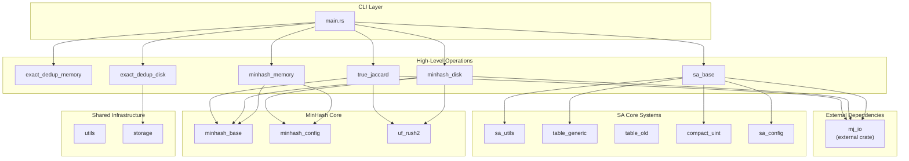

**Sources:** [src/main.rs:105-122]()

Duplodocus is organized into 16 internal modules declared at [src/main.rs:105-122](). The module structure creates clear subsystem boundaries:

| Module | Purpose | Key Dependencies |
|--------|---------|------------------|
| `exact_dedup_memory` | In-memory exact deduplication | `utils` |
| `exact_dedup_disk` | Disk-based exact deduplication | `storage` |
| `minhash_memory` | In-memory MinHash pipeline | `minhash_base`, `minhash_config` |
| `minhash_disk` | Distributed MinHash pipeline | `minhash_base`, `uf_rush2`, `mj_io` |
| `sa_base` | SA pipeline orchestration | `sa_utils`, `table_generic`, `compact_uint`, `sa_config` |
| `sa_utils` | SA streaming and merging | `compact_uint` |
| `table_generic` | Generic suffix array implementation | `compact_uint` |
| `table_old` | Legacy suffix array (reference) | - |
| `compact_uint` | Memory-efficient integer types | - |
| `sa_config` | SA configuration management | - |
| `minhash_base` | Core MinHash algorithms | `minhash_config` |
| `minhash_config` | MinHash configuration | - |
| `uf_rush2` | Union-Find data structure | - |
| `true_jaccard` | Exact similarity computation | `minhash_base`, `uf_rush2` |
| `utils` | Shared utilities | - |
| `storage` | Disk I/O utilities | - |

**Sources:** [src/main.rs:105-122]()

---

## Deduplication Subsystems

### Exact Deduplication Architecture

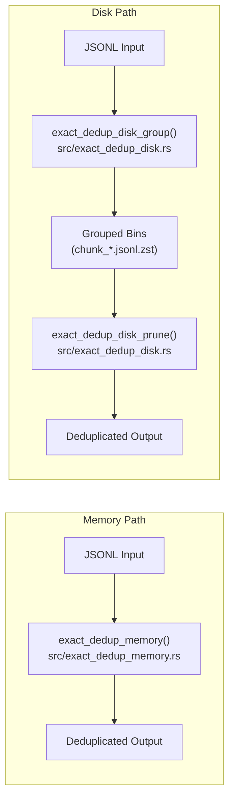

**Sources:** [src/main.rs:96-97](), [src/main.rs:802-839]()

The exact deduplication subsystem provides two implementations:

- **Memory-based** ([src/main.rs:802-816]()): Single-pass hash-based deduplication using in-memory hash maps. Invoked via `ExactDedupMemory` command.
- **Disk-based** ([src/main.rs:818-839]()): Two-phase distributed pipeline. Phase 1 (`exact_dedup_disk_group`) groups documents by hash into bins. Phase 2 (`exact_dedup_disk_prune`) removes duplicates from each bin independently.

### MinHash Deduplication Architecture

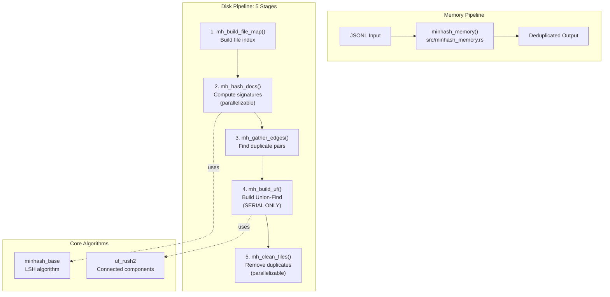

**Sources:** [src/main.rs:98-101](), [src/main.rs:841-957]()

The MinHash subsystem implements fuzzy deduplication using Locality-Sensitive Hashing (LSH):

- **Memory pipeline** ([src/main.rs:841-875]()): Single command `minhash_memory()` executes all five phases sequentially in memory.
- **Disk pipeline** ([src/main.rs:877-957]()): Five separate commands for distributed processing:
  - `mh_build_file_map()`: Creates file path index
  - `mh_hash_docs()`: Computes MinHash signatures (parallel across path chunks)
  - `mh_gather_edges()`: Groups documents with matching signatures
  - `mh_build_uf()`: Builds global Union-Find structure (must run on single machine)
  - `mh_clean_files()`: Applies deduplication decisions (parallel across path chunks)

Core algorithms are centralized in `minhash_base` for LSH operations and `uf_rush2` for connected component identification.

**Sources:** [src/main.rs:841-957]()

### Suffix Array Architecture

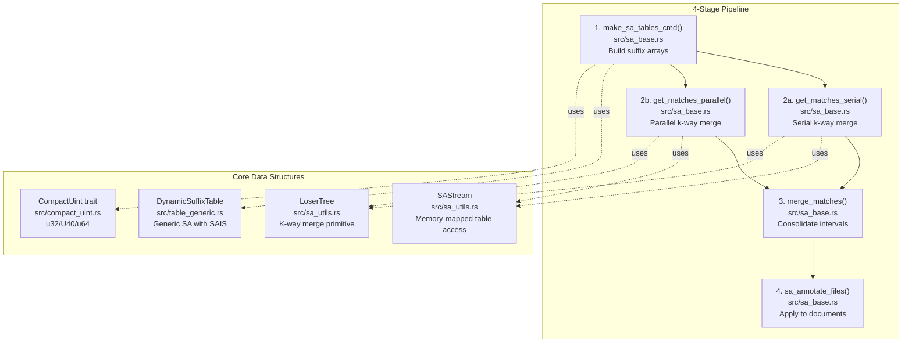

**Sources:** [src/main.rs:102](), [src/main.rs:990-1031]()

The Suffix Array subsystem is the most complex, implementing a four-stage pipeline orchestrated by `sa_base`:

1. **Make Tables** ([src/main.rs:990-1008]()): `make_sa_tables_cmd()` loads documents, chunks them adaptively for memory constraints, and builds suffix arrays using `DynamicSuffixTable` from `table_generic`.

2. **Match Finding** ([src/main.rs:1010-1018]()): Two strategies for finding repeated sequences:
   - `get_matches_serial()`: Single-threaded k-way merge
   - `get_matches_parallel()`: Multi-threaded with alphabet space partitioning
   
   Both use `SAStream` for memory-mapped access and `LoserTree` for efficient k-way merging.

3. **Merge Matches** ([src/main.rs:1020-1022]()): `merge_matches()` consolidates raw matches into document-relative intervals.

4. **Annotate** ([src/main.rs:1024-1030]()): `sa_annotate_files()` applies interval metadata to original documents.

The system uses specialized data structures from `sa_utils`, `table_generic`, and `compact_uint` for memory efficiency and performance.

**Sources:** [src/main.rs:102](), [src/main.rs:990-1031]()

---

## Shared Infrastructure

### Cross-Cutting Concerns

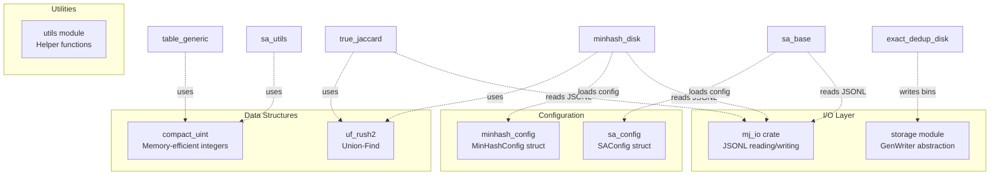

**Sources:** [src/main.rs:105-122](), [Cargo.toml:1-45]()

Duplodocus shares several cross-cutting infrastructure components:

| Component | Type | Users | Purpose |
|-----------|------|-------|---------|
| `mj_io` | External crate | `sa_base`, `minhash_disk`, `true_jaccard` | Efficient JSONL I/O |
| `storage` | Internal module | `exact_dedup_disk` | `GenWriter` abstraction for file output |
| `utils` | Internal module | Multiple | Shared utility functions |
| `compact_uint` | Internal module | `sa_utils`, `table_generic` | Memory-efficient integer storage (U40) |
| `uf_rush2` | Internal module | `minhash_disk`, `true_jaccard` | Union-Find for connected components |
| `sa_config` | Internal module | `sa_base` | SA configuration management |
| `minhash_config` | Internal module | `minhash_base`, `minhash_disk` | MinHash parameter configuration |

**Sources:** [src/main.rs:105-122](), [Cargo.toml:8-38]()

### External Dependencies

Key external dependencies from [Cargo.toml:8-38]():

| Dependency | Version | Purpose |
|------------|---------|---------|
| `clap` | 4.1.11 | CLI argument parsing with derive macros |
| `serde_json` | 1.0.97 | JSON parsing and serialization |
| `zstd` | 0.13.1 | Compression for intermediate files |
| `mj_io` | 0.1.7 | High-performance JSONL I/O |
| `rayon` | 1.10.0 | Data parallelism for CPU-bound tasks |
| `memmap2` | 0.9.9 | Memory-mapped file access (SA tables) |
| `tiktoken-rs` | 0.5.8 | OpenAI tokenizers for text processing |
| `sha2` | 0.9 | Hashing for exact deduplication |
| `xxhash-rust` | 0.8 | Fast hashing for MinHash |

**Sources:** [Cargo.toml:8-38]()

---

## Data Flow Patterns

### Input/Output Structure

All three deduplication strategies follow a common I/O pattern:

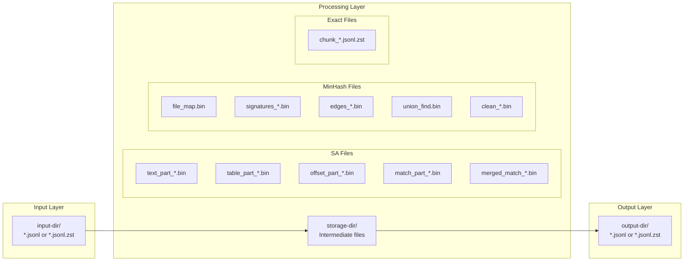

**Sources:** [src/main.rs:36-86](), [src/main.rs:234-787]()

### Processing Models

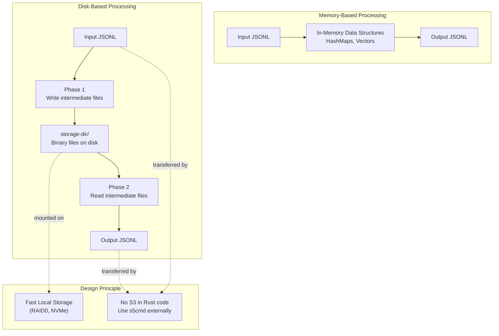

**Sources:** [src/main.rs:7-32](), [src/main.rs:123-218]()

Duplodocus implements two processing models:

### Memory-Based Processing
- All data structures reside in RAM
- Single-pass processing
- Best for datasets under ~10GB
- Simpler deployment (no storage directory setup)
- Examples: `ExactDedupMemory`, `MinhashMemory`

### Disk-Based Processing  
- Intermediate results stored on local disk
- Multi-phase pipelines with explicit file dependencies
- Supports datasets larger than memory
- Enables distributed processing across multiple machines
- Examples: `ExactDedupDisk*`, `MhHash*`, SA pipeline

**Key Design Principle** ([src/main.rs:207-210]()): The Rust code never touches S3 directly. All S3 transfers are handled externally (e.g., using `s5cmd`). Disk-based processing operates on fast local storage (RAID0 NVMe arrays) to maximize I/O throughput.

**Sources:** [src/main.rs:7-32](), [src/main.rs:123-218]()

---

## Thread Pool Configuration

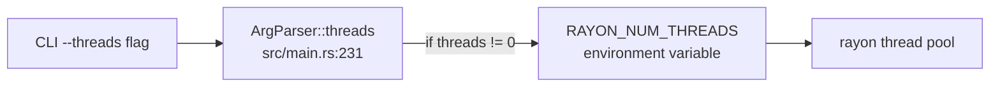

**Sources:** [src/main.rs:224-232](), [src/main.rs:795-799]()

Duplodocus supports global thread pool configuration through the `--threads` flag ([src/main.rs:230-231]()). If specified and non-zero, the value is set in the `RAYON_NUM_THREADS` environment variable ([src/main.rs:797-799]()), which controls the size of the `rayon` parallel executor thread pool used throughout the codebase.

**Sources:** [src/main.rs:224-232](), [src/main.rs:795-799]()

---

## Command Groups and Naming Conventions

Commands follow a consistent naming pattern that reflects their subsystem and processing model:

| Prefix | Processing Model | Example Commands |
|--------|------------------|------------------|
| `exact-dedup-memory` | Exact, Memory | `ExactDedupMemory` |
| `exact-dedup-disk-*` | Exact, Disk | `ExactDedupDiskGroup`, `ExactDedupDiskPrune` |
| `minhash-memory` | MinHash, Memory | `MinhashMemory` |
| `mh-*` | MinHash, Disk | `MhBuildFileMap`, `MhHashDocs`, `MhGatherEdges`, `MhBuildUf`, `MhCleanFiles` |
| `sa-*` | Suffix Array | `SaMakeTables`, `SaGetMatchesSerial`, `SaGetMatchesParallel`, `SaMergeMatches`, `SaAnnotate` |

**Sources:** [src/main.rs:234-787]()

This naming scheme makes it easy to identify the subsystem and whether a command is part of a distributed pipeline. Disk-based commands with multiple phases use ordinal numbers in their descriptions (e.g., "step 1/5", "step 2/5") to clarify execution order.

**Sources:** [src/main.rs:234-787]()

---

# Page: Suffix Array System

# Suffix Array System

<details>
<summary>Relevant source files</summary>

The following files were used as context for generating this wiki page:

- [src/sa_base.rs](src/sa_base.rs)
- [src/sa_utils.rs](src/sa_utils.rs)

</details>


## Purpose and Scope

The Suffix Array System is the most complex and important subsystem in Duplodocus (importance score: 49.27), designed to identify and annotate repeated text sequences (substrings) across large document corpora. Unlike exact and fuzzy deduplication methods that operate at the document level, the suffix array approach finds all repeated sequences of a configurable minimum length within and across documents.

This page covers the complete suffix array pipeline including table construction, match finding, match consolidation, and document annotation. For information about suffix table implementation details, see [Suffix Table Implementation](#2.3). For compact integer storage used by suffix arrays, see [Compact Integer Types](#2.4). For configuration management, see [SA Configuration](#2.5).

**Sources:** [src/sa_base.rs:1-90]()

## System Overview

The suffix array system operates through a four-stage pipeline that processes documents from input to annotated output. The system is designed to handle datasets larger than available memory through adaptive chunking and disk-backed storage.

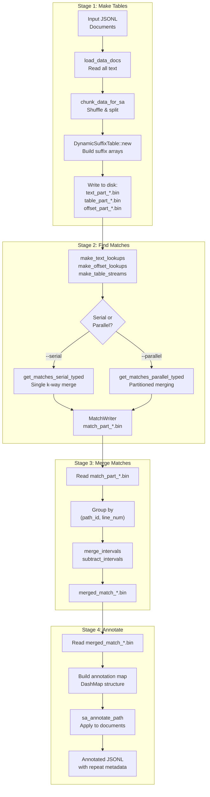

**Diagram: Complete Suffix Array Pipeline Flow**

The pipeline is orchestrated through CLI commands that invoke functions in `sa_base.rs`, with supporting utilities in `sa_utils.rs` providing core data structures for streaming, merging, and writing operations.

**Sources:** [src/sa_base.rs:41-88](), [src/sa_base.rs:98-264](), [src/sa_base.rs:347-506](), [src/sa_base.rs:887-936](), [src/sa_base.rs:1081-1197]()

## File Storage Layout

The suffix array system creates a structured directory hierarchy for intermediate and final results:

| Directory | File Pattern | Contents | Byte Layout |
|-----------|-------------|----------|-------------|
| `file_map.json.gz` | Single file | Path to index mapping | JSON compressed |
| `text/` | `text_part_XXXX.bin` | Concatenated document text | `<text>\xff\xff<path_id:u64><line_num:u64>` repeated |
| `table/` | `table_part_XXXX.bin` | Suffix array indices | Array of `u32`, `U40`, or `u64` |
| `offsets/` | `offset_part_XXXX.bin` | Document boundaries | Triplets: `<path_id:u64><line_num:u64><end_offset:u64>` |
| `matches/` | `match_part_XXXX.bin` | Raw match data | `MatchWriterElement` (33 bytes each) |
| `merged_matches/` | `merged_match_*.bin` | Consolidated intervals | Quads: `<path_id:u64><line_num:u64><start:u64><end:u64>` |

The `XXXX` suffix in filenames represents the part number (e.g., `0000`, `0001`), allowing the system to partition large datasets across multiple files. The number of parts is determined adaptively by `adaptive_batch_size` based on available system memory.

**Sources:** [src/sa_base.rs:41-88](), [src/sa_base.rs:216-237](), [src/sa_utils.rs:384-420]()

## Stage 1: Make Tables

### Overview

Stage 1 transforms input documents into suffix array tables with supporting metadata. This stage is invoked through `make_sa_tables_cmd` which loads documents, chunks them for memory efficiency, constructs suffix arrays, and writes everything to disk.

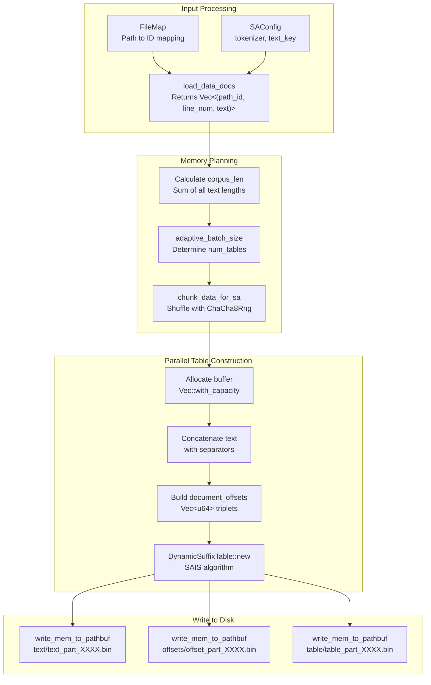

**Diagram: Stage 1 Data Flow and Processing Steps**

### Document Loading and Chunking

The `load_data_docs` function reads all documents from the input directory, extracting text using the configured `text_key` from JSONL records. Documents are represented as tuples `(path_id, line_num, text)` where `path_id` comes from the `FileMap`.

To handle memory constraints, `chunk_data_for_sa` shuffles documents using a seeded PRNG (`ChaCha8Rng`) and distributes them across multiple chunks. The number of chunks (`num_tables`) is determined by:

1. If `batch_size` parameter is 0: Use `adaptive_batch_size` which analyzes available RAM
2. Otherwise: Use `rayon::current_num_threads() * batch_size`

**Sources:** [src/sa_base.rs:266-295](), [src/sa_base.rs:310-339](), [src/sa_utils.rs:52-83]()

### Text Buffer Construction

For each chunk, the system builds a contiguous byte buffer with special structure:

```
<document_1_text>\xff\xff<path_id:u64><line_num:u64>
<document_2_text>\xff\xff<path_id:u64><line_num:u64>
...
```

The `\xff\xff` sentinel ensures suffixes starting at document boundaries don't match across documents. The `path_id` and `line_num` are stored as little-endian `u64` values for later reconstruction.

Simultaneously, `document_offsets` is built as a `Vec<u64>` containing triplets: `[path_id, line_num, offset]` where `offset` is the byte position after each document's separator.

**Sources:** [src/sa_base.rs:186-203]()

### Suffix Array Construction

Each buffer is passed to `DynamicSuffixTable::new` which constructs the suffix array using the SAIS (Suffix Array Induced Sorting) algorithm. The table type (`u32`, `U40`, or `u64`) is selected based on buffer size:

- Text ≤ 2^32 bytes: Use `u32` (4 bytes per index)
- Text ≤ 2^40 bytes: Use `U40` (5 bytes per index) 
- Text > 2^40 bytes: Use `u64` (8 bytes per index)

This adaptive sizing minimizes memory overhead while supporting arbitrarily large corpora.

**Sources:** [src/sa_base.rs:206-209](), [src/sa_utils.rs:28-37](), [src/table_generic.rs]()

### Parallel Execution

The entire chunking and table-building process runs in parallel using `rayon::into_par_iter()`, with each thread handling one chunk independently. Timing statistics for allocation, buffer building, suffix array construction, and disk writes are collected and averaged across all threads.

**Sources:** [src/sa_base.rs:176-246]()

## Stage 2: Find Matches

### Overview

Stage 2 identifies all repeated sequences by performing a k-way merge across all suffix array tables. The system supports two modes:

1. **Serial Mode** (`get_matches_serial`): Single-threaded merge of all tables
2. **Parallel Mode** (`get_matches_parallel`): Multi-threaded with alphabet space partitioning

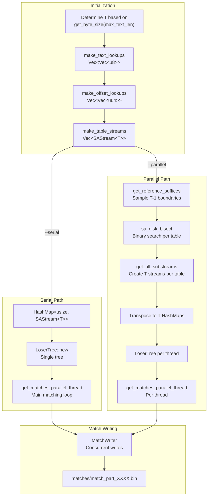

**Diagram: Stage 2 Serial vs Parallel Processing**

### Serial Processing

In serial mode, all suffix array tables are loaded as `SAStream` instances and placed into a single `HashMap<usize, SAStream<T>>` keyed by part number. A single `LoserTree` performs k-way merging across all streams.

The `get_matches_parallel_thread` function (despite its name, used in both modes) implements the core matching logic:

1. Pop minimum suffix from `LoserTree`
2. Compare with previous suffix using `cmp_eq` (first `match_length` bytes)
3. If matching, compute LCP (longest common prefix) and write to `MatchWriter`
4. Track runs to avoid duplicate writes
5. Filter out subsumed matches using `prev_char_same`

**Sources:** [src/sa_base.rs:347-389](), [src/sa_base.rs:776-876]()

### Parallel Processing

Parallel mode partitions the suffix array space across threads to enable concurrent processing:

#### Boundary Sampling

`get_reference_suffices` selects `T-1` evenly-spaced suffixes from one reference table (where `T` = thread count). These boundaries define partition points in alphabetical order across the suffix space.

**Sources:** [src/sa_base.rs:559-606]()

#### Binary Search Partitioning

For each suffix array table, `sa_disk_bisect` performs binary search to find the indices where each boundary occurs. This creates `T` non-overlapping ranges per table. Ranges are dilated by ±1 to ensure overlap and catch all matches.

The bisection function reads suffix array elements directly from disk using `Seek` operations, comparing the pointed-to text against boundary strings.

**Sources:** [src/sa_base.rs:725-774](), [src/sa_base.rs:647-723]()

#### Stream Creation and Transposition

`get_all_substreams` creates `SAStream` instances using `MmapRangeReader::from_range` to memory-map only the relevant portions of each table file. The resulting `Vec<Vec<SAStream>>` is transposed so each thread receives one stream per table, all covering the same alphabetical range.

**Sources:** [src/sa_base.rs:608-645]()

#### Parallel Execution

Each thread runs `get_matches_parallel_thread` with its own `LoserTree` and subset of streams. A single shared `MatchWriter` handles concurrent writes through interior mutability (`DashMap` + `Arc<Mutex<BufWriter>>`).

**Sources:** [src/sa_base.rs:508-556]()

### Match Detection Logic

The core matching algorithm in `get_matches_parallel_thread` implements sophisticated duplicate detection:

```
prev_min = initial minimum
currently_in_a_run = false
prev_lcp = None

for cur_min in loser_tree:
    if cur_min.cmp_eq(prev_min):  # First match_length bytes identical
        cur_lcp = cur_min.lcp(prev_min, match_length)
        prev_char_same = cur_min.prev_char_same(prev_min)
        
        if not prev_char_same:  # Not subsumed by larger match
            if not currently_in_a_run:
                write(prev_min, max(prev_lcp, cur_lcp), first=true)
            else:
                write(prev_min, max(prev_lcp, cur_lcp), first=false)
            currently_in_a_run = true
        
        prev_lcp = cur_lcp
    else:
        if currently_in_a_run and not prev_char_same:
            write(prev_min, prev_lcp, first=false)
        currently_in_a_run = false
        prev_lcp = None
    
    prev_min = cur_min
```

This logic ensures:
- Each run of matches is written with proper LCP values
- The `first_run_el` flag distinguishes run starts for later processing
- Subsumed matches (same suffix but preceded by same character) are filtered

**Sources:** [src/sa_base.rs:808-876]()

## Stage 3: Merge Matches

### Overview

Stage 3 consolidates raw match data from Stage 2 into cleaned, document-relative intervals. The `merge_matches` function processes each `match_part_*.bin` file in parallel, grouping matches by document and merging overlapping intervals.

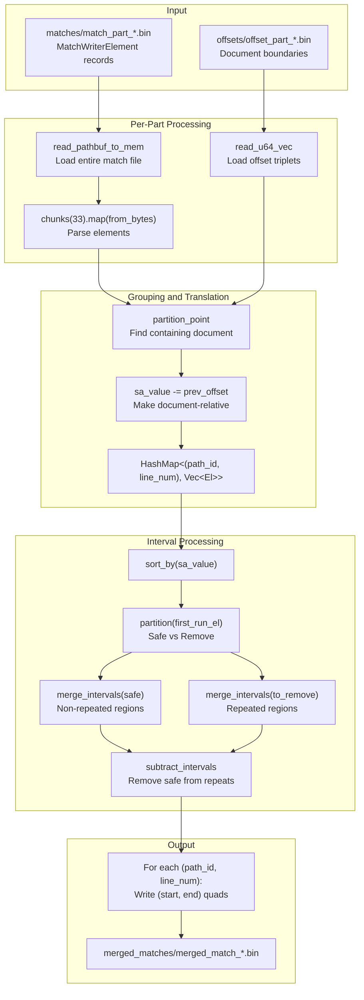

**Diagram: Stage 3 Match Merging and Interval Consolidation**

### Document Boundary Resolution

Each `MatchWriterElement` contains `sa_value` as a global offset into the concatenated text buffer. The system uses binary search (`partition_point`) on the offset triplets to find which document contains each match:

```rust
let offset_index = offset_trips.partition_point(|&(_, _, document_end)| document_end <= el.sa_value);
let (path_id, line_num, _) = offset_trips[offset_index];
let prev_offset_start = offset_trips[offset_index - 1].2;
el.sa_value -= prev_offset_start;  // Now document-relative
```

**Sources:** [src/sa_base.rs:938-976]()

### Interval Merging

The `merge_intervals` function takes a sorted sequence of `(start, lcp)` pairs and produces non-overlapping intervals:

1. Initialize with first element: `(start, start + lcp)`
2. For each subsequent element:
   - If `start > current_end`: Close current interval, start new one
   - Otherwise: Extend current interval: `current_end = max(current_end, start + lcp)`

This consolidates overlapping or adjacent repeated regions into minimal covering intervals.

**Sources:** [src/sa_base.rs:1017-1036]()

### Safe Region Subtraction

Elements marked with `first_run_el=true` indicate suffixes that begin new repeated sequences. These are treated as "safe" regions that should not be marked as repeats (to avoid false positives). The `subtract_intervals` function removes safe intervals from the repeat intervals:

```
result = []
for each interval_a in vec_a:  # Repeats
    current_start = a_start
    for each overlapping interval_b in vec_b:  # Safe regions
        if current_start < b_start:
            result.append((current_start, b_start))
        current_start = max(current_start, b_end)
    if current_start < a_end:
        result.append((current_start, a_end))
```

**Sources:** [src/sa_base.rs:1038-1071](), [src/sa_base.rs:982-1007]()

## Stage 4: Annotate Files

### Overview

Stage 4 applies the merged intervals to original documents, adding repeat metadata. The `sa_annotate_files` function coordinates parallel processing of all input files, using a `DashMap` to organize intervals by document.

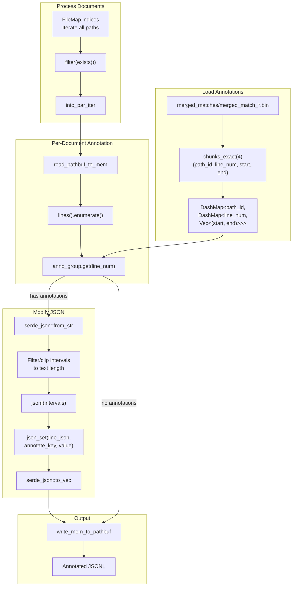

**Diagram: Stage 4 Document Annotation Flow**

### Annotation Map Construction

The function first loads all merged match files and builds a nested map structure:

```
DashMap<usize, DashMap<usize, Vec<(u64, u64)>>>
   ^           ^           ^
   path_id     line_num    (start, end) intervals
```

This three-level structure allows efficient lookup during document processing. The outer `DashMap` enables parallel access across paths.

**Sources:** [src/sa_base.rs:1081-1124]()

### Document Processing

Each input path is processed in parallel. For each line (document) in the file:

1. Check if annotations exist for `(path_id, line_num)`
2. If none: Write line unchanged
3. If present:
   - Parse JSONL into `serde_json::Value`
   - Extract text length using `json_get(text_key)`
   - Filter intervals to clip at text boundaries
   - Create JSON array: `json!(vec![(start, end), ...])`
   - Insert into document: `json_set(&mut line_json, annotate_key, anno_val)`
   - Serialize and write

**Sources:** [src/sa_base.rs:1126-1152](), [src/sa_base.rs:1154-1197]()

### Interval Clipping

The annotation process filters intervals to ensure they don't extend beyond document boundaries:

```rust
let anno_val: Vec<(u64, u64)> = anno_val.iter().filter_map(|(l, r)| {
    let l2 = l.min(&text_len);
    let r2 = r.min(&text_len);
    if l2 == r2 { None } else { Some((*l2, *r2)) }
}).collect();
```

This handles edge cases where suffix array matches might reference positions beyond the actual document length due to the separator bytes.

**Sources:** [src/sa_base.rs:1176-1184]()

## Core Data Structures

### SAStream

`SAStream<'a, T: CompactUint>` provides streaming access to suffix array tables with automatic filtering of invalid suffixes.

**Key Components:**

| Field | Type | Purpose |
|-------|------|---------|
| `reader` | `MmapRangeReader` | Memory-mapped access to table file |
| `text` | `&'a [u8]` | Reference to concatenated text buffer |
| `offset` | `&'a [u64]` | Document boundary triplets |
| `source` | `usize` | Table part number (0, 1, 2, ...) |
| `min_len` | `usize` | Minimum match length to consider |
| `batch_buffer` | `Vec<T>` | Internal buffer for batched reads (8192 elements) |

**Iterator Protocol:**

The `Iterator` implementation yields `Result<(u64, Option<TreeNode>), Error>` where the `u64` represents loop iterations (for progress tracking) and `TreeNode` contains:

```rust
pub struct TreeNode<'a> {
    pub sa_idx: u64,           // Index in suffix array
    pub sa_value: u64,         // Text offset (suffix start)
    pub cmp_bytes: &'a [u8],   // First min_len bytes
    pub source: usize,         // Stream source ID
    pub prev_char: Option<u8>, // Character before suffix
    pub rest_of_doc: &'a [u8], // Remaining document text
}
```

**Filtering Logic:**

The iterator automatically skips suffixes that:
1. Overrun the text buffer: `next_idx + min_len > text.len()`
2. Extend past document end: `next_eos(next_idx) < next_idx + min_len`

This ensures only valid, document-internal suffixes are considered for matching.

**Sources:** [src/sa_utils.rs:211-365](), [src/sa_utils.rs:500-560]()

### LoserTree

`LoserTree<'a, T: CompactUint>` implements efficient k-way merging using the loser tree data structure, which maintains O(log k) time complexity for extracting the minimum element from k sorted streams.

**Architecture:**

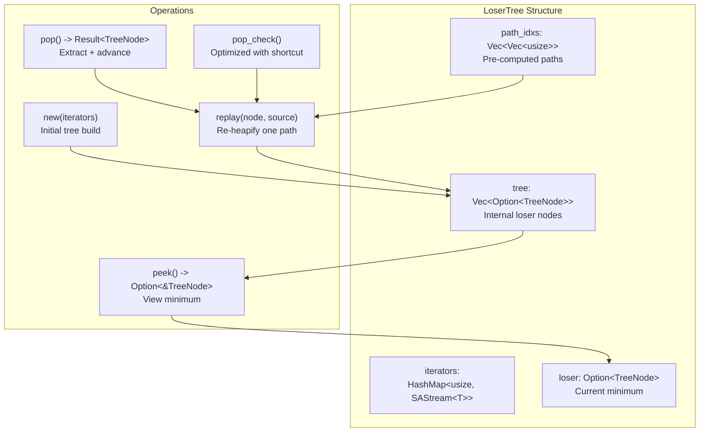

**Diagram: LoserTree Data Structure and Operations**

**Tree Layout:**

The tree is stored as a flat vector with size `sum((k + 1) / 2^i)` for i=1 to log(k). Internal nodes store "losers" (larger elements that lost comparisons during tree construction).

**Optimized Pop:**

`pop_check` implements a fast path: if the replacement element is smaller than the second minimum (stored at `tree.last()`), it immediately becomes the new winner without full replay. This optimization is tracked via `shortcut_count`.

**Replay Algorithm:**

When a stream advances, `replay` walks up the pre-computed path, comparing the new element against stored losers. Swaps occur when the new element is larger (loses):

```rust
for &idx in path {
    match (&current, &self.tree[idx]) {
        (Some(curr), Some(loser)) => {
            if curr > loser {
                std::mem::swap(&mut self.tree[idx], &mut current);
            }
        }
        (None, Some(_)) => {
            std::mem::swap(&mut self.tree[idx], &mut current);
        }
        _ => {}
    }
}
```

**Sources:** [src/sa_utils.rs:565-843]()

### MatchWriter

`MatchWriter` provides thread-safe, concurrent writing of match records to disk using a `DashMap<usize, Arc<Mutex<BufWriter<File>>>>` structure.

**Concurrency Model:**

- Outer `DashMap`: Allows lock-free lookup of writers by source ID
- Inner `Arc<Mutex<BufWriter>>`: Serializes writes to individual files
- Lazy initialization: Writers created on first access per source

**Match Element Format:**

`MatchWriterElement` serializes to 33 bytes:

| Offset | Size | Field | Description |
|--------|------|-------|-------------|
| 0-7 | 8 | `part_num` | Processing part/thread ID |
| 8-15 | 8 | `sa_idx` | Suffix array index |
| 16-23 | 8 | `sa_value` | Text offset |
| 24-31 | 8 | `lcp` | Longest common prefix length |
| 32 | 1 | `first_run_el` | Boolean flag (0 or 1) |

The `source` field is not serialized but used as the key for determining which file to write to (`match_part_{source:04}.bin`).

**Sources:** [src/sa_utils.rs:374-483]()

### MmapRangeReader

`MmapRangeReader` wraps `memmap2::Mmap` to provide efficient, zero-copy access to file regions.

**Key Features:**

1. **Full File Mapping:** `MmapRangeReader::new(file)` maps entire file
2. **Range Mapping:** `from_range(file, offset, length)` maps specific region
3. **Read Trait:** Implements `std::io::Read` for compatibility
4. **Slice Access:** `as_slice()` provides direct byte array access

**Usage in SAStream:**

Tables are memory-mapped using range mapping, allowing parallel threads to each access non-overlapping portions without loading the entire file. The `read_next_batch` function reads directly from the memory-mapped slice:

```rust
let byte_offset = position * T::BYTE_SIZE;
let bytes_to_read = to_read * T::BYTE_SIZE;
let slice = &reader.as_slice()[byte_offset..byte_offset + bytes_to_read];
```

**Sources:** [src/sa_utils.rs:136-199]()

## Memory Management

### Adaptive Batch Sizing

The `adaptive_batch_size` function dynamically determines how many suffix array tables to create based on available system memory:

**Memory Model:**

```
Total Available = total_memory × safety_margin
Text Memory = corpus_len × 1.25
Table Memory = corpus_len × byte_size / batch_size

where byte_size = ceil(log₂(corpus_len / (threads × batch_size)) / 8)
```

The function iterates through batch sizes (1 to 32), computing the resulting table memory for each. It selects the smallest batch size where:

```
text_memory + table_memory < total_available
```

**Sources:** [src/sa_utils.rs:52-83]()

### Byte Size Selection

Integer type selection is based on maximum representable value:

```rust
pub fn get_byte_size(num_bytes: usize) -> usize {
    if num_bytes <= u32::MAX as usize {
        4  // u32
    } else if num_bytes <= (1u64 << 40 - 1) as usize {
        5  // U40 (custom 5-byte type)
    } else {
        8  // u64
    }
}
```

This allows processing corpora up to:
- 4 GB: 4 bytes per index
- 1 TB: 5 bytes per index  
- Unlimited: 8 bytes per index

**Sources:** [src/sa_utils.rs:28-37]()

### Document Shuffling

To balance load across chunks, `chunk_data_for_sa` shuffles documents using a deterministic PRNG:

```rust
let mut indexed: Vec<(u64, (usize, usize, String))> = data_docs
    .into_par_iter()
    .enumerate()
    .map(|(i, item)| {
        let mut rng = ChaCha8Rng::seed_from_u64(config.random_seed.wrapping_add(i as u64));
        (rng.gen(), item)
    })
    .collect();

indexed.par_sort_unstable_by_key(|(key, _)| *key);
```

Each document gets a unique random key, ensuring reproducible shuffling across runs while distributing documents uniformly.

**Sources:** [src/sa_base.rs:316-327]()

## Processing Performance

### Progress Tracking

Both processing modes use `indicatif::ProgressBar` for progress visualization:

- **Stage 1:** Tracks table construction with `total_pbar` covering allocation, building, and writing
- **Stage 2:** Random thread displays merge progress, incrementing by batch reads
- **Stage 3:** Optionally displays match processing and interval merging
- **Stage 4:** Tracks annotation of input paths

**Sources:** [src/sa_base.rs:184](), [src/sa_base.rs:542-551](), [src/sa_base.rs:954-958](), [src/sa_base.rs:1131]()

### Timing Instrumentation

Stage 1 collects detailed timing per chunk:

```rust
let phase_times = Arc::new(Mutex::new(Vec::new()));
// ... in parallel closure:
phase_times.lock().unwrap().push((
    table_idx, 
    alloc_time.as_millis(),
    build_time.as_millis(),
    sa_time.as_millis(),
    write_time.as_millis()
));
```

Average timings are printed at completion, helping identify bottlenecks.

**Sources:** [src/sa_base.rs:186](), [src/sa_base.rs:240-254]()

## Integration with Other Systems

### FileMap Dependency

The suffix array system reuses `FileMap` from the MinHash subsystem to maintain consistent path-to-index mappings:

```rust
use crate::minhash_base::FileMap;

let file_map = if let Some(file_map_name) = file_map_opt {
    FileMap::load(&file_map_name).unwrap()
} else {
    let file_map = FileMap::new(input_dir, &None).unwrap();
    file_map.save(&(output_dir.join("file_map.json.gz"))).unwrap();
    file_map
};
```

This ensures compatibility when running multiple deduplication strategies on the same dataset.

**Sources:** [src/sa_base.rs:7](), [src/sa_base.rs:108-116]()

### Configuration System

The `SAConfig` structure (detailed in [SA Configuration](#2.5)) provides centralized parameter management including:

- `tokenizer`: Optional tokenization method
- `text_key`: JSONL field containing document text
- `max_lines_per_path`: Limit on documents per file
- `random_seed`: Seed for reproducible shuffling

**Sources:** [src/sa_base.rs:38](), [src/sa_base.rs:118-125]()

### Utility Functions

Shared utilities from `mj_io` handle common I/O operations:

- `read_pathbuf`: Read file with optional compression detection
- `read_pathbuf_to_mem`: Load entire file into memory
- `write_mem_to_pathbuf`: Write bytes to file with directory creation
- `build_pbar`: Create progress bars with consistent styling
- `get_output_filename`: Maintain directory structure in output

**Sources:** [src/sa_base.rs:28-30]()

---

**Sources for entire page:** [src/sa_base.rs:1-1199](), [src/sa_utils.rs:1-844]()

---

# Page: SA Pipeline Stages

# SA Pipeline Stages

<details>
<summary>Relevant source files</summary>

The following files were used as context for generating this wiki page:

- [src/sa_base.rs](src/sa_base.rs)

</details>


## Purpose and Scope

This document details the four-stage Suffix Array (SA) pipeline that identifies repeated substrings across a corpus of documents. The pipeline transforms raw text documents into annotated outputs marking duplicate text regions, handling datasets larger than available memory through adaptive chunking and disk-backed suffix arrays.

The four stages are:
1. **Make Tables**: Build suffix array tables from input documents
2. **Find Matches**: Identify repeated sequences through k-way merge
3. **Merge Matches**: Consolidate raw matches into document-relative intervals
4. **Annotate**: Apply repeat annotations to original documents

For information on the core data structures used by this pipeline (SAStream, LoserTree, MatchWriter), see [SA Utilities and Data Structures](#2.2). For details on the suffix array implementation itself, see [Suffix Table Implementation](#2.3). For configuration management, see [SA Configuration](#2.5).

---

## Pipeline Overview

The SA pipeline executes as a sequence of independent stages, each consuming the outputs of the previous stage. This design enables processing datasets larger than memory by writing intermediate results to disk.

### Four-Stage Architecture

```mermaid
graph TB
    Input["JSONL Documents<br/>(input-dir/)"]
    
    subgraph Stage1["Stage 1: Make Tables"]
        S1Entry["make_sa_tables_cmd()"]
        LoadDocs["load_data_docs()<br/>Extract text from JSONL"]
        Chunk["chunk_data_for_sa()<br/>Shuffle and partition"]
        BuildSA["DynamicSuffixTable::new()<br/>SAIS algorithm"]
    end
    
    subgraph Stage2["Stage 2: Find Matches"]
        S2Entry["get_matches_serial() or<br/>get_matches_parallel()"]
        LoadStreams["make_table_streams()<br/>Memory-map SA tables"]
        Merge["get_matches_parallel_thread()<br/>LoserTree k-way merge"]
    end
    
    subgraph Stage3["Stage 3: Merge Matches"]
        S3Entry["merge_matches()"]
        Group["merge_match_path()<br/>Group by document"]
        Intervals["merge_intervals() +<br/>subtract_intervals()"]
    end
    
    subgraph Stage4["Stage 4: Annotate"]
        S4Entry["sa_annotate_files()"]
        Apply["sa_annotate_path()<br/>Inject metadata"]
    end
    
    Input --> S1Entry
    S1Entry --> LoadDocs
    LoadDocs --> Chunk
    Chunk --> BuildSA
    BuildSA --> TextParts["text_part_*.bin"]
    BuildSA --> TableParts["table_part_*.bin"]
    BuildSA --> OffsetParts["offset_part_*.bin"]
    
    TextParts --> S2Entry
    TableParts --> S2Entry
    OffsetParts --> S2Entry
    S2Entry --> LoadStreams
    LoadStreams --> Merge
    Merge --> MatchParts["match_part_*.bin"]
    
    MatchParts --> S3Entry
    OffsetParts --> S3Entry
    S3Entry --> Group
    Group --> Intervals
    Intervals --> MergedParts["merged_match_*.bin"]
    
    MergedParts --> S4Entry
    Input --> S4Entry
    S4Entry --> Apply
    Apply --> Output["Annotated JSONL<br/>(output-dir/)"]
```

**Sources:** [src/sa_base.rs:98-264](), [src/sa_base.rs:347-556](), [src/sa_base.rs:887-1071](), [src/sa_base.rs:1081-1197]()

---

## Stage 1: Make Tables

### Purpose

Stage 1 transforms raw JSONL documents into suffix array tables that enable efficient substring search. This stage handles memory constraints by adaptively chunking the corpus into multiple suffix arrays, each sized to fit comfortably in available memory.

### Key Functions

| Function | Location | Purpose |
|----------|----------|---------|
| `make_sa_tables_cmd()` | [src/sa_base.rs:98-128]() | CLI entry point, loads FileMap and configuration |
| `make_sa_tables()` | [src/sa_base.rs:130-264]() | Main orchestration of table building |
| `load_data_docs()` | [src/sa_base.rs:266-295]() | Extracts text from JSONL using FileMap |
| `chunk_data_for_sa()` | [src/sa_base.rs:310-339]() | Partitions documents into balanced chunks |
| `adaptive_batch_size()` | [src/sa_utils.rs]() | Calculates optimal number of tables |

### Process Flow

```mermaid
graph TB
    Start["make_sa_tables()"]
    Load["load_data_docs()<br/>Read all document texts"]
    CalcChunks["adaptive_batch_size()<br/>or manual batch_size"]
    Shuffle["chunk_data_for_sa()<br/>Random shuffle for balance"]
    
    subgraph ParallelBuild["Parallel Table Building (rayon)"]
        Alloc["Allocate buffer<br/>Vec with_capacity"]
        Concat["Concatenate text + markers<br/>0xff 0xff + u64 path_id + u64 line_num"]
        BuildSA["DynamicSuffixTable::new()<br/>Run SAIS algorithm"]
        WriteTrio["Write 3 files:<br/>text_part_XXXX.bin<br/>table_part_XXXX.bin<br/>offset_part_XXXX.bin"]
    end
    
    Start --> Load
    Load --> CalcChunks
    CalcChunks --> Shuffle
    Shuffle --> ParallelBuild
    Alloc --> Concat
    Concat --> BuildSA
    BuildSA --> WriteTrio
```

### Data Format

Each table index `XXXX` produces three synchronized files:

**text_part_XXXX.bin**: Concatenated text buffer
```
<doc1_text>\xff\xff<path_id:u64><line_num:u64><doc2_text>\xff\xff<path_id:u64><line_num:u64>...
```

**table_part_XXXX.bin**: Suffix array indices
```
Array of CompactUint (u32, U40, or u64) pointing into text_part
```

**offset_part_XXXX.bin**: Document boundaries
```
[u64::MAX, u64::MAX, 0, path_id_1, line_num_1, offset_1, path_id_2, line_num_2, offset_2, ...]
```

### Memory Management

The system uses a safety margin of 90% (`MEMORY_SAFETY_MARGIN = 0.90`) when calculating table sizes. The number of tables is determined by:

```
corpus_bytes_with_metadata / (available_memory * 0.9 / 9)
```

The factor of 9 accounts for: 1 byte text + 8 bytes worst-case suffix array storage (though 4 or 5 bytes is typical with compression).

**Sources:** [src/sa_base.rs:95-264](), [src/sa_base.rs:310-339]()

---

## Stage 2: Find Matches

### Purpose

Stage 2 identifies all repeated substrings of length ≥ `match_length` by performing a k-way merge across all suffix array tables. The stage supports both serial (single-threaded) and parallel (multi-threaded) execution modes.

### Execution Modes

| Mode | Entry Function | Location | Parallelization Strategy |
|------|---------------|----------|--------------------------|
| Serial | `get_matches_serial()` | [src/sa_base.rs:347-373]() | Single LoserTree merging all tables |
| Parallel | `get_matches_parallel()` | [src/sa_base.rs:481-506]() | Multiple LoserTrees, each handling alphabet partition |

### Serial Mode Flow

```mermaid
graph TB
    Entry["get_matches_serial()"]
    LoadText["make_text_lookups()<br/>Load all text_part files"]
    LoadOffsets["make_offset_lookups()<br/>Load all offset_part files"]
    CreateStreams["make_table_streams()<br/>MmapRangeReader for each table"]
    TypeDispatch["Dispatch by element size:<br/>u32, U40, or u64"]
    BuildTree["LoserTree::new()<br/>Initialize with all SAStreams"]
    MergeLoop["get_matches_parallel_thread()<br/>Pop minimum, check LCP"]
    WriteMatches["MatchWriter::write_element()<br/>Record duplicate positions"]
    
    Entry --> LoadText
    Entry --> LoadOffsets
    LoadText --> CreateStreams
    LoadOffsets --> CreateStreams
    CreateStreams --> TypeDispatch
    TypeDispatch --> BuildTree
    BuildTree --> MergeLoop
    MergeLoop --> WriteMatches
    WriteMatches --> Output["match_part_*.bin"]
```

### Parallel Mode Flow

The parallel mode partitions the suffix array space into `T` threads by sampling boundary suffixes:

```mermaid
graph TB
    Entry["get_matches_parallel()"]
    LoadText["make_text_lookups()"]
    SampleBoundaries["get_reference_suffices()<br/>Sample T-1 boundary strings"]
    BisectAll["get_all_substreams()<br/>Binary search each table"]
    
    subgraph BisectDetail["Per Table: get_substreams_from_boundaries()"]
        BisectOps["sa_disk_bisect()<br/>Find boundary indices"]
        CreateRanges["MmapRangeReader::from_range()<br/>Create sub-streams"]
    end
    
    Transpose["Transpose to thread-major layout<br/>HashMap per thread"]
    
    subgraph ParallelMerge["Parallel Execution (rayon)"]
        ThreadTree["LoserTree per thread<br/>Merge assigned partition"]
        ThreadWrite["MatchWriter concurrent writes"]
    end
    
    Entry --> LoadText
    LoadText --> SampleBoundaries
    SampleBoundaries --> BisectAll
    BisectAll --> BisectDetail
    BisectDetail --> Transpose
    Transpose --> ParallelMerge
    ParallelMerge --> Output["match_part_*.bin"]
```

### Match Detection Algorithm

The core matching logic in `get_matches_parallel_thread()` uses a stateful loop:

1. **Pop minimum** from LoserTree
2. **Compare** with previous element using `cmp_eq()` (checks first `match_length` bytes)
3. **If match found:**
   - Calculate LCP (Longest Common Prefix) using `lcp()`
   - Check `prev_char_same()` to avoid subsumed matches
   - Write to MatchWriter with `first_run_el` flag
4. **Track run state** to properly close duplicate sequences

This algorithm ensures that only the maximal repeated regions are recorded, filtering out subsumed substrings.

**Sources:** [src/sa_base.rs:347-556](), [src/sa_base.rs:559-774](), [src/sa_base.rs:776-876]()

---

## Stage 3: Merge Matches

### Purpose

Stage 3 converts raw match records (which reference positions in concatenated text buffers) into document-relative intervals, merging overlapping regions and applying filtering rules to produce final deduplicated intervals.

### Key Functions

| Function | Location | Purpose |
|----------|----------|---------|
| `merge_matches()` | [src/sa_base.rs:887-936]() | Orchestrates parallel merging of all match files |
| `merge_match_path()` | [src/sa_base.rs:938-1015]() | Processes single match file |
| `merge_intervals()` | [src/sa_base.rs:1017-1036]() | Combines overlapping intervals |
| `subtract_intervals()` | [src/sa_base.rs:1038-1071]() | Removes safe regions from duplicate regions |

### Processing Pipeline

```mermaid
graph TB
    Entry["merge_matches()"]
    Glob["glob() match_part_*.bin<br/>and offset_part_*.bin"]
    
    subgraph PerFile["merge_match_path() per file (parallel)"]
        ReadMatches["Read MatchWriterElement chunks<br/>40 bytes each"]
        ReadOffsets["Read offset triples<br/>(path_id, line_num, document_end)"]
        
        Lookup["Binary search: partition_point()<br/>Find document for each match"]
        GroupByDoc["HashMap<(path_id, line_num), Vec>"]
        
        Sort["Sort by sa_value within document"]
        Partition["Partition by first_run_el flag<br/>safe vs. to_remove"]
        
        MergeSafe["merge_intervals(safe)"]
        MergeRemove["merge_intervals(to_remove)"]
        Subtract["subtract_intervals()<br/>remove - safe"]
        
        Serialize["Serialize to bytes:<br/>path_id:u64 + line_num:u64 +<br/>start:u64 + end:u64"]
    end
    
    Entry --> Glob
    Glob --> PerFile
    ReadMatches --> Lookup
    ReadOffsets --> Lookup
    Lookup --> GroupByDoc
    GroupByDoc --> Sort
    Sort --> Partition
    Partition --> MergeSafe
    Partition --> MergeRemove
    MergeSafe --> Subtract
    MergeRemove --> Subtract
    Subtract --> Serialize
    Serialize --> Output["merged_match_*.bin"]
```

### Match Element Structure

Each `MatchWriterElement` (40 bytes) contains:

| Field | Type | Bytes | Description |
|-------|------|-------|-------------|
| `source` | u64 | 8 | Table index (text_part_XXXX) |
| `part_num` | u64 | 8 | Thread/partition number |
| `sa_idx` | u64 | 8 | Index in suffix array |
| `sa_value` | u64 | 8 | Position in text buffer |
| `lcp` | u64 | 8 | Length of repeated region |
| `first_run_el` | bool | Packed in flags | Marks start of duplicate run |

### Interval Filtering Logic

The `subtract_intervals()` function implements a critical filtering step:

1. **Safe intervals**: Marked by `first_run_el=true`, these are the first occurrence of a repeated sequence
2. **To-remove intervals**: Subsequent occurrences of the same sequence
3. **Subtraction**: Remove any overlap with safe intervals to avoid false positives

This ensures that legitimate repeated text (e.g., common function signatures) is not incorrectly flagged if it appears first in a "safe" context.

**Sources:** [src/sa_base.rs:887-1071]()

---

## Stage 4: Annotate

### Purpose

Stage 4 applies the computed duplicate intervals back to the original JSONL documents, injecting metadata that marks which byte ranges contain repeated text.

### Key Functions

| Function | Location | Purpose |
|----------|----------|---------|
| `sa_annotate_files()` | [src/sa_base.rs:1081-1152]() | Orchestrates parallel annotation across all files |
| `sa_annotate_path()` | [src/sa_base.rs:1154-1197]() | Annotates single file |

### Annotation Flow

```mermaid
graph TB
    Entry["sa_annotate_files()"]
    LoadMap["FileMap::load()<br/>Restore path->id mapping"]
    LoadIntervals["glob() merged_match_*.bin<br/>Load all intervals"]
    BuildIndex["DashMap<path_id,<br/>DashMap<line_num,<br/>Vec<(start, end)>>>"]
    
    subgraph PerPath["sa_annotate_path() per path (parallel)"]
        ReadLines["Read JSONL lines"]
        CheckAnno["Check DashMap for intervals"]
        
        subgraph IfAnnotated["If intervals exist"]
            ParseJSON["serde_json::from_str()"]
            ClipIntervals["Filter intervals to text length"]
            InjectMeta["json_set(annotate_key, intervals)"]
            SerializeJSON["serde_json::to_vec()"]
        end
        
        PassThrough["If no intervals, copy line as-is"]
    end
    
    Entry --> LoadMap
    Entry --> LoadIntervals
    LoadIntervals --> BuildIndex
    BuildIndex --> PerPath
    ReadLines --> CheckAnno
    CheckAnno --> IfAnnotated
    CheckAnno --> PassThrough
    InjectMeta --> SerializeJSON
    SerializeJSON --> Output["Annotated JSONL"]
    PassThrough --> Output
```

### Annotation Format

Given an input document:
```json
{"text": "This is sample text with duplicates.", "id": "doc123"}
```

With intervals `[(5, 15), (20, 30)]`, the output becomes:
```json
{"text": "This is sample text with duplicates.", "id": "doc123", "sa_duplicates": [[5, 15], [20, 30]]}
```

The annotation key (default: `"sa_duplicates"`) is configurable via the `--annotate-key` parameter.

### Bounds Checking

The annotation process clips intervals to the actual text length [src/sa_base.rs:1176-1184]():
```rust
let anno_val: Vec<(u64, u64)> = anno_val.iter().filter_map(|(l, r)| {
    let l2 = l.min(&text_len);
    let r2 = r.min(&text_len);
    if l2 == r2 { None } else { Some((*l2, *r2)) }
}).collect();
```

This handles edge cases where matches extend beyond document boundaries due to marker bytes or suffix array artifacts.

**Sources:** [src/sa_base.rs:1081-1197]()

---

## Inter-Stage Data Dependencies

The following table summarizes the data flow between stages:

| Stage | Inputs | Outputs | Consumed By |
|-------|--------|---------|-------------|
| Make Tables | JSONL documents<br/>FileMap | `text_part_*.bin`<br/>`table_part_*.bin`<br/>`offset_part_*.bin` | Find Matches |
| Find Matches | All Stage 1 outputs | `match_part_*.bin` | Merge Matches |
| Merge Matches | `match_part_*.bin`<br/>`offset_part_*.bin` | `merged_match_*.bin` | Annotate |
| Annotate | `merged_match_*.bin`<br/>Original JSONL<br/>FileMap | Annotated JSONL | (Final output) |

All intermediate files are stored in the `storage-dir/` directory, organized by subdirectory (`text/`, `table/`, `offsets/`, `matches/`, `merged_matches/`).

**Sources:** [src/sa_base.rs:40-88]() (comments documenting file formats)

---

## Performance Characteristics

### Stage Timing

Typical relative execution times for a 1TB corpus:

| Stage | Relative Time | Bottleneck |
|-------|---------------|------------|
| Make Tables | 40% | SAIS algorithm CPU + disk writes |
| Find Matches | 45% | K-way merge I/O + comparison operations |
| Merge Matches | 10% | Binary search + interval merging |
| Annotate | 5% | JSON parsing + serialization |

### Parallelization Strategies

- **Make Tables**: Parallelizes across chunks (rayon), limited by number of chunks
- **Find Matches (Serial)**: Single-threaded, suitable for small datasets
- **Find Matches (Parallel)**: Parallelizes across alphabet space, optimal for large datasets
- **Merge Matches**: Parallelizes across match files (DashMap)
- **Annotate**: Parallelizes across input files

**Sources:** [src/sa_base.rs:95-264](), [src/sa_base.rs:481-556]()

---

# Page: Make Tables Stage

# Make Tables Stage

<details>
<summary>Relevant source files</summary>

The following files were used as context for generating this wiki page:

- [src/sa_base.rs](src/sa_base.rs)
- [src/table_generic.rs](src/table_generic.rs)

</details>


## Purpose and Scope

The Make Tables Stage is the first stage of the Suffix Array (SA) pipeline. It transforms a collection of JSONL documents into a set of disk-backed suffix array tables with associated metadata. This stage handles:

- Loading and parsing documents from the input directory
- Adaptive memory-based chunking to stay within RAM constraints
- Constructing suffix arrays using the SAIS (Induced Sorting) algorithm
- Writing synchronized text, table, and offset files to disk

For information about how these tables are used to find matches, see [Match Finding Stage](#2.1.2). For the overall SA pipeline architecture, see [SA Pipeline Stages](#2.1).

**Sources:** [src/sa_base.rs:92-264]()

---

## Entry Points and Command Flow

The stage is invoked through two primary entry points:

| Function | Purpose | Location |
|----------|---------|----------|
| `make_sa_tables_cmd` | CLI wrapper that handles configuration loading | [src/sa_base.rs:98-128]() |
| `make_sa_tables` | Core implementation that orchestrates table construction | [src/sa_base.rs:130-264]() |

The command flow proceeds as follows:

```mermaid
graph TB
    CLI["make_sa_tables_cmd"]
    LoadMap["Load or Create FileMap"]
    LoadConfig["Load SAConfig with Overrides"]
    Core["make_sa_tables"]
    
    CLI --> LoadMap
    CLI --> LoadConfig
    LoadMap --> Core
    LoadConfig --> Core
    
    subgraph "Core Implementation"
        Core --> LoadDocs["load_data_docs"]
        LoadDocs --> CalcChunks["Calculate num_tables<br/>adaptive_batch_size"]
        CalcChunks --> ChunkData["chunk_data_for_sa<br/>Shuffle & partition"]
        ChunkData --> ParallelBuild["Parallel table construction<br/>rayon::par_iter"]
        
        subgraph "Per-Chunk Processing"
            ParallelBuild --> BuildBuf["Build concatenated buffer"]
            BuildBuf --> BuildSA["DynamicSuffixTable::new"]
            BuildSA --> WriteFiles["Write text_part_XXXX.bin<br/>table_part_XXXX.bin<br/>offset_part_XXXX.bin"]
        end
    end
    
    style Core fill:#f9f9f9
    style ParallelBuild fill:#e1f5ff
```

**Sources:** [src/sa_base.rs:98-264]()

---

## Input Requirements

### FileMap Structure

The stage requires a `FileMap` that maps file paths to unique integer IDs. This mapping is either:
- Loaded from an existing `file_map.json.gz` (if `--file-map` provided)
- Generated from the input directory and saved to `output_dir/file_map.json.gz`

**Sources:** [src/sa_base.rs:108-116]()

### Configuration

Configuration is managed through `SAConfig` with optional overrides:

| Parameter | Type | Purpose | Default |
|-----------|------|---------|---------|
| `tokenizer` | `Option<String>` | Tokenizer name (future use) | None |
| `max_lines_per_path` | `Option<usize>` | Limit lines per file | None |
| `text_key` | `Option<String>` | JSON key for text extraction | "text" |
| `random_seed` | `u64` | Seed for document shuffling | From config |
| `batch_size` | `f32` | Manual batch size multiplier | 0.0 (auto) |

**Sources:** [src/sa_base.rs:118-127](), [src/sa_config.rs]()

---

## Document Loading

### Loading Process

The `load_data_docs` function reads all documents from disk into memory as tuples:

```rust
Vec<(usize, usize, String)>
// (path_id, line_num, text_content)
```

```mermaid
graph LR
    Input["Input Directory<br/>JSONL Files"]
    FileMap["FileMap<br/>path → id"]
    Filter["Filter Extant Paths<br/>parallel_iter"]
    Read["Read Each Path<br/>BufRead lines"]
    Extract["Extract text_key<br/>gjson::get"]
    Output["Vec&lt;(path_id, line_num, text)&gt;"]
    
    Input --> Filter
    FileMap --> Filter
    Filter --> Read
    Read --> Extract
    Extract --> Output
    
    style Filter fill:#e1f5ff
    style Read fill:#e1f5ff
```

**Key characteristics:**
- Uses parallel iteration over paths (`par_iter`)
- Only processes files that exist in the input directory
- Extracts text using `gjson::get` with configurable `text_key`
- Preserves document ordering within each file via `line_num`

**Sources:** [src/sa_base.rs:266-295]()

---

## Memory Management and Adaptive Chunking

### Memory Calculation

The stage must handle datasets larger than RAM by chunking documents into multiple suffix arrays. The number of tables is determined by:

```rust
const MEMORY_SAFETY_MARGIN: f64 = 0.90;

let corpus_len: usize = data_docs.par_iter()
    .map(|(_, _, doc)| doc.len() + 2 * 8)
    .sum();

let num_tables = if batch_size == 0.0 {
    adaptive_batch_size(corpus_len, MEMORY_SAFETY_MARGIN)
} else {
    (rayon::current_num_threads() as f32 * batch_size) as usize
};
```

The `adaptive_batch_size` function (in `sa_utils.rs`) calculates how many tables are needed based on:
- Total corpus length (text + metadata per document)
- Available system memory
- Safety margin (90% utilization)
- Suffix array memory overhead (9x text size for construction)

**Sources:** [src/sa_base.rs:95, 158-163](), [src/sa_utils.rs]()

### Chunking Strategy

The `chunk_data_for_sa` function divides documents into balanced chunks:

```mermaid
graph TB
    Input["data_docs: Vec&lt;(path_id, line_num, text)&gt;"]
    Shuffle["Shuffle with ChaCha8Rng<br/>seed + document index"]
    Sort["Parallel sort by random key"]
    Partition["Partition into num_tables chunks<br/>Base size + remainder distribution"]
    Output["Vec&lt;Vec&lt;(path_id, line_num, text)&gt;&gt;"]
    
    Input --> Shuffle
    Shuffle --> Sort
    Sort --> Partition
    Partition --> Output
    
    style Shuffle fill:#fff9c4
    style Sort fill:#e1f5ff
```

**Why shuffling?** Documents are shuffled to ensure each chunk has similar characteristics (length distribution, complexity). Without shuffling, if documents are ordered by size, some tables would be disproportionately large.

**Deterministic randomness:** Uses `ChaCha8Rng` seeded with `config.random_seed.wrapping_add(i)` for reproducible chunking.

**Sources:** [src/sa_base.rs:310-339]()

---

## Parallel Table Construction

### Per-Chunk Processing

Each chunk is processed independently in parallel using `rayon::par_iter`:

```mermaid
graph TB
    Chunk["Document Chunk"]
    
    subgraph "Phase 1: Buffer Construction"
        Alloc["Allocate buffer<br/>with_capacity(allocate_size)"]
        Build["Extend buffer for each doc:<br/>text + 0xFF 0xFF + path_id + line_num"]
        Offsets["Track document offsets<br/>Vec&lt;u64&gt; triplets"]
    end
    
    subgraph "Phase 2: SA Construction"
        ChooseType["Choose index type<br/>get_byte_size(max_table_len)"]
        BuildSA["DynamicSuffixTable::new<br/>SAIS algorithm"]
    end
    
    subgraph "Phase 3: File Writing"
        WriteText["text_part_XXXX.bin<br/>Concatenated buffer"]
        WriteTable["table_part_XXXX.bin<br/>Suffix array indices"]
        WriteOffset["offset_part_XXXX.bin<br/>Document boundary triplets"]
    end
    
    Chunk --> Alloc
    Alloc --> Build
    Build --> Offsets
    Offsets --> ChooseType
    ChooseType --> BuildSA
    BuildSA --> WriteText
    BuildSA --> WriteTable
    BuildSA --> WriteOffset
    
    style BuildSA fill:#ffe1e1
```

**Sources:** [src/sa_base.rs:176-246]()

### Buffer Format

The concatenated text buffer has this structure:

```
[document_1_text][0xFF][0xFF][path_id as u64 LE][line_num as u64 LE]
[document_2_text][0xFF][0xFF][path_id as u64 LE][line_num as u64 LE]
...
```

- **Text separator:** Two `0xFF` bytes mark document boundaries
- **Metadata:** 16 bytes per document (two u64 values in little-endian)
- **Total overhead:** 18 bytes per document (2 + 8 + 8)

**Sources:** [src/sa_base.rs:195-202]()

---

## Suffix Array Construction

### DynamicSuffixTable

The stage uses `DynamicSuffixTable`, which automatically selects the appropriate integer type for suffix array indices:

```mermaid
graph LR
    Input["Text Buffer<br/>byte_size parameter"]
    
    subgraph "DynamicSuffixTable Variants"
        U32["SuffixTableGeneric&lt;u32&gt;<br/>For buffers &lt; 4GB"]
        U40["SuffixTableGeneric&lt;U40&gt;<br/>For buffers &lt; 1TB"]
        U64["SuffixTableGeneric&lt;u64&gt;<br/>For buffers &ge; 1TB"]
    end
    
    Input -->|"byte_size = 4"| U32
    Input -->|"byte_size = 5"| U40
    Input -->|"byte_size = 8"| U64
```

The `byte_size` is determined by `get_byte_size(max_text_len)` which returns:
- `4` if length fits in `u32` (< 4,294,967,296 bytes)
- `5` if length fits in `U40` (< 1,099,511,627,776 bytes)
- `8` otherwise

**Why variable sizes?** Memory efficiency. Using `u32` indices saves 50% memory vs `u64` for smaller corpora, significantly improving cache performance during construction and matching.

**Sources:** [src/sa_base.rs:183, 207](), [src/table_generic.rs:90-118](), [src/compact_uint.rs]()

### SAIS Algorithm

The suffix array is constructed using the Induced Sorting (SAIS) algorithm:

| Property | Value |
|----------|-------|
| Time Complexity | O(n) |
| Space Complexity | O(n) during construction |
| Algorithm | SAIS (Nong et al., 2009) |
| Implementation | `sais_table_generic` |

The algorithm:
1. Classifies suffixes as Ascending (S-type), Descending (L-type), or Valley (LMS)
2. Sorts valley suffixes recursively
3. Induces the order of remaining suffixes in linear scans

**Sources:** [src/table_generic.rs:440-447, 449-641]()

---

## Output File Structure

### File Organization

The stage creates three synchronized sets of files:

```mermaid
graph TB
    Storage["storage-dir/"]
    
    subgraph "Text Directory"
        TextDir["text/"]
        Text0["text_part_0000.bin"]
        Text1["text_part_0001.bin"]
        TextN["text_part_NNNN.bin"]
    end
    
    subgraph "Table Directory"
        TableDir["table/"]
        Table0["table_part_0000.bin"]
        Table1["table_part_0001.bin"]
        TableN["table_part_NNNN.bin"]
    end
    
    subgraph "Offsets Directory"
        OffsetDir["offsets/"]
        Offset0["offset_part_0000.bin"]
        Offset1["offset_part_0001.bin"]
        OffsetN["offset_part_NNNN.bin"]
    end
    
    FileMap["file_map.json.gz"]
    
    Storage --> TextDir
    Storage --> TableDir
    Storage --> OffsetDir
    Storage --> FileMap
    
    TextDir --> Text0
    TextDir --> Text1
    TextDir --> TextN
    
    TableDir --> Table0
    TableDir --> Table1
    TableDir --> TableN
    
    OffsetDir --> Offset0
    OffsetDir --> Offset1
    OffsetDir --> OffsetN
```

**Sources:** [src/sa_base.rs:48-64, 216-237]()

### File Format Specifications

#### text_part_XXXX.bin

Binary file containing concatenated document text with separators.

**Format:**
```
[document_text_bytes][0xFF 0xFF][path_id: u64 LE][line_num: u64 LE]
[document_text_bytes][0xFF 0xFF][path_id: u64 LE][line_num: u64 LE]
...
```

**Sources:** [src/sa_base.rs:216-220]()

#### table_part_XXXX.bin

Binary file containing the suffix array - lexicographically sorted byte indices.

**Format:**
```
[index_0: u32/U40/u64 LE]
[index_1: u32/U40/u64 LE]
...
[index_n: u32/U40/u64 LE]
```

Where each index points to a byte position in the corresponding `text_part_XXXX.bin` file.

**Sources:** [src/sa_base.rs:232-237]()

#### offset_part_XXXX.bin

Binary file containing document boundary information.

**Format:**
```
[u64::MAX][u64::MAX][0]  // Sentinel triple
[path_id: u64 LE][line_num: u64 LE][end_offset: u64 LE]
[path_id: u64 LE][line_num: u64 LE][end_offset: u64 LE]
...
```

Each triplet indicates:
- `path_id`: File path identifier from FileMap
- `line_num`: Line number within the file
- `end_offset`: Byte position where this document ends in the text buffer

The sentinel triple at the start ensures safe binary search operations.

**Sources:** [src/sa_base.rs:189-190, 224-229]()

---

## Performance Characteristics

### Timing Breakdown

The stage tracks four phases per chunk:

| Phase | Operation | Typical Proportion |
|-------|-----------|-------------------|
| Allocation | Buffer pre-allocation | < 5% |
| Building | Text concatenation | 10-15% |
| SA Construction | SAIS algorithm | 70-80% |
| Writing | Disk I/O | 5-15% |

Average timings are printed at completion:

```rust
println!("Average alloc: {:?}ms, build: {:?}ms, SA: {:?}ms, write: {:?}ms",
    times.iter().map(|t| t.1).sum::<u128>() / times.len() as u128,
    ...
);
```

**Sources:** [src/sa_base.rs:240-254]()

### System Requirements

The stage validates the system is little-endian:

```rust
assert_eq!(
    1u16.to_ne_bytes(),
    1u16.to_le_bytes(),
    "System must be little-endian"
);
```

This ensures binary compatibility of all output files across different machines in the processing cluster.

**Sources:** [src/sa_base.rs:137-141]()

---

## Usage Example

```bash
# Basic usage - auto-detect chunking
duplodocus make-sa-tables \
    --input-dir /data/corpus \
    --output-dir /scratch/sa-tables \
    --text-key "text"

# Manual batch size control
duplodocus make-sa-tables \
    --input-dir /data/corpus \
    --output-dir /scratch/sa-tables \
    --batch-size 2.0  # 2x thread count

# With existing file map
duplodocus make-sa-tables \
    --input-dir /data/corpus \
    --output-dir /scratch/sa-tables \
    --file-map /data/file_map.json.gz
```

**Sources:** [src/sa_base.rs:98-107]()

---

# Page: Match Finding Stage

# Match Finding Stage

<details>
<summary>Relevant source files</summary>

The following files were used as context for generating this wiki page:

- [src/sa_base.rs](src/sa_base.rs)
- [src/sa_utils.rs](src/sa_utils.rs)

</details>


## Purpose and Scope

The Match Finding Stage is Stage 2 of the four-stage Suffix Array (SA) pipeline. This stage takes the suffix array tables produced in Stage 1 (see [Make Tables Stage](#2.1.1)) and identifies all repeated text sequences that meet the minimum length threshold. The stage performs an efficient k-way merge across multiple suffix arrays to detect duplicates, outputting raw match data that will be consolidated in Stage 3 (see [Merge and Annotate Stages](#2.1.3)).

This document covers the match finding algorithms, data structures, and parallelization strategies. For information about the underlying suffix table construction, see [Suffix Table Implementation](#2.3). For details on compact integer types used in the suffix arrays, see [Compact Integer Types](#2.4).

---

## Input and Output Format

### Input Files

The stage operates on files produced by Stage 1:

| File Pattern | Content | Format |
|--------------|---------|--------|
| `text/text_part_*.bin` | Concatenated document text | Raw bytes with `\xff\xff` separators + 16-byte metadata |
| `table/table_part_*.bin` | Suffix array indices | CompactUint array (u32, U40, or u64) |
| `offsets/offset_part_*.bin` | Document boundaries | u64 triples: `(path_id, line_num, offset)` |

### Output Files

| File Pattern | Content | Format |
|--------------|---------|--------|
| `matches/match_part_*.bin` | Raw match locations | 33-byte `MatchWriterElement` structs |

The `MatchWriterElement` structure contains:

```
- part_num (u64): Which table partition the match came from
- sa_idx (u64): Index into the suffix array
- sa_value (u64): Position in text where match occurs
- lcp (u64): Length of the repeated sequence
- first_run_el (bool): Whether this starts a new duplicate run
```

Sources: [src/sa_base.rs:48-88](), [src/sa_utils.rs:375-420]()

---

## Processing Modes

The stage supports two processing modes selected via CLI commands:

```mermaid
graph TB
    Input["Suffix Array Tables<br/>(text/table/offset parts)"]
    
    Choice{"Processing Mode"}
    
    Serial["Serial Mode<br/>get_matches_serial"]
    Parallel["Parallel Mode<br/>get_matches_parallel"]
    
    SerialMerge["Single-threaded K-way Merge<br/>One LoserTree"]
    ParallelPrep["Boundary Sampling<br/>get_reference_suffices"]
    ParallelPartition["Alphabet Space Partitioning<br/>sa_disk_bisect per table"]
    ParallelMerge["Multi-threaded Merge<br/>LoserTree per thread"]
    
    Output["Raw Match Files<br/>match_part_*.bin"]
    
    Input --> Choice
    Choice -->|"Serial"| Serial
    Choice -->|"Parallel"| Parallel
    
    Serial --> SerialMerge
    Parallel --> ParallelPrep
    ParallelPrep --> ParallelPartition
    ParallelPartition --> ParallelMerge
    
    SerialMerge --> Output
    ParallelMerge --> Output
```

**Serial Mode**: Best for smaller datasets or when memory is constrained. Uses a single thread to perform k-way merge across all suffix arrays.

**Parallel Mode**: Scales to large datasets by partitioning the suffix array space across threads based on lexicographic boundaries.

Sources: [src/sa_base.rs:347-389](), [src/sa_base.rs:481-556]()

---

## Core Data Structures

### SAStream

The `SAStream<T>` struct provides efficient streaming access to memory-mapped suffix arrays with automatic filtering of invalid entries.

```mermaid
graph LR
    subgraph "SAStream<T: CompactUint>"
        Reader["MmapRangeReader<br/>Memory-mapped file"]
        Text["&[u8] text<br/>Reference to text data"]
        Offset["&[u64] offset<br/>Document boundaries"]
        Buffer["Vec<T> batch_buffer<br/>8192-element read buffer"]
    end
    
    Reader --> Buffer
    Buffer --> Iterator["Iterator<Item=TreeNode>"]
    Text --> Iterator
    Offset --> Iterator
    
    Iterator --> Filter["Filter:<br/>- Skip if overruns doc end<br/>- Skip if doc shorter than min_len"]
    Filter --> Output["TreeNode<br/>{sa_idx, sa_value, cmp_bytes, source}"]
```

Key methods:
- `new()`: Create stream from memory-mapped file
- `next_eos()`: Binary search to find end-of-document position
- `read_next_batch()`: Batch read for performance (8192 elements at a time)

Sources: [src/sa_utils.rs:211-365]()

### LoserTree

The `LoserTree<T>` implements an efficient k-way merge using the loser tree data structure, which maintains O(log k) comparison complexity per element.

```mermaid
graph TB
    subgraph "LoserTree Structure"
        Streams["HashMap<usize, SAStream<T>><br/>K input streams"]
        TreeArray["Vec<Option<TreeNode>><br/>Internal loser nodes"]
        CurrentMin["Option<TreeNode> loser<br/>Current minimum"]
        PathCache["Vec<Vec<usize>> path_idxs<br/>Precomputed tree paths"]
    end
    
    Streams --> |"next()"| TreeArray
    TreeArray --> Replay["replay(new_node, source)<br/>Update tree after pop"]
    CurrentMin --> |"peek()"| User["Consumer"]
    CurrentMin --> |"pop() / pop_check()"| Replay
    PathCache --> Replay
    Replay --> CurrentMin
```

The loser tree maintains the invariant that the current minimum is always available in O(1) time, while insertions require O(log k) comparisons.

**Optimization: pop_check()**: This method implements a fast path that avoids the full replay when the new element from a stream is still less than the second-minimum element:

```
if new_node < second_min:
    # Fast path: new node is still minimum
    return without replay
else:
    # Slow path: perform full replay
```

Sources: [src/sa_utils.rs:565-843]()

### MatchWriter

Thread-safe concurrent writer for match output:

```mermaid
graph LR
    Thread1["Thread 1"] --> Writer1["Arc<Mutex<BufWriter>>"]
    Thread2["Thread 2"] --> Writer2["Arc<Mutex<BufWriter>>"]
    ThreadN["Thread N"] --> WriterN["Arc<Mutex<BufWriter>>"]
    
    Writer1 --> File1["match_part_0000.bin"]
    Writer2 --> File2["match_part_0001.bin"]
    WriterN --> FileN["match_part_NNNN.bin"]
    
    subgraph "MatchWriter (DashMap)"
        Writer1
        Writer2
        WriterN
    end
```

Each thread writes to separate files identified by the source table index, avoiding lock contention.

Sources: [src/sa_utils.rs:424-483]()

---

## Serial Processing

Serial mode performs a straightforward k-way merge using a single `LoserTree`.

### Serial Processing Flow

```mermaid
graph TB
    Start["Load all suffix arrays<br/>make_table_streams()"]
    
    LoadText["Load text_lookup<br/>make_text_lookups()"]
    LoadOffset["Load offset_lookup<br/>make_offset_lookups()"]
    
    CreateStreams["Create SAStream for each table<br/>Memory-map table files"]
    
    InitTree["Initialize LoserTree<br/>with all streams"]
    
    LoopStart["Pop minimum from tree"]
    Compare{"Compare with<br/>previous minimum"}
    
    CheckLCP["Calculate LCP<br/>Check prev_char"]
    WriteMatch["Write MatchWriterElement"]
    
    LoopEnd{"Tree<br/>empty?"}
    
    Finish["Flush MatchWriter"]
    
    Start --> LoadText
    Start --> LoadOffset
    LoadText --> CreateStreams
    LoadOffset --> CreateStreams
    CreateStreams --> InitTree
    InitTree --> LoopStart
    LoopStart --> Compare
    Compare -->|"Matches"| CheckLCP
    Compare -->|"Different"| LoopStart
    CheckLCP --> WriteMatch
    WriteMatch --> LoopEnd
    LoopEnd -->|"No"| LoopStart
    LoopEnd -->|"Yes"| Finish
```

Sources: [src/sa_base.rs:376-389](), [src/sa_base.rs:776-876]()

---

## Parallel Processing

Parallel mode distributes work across threads by partitioning the suffix array space based on lexicographic boundaries.

### Boundary Sampling Strategy

To partition suffix arrays, the system samples boundary suffixes from a reference table:

```mermaid
graph TB
    RefTable["Select reference table<br/>(table_part_0000.bin)"]
    
    CalcPositions["Calculate T-1 sample positions<br/>positions = [i * (N / T)] for i in 1..T"]
    
    ReadSuffixes["Read suffix at each position<br/>Extract first match_length bytes"]
    
    Boundaries["Reference suffixes:<br/>[suffix₁, suffix₂, ..., suffixₜ₋₁]"]
    
    RefTable --> CalcPositions
    CalcPositions --> ReadSuffixes
    ReadSuffixes --> Boundaries
```

For T threads, we need T-1 internal boundaries to create T partitions.

Sources: [src/sa_base.rs:559-606]()

### Alphabet Space Partitioning

Each suffix array is partitioned using binary search (`sa_disk_bisect`) to find split points:

```mermaid
graph TB
    subgraph "For each table_part_XXXX.bin"
        Table["Suffix Array Table"]
        
        Bisect1["sa_disk_bisect(boundary₁)<br/>Find first suffix ≥ boundary₁"]
        Bisect2["sa_disk_bisect(boundary₂)<br/>Find first suffix ≥ boundary₂"]
        BisectN["sa_disk_bisect(boundaryₙ)<br/>Find first suffix ≥ boundaryₙ"]
        
        Table --> Bisect1
        Table --> Bisect2
        Table --> BisectN
    end
    
    Partition0["Partition 0:<br/>[0, idx₁)"]
    Partition1["Partition 1:<br/>[idx₁, idx₂)"]
    PartitionN["Partition N:<br/>[idxₙ, end)"]
    
    Bisect1 --> Partition0
    Bisect1 --> Partition1
    Bisect2 --> Partition1
    Bisect2 --> PartitionN
    BisectN --> PartitionN
```

The binary search compares the first `match_length` bytes of each suffix against the boundary string. Partitions are dilated by ±1 element to prevent missing duplicates at boundaries.

Sources: [src/sa_base.rs:608-723](), [src/sa_base.rs:725-774]()

### Thread Allocation and Execution

```mermaid
graph TB
    Boundaries["T-1 boundary suffixes"]
    AllTables["K suffix array tables"]
    
    Partition["Partition each table<br/>into T substreams"]
    
    Transpose["Transpose: K×T → T×K<br/>Each thread gets K substreams"]
    
    Thread0["Thread 0:<br/>LoserTree(substreams₀)"]
    Thread1["Thread 1:<br/>LoserTree(substreams₁)"]
    ThreadT["Thread T:<br/>LoserTree(substreamsₜ)"]
    
    Writer["Shared MatchWriter"]
    
    Boundaries --> Partition
    AllTables --> Partition
    Partition --> Transpose
    Transpose --> Thread0
    Transpose --> Thread1
    Transpose --> ThreadT
    
    Thread0 --> Writer
    Thread1 --> Writer
    ThreadT --> Writer
```

Each thread operates independently on its portion of the alphabet space, writing matches to source-specific files via the shared `MatchWriter`.

Sources: [src/sa_base.rs:508-556]()

---

## Match Detection Algorithm

The core k-way merge loop in `get_matches_parallel_thread` implements the match detection logic.

### Match Detection State Machine

```mermaid
stateDiagram-v2
    [*] --> NotInRun
    
    NotInRun --> CheckMatch: Pop from tree
    CheckMatch --> NotInRun: No match with prev
    CheckMatch --> StartRun: Match with prev
    
    StartRun --> InRun: Write first element
    
    InRun --> CheckMatch2: Pop from tree
    CheckMatch2 --> InRun: Match continues
    CheckMatch2 --> EndRun: No match
    
    EndRun --> NotInRun: Write last element
    
    note right of StartRun
        Write prev element with:
        - first_run_el = true
        - lcp = current LCP
    end note
    
    note right of InRun
        Accumulate max LCP
        Check prev_char filtering
    end note
    
    note right of EndRun
        Write prev element with:
        - first_run_el = false
        - lcp = max accumulated LCP
    end note
```

Sources: [src/sa_base.rs:776-876]()

### TreeNode Comparison

The `TreeNode` struct carries the information needed for comparison and LCP calculation:

| Field | Purpose |
|-------|---------|
| `sa_idx` | Position in suffix array (for tracking) |
| `sa_value` | Position in text where suffix starts |
| `cmp_bytes` | First `match_length` bytes (for equality check) |
| `source` | Which table this came from |
| `prev_char` | Byte before suffix (for filtering) |
| `rest_of_doc` | Remaining document bytes (for LCP calculation) |

**Comparison Logic**:
1. Primary: Compare `cmp_bytes` lexicographically
2. Tie-breaker: Compare `source` index to ensure deterministic ordering

**LCP Calculation**: When two nodes match on `cmp_bytes`, extend the comparison into `rest_of_doc` to find the full length of the repeated sequence.

Sources: [src/sa_utils.rs:499-560]()

### Previous Character Filtering

The `prev_char_same()` check prevents writing subsumed matches:

```
Example:
  Text: "...banana..."
  
  Suffixes:
    "anana..."  (prev_char = 'b')
    "anana..."  (prev_char = 'n')  ← subsumed match
    
  Only write the first occurrence where prev_char differs
```

This filtering ensures that overlapping matches are properly deduplicated in later stages.

Sources: [src/sa_utils.rs:509-521](), [src/sa_base.rs:819-836]()

---

## Performance Characteristics

### Serial Mode

| Aspect | Characteristic |
|--------|----------------|
| Time Complexity | O(N log K) where N = total suffixes, K = number of tables |
| Space Complexity | O(K) for tree + memory-mapped files |
| Parallelism | None (single-threaded) |
| Best For | Small datasets, memory-constrained environments |

### Parallel Mode

| Aspect | Characteristic |
|--------|----------------|
| Time Complexity | O(N/T log K) per thread, where T = thread count |
| Space Complexity | O(K×T) for substreams + memory-mapped files |
| Parallelism | T threads (typically = CPU cores) |
| Overhead | Boundary sampling + binary search partitioning |
| Best For | Large datasets with sufficient memory |

The parallel mode achieves near-linear scaling because:
1. Each thread processes a disjoint portion of the alphabet space
2. Memory-mapped I/O is already parallelized by the OS
3. Lock contention is minimized (separate output files per source)

**Shortcut Optimization**: The `pop_check()` method in `LoserTree` implements an early-exit optimization that skips tree replay when the new element is still the minimum. This optimization is particularly effective when data has long runs of duplicates.

Sources: [src/sa_utils.rs:699-732]()

---

## File Path to Code Entity Mapping

### Entry Points

| CLI Command | Function | File |
|-------------|----------|------|
| `duplodocus sa-get-matches-serial` | `get_matches_serial()` | [src/sa_base.rs:347-373]() |
| `duplodocus sa-get-matches-parallel` | `get_matches_parallel()` | [src/sa_base.rs:481-506]() |

### Core Processing Functions

| Function | Purpose | Location |
|----------|---------|----------|
| `make_text_lookups()` | Load all text files into memory | [src/sa_base.rs:391-418]() |
| `make_offset_lookups()` | Load all offset files into memory | [src/sa_base.rs:420-447]() |
| `make_table_streams()` | Create SAStream instances for all tables | [src/sa_base.rs:450-479]() |
| `get_reference_suffices()` | Sample boundary suffixes for partitioning | [src/sa_base.rs:559-606]() |
| `get_all_substreams()` | Partition all tables using boundaries | [src/sa_base.rs:608-645]() |
| `sa_disk_bisect()` | Binary search in memory-mapped suffix array | [src/sa_base.rs:725-774]() |
| `get_matches_parallel_thread()` | K-way merge with match detection | [src/sa_base.rs:776-876]() |

### Data Structure Implementations

| Type | File | Key Methods |
|------|------|-------------|
| `SAStream<T>` | [src/sa_utils.rs:211-365]() | `new()`, `next()`, `read_next_batch()` |
| `LoserTree<T>` | [src/sa_utils.rs:565-843]() | `new()`, `pop()`, `pop_check()`, `replay()` |
| `MatchWriter` | [src/sa_utils.rs:424-483]() | `new()`, `write_element()`, `finish()` |
| `MatchWriterElement` | [src/sa_utils.rs:375-420]() | `into_bytes()`, `from_bytes()` |
| `TreeNode` | [src/sa_utils.rs:499-560]() | `cmp_eq()`, `lcp()`, `prev_char_same()` |
| `MmapRangeReader` | [src/sa_utils.rs:136-199]() | `new()`, `from_range()` |

Sources: [src/sa_base.rs:1-1199](), [src/sa_utils.rs:1-844]()

---

# Page: Merge and Annotate Stages

# Merge and Annotate Stages

<details>
<summary>Relevant source files</summary>

The following files were used as context for generating this wiki page:

- [src/sa_base.rs](src/sa_base.rs)

</details>


## Purpose and Scope

This document describes Stages 3 and 4 of the Suffix Array pipeline: the **Merge Matches** stage and the **Annotate Files** stage. These final stages consolidate raw match data into document-relative intervals and apply them back to the original documents.

For information about earlier pipeline stages, see [Make Tables Stage](#2.1.1) and [Match Finding Stage](#2.1.2). For details on the overall SA pipeline architecture, see [SA Pipeline Stages](#2.1).

---

## Pipeline Context

The Merge and Annotate stages complete the SA pipeline by transforming raw suffix array matches into actionable annotations on original documents:

```mermaid
graph TB
    Stage1["Stage 1: Make Tables<br/>Build suffix arrays"]
    Stage2["Stage 2: Find Matches<br/>Identify repeated sequences"]
    Stage3["Stage 3: Merge Matches<br/>Consolidate intervals"]
    Stage4["Stage 4: Annotate Files<br/>Apply to documents"]
    
    Input["storage/matches/<br/>match_part_*.bin"]
    Offsets["storage/offsets/<br/>offset_part_*.bin"]
    Merged["storage/merged_matches/<br/>merged_*.bin"]
    Original["input-dir/<br/>*.jsonl"]
    Output["output-dir/<br/>*.jsonl (annotated)"]
    
    Stage1 --> Stage2
    Stage2 --> Input
    Stage2 --> Offsets
    Input --> Stage3
    Offsets --> Stage3
    Stage3 --> Merged
    Merged --> Stage4
    Original --> Stage4
    Stage4 --> Output
    
    style Stage3 fill:#ffe1e1
    style Stage4 fill:#ffe1e1
```

**Sources:** [src/sa_base.rs:47-88]()

---

## Stage 3: Merge Matches

### Overview

The `merge_matches` function consolidates raw match data from Stage 2 into merged interval representations. This stage performs three critical operations:

1. **Grouping**: Organize matches by document (path_id, line_num)
2. **Offset Conversion**: Transform global text offsets into document-relative positions
3. **Interval Processing**: Merge overlapping intervals and apply safe region filtering

**Sources:** [src/sa_base.rs:887-936]()

---

### Entry Point and Parallelization

```mermaid
graph TB
    Entry["merge_matches()"]
    Glob1["Glob match_part*.bin"]
    Glob2["Glob offset_part*.bin"]
    DashMap1["DashMap<usize, PathBuf><br/>matches by part_num"]
    DashMap2["DashMap<usize, PathBuf><br/>offsets by part_num"]
    Parallel["Parallel iteration<br/>via into_par_iter()"]
    Process["merge_match_path()<br/>for each part"]
    
    Entry --> Glob1
    Entry --> Glob2
    Glob1 --> DashMap1
    Glob2 --> DashMap2
    DashMap1 --> Parallel
    DashMap2 --> Parallel
    Parallel --> Process
```

The function uses `glob` to discover all match files and offset files, stores them in `DashMap` collections indexed by part number, then processes each part in parallel using `into_par_iter()`.

**Sources:** [src/sa_base.rs:887-936]()

---

### Input Format: MatchWriterElement

Raw matches from Stage 2 are stored as `MatchWriterElement` structures:

| Field | Type | Description |
|-------|------|-------------|
| `source` | u64 | Source table index (which text_part_*.bin) |
| `part_num` | u64 | Match writer part number (for parallelization) |
| `sa_idx` | u64 | Index in the suffix array |
| `sa_value` | u64 | **Global text offset** where repeat starts |
| `lcp` | u64 | Longest common prefix length (repeat length) |
| `first_run_el` | bool | Whether this is first in a run (safe region marker) |

The structure serializes to `MatchWriterElement::MATCH_EL_SIZE` bytes per element.

**Sources:** [src/sa_base.rs:945-947](), [src/sa_utils.rs]()

---

### Offset Conversion Algorithm

The merge process must convert global text offsets (across entire `text_part_*.bin` file) to document-relative offsets:

```mermaid
graph LR
    Global["sa_value<br/>(global offset)"]
    OffsetTrips["offset_part_*.bin<br/>(path_id, line_num, ceiling)"]
    BinarySearch["partition_point()<br/>binary search"]
    DocStart["prev_offset_start<br/>(document start)"]
    Relative["sa_value - prev_offset_start<br/>(document-relative)"]
    
    Global --> BinarySearch
    OffsetTrips --> BinarySearch
    BinarySearch --> DocStart
    Global --> Relative
    DocStart --> Relative
```

The algorithm:

1. Loads offset triplets: `(path_id, line_num, document_end)` from offset files
2. Uses `partition_point` to binary search for the document containing each offset
3. Subtracts the previous document's end position to get document-relative offset
4. Groups matches by `(path_id, line_num)` key

**Sources:** [src/sa_base.rs:948-976]()

---

### Interval Merging and Safe Region Handling

Each document's matches are processed to produce final intervals:

```mermaid
graph TB
    Input["Vec<MatchWriterElement><br/>for document"]
    Sort["Sort by sa_value"]
    Partition["Partition by first_run_el"]
    Safe["safe_intervals<br/>(first_run_el = true)"]
    Remove["to_remove_intervals<br/>(first_run_el = false)"]
    
    MergeSafe["merge_intervals(safe)"]
    MergeRemove["merge_intervals(to_remove)"]
    
    Subtract["subtract_intervals()<br/>(remove - safe)"]
    Output["Final intervals<br/>Vec<(u64, u64)>"]
    
    Input --> Sort
    Sort --> Partition
    Partition --> Safe
    Partition --> Remove
    Safe --> MergeSafe
    Remove --> MergeRemove
    MergeSafe --> Subtract
    MergeRemove --> Subtract
    Subtract --> Output
```

**Key concepts:**

- **first_run_el flag**: Marks the first element in a repeated sequence. These are "safe" intervals that represent novel text (the original occurrence).
- **Safe intervals**: Should NOT be marked as repeats, as they are the source text.
- **Remove intervals**: The actual repeated occurrences that should be marked.
- **Subtraction**: Final intervals are `remove_merged - safe_merged` to avoid marking original occurrences.

**Sources:** [src/sa_base.rs:982-1007]()

---

### Merge Intervals Algorithm

The `merge_intervals` function consolidates overlapping intervals:

```rust
// Pseudocode based on src/sa_base.rs:1017-1036
Input: sorted Vec<&mut MatchWriterElement>
Output: Vec<(u64, u64)> of merged intervals

1. Initialize with first element: start = first.sa_value, cur_end = start + first.lcp
2. For each subsequent element:
   - If element.sa_value > cur_end: intervals don't overlap
     - Push (start, cur_end) to output
     - Reset: start = element.sa_value
   - Always update: cur_end = element.sa_value + element.lcp
3. Push final interval (start, cur_end)
```

This classic interval merging algorithm assumes sorted input and produces non-overlapping intervals.

**Sources:** [src/sa_base.rs:1017-1036]()

---

### Subtract Intervals Algorithm

The `subtract_intervals(vec_a, vec_b)` function computes `A - B` for interval sets:

```mermaid
graph TD
    Start["For each interval in A"]
    Track["Track current_start in A"]
    Skip["Skip B intervals ending before current_start"]
    Process["Process B intervals overlapping with A"]
    Gap["If gap before B: add to result"]
    Advance["Advance current_start past B"]
    Check["If current_start < a_end"]
    Final["Add remaining part of A"]
    
    Start --> Track
    Track --> Skip
    Skip --> Process
    Process --> Gap
    Gap --> Advance
    Advance --> Check
    Check -->|Yes| Final
    Check -->|No| Process
```

The algorithm maintains an index into `vec_b` to avoid redundant comparisons, processing intervals in order to compute set difference.

**Sources:** [src/sa_base.rs:1038-1071]()

---

### Output Format: Merged Matches

The merged match files contain quadruplets:

| Field | Type | Description |
|-------|------|-------------|
| path_id | u64 (8 bytes) | File path identifier from FileMap |
| line_num | u64 (8 bytes) | Line number within file |
| start | u64 (8 bytes) | Document-relative start offset |
| end | u64 (8 bytes) | Document-relative end offset (exclusive) |

Each record is 32 bytes. Files are named `merged_match_part_XXXX.bin`.

**Sources:** [src/sa_base.rs:995-1002]()

---

## Stage 4: Annotate Files

### Overview

The `sa_annotate_files` function applies merged intervals back to original documents, adding JSON metadata to mark repeated text regions. This stage:

1. Loads merged match intervals
2. Groups annotations by document
3. Processes each input file
4. Adds annotation arrays to JSON documents
5. Writes annotated output

**Sources:** [src/sa_base.rs:1081-1152]()

---

### Data Flow Architecture

```mermaid
graph TB
    FileMap["file_map.json.gz<br/>Path to ID mapping"]
    Merged["merged_matches/<br/>merged_*.bin"]
    Input["input-dir/<br/>Original JSONL files"]
    
    Load["Load and parse<br/>merged matches"]
    Group["DashMap<usize, DashMap<usize, Vec<(u64, u64)>>><br/>path_id → line_num → intervals"]
    
    Parallel["Parallel iteration<br/>over paths"]
    Process["sa_annotate_path()<br/>for each file"]
    
    Output["output-dir/<br/>Annotated JSONL"]
    
    FileMap --> Parallel
    Merged --> Load
    Load --> Group
    Group --> Process
    Input --> Process
    Process --> Output
    
    Parallel --> Process
```

The annotation structure uses nested `DashMap` for thread-safe access during parallel file processing.

**Sources:** [src/sa_base.rs:1081-1152]()

---

### Annotation Loading and Grouping

The loading phase uses parallel iteration over all merged match files:

```rust
// Based on src/sa_base.rs:1108-1124
anno_groups: DashMap<usize, DashMap<usize, Vec<(u64, u64)>>>
//           path_id → (line_num → intervals)

For each merged_*.bin file:
  1. Read as Vec<u64>
  2. Chunk into (path_id, line_num, start, end) quadruplets
  3. Insert into nested DashMap structure
```

The nested `DashMap` provides:
- **Outer map**: Groups by path_id (file)
- **Inner map**: Groups by line_num (document within file)
- **Values**: Vectors of (start, end) intervals

**Sources:** [src/sa_base.rs:1105-1124]()

---

### Document Processing Pipeline

For each input file, `sa_annotate_path` processes line-by-line:

```mermaid
graph TD
    Read["Read input file"]
    Lines["Iterate lines"]
    Check["Check anno_group<br/>for line_num"]
    
    NoAnno["No annotations:<br/>Copy line as-is"]
    HasAnno["Has annotations:<br/>Process JSON"]
    
    Parse["Parse JSON"]
    GetText["Get text length<br/>from text_key"]
    Clip["Clip intervals to text length"]
    AddKey["Add intervals to annotate_key"]
    Serialize["Serialize JSON"]
    
    Write["Write to output"]
    
    Read --> Lines
    Lines --> Check
    Check -->|Empty| NoAnno
    Check -->|Has data| HasAnno
    HasAnno --> Parse
    Parse --> GetText
    GetText --> Clip
    Clip --> AddKey
    AddKey --> Serialize
    NoAnno --> Write
    Serialize --> Write
```

**Sources:** [src/sa_base.rs:1154-1197]()

---

### JSON Manipulation

The annotation process modifies JSON documents:

**Before:**
```json
{"text": "This is a sample document with repeated text.", "id": "doc1"}
```

**After (with annotate_key="sa_annotations"):**
```json
{
  "text": "This is a sample document with repeated text.",
  "id": "doc1",
  "sa_annotations": [[15, 30], [35, 42]]
}
```

The intervals `[[15, 30], [35, 42]]` indicate byte ranges in the `text` field that contain repeated content.

**Implementation details:**
- Uses `json_get` to retrieve text field and measure length
- Clips intervals to text boundaries: `l.min(text_len)`, `r.min(text_len)`
- Filters out zero-length intervals: `if l2 == r2 { None }`
- Uses `json_set` to add annotation array to document

**Sources:** [src/sa_base.rs:1165-1191]()

---

## Key Functions and Data Structures

### Function Reference

| Function | Purpose | Parallelization |
|----------|---------|-----------------|
| `merge_matches()` | Orchestrates merge stage | Parallel over parts |
| `merge_match_path()` | Processes one part file | Single-threaded |
| `merge_intervals()` | Merges overlapping intervals | Single-threaded |
| `subtract_intervals()` | Computes interval set difference | Single-threaded |
| `sa_annotate_files()` | Orchestrates annotation stage | Parallel over files |
| `sa_annotate_path()` | Annotates one input file | Single-threaded |

**Sources:** [src/sa_base.rs:887-1197]()

---

### Data Structure Summary

| Structure | Location | Purpose |
|-----------|----------|---------|
| `MatchWriterElement` | sa_utils.rs | Raw match representation with LCP |
| `DashMap<usize, PathBuf>` | merge_matches | Thread-safe part number → path mapping |
| `HashMap<(usize, usize), Vec<...>>` | merge_match_path | Document → matches grouping |
| `DashMap<usize, DashMap<...>>` | sa_annotate_files | Thread-safe nested annotation map |
| `Vec<(u64, u64)>` | Throughout | Interval representation (start, end) |

**Sources:** [src/sa_base.rs:887-1197](), [src/sa_utils.rs]()

---

## Performance Characteristics

### Merge Stage

- **Parallelization**: Across part files (one thread per part)
- **Memory**: Loads one part file at a time into memory
- **I/O Pattern**: Sequential reads of match/offset files, sequential writes of merged files
- **Bottleneck**: Binary search in offset files for each match element

### Annotate Stage

- **Parallelization**: Across input files (one thread per file)
- **Memory**: Loads entire file into memory for processing
- **I/O Pattern**: Random access to annotation map, sequential file writes
- **Bottleneck**: JSON parsing/serialization for each document

**Sources:** [src/sa_base.rs:887-1197]()

---

## Progress Tracking

Both stages provide progress feedback:

**Merge stage:**
- First thread to start gets a progress bar
- Tracks matches processed (2x elements.len())
- Controlled by `pbar_flag` parameter

**Annotate stage:**
- Progress bar over all paths
- Atomic counters for annotated documents and bytes
- Final summary: `"Annotated X docs, marked Y bytes in Z secs"`

**Sources:** [src/sa_base.rs:918-930](), [src/sa_base.rs:1131-1150]()

---

## Usage Context

These stages are invoked as the final steps of the SA pipeline:

1. User runs: `duplodocus sa-make-tables` (Stage 1)
2. User runs: `duplodocus sa-get-matches-serial` or `sa-get-matches-parallel` (Stage 2)
3. User runs: `duplodocus sa-merge-matches` (Stage 3) ← **This page**
4. User runs: `duplodocus sa-annotate-files` (Stage 4) ← **This page**

After completion, the output directory contains annotated JSONL files with intervals marking repeated text regions.

**Sources:** [src/main.rs](), [src/sa_base.rs:887-1197]()

---

# Page: SA Utilities and Data Structures

# SA Utilities and Data Structures

<details>
<summary>Relevant source files</summary>

The following files were used as context for generating this wiki page:

- [src/compact_uint.rs](src/compact_uint.rs)
- [src/sa_utils.rs](src/sa_utils.rs)

</details>


This page documents the core utilities and data structures used throughout the Suffix Array (SA) pipeline. These components provide memory-efficient streaming, k-way merging, concurrent I/O, and adaptive memory management.

For information about the SA pipeline stages that use these utilities, see [SA Pipeline Stages](#2.1). For details on suffix table construction, see [Suffix Table Implementation](#2.3). For the compact integer types used as suffix array indices, see [Compact Integer Types](#2.4).

## Overview

The SA utilities support three critical requirements of the suffix array pipeline:

1. **Memory efficiency**: Process datasets larger than RAM through streaming and memory mapping
2. **Performance**: Enable parallel k-way merging with minimal overhead
3. **Correctness**: Ensure thread-safe concurrent writes and accurate filtering of invalid matches

The following diagram shows how these utilities work together in the match finding stage:

```mermaid
graph TB
    subgraph "Stage 2: Match Finding"
        Parts["Suffix Array Parts on Disk<br/>text_part_*.bin<br/>table_part_*.bin<br/>offset_part_*.bin"]
        
        Parts --> MmapReader["MmapRangeReader<br/>Memory-mapped file access"]
        MmapReader --> SAStream["SAStream&lt;T: CompactUint&gt;<br/>Filtered streaming of suffix entries"]
        
        SAStream --> LoserTree["LoserTree<br/>K-way merge coordination"]
        
        LoserTree --> TreeNode["TreeNode<br/>Comparison and LCP calculation"]
        TreeNode --> MatchWriter["MatchWriter<br/>Concurrent match recording"]
        
        MatchWriter --> Matches["match_part_*.bin<br/>Raw match files"]
    end
    
    subgraph "Memory Management"
        Memory["Memory Utilities<br/>adaptive_batch_size()<br/>sa_thread_memory()<br/>calculate_bytes_per_chunk()"]
        Memory -.configures.-> Parts
        Memory -.configures.-> LoserTree
    end
    
    subgraph "Type System"
        CompactUint["CompactUint Trait<br/>u32 | U40 | u64"]
        CompactUint -.generic over.-> SAStream
    end
```

**Sources:** [src/sa_utils.rs:1-844]()

## Memory Management Functions

The SA pipeline must adapt to available system memory to avoid out-of-memory errors while maximizing throughput. These functions calculate appropriate chunk sizes, batch sizes, and thread allocations.

### Function Overview

| Function | Purpose | Returns | Usage Context |
|----------|---------|---------|---------------|
| `get_byte_size()` | Select integer size for SA indices | 4, 5, or 8 bytes | Table construction |
| `adaptive_batch_size()` | Calculate safe batch size for chunking | Number of documents per batch | Make tables stage |
| `sa_safety_check()` | Verify sufficient RAM available | Boolean | Pre-flight check |
| `sa_thread_memory()` | Compute max memory per thread | Bytes per thread | Parallel processing |
| `calculate_bytes_per_chunk()` | Determine chunk size for text | Bytes per chunk | Chunking documents |

### Integer Size Selection

The `get_byte_size()` function determines the appropriate byte width for suffix array indices based on total text size:

```mermaid
graph LR
    TextSize["num_bytes<br/>(total text size)"]
    
    TextSize -->|"≤ 2^32 - 1"| U32["4 bytes<br/>(u32)"]
    TextSize -->|"≤ 2^40 - 1"| U40["5 bytes<br/>(U40)"]
    TextSize -->|"> 2^40 - 1"| U64["8 bytes<br/>(u64)"]
    
    U32 --> Savings1["~0% overhead<br/>Standard size"]
    U40 --> Savings2["~37.5% savings<br/>vs u64"]
    U64 --> Savings3["~0% overhead<br/>Necessary for huge datasets"]
```

The function implements this decision at [src/sa_utils.rs:28-37](). For datasets between 4GB and 1TB, using U40 provides significant memory savings compared to u64.

### Adaptive Batch Sizing

The `adaptive_batch_size()` function calculates how many documents can be safely processed in parallel without exceeding memory limits:

**Memory Model:**
```
total_memory_usage = text_memory + table_memory
text_memory ≈ corpus_len × 1.25
table_memory ≈ corpus_len × byte_size / batch_size
```

The function iterates through batch sizes 1-32, selecting the smallest batch size where `total_memory_usage < total_memory × safety_margin`. Implementation at [src/sa_utils.rs:52-83]().

### Thread Memory Allocation

Two functions manage per-thread memory budgets:

- **`sa_thread_memory()`** [src/sa_utils.rs:101-109](): Calculates maximum memory each thread should use, given total threads and a safety margin
- **`calculate_bytes_per_chunk()`** [src/sa_utils.rs:112-127](): Determines text chunk size, accounting for the ~11× overhead of suffix array construction

**Sources:** [src/sa_utils.rs:28-127]()

## MmapRangeReader

`MmapRangeReader` provides memory-mapped file access with support for reading specific byte ranges. This enables efficient random access to large files without loading them entirely into RAM.

### Architecture

```mermaid
graph TB
    File["File Handle"]
    
    File --> Mmap["Mmap<br/>Memory-mapped region"]
    Mmap --> Reader["MmapRangeReader<br/>position: usize<br/>start: usize<br/>end: usize"]
    
    Reader --> Read["Read Trait<br/>read(&mut self, buf)"]
    Reader --> ByteSize["ByteSize Trait<br/>byte_size(&self)"]
    Reader --> Slice["as_slice() → &[u8]<br/>Zero-copy access"]
    
    subgraph "Construction"
        New["new(file)<br/>Map entire file"]
        Range["from_range(file, offset, length)<br/>Map specific range"]
    end
    
    New --> Reader
    Range --> Reader
```

### Key Features

1. **Zero-copy access**: `as_slice()` [src/sa_utils.rs:176-178]() returns a direct slice into the memory-mapped region
2. **Range support**: `from_range()` [src/sa_utils.rs:155-170]() maps only a specific byte range, useful for parallel processing
3. **Read trait**: Implements `std::io::Read` [src/sa_utils.rs:182-193]() for compatibility with standard I/O interfaces
4. **Remaining bytes**: `remaining()` [src/sa_utils.rs:172-174]() efficiently tracks unread data

### Usage Pattern

The SA pipeline uses `MmapRangeReader` in two modes:

- **Full file**: Load entire suffix array part for serial processing
- **Byte range**: Load specific range for parallel processing (each thread gets a range)

**Sources:** [src/sa_utils.rs:132-199]()

## SAStream

`SAStream<'a, T: CompactUint>` is a generic streaming reader for suffix arrays. It filters and transforms raw suffix array indices into `TreeNode` entries suitable for k-way merging.

### Type Structure

```mermaid
graph TB
    SAStreamDyn["SAStreamDyn&lt;'a&gt;<br/>Enum wrapper for dynamic dispatch"]
    
    SAStreamDyn --> U32Variant["U32(SAStream&lt;'a, u32&gt;)"]
    SAStreamDyn --> U40Variant["U40(SAStream&lt;'a, U40&gt;)"]
    SAStreamDyn --> U64Variant["U64(SAStream&lt;'a, u64&gt;)"]
    
    U32Variant --> SAStream["SAStream&lt;'a, T: CompactUint&gt;"]
    U40Variant --> SAStream
    U64Variant --> SAStream
    
    subgraph "SAStream Fields"
        Reader["reader: MmapRangeReader<br/>Source of raw SA data"]
        Text["text: &'a [u8]<br/>Original concatenated text"]
        Offset["offset: &'a [u64]<br/>Document boundaries"]
        Batch["batch_buffer: Vec&lt;T&gt;<br/>Batched reads (8192 elements)"]
        State["position: usize<br/>source: usize<br/>min_len: usize"]
    end
    
    SAStream --> Reader
    SAStream --> Text
    SAStream --> Offset
    SAStream --> Batch
    SAStream --> State
```

### Filtering Logic

`SAStream` performs two critical filtering operations to eliminate invalid suffix array entries:

1. **End-of-text check** [src/sa_utils.rs:332-334](): Skip if `next_idx + min_len > text.len()`
2. **End-of-document check** [src/sa_utils.rs:336-340](): Skip if remainder of document is shorter than `min_len`

The `next_eos()` method [src/sa_utils.rs:294-312]() uses binary search on the offset array to find document boundaries.

### Batch Reading

For performance, `SAStream` reads suffix array indices in batches of 8192 elements:

```mermaid
graph LR
    Start["Iterator::next() called"]
    Start --> CheckBatch{"batch_buffer empty?"}
    
    CheckBatch -->|Yes| ReadBatch["read_next_batch()<br/>Read up to 8192 elements"]
    ReadBatch --> Decode["Decode using<br/>read_compact_uint_fast&lt;T&gt;()"]
    Decode --> Buffer["Store in batch_buffer"]
    
    CheckBatch -->|No| GetElement
    Buffer --> GetElement["Get next element<br/>from batch_buffer"]
    
    GetElement --> Filter["Apply filtering logic"]
    Filter --> Valid{"Valid entry?"}
    Valid -->|No| Start
    Valid -->|Yes| TreeNode["Create TreeNode<br/>with text slices"]
```

The `read_next_batch()` static method [src/sa_utils.rs:252-273]() reads raw bytes and decodes them using `read_compact_uint_fast()` from the compact_uint module.

### TreeNode Construction

When a valid suffix array entry is found, `SAStream` constructs a `TreeNode` with:

- `sa_idx`: Position in the suffix array
- `sa_value`: Text offset the suffix points to
- `cmp_bytes`: First `min_len` bytes for comparison
- `rest_of_doc`: Remaining bytes in the document (for LCP calculation)
- `prev_char`: Byte preceding this suffix (for filtering same-character runs)
- `source`: Which suffix array part this came from

Construction at [src/sa_utils.rs:353-360]().

**Sources:** [src/sa_utils.rs:203-365](), [src/compact_uint.rs:1-206]()

## TreeNode

`TreeNode<'a>` represents a suffix array entry during k-way merging. It contains the information needed for comparison, LCP calculation, and match recording.

### Structure

```mermaid
graph TB
    TreeNode["TreeNode&lt;'a&gt;"]
    
    TreeNode --> Fields["sa_idx: u64<br/>sa_value: u64<br/>cmp_bytes: &'a [u8]<br/>source: usize<br/>prev_char: Option&lt;u8&gt;<br/>rest_of_doc: &'a [u8]"]
    
    TreeNode --> Traits["Ord + PartialOrd<br/>Eq + PartialEq"]
    
    TreeNode --> Methods["cmp_eq(&self, other) → bool<br/>lcp(&self, other, min_len) → u64<br/>prev_char_same(&self, other) → bool"]
    
    subgraph "Comparison Logic"
        CmpBytes["Primary: cmp_bytes<br/>Lexicographic comparison"]
        CmpSource["Secondary: source<br/>Stable ordering"]
    end
    
    Traits --> CmpBytes
    CmpBytes --> CmpSource
```

### Comparison Implementation

The `Ord` implementation [src/sa_utils.rs:523-531]() uses a two-level comparison:

1. **Primary**: Compare `cmp_bytes` lexicographically
2. **Secondary**: If `cmp_bytes` are equal, compare `source` to ensure stable ordering

This ensures deterministic behavior in the LoserTree when multiple suffixes share the same prefix.

### LCP Calculation

The `lcp()` method [src/sa_utils.rs:554-559]() calculates the Longest Common Prefix between two TreeNodes:

```
lcp_length = min_len + count(matching bytes in rest_of_doc)
```

This is used during match recording to determine how much text actually matches between two suffix occurrences.

### Previous Character Filtering

The `prev_char_same()` method [src/sa_utils.rs:510-521]() checks if two TreeNodes have the same preceding character. This is used to filter out false positive matches that extend beyond word boundaries (e.g., matching "the" in both "the" and "other").

**Sources:** [src/sa_utils.rs:500-560]()

## LoserTree

`LoserTree<'a, T: CompactUint>` implements an efficient k-way merge using a tournament tree structure. This is the core algorithm for finding repeated sequences across multiple suffix array parts.

### Architecture

```mermaid
graph TB
    LoserTree["LoserTree&lt;'a, T&gt;"]
    
    LoserTree --> Components["tree: Vec&lt;Option&lt;TreeNode&gt;&gt;<br/>loser: Option&lt;TreeNode&gt;<br/>iterators: &'a mut HashMap&lt;usize, SAStream&gt;<br/>path_idxs: Vec&lt;Vec&lt;usize&gt;&gt;"]
    
    LoserTree --> New["new(iterators, pbar_opt)<br/>Initialize with k streams"]
    LoserTree --> Operations["peek() → Option&lt;&TreeNode&gt;<br/>pop() → Result&lt;Option&lt;TreeNode&gt;&gt;<br/>pop_check() → Result&lt;Option&lt;TreeNode&gt;&gt;<br/>is_empty() → bool"]
    
    New --> BuildTree["build_tree()<br/>Initial tournament"]
    Operations --> Replay["replay(current, source)<br/>Update after extraction"]
    
    subgraph "Optimization"
        PopCheck["pop_check()<br/>Shortcut when next element<br/>still smaller than second-min"]
        ShortcutCount["shortcut_count: usize<br/>Tracks optimizations"]
    end
    
    Operations --> PopCheck
    PopCheck --> ShortcutCount
```

### Tournament Structure

The loser tree organizes k input streams into a binary tournament where "losers" (larger elements) are stored in internal nodes, and the "winner" (smallest element) is stored separately.

**Tree size calculation** [src/sa_utils.rs:826-836]():
```
For k inputs:
  level_size[0] = k
  level_size[i+1] = ⌈level_size[i] / 2⌉
  total_nodes = Σ ⌈level_size[i] / 2⌉
```

**Path indices** [src/sa_utils.rs:809-825](): Each leaf has a precomputed path to the root, stored in `path_idxs`. This enables O(log k) replay operations.

### Replay Algorithm

After extracting the minimum element with `pop()`, the tree must be updated. The `replay()` method [src/sa_utils.rs:782-806]() walks the precomputed path from the affected leaf to the root:

```mermaid
graph TB
    Start["New element from source"]
    Start --> Path["Walk precomputed path<br/>from leaf to root"]
    
    Path --> Compare{"current vs tree[idx]"}
    
    Compare -->|"current > tree[idx]<br/>(current loses)"| Swap["Swap: current ↔ tree[idx]<br/>Loser stays, winner continues"]
    Compare -->|"current ≤ tree[idx]<br/>(current wins)"| Continue["Keep tree[idx] in place<br/>current continues up"]
    
    Swap --> NextNode{"More nodes in path?"}
    Continue --> NextNode
    
    NextNode -->|Yes| Path
    NextNode -->|No| Done["Current becomes new winner"]
```

### Pop Optimization

The `pop_check()` method [src/sa_utils.rs:699-732]() implements an important optimization: if the next element from the winner's stream is still smaller than the second-smallest element (stored in `tree.last()`), we can avoid a full replay:

```
if next_element < tree.last():
    # Shortcut: next_element is still the minimum
    loser = next_element
    return previous_winner
else:
    # Full replay needed
    replay(next_element, source)
```

This optimization is tracked via `shortcut_count` [src/sa_utils.rs:569]() and can significantly reduce tree operations when input streams have long runs of consecutive values.

**Sources:** [src/sa_utils.rs:565-843]()

## MatchWriter

`MatchWriter` provides thread-safe concurrent writing of match results to disk. Each source (suffix array part) gets its own output file, and multiple threads can write matches simultaneously.

### Architecture

```mermaid
graph TB
    MatchWriter["MatchWriter"]
    
    MatchWriter --> Storage["storage_loc: PathBuf<br/>Base directory for match files"]
    MatchWriter --> Writers["writer: DashMap&lt;usize, Arc&lt;Mutex&lt;BufWriter&gt;&gt;&gt;<br/>Per-source buffered writers"]
    
    subgraph "Concurrent Writing"
        Thread1["Thread 1"] --> WriteEl1["write_element()<br/>source=0"]
        Thread2["Thread 2"] --> WriteEl2["write_element()<br/>source=1"]
        ThreadN["Thread N"] --> WriteElN["write_element()<br/>source=K"]
        
        WriteEl1 --> GetWriter1["DashMap::get(0)<br/>or create new writer"]
        WriteEl2 --> GetWriter2["DashMap::get(1)<br/>or create new writer"]
        WriteElN --> GetWriterN["DashMap::get(K)<br/>or create new writer"]
        
        GetWriter1 --> Lock1["Mutex::lock()"]
        GetWriter2 --> Lock2["Mutex::lock()"]
        GetWriterN --> LockN["Mutex::lock()"]
        
        Lock1 --> Write1["BufWriter::write()"]
        Lock2 --> Write2["BufWriter::write()"]
        LockN --> WriteN["BufWriter::write()"]
    end
    
    Writers --> GetWriter1
    Writers --> GetWriter2
    Writers --> GetWriterN
```

### MatchWriterElement Serialization

`MatchWriterElement` [src/sa_utils.rs:375-420]() represents a single match and is serialized to 33 bytes:

| Offset | Size | Field | Description |
|--------|------|-------|-------------|
| 0 | 8 | `part_num` | Document part number |
| 8 | 8 | `sa_idx` | Suffix array index |
| 16 | 8 | `sa_value` | Text offset |
| 24 | 8 | `lcp` | Match length |
| 32 | 1 | `first_run_el` | Boolean flag |

**Serialization** [src/sa_utils.rs:387-395](): Uses `copy_from_slice()` with `to_le_bytes()` for little-endian encoding.

**Deserialization** [src/sa_utils.rs:404-419](): Uses unsafe pointer casts for maximum performance, avoiding bounds checks.

### Thread Safety

Thread safety is achieved through two levels:

1. **DashMap**: Lock-free concurrent hash map maps source → writer
2. **Mutex**: Each writer is wrapped in a Mutex for exclusive write access

This design minimizes contention: threads writing to different sources never block each other, and threads writing to the same source are serialized only at the buffer write level.

### File Management

Files are created lazily on first write via `make_new_writer()` [src/sa_utils.rs:443-454]():

- Opens file in append mode (`OpenOptions::append()`)
- Sets permissions to 0o644
- Wraps in `BufWriter` for efficient I/O
- Stores in `Arc<Mutex<>>` for sharing

File naming: `match_part_{source:04}.bin` at [src/sa_utils.rs:478-482]().

**Flush**: The `finish()` method [src/sa_utils.rs:471-476]() uses rayon to flush all writers in parallel.

**Sources:** [src/sa_utils.rs:374-483]()

## Integration with Pipeline

The following diagram shows how these utilities integrate into the complete match finding workflow:

```mermaid
graph TB
    subgraph "Input"
        TextParts["text_part_*.bin"]
        TableParts["table_part_*.bin"]
        OffsetParts["offset_part_*.bin"]
    end
    
    subgraph "Memory Management"
        Adaptive["adaptive_batch_size()<br/>Determined during table creation"]
        ThreadMem["sa_thread_memory()<br/>Per-thread budget"]
        GetByteSize["get_byte_size()<br/>Selected at table creation"]
    end
    
    subgraph "Streaming Layer"
        TextParts --> MmapText["MmapRangeReader<br/>Memory-map text"]
        TableParts --> MmapTable["MmapRangeReader<br/>Memory-map table"]
        OffsetParts --> MmapOffset["MmapRangeReader<br/>Memory-map offsets"]
        
        MmapText --> SAStream1["SAStream&lt;T&gt;<br/>source=0"]
        MmapTable --> SAStream1
        MmapOffset --> SAStream1
        
        MmapText --> SAStream2["SAStream&lt;T&gt;<br/>source=1"]
        MmapTable --> SAStream2
        MmapOffset --> SAStream2
        
        MmapText --> SAStreamK["SAStream&lt;T&gt;<br/>source=K-1"]
        MmapTable --> SAStreamK
        MmapOffset --> SAStreamK
    end
    
    subgraph "Merge Layer"
        SAStream1 --> TreeNode1["TreeNode"]
        SAStream2 --> TreeNode2["TreeNode"]
        SAStreamK --> TreeNodeK["TreeNode"]
        
        TreeNode1 --> LoserTree["LoserTree&lt;T&gt;<br/>K-way merge<br/>pop_check() optimization"]
        TreeNode2 --> LoserTree
        TreeNodeK --> LoserTree
    end
    
    subgraph "Output Layer"
        LoserTree --> Matches["Extract consecutive<br/>matching TreeNodes"]
        Matches --> Element["MatchWriterElement<br/>33-byte serialization"]
        Element --> MatchWriter["MatchWriter<br/>Concurrent per-source files"]
        MatchWriter --> Output["match_part_*.bin"]
    end
    
    GetByteSize -.determines T type.-> SAStream1
    GetByteSize -.determines T type.-> SAStream2
    GetByteSize -.determines T type.-> SAStreamK
    ThreadMem -.configures.-> LoserTree
    Adaptive -.determined K.-> LoserTree
```

**Sources:** [src/sa_utils.rs:1-844]()

## Performance Characteristics

### Memory Usage

| Component | Memory Cost | Notes |
|-----------|-------------|-------|
| `MmapRangeReader` | ~0 bytes | OS manages pages, not RSS |
| `SAStream<T>` | ~64 KB per stream | 8192-element batch buffer |
| `TreeNode` | ~80 bytes | Holds slices, not copies |
| `LoserTree` | k × 80 bytes | One TreeNode per stream |
| `MatchWriter` | ~8 KB × k | One BufWriter per source |

### Time Complexity

| Operation | Complexity | Dominant Factor |
|-----------|------------|-----------------|
| `SAStream::next()` | O(1) amortized | Batch reading |
| `LoserTree::peek()` | O(1) | Direct access to winner |
| `LoserTree::pop()` | O(log k) | Path replay |
| `LoserTree::pop_check()` | O(1) or O(log k) | Shortcut when possible |
| `TreeNode::lcp()` | O(m) | m = match length |
| `MatchWriter::write_element()` | O(1) amortized | Buffered I/O |

### I/O Patterns

- **Sequential reads**: `SAStream` reads suffix arrays sequentially via memory mapping
- **Random access**: Text and offset arrays accessed randomly via zero-copy slices
- **Sequential writes**: `MatchWriter` appends matches sequentially, buffered
- **Parallel I/O**: Multiple threads writing to different files simultaneously

**Sources:** [src/sa_utils.rs:1-844]()

---

# Page: Suffix Table Implementation

# Suffix Table Implementation

<details>
<summary>Relevant source files</summary>

The following files were used as context for generating this wiki page:

- [src/compact_uint.rs](src/compact_uint.rs)
- [src/table_generic.rs](src/table_generic.rs)

</details>


## Purpose and Scope

This page documents the core suffix table implementation in Duplodocus, which provides efficient construction and querying of suffix arrays using the SAIS (Suffix Array - Induced Sorting) algorithm. The implementation is generic over different integer sizes to enable memory-efficient indexing of texts from megabytes to terabytes.

For information about the compact integer types (`u32`, `U40`, `u64`) used as indices, see [Compact Integer Types](#2.4). For details on how suffix tables are used in the SA pipeline, see [SA Pipeline Stages](#2.1) and [SA Utilities and Data Structures](#2.2).

**Sources:** [src/table_generic.rs:1-997]()

## Suffix Table Overview

A suffix table is a lexicographically sorted array of all suffixes in a text, represented as byte indices into the original text. For a text of length `n`, the suffix table contains `n` integers, each pointing to the start position of a suffix. This data structure enables efficient substring search, pattern matching, and duplicate detection.

Unlike enhanced suffix arrays that include auxiliary data (inverse suffix array, LCP array), this implementation stores only the sorted suffix indices, minimizing memory usage to the size of the index type multiplied by text length.

### Key Design Trade-offs

| Aspect | Choice | Rationale |
|--------|--------|-----------|
| **Index Representation** | Integer offsets only | 4-8 bytes per character vs 12+ bytes for enhanced structures |
| **Construction Algorithm** | SAIS (Linear time) | `O(n)` time, `O(kn)` space where `k` is alphabet size |
| **Integer Size** | Generic (`u32`, `U40`, `u64`) | Memory efficiency: 4 bytes for ≤4GB, 5 bytes for ≤1TB, 8 bytes for larger |
| **Text Representation** | Byte arrays (`[u8]`) | Works with any tokenized text, not limited to UTF-8 strings |

**Sources:** [src/table_generic.rs:44-87](), [src/table_generic.rs:121-126]()

## Type Hierarchy and Dynamic Dispatch

### DynamicSuffixTable Enum

```mermaid
graph TB
    subgraph "Dynamic Selection at Runtime"
        DST["DynamicSuffixTable&lt;'s, 't&gt;"]
        DST --> U32V["U32(SuffixTableGeneric&lt;'s, 't, u32&gt;)"]
        DST --> U40V["U40(SuffixTableGeneric&lt;'s, 't, U40&gt;)"]
        DST --> U64V["U64(SuffixTableGeneric&lt;'s, 't, u64&gt;)"]
    end
    
    subgraph "Selection Logic"
        New["DynamicSuffixTable::new(text, byte_size)"]
        New --> Check{byte_size?}
        Check -->|4| U32V
        Check -->|5| U40V
        Check -->|8| U64V
    end
    
    subgraph "Usage"
        U32V --> Table["table() -&gt; &[u8]"]
        U40V --> Table
        U64V --> Table
    end
```

The `DynamicSuffixTable` enum provides runtime selection of index size based on text length:

```rust
// From src/table_generic.rs
pub enum DynamicSuffixTable<'s, 't> {
    U32(SuffixTableGeneric<'s, 't, u32>),
    U40(SuffixTableGeneric<'s, 't, U40>),
    U64(SuffixTableGeneric<'s, 't, u64>),
}
```

The `new()` method selects the appropriate variant based on the `byte_size` parameter (4, 5, or 8), which is determined by the SA pipeline based on the total text size being processed.

**Sources:** [src/table_generic.rs:90-118]()

## SuffixTableGeneric Structure

### Core Components

```mermaid
graph LR
    subgraph "SuffixTableGeneric&lt;'s, 't, I: CompactUint&gt;"
        Text["text: Cow&lt;'s, [u8]&gt;<br/>Original byte sequence"]
        Table["table: Cow&lt;'t, [I]&gt;<br/>Sorted suffix indices"]
        Phantom["_phantom: PhantomData&lt;I&gt;"]
    end
    
    Text --> Access["Access via text()"]
    Table --> Access2["Access via table()"]
    
    Access --> Query["Query Operations<br/>contains(), positions()"]
    Access2 --> Query
    
    Access --> LCP["lcp_lens()<br/>Compute LCP array"]
    Access2 --> LCP
```

The generic structure uses `Cow` (Clone-on-Write) to allow both owned and borrowed data:

| Field | Type | Purpose |
|-------|------|---------|
| `text` | `Cow<'s, [u8]>` | Original byte sequence, borrowed or owned |
| `table` | `Cow<'t, [I]>` | Suffix indices, where `I` is `u32`, `U40`, or `u64` |
| `_phantom` | `PhantomData<I>` | Zero-size marker to satisfy type system |

**Sources:** [src/table_generic.rs:121-126]()

### Construction Methods

```mermaid
graph TD
    Input["Input Text: &[u8]"] --> Method{Construction Method}
    
    Method -->|Production| SAIS["new(text)<br/>SuffixTableGeneric::new"]
    Method -->|Testing/Small| Naive["new_naive(text)<br/>O(n² log n) sorting"]
    Method -->|Pre-computed| Parts["from_parts(text, table)<br/>No validation"]
    
    SAIS --> Check{text.len() &lt;= I::max_value?}
    Check -->|Yes| Construct["sais_table_generic&lt;I&gt;(text)"]
    Check -->|No| Error["Err('Text too large')"]
    
    Construct --> Result["SuffixTableGeneric&lt;'s, 't, I&gt;"]
    Naive --> Result
    Parts --> Result
```

**Sources:** [src/table_generic.rs:146-208]()

## SAIS Algorithm Implementation

### Algorithm Overview

SAIS (Suffix Array - Induced Sorting) constructs suffix arrays in `O(n)` time using a "reduce and conquer" approach. The algorithm classifies suffixes, recursively solves a reduced problem, and induces the final sort.

**Key References:**
- Original paper: [Nong et al., 2009](https://local.ugene.unipro.ru/tracker/secure/attachment/12144/Linear%20Suffix%20Array%20Construction%20by%20Almost%20Pure%20Induced-Sorting.pdf)
- Accessible description: [Shrestha et al., 2014](http://bib.oxfordjournals.org/content/15/2/138.full.pdf)

**Sources:** [src/table_generic.rs:59-89]()

### SAIS Algorithm Flow

```mermaid
graph TB
    Start["sais(sa, stypes, bins, text)"] --> EdgeCase{text.len?}
    EdgeCase -->|0| Return0["return (empty)"]
    EdgeCase -->|1| Return1["sa[0] = 0; return"]
    EdgeCase -->|"≥2"| Initialize
    
    Initialize["Initialize sa to zeros<br/>stypes.compute(text)<br/>bins.find_sizes()"] --> InsertValley
    
    InsertValley["Insert Valley Suffixes<br/>bins.tail_insert()"] --> InsertDesc1
    
    InsertDesc1["Insert Descending Suffixes<br/>Pass 1: bins.head_insert()"] --> InsertAsc1
    
    InsertAsc1["Insert Ascending Suffixes<br/>Pass 1: bins.tail_insert()"] --> FindWstr
    
    FindWstr["Extract Valley-Strings<br/>Move to sa[0..num_wstrs]"] --> NameWstr
    
    NameWstr["Assign Lexical Names<br/>Compare adjacent wstrings"] --> CheckDup{Duplicate names?}
    
    CheckDup -->|Yes| Recurse["Recursive Call<br/>sais(r_sa, stypes, bins, LexNames)"]
    CheckDup -->|No| DirectSort["Direct sort from names"]
    
    Recurse --> MapBack
    DirectSort --> MapBack
    
    MapBack["Map Reduced Indices<br/>Back to Original Text"] --> InsertValley2
    
    InsertValley2["Re-insert Valley Suffixes<br/>Using sorted order"] --> InsertDesc2
    
    InsertDesc2["Induce Descending Suffixes<br/>Pass 2: bins.head_insert()"] --> InsertAsc2
    
    InsertAsc2["Induce Ascending Suffixes<br/>Pass 2: bins.tail_insert()"] --> Done["Complete: sa is sorted"]
```

**Sources:** [src/table_generic.rs:449-641]()

### Suffix Type Classification

```mermaid
graph LR
    subgraph "SuffixType Enum"
        Asc["Ascending<br/>text[i] &lt; text[i+1]"]
        Desc["Descending<br/>text[i] &gt; text[i+1]"]
        Valley["Valley (LMS)<br/>Desc → Asc transition"]
    end
    
    subgraph "SuffixTypes Structure"
        Types["types: Vec&lt;SuffixType&gt;<br/>One per character"]
        Compute["compute(text)<br/>Single reverse pass"]
    end
    
    Compute --> Types
    Types --> Asc
    Types --> Desc
    Types --> Valley
    
    subgraph "Query Methods"
        Types --> IsAsc["is_asc(i)"]
        Types --> IsDesc["is_desc(i)"]
        Types --> IsValley["is_valley(i)"]
    end
```

The algorithm classifies each suffix position as:
- **Ascending**: Starts with a character less than the next
- **Descending**: Starts with a character greater than the next
- **Valley (LMS)**: Leftmost S-type, where a descending suffix is followed by ascending

Valley suffixes are critical anchor points that divide the problem space and enable the recursive reduction.

**Sources:** [src/table_generic.rs:643-708]()

## Supporting Data Structures

### Bins Structure

```mermaid
graph TB
    subgraph "Bins: Alphabet Binning System"
        Alphas["alphas: Vec&lt;u64&gt;<br/>Sorted unique characters"]
        Sizes["sizes: Vec&lt;u64&gt;<br/>Count per character"]
        Ptrs["ptrs: Vec&lt;u64&gt;<br/>Head or tail pointers"]
    end
    
    subgraph "Operations"
        FindSizes["find_sizes(chars)<br/>Count character frequencies"]
        FindHead["find_head_pointers()<br/>Set to bin starts"]
        FindTail["find_tail_pointers()<br/>Set to bin ends"]
    end
    
    FindSizes --> Alphas
    FindSizes --> Sizes
    Sizes --> FindHead
    Sizes --> FindTail
    FindHead --> Ptrs
    FindTail --> Ptrs
    
    subgraph "Insertion"
        Ptrs --> HeadInsert["head_insert(sa, i, c)<br/>Insert at bin start"]
        Ptrs --> TailInsert["tail_insert(sa, i, c)<br/>Insert at bin end"]
    end
```

The `Bins` structure manages bins for each unique character in the alphabet:

| Method | Purpose | Pointer Movement |
|--------|---------|------------------|
| `find_sizes()` | Count character frequencies | N/A |
| `find_head_pointers()` | Position at bin starts | Left to right |
| `find_tail_pointers()` | Position at bin ends | Right to left |
| `head_insert()` | Insert at current head, increment | Forward |
| `tail_insert()` | Insert at current tail, decrement | Backward |

**Sources:** [src/table_generic.rs:752-831]()

### Text Trait Abstraction

```mermaid
graph TB
    subgraph "Text Trait"
        Trait["trait Text<br/>Abstraction over sequences"]
        Trait --> Len["len() -&gt; u64"]
        Trait --> Prev["prev(i) -&gt; (u64, u64)"]
        Trait --> CharAt["char_at(i) -&gt; u64"]
        Trait --> CharIndices["char_indices() -&gt; IdxChars"]
        Trait --> WstrEq["wstring_equal(...) -&gt; bool"]
    end
    
    subgraph "Implementations"
        Utf8Impl["Utf8(&[u8])<br/>Byte array text"]
        LexImpl["LexNames(&[I])<br/>Lexical names for recursion"]
    end
    
    Trait -.implements.-> Utf8Impl
    Trait -.implements.-> LexImpl
    
    subgraph "Usage"
        SAIS["sais&lt;T: Text&gt;(...)"]
        SAIS --> Utf8Impl
        SAIS --> LexImpl
    end
```

The `Text` trait enables the SAIS algorithm to work on both:
1. **Original text** (`Utf8(&[u8])`): Byte sequences from input documents
2. **Reduced text** (`LexNames(&[I])`): Lexical names during recursive calls

This abstraction allows the same algorithm code to handle both the initial problem and subproblems without duplication.

**Sources:** [src/table_generic.rs:833-947]()

## Query Operations

### Binary Search-Based Queries

```mermaid
graph TB
    Query["Query: &[u8]"] --> Contains{Operation?}
    
    Contains -->|Test Existence| ContainsMethod["contains(query)"]
    Contains -->|Find All| PositionsMethod["positions(query)"]
    
    ContainsMethod --> BinSearch1["binary_search_by<br/>Compare query with suffixes"]
    BinSearch1 --> BoolResult["bool"]
    
    PositionsMethod --> FastCheck{Quick checks}
    FastCheck -->|Empty/Out of range| EmptySlice["Return &[]"]
    FastCheck -->|Possible match| FindRange
    
    FindRange --> FindStart["binary_search:<br/>Find first suffix ≥ query"]
    FindStart --> FindEnd["binary_search:<br/>Find first suffix not starting with query"]
    FindEnd --> SliceResult["&[I] slice of matching indices"]
```

| Operation | Time Complexity | Description |
|-----------|-----------------|-------------|
| `contains(query)` | `O(m log n)` | Returns true if query exists in text |
| `positions(query)` | `O(m log n)` | Returns slice of all positions where query starts |

Where `m = query.len()` and `n = text.len()`.

**Sources:** [src/table_generic.rs:272-359]()

### LCP Array Computation

```rust
// Available but not used in main pipeline
pub fn lcp_lens(&self) -> Vec<u64>
```

Computes the Longest Common Prefix array using a quadratic algorithm (linear-time algorithm commented out due to Unicode issues). The LCP array `lcp[i]` stores the length of the longest common prefix between suffixes at ranks `i-1` and `i`.

**Sources:** [src/table_generic.rs:218-428]()

## Memory and Performance Characteristics

### Space Complexity

```mermaid
graph LR
    subgraph "Memory Usage During Construction"
        Text["Original Text<br/>n bytes"]
        SA["Suffix Array<br/>n × I::BYTE_SIZE"]
        STypes["SuffixTypes<br/>n bytes"]
        Bins["Bins Structure<br/>k × 24 bytes"]
        Recursive["Recursive Space<br/>≤ n/2 × I::BYTE_SIZE"]
    end
    
    subgraph "Total"
        Text --> Sum["Total ≈ (6-10) × n bytes"]
        SA --> Sum
        STypes --> Sum
        Bins --> Sum
        Recursive --> Sum
    end
    
    subgraph "Post-Construction"
        Final["SuffixTableGeneric<br/>Text + SA only"]
        Final --> Compact["(1 + I::BYTE_SIZE) × n bytes"]
    end
```

| Component | Size | Notes |
|-----------|------|-------|
| Text | `n` bytes | Input byte sequence |
| Suffix Array | `n × 4/5/8` bytes | Depends on index type |
| SuffixTypes | `n` bytes | Temporary during construction |
| Bins | `k × 24` bytes | `k` = alphabet size |
| Recursive | `≤ n/2 × 4/5/8` bytes | Temporary during recursion |

**Optimal Configuration:**

| Text Size | Index Type | SA Memory | Total (with text) |
|-----------|-----------|-----------|-------------------|
| ≤ 4 GB | `u32` | 4n bytes | 5n bytes |
| 4 GB - 1 TB | `U40` | 5n bytes | 6n bytes |
| > 1 TB | `u64` | 8n bytes | 9n bytes |

**Sources:** [src/table_generic.rs:78-89]()

### Time Complexity

| Operation | Complexity | Notes |
|-----------|------------|-------|
| Construction (SAIS) | `O(n)` | Linear in text length |
| Construction (Naive) | `O(n² log n)` | Only for testing small texts |
| Substring Search | `O(m log n)` | `m` = query length |
| LCP Computation | `O(n²)` | Quadratic implementation |

The SAIS algorithm achieves linear time through:
1. Single-pass suffix type classification
2. Recursive reduction to at most half the problem size
3. Linear-time induced sorting in each recursive level

Cache performance is critical - the algorithm makes multiple linear passes over the data, favoring smaller index types for better cache locality.

**Sources:** [src/table_generic.rs:57-77](), [src/table_generic.rs:129-145]()

## Integration with SA Pipeline

The suffix table implementation integrates into the SA pipeline through:

1. **Construction**: Called by `sa_base.rs` during the "Make Tables" stage for each text chunk
2. **Index Type Selection**: Pipeline determines appropriate byte size (4, 5, or 8) based on total corpus size
3. **Serialization**: The `table()` method returns `&[u8]` for writing to disk via `bytemuck::cast_slice()`
4. **Memory Management**: `Cow` types allow zero-copy operation when memory-mapping tables from disk

For details on how these tables are used for matching, see [Match Finding Stage](#2.1.2).

**Sources:** [src/table_generic.rs:111-118](), [src/table_generic.rs:214-216]()

---

# Page: Compact Integer Types

# Compact Integer Types

<details>
<summary>Relevant source files</summary>

The following files were used as context for generating this wiki page:

- [src/compact_uint.rs](src/compact_uint.rs)

</details>


## Purpose and Scope

This document describes the compact integer type system used by the suffix array implementation to optimize memory usage. The `CompactUint` trait and its implementations (`u32`, `u64`, `U40`) allow suffix arrays to work with different integer sizes, trading off between memory efficiency and maximum addressable text size.

For the broader suffix array system that uses these types, see [Suffix Array System](#2). For the specific suffix table implementation that depends on these types, see [Suffix Table Implementation](#2.3).

Sources: [src/compact_uint.rs:1-31]()

---

## Overview

The suffix array system requires storing large arrays of integer indices that point into text data. For datasets ranging from megabytes to terabytes, the choice of integer size directly impacts memory consumption:

| Type | Bytes | Max Value | Addressable Text Size |
|------|-------|-----------|----------------------|
| `u32` | 4 | ~4.3 billion | ~4 GB |
| `U40` | 5 | ~1.1 trillion | ~1 TB |
| `u64` | 8 | ~18 quintillion | ~16 EB |

The `U40` type provides a 37.5% memory reduction compared to `u64` while supporting datasets up to 1 TB, which covers most practical use cases. The `CompactUint` trait abstracts over these types, allowing the suffix array implementation to be generic.

Sources: [src/compact_uint.rs:94-101]()

---

## The CompactUint Trait

The `CompactUint` trait defines the interface that all compact integer types must implement to be usable as suffix array indices.

```mermaid
graph TB
    subgraph "CompactUint Trait Interface"
        Trait["CompactUint trait<br/>(src/compact_uint.rs:8-31)"]
        
        FromU64["from_u64(val: u64) -> Self<br/>Convert from u64"]
        ToU64["to_u64(self) -> u64<br/>Convert to u64"]
        MaxValue["max_value() -> u64<br/>Maximum representable value"]
        Zero["zero() -> Self<br/>Return zero"]
        MaxI["max_i() -> Self<br/>Return maximum as Self"]
        ByteSize["BYTE_SIZE: usize<br/>Size in bytes"]
        
        Trait --> FromU64
        Trait --> ToU64
        Trait --> MaxValue
        Trait --> Zero
        Trait --> MaxI
        Trait --> ByteSize
    end
    
    subgraph "Trait Bounds"
        Copy["Copy"]
        Clone["Clone"]
        Ord["Ord"]
        Eq["Eq"]
        Debug["Debug"]
        Send["Send"]
        Sync["Sync"]
        Static["'static"]
    end
    
    Trait -.requires.-> Copy
    Trait -.requires.-> Clone
    Trait -.requires.-> Ord
    Trait -.requires.-> Eq
    Trait -.requires.-> Debug
    Trait -.requires.-> Send
    Trait -.requires.-> Sync
    Trait -.requires.-> Static
```

### Trait Definition

The trait requires implementors to be:
- **Copy/Clone**: Cheap to pass by value
- **Ord/Eq**: Sortable and comparable for suffix array algorithms
- **Debug**: Debuggable for development
- **Send/Sync**: Safe for concurrent use in parallel algorithms
- **'static**: No lifetime constraints

The core methods provide conversions to/from `u64` and metadata about the type's range:

- **`from_u64`**: Converts a `u64` to the compact type, with debug assertions to check bounds
- **`to_u64`**: Converts back to `u64` for use in algorithms
- **`max_value`**: Returns the maximum representable value as `u64`
- **`zero`** and **`max_i`**: Provide constant values for initialization
- **`BYTE_SIZE`**: Compile-time constant for memory calculations

Sources: [src/compact_uint.rs:4-31]()

---

## Standard Implementations

### u32 Implementation

The `u32` implementation provides the most compact representation, suitable for suffix arrays over text up to 4 GB.

```mermaid
graph LR
    subgraph "u32 CompactUint Implementation"
        U32["u32 type"]
        FromU64_32["from_u64: val as u32<br/>Line 36-39"]
        ToU64_32["to_u64: self as u64<br/>Line 42-44"]
        Max32["max_value: u32::MAX<br/>Line 47-49"]
        ByteSize32["BYTE_SIZE = 4<br/>Line 61"]
    end
    
    U32 --> FromU64_32
    U32 --> ToU64_32
    U32 --> Max32
    U32 --> ByteSize32
```

The implementation uses simple casts with debug assertions to verify that values fit within the `u32` range. All methods are marked `#[inline(always)]` for performance.

**Key characteristics:**
- Maximum value: 4,294,967,295 (2³² - 1)
- Storage: 4 bytes per entry
- Use case: Datasets under 4 GB

Sources: [src/compact_uint.rs:33-62]()

### u64 Implementation

The `u64` implementation provides the widest range, with essentially unlimited addressable text size for practical purposes.

```mermaid
graph LR
    subgraph "u64 CompactUint Implementation"
        U64["u64 type"]
        FromU64_64["from_u64: val<br/>Line 67-69"]
        ToU64_64["to_u64: self<br/>Line 72-74"]
        Max64["max_value: u64::MAX<br/>Line 77-79"]
        ByteSize64["BYTE_SIZE = 8<br/>Line 91"]
    end
    
    U64 --> FromU64_64
    U64 --> ToU64_64
    U64 --> Max64
    U64 --> ByteSize64
```

Conversion methods are trivial (identity functions) since the internal representation is already `u64`.

**Key characteristics:**
- Maximum value: 18,446,744,073,709,551,615 (2⁶⁴ - 1)
- Storage: 8 bytes per entry
- Use case: Very large datasets (> 1 TB), or when memory is not a constraint

Sources: [src/compact_uint.rs:64-92]()

---

## U40: The 40-bit Integer Type

### Structure and Memory Layout

`U40` is a custom 40-bit unsigned integer type that strikes a balance between memory efficiency and addressable range. It is stored as an array of 5 bytes with `#[repr(C)]` for consistent memory layout.

```mermaid
graph TB
    subgraph "U40 Structure"
        Struct["U40([u8; 5])<br/>Line 101-103"]
        
        Byte0["Byte 0<br/>Bits 0-7"]
        Byte1["Byte 1<br/>Bits 8-15"]
        Byte2["Byte 2<br/>Bits 16-23"]
        Byte3["Byte 3<br/>Bits 24-31"]
        Byte4["Byte 4<br/>Bits 32-39"]
        
        Struct --> Byte0
        Struct --> Byte1
        Struct --> Byte2
        Struct --> Byte3
        Struct --> Byte4
    end
    
    subgraph "Traits"
        Zeroable["Zeroable<br/>Line 105"]
        Pod["Pod<br/>Line 106"]
        
        Struct -.implements.-> Zeroable
        Struct -.implements.-> Pod
    end
    
    subgraph "Properties"
        Max["MAX = (1 << 40) - 1<br/>= 1,099,511,627,775<br/>Line 110"]
        Range["Can index ~1 TB of text"]
    end
    
    Struct -.has.-> Max
    Max --> Range
```

The `U40` type implements `bytemuck::Zeroable` and `bytemuck::Pod`, which allow for safe zero-initialization and direct byte-level operations. This is critical for efficient memory-mapped I/O operations in the suffix array system.

**Design rationale:**
- 40 bits = 5 bytes provides 2⁴⁰ = 1,099,511,627,776 distinct values
- Can address up to 1 TB of text data
- Saves 3 bytes per entry compared to `u64` (37.5% memory reduction)
- For a suffix array over 100 GB of text, this saves ~30 GB of memory

Sources: [src/compact_uint.rs:94-106]()

### Conversion Methods

#### Encoding: u64 to U40

```mermaid
graph LR
    subgraph "from_u64 Encoding"
        Input["u64 value<br/>(40 bits used)"]
        
        B0["Byte 0 = val & 0xFF"]
        B1["Byte 1 = (val >> 8) & 0xFF"]
        B2["Byte 2 = (val >> 16) & 0xFF"]
        B3["Byte 3 = (val >> 24) & 0xFF"]
        B4["Byte 4 = (val >> 32) & 0xFF"]
        
        Output["U40([b0, b1, b2, b3, b4])"]
        
        Input --> B0
        Input --> B1
        Input --> B2
        Input --> B3
        Input --> B4
        
        B0 --> Output
        B1 --> Output
        B2 --> Output
        B3 --> Output
        B4 --> Output
    end
```

The `from_u64` method extracts 5 bytes from the lower 40 bits of the input value using bitwise operations. A debug assertion verifies that the value doesn't exceed `U40::MAX`.

Sources: [src/compact_uint.rs:131-141]()

#### Decoding: U40 to u64

```mermaid
graph LR
    subgraph "to_u64 Decoding"
        Input["U40([b0, b1, b2, b3, b4])"]
        
        V0["b0 as u64"]
        V1["(b1 as u64) << 8"]
        V2["(b2 as u64) << 16"]
        V3["(b3 as u64) << 24"]
        V4["(b4 as u64) << 32"]
        
        OR["Bitwise OR"]
        Output["u64 result"]
        
        Input --> V0
        Input --> V1
        Input --> V2
        Input --> V3
        Input --> V4
        
        V0 --> OR
        V1 --> OR
        V2 --> OR
        V3 --> OR
        V4 --> OR
        
        OR --> Output
    end
```

The `to_u64` method reconstructs the full 64-bit value by casting each byte to `u64`, shifting to the appropriate bit position, and combining with bitwise OR.

Sources: [src/compact_uint.rs:143-150]()

### Construction Methods

The `U40` type provides two constructors:

| Method | Behavior | Use Case |
|--------|----------|----------|
| `new(val: u64)` | Panics if `val > U40::MAX` | When the caller guarantees valid values |
| `try_new(val: u64)` | Returns `Option<Self>` | When validation is needed |

```mermaid
graph TB
    Value["Input: u64 value"]
    
    Value --> New["U40::new(val)"]
    Value --> TryNew["U40::try_new(val)"]
    
    New --> CheckNew{val <= MAX?}
    CheckNew -->|Yes| SuccessNew["Returns U40"]
    CheckNew -->|No| PanicNew["Panics with message"]
    
    TryNew --> CheckTry{val <= MAX?}
    CheckTry -->|Yes| SuccessTry["Returns Some(U40)"]
    CheckTry -->|No| NoneTry["Returns None"]
```

Sources: [src/compact_uint.rs:112-128]()

---

## Fast Reading Helper

The `read_compact_uint_fast` function provides optimized byte-level reading for all `CompactUint` types. It uses compile-time dispatch based on `BYTE_SIZE` to select the most efficient implementation.

```mermaid
graph TB
    Input["read_compact_uint_fast&lt;T&gt;(bytes)"]
    
    Input --> Switch{T::BYTE_SIZE}
    
    Switch -->|4| U32Path["Read 4 bytes<br/>u32::from_le_bytes<br/>Cast to u64<br/>Line 186-190"]
    Switch -->|5| U40Path["Read 5 bytes<br/>Pack into u64 with padding<br/>Line 191-198"]
    Switch -->|8| U64Path["Read 8 bytes<br/>u64::from_le_bytes<br/>Line 199-203"]
    
    U32Path --> Result["T::from_u64(value)"]
    U40Path --> Result
    U64Path --> Result
```

**Implementation details:**
- **u32 case**: Uses `u32::from_le_bytes` for direct 4-byte read
- **U40 case**: Reads 5 bytes and pads with zeros to create a `u64` before conversion
- **u64 case**: Uses `u64::from_le_bytes` for direct 8-byte read
- All branches use little-endian byte order for cross-platform consistency

This function is critical for performance in the suffix array matching stage, where millions of indices are read from disk.

Sources: [src/compact_uint.rs:183-206]()

---

## Usage in Suffix Array System

### Type Selection Strategy

The suffix array implementation uses these types through generic programming:

```mermaid
graph TB
    subgraph "Type Selection by Data Size"
        Input["Text corpus size"]
        
        Input --> Decision{Size?}
        
        Decision -->|"< 4 GB"| UseU32["Use u32<br/>4 bytes/entry<br/>Most memory efficient"]
        Decision -->|"4 GB - 1 TB"| UseU40["Use U40<br/>5 bytes/entry<br/>Balanced efficiency"]
        Decision -->|"> 1 TB"| UseU64["Use u64<br/>8 bytes/entry<br/>No size limits"]
    end
    
    subgraph "Consumed By"
        Table["DynamicSuffixTable&lt;I&gt;<br/>table_generic.rs"]
        Stream["SAStream&lt;I&gt;<br/>sa_utils.rs"]
        Writer["MatchWriter<br/>sa_utils.rs"]
    end
    
    UseU32 -.feeds.-> Table
    UseU40 -.feeds.-> Table
    UseU64 -.feeds.-> Table
    
    Table --> Stream
    Table --> Writer
```

**Integration points:**

1. **DynamicSuffixTable**: The suffix table implementation is generic over `CompactUint`, storing arrays of type `Vec<I>` where `I: CompactUint`. See [Suffix Table Implementation](#2.3).

2. **SAStream**: The streaming reader for suffix arrays uses `CompactUint` to deserialize indices from memory-mapped files.

3. **MatchWriter**: The match writing system uses `read_compact_uint_fast` when processing suffix array data.

4. **sa_base.rs**: The main pipeline orchestration code selects the appropriate type based on input size, instantiating the generic implementations with concrete types.

Sources: [src/compact_uint.rs:4-31]()

### Memory Impact

For a concrete example, consider a suffix array over 100 GB of text:

| Type | Array Size (entries) | Memory per Array | Memory Savings vs u64 |
|------|---------------------|------------------|----------------------|
| `u32` | N/A (exceeds range) | N/A | N/A |
| `U40` | ~100 billion | ~500 GB | ~300 GB (37.5%) |
| `u64` | ~100 billion | ~800 GB | 0 GB (baseline) |

This memory reduction is compounded because the suffix array system stores multiple arrays (suffix array, LCP array, document offsets), making the choice of compact type critical for large-scale processing.

Sources: [src/compact_uint.rs:94-101]()

---

## Testing and Validation

The module includes comprehensive tests covering:

| Test | Purpose |
|------|---------|
| `test_u40_basic` | Zero, max, and mid-range values |
| `test_u40_roundtrip` | Conversion correctness for various values |
| `test_u40_ordering` | Comparison operators (`<`, `>`, `==`) |
| `test_u40_overflow_new` | Panic on overflow with `new()` |
| `test_u40_try_new` | Optional return with `try_new()` |
| `test_compact_uint_trait` | Generic trait interface for all types |

The test suite validates that:
- Conversions are lossless within the valid range
- Ordering operations work correctly
- Overflow is properly detected
- The trait abstraction works uniformly across all implementations

Sources: [src/compact_uint.rs:210-289]()

---

## Performance Considerations

### Inline Annotations

All conversion methods are marked `#[inline(always)]` to ensure zero-cost abstraction. The compiler will inline these methods at call sites, eliminating function call overhead.

### Cache Line Efficiency

The `U40` struct uses `#[repr(C)]` to ensure consistent layout. While not explicitly aligned to 8 bytes (a single cache line is typically 64 bytes), the deterministic layout helps with predictable memory access patterns.

### Memory Bandwidth

The primary performance benefit comes from reduced memory bandwidth:
- Smaller integers mean more indices fit in CPU cache
- Fewer cache misses during suffix array traversal
- Reduced I/O bandwidth when streaming from disk

For the match-finding stage, which processes billions of suffix array entries, the 37.5% memory reduction translates directly to reduced I/O and improved throughput.

Sources: [src/compact_uint.rs:36-168]()

---

## Summary

The compact integer type system provides:

1. **Memory efficiency**: Up to 37.5% reduction in suffix array memory consumption
2. **Flexibility**: Generic trait allows algorithm code to be type-agnostic
3. **Safety**: Debug assertions and optional constructors prevent overflow
4. **Performance**: Inline methods and optimized reading ensure zero overhead
5. **Practicality**: `U40` covers the vast majority of real-world datasets (up to 1 TB)

This abstraction is foundational to making the suffix array system scalable to terabyte-scale datasets while maintaining reasonable memory requirements.

Sources: [src/compact_uint.rs:1-289]()

---

# Page: SA Configuration

# SA Configuration

<details>
<summary>Relevant source files</summary>

The following files were used as context for generating this wiki page:

- [src/sa_config.rs](src/sa_config.rs)

</details>


## Purpose and Scope

This document describes the configuration management system for Suffix Array operations in Duplodocus. The `SAConfig` structure controls fundamental parameters that affect how documents are processed, tokenized, and partitioned during the SA pipeline stages.

For information about how these configuration values are used during SA processing, see [SA Pipeline Stages](#2.1). For details on the data structures that implement the suffix array operations, see [Suffix Table Implementation](#2.3).

**Sources:** [src/sa_config.rs:1-77]()

---

## Configuration Structure

The SA configuration system is implemented through two primary structures in `sa_config.rs`: `SAConfig` for storing configuration values and `SAConfigOverrides` for selectively overriding them.

```mermaid
graph TB
    subgraph "Configuration Types"
        SAConfig["SAConfig<br/>(Complete configuration state)"]
        SAConfigOverrides["SAConfigOverrides<br/>(Optional overrides)"]
    end
    
    subgraph "Fields"
        F1["tokenizer: String"]
        F2["max_lines_per_path: usize"]
        F3["text_key: String"]
        F4["random_seed: u64"]
    end
    
    subgraph "Default Values"
        D1["DEFAULT_TOKENIZER = 'bytes'"]
        D2["DEFAULT_MAX_LINES_PER_PATH = 1_000_000_000"]
        D3["DEFAULT_TEXT_KEY = 'text'"]
        D4["DEFAULT_RANDOM_SEED = 42"]
    end
    
    SAConfig --> F1
    SAConfig --> F2
    SAConfig --> F3
    SAConfig --> F4
    
    F1 -.default.-> D1
    F2 -.default.-> D2
    F3 -.default.-> D3
    F4 -.default.-> D4
    
    SAConfigOverrides --> F1
    SAConfigOverrides --> F2
    SAConfigOverrides --> F3
    SAConfigOverrides --> F4
```

**Diagram: SAConfig structure and default values**

The `SAConfig` struct [src/sa_config.rs:13-21]() is serializable via `serde` and contains four fields that control document processing behavior. All fields have sensible defaults defined as constants [src/sa_config.rs:8-11]().

**Sources:** [src/sa_config.rs:8-21](), [src/sa_config.rs:23-32]()

---

## Configuration Parameters

### tokenizer

| Property | Value |
|----------|-------|
| Type | `String` |
| Default | `"bytes"` |
| Purpose | Specifies how text should be tokenized before building suffix arrays |

The tokenizer determines the atomic units used for substring matching. The default `"bytes"` tokenizer treats each byte as a separate token, enabling exact byte-level matching regardless of character encoding. Alternative tokenizers may be implemented to support whitespace-delimited tokens, character-based tokenization, or other schemes.

### max_lines_per_path

| Property | Value |
|----------|-------|
| Type | `usize` |
| Default | `1_000_000_000` |
| Purpose | Maximum number of document lines to process from a single input file path |

This parameter controls memory usage and parallelization granularity. During the Make Tables stage (see [Make Tables Stage](#2.1.1)), documents are chunked adaptively to fit within memory constraints. This limit prevents a single large file from dominating a processing chunk, improving load balancing across parallel workers.

### text_key

| Property | Value |
|----------|-------|
| Type | `String` |
| Default | `"text"` |
| Purpose | JSON field name containing the document text to process |

Input documents are expected in JSONL format (one JSON object per line). This parameter specifies which field in each JSON object contains the actual text content to deduplicate. For example, with the default `"text"`, the system expects documents like:

```json
{"text": "document content here", "id": "doc123", "metadata": {...}}
```

### random_seed

| Property | Value |
|----------|-------|
| Type | `u64` |
| Default | `42` |
| Purpose | Seed for random number generation during document shuffling |

During the Make Tables stage, documents are shuffled to ensure balanced distribution across suffix array chunks. This seed ensures reproducible shuffling behavior across runs, which is critical for debugging and deterministic pipeline execution.

**Sources:** [src/sa_config.rs:13-21](), [src/sa_config.rs:8-11]()

---

## Configuration Loading and Override Hierarchy

The SA configuration system supports a three-tier hierarchy: defaults → YAML file → command-line overrides.

```mermaid
graph LR
    subgraph "Priority Flow (Low to High)"
        Default["Default Values<br/>SAConfig::default()"]
        YAMLFile["YAML Config File<br/>Optional path"]
        CLIOverrides["CLI Overrides<br/>SAConfigOverrides"]
    end
    
    subgraph "Loading Process"
        LoadFunc["SAConfig::load_with_overrides()"]
        MutConfig["Mutable SAConfig"]
        ApplyOverrides["overrides.apply_to()"]
        FinalConfig["Final SAConfig"]
    end
    
    Default --> LoadFunc
    YAMLFile -.optional.-> LoadFunc
    LoadFunc --> MutConfig
    CLIOverrides --> ApplyOverrides
    MutConfig --> ApplyOverrides
    ApplyOverrides --> FinalConfig
```

**Diagram: Configuration loading and override hierarchy**

### Loading Mechanism

The `load_with_overrides` method [src/sa_config.rs:62-76]() implements the configuration loading logic:

1. **Initialize with defaults**: Creates a `SAConfig` instance using `Default::default()` [src/sa_config.rs:66]()
2. **Load from file (optional)**: If a `config_path` is provided, reads and deserializes YAML content using `serde_yaml` [src/sa_config.rs:67-71]()
3. **Apply overrides**: Calls `apply_to()` on the `SAConfigOverrides` to selectively replace field values [src/sa_config.rs:73]()

### Override Application

The `SAConfigOverrides` struct [src/sa_config.rs:34-39]() contains `Option<T>` fields for each configuration parameter. The `apply_to` method [src/sa_config.rs:42-58]() uses pattern matching to selectively override only the fields that are explicitly set:

```rust
// Pseudocode representation
if overrides.tokenizer is Some(value):
    config.tokenizer = value
if overrides.max_lines_per_path is Some(value):
    config.max_lines_per_path = value
// ... etc
```

This design allows CLI arguments to override specific parameters without requiring all parameters to be specified.

**Sources:** [src/sa_config.rs:34-76]()

---

## YAML Configuration Format

When loading configuration from a file, `SAConfig` expects YAML format compatible with `serde_yaml` deserialization [src/sa_config.rs:69](). 

### Example Configuration File

```yaml
tokenizer: bytes
max_lines_per_path: 500000000
text_key: content
random_seed: 12345
```

### Serialization Support

The `SAConfig` struct derives both `Serialize` and `Deserialize` [src/sa_config.rs:13](), enabling:
- Reading configuration from YAML files
- Writing configuration to YAML files (for documentation or reproduction)
- Passing configuration through serialization-based channels if needed

**Sources:** [src/sa_config.rs:2-3](), [src/sa_config.rs:13](), [src/sa_config.rs:68-70]()

---

## Integration with SA Pipeline

The `SAConfig` structure is consumed by various stages of the SA pipeline to control processing behavior.

```mermaid
graph TB
    subgraph "CLI Layer"
        CLI["main.rs<br/>Parse CLI arguments"]
    end
    
    subgraph "Config Creation"
        OverridesStruct["SAConfigOverrides<br/>From CLI flags"]
        LoadFunc["SAConfig::load_with_overrides()"]
        ConfigInstance["SAConfig instance"]
    end
    
    subgraph "SA Pipeline Stages"
        Stage1["Stage 1: Make Tables<br/>Uses: tokenizer, max_lines_per_path,<br/>text_key, random_seed"]
        Stage2["Stage 2: Find Matches<br/>Uses tokenizer for validation"]
        Stage3["Stage 3: Merge Matches<br/>No direct config dependency"]
        Stage4["Stage 4: Annotate<br/>Uses text_key for output"]
    end
    
    CLI --> OverridesStruct
    OverridesStruct --> LoadFunc
    LoadFunc --> ConfigInstance
    
    ConfigInstance --> Stage1
    ConfigInstance --> Stage2
    ConfigInstance --> Stage4
```

**Diagram: SAConfig usage across pipeline stages**

### Configuration Usage by Stage

| Pipeline Stage | Configuration Parameters Used | Purpose |
|----------------|-------------------------------|---------|
| **Make Tables** (see [Make Tables Stage](#2.1.1)) | `tokenizer`, `max_lines_per_path`, `text_key`, `random_seed` | Controls how documents are loaded, tokenized, shuffled, and chunked |
| **Find Matches** (see [Match Finding Stage](#2.1.2)) | `tokenizer` (validation) | Ensures match finding uses same tokenization as table construction |
| **Merge Matches** (see [Merge and Annotate Stages](#2.1.3)) | None | Operates on pre-processed match data |
| **Annotate** (see [Merge and Annotate Stages](#2.1.3)) | `text_key` | Determines which JSON field to annotate in output documents |

### Key Invariants

1. **Tokenizer consistency**: The same `tokenizer` value must be used across all stages for a given SA pipeline execution
2. **Text key consistency**: The `text_key` must match the actual structure of input JSONL documents
3. **Seed reproducibility**: The `random_seed` ensures that repeated runs with the same input produce identical suffix array chunking

**Sources:** [src/sa_config.rs:14-21]()

---

## Configuration in Production

### Recommended Settings

| Use Case | Tokenizer | max_lines_per_path | Notes |
|----------|-----------|-------------------|-------|
| **General text deduplication** | `bytes` | `1_000_000_000` | Default settings work well |
| **Memory-constrained environments** | `bytes` | `100_000_000` | Reduce chunk size to fit available RAM |
| **Large document collections** | `bytes` | `500_000_000` | Balance between memory and I/O |

### Common Override Patterns

**Override from CLI**: Command-line arguments take precedence, useful for experimentation:
```bash
duplodocus sa-make-tables \
    --tokenizer bytes \
    --max-lines-per-path 500000000 \
    --text-key content
```

**Configuration file**: For reproducible production runs, use a YAML file:
```bash
duplodocus sa-make-tables --config production-sa.yaml
```

**Hybrid approach**: Base configuration in file, selective CLI overrides:
```bash
duplodocus sa-make-tables \
    --config base-sa.yaml \
    --random-seed 99999
```

**Sources:** [src/sa_config.rs:1-77]()

---

## Summary

The `SAConfig` system provides a flexible, hierarchical configuration mechanism for SA pipeline operations:

| Component | Purpose | Location |
|-----------|---------|----------|
| `SAConfig` | Complete configuration state | [src/sa_config.rs:13-21]() |
| `SAConfigOverrides` | Selective field overrides | [src/sa_config.rs:34-39]() |
| `load_with_overrides()` | Configuration loading logic | [src/sa_config.rs:62-76]() |
| `apply_to()` | Override application | [src/sa_config.rs:42-58]() |
| Default constants | Sensible default values | [src/sa_config.rs:8-11]() |

The three-tier hierarchy (defaults → YAML → CLI) enables both convenient defaults for common use cases and precise control for specialized applications. All configuration parameters directly impact the behavior of the Make Tables stage and subsequent SA pipeline operations.

**Sources:** [src/sa_config.rs:1-77]()

---

# Page: MinHash Fuzzy Deduplication

# MinHash Fuzzy Deduplication

<details>
<summary>Relevant source files</summary>

The following files were used as context for generating this wiki page:

- [README.md](README.md)
- [primer.md](primer.md)
- [src/main.rs](src/main.rs)

</details>


## Purpose and Scope

This page provides an overview of MinHash fuzzy deduplication in Duplodocus, a technique for identifying and removing near-duplicate documents based on Jaccard similarity. Unlike exact deduplication which only matches identical content, fuzzy deduplication identifies documents that are substantially similar but not necessarily identical.

This page covers the high-level architecture, core concepts, and implementation variants. For detailed information on specific topics:
- Mathematical foundations and algorithm details: see [MinHash Theory and Algorithm](#3.1)
- Memory-based implementation: see [MinHash Memory Pipeline](#3.2)
- Distributed disk-based implementation: see [MinHash Disk Pipeline](#3.3)
- Exact deduplication methods: see [Exact Deduplication](#4)

## Overview

MinHash fuzzy deduplication uses Locality-Sensitive Hashing (LSH) to efficiently identify near-duplicate documents in large text corpora. The implementation follows the algorithm described in [Lee et al. 2021](https://arxiv.org/abs/2107.06499) and is designed for scalability to datasets containing billions of documents.

The core idea is to:
1. Convert each document into a set of n-grams (shingling)
2. Generate MinHash signatures that preserve Jaccard similarity
3. Use LSH banding to efficiently find candidate duplicate pairs
4. Build connected components to group all related duplicates
5. Remove or annotate duplicates based on user preferences

**Key Characteristics:**
- **Fuzzy matching**: Finds documents with high Jaccard similarity (e.g., >80%)
- **Configurable threshold**: Adjust `num_buckets` and `bucket_size` to control strictness
- **Approximate algorithm**: Trades perfect accuracy for massive scalability
- **Graph-based clustering**: Uses Union-Find for connected component identification

Sources: [main.rs:16-24](), [README.md:29-34](), [primer.md:1-14]()

## Architecture Overview

Duplodocus provides two MinHash implementations optimized for different dataset sizes:

| Variant | Best For | Memory Requirement | Parallelization |
|---------|----------|-------------------|-----------------|
| **MinHash Memory** | Datasets <10GB | All data + structures in RAM | Single machine, multi-threaded |
| **MinHash Disk** | Datasets >10GB | Minimal (~8-16GB) | Distributed across cluster |

### High-Level System Architecture

```mermaid
graph TB
    subgraph "Entry Points"
        CLI["main.rs<br/>CLI dispatcher"]
    end
    
    subgraph "Memory Pipeline"
        MemCmd["Commands::MinhashMemory"]
        MemImpl["minhash_memory::minhash_memory()"]
    end
    
    subgraph "Disk Pipeline - 5 Stages"
        FileMapCmd["Commands::MhBuildFileMap"]
        HashCmd["Commands::MhHashDocs"]
        EdgesCmd["Commands::MhGatherEdges"]
        UFCmd["Commands::MhBuildUf"]
        CleanCmd["Commands::MhCleanFiles"]
        
        FileMapImpl["minhash_disk::mh_build_file_map()"]
        HashImpl["minhash_disk::mh_hash_docs()"]
        EdgesImpl["minhash_disk::mh_gather_edges()"]
        UFImpl["minhash_disk::mh_build_uf()"]
        CleanImpl["minhash_disk::mh_clean_files()"]
    end
    
    subgraph "Core Modules"
        Base["minhash_base<br/>Core algorithms"]
        Config["minhash_config<br/>Parameters"]
        UF["uf_rush2<br/>Union-Find"]
    end
    
    CLI --> MemCmd
    CLI --> FileMapCmd
    CLI --> HashCmd
    CLI --> EdgesCmd
    CLI --> UFCmd
    CLI --> CleanCmd
    
    MemCmd --> MemImpl
    FileMapCmd --> FileMapImpl
    HashCmd --> HashImpl
    EdgesCmd --> EdgesImpl
    UFCmd --> UFImpl
    CleanCmd --> CleanImpl
    
    MemImpl --> Base
    MemImpl --> Config
    
    HashImpl --> Base
    HashImpl --> Config
    EdgesImpl --> Base
    UFImpl --> UF
    CleanImpl --> Config
```

Sources: [main.rs:98-101](), [main.rs:350-644](), [main.rs:105-114]()

## Core Concepts

### Jaccard Similarity and Shingling

MinHash operates on documents represented as sets. For text documents, this is achieved through **n-gram shingling**:

**Document → Set Transformation:**
1. Tokenize document: `[token1, token2, ..., tokenN]`
2. Extract overlapping n-grams: `{token1:n+1, token2:n+2, ..., tokenN-n:N}`
3. Each n-gram becomes a set element

**Jaccard Similarity:**
```
J(A, B) = |A ∩ B| / |A ∪ B|
```

Two documents are considered near-duplicates if their Jaccard similarity exceeds a threshold (typically 0.8-0.9).

### LSH Banding Strategy

MinHash generates signature matrices to enable efficient similarity search:

```mermaid
graph LR
    Doc["Document"] --> Ngrams["N-gram Set"]
    Ngrams --> Sigs["Signature Matrix<br/>num_buckets × bucket_size"]
    Sigs --> Bands["Band Hashes<br/>(band_id, signature)"]
    Bands --> Matches["Candidate Pairs<br/>Same band signature"]
    
    subgraph "Parameters"
        NumBuckets["num_buckets (m)<br/>Number of bands"]
        BucketSize["bucket_size (k)<br/>Hashes per band"]
    end
    
    NumBuckets -.controls.-> Sigs
    BucketSize -.controls.-> Sigs
```

**Key Parameters:**
- `num_buckets` (m): Number of LSH bands - more bands = stricter matching
- `bucket_size` (k): Hash values per band - larger bands = stricter matching
- Collision probability: `P = 1 - (1 - J^k)^m` where J is Jaccard similarity

Sources: [primer.md:33-48](), [main.rs:387-393]()

### Union-Find for Connected Components

Duplicate candidates form a graph where documents are nodes and edges connect similar pairs. The Union-Find data structure efficiently computes connected components:

```mermaid
graph TB
    Edges["Edge List<br/>(doc1, doc2) pairs"] --> UF["uf_rush2::UnionFind<br/>Lock-free, thread-safe"]
    UF --> Components["Connected Components<br/>(doc_id, cc_id, cc_size, cc_index)"]
    Components --> Decision{Deduplication Strategy}
    Decision -->|"remove_duplicates=true"| Keep["Keep only cc_index=0<br/>Remove others"]
    Decision -->|"annotate=true"| Annotate["Add metadata<br/>cc_id, cc_size, cc_index"]
```

Sources: [main.rs:114](), [primer.md:105-109]()

## Implementation Variants

### Memory-Based Pipeline

The memory-based pipeline executes all five stages sequentially in a single command:

**Execution Flow:**
```
minhash_memory() in src/minhash_memory.rs
  ↓
1. Build file map (in-memory)
2. Hash documents → signatures (in-memory)
3. Gather edges from signatures
4. Build Union-Find structure
5. Clean/annotate files
```

**Characteristics:**
- Single command: `minhash-memory`
- All intermediate structures in RAM
- Automatic cleanup with `--cleanup-storage`
- Best for datasets that fit in available memory

Sources: [main.rs:350-430](), [main.rs:841-875]()

### Disk-Based Distributed Pipeline

The disk-based pipeline separates stages for distributed execution across a cluster:

```mermaid
graph TB
    subgraph "Stage 1: File Map"
        S1["mh_build_file_map<br/>Run once<br/>Single machine"]
    end
    
    subgraph "Stage 2: Hashing"
        S2["mh_hash_docs<br/>Parallel by path_chunk<br/>Multiple workers"]
    end
    
    subgraph "Stage 3: Edge Gathering"
        S3["mh_gather_edges<br/>Run once<br/>Requires all signatures"]
    end
    
    subgraph "Stage 4: Union-Find"
        S4["mh_build_uf<br/>Run once<br/>SINGLE MACHINE ONLY<br/>High memory"]
    end
    
    subgraph "Stage 5: Cleaning"
        S5["mh_clean_files<br/>Parallel by path_chunk<br/>Multiple workers"]
    end
    
    S1 --> S2
    S2 --> S3
    S3 --> S4
    S4 --> S5
    
    Files1["file_map.bin"] -.written by.-> S1
    Files2["signatures_*.bin"] -.written by.-> S2
    Files3["edges_*.bin"] -.written by.-> S3
    Files4["union_find.bin<br/>to_remove_*.bin"] -.written by.-> S4
```

**Parallelization Pattern:**
- **Stages 1, 3, 4**: Global, single execution
- **Stages 2, 5**: Distributed via `path_chunk` parameter
- **Stage 4 Constraint**: Must run on single machine with sufficient memory for entire graph

**File Organization:**
```
storage_dir/
├── file_map.bin                    # Stage 1 output
├── signatures_*.bin                # Stage 2 output (many files)
├── edges_*.bin                     # Stage 3 output (many files)
├── union_find.bin                  # Stage 4 output
└── to_remove_{path_chunk}.bin      # Stage 4 output (per chunk)
```

Sources: [main.rs:432-644](), [primer.md:82-114](), [main.rs:140-218]()

## Module Organization

### Core MinHash Modules

```mermaid
graph TB
    subgraph "minhash_base Module"
        HashFn["compute_minhash()<br/>Generate signatures"]
        NGram["extract_ngrams()<br/>Tokenization & shingling"]
        Tokenizers["Tokenizer trait<br/>cl100k, p50k, uniseg, char"]
    end
    
    subgraph "minhash_config Module"
        MHParams["MinHashParams<br/>num_buckets, bucket_size<br/>ngram_size, seed"]
        EngParams["EngineeringParams<br/>num_docs, max_lines<br/>num_sig_chunks"]
        OutParams["OutputParams<br/>annotate, remove_duplicates"]
        ConfigLoad["load_from_yaml()"]
    end
    
    subgraph "uf_rush2 Module"
        UFStruct["UnionFind struct<br/>Lock-free implementation"]
        UnionOp["union(a, b)"]
        FindOp["find(x)"]
        CompressOp["compress_all()"]
    end
    
    subgraph "minhash_memory Module"
        MemMain["minhash_memory()<br/>Orchestrates all stages"]
    end
    
    subgraph "minhash_disk Module"
        DiskFileMap["mh_build_file_map()"]
        DiskHash["mh_hash_docs()"]
        DiskEdges["mh_gather_edges()"]
        DiskUF["mh_build_uf()"]
        DiskClean["mh_clean_files()"]
    end
    
    MemMain --> HashFn
    MemMain --> MHParams
    MemMain --> UFStruct
    
    DiskHash --> HashFn
    DiskHash --> MHParams
    DiskUF --> UFStruct
    DiskClean --> OutParams
```

Sources: [main.rs:107-114]()

## Configuration Parameters

MinHash behavior is controlled through three parameter groups:

### MinHash Parameters (Algorithm Tuning)

| Parameter | Type | Default | Effect |
|-----------|------|---------|--------|
| `num_buckets` | usize | 20 | Number of LSH bands (m) - more = stricter |
| `bucket_size` | usize | 5 | Hashes per band (k) - more = stricter |
| `ngram_size` | usize | 5 | N-gram size for shingling |
| `permutation_seed` | u64 | random | Random seed for reproducibility |
| `tokenizer` | String | "char" | Tokenizer: cl100k, p50k, uniseg, char |

**Threshold Tuning:**
- For 80% Jaccard threshold: `num_buckets=20, bucket_size=5`
- For 90% Jaccard threshold: `num_buckets=26, bucket_size=11`
- Collision probability curve: `P = 1 - (1 - J^bucket_size)^num_buckets`

Sources: [main.rs:387-409](), [README.md:183-188]()

### Engineering Parameters (Performance Tuning)

| Parameter | Type | Default | Effect |
|-----------|------|---------|--------|
| `num_docs` | Option<usize> | None | Expected total documents (affects encoding) |
| `max_lines_per_path` | Option<usize> | None | Max lines per file (affects encoding) |
| `num_sig_chunks` | Option<usize> | 8 | Signature distribution chunks |
| `num_path_chunks` | usize | - | Parallel worker count (disk only) |

Sources: [main.rs:514-523]()

### Output Parameters (Behavior Control)

| Parameter | Type | Default | Effect |
|-----------|------|---------|--------|
| `annotate` | Option<bool> | false | Add metadata instead of removing |
| `annotate_key` | Option<String> | None | JSON key for metadata |
| `remove_duplicates` | Option<bool> | true | Keep only first occurrence |
| `delete_while_cleaning` | Option<bool> | false | Delete input files after processing |
| `cleanup_storage` | bool | false | Delete storage directory after completion |

Sources: [main.rs:412-429](), [main.rs:624-643]()

## Data Flow and File Formats

### Disk-Based Data Flow

```mermaid
graph LR
    subgraph "Input"
        JSONL["JSONL Files<br/>input-dir/"]
    end
    
    subgraph "Stage 1 Output"
        FileMap["file_map.bin<br/>Vec<PathBuf>"]
    end
    
    subgraph "Stage 2 Output"
        Sigs["signatures_*.bin<br/>(band_id, sig_chunk_id)<br/>Vec<(doc_id, band_sig)>"]
    end
    
    subgraph "Stage 3 Output"
        Edges["edges_*.bin<br/>(band_id, sig_chunk_id)<br/>Compressed edge lists"]
    end
    
    subgraph "Stage 4 Output"
        UF["union_find.bin<br/>Full UF structure"]
        ToRemove["to_remove_*.bin<br/>Per path_chunk<br/>(doc_id, cc_info)"]
    end
    
    subgraph "Stage 5 Output"
        Output["JSONL Files<br/>output-dir/<br/>Deduplicated"]
    end
    
    JSONL --> FileMap
    FileMap --> Sigs
    Sigs --> Edges
    Edges --> UF
    UF --> ToRemove
    ToRemove --> Output
    JSONL -.original data.-> Output
```

**Signature File Organization:**
```
storage_dir/
├── signatures/
│   ├── band_0/
│   │   ├── sigchunk_0/
│   │   │   ├── pathchunk_0.sig.bin
│   │   │   ├── pathchunk_1.sig.bin
│   │   │   └── ...
│   │   ├── sigchunk_1/
│   │   └── ...
│   ├── band_1/
│   └── ...
```

Sources: [primer.md:88-102]()

## Command-Line Interface

### Memory-Based Usage

```bash
# Single command for complete pipeline
duplodocus minhash-memory \
  --input-dir /data/docs \
  --storage-dir /tmp/work \
  --output-dir /data/deduped \
  --text-key "text" \
  --num-buckets 20 \
  --bucket-size 5 \
  --ngram-size 5 \
  --tokenizer "cl100k" \
  --remove-duplicates true \
  --cleanup-storage
```

Sources: [main.rs:366-430](), [README.md:167-181]()

### Disk-Based Usage (Distributed)

```bash
# Step 1: Build file map (once, single machine)
duplodocus mh-build-file-map \
  --input-dir /data/docs \
  --storage-dir /shared/work

# Step 2: Hash documents (parallel workers, each with different path-chunk)
# Worker 0:
duplodocus mh-hash-docs \
  --local-input /data/docs \
  --storage-dir /shared/work \
  --text-key "text" \
  --path-chunk 0 \
  --num-path-chunks 10 \
  --num-buckets 20 \
  --bucket-size 5

# Step 3: Gather edges (once, requires all signatures)
duplodocus mh-gather-edges \
  --storage-dir /shared/work

# Step 4: Build Union-Find (once, SINGLE MACHINE with high memory)
duplodocus mh-build-uf \
  --storage-dir /shared/work \
  --num-path-chunks 10

# Step 5: Clean files (parallel workers)
# Worker 0:
duplodocus mh-clean-files \
  --input-dir /data/docs \
  --storage-dir /shared/work \
  --output-dir /data/deduped \
  --path-chunk 0 \
  --num-path-chunks 10 \
  --remove-duplicates true
```

Sources: [main.rs:54-86](), [README.md:192-251]()

## Performance Characteristics

### Computational Complexity

| Stage | Time Complexity | Space Complexity | Parallelizable |
|-------|----------------|------------------|----------------|
| Shingling | O(n × doc_len) | O(n × ngrams) | Yes (by document) |
| Hashing | O(n × ngrams × buckets × bucket_size) | O(n × buckets) | Yes (by path_chunk) |
| Edge Gathering | O(sigs × log(sigs)) | O(edges) | Yes (by band/sigchunk) |
| Union-Find | O(n × α(n)) | O(n) | No (single machine) |
| Cleaning | O(n) | O(n) | Yes (by path_chunk) |

Where:
- n = number of documents
- α(n) = inverse Ackermann function (effectively constant)
- sigs = total signatures across all documents

### Memory Requirements

**Memory-Based:**
- ~3-5x input dataset size in RAM
- All signatures + Union-Find structure in memory

**Disk-Based:**
- Stage 4 bottleneck: ~20-40 bytes per document for Union-Find
- Example: 1 billion documents ≈ 20-40 GB RAM requirement for Stage 4

Sources: [README.md:299-316](), [primer.md:105-110]()

## Related Pages

- **Theory and Mathematical Foundations**: See [MinHash Theory and Algorithm](#3.1) for detailed explanation of Jaccard similarity, LSH banding, and hash function properties
- **Memory Pipeline Implementation**: See [MinHash Memory Pipeline](#3.2) for the all-in-one memory-based approach
- **Distributed Pipeline Implementation**: See [MinHash Disk Pipeline](#3.3) for the 5-stage distributed architecture
- **Exact Deduplication**: See [Exact Deduplication](#4) for hash-based duplicate removal
- **True Jaccard Validation**: See [True Jaccard Calculation](#5.1) for validating MinHash results with exact Jaccard computation
- **Getting Started**: See [Getting Started](#1.1) for installation and basic usage patterns

---

# Page: MinHash Theory and Algorithm

# MinHash Theory and Algorithm

<details>
<summary>Relevant source files</summary>

The following files were used as context for generating this wiki page:

- [primer.md](primer.md)

</details>


## Purpose and Scope

This page provides the mathematical and algorithmic foundations for MinHash-based fuzzy deduplication in Duplodocus. It covers the core MinHash algorithm, Jaccard similarity estimation, LSH banding for signal amplification, and the graph-theoretic interpretation used for finding near-duplicate clusters.

For implementation details of the memory-based pipeline, see [MinHash Memory Pipeline](#3.2). For the distributed disk-based pipeline, see [MinHash Disk Pipeline](#3.3). For validation and exact similarity computation, see [True Jaccard Calculation](#5.1).

---

## Jaccard Similarity and Fuzzy Duplicates

MinHash operates on **sets** to determine their similarity. The Jaccard similarity of two sets A and B measures the overlap between them:

$$J(A,B) := \frac{|A \cap B|}{|A \cup B|}$$

This metric ranges from 0.0 (disjoint sets) to 1.0 (identical sets). **Duplodocus defines two documents as fuzzy duplicates if their Jaccard similarity exceeds a configured threshold T**.

| Jaccard Value | Interpretation | Example |
|--------------|----------------|---------|
| 1.0 | Identical sets | Same document |
| 0.7-0.99 | Near-duplicates | Minor edits, formatting changes |
| 0.3-0.69 | Partial overlap | Shared sections |
| 0.0-0.29 | Minimal similarity | Unrelated content |

**Sources:** [primer.md:8-14]()

---

## Single Hash MinHash

The fundamental MinHash property provides a collision probability equal to Jaccard similarity:

$$P[S_A = S_B] = J(A,B)$$

where $S_A$ and $S_B$ are MinHash signatures derived from a hash function $h: X \rightarrow U$ mapping set elements to an ordered universe (integers):

$$S_A := \min_{x \in A} h(x)$$

### Why This Works

The signature $S_A$ equals $S_B$ if and only if the minimum element across $A \cup B$ belongs to $A \cap B$, which occurs with probability $J(A,B)$.

```mermaid
graph LR
    SetA["Set A<br/>{3, 7, 9, 12}"] --> Hash1["Hash Function h"]
    SetB["Set B<br/>{7, 9, 14, 18}"] --> Hash1
    
    Hash1 --> MinA["min(h(A)) = SA"]
    Hash1 --> MinB["min(h(B)) = SB"]
    
    MinA --> Compare["SA = SB ?"]
    MinB --> Compare
    
    Compare --> Collision["Probability = J(A,B)"]
```

**Diagram:** Single Hash MinHash Process

**Sources:** [primer.md:16-30]()

---

## Signal Amplification with LSH Banding

A single hash provides high variance. To create a sharper decision boundary at threshold T, Duplodocus uses **Locality-Sensitive Hashing (LSH) banding**:

### The Banding Scheme

MinHash generates a signature matrix of size $m \times k$ for each document:
- **m** = number of bands (rows)
- **k** = signatures per band (columns)

Two documents collide if **any complete band matches**:

$$P[\text{collision}] = 1 - (1 - J(A,B)^k)^m$$

This creates an S-curve that approximates a step function at the desired threshold.

```mermaid
graph TB
    subgraph "Document Signature Matrix"
        Doc["Document"] --> HashFuncs["m × k<br/>Hash Functions"]
        
        HashFuncs --> Band1["Band 0:<br/>k signatures"]
        HashFuncs --> Band2["Band 1:<br/>k signatures"]
        HashFuncs --> BandDots["..."]
        HashFuncs --> BandM["Band m-1:<br/>k signatures"]
    end
    
    subgraph "Collision Detection"
        Band1 --> Comp1["Compare Band 0"]
        Band2 --> Comp2["Compare Band 1"]
        BandM --> CompM["Compare Band m-1"]
        
        Comp1 --> OR["OR Logic"]
        Comp2 --> OR
        CompM --> OR
        
        OR --> Result["Collision if ANY<br/>band matches"]
    end
    
    Other["Other Document's<br/>Signature Matrix"] --> Comp1
    Other --> Comp2
    Other --> CompM
```

**Diagram:** LSH Banding Architecture

### Parameter Selection

| Parameter | Symbol | Effect on Curve |
|-----------|--------|-----------------|
| Signatures per band | k | Increases sharpness (steeper S-curve) |
| Number of bands | m | Shifts curve left (lowers threshold) |
| Threshold | T | Target Jaccard for separation |

Typical configuration: $m \times k$ ranges from 128 to 512 total hash functions.

**Sources:** [primer.md:34-48]()

---

## Hash Family Implementation

Duplodocus uses a computationally efficient hash family that provides approximate min-wise independence:

$$h_a(x) := \text{MSB}_{64}(ax \mod 2^{128})$$

where:
- $a$ is an odd 128-bit integer
- $\text{MSB}_{64}$ extracts the 64 most significant bits
- No additive constant $b$ is needed (only relative ordering matters)

### Properties

This hash family is **2-universal**, meaning for distinct $x, y$:

$$P_a[h_a(x) = h_a(y)] \leq 2^{-64}$$

It provides **approximate min-wise independence** for a set $S$ with $|S| = k$:

$$|P_h[h(x) = \min_{x' \in S} h(x')] - \frac{1}{k}| = O(\frac{k^2}{M})$$

where $M = 2^{64}$ is the output range. MinHash is robust to this approximation.

### Implementation Advantages

The hash function requires only:
1. One 128-bit multiplication
2. One bitwise shift operation

This makes it extremely fast for hashing millions of n-grams per second.

**Sources:** [primer.md:56-68]()

---

## Text to Sets: N-gram Shingling

Text documents must be converted to sets before applying MinHash. Duplodocus uses **n-gram shingling**:

### Process

1. **Tokenization**: Document → sequence of tokens $[x_1, x_2, ..., x_m]$
2. **Shingling**: Extract all n-grams → $\{x_{1:n+1}, x_{2:n+2}, ..., x_{m-n:m}\}$

```mermaid
graph LR
    Text["Text Document"] --> Tokenizer["Tokenizer"]
    Tokenizer --> Tokens["Token Sequence<br/>[t1, t2, t3, t4, t5]"]
    
    Tokens --> Shingle["N-gram Shingling<br/>n=3"]
    
    Shingle --> NGrams["N-gram Set<br/>{(t1,t2,t3),<br/>(t2,t3,t4),<br/>(t3,t4,t5)}"]
    
    NGrams --> MinHash["MinHash<br/>Signature Matrix"]
```

**Diagram:** Document to Set Conversion

### Configuration

| Parameter | Typical Value | Purpose |
|-----------|--------------|---------|
| N-gram size | 5-13 | Balance granularity vs. sensitivity |
| Tokenizer | Character, word, or custom | Define token boundaries |

Larger n-grams make the similarity measure stricter (exact substring matches required), while smaller n-grams are more forgiving to word reordering.

**Sources:** [primer.md:70-71]()

---

## Graph-Theoretic Interpretation

MinHash deduplication operates on a **document similarity graph**:

### Graph Construction

- **Nodes**: Documents in the corpus
- **Edges**: Exist if documents share at least one matching band
- **Connected Components**: Represent fuzzy duplicate clusters

```mermaid
graph TB
    subgraph "Signature Comparison"
        Doc1["Document 1<br/>Signature Matrix"] --> Band0_1["Band 0"]
        Doc2["Document 2<br/>Signature Matrix"] --> Band0_2["Band 0"]
        Doc3["Document 3<br/>Signature Matrix"] --> Band0_3["Band 0"]
        
        Band0_1 --> Match1["Match?"]
        Band0_2 --> Match1
        
        Band0_2 --> Match2["Match?"]
        Band0_3 --> Match2
        
        Match1 --> Edge1["Edge (1,2)"]
        Match2 --> Edge2["Edge (2,3)"]
    end
    
    subgraph "Graph View"
        D1[("1")] --- D2[("2")]
        D2 --- D3[("3")]
        
        D4[("4")] --- D5[("5")]
        
        D6[("6")]
    end
    
    Edge1 -.-> D1
    Edge2 -.-> D2
    
    subgraph "Connected Components"
        CC1["Component 1:<br/>{1, 2, 3}"]
        CC2["Component 2:<br/>{4, 5}"]
        CC3["Component 3:<br/>{6}"]
    end
    
    D1 -.-> CC1
    D2 -.-> CC1
    D3 -.-> CC1
    D4 -.-> CC2
    D5 -.-> CC2
    D6 -.-> CC3
```

**Diagram:** Graph-Based Fuzzy Duplicate Clustering

### Non-Transitivity Caveat

Jaccard similarity is **not transitive**: If $J(A,B) \geq T$ and $J(B,C) \geq T$, it does not follow that $J(A,C) \geq T$.

This means connected components can contain documents where not all pairs exceed threshold T. However, this is acceptable because:
1. It ensures no duplicate cluster is split across components
2. Post-processing can compute exact Jaccard within components if needed (see [True Jaccard Calculation](#5.1))

**Sources:** [primer.md:49-54]()

---

## Four-Stage MinHash Pipeline

The theory translates into a practical four-stage algorithm:

```mermaid
graph TB
    Stage1["Stage 1:<br/>Compute Signature Matrices"] --> Stage2["Stage 2:<br/>Gather Edges from Band Collisions"]
    Stage2 --> Stage3["Stage 3:<br/>Build Union-Find,<br/>Find Connected Components"]
    Stage3 --> Stage4["Stage 4:<br/>Annotate or Clean Corpus"]
    
    Stage1 -.-> Files1["band_X/sigchunk_Y/<br/>pathchunk_Z.sig.bin"]
    Stage2 -.-> Files2["edges.X.Y.bin"]
    Stage3 -.-> Files3["union_find.bin<br/>(doc_id, cc_id, cc_size, cc_idx)"]
    Stage4 -.-> Files4["deduplicated.jsonl"]
```

**Diagram:** End-to-End MinHash Pipeline

### Stage Details

| Stage | Input | Output | Parallelizable? |
|-------|-------|--------|-----------------|
| 1. Compute Signatures | Documents | Signature files grouped by (band, sigchunk, pathchunk) | Yes - embarrassingly parallel |
| 2. Gather Edges | Signatures | Edge lists per (band, sigchunk) | Yes - parallel per band/sigchunk |
| 3. Build Union-Find | Edge lists | Connected component assignments | **No - single machine required** |
| 4. Clean Corpus | Documents + CC assignments | Deduplicated documents | Yes - parallel per file |

### Critical Bottleneck: Union-Find

Stage 3 **cannot be distributed** across multiple machines. It requires sufficient memory to hold the entire Union-Find data structure for all documents. This is the primary scaling limitation of MinHash deduplication.

**Sources:** [primer.md:82-114]()

---

## Code Mapping

The theory described above maps to the following code modules:

```mermaid
graph TB
    subgraph "Theory Concepts"
        Theory1["Hash Family<br/>h_a(x) = MSB64(ax mod 2^128)"]
        Theory2["Signature Matrix<br/>m × k signatures"]
        Theory3["Band Collision<br/>Row-wise equality"]
        Theory4["Connected Components<br/>Union-Find"]
        Theory5["N-gram Shingling<br/>Token sequence → Set"]
    end
    
    subgraph "Code Entities"
        Code1["minhash_base module"]
        Code2["minhash_config module"]
        Code3["minhash_memory module"]
        Code4["minhash_disk module"]
        Code5["uf_rush2 module"]
    end
    
    Theory1 --> Code1
    Theory2 --> Code1
    Theory2 --> Code2
    Theory3 --> Code1
    Theory3 --> Code3
    Theory3 --> Code4
    Theory4 --> Code5
    Theory5 --> Code2
```

**Diagram:** Theory to Implementation Mapping

### Module Responsibilities

| Module | Theory Implementation |
|--------|----------------------|
| `minhash_base` | Hash function, signature computation, band collision logic |
| `minhash_config` | Parameters (m, k, threshold T), tokenizer configuration, n-gram size |
| `minhash_memory` | Single-machine pipeline for small datasets (< 10GB) |
| `minhash_disk` | Five-stage distributed pipeline for large datasets |
| `uf_rush2` | Union-Find data structure for connected components |

### File Storage Conventions

The pipeline stores intermediate files following this naming convention:

- **Signature files**: `band_X/sigchunk_Y/pathchunk_Z.sig.bin`
  - `X`: Band index (0 to m-1)
  - `Y`: Signature prefix chunk for load balancing
  - `Z`: Source document chunk
  
- **Edge files**: `edges.X.Y.bin`
  - Contains document ID sequences separated by special tokens
  
- **Union-Find output**: `union_find.bin`
  - Stores `(document_id, connected_component_id, connected_component_size, connected_component_index)` tuples

**Sources:** [primer.md:90-114](), Diagrams 4 and 5 from high-level architecture

---

## Summary

MinHash provides efficient fuzzy deduplication by:

1. Converting documents to n-gram sets
2. Hashing sets with m × k hash functions to create signature matrices
3. Detecting band collisions to form a similarity graph
4. Computing connected components via Union-Find
5. Removing duplicates within each component

The key insight is that $P[\text{band collision}] = 1 - (1 - J(A,B)^k)^m$ approximates a step function at threshold T, enabling large-scale near-duplicate detection with tunable precision.

For implementation specifics, see [MinHash Memory Pipeline](#3.2) and [MinHash Disk Pipeline](#3.3).

**Sources:** [primer.md:1-115]()

---

# Page: MinHash Memory Pipeline

# MinHash Memory Pipeline

<details>
<summary>Relevant source files</summary>

The following files were used as context for generating this wiki page:

- [README.md](README.md)
- [src/main.rs](src/main.rs)

</details>


## Purpose and Scope

The MinHash Memory Pipeline provides an all-in-one, in-memory implementation of MinHash LSH fuzzy deduplication for datasets under approximately 10GB. This pipeline executes all five phases of MinHash deduplication (file mapping, signature computation, edge gathering, Union-Find clustering, and file cleaning) in a single command without intermediate disk files.

For the mathematical foundations of MinHash and LSH, see [MinHash Theory and Algorithm](#3.1). For large-scale distributed deduplication requiring multi-stage processing, see [MinHash Disk Pipeline](#3.3).

**Sources:** [src/main.rs:350-430]()

---

## Overview

The memory pipeline collapses the five-stage disk-based MinHash workflow into a single execution unit that maintains all intermediate data structures in RAM. This design eliminates the need for disk I/O coordination and simplifies the user experience at the cost of memory capacity constraints.

### Key Characteristics

| Aspect | Memory Pipeline |
|--------|----------------|
| **Execution Model** | Single command, one process |
| **Data Storage** | All structures in RAM |
| **Dataset Limit** | ~10GB (depends on available memory) |
| **Parallelism** | Thread-level via Rayon |
| **Setup Complexity** | Minimal (no coordination required) |
| **Intermediate Files** | Temporary signature files only |

**Sources:** [src/main.rs:350-365](), [README.md:167-181]()

---

## Command Interface

### CLI Command Structure

The memory pipeline is invoked through the `minhash-memory` subcommand:

```bash
cargo run --release -- minhash-memory \
  --input-dir <PATH> \
  --storage-dir <PATH> \
  --output-dir <PATH> \
  --text-key <KEY> \
  [OPTIONS]
```

### Required Parameters

| Parameter | Type | Description |
|-----------|------|-------------|
| `--input-dir` | PathBuf | Directory containing input JSONL files |
| `--storage-dir` | PathBuf | Working directory for temporary signature files |
| `--output-dir` | PathBuf | Destination for deduplicated output |
| `--text-key` | String | JSON key containing document text (default: "text") |

### MinHash Algorithm Parameters

| Parameter | Type | Default | Description |
|-----------|------|---------|-------------|
| `--num-buckets` | usize | 20 | Number of LSH bands (stricter with more) |
| `--bucket-size` | usize | 5 | Hash values per band (stricter with more) |
| `--ngram-size` | usize | 5 | N-gram size for document shingling |
| `--permutation-seed` | u64 | - | Random seed for reproducibility |
| `--tokenizer` | String | character | Options: "cl100k", "p50k", "uniseg", or character-level |

### Output Control Parameters

| Parameter | Type | Default | Description |
|-----------|------|---------|-------------|
| `--remove-duplicates` | bool | false | Remove duplicate documents (keep first only) |
| `--annotate` | bool | false | Add duplicate metadata instead of removing |
| `--annotate-key` | String | - | JSON key for annotation (e.g., "dedup_info") |
| `--delete-while-cleaning` | bool | false | Delete input files during processing |
| `--cleanup-storage` | bool | false | Delete storage directory after completion |

### Configuration File

Instead of individual parameters, a YAML configuration file can be provided:

```bash
--config minhash_config.yaml
```

**Sources:** [src/main.rs:366-430](), [src/main.rs:841-875]()

---

## Architecture and Data Flow

### Conceptual Pipeline Stages

```mermaid
graph TB
    Input["Input JSONL Files<br/>(input-dir)"]
    
    subgraph "Memory Pipeline Execution"
        Stage1["Phase 1: File Map<br/>Build in-memory path → id mapping"]
        Stage2["Phase 2: Hash Documents<br/>Compute MinHash signatures"]
        Stage3["Phase 3: Gather Edges<br/>Collect duplicate candidates"]
        Stage4["Phase 4: Union-Find<br/>Build connected components"]
        Stage5["Phase 5: Clean Files<br/>Apply deduplication"]
    end
    
    Storage["Temporary Signature Files<br/>(storage-dir)"]
    Output["Deduplicated Output<br/>(output-dir)"]
    
    Input --> Stage1
    Stage1 --> Stage2
    Stage2 --> Storage
    Storage --> Stage3
    Stage3 --> Stage4
    Stage4 --> Stage5
    Stage5 --> Output
    
    style Input fill:#f9f9f9
    style Output fill:#f9f9f9
    style Storage fill:#fff9e6
```

**Sources:** [src/main.rs:123-218]()

### Data Structure Flow

The pipeline maintains intermediate data structures entirely in memory:

```mermaid
graph LR
    subgraph "In-Memory Structures"
        FileMap["FileMap<br/>HashMap<PathBuf, usize>"]
        Signatures["MinHash Signatures<br/>Vec<(band_id, sig, doc_id)>"]
        Edges["Edge List<br/>Vec<(doc_id, doc_id)>"]
        UF["Union-Find<br/>UnionFind structure"]
        DupInfo["Duplicate Metadata<br/>HashSet or annotations"]
    end
    
    FileMap --> Signatures
    Signatures --> Edges
    Edges --> UF
    UF --> DupInfo
```

Unlike the disk pipeline, these structures are not persisted between phases except for temporary signature files written to `storage-dir` during processing.

**Sources:** [src/main.rs:140-218]()

---

## Internal Execution Flow

### Function Entry Point

The `minhash_memory` function is invoked from the CLI dispatcher:

```
main.rs:858 → minhash_memory(
    input_dir, storage_dir, output_dir,
    text_key, config, num_buckets, bucket_size,
    ngram_size, permutation_seed, num_sig_chunks,
    tokenizer, annotate, annotate_key,
    delete_while_cleaning, remove_duplicates,
    cleanup_storage
)
```

### Phase Integration

```mermaid
graph TB
    Entry["minhash_memory() entry point"]
    
    subgraph "Phase 1: Initialize"
        LoadFiles["Scan input-dir<br/>Build path list"]
        BuildMap["Create FileMap<br/>Assign path IDs"]
    end
    
    subgraph "Phase 2: Hash"
        ReadDocs["Read documents<br/>Parse JSON"]
        Tokenize["Tokenize text<br/>Apply n-grams"]
        ComputeSigs["Compute MinHash<br/>Generate signatures"]
        WriteSigs["Write temp signatures<br/>to storage-dir"]
    end
    
    subgraph "Phase 3: Edges"
        LoadSigs["Load signatures<br/>from storage-dir"]
        GroupBands["Group by (band_id, signature)"]
        ExtractEdges["Extract candidate pairs"]
    end
    
    subgraph "Phase 4: UF"
        InitUF["Initialize Union-Find<br/>with num_docs"]
        ProcessEdges["Union edge pairs<br/>Build components"]
        ExtractComponents["Extract CC representatives"]
    end
    
    subgraph "Phase 5: Clean"
        ReadOriginal["Read original files"]
        ApplyDup["Apply duplicate info<br/>remove or annotate"]
        WriteOutput["Write to output-dir"]
    end
    
    Entry --> LoadFiles
    LoadFiles --> BuildMap
    BuildMap --> ReadDocs
    ReadDocs --> Tokenize
    Tokenize --> ComputeSigs
    ComputeSigs --> WriteSigs
    WriteSigs --> LoadSigs
    LoadSigs --> GroupBands
    GroupBands --> ExtractEdges
    ExtractEdges --> InitUF
    InitUF --> ProcessEdges
    ProcessEdges --> ExtractComponents
    ExtractComponents --> ReadOriginal
    ReadOriginal --> ApplyDup
    ApplyDup --> WriteOutput
```

**Sources:** [src/main.rs:858-875]()

---

## Configuration Management

### YAML Configuration Format

The memory pipeline accepts the same configuration format as the disk pipeline:

```yaml
minhash_params:
  num_buckets: 20           # LSH bands
  bucket_size: 5            # Hashes per band
  ngram_size: 5             # N-gram size
  permutation_seed: 42      # Random seed
  tokenizer: "cl100k_base"  # Tokenizer type

eng_params:
  num_sig_chunks: 8         # Signature file chunks

output_params:
  annotate: false           # Add metadata
  annotate_key: "metadata.minhash"
  remove_duplicates: true   # Remove or keep
  delete_while_cleaning: false
```

### Parameter Precedence

Configuration sources are applied in order:
1. YAML config file (if `--config` provided)
2. Command-line arguments override YAML values
3. Default values for unspecified parameters

**Sources:** [src/main.rs:383-417](), [README.md:269-286]()

---

## Memory Requirements

### Memory Footprint Estimation

The memory pipeline's RAM usage consists of:

| Component | Size Estimate |
|-----------|--------------|
| **Input documents** | ~1x dataset size (during reading) |
| **MinHash signatures** | `num_docs × num_buckets × bucket_size × 12 bytes` |
| **Edge list** | `num_candidate_pairs × 16 bytes` |
| **Union-Find structure** | `num_docs × 8 bytes` |
| **Document metadata** | `num_docs × 32 bytes` (overhead) |
| **Working buffers** | ~2-3 GB |

### Practical Limits

For typical configurations (`num_buckets=20`, `bucket_size=5`):
- **1M documents, 500 bytes average**: ~4-6 GB RAM
- **10M documents, 500 bytes average**: ~40-60 GB RAM
- **100M documents**: Exceeds memory pipeline capacity, use disk pipeline

### Storage Directory Usage

The `storage-dir` is used for temporary signature files:
- Size: ~`num_docs × num_buckets × bucket_size × 16 bytes`
- Automatically cleaned if `--cleanup-storage` is set
- Can be on slower storage since it's only accessed once

**Sources:** [src/main.rs:350-365](), [README.md:301-310]()

---

## Usage Examples

### Basic Deduplication

Remove near-duplicates with default parameters:

```bash
cargo run --release -- minhash-memory \
  --input-dir /data/documents \
  --storage-dir /tmp/minhash_work \
  --output-dir /data/deduped \
  --text-key "text" \
  --remove-duplicates true \
  --cleanup-storage
```

### Annotation Mode

Add duplicate metadata without removing documents:

```bash
cargo run --release -- minhash-memory \
  --input-dir /data/documents \
  --storage-dir /tmp/minhash_work \
  --output-dir /data/annotated \
  --text-key "content" \
  --annotate true \
  --annotate-key "metadata.duplicates" \
  --cleanup-storage
```

### Strict Matching

Increase matching strictness with more bands and larger bucket size:

```bash
cargo run --release -- minhash-memory \
  --input-dir /data/documents \
  --storage-dir /tmp/minhash_work \
  --output-dir /data/deduped \
  --text-key "text" \
  --num-buckets 30 \
  --bucket-size 7 \
  --remove-duplicates true \
  --cleanup-storage
```

### With Configuration File

```bash
cargo run --release -- minhash-memory \
  --input-dir /data/documents \
  --storage-dir /tmp/minhash_work \
  --output-dir /data/deduped \
  --text-key "text" \
  --config minhash_config.yaml \
  --cleanup-storage
```

**Sources:** [README.md:167-181](), [src/main.rs:355-365]()

---

## Comparison with Disk Pipeline

### When to Use Memory vs Disk Pipeline

```mermaid
graph TD
    Start["Dataset Size?"]
    
    Start -->|"< 10 GB"| MemCheck["RAM Available?"]
    Start -->|"> 10 GB"| DiskPipeline["Use Disk Pipeline<br/>mh-build-file-map → mh-clean-files"]
    
    MemCheck -->|"RAM > 2x dataset"| MemPipeline["Use Memory Pipeline<br/>minhash-memory"]
    MemCheck -->|"RAM < 2x dataset"| DiskPipeline
    
    MemPipeline --> MemBenefits["Benefits:<br/>- Single command<br/>- No coordination<br/>- Faster execution"]
    
    DiskPipeline --> DiskBenefits["Benefits:<br/>- No memory limits<br/>- Distributed processing<br/>- Checkpointing"]
    
    style MemPipeline fill:#e8f5e9
    style DiskPipeline fill:#fff3e0
```

### Feature Comparison

| Feature | Memory Pipeline | Disk Pipeline |
|---------|----------------|---------------|
| **Command count** | 1 | 5 (separate stages) |
| **Parallelism** | Thread-level (Rayon) | Multi-machine distributed |
| **Intermediate files** | Temporary signatures only | Full state persisted |
| **Restart capability** | No (must rerun from start) | Yes (per stage) |
| **Memory requirement** | ~2-3x dataset size | ~8-16 GB fixed |
| **Setup complexity** | Minimal | Requires coordination |
| **Suitable for** | Small datasets, development | Production, large scale |

### Execution Model Differences

**Memory Pipeline:**
```
minhash-memory → [All phases in memory] → Output
```

**Disk Pipeline:**
```
mh-build-file-map → 
mh-hash-docs (parallel) → 
mh-gather-edges → 
mh-build-uf → 
mh-clean-files (parallel) → Output
```

**Sources:** [src/main.rs:432-643](), [README.md:167-251]()

---

## Thread-Level Parallelism

### Rayon Integration

The memory pipeline uses Rayon for thread-level parallelism during:
- Document reading and parsing
- MinHash signature computation
- Edge list processing
- File cleaning operations

Thread count is controlled by the global `--threads` flag:

```bash
cargo run --release -- --threads 16 minhash-memory \
  --input-dir /data/documents \
  --storage-dir /tmp/work \
  --output-dir /data/deduped \
  --text-key "text"
```

If `--threads` is 0 or not specified, Rayon uses the default (typically number of CPU cores).

**Sources:** [src/main.rs:230-232](), [src/main.rs:796-799]()

---

## Cleanup and Temporary Files

### Storage Directory Management

The `storage-dir` contains temporary files during execution:
- `signatures_*.bin`: Signature chunks
- Automatically cleaned if `--cleanup-storage` is set to `true`

### Safe Cleanup Practices

**Recommended:**
```bash
# Clean storage after successful run
--cleanup-storage
```

**Not recommended:**
```bash
# Don't clean if you may need to debug or rerun
--cleanup-storage false
```

The `--delete-while-cleaning` flag controls whether input files are deleted during processing. Use with caution:

```bash
# Only use if you're sure about removal
--delete-while-cleaning true
```

**Sources:** [src/main.rs:419-429](), [src/main.rs:641-643]()

---

## Error Handling and Validation

### Common Failure Modes

| Error Type | Cause | Solution |
|------------|-------|----------|
| **Out of Memory** | Dataset too large for RAM | Use disk pipeline instead |
| **Missing text_key** | JSON field not found | Verify `--text-key` matches your data |
| **Invalid storage-dir** | Permission issues | Ensure write access to storage directory |
| **Empty input-dir** | No JSONL files found | Check input directory contains .jsonl files |

### Input Validation

The pipeline expects:
- Input files in JSONL format (one JSON object per line)
- Each document contains the field specified by `--text-key`
- File basenames are unique within `input-dir`

**Sources:** [README.md:318-323](), [src/main.rs:252-277]()

---

## Integration with Other Components

### Shared Components

The memory pipeline uses shared modules:

```mermaid
graph TB
    MemPipeline["minhash_memory<br/>module"]
    
    Base["minhash_base<br/>Core algorithms"]
    Config["minhash_config<br/>Configuration"]
    UF["uf_rush2<br/>Union-Find"]
    Utils["utils<br/>Shared utilities"]
    
    MemPipeline --> Base
    MemPipeline --> Config
    MemPipeline --> UF
    MemPipeline --> Utils
    
    Base -.-> |"MinHash computation"| Base
    Config -.-> |"Parameter management"| Config
    UF -.-> |"Component finding"| UF
```

These modules are shared with:
- [MinHash Disk Pipeline](#3.3) for distributed processing
- [True Jaccard Calculation](#5.1) for validation

**Sources:** [src/main.rs:107-114]()

---

## Performance Characteristics

### Throughput Estimates

Typical processing speeds on modern hardware (16-core CPU, NVMe storage):

| Dataset Size | Documents | Processing Time | Memory Usage |
|--------------|-----------|-----------------|--------------|
| 1 GB | ~1M | 5-10 minutes | 4-6 GB |
| 5 GB | ~5M | 25-50 minutes | 20-30 GB |
| 10 GB | ~10M | 60-120 minutes | 40-60 GB |

### Bottleneck Stages

1. **Signature computation** (40% of runtime): CPU-bound
2. **Edge gathering** (30% of runtime): Memory bandwidth
3. **Union-Find** (15% of runtime): Cache-bound
4. **File I/O** (15% of runtime): Disk-bound

**Sources:** [README.md:324-330]()

---

# Page: MinHash Disk Pipeline

# MinHash Disk Pipeline

<details>
<summary>Relevant source files</summary>

The following files were used as context for generating this wiki page:

- [README.md](README.md)
- [primer.md](primer.md)
- [src/main.rs](src/main.rs)

</details>


## Purpose and Scope

The MinHash Disk Pipeline implements a five-stage distributed deduplication system for large-scale datasets that exceed available memory. It identifies near-duplicate documents using MinHash Locality-Sensitive Hashing (LSH) and can process datasets across multiple machines through coordinated parallel execution.

This page covers the disk-based implementation. For memory-based fuzzy deduplication on smaller datasets, see [MinHash Memory Pipeline](#3.2). For the underlying MinHash algorithm and theory, see [MinHash Theory and Algorithm](#3.1).

**Sources:** [src/main.rs:1-219](), [README.md:191-251](), [primer.md:73-114]()

---

## Pipeline Overview

The MinHash Disk Pipeline operates in five sequential stages, each with different parallelization characteristics:

```mermaid
graph TB
    Input["Input JSONL Files<br/>(input-dir/)"]
    
    Stage1["Stage 1: mh_build_file_map<br/>Maps paths to integer IDs<br/>SINGLE EXECUTION"]
    Stage2["Stage 2: mh_hash_docs<br/>Compute MinHash signatures<br/>PARALLEL by path-chunk"]
    Stage3["Stage 3: mh_gather_edges<br/>Extract duplicate candidates<br/>PARALLEL by band/sigchunk"]
    Stage4["Stage 4: mh_build_uf<br/>Build Union-Find structure<br/>SINGLE MACHINE REQUIRED"]
    Stage5["Stage 5: mh_clean_files<br/>Apply deduplication<br/>PARALLEL by path-chunk"]
    
    Output["Deduplicated JSONL Files<br/>(output-dir/)"]
    
    FileMap["file_map.bin<br/>(storage-dir/)"]
    Sigs["signatures_*.bin<br/>(band_X/sigchunk_Y/pathchunk_Z.sig.bin)"]
    Edges["edges_*.bin<br/>(edges.X.Y.bin)"]
    UF["union_find.bin<br/>cleaning_metadata_*.bin"]
    
    Input --> Stage1
    Stage1 --> FileMap
    FileMap --> Stage2
    Input --> Stage2
    Stage2 --> Sigs
    Sigs --> Stage3
    Stage3 --> Edges
    Edges --> Stage4
    Stage4 --> UF
    UF --> Stage5
    Input --> Stage5
    Stage5 --> Output
```

**Parallelization Summary:**

| Stage | Parallelization | Synchronization Required |
|-------|----------------|-------------------------|
| 1. File Map | Run once | Completes before Stage 2 |
| 2. Hash Docs | `num_path_chunks` workers | All signatures complete before Stage 3 |
| 3. Gather Edges | `num_buckets × num_sig_chunks` groups | All edges complete before Stage 4 |
| 4. Build UF | **Single machine only** | Completes before Stage 5 |
| 5. Clean Files | `num_path_chunks` workers | Independent execution |

**Sources:** [src/main.rs:140-218](), [README.md:191-251](), [primer.md:82-113]()

---

## Stage 1: Build File Map

### Purpose

The `mh_build_file_map` stage creates a bidirectional mapping between file paths and compact integer identifiers. This enables documents to be uniquely identified by `(path_id, line_number)` tuples, which use less storage than full paths.

```mermaid
graph LR
    InputFiles["Input Directory<br/>file1.jsonl<br/>file2.jsonl<br/>..."]
    BuildFileMap["mh_build_file_map()"]
    FileMap["file_map.bin<br/>{path → path_id}<br/>{path_id → path}"]
    
    InputFiles --> BuildFileMap
    BuildFileMap --> FileMap
```

### Execution

**Command:**
```bash
cargo run --release -- mh-build-file-map \
  --input-dir /data/documents \
  --storage-dir /shared/work
```

**CLI Arguments:**
- `--input-dir`: Directory containing input JSONL files
- `--storage-dir`: Working directory for output file map

**Output:**
- `{storage-dir}/file_map.bin`: Serialized bidirectional path mapping

### Implementation Details

The file map must be created before any other stages and is typically run once from a single machine. It discovers all input files with unique basenames and assigns sequential integer IDs.

**Sources:** [src/main.rs:432-450](), [src/main.rs:877-880](), [README.md:194-199]()

---

## Stage 2: Hash Documents

### Purpose

The `mh_hash_docs` stage computes MinHash signatures for each document and organizes them for efficient similarity comparison. This is the most computationally intensive stage and supports distributed execution across multiple workers.

```mermaid
graph TB
    FileMap["file_map.bin"]
    LocalInput["Local Input Files<br/>(path_chunk subset)"]
    
    HashDocs["mh_hash_docs()<br/>Worker path_chunk=K"]
    
    subgraph "Per Document Processing"
        LoadDoc["Load document text"]
        Tokenize["Tokenize + N-gram shingles"]
        ComputeSigs["Compute num_buckets × bucket_size signatures"]
        BandHash["Hash each band (row) → band_signature"]
    end
    
    SigFiles["Signature Files<br/>band_X/sigchunk_Y/pathchunk_K.sig.bin<br/>(doc_id, band_signature) pairs"]
    
    FileMap --> HashDocs
    LocalInput --> HashDocs
    HashDocs --> LoadDoc
    LoadDoc --> Tokenize
    Tokenize --> ComputeSigs
    ComputeSigs --> BandHash
    BandHash --> SigFiles
```

### Execution

**Command (Worker 0 of 10):**
```bash
cargo run --release -- mh-hash-docs \
  --local-input /data/documents \
  --storage-dir /shared/work \
  --text-key "text" \
  --path-chunk 0 \
  --num-path-chunks 10 \
  --num-buckets 20 \
  --bucket-size 5 \
  --ngram-size 5 \
  --tokenizer "cl100k"
```

**CLI Arguments:**
- `--local-input`: Directory containing input files to process
- `--storage-dir`: Working directory containing `file_map.bin`
- `--text-key`: JSON key containing document text (default: "text")
- `--path-chunk`: This worker's chunk ID (0 to `num_path_chunks - 1`)
- `--num-path-chunks`: Total number of parallel workers
- `--num-buckets`: Number of LSH bands (default from config)
- `--bucket-size`: Hash values per band (default from config)
- `--ngram-size`: N-gram size for shingling (default: 5)
- `--tokenizer`: Options: "cl100k", "p50k", "uniseg", or character-level
- `--num-sig-chunks`: Number of signature prefix groups for distribution
- `--num-docs`: Expected total documents (affects encoding)
- `--max-lines-per-path`: Maximum lines per file (affects encoding)

### Output Structure

Signatures are organized in a three-level hierarchy:

```
storage-dir/
  band_0/
    sigchunk_0/
      pathchunk_0.sig.bin
      pathchunk_1.sig.bin
      ...
    sigchunk_1/
      pathchunk_0.sig.bin
      ...
  band_1/
    ...
```

Each `.sig.bin` file contains a list of `(document_id, band_signature)` pairs as binary data.

### Parallelization

Each worker processes a subset of files determined by `path_chunk`:
- Worker K processes files where `path_id % num_path_chunks == K`
- All workers must complete before Stage 3 begins
- Workers write to disjoint output files, avoiding coordination

**Sources:** [src/main.rs:452-524](), [src/main.rs:882-912](), [primer.md:90-98](), [README.md:201-224]()

---

## Stage 3: Gather Edges

### Purpose

The `mh_gather_edges` stage identifies candidate duplicate pairs by grouping documents with identical band signatures. Documents sharing a signature in any band are connected by an edge, forming a similarity graph.

```mermaid
graph TB
    SigFiles["Signature Files<br/>band_X/sigchunk_Y/pathchunk_*.sig.bin"]
    
    GatherEdges["mh_gather_edges()<br/>For each (band_X, sigchunk_Y)"]
    
    subgraph "Edge Extraction"
        LoadSigs["Load all pathchunk files<br/>for (band_X, sigchunk_Y)"]
        SortSigs["Sort by band_signature"]
        GroupSigs["Group identical signatures"]
        EmitEdges["Emit edges as sequences:<br/>[doc1, doc2, doc3, SEPARATOR, ...]"]
    end
    
    EdgeFiles["Edge Files<br/>edges.X.Y.bin"]
    
    SigFiles --> GatherEdges
    GatherEdges --> LoadSigs
    LoadSigs --> SortSigs
    SortSigs --> GroupSigs
    GroupSigs --> EmitEdges
    EmitEdges --> EdgeFiles
```

### Execution

**Command:**
```bash
cargo run --release -- mh-gather-edges \
  --storage-dir /shared/work \
  --num-docs 1000000 \
  --max-lines-per-path 100000
```

**CLI Arguments:**
- `--storage-dir`: Working directory containing signature files
- `--config`: Optional YAML configuration file
- `--num-docs`: Expected total documents (must match Stage 2)
- `--max-lines-per-path`: Maximum lines per file (must match Stage 2)

### Output Structure

```
storage-dir/
  edges.0.0.bin
  edges.0.1.bin
  ...
  edges.{num_buckets-1}.{num_sig_chunks-1}.bin
```

Each edge file represents edges discovered within one `(band_id, sigchunk_id)` combination.

### Edge Representation

Instead of storing explicit pairs `(doc1, doc2)`, edges are compressed as sequences:
- If documents `[A, B, C, D]` all share a signature, store: `[A, B, C, D, SEPARATOR]`
- This forms a clique where all pairs are implicitly connected
- Reduces storage and speeds up Union-Find construction

### Parallelization

This stage can be parallelized across `num_buckets × num_sig_chunks` independent tasks:
- Each task processes one `(band_id, sigchunk_id)` combination
- All edge files must be complete before Stage 4 begins

**Sources:** [src/main.rs:526-551](), [src/main.rs:914-919](), [primer.md:100-103](), [README.md:226-230]()

---

## Stage 4: Build Union-Find

### Purpose

The `mh_build_uf` stage constructs a global Union-Find data structure to identify connected components in the duplicate graph. This determines which documents belong to the same duplicate cluster.

```mermaid
graph TB
    EdgeFiles["Edge Files<br/>edges.*.*.bin"]
    
    BuildUF["mh_build_uf()<br/>SINGLE MACHINE ONLY"]
    
    subgraph "Connected Components"
        InitUF["Initialize Union-Find<br/>for all document IDs"]
        LoadEdges["Load edge files sequentially"]
        UnionOps["Perform union operations<br/>for each edge clique"]
        Compress["Path compression"]
        FindRoots["Find root for each document"]
        AssignMetadata["Assign CC ID, size, index"]
    end
    
    CleaningMeta["Cleaning Metadata<br/>cleaning_metadata_*.bin<br/>union_find.bin"]
    
    EdgeFiles --> BuildUF
    BuildUF --> InitUF
    InitUF --> LoadEdges
    LoadEdges --> UnionOps
    UnionOps --> Compress
    Compress --> FindRoots
    FindRoots --> AssignMetadata
    AssignMetadata --> CleaningMeta
```

### Execution

**Command:**
```bash
cargo run --release -- mh-build-uf \
  --storage-dir /shared/work \
  --num-path-chunks 10 \
  --max-lines-per-path 100000
```

**CLI Arguments:**
- `--storage-dir`: Working directory containing edge files
- `--num-path-chunks`: Number of output metadata chunks (should match Stage 5)
- `--max-lines-per-path`: Maximum lines per file
- `--config`: Optional YAML configuration file

### Output Structure

```
storage-dir/
  union_find.bin                    # Full Union-Find structure
  cleaning_metadata_0.bin           # Metadata for path_chunk 0
  cleaning_metadata_1.bin           # Metadata for path_chunk 1
  ...
  cleaning_metadata_{num_path_chunks-1}.bin
```

Each `cleaning_metadata_*.bin` file contains for each document:
- `document_id`: `(path_id, line_number)`
- `connected_component_id`: Root of the CC in Union-Find
- `connected_component_size`: Number of documents in CC
- `connected_component_index`: Position within CC (0 = kept, >0 = duplicate)

### Critical Constraint

**This stage MUST run on a single machine with sufficient memory.** It cannot be parallelized across multiple machines because:
- Union-Find requires global state
- All documents must be unified into a single connected component structure
- Memory requirement: ~24 bytes per document + edge storage

For extremely large datasets (billions of documents), this becomes the primary bottleneck.

**Sources:** [src/main.rs:553-580](), [src/main.rs:921-931](), [primer.md:105-110](), [README.md:232-237]()

---

## Stage 5: Clean Files

### Purpose

The `mh_clean_files` stage applies deduplication by either removing duplicate documents or annotating them with metadata. This stage uses the connected component information from Stage 4.

```mermaid
graph TB
    InputFiles["Original Input Files"]
    CleaningMeta["cleaning_metadata_K.bin<br/>(for path_chunk K)"]
    
    CleanFiles["mh_clean_files()<br/>Worker path_chunk=K"]
    
    subgraph "Per Document Processing"
        LoadMeta["Load metadata into memory"]
        ReadDoc["Read document from input"]
        LookupCC["Lookup CC metadata"]
        Decision{"CC index > 0?"}
        KeepOrAnnotate["Keep or annotate"]
        Remove["Skip document"]
    end
    
    OutputFiles["Output Files<br/>Deduplicated or annotated"]
    
    InputFiles --> CleanFiles
    CleaningMeta --> CleanFiles
    CleanFiles --> LoadMeta
    LoadMeta --> ReadDoc
    ReadDoc --> LookupCC
    LookupCC --> Decision
    Decision -->|"No (first in CC)"| KeepOrAnnotate
    Decision -->|"Yes (duplicate)"| Remove
    KeepOrAnnotate --> OutputFiles
```

### Execution

**Command (Worker 0 of 10):**
```bash
cargo run --release -- mh-clean-files \
  --input-dir /data/documents \
  --storage-dir /shared/work \
  --output-dir /data/deduped \
  --path-chunk 0 \
  --num-path-chunks 10 \
  --remove-duplicates true \
  --annotate true \
  --annotate-key "minhash_info"
```

**CLI Arguments:**
- `--input-dir`: Directory containing original input files
- `--storage-dir`: Working directory containing cleaning metadata
- `--output-dir`: Directory for output files
- `--path-chunk`: This worker's chunk ID
- `--num-path-chunks`: Total number of workers
- `--remove-duplicates`: If true, remove documents with CC index > 0
- `--annotate`: If true, add CC metadata to documents
- `--annotate-key`: JSON key for metadata (e.g., "minhash_info")
- `--delete-while-cleaning`: Delete input files after processing
- `--cleanup-storage`: Delete storage directory (use only on final worker)

### Behavior Modes

| `remove_duplicates` | `annotate` | Behavior |
|---------------------|-----------|----------|
| `false` | `false` | Copy all documents unchanged |
| `true` | `false` | Keep only first document per CC |
| `false` | `true` | Keep all, add CC metadata |
| `true` | `true` | Keep only first per CC, add metadata |

### Annotation Format

When `--annotate true`, documents receive metadata like:
```json
{
  "text": "document content...",
  "minhash_info": {
    "connected_component_id": 12345,
    "connected_component_size": 5,
    "connected_component_index": 0
  }
}
```

### Parallelization

Similar to Stage 2, workers process files where `path_id % num_path_chunks == K`. Each worker:
- Loads only its corresponding metadata chunk
- Reads and processes only its assigned files
- Writes output independently

**Sources:** [src/main.rs:582-644](), [src/main.rs:933-957](), [primer.md:112-114](), [README.md:239-251]()

---

## Data Structures and File Organization

### File Map Structure

The `file_map.bin` contains:
- **Forward map**: `HashMap<PathBuf, usize>` (path → path_id)
- **Reverse map**: `Vec<PathBuf>` (path_id → path)

### Document ID Encoding

Documents are identified by `(path_id, line_number)` and encoded as:
- Compact integer representation based on `max_lines_per_path`
- If `max_lines_per_path < 2^32`, use u32 or u40 encoding
- Allows efficient binary storage and lookups

### Signature File Format

Each `band_X/sigchunk_Y/pathchunk_Z.sig.bin` contains:
- Binary stream of `(document_id, band_signature)` pairs
- `document_id`: Encoded as compact integer
- `band_signature`: 16-byte hash digest of the band row

### Edge File Format

Each `edges.X.Y.bin` contains:
- Sequences of document IDs representing cliques
- Special separator value (typically `usize::MAX`) between cliques
- Example: `[doc1, doc2, doc3, SEP, doc4, doc5, SEP, ...]`

### Cleaning Metadata Format

Each `cleaning_metadata_K.bin` contains:
- Map from `document_id` to `(cc_id, cc_size, cc_index)`
- Serialized using binary format for efficient loading

**Sources:** [src/main.rs:140-218](), [primer.md:90-98]()

---

## Distributed Execution Pattern

### Workflow Coordination

```mermaid
graph TB
    Coord["Coordinator Node"]
    
    subgraph "Stage 1: File Map"
        S1["Single execution<br/>on coordinator"]
    end
    
    subgraph "Stage 2: Hash Docs"
        W20["Worker 0<br/>path_chunk=0"]
        W21["Worker 1<br/>path_chunk=1"]
        W2N["Worker N-1<br/>path_chunk=N-1"]
    end
    
    subgraph "Stage 3: Gather Edges"
        E0["Task 0<br/>(band_0, sig_0)"]
        E1["Task 1<br/>(band_0, sig_1)"]
        EN["Task M-1<br/>(band_B, sig_S)"]
    end
    
    subgraph "Stage 4: Build UF"
        S4["Single machine<br/>Large memory required"]
    end
    
    subgraph "Stage 5: Clean Files"
        W50["Worker 0<br/>path_chunk=0"]
        W51["Worker 1<br/>path_chunk=1"]
        W5N["Worker N-1<br/>path_chunk=N-1"]
    end
    
    Coord --> S1
    S1 --> W20
    S1 --> W21
    S1 --> W2N
    
    W20 --> E0
    W21 --> E0
    W2N --> E0
    
    W20 --> EN
    W21 --> EN
    W2N --> EN
    
    E0 --> S4
    E1 --> S4
    EN --> S4
    
    S4 --> W50
    S4 --> W51
    S4 --> W5N
```

### Synchronization Points

1. **After Stage 1**: All workers need `file_map.bin`
2. **After Stage 2**: All signature files must exist before Stage 3
3. **After Stage 3**: All edge files must exist before Stage 4
4. **After Stage 4**: All metadata files must exist before Stage 5

### Network Shuffle Operations

The pipeline includes two implicit shuffle operations:

**Shuffle 1 (Stage 2 → Stage 3):**
- Signatures generated by path_chunk must be reorganized by (band, sigchunk)
- Typically handled by shared filesystem (NFS, S3, etc.)
- No explicit data movement in code

**Shuffle 2 (Stage 4 → Stage 5):**
- Cleaning metadata partitioned by path_chunk
- Stage 4 writes separate files for each path_chunk
- Workers read their corresponding chunk

### Path Chunking Strategy

The `--num-path-chunks` parameter determines parallelism for Stages 2 and 5:
- More chunks = more parallelism but more coordination
- Typical values: 10-100 for large datasets
- Each worker processes `total_files / num_path_chunks` files

**Sources:** [src/main.rs:200-206](), [README.md:191-251](), [primer.md:98-113]()

---

## Configuration Parameters

### MinHash Parameters

These control the similarity detection behavior:

| Parameter | CLI Flag | Config Key | Default | Description |
|-----------|----------|-----------|---------|-------------|
| Num Buckets | `--num-buckets` | `minhash_params.num_buckets` | 20 | Number of LSH bands (more = stricter) |
| Bucket Size | `--bucket-size` | `minhash_params.bucket_size` | 5 | Hash values per band (more = stricter) |
| N-gram Size | `--ngram-size` | `minhash_params.ngram_size` | 5 | N-gram size for shingling |
| Seed | `--permutation-seed` | `minhash_params.permutation_seed` | Random | Random seed for reproducibility |
| Tokenizer | `--tokenizer` | `minhash_params.tokenizer` | Character | Options: "cl100k", "p50k", "uniseg" |

### Engineering Parameters

These control storage and encoding:

| Parameter | CLI Flag | Config Key | Description |
|-----------|----------|-----------|-------------|
| Num Docs | `--num-docs` | `eng_params.num_docs` | Expected total documents (affects encoding) |
| Max Lines | `--max-lines-per-path` | `eng_params.max_lines_per_path` | Maximum lines per file (affects encoding) |
| Sig Chunks | `--num-sig-chunks` | `eng_params.num_sig_chunks` | Signature prefix groups for distribution |

### Output Parameters

These control deduplication behavior:

| Parameter | CLI Flag | Config Key | Description |
|-----------|----------|-----------|-------------|
| Annotate | `--annotate` | `output_params.annotate` | Add metadata to documents |
| Annotate Key | `--annotate-key` | `output_params.annotate_key` | JSON key for metadata |
| Remove Duplicates | `--remove-duplicates` | `output_params.remove_duplicates` | Delete duplicates instead of keeping |
| Delete Input | `--delete-while-cleaning` | `output_params.delete_while_cleaning` | Delete input files after processing |

### YAML Configuration Example

```yaml
minhash_params:
  num_buckets: 26
  bucket_size: 11
  ngram_size: 5
  permutation_seed: 42
  tokenizer: "cl100k_base"

eng_params:
  num_docs: 1000000
  max_lines_per_path: 100000
  num_sig_chunks: 8

output_params:
  annotate: true
  annotate_key: "metadata.minhash"
  remove_duplicates: true
  delete_while_cleaning: false
```

**Sources:** [src/main.rs:385-524](), [README.md:265-296]()

---

## Usage Examples

### Multi-Node Distributed Example

For a dataset with 10 million documents across 100 files on a cluster:

```bash
# === Coordinator Node ===

# Stage 1: Build file map (run once)
cargo run --release -- mh-build-file-map \
  --input-dir /shared/input \
  --storage-dir /shared/work

# Wait for Stage 1 to complete, then launch Stage 2 workers...

# === Worker Nodes (10 workers) ===

# Stage 2: Hash documents (each worker)
# Worker 0:
cargo run --release -- mh-hash-docs \
  --local-input /shared/input \
  --storage-dir /shared/work \
  --text-key "text" \
  --path-chunk 0 \
  --num-path-chunks 10 \
  --num-buckets 20 \
  --bucket-size 5 \
  --num-docs 10000000 \
  --max-lines-per-path 100000

# Worker 1-9: Same command with path-chunk=1-9

# Wait for all Stage 2 workers to complete...

# === Coordinator Node ===

# Stage 3: Gather edges (run once)
cargo run --release -- mh-gather-edges \
  --storage-dir /shared/work \
  --num-docs 10000000 \
  --max-lines-per-path 100000

# Wait for Stage 3 to complete...

# Stage 4: Build Union-Find (SINGLE MACHINE with enough memory)
cargo run --release -- mh-build-uf \
  --storage-dir /shared/work \
  --num-path-chunks 10 \
  --max-lines-per-path 100000

# Wait for Stage 4 to complete, then launch Stage 5 workers...

# === Worker Nodes (10 workers) ===

# Stage 5: Clean files (each worker)
# Worker 0:
cargo run --release -- mh-clean-files \
  --input-dir /shared/input \
  --storage-dir /shared/work \
  --output-dir /shared/output \
  --path-chunk 0 \
  --num-path-chunks 10 \
  --remove-duplicates true \
  --annotate true \
  --annotate-key "minhash_metadata"

# Worker 1-9: Same command with path-chunk=1-9

# Final worker can optionally set --cleanup-storage
```

### Single-Node Example with Configuration File

For a smaller dataset on a single machine with 16 cores:

```bash
# Create config file
cat > minhash_config.yaml << EOF
minhash_params:
  num_buckets: 20
  bucket_size: 5
  ngram_size: 5
  tokenizer: "cl100k_base"
eng_params:
  num_docs: 500000
  max_lines_per_path: 50000
  num_sig_chunks: 4
output_params:
  annotate: false
  remove_duplicates: true
EOF

# Stage 1: File map
cargo run --release -- mh-build-file-map \
  --input-dir /data/input \
  --storage-dir /data/work

# Stage 2: Hash docs (4 parallel processes)
for i in {0..3}; do
  cargo run --release -- mh-hash-docs \
    --local-input /data/input \
    --storage-dir /data/work \
    --text-key "text" \
    --path-chunk $i \
    --num-path-chunks 4 \
    --config minhash_config.yaml &
done
wait

# Stage 3: Gather edges
cargo run --release -- mh-gather-edges \
  --storage-dir /data/work \
  --config minhash_config.yaml

# Stage 4: Build UF
cargo run --release -- mh-build-uf \
  --storage-dir /data/work \
  --num-path-chunks 4 \
  --config minhash_config.yaml

# Stage 5: Clean files (4 parallel processes)
for i in {0..3}; do
  cargo run --release -- mh-clean-files \
    --input-dir /data/input \
    --storage-dir /data/work \
    --output-dir /data/output \
    --path-chunk $i \
    --num-path-chunks 4 \
    --config minhash_config.yaml &
done
wait

# Cleanup
rm -rf /data/work
```

**Sources:** [src/main.rs:54-86](), [README.md:191-251]()

---

## Performance Considerations

### Memory Requirements

**Stage 2 (Hash Docs):**
- Memory per worker: ~2-4GB + size of largest input file
- Processes one file at a time

**Stage 3 (Gather Edges):**
- Memory per task: Proportional to signatures per (band, sigchunk)
- Typically 1-8GB per task

**Stage 4 (Build UF):**
- **Critical bottleneck**: ~24 bytes per document
- 100M documents ≈ 2.4GB minimum
- 1B documents ≈ 24GB minimum
- Additional memory for edge processing

**Stage 5 (Clean Files):**
- Memory per worker: ~1GB + metadata for assigned path_chunk
- Processes one file at a time

### Storage Requirements

Intermediate files can be 3-5x the input dataset size:
- Signature files: ~1-2x input size
- Edge files: ~0.5-1x input size
- Union-Find + metadata: ~0.5x input size

Use fast local storage (NVMe SSD) for best performance.

### Tuning Parameters

**For high precision (fewer false positives):**
- Increase `--num-buckets` (e.g., 30-50)
- Increase `--bucket-size` (e.g., 8-12)

**For high recall (catch more near-duplicates):**
- Decrease `--num-buckets` (e.g., 10-15)
- Decrease `--bucket-size` (e.g., 3-4)

**For faster processing:**
- Increase `--num-sig-chunks` to parallelize Stage 3
- Use more workers with higher `--num-path-chunks`

**Sources:** [README.md:299-330](), [primer.md:34-48]()

---

# Page: Exact Deduplication

# Exact Deduplication

<details>
<summary>Relevant source files</summary>

The following files were used as context for generating this wiki page:

- [README.md](README.md)
- [src/main.rs](src/main.rs)

</details>


## Purpose and Scope

This document describes the exact deduplication system in Duplodocus, which removes documents with identical content using hash-based matching. Exact deduplication finds only perfect duplicates - documents that hash to the same value - and is faster and more deterministic than fuzzy deduplication methods.

For near-duplicate detection using Jaccard similarity, see [MinHash Fuzzy Deduplication](#3). For substring-level repeat detection, see [Suffix Array System](#2).

**Sources:** [README.md:30-31](), [main.rs:16-19]()

---

## Overview

Exact deduplication identifies documents with identical content by computing a hash of each document's text. Documents with matching hashes are considered duplicates, and all but one occurrence are either removed or annotated with duplicate metadata.

The system provides two implementations optimized for different dataset scales:

| Method | Scale | Processing Model | Best For |
|--------|-------|------------------|----------|
| **Memory-Based** | < 100GB | Single-pass, all in RAM | Simple workflows, medium datasets |
| **Disk-Based** | Unlimited | Two-phase, distributed | Large datasets, multi-node clusters |

Both methods support:
- Custom hash keys (use pre-computed hashes from documents)
- Automatic text hashing (compute hashes on-the-fly)
- Configurable hash bit size (default: 128 bits)
- Duplicate annotation mode (add metadata instead of removing)

**Sources:** [main.rs:11-14](), [README.md:124-162]()

---

## Architecture Comparison

```mermaid
graph TB
    subgraph Memory["exact-dedup-memory Command"]
        MemInput["Input JSONL Files"]
        MemHash["Compute/Read Hash"]
        MemSet["HashSet&lt;Hash&gt;<br/>In-memory tracking"]
        MemWrite["Write Unique Docs"]
        
        MemInput --> MemHash
        MemHash --> MemSet
        MemSet --> MemWrite
    end
    
    subgraph Disk["exact-dedup-disk Commands"]
        DiskInput["Input JSONL Files"]
        
        subgraph Phase1["Phase 1: exact-dedup-disk-group"]
            DiskHash["Compute Hash"]
            DiskBin["Partition by Hash % num_bins"]
            DiskGroup["Write to Bins<br/>storage-dir/chunk_*.jsonl.zst"]
        end
        
        subgraph Phase2["Phase 2: exact-dedup-disk-prune"]
            DiskRead["Read Bins"]
            DiskPrune["HashSet per Bin<br/>Remove duplicates"]
            DiskOutput["Write Unique Docs"]
        end
        
        DiskInput --> DiskHash
        DiskHash --> DiskBin
        DiskBin --> DiskGroup
        DiskGroup -.->|"Network shuffle<br/>if distributed"| DiskRead
        DiskRead --> DiskPrune
        DiskPrune --> DiskOutput
    end
    
    style MemSet fill:#f9f9f9
    style DiskGroup fill:#f9f9f9
    style DiskPrune fill:#f9f9f9
```

**Diagram: Memory vs. Disk Processing Models**

The memory-based method processes documents in a single pass with an in-memory `HashSet`, while the disk-based method separates grouping (phase 1) from pruning (phase 2), enabling distributed processing across multiple workers.

**Sources:** [main.rs:239-277](), [main.rs:279-345]()

---

## Memory-Based Exact Deduplication

### Command Interface

The `exact-dedup-memory` command performs single-pass exact deduplication entirely in memory:

```bash
cargo run --release -- exact-dedup-memory \
  --input-dir /data/documents \
  --output-dir /data/unique \
  --text-key "content" \
  --hash-key "doc_id" \
  --hash-bits 128 \
  --annotate-key "duplicate_info"
```

**Sources:** [main.rs:239-277]()

### Parameters

| Parameter | Required | Default | Description |
|-----------|----------|---------|-------------|
| `--input-dir` | Yes | - | Directory containing input JSONL files |
| `--output-dir` | Yes | - | Directory for deduplicated output |
| `--text-key` | No | `"text"` | JSON key containing document text |
| `--hash-key` | No | None | JSON key with pre-computed hash; if absent, text is hashed |
| `--hash-bits` | No | `128` | Hash size (32, 64, 128, or 256 bits) |
| `--annotate-key` | No | None | If set, adds duplicate metadata instead of removing documents |

**Sources:** [main.rs:252-276]()

### Algorithm Flow

```mermaid
graph TB
    Start["Read JSONL files from input-dir"]
    Extract["Extract text using text-key"]
    HashCheck{hash-key<br/>provided?}
    UseHash["Use existing hash from document"]
    ComputeHash["Compute hash of text using hash-bits"]
    CheckSet{"Hash in<br/>seen_hashes?"}
    AddHash["Add hash to seen_hashes HashSet"]
    WriteUnique["Write document to output-dir"]
    AnnotateCheck{annotate-key<br/>set?}
    AddMeta["Add duplicate metadata to document"]
    Skip["Skip document"]
    
    Start --> Extract
    Extract --> HashCheck
    HashCheck -->|Yes| UseHash
    HashCheck -->|No| ComputeHash
    UseHash --> CheckSet
    ComputeHash --> CheckSet
    CheckSet -->|Not seen| AddHash
    AddHash --> WriteUnique
    CheckSet -->|Seen| AnnotateCheck
    AnnotateCheck -->|Yes| AddMeta
    AnnotateCheck -->|No| Skip
    AddMeta --> WriteUnique
```

**Diagram: exact-dedup-memory Processing Logic**

The algorithm maintains a single `HashSet<Hash>` in memory. Each document is checked against this set; first-occurrence documents are written to output, while duplicates are either skipped or annotated based on configuration.

**Sources:** [main.rs:802-816](), [src/exact_dedup_memory.rs]() (function call)

### Memory Requirements

The memory footprint is dominated by the hash set:

- **Hash storage**: `num_documents * hash_size_bytes` 
  - 128-bit hashes: ~16 bytes per document
  - For 10M documents: ~160 MB
- **Document buffers**: Temporary storage for JSONL parsing/writing
- **Overhead**: Rust `HashSet` overhead (~1.5x raw size)

**Typical requirement**: Dataset size + 2-3 GB overhead for a 128-bit hash configuration.

**Sources:** [README.md:302-304]()

---

## Disk-Based Exact Deduplication

The disk-based method splits processing into two phases that can run on separate machines, enabling horizontal scaling for arbitrarily large datasets.

### Phase 1: Group by Hash

The `exact-dedup-disk-group` command partitions documents into bins based on their hash value:

```bash
cargo run --release -- exact-dedup-disk-group \
  --input-dir /data/documents \
  --storage-dir /scratch/work \
  --text-key "content" \
  --hash-key "doc_id" \
  --hash-bits 128 \
  --num-bins 100
```

**Sources:** [main.rs:279-316]()

#### Phase 1 Parameters

| Parameter | Required | Default | Description |
|-----------|----------|---------|-------------|
| `--input-dir` | Yes | - | Directory containing input JSONL files |
| `--storage-dir` | Yes | - | Working directory for intermediate bin files |
| `--text-key` | No | `"text"` | JSON key containing document text |
| `--hash-key` | Yes | - | JSON key where hash is stored in documents |
| `--hash-bits` | No | `128` | Hash size (affects hash computation if needed) |
| `--num-bins` | Yes | - | Number of bins to partition documents into |

**Sources:** [main.rs:291-315]()

#### Binning Strategy

```mermaid
graph LR
    Doc1["Document 1<br/>hash=0x3A7F..."]
    Doc2["Document 2<br/>hash=0x8B2C..."]
    Doc3["Document 3<br/>hash=0x3A7F..."]
    DocN["Document N<br/>hash=0x1D4E..."]
    
    Mod["bin_id = hash % num_bins"]
    
    Bin0["storage-dir/chunk_0.jsonl.zst"]
    Bin1["storage-dir/chunk_1.jsonl.zst"]
    BinK["storage-dir/chunk_99.jsonl.zst"]
    
    Doc1 --> Mod
    Doc2 --> Mod
    Doc3 --> Mod
    DocN --> Mod
    
    Mod -->|"bin 0"| Bin0
    Mod -->|"bin 1"| Bin1
    Mod -->|"bin 99"| BinK
    
    Doc1 -.->|"same hash"| Doc3
```

**Diagram: Hash-Based Binning in Phase 1**

Documents with the same hash always go to the same bin (due to modulo operation), ensuring duplicates are co-located for phase 2 processing. Each bin is written as a compressed JSONL file.

**Sources:** [main.rs:818-832](), [main.rs:310-315]()

#### Output Files

Phase 1 produces `num_bins` files in the storage directory:
- `chunk_0.jsonl.zst`
- `chunk_1.jsonl.zst`
- ...
- `chunk_{num_bins-1}.jsonl.zst`

Each file contains documents whose hash maps to that bin index. Files are compressed with zstd.

**Sources:** [main.rs:279-316]()

### Phase 2: Prune Duplicates

The `exact-dedup-disk-prune` command processes each bin independently, removing duplicates within each bin:

```bash
cargo run --release -- exact-dedup-disk-prune \
  --storage-dir /scratch/work \
  --output-dir /data/unique \
  --hash-key "doc_id" \
  --annotate-key "duplicate_info"
```

**Sources:** [main.rs:318-345]()

#### Phase 2 Parameters

| Parameter | Required | Default | Description |
|-----------|----------|---------|-------------|
| `--storage-dir` | Yes | - | Working directory containing bin files from phase 1 |
| `--output-dir` | Yes | - | Directory where deduplicated files will be written |
| `--hash-key` | Yes | - | JSON key for hash (must match phase 1) |
| `--annotate-key` | No | None | If set, annotates duplicates instead of removing |

**Sources:** [main.rs:329-344]()

#### Per-Bin Processing

```mermaid
graph TB
    subgraph "Worker 1: Bins 0-24"
        Bin0["chunk_0.jsonl.zst"]
        Bin24["chunk_24.jsonl.zst"]
        Set1["HashSet (bin 0-24 only)"]
        Out1["output-dir/chunk_0-24.jsonl"]
    end
    
    subgraph "Worker 2: Bins 25-49"
        Bin25["chunk_25.jsonl.zst"]
        Bin49["chunk_49.jsonl.zst"]
        Set2["HashSet (bin 25-49 only)"]
        Out2["output-dir/chunk_25-49.jsonl"]
    end
    
    subgraph "Worker 3: Bins 50-74"
        Bin50["chunk_50.jsonl.zst"]
        Bin74["chunk_74.jsonl.zst"]
        Set3["HashSet (bin 50-74 only)"]
        Out3["output-dir/chunk_50-74.jsonl"]
    end
    
    subgraph "Worker 4: Bins 75-99"
        Bin75["chunk_75.jsonl.zst"]
        Bin99["chunk_99.jsonl.zst"]
        Set4["HashSet (bin 75-99 only)"]
        Out4["output-dir/chunk_75-99.jsonl"]
    end
    
    Bin0 --> Set1
    Bin24 --> Set1
    Set1 --> Out1
    
    Bin25 --> Set2
    Bin49 --> Set2
    Set2 --> Out2
    
    Bin50 --> Set3
    Bin74 --> Set3
    Set3 --> Out3
    
    Bin75 --> Set4
    Bin99 --> Set4
    Set4 --> Out4
```

**Diagram: Parallelized Phase 2 Processing**

Phase 2 can be parallelized across multiple workers. Each worker processes a subset of bins independently since duplicates cannot span bins. Each worker maintains only the hashes for its assigned bins in memory.

**Sources:** [main.rs:834-839]()

### Distributed Execution

The two-phase design enables distributed processing:

1. **Phase 1 parallelization**: Multiple workers can run `exact-dedup-disk-group` on different input file subsets, all writing to a shared storage directory. The binning ensures documents with the same hash end up in the same bin regardless of which worker processes them.

2. **Network shuffle**: Between phases, bin files may need to be redistributed across workers if input and processing nodes differ. Tools like `s5cmd` handle this outside the Rust code.

3. **Phase 2 parallelization**: Multiple workers run `exact-dedup-disk-prune` on disjoint bin ranges, producing independent output files.

**Sources:** [README.md:143-162](), [main.rs:194-210]()

---

## Implementation Code Mapping

```mermaid
graph TB
    CLI["main.rs:Commands enum"]
    
    MemCmd["ExactDedupMemory<br/>(lines 251-277)"]
    GroupCmd["ExactDedupDiskGroup<br/>(lines 290-316)"]
    PruneCmd["ExactDedupDiskPrune<br/>(lines 329-345)"]
    
    MemFn["exact_dedup_memory()<br/>src/exact_dedup_memory.rs"]
    GroupFn["exact_dedup_disk_group()<br/>src/exact_dedup_disk.rs"]
    PruneFn["exact_dedup_disk_prune()<br/>src/exact_dedup_disk.rs"]
    
    MemMatch["Match arm<br/>(lines 802-816)"]
    GroupMatch["Match arm<br/>(lines 818-832)"]
    PruneMatch["Match arm<br/>(lines 834-839)"]
    
    CLI --> MemCmd
    CLI --> GroupCmd
    CLI --> PruneCmd
    
    MemCmd --> MemMatch
    GroupCmd --> GroupMatch
    PruneCmd --> PruneMatch
    
    MemMatch --> MemFn
    GroupMatch --> GroupFn
    PruneMatch --> PruneFn
    
    style MemFn fill:#f9f9f9
    style GroupFn fill:#f9f9f9
    style PruneFn fill:#f9f9f9
```

**Diagram: Code Structure for Exact Deduplication**

The CLI command enum definitions ([main.rs:234-345]()) map to match arms in `main()` ([main.rs:801-839]()) which call implementation functions in the `exact_dedup_memory` and `exact_dedup_disk` modules ([main.rs:96-97]()).

**Sources:** [main.rs:96-97](), [main.rs:234-345](), [main.rs:801-839]()

---

## Configuration and Options

### Hash Computation

When `--hash-key` is not provided (memory method only), the system computes a hash from the document's text:

- **32-bit**: Fast, risk of collisions on large datasets
- **64-bit**: Balanced performance and collision resistance  
- **128-bit**: Default, very low collision probability
- **256-bit**: Maximum collision resistance for critical applications

**Hash algorithm**: The implementation uses a cryptographic-quality hash function suitable for deduplication.

**Sources:** [main.rs:270-271](), [main.rs:309-310]()

### Annotation Mode

Setting `--annotate-key` changes behavior from removal to annotation:

```json
// Without --annotate-key: duplicate document is removed

// With --annotate-key "duplicate_info":
{
  "text": "Document content...",
  "duplicate_info": {
    "is_duplicate": true,
    "hash": "a3f7c29e..."
  }
}
```

For nested keys, use dot notation: `--annotate-key "metadata.dedup.exact"`

**Sources:** [main.rs:275-276](), [main.rs:342-344]()

### Choosing num-bins

The `--num-bins` parameter in disk-based deduplication affects:

- **Parallelism**: More bins = finer-grained distribution across workers
- **Memory per worker**: More bins = smaller bins = less memory per worker in phase 2
- **File overhead**: More bins = more files to manage

**Recommendation**: 
- Small clusters (1-4 nodes): 50-100 bins
- Large clusters (10+ nodes): 200-1000 bins
- Rule of thumb: 10-50 bins per worker for balanced distribution

**Sources:** [main.rs:312-315](), [README.md:143-162]()

---

## Performance Characteristics

### Memory Method

| Aspect | Performance |
|--------|-------------|
| **Time complexity** | O(n) where n = number of documents |
| **Space complexity** | O(n) for hash set |
| **I/O pattern** | Sequential read → Sequential write |
| **Parallelism** | Single-threaded (can run multiple instances on different input directories) |

### Disk Method

| Aspect | Phase 1 (Group) | Phase 2 (Prune) |
|--------|-----------------|-----------------|
| **Time complexity** | O(n) | O(n) |
| **Space complexity** | O(num_bins) writers | O(unique_hashes_per_bin) |
| **I/O pattern** | Sequential read → Random write (bins) | Sequential read per bin → Sequential write |
| **Parallelism** | Fully parallel across input chunks | Fully parallel across bin ranges |

**Sources:** [main.rs:11-14](), [README.md:302-310]()

---

## Usage Recommendations

### Use Memory-Based When:
- Dataset fits in available RAM with 2-3 GB overhead
- Simple, one-off deduplication tasks
- Interactive workflows requiring fast turnaround
- No distributed infrastructure available

### Use Disk-Based When:
- Dataset exceeds available memory
- Running on a compute cluster with shared storage
- Need to checkpoint between phases (fault tolerance)
- Processing data in batches over time

### Best Practices

1. **Fast local storage**: Use NVMe or SSD for `storage-dir` in disk-based method
2. **Pre-compute hashes**: If running multiple deduplication passes, compute hashes once and use `--hash-key`
3. **Monitor disk space**: Disk-based method requires ~2x input size for bin files
4. **Test with subsets**: Validate parameters on a small data subset before processing full dataset
5. **Consistent hash-key**: Phase 2 must use the same `--hash-key` as phase 1

**Sources:** [README.md:318-330]()

---

## Related Operations

For working with deduplicated data:

- **MinHash fuzzy deduplication**: See [MinHash Memory Pipeline](#3.2) and [MinHash Disk Pipeline](#3.3)
- **Suffix array deduplication**: See [Suffix Array System](#2)
- **Validation**: Use [True Jaccard Calculation](#5.1) to verify similarity of documents marked as duplicates

**Sources:** [main.rs:1-137]()

---

# Page: Exact Memory-Based Deduplication

# Exact Memory-Based Deduplication

<details>
<summary>Relevant source files</summary>

The following files were used as context for generating this wiki page:

- [README.md](README.md)
- [src/main.rs](src/main.rs)

</details>


## Purpose and Scope

This page documents the memory-based exact deduplication system in Duplodocus. This method removes documents with identical content using hash-based matching in a single in-memory pass. It is designed for datasets under 100GB where simplicity and speed are priorities.

For large-scale exact deduplication requiring distributed processing, see [Exact Disk-Based Deduplication](#4.2). For fuzzy (near-duplicate) matching, see [MinHash Fuzzy Deduplication](#3).

## Algorithm Overview

The exact memory-based deduplication algorithm follows a simple single-pass strategy:

1. **Hash Computation**: Each document is hashed to produce a fixed-size identifier. The hash can be pre-computed and provided via a JSON field, or generated on-the-fly from the document text.

2. **Duplicate Detection**: A hash table tracks which documents have been seen. When a duplicate hash is encountered, the document is marked for removal or annotation.

3. **Output Generation**: Documents are written to the output directory, either filtered (duplicates removed) or annotated (duplicates marked with metadata).

The entire process maintains all necessary data structures in RAM, enabling fast single-pass processing without intermediate file I/O.

**Key Characteristics:**
- **Time Complexity**: O(n) for n documents (single pass with hash lookups)
- **Space Complexity**: O(n) for hash table storage
- **Determinism**: First occurrence of each hash is kept; subsequent duplicates are removed
- **Ordering**: Processing order determines which document is retained

Sources: [src/main.rs:11-41](), [src/main.rs:239-277]()

## Data Flow Architecture

```mermaid
graph TB
    Input["Input JSONL Files<br/>(input-dir/)"]
    HashExtract["Extract/Compute Hash<br/>hash_key or hash(text_key)"]
    HashTable["In-Memory Hash Table<br/>HashSet or HashMap"]
    Decision{"Hash<br/>Seen?"}
    Keep["Keep Document<br/>(First Occurrence)"]
    Duplicate["Mark as Duplicate<br/>(Subsequent Occurrence)"]
    Annotate["Annotate with Metadata<br/>(if annotate_key set)"]
    Remove["Remove from Output<br/>(default behavior)"]
    Output["Output JSONL Files<br/>(output-dir/)"]
    
    Input --> HashExtract
    HashExtract --> Decision
    Decision -->|No| Keep
    Decision -->|Yes| Duplicate
    Keep --> HashTable
    Keep --> Output
    Duplicate --> Annotate
    Duplicate --> Remove
    Annotate --> Output
    
    HashTable -.->|Lookup| Decision
```

**Figure 1: Memory-Based Exact Deduplication Data Flow**

The hash table grows linearly with the number of unique documents encountered. Once a hash is in the table, subsequent matches are immediately identified as duplicates.

Sources: [src/main.rs:36-41](), [src/main.rs:251-277]()

## CLI Interface and Parameters

The memory-based exact deduplication is exposed via the `ExactDedupMemory` command:

```mermaid
graph LR
    CLI["exact-dedup-memory"]
    Required["Required Parameters"]
    Optional["Optional Parameters"]
    Function["exact_dedup_memory()"]
    
    CLI --> Required
    CLI --> Optional
    Required --> Function
    Optional --> Function
    
    Required --> InputDir["--input-dir<br/>PathBuf"]
    Required --> OutputDir["--output-dir<br/>PathBuf"]
    
    Optional --> TextKey["--text-key<br/>String (default: 'text')"]
    Optional --> HashKey["--hash-key<br/>Option<String>"]
    Optional --> HashBits["--hash-bits<br/>usize (default: 128)"]
    Optional --> AnnotateKey["--annotate-key<br/>Option<String>"]
```

**Figure 2: CLI Parameter Mapping to Function Call**

Sources: [src/main.rs:251-277](), [src/main.rs:802-816]()

### Parameter Reference

| Parameter | Type | Default | Description |
|-----------|------|---------|-------------|
| `--input-dir` | PathBuf | *required* | Directory containing input JSONL files |
| `--output-dir` | PathBuf | *required* | Directory where deduplicated files will be written |
| `--text-key` | String | `"text"` | JSON key containing document text for hashing |
| `--hash-key` | Option<String> | None | Optional pre-computed hash field; if absent, text is hashed automatically |
| `--hash-bits` | usize | 128 | Number of bits for hash computation (only used if hash-key not provided) |
| `--annotate-key` | Option<String> | None | If set, adds duplicate metadata instead of removing documents; supports nested keys (e.g., `"metadata.duplicates"`) |

Sources: [src/main.rs:251-277]()

## Processing Pipeline

```mermaid
graph TB
    Start["exact_dedup_memory()"]
    
    subgraph "Initialization"
        ReadArgs["Parse CLI Arguments"]
        InitHashSet["Initialize HashSet/HashMap<br/>(in-memory)"]
    end
    
    subgraph "File Processing Loop"
        ReadFiles["Iterate Input JSONL Files<br/>(input-dir)"]
        ReadLines["Read Document Lines"]
        ParseJSON["Parse JSON Document"]
    end
    
    subgraph "Hash Resolution"
        CheckHashKey{"hash_key<br/>provided?"}
        ExtractHash["Extract doc[hash_key]"]
        ComputeHash["Hash doc[text_key]<br/>(hash_bits bits)"]
    end
    
    subgraph "Duplicate Detection"
        CheckSeen{"Hash in<br/>HashSet?"}
        InsertHash["Insert hash into HashSet"]
        MarkDupe["Mark as duplicate"]
    end
    
    subgraph "Output Handling"
        CheckAnnotate{"annotate_key<br/>set?"}
        WriteAnnotated["Add duplicate metadata<br/>Write to output"]
        WriteFirst["Write to output<br/>(first occurrence)"]
        SkipDupe["Skip duplicate<br/>(do not write)"]
    end
    
    Start --> ReadArgs
    ReadArgs --> InitHashSet
    InitHashSet --> ReadFiles
    ReadFiles --> ReadLines
    ReadLines --> ParseJSON
    ParseJSON --> CheckHashKey
    
    CheckHashKey -->|Yes| ExtractHash
    CheckHashKey -->|No| ComputeHash
    ExtractHash --> CheckSeen
    ComputeHash --> CheckSeen
    
    CheckSeen -->|No| InsertHash
    CheckSeen -->|Yes| MarkDupe
    InsertHash --> WriteFirst
    
    MarkDupe --> CheckAnnotate
    CheckAnnotate -->|Yes| WriteAnnotated
    CheckAnnotate -->|No| SkipDupe
    
    WriteFirst --> ReadLines
    WriteAnnotated --> ReadLines
    SkipDupe --> ReadLines
```

**Figure 3: Detailed Processing Pipeline**

The pipeline processes documents sequentially, maintaining the hash set state across all files. The first document with each unique hash is always retained; subsequent duplicates are either annotated or skipped.

Sources: [src/main.rs:239-277](), [src/main.rs:802-816]()

## Code Structure Mapping

The memory-based exact deduplication implementation follows this module structure:

```mermaid
graph TB
    subgraph "CLI Layer (main.rs)"
        Main["main()"]
        ArgParser["ArgParser::parse()"]
        Commands["Commands::ExactDedupMemory"]
    end
    
    subgraph "Implementation (exact_dedup_memory.rs)"
        ExactDedupMemory["exact_dedup_memory()"]
        HashCompute["Hash computation logic"]
        DupeDetection["Duplicate detection"]
        OutputWriter["Output file writer"]
    end
    
    subgraph "Supporting Utilities"
        Utils["utils module"]
        MJIO["mj_io module<br/>(JSONL I/O)"]
    end
    
    Main --> ArgParser
    ArgParser --> Commands
    Commands --> ExactDedupMemory
    
    ExactDedupMemory --> HashCompute
    ExactDedupMemory --> DupeDetection
    ExactDedupMemory --> OutputWriter
    
    ExactDedupMemory --> Utils
    ExactDedupMemory --> MJIO
    
    style ExactDedupMemory fill:#f9f9f9
```

**Figure 4: Module Dependencies for Exact Memory Deduplication**

### Function Signature

The main entry point is invoked from the CLI dispatcher:

```
exact_dedup_memory(
    input_dir: &PathBuf,
    output_dir: &PathBuf,
    text_key: &str,
    hash_key: Option<String>,
    hash_bits: usize,
    annotate_key: Option<String>,
) -> Result<(), Box<dyn Error>>
```

Sources: [src/main.rs:97](), [src/main.rs:809-816]()

## Hash Computation Strategy

The system supports two hash computation strategies:

### Strategy 1: Pre-computed Hash Field

When `--hash-key` is provided, the system extracts the hash value directly from the JSON document:

```
Document: {"id": "doc1", "text": "...", "content_hash": "abc123..."}
Command:  --hash-key "content_hash"
Result:   Uses "abc123..." as the hash
```

**Use Cases:**
- Dataset already includes document identifiers
- Consistent hashing across multiple deduplication runs
- Custom hash functions applied during data preparation

### Strategy 2: On-the-Fly Text Hashing

When `--hash-key` is not provided, the system hashes the content of the `text_key` field:

```
Document: {"id": "doc1", "text": "Hello world..."}
Command:  --text-key "text" --hash-bits 128
Result:   Computes 128-bit hash of "Hello world..."
```

**Hash Algorithm Characteristics:**
- Configurable bit width via `--hash-bits` (default: 128)
- Deterministic: same text produces same hash
- Fast computation suitable for single-pass processing

Sources: [src/main.rs:260-271]()

## Output Modes

The system supports two output modes controlled by the `--annotate-key` parameter:

### Removal Mode (Default)

When `annotate_key` is `None`, duplicates are removed from the output:

| Input Documents | Hash | Action | Output |
|-----------------|------|--------|--------|
| doc1.jsonl, line 1 | h1 | Keep (first) | ✓ Written |
| doc1.jsonl, line 2 | h2 | Keep (first) | ✓ Written |
| doc2.jsonl, line 1 | h1 | Duplicate | ✗ Skipped |
| doc2.jsonl, line 2 | h3 | Keep (first) | ✓ Written |
| doc3.jsonl, line 1 | h2 | Duplicate | ✗ Skipped |

**Result:** Only first occurrence of each hash is written to output.

### Annotation Mode

When `annotate_key` is set, all documents are written but duplicates receive metadata:

```
Command: --annotate-key "metadata.duplicate_info"

Output for first occurrence:
{
  "text": "...",
  "metadata": {
    "duplicate_info": {
      "is_duplicate": false,
      "occurrence": "first"
    }
  }
}

Output for duplicate:
{
  "text": "...",
  "metadata": {
    "duplicate_info": {
      "is_duplicate": true,
      "occurrence": "duplicate"
    }
  }
}
```

**Features:**
- Nested key support: `"metadata.duplicates"` creates nested JSON structure
- Preserves all documents for downstream analysis
- Enables custom filtering or processing based on duplicate status

Sources: [src/main.rs:274-276]()

## Memory Considerations

### Memory Usage Formula

For a dataset with `N` total documents and `U` unique documents:

```
Memory ≈ U × (hash_size + pointer_overhead) + document_buffer
       ≈ U × (16 bytes + 8 bytes) + ~1MB
       ≈ 24 × U bytes + 1MB
```

**Example Calculations:**

| Dataset Size | Unique Docs | Estimated RAM | Safe Threshold |
|--------------|-------------|---------------|----------------|
| 1M documents | 900K unique | ~21 MB | ✓ Safe |
| 10M documents | 8M unique | ~192 MB | ✓ Safe |
| 100M documents | 70M unique | ~1.6 GB | ✓ Safe |
| 1B documents | 500M unique | ~11.2 GB | ⚠ Marginal |
| 10B documents | 5B unique | ~112 GB | ✗ Use disk-based |

### Memory Limits

The in-memory approach has practical limits:

**Hard Limit:** Available system RAM minus OS/process overhead

**Soft Limit:** ~100GB dataset size (as documented in README)

**Recommendation:** For datasets over 10GB or with high uniqueness ratios, consider [Exact Disk-Based Deduplication](#4.2) which partitions the hash space across files.

Sources: [src/main.rs:11-14](), [README.md:23-27](), [README.md:299-310]()

## Performance Characteristics

### Time Complexity

```mermaid
graph LR
    FileRead["File I/O<br/>O(N)"]
    HashComp["Hash Computation<br/>O(N)"]
    HashLookup["Hash Lookup<br/>O(N) × O(1)"]
    WriteOut["Write Output<br/>O(N)"]
    
    FileRead --> HashComp
    HashComp --> HashLookup
    HashLookup --> WriteOut
    
    Total["Total: O(N)<br/>Linear in document count"]
    
    WriteOut --> Total
```

**Figure 5: Time Complexity Components**

### Throughput Estimates

Typical processing rates (single thread):

| Document Size | Processing Rate | Bottleneck |
|---------------|----------------|------------|
| Small (< 1KB) | 50K-100K docs/sec | Hash computation |
| Medium (1-10KB) | 10K-50K docs/sec | I/O + hashing |
| Large (> 10KB) | 1K-10K docs/sec | File I/O |

**Optimization Notes:**
- SSD/NVMe storage significantly improves I/O throughput
- Pre-computed hashes eliminate hash computation overhead
- Rayon threading (via `--threads` flag) can parallelize file processing

Sources: [src/main.rs:230-232](), [README.md:324-330]()

## Usage Examples

### Basic Exact Deduplication

Remove duplicate documents from a dataset:

```bash
cargo run --release -- exact-dedup-memory \
  --input-dir /data/documents \
  --output-dir /data/unique \
  --text-key "content"
```

**Input:** JSONL files with `{"content": "document text"}`  
**Output:** Deduplicated JSONL files with duplicates removed

### Using Pre-computed Hashes

Leverage existing document identifiers:

```bash
cargo run --release -- exact-dedup-memory \
  --input-dir /data/documents \
  --output-dir /data/unique \
  --hash-key "doc_id" \
  --text-key "content"
```

**Use Case:** Documents already have unique IDs; use these for deduplication without re-hashing.

### Annotation Mode

Keep all documents but mark duplicates:

```bash
cargo run --release -- exact-dedup-memory \
  --input-dir /data/documents \
  --output-dir /data/annotated \
  --text-key "content" \
  --annotate-key "duplicate_info"
```

**Output:** All documents written with duplicate status metadata at `duplicate_info` key.

### Custom Hash Bit Width

Adjust collision probability for extremely large datasets:

```bash
cargo run --release -- exact-dedup-memory \
  --input-dir /data/documents \
  --output-dir /data/unique \
  --text-key "content" \
  --hash-bits 256
```

**Note:** 256-bit hashes reduce collision probability at cost of increased memory usage.

Sources: [src/main.rs:244-250](), [README.md:95-104](), [README.md:127-142]()

## Comparison with Disk-Based Method

| Aspect | Memory-Based | Disk-Based |
|--------|--------------|------------|
| **Setup Complexity** | Simple (single command) | Complex (2-phase pipeline) |
| **Dataset Size Limit** | ~100GB | Unlimited |
| **Processing Speed** | Fast (single pass) | Slower (multiple I/O passes) |
| **Memory Requirements** | O(unique_docs) | O(bin_size) |
| **Distributed Processing** | No | Yes (via binning) |
| **Intermediate Files** | None | Hash bins on disk |
| **Use Case** | Small to medium datasets | Large datasets, distributed systems |

**Decision Rule:**
- Dataset < 100GB AND fits in available RAM → Use memory-based
- Dataset ≥ 100GB OR distributed processing needed → Use [disk-based](#4.2)

Sources: [src/main.rs:11-32](), [README.md:22-28]()

## Error Handling

Common error scenarios:

### Out of Memory

**Symptom:** Process killed by OS or allocation failure  
**Cause:** Dataset larger than available RAM  
**Solution:** Use [Exact Disk-Based Deduplication](#4.2)

### Missing Input Directory

**Symptom:** "No such file or directory" error  
**Cause:** `--input-dir` path does not exist  
**Solution:** Verify path and ensure directory exists

### Invalid JSON

**Symptom:** Parse errors during processing  
**Cause:** Malformed JSONL in input files  
**Solution:** Validate input JSONL format; each line must be valid JSON

### Missing Text Key

**Symptom:** Key not found in document  
**Cause:** Specified `--text-key` or `--hash-key` not present in JSON  
**Solution:** Verify key names match document structure

Sources: [src/main.rs:251-277]()

## Integration with Other Systems

The memory-based exact deduplication is independent but can be combined with:

- **MinHash Fuzzy Deduplication** ([Section 3](#3)): Run exact dedup first to remove identical copies, then fuzzy dedup for near-duplicates
- **Suffix Array Analysis** ([Section 2](#2)): Use exact dedup as preprocessing to reduce dataset size before SA analysis
- **True Jaccard Calculation** ([Section 5.1](#5.1)): Validate deduplication quality by computing exact similarity

Sources: [src/main.rs:88-103]()

---

# Page: Exact Disk-Based Deduplication

# Exact Disk-Based Deduplication

<details>
<summary>Relevant source files</summary>

The following files were used as context for generating this wiki page:

- [src/exact_dedup_disk.rs](src/exact_dedup_disk.rs)
- [src/main.rs](src/main.rs)

</details>


## Purpose and Scope

This page describes the disk-based exact deduplication system for datasets that do not fit in memory. This implementation enables distributed processing across multiple machines through a two-phase MapReduce-style pipeline.

For small datasets that fit in memory (< 10GB), see [Exact Memory-Based Deduplication](#4.1). For near-duplicate detection, see [MinHash Fuzzy Deduplication](#3).

**Sources:** [src/exact_dedup_disk.rs:1-52]()

---

## Architecture Overview

The disk-based exact deduplication system implements a two-phase approach that partitions work across machines:

```mermaid
graph TB
    subgraph "Phase 1: Group (Distributed)"
        Input1["Input JSONL Files<br/>Worker 1"]
        Input2["Input JSONL Files<br/>Worker 2"]
        Input3["Input JSONL Files<br/>Worker N"]
        
        Hash1["exact_dedup_disk_group()<br/>Compute/Read Hashes"]
        Hash2["exact_dedup_disk_group()<br/>Compute/Read Hashes"]
        Hash3["exact_dedup_disk_group()<br/>Compute/Read Hashes"]
        
        Bins1["Bin Files<br/>chunk_*.jsonl.zst"]
        Bins2["Bin Files<br/>chunk_*.jsonl.zst"]
        Bins3["Bin Files<br/>chunk_*.jsonl.zst"]
        
        Input1 --> Hash1
        Input2 --> Hash2
        Input3 --> Hash3
        
        Hash1 --> Bins1
        Hash2 --> Bins2
        Hash3 --> Bins3
    end
    
    subgraph "Shuffle Phase (External)"
        Shuffle["Network Shuffle<br/>Redistribute by bin number"]
        Bins1 --> Shuffle
        Bins2 --> Shuffle
        Bins3 --> Shuffle
    end
    
    subgraph "Phase 2: Prune (Distributed)"
        BinGroup1["Bin 0 Files<br/>All chunks with bin=0"]
        BinGroup2["Bin 1 Files<br/>All chunks with bin=1"]
        BinGroup3["Bin N Files<br/>All chunks with bin=N"]
        
        Prune1["exact_dedup_disk_prune()<br/>Deduplicate bin 0"]
        Prune2["exact_dedup_disk_prune()<br/>Deduplicate bin 1"]
        Prune3["exact_dedup_disk_prune()<br/>Deduplicate bin N"]
        
        Output1["Deduplicated Output<br/>Worker 1"]
        Output2["Deduplicated Output<br/>Worker 2"]
        Output3["Deduplicated Output<br/>Worker N"]
        
        Shuffle --> BinGroup1
        Shuffle --> BinGroup2
        Shuffle --> BinGroup3
        
        BinGroup1 --> Prune1
        BinGroup2 --> Prune2
        BinGroup3 --> Prune3
        
        Prune1 --> Output1
        Prune2 --> Output2
        Prune3 --> Output3
    end
```

**Guarantee:** All documents with identical hash values are routed to the same bin number (`hash % num_bins`), ensuring complete deduplication when bins are processed independently.

**Sources:** [src/exact_dedup_disk.rs:1-52](), [src/main.rs:279-345]()

---

## Phase 1: Group (Partitioning)

### Function: `exact_dedup_disk_group`

The grouping phase reads documents from `input_dir`, computes or reads hash values, and partitions documents into bins based on their hash modulo the number of bins.

#### CLI Command

```bash
cargo run --release -- exact-dedup-disk-group \
  --input-dir /data/documents \
  --storage-dir /scratch/work \
  --text-key "text" \
  --hash-key "doc_hash" \
  --hash-bits 128 \
  --num-bins 100
```

**Sources:** [src/main.rs:279-316]()

#### Processing Pipeline

```mermaid
graph LR
    Input["JSONL Document"]
    CheckHash{"hash_key<br/>exists?"}
    ReadHash["Read existing<br/>hash value"]
    ComputeHash["xxh3_64() or<br/>xxh3_128()"]
    AddHash["json_set()<br/>Add hash to doc"]
    BinCalc["bin = hash % num_bins"]
    Write["GenWriter.write_line()<br/>Write to bin file"]
    
    Input --> CheckHash
    CheckHash -->|Yes| ReadHash
    CheckHash -->|No| ComputeHash
    ComputeHash --> AddHash
    ReadHash --> BinCalc
    AddHash --> BinCalc
    BinCalc --> Write
```

**Sources:** [src/exact_dedup_disk.rs:210-273]()

#### Hash Computation

| Hash Bits | Algorithm | JSON Format | Bin Calculation |
|-----------|-----------|-------------|-----------------|
| 64 | `xxh3_64()` | JSON number | `hash as usize % num_bins` |
| 128 | `xxh3_128()` | JSON string (decimal) | `(hash as u128 % num_bins) as usize` |

**Hash Key Behavior:**
- If document contains `hash_key`: Use existing value, no modification
- If `hash_key` missing: Compute from `text_key` content and add to document

**Sources:** [src/exact_dedup_disk.rs:224-264]()

#### Output File Structure

The `GenWriter` creates files in `storage_dir` with the naming pattern:

```
storage_dir/
├── chunk_00000000.{run_id}.jsonl.zst
├── chunk_00000001.{run_id}.jsonl.zst
├── chunk_00000002.{run_id}.jsonl.zst
└── ...
```

Where `run_id = "{hash_fingerprint:08x}_{salt}"` provides uniqueness based on input files.

**File Splitting:** Files exceeding `MAX_SIZE` (256MB) are automatically split into multiple parts by `GenWriter`.

**Sources:** [src/exact_dedup_disk.rs:74-182](), [src/exact_dedup_disk.rs:153-201]()

#### Parallelism

The function processes input files in parallel using Rayon:

```rust
input_paths.into_par_iter().for_each(|p| {
    docs_seen.fetch_add(
        group_docs(&p, text_key, hash_key, hash_bits, &gen_writer, num_bins).unwrap(),
        Ordering::Relaxed,
    );
    pbar.inc(1);
});
```

Multiple workers on different machines can run `exact_dedup_disk_group` concurrently, each processing their local data, as long as they use the same `num_bins` value.

**Sources:** [src/exact_dedup_disk.rs:185-191]()

---

## Phase 2: Prune (Deduplication)

### Function: `exact_dedup_disk_prune`

The pruning phase reads bin files from `storage_dir`, groups them by bin number, and deduplicates each group independently.

#### CLI Command

```bash
cargo run --release -- exact-dedup-disk-prune \
  --storage-dir /scratch/work \
  --output-dir /data/deduplicated \
  --hash-key "doc_hash" \
  --annotate-key "duplicate_info"  # Optional
```

**Sources:** [src/main.rs:318-345]()

#### Bin Grouping and Processing

```mermaid
graph TB
    Storage["storage_dir/<br/>chunk_*.jsonl.zst files"]
    Regex["Regex: chunk_(\\d{8})\\."]
    Groups["HashMap&lt;bin_num, Vec&lt;PathBuf&gt;&gt;"]
    
    Parallel["Parallel Processing<br/>groups.values().for_each()"]
    
    PruneGroup["prune_group()<br/>For each bin group"]
    
    Counter["DashMap&lt;hash, count&gt;<br/>Track occurrences"]
    
    Decision{"annotate_key?"}
    
    Annotate["Add metadata:<br/>{hash, num_dups}"]
    Remove["Keep only first<br/>occurrence"]
    
    Output["output_dir/<br/>Deduplicated files"]
    
    Storage --> Regex
    Regex --> Groups
    Groups --> Parallel
    Parallel --> PruneGroup
    PruneGroup --> Counter
    Counter --> Decision
    Decision -->|Some| Annotate
    Decision -->|None| Remove
    Annotate --> Output
    Remove --> Output
```

**Sources:** [src/exact_dedup_disk.rs:347-395]()

#### Algorithm Details

The `prune_group` function handles each bin independently:

**Step 1: Optional Pre-counting (if annotating)**
```rust
if let Some(_anno) = annotate_key {
    vlist.par_iter().for_each(|p| {
        // Count occurrences of each hash
        counter.entry(hash_val.clone())
               .and_modify(|c| *c += 1)
               .or_insert(1);
    })
}
```

**Step 2: Process and write**
- If `annotate_key` is `None`: Write only first occurrence of each hash
- If `annotate_key` is `Some`: Write all documents with duplicate metadata

**Sources:** [src/exact_dedup_disk.rs:413-469]()

#### Annotation Format

When `annotate_key` is provided, each document receives metadata:

```json
{
  "your_annotation_key": {
    "hash": "12345678901234567890",
    "num_dups": 3
  }
}
```

This preserves all documents for analysis while marking duplicates.

**Sources:** [src/exact_dedup_disk.rs:444-450]()

---

## File Organization and Naming

### Phase 1 Output

Pattern: `chunk_{bin_number:08}.{run_id}.jsonl.zst`

Example:
```
chunk_00000000.a3f2bc01_4f.jsonl.zst
chunk_00000000.a3f2bc01_4f.jsonl.zst.1
chunk_00000001.a3f2bc01_4f.jsonl.zst
```

The `run_id` consists of:
- 8-character hash fingerprint of input file paths
- 2-character random salt

This ensures files from different grouping runs don't collide.

**Sources:** [src/exact_dedup_disk.rs:167-182]()

### Bin Number Extraction

Phase 2 uses regex to group files by bin number:

```rust
let re = Regex::new(r"chunk_(\d{8})\.").unwrap();
let bin_num = re.captures(base_name)
                .unwrap()
                .get(1)
                .unwrap()
                .as_str()
                .parse::<usize>()
                .unwrap();
```

**Sources:** [src/exact_dedup_disk.rs:359-370]()

---

## Distributed Processing Workflow

### Complete Multi-Node Example

```mermaid
graph TB
    subgraph "Node 1"
        N1Input["Local Data:<br/>/data/shard1/"]
        N1Group["exact_dedup_disk_group<br/>--num-bins 100"]
        N1Bins["Bins 0-99<br/>(partial)"]
        N1Input --> N1Group
        N1Group --> N1Bins
    end
    
    subgraph "Node 2"
        N2Input["Local Data:<br/>/data/shard2/"]
        N2Group["exact_dedup_disk_group<br/>--num-bins 100"]
        N2Bins["Bins 0-99<br/>(partial)"]
        N2Input --> N2Group
        N2Group --> N2Bins
    end
    
    subgraph "Shuffle (External Tool)"
        Collect["Collect all bin files<br/>from all nodes"]
        Redistribute["Redistribute:<br/>All bin X files → Node X % M"]
        N1Bins --> Collect
        N2Bins --> Collect
        Collect --> Redistribute
    end
    
    subgraph "Node 1 (Post-Shuffle)"
        N1BinsComplete["Bins 0, M, 2M, ...<br/>(complete)"]
        N1Prune["exact_dedup_disk_prune"]
        N1Output["Deduplicated Output"]
        Redistribute --> N1BinsComplete
        N1BinsComplete --> N1Prune
        N1Prune --> N1Output
    end
    
    subgraph "Node 2 (Post-Shuffle)"
        N2BinsComplete["Bins 1, M+1, 2M+1, ...<br/>(complete)"]
        N2Prune["exact_dedup_disk_prune"]
        N2Output["Deduplicated Output"]
        Redistribute --> N2BinsComplete
        N2BinsComplete --> N2Prune
        N2Prune --> N2Output
    end
```

### Shuffle Strategy

The shuffle phase is performed **outside the Rust code** using tools like:
- `rsync`
- `s5cmd` (for S3)
- Distributed filesystems (NFS, GlusterFS)

**Critical requirement:** After shuffling, each machine must have **all** files for its assigned bins.

**Sources:** [src/exact_dedup_disk.rs:40-46](), [src/main.rs:207-209]()

---

## Configuration Parameters

### Grouping Phase Parameters

| Parameter | Type | Description | Considerations |
|-----------|------|-------------|----------------|
| `input_dir` | PathBuf | Directory with input JSONL files | Can be local to each worker |
| `storage_dir` | PathBuf | Working directory for bins | Should be shared or collected later |
| `text_key` | String | JSON key for document text | Used if hash not present |
| `hash_key` | String | JSON key for hash value | Added to document if missing |
| `hash_bits` | usize | 64 or 128 | 128 recommended for > 10B docs |
| `num_bins` | usize | Number of partitions | Trade-off: parallelism vs. memory |

**Sources:** [src/main.rs:279-316](), [src/exact_dedup_disk.rs:153-160]()

### Pruning Phase Parameters

| Parameter | Type | Description | Default |
|-----------|------|-------------|---------|
| `storage_dir` | PathBuf | Directory with bin files | Must contain grouped files |
| `output_dir` | PathBuf | Deduplicated output location | - |
| `hash_key` | String | JSON key for hash (must match Phase 1) | - |
| `annotate_key` | Option\<String\> | Key for duplicate metadata | None (remove duplicates) |

**Sources:** [src/main.rs:318-345](), [src/exact_dedup_disk.rs:347-352]()

### Choosing `num_bins`

**Guidelines:**
- Each bin should fit in memory during Phase 2 pruning
- More bins = better load balancing but more files
- **Recommended:** 100-1000 bins for datasets > 100GB
- **Formula:** `num_bins ≥ dataset_size_GB / target_bin_size_GB`

**Example:** For a 1TB dataset with 2GB target bin size:
```
num_bins ≥ 1000 / 2 = 500 bins
```

**Sources:** [src/exact_dedup_disk.rs:47-51]()

---

## Implementation Details

### GenWriter Class

The `GenWriter` utility handles concurrent writing to multiple bin files:

```rust
let gen_writer = GenWriter::new(
    storage_dir,
    num_bins,
    &run_id,
    &Some(String::from("jsonl.zst")),
    true,              // use_zstd
    Some(MAX_SIZE),    // 256MB max file size
);
```

**Key features:**
- Thread-safe writing via internal locks
- Automatic file splitting at `MAX_SIZE`
- Compression with Zstandard

**Sources:** [src/exact_dedup_disk.rs:175-182](), [src/storage.rs]()

### DashMap for Concurrent Counting

Phase 2 uses `DashMap` for thread-safe hash counting:

```rust
let counter: DashMap<Value, usize> = DashMap::new();
counter.entry(hash_val.clone())
       .and_modify(|c| *c += 1)
       .or_insert(1);
```

This allows parallel processing of input files while safely tracking hash occurrences.

**Sources:** [src/exact_dedup_disk.rs:420-433]()

### Hash Functions

| Function | Size | Use Case |
|----------|------|----------|
| `xxh3_64()` | 64-bit | Datasets < 10B documents |
| `xxh3_128()` | 128-bit | Datasets ≥ 10B documents |

Both are provided by the `xxhash_rust` crate and offer excellent performance and collision resistance.

**Sources:** [src/exact_dedup_disk.rs:68](), [src/exact_dedup_disk.rs:247-254]()

---

## Performance Characteristics

### Memory Usage

| Phase | Per-Worker Memory | Scaling |
|-------|-------------------|---------|
| Group | O(num_bins × buffer_size) | Constant |
| Prune | O(bin_size) | Linear with largest bin |

**Critical:** Each bin must fit in memory during pruning. If pruning fails with OOM, increase `num_bins` and rerun Phase 1.

### Parallelism

**Phase 1 (Group):**
- File-level parallelism within each worker
- Worker-level parallelism across machines
- No synchronization required between workers

**Phase 2 (Prune):**
- Bin-level parallelism across workers
- File-level parallelism within each bin group
- Requires complete bin files on each machine

**Sources:** [src/exact_dedup_disk.rs:185-191](), [src/exact_dedup_disk.rs:374-380]()

### I/O Patterns

```mermaid
graph LR
    subgraph "Phase 1: Write-Heavy"
        Read1["Sequential Read<br/>Input files"]
        Write1["Random Write<br/>Multiple bin files"]
        Read1 --> Write1
    end
    
    subgraph "Phase 2: Read-Heavy"
        Read2["Sequential Read<br/>Bin group files"]
        Write2["Sequential Write<br/>Output files"]
        Read2 --> Write2
    end
```

**Optimization:** Use fast local storage (NVMe, RAID0) for `storage_dir` to minimize I/O bottlenecks during bin writes.

**Sources:** Derived from [src/exact_dedup_disk.rs:210-273]() and [src/exact_dedup_disk.rs:435-464]()

---

## Error Handling

### Common Issues

| Issue | Cause | Solution |
|-------|-------|----------|
| OOM during pruning | Bin too large | Increase `num_bins`, rerun Phase 1 |
| Hash mismatch | `hash_bits` differs between phases | Use consistent parameters |
| Missing bin files | Incomplete shuffle | Verify all bins transferred |
| Bin number mismatch | Regex extraction failed | Check filename format |

### Validation

The system relies on correct bin assignment. To verify:

```bash
# Check bin distribution
ls -lh storage_dir/chunk_*.jsonl.zst | wc -l

# Verify bin numbers are consecutive
ls storage_dir/ | grep -oP 'chunk_\K\d{8}' | sort -u
```

**Sources:** [src/exact_dedup_disk.rs:359-372]()

---

# Page: Advanced Analysis Tools

# Advanced Analysis Tools

<details>
<summary>Relevant source files</summary>

The following files were used as context for generating this wiki page:

- [src/main.rs](src/main.rs)
- [src/true_jaccard.rs](src/true_jaccard.rs)

</details>


## Purpose and Scope

Advanced Analysis Tools provide supplementary capabilities for analyzing and validating deduplication results. The primary tool in this category is the True Jaccard calculator, which computes exact pairwise Jaccard similarity between documents. This differs from the approximate MinHash-based fuzzy deduplication ([see page 3](#3)) by calculating precise similarity scores rather than probabilistic estimates.

True Jaccard is typically used for:
- **Validation**: Verifying the accuracy of MinHash deduplication results
- **Refinement**: Applying stricter similarity thresholds to existing clusters
- **Analysis**: Understanding the true similarity distribution within document groups

For the actual deduplication methods (exact, fuzzy, and suffix array), see pages [2](#2), [3](#3), and [4](#4).

**Sources:** [src/main.rs:646-703](), [src/true_jaccard.rs:1-50]()

---

## Overview and Architecture

### System Position

True Jaccard analysis sits downstream of other deduplication methods, particularly MinHash fuzzy deduplication. It operates on documents that may already have cluster annotations and produces refined similarity metrics.

```mermaid
graph TB
    subgraph "Upstream Processing"
        Input["Input Documents<br/>(JSONL files)"]
        MinHash["MinHash Deduplication<br/>(Optional)"]
        Input --> MinHash
    end
    
    subgraph "True Jaccard Pipeline"
        TJ["true_jaccard()<br/>Main entry point"]
        Group["Group Documents<br/>By minhash_cc_id or all together"]
        Filter["Filter Hotnodes<br/>Large clusters → hotnode_dir"]
        Tokset["toksetify()<br/>Convert to n-gram HashSets"]
        Pairs["generate_pair_indices()<br/>Create pair list"]
        Compute["Parallel Jaccard Computation<br/>Filter by threshold"]
        UF["UFRush Union-Find<br/>Build connected components"]
        Annotate["par_annotate()<br/>Add cluster metadata"]
        Write["write_docs()<br/>Output annotated files"]
    end
    
    subgraph "Output"
        Regular["Regular Output<br/>output_dir/"]
        Hotnodes["Hotnode Output<br/>hotnode_dir/"]
    end
    
    MinHash --> TJ
    Input -.->|"Without MinHash"| TJ
    TJ --> Group
    Group --> Filter
    Filter --> Tokset
    Filter --> Hotnodes
    Tokset --> Pairs
    Pairs --> Compute
    Compute --> UF
    UF --> Annotate
    Annotate --> Write
    Write --> Regular
```

**Sources:** [src/true_jaccard.rs:28-148](), [src/main.rs:959-989]()

---

## Command-Line Interface

### CLI Parameters

The `TrueJaccard` command provides extensive configurability:

| Parameter | Type | Required | Purpose |
|-----------|------|----------|---------|
| `--input-dir` | PathBuf | Yes | Directory containing input JSONL files |
| `--output-dir` | PathBuf | Yes | Directory for annotated output files |
| `--jaccard-threshold` | f64 | Yes | Minimum similarity to consider duplicates (0.0-1.0) |
| `--annotate-key` | String | Yes | JSON key for cluster metadata output |
| `--minhash-cc-id` | String | No | Key containing existing MinHash cluster IDs |
| `--group-regex` | String | No | Regex for grouping files for parallel processing |
| `--config` | PathBuf | No | YAML configuration file path |
| `--ngram-size` | usize | No | N-gram size for shingling (default from config) |
| `--tokenizer` | String | No | Tokenizer type: "cl100k", "p50k", "uniseg", or character |
| `--hotnode-size` | usize | No | Cluster size threshold for hotnode filtering (default: usize::MAX) |
| `--hotnode-dir` | PathBuf | No | Output directory for hotnode documents (default: output_dir) |
| `--parallel-nest` | usize | No | Parallelization factor (default: 4) |
| `--id-offset` | usize | No | Starting ID for cluster numbering (default: 0) |
| `--delete-while-cleaning` | bool | No | Delete input files after processing |

**Sources:** [src/main.rs:646-703]()

### Example Usage

```bash
# Validate MinHash results with 0.8 threshold
cargo run --release -- true-jaccard \
  --input-dir /data/minhash_output \
  --output-dir /data/validated \
  --minhash-cc-id "dedup_info.cc_id" \
  --jaccard-threshold 0.8 \
  --annotate-key "true_jacc_info" \
  --hotnode-size 100 \
  --hotnode-dir /data/hotnodes

# Standalone pairwise comparison (no MinHash grouping)
cargo run --release -- true-jaccard \
  --input-dir /data/docs \
  --output-dir /data/analyzed \
  --jaccard-threshold 0.9 \
  --annotate-key "similarity_info" \
  --ngram-size 5 \
  --tokenizer "cl100k"
```

**Sources:** [src/main.rs:959-989]()

---

## Core Algorithm

### Processing Pipeline

The true Jaccard computation follows a six-stage pipeline implemented in `true_jacc_group()`:

```mermaid
graph TB
    subgraph "Stage 1: Load Documents"
        Load["Parallel document loading<br/>pvec.par_iter().flat_map()"]
        Parse["Parse JSONL<br/>serde_json::from_str()"]
        Load --> Parse
    end
    
    subgraph "Stage 2: Group by Cluster ID"
        GroupCheck{"minhash_cc_id<br/>present?"}
        GroupBy["DashMap groups<br/>Key: cc_id string"]
        NoGroup["Single group<br/>Key: 'None'"]
        GroupCheck -->|Yes| GroupBy
        GroupCheck -->|No| NoGroup
    end
    
    subgraph "Stage 3: Filter Hotnodes"
        Partition["partition()<br/>Split by hotnode_size"]
        HotnodeWrite["write_docs()<br/>To hotnode_dir"]
        Partition --> HotnodeWrite
    end
    
    subgraph "Stage 4: Tokenize"
        TokenLoop["For each document"]
        PreProc["preprocess_text()<br/>OmniTokenizer"]
        NGram["VecDeque n-grams<br/>Sliding window"]
        Hash["ahash RandomState<br/>Hash to u64"]
        HashSetBuild["HashSet&lt;u64&gt;<br/>Per document"]
        TokenLoop --> PreProc
        PreProc --> NGram
        NGram --> Hash
        Hash --> HashSetBuild
    end
    
    subgraph "Stage 5: Compute Similarities"
        GenPairs["generate_pair_indices()<br/>(g, i, j) tuples"]
        ParCheck["par_iter().filter()<br/>Parallel pair checking"]
        JaccCalc["intersection_size /<br/>union_size"]
        Threshold{"≥ threshold?"}
        GenPairs --> ParCheck
        ParCheck --> JaccCalc
        JaccCalc --> Threshold
    end
    
    subgraph "Stage 6: Build Clusters"
        UFBuild["UFRush::new()<br/>Union-Find structure"]
        Unite["uf.unite(i, j)<br/>For passing pairs"]
        Compress["find_path_compression()<br/>All nodes"]
        CCSize["DashMap cc_sizes<br/>Parent → count"]
        CCIDMap["DashMap cc_id_lookup<br/>Parent → global ID"]
        UFBuild --> Unite
        Unite --> Compress
        Compress --> CCSize
        CCSize --> CCIDMap
    end
    
    Parse --> GroupCheck
    GroupBy --> Partition
    NoGroup --> Partition
    Partition --> TokenLoop
    HashSetBuild --> GenPairs
    Threshold -->|Pass| UFBuild
    CCIDMap --> Annotate["par_annotate()<br/>Add metadata"]
    Annotate --> WriteOut["write_docs()<br/>To output_dir"]
```

**Sources:** [src/true_jaccard.rs:150-307]()

---

## Key Data Structures and Functions

### Document Processing

#### text_2_tokset

Converts document text to a set of n-gram hashes:

| Component | Type | Purpose |
|-----------|------|---------|
| Input | `String`, `OmniTokenizer`, `ngram_size: usize` | Document text and tokenization params |
| Tokens | `Vec<usize>` | Token IDs from `preprocess_text()` |
| N-gram Buffer | `VecDeque<usize>` | Sliding window of size `ngram_size` |
| Hasher | `ahash::RandomState` | Deterministic hasher with seeds (1,2,3,4) |
| Output | `HashSet<u64>` | Set of unique n-gram hashes |

**Algorithm:**
1. Tokenize text using `preprocess_text()` ([src/minhash_base.rs]())
2. Build sliding window of `ngram_size` tokens
3. Hash each n-gram using `ahash` with fixed seeds
4. Insert hash into `HashSet<u64>`
5. Handle edge case: if no n-grams formed, hash entire token sequence

**Sources:** [src/true_jaccard.rs:309-340]()

#### toksetify

Parallelizes `text_2_tokset` across multiple document groups:

```mermaid
graph LR
    subgraph "Input Structure"
        Groups["Vec&lt;Vec&lt;JSONValue&gt;&gt;<br/>Grouped documents"]
    end
    
    subgraph "Parallel Processing"
        Flatten["flat_with_indices<br/>(group_idx, &JSONValue)"]
        MapPar["par_iter().map()<br/>text_2_tokset per doc"]
        Collect["Vec&lt;(group_idx, HashSet)&gt;"]
    end
    
    subgraph "Reconstruction"
        Init["vec![Vec::new(); n_groups]"]
        Push["result[group_idx].push()"]
    end
    
    subgraph "Output Structure"
        Output["Vec&lt;Vec&lt;HashSet&lt;u64&gt;&gt;&gt;<br/>Same structure as input"]
    end
    
    Groups --> Flatten
    Flatten --> MapPar
    MapPar --> Collect
    Collect --> Init
    Init --> Push
    Push --> Output
```

**Sources:** [src/true_jaccard.rs:342-373]()

---

### Jaccard Similarity Computation

#### Optimized Intersection Calculation

The Jaccard similarity computation uses an optimized algorithm that minimizes comparisons:

```
intersection_size = count { x ∈ smaller_set : x ∈ larger_set }
union_size = |smaller_set| - intersection_size + |larger_set|
jaccard = intersection_size / union_size
```

**Key optimization:** Always iterate over the smaller set for intersection testing, reducing average-case complexity.

**Sources:** [src/true_jaccard.rs:240-264]()

#### generate_pair_indices

Creates all pairs within each group for comparison:

| Input | Output | Example |
|-------|--------|---------|
| `Vec<Vec<T>>` | `Vec<(group_idx, i, j)>` | `[[A,B,C], [D,E]]` → `[(0,0,1), (0,0,2), (0,1,2), (1,0,1)]` |

**Algorithm:**
- For each group `g` with `n` elements
- Generate all pairs `(g, i, j)` where `0 ≤ i < j < n`
- Produces `∑(n_g * (n_g - 1) / 2)` pairs across all groups

**Sources:** [src/true_jaccard.rs:538-549]()

---

### Cluster Construction

#### Union-Find with UFRush

True Jaccard uses the `UFRush` data structure for efficient connected component discovery:

| Component | Type | Purpose |
|-----------|------|---------|
| `UFRush::new()` | `UFRush` | Thread-safe Union-Find with DashMap backend |
| `uf.unite(i, j)` | Unit | Connect two documents |
| `find_path_compression(k)` | Unit | Compress paths for faster queries |
| `uf.nodes` | `DashMap<usize, AtomicUsize>` | Node ID → encoded parent/rank |

**Two-pass algorithm:**
1. **Union phase:** Parallel insertion of edges from passing pairs
2. **Compression phase:** Parallel path compression for all nodes

**Sources:** [src/true_jaccard.rs:269-280](), [src/uf_rush2.rs]()

#### par_annotate

Converts Union-Find structure to annotated JSON documents:

```mermaid
graph TB
    subgraph "Input"
        Docs["Vec&lt;Vec&lt;JSONValue&gt;&gt;<br/>Grouped documents"]
        UF["UFRush<br/>Connected components"]
        CCSize["DashMap cc_sizes<br/>Parent → size"]
        CCIDLookup["DashMap cc_id_lookup<br/>Parent → global ID"]
    end
    
    subgraph "Flatten"
        FlatIdx["Vec&lt;(uf_idx, JSONValue)&gt;<br/>uf_idx = n * group + i"]
    end
    
    subgraph "Parent Lookup"
        ParLookup["Vec&lt;Option&lt;usize&gt;&gt;<br/>uf_idx → parent"]
        GetParent["uf.nodes.get(i)<br/>uf_parent(val)"]
        FlatIdx --> GetParent
        GetParent --> ParLookup
    end
    
    subgraph "Build Parent Groups"
        ParPairs["Vec&lt;(parent, doc_idx)&gt;<br/>Filter non-None"]
        FoldReduce["Parallel fold + reduce<br/>HashMap&lt;parent, Vec&lt;doc_idx&gt;&gt;"]
        SortIndices["Sort indices per parent<br/>Deterministic cc_idx"]
        ParLookup --> ParPairs
        ParPairs --> FoldReduce
        FoldReduce --> SortIndices
    end
    
    subgraph "Annotate"
        MapDocs["par_iter().map()<br/>For each document"]
        GetMeta["Get cc_id, cc_size, cc_idx"]
        JsonSet["json_set(annotate_key, metadata)"]
        MapDocs --> GetMeta
        GetMeta --> JsonSet
    end
    
    subgraph "Output"
        Sorted["Vec&lt;(cc_id, JSONValue)&gt;<br/>Sorted by cc_id"]
        RemoveCount["usize<br/>Count where cc_idx &gt; 0"]
    end
    
    Docs --> FlatIdx
    SortIndices --> MapDocs
    CCSize --> GetMeta
    CCIDLookup --> GetMeta
    JsonSet --> Sorted
    MapDocs --> RemoveCount
```

**Annotation format:**
```json
{
  "text": "...",
  "annotate_key": {
    "cc_id": 12345,
    "cc_size": 8,
    "cc_idx": 0
  }
}
```

Where:
- `cc_id`: Global cluster identifier
- `cc_size`: Number of documents in cluster
- `cc_idx`: Position within cluster (0 = cluster representative, >0 = duplicate)

**Sources:** [src/true_jaccard.rs:375-475]()

---

### Output Management

#### write_docs

Handles parallel serialization and writing of documents with cluster-aware chunking:

| Stage | Details |
|-------|---------|
| **Serialization** | Parallel: `into_par_iter().map()` converts each `JSONValue` to bytes with newline |
| **Chunking** | Sequential: Groups documents into ~256MB chunks, respecting `cc_id` boundaries |
| **Writing** | Parallel: Each chunk written to separate `.jsonl.zst` file via `write_mem_to_pathbuf()` |

**Key constraint:** Documents with the same `cc_id` must appear in the same output file to maintain cluster integrity.

**File naming:**
```
{prefix}_file_{counter:08}.jsonl.zst
```
Where `prefix` is either "chunk" (regular) or "hotnode" (large clusters).

**Sources:** [src/true_jaccard.rs:477-536](), [src/true_jaccard.rs:26]()

---

## Integration with MinHash

### Two Operating Modes

#### Mode 1: Post-MinHash Validation

When `--minhash-cc-id` is provided, True Jaccard refines existing MinHash clusters:

```mermaid
graph LR
    subgraph "MinHash Output"
        MH["Documents with<br/>minhash_cc_id field"]
    end
    
    subgraph "True Jaccard Grouping"
        Extract["Extract minhash_cc_id<br/>from each document"]
        Group["Group by cc_id<br/>DashMap&lt;String, Vec&lt;doc&gt;&gt;"]
        Separate["Documents without cc_id<br/>→ Output unchanged"]
    end
    
    subgraph "Per-Group Processing"
        Check["Compute pairwise<br/>Jaccard within group"]
        ReCluster["Build new clusters<br/>Based on threshold"]
    end
    
    subgraph "Output"
        Refined["Refined clusters<br/>New cc_id, cc_size, cc_idx"]
    end
    
    MH --> Extract
    Extract --> Group
    Extract --> Separate
    Group --> Check
    Check --> ReCluster
    ReCluster --> Refined
    Separate --> Refined
```

**Use case:** Verify that documents grouped by MinHash LSH truly exceed a specific Jaccard threshold.

**Sources:** [src/true_jaccard.rs:195-212]()

#### Mode 2: Standalone Analysis

When `--minhash-cc-id` is omitted, all documents are compared pairwise:

```mermaid
graph LR
    subgraph "Input"
        AllDocs["All documents<br/>(no prior grouping)"]
    end
    
    subgraph "Processing"
        Single["Single group<br/>Key: 'None'"]
        AllPairs["Generate all pairs<br/>O(n²) comparisons"]
    end
    
    subgraph "Output"
        NewClusters["New clusters<br/>From scratch"]
    end
    
    AllDocs --> Single
    Single --> AllPairs
    AllPairs --> NewClusters
```

**Warning:** This mode has O(n²) complexity and is only practical for small document sets or when using aggressive `--hotnode-size` filtering.

**Sources:** [src/true_jaccard.rs:208-212]()

---

## Hotnode Management

### Purpose

Large clusters (e.g., boilerplate text appearing in thousands of documents) can dominate processing time due to O(n²) pairwise comparisons within each cluster. The hotnode system separates these for special handling.

### Filtering Strategy

```mermaid
graph TB
    subgraph "Input Groups"
        Groups["DashMap&lt;cc_id, Vec&lt;doc&gt;&gt;<br/>From MinHash or new grouping"]
    end
    
    subgraph "Partition"
        Check{"group.len() ≥<br/>hotnode_size?"}
        ToHot["Hotnode groups<br/>Vec&lt;Vec&lt;doc&gt;&gt;"]
        ToProc["Process groups<br/>Vec&lt;Vec&lt;doc&gt;&gt;"]
        Check -->|Yes| ToHot
        Check -->|No| ToProc
    end
    
    subgraph "Hotnode Output"
        HotWrite["write_docs()<br/>Prefix: 'hotnode'"]
        HotDir["hotnode_dir/<br/>hotnode_file_*.jsonl.zst"]
        ToHot --> HotWrite
        HotWrite --> HotDir
    end
    
    subgraph "Regular Processing"
        Compute["Jaccard computation<br/>Union-Find clustering"]
        RegWrite["write_docs()<br/>Prefix: 'chunk'"]
        RegDir["output_dir/<br/>chunk_file_*.jsonl.zst"]
        ToProc --> Compute
        Compute --> RegWrite
        RegWrite --> RegDir
    end
    
    Groups --> Check
```

**Default behavior:** `hotnode_size = usize::MAX` (no filtering), all groups processed normally.

**Typical value:** `--hotnode-size 100` separates clusters with 100+ documents.

**Sources:** [src/true_jaccard.rs:71-72](), [src/true_jaccard.rs:227-233]()

---

## Parallelization Strategy

### Multi-Level Parallelism

True Jaccard employs parallel processing at multiple levels:

| Level | Component | Parallelism Type |
|-------|-----------|------------------|
| **File groups** | `input_groups.par_chunks()` | Split by `parallel_nest` parameter |
| **Document loading** | `pvec.par_iter().flat_map()` | Rayon parallel iterator |
| **Tokenization** | `flat_with_indices.par_iter().map()` | Parallel `text_2_tokset()` calls |
| **Pair checking** | `pair_indices.par_iter().filter()` | Parallel Jaccard computation |
| **Union-Find** | `passing_pairs.into_par_iter()` | Parallel `uf.unite()` calls |
| **Path compression** | `keys.into_par_iter()` | Parallel compression |
| **Annotation** | `flat_with_indices.into_par_iter()` | Parallel `json_set()` calls |
| **Serialization** | `docs.into_par_iter().map()` | Parallel JSON serialization |
| **File writing** | `idx_groups.into_par_iter()` | Parallel file I/O |

**Key insight:** The `parallel_nest` parameter controls the outermost level, allowing users to balance parallelism with memory pressure. Higher values increase throughput but require more RAM for concurrent group processing.

**Sources:** [src/true_jaccard.rs:105-130]()

---

## Configuration

### Config Integration

True Jaccard reuses the `Config` system from MinHash for tokenization parameters:

```mermaid
graph TB
    subgraph "Config Sources"
        CLI["CLI arguments<br/>--ngram-size, --tokenizer"]
        File["YAML file<br/>--config path"]
        Defaults["Built-in defaults<br/>ngram_size=5, tokenizer='char'"]
    end
    
    subgraph "Override Structure"
        Override["ConfigOverrides"]
        MHOver["MinHashOverrides<br/>ngram_size, tokenizer"]
        EngOver["EngOverrides<br/>(unused)"]
        OutOver["OutputOverrides<br/>annotate=true"]
        Override --> MHOver
        Override --> EngOver
        Override --> OutOver
    end
    
    subgraph "Loading"
        Load["Config::load_with_overrides()"]
        Merge["CLI > File > Defaults"]
    end
    
    subgraph "Usage"
        TokenizerObj["OmniTokenizer::new()<br/>For text preprocessing"]
        NGramSize["ngram_size<br/>For sliding window"]
    end
    
    CLI --> Override
    File --> Load
    Override --> Load
    Defaults --> Merge
    Load --> Merge
    Merge --> TokenizerObj
    Merge --> NGramSize
```

**Sources:** [src/true_jaccard.rs:48-77](), [src/minhash_config.rs]()

---

## Performance Characteristics

### Computational Complexity

| Operation | Complexity | Notes |
|-----------|-----------|-------|
| **Document loading** | O(n × m) | n = docs, m = avg doc size |
| **Tokenization** | O(n × m) | Linear in total text size |
| **Pair generation** | O(∑ c_i²) | c_i = size of cluster i |
| **Jaccard per pair** | O(min(\|A\|, \|B\|)) | Optimized intersection |
| **Union-Find** | O(α(n) × edges) | Nearly constant with path compression |
| **Annotation** | O(n) | Linear in document count |

**Critical factor:** The number of pairs grows quadratically within each cluster. For a cluster of size c, there are c(c-1)/2 pairs to check.

**Example:**
- 1,000 documents in 10 clusters of 100 each: 10 × 100×99/2 = 49,500 pairs
- 1,000 documents in 1 cluster of 1,000: 1,000×999/2 = 499,500 pairs (10× more)

**Mitigation:** Use `--hotnode-size` to cap cluster sizes, or provide `--minhash-cc-id` to pre-group documents.

**Sources:** [src/true_jaccard.rs:240-264](), [src/true_jaccard.rs:538-549]()

### Memory Requirements

| Component | Memory Usage | Details |
|-----------|--------------|---------|
| **Document cache** | O(n × m) | All documents loaded into `Vec<JSONValue>` |
| **Token sets** | O(n × s) | s = avg unique n-grams per doc (~1-10K per doc) |
| **Pair indices** | O(∑ c_i²) | 3 × usize per pair (~24 bytes) |
| **Union-Find** | O(n) | DashMap with AtomicUsize values |
| **CC metadata** | O(k) | k = number of clusters |

**Peak memory occurs during pair checking:** All token sets and pair indices held simultaneously.

**Example estimate for 100K documents:**
- Documents: 100K × 5KB = 500MB
- Token sets: 100K × 5K × 8 bytes = 4GB
- Pair indices (1% similar): 100K × 0.01 × 24 bytes = 24MB
- Union-Find: 100K × 16 bytes = 1.6MB
- **Total: ~5GB**

**Sources:** [src/true_jaccard.rs:170-213](), [src/true_jaccard.rs:342-373]()

---

## Metrics and Diagnostics

### Output Statistics

True Jaccard reports comprehensive statistics at completion:

```
Finished true jaccard checks in 1234 secs
Saw 50000 docs | Removed 2000 hotnode docs | Removed 15000 docs | Removal rate would 31.25%
```

| Metric | Calculation | Interpretation |
|--------|-------------|----------------|
| **Total docs** | `total_count` | All documents processed |
| **Hotnode docs** | `hotnode_count` | Documents in clusters ≥ `hotnode_size` |
| **Removed docs** | `remove_count` | Documents with `cc_idx > 0` (duplicates) |
| **Removal rate** | `remove_count / (total_count - hotnode_count)` | Percentage of non-hotnode duplicates |

**Sources:** [src/true_jaccard.rs:136-146]()

### Progress Tracking

```mermaid
graph LR
    subgraph "Progress Bars"
        PathPbar["Paths pbar<br/>paths.len() total"]
        PairPbar["Pair checks pbar<br/>pair_indices.len() total"]
    end
    
    subgraph "Atomic Counters"
        TotalCount["total_count<br/>All documents"]
        HotnodeCount["hotnode_count<br/>Hotnode documents"]
        RemoveCount["remove_count<br/>Duplicate documents"]
        OutputCounter["output_counter<br/>Output file numbering"]
        HotnodeCounter["hotnode_counter<br/>Hotnode file numbering"]
        NewCCCounter["new_cc_counter<br/>Next cluster ID"]
    end
    
    PathPbar -.->|"Incremented by"| TotalCount
    PairPbar -.->|"Tracks"| PairComparison["Jaccard computations"]
```

All counters use `AtomicUsize` with `Ordering::SeqCst` for thread-safe updates across parallel workers.

**Sources:** [src/true_jaccard.rs:96-134](), [src/true_jaccard.rs:239]()

---

## Advanced Features

### Group-Based Parallelism

The `--group-regex` parameter enables intelligent file grouping for better parallelization:

```mermaid
graph TB
    subgraph "Input Files"
        Files["shard_00_chunk_01.jsonl.zst<br/>shard_00_chunk_02.jsonl.zst<br/>shard_01_chunk_01.jsonl.zst<br/>shard_01_chunk_02.jsonl.zst"]
    end
    
    subgraph "Regex Extraction"
        Regex["group_regex:<br/>'shard_\\d+'"]
        Extract["Extract matching substring"]
    end
    
    subgraph "Grouped Files"
        G0["Group 'shard_00':<br/>chunk_01, chunk_02"]
        G1["Group 'shard_01':<br/>chunk_01, chunk_02"]
    end
    
    subgraph "Parallel Processing"
        Process["Process each group<br/>independently in parallel"]
    end
    
    Files --> Regex
    Regex --> Extract
    Extract --> G0
    Extract --> G1
    G0 --> Process
    G1 --> Process
```

**Use case:** When documents are already partitioned (e.g., by data source or time period), process each partition separately to maximize parallelism and cache locality.

**Sources:** [src/true_jaccard.rs:80-94]()

### ID Offset for Multi-Node Execution

The `--id-offset` parameter enables coordination across multiple machines:

```
Machine 1: --id-offset 0        → cc_id range: [0, 10000)
Machine 2: --id-offset 10000    → cc_id range: [10000, 20000)
Machine 3: --id-offset 20000    → cc_id range: [20000, 30000)
```

Each machine processes a different subset of input files and assigns globally unique cluster IDs.

**Requirements:**
1. Each machine processes disjoint file sets
2. Offset values must not overlap (allocate sufficient range per machine)
3. No coordination required during execution (embarrassingly parallel)

**Sources:** [src/true_jaccard.rs:73](), [src/true_jaccard.rs:296]()

---

## Comparison with MinHash

### True Jaccard vs. MinHash Similarity

| Aspect | MinHash | True Jaccard |
|--------|---------|--------------|
| **Accuracy** | Probabilistic estimate | Exact calculation |
| **Speed** | O(k) per pair (k = signature size) | O(min(\|A\|, \|B\|)) per pair |
| **Memory** | O(n × k) signatures | O(n × s) token sets |
| **Scalability** | Excellent (LSH avoids most comparisons) | Limited (must check all pairs) |
| **Use case** | Large-scale deduplication | Validation and analysis |

**Typical workflow:**
1. Run MinHash with threshold 0.7 to find candidate clusters
2. Run True Jaccard with threshold 0.8 on MinHash output to refine
3. Analyze distribution of true similarities within clusters

**Sources:** [src/minhash_base.rs](), [src/true_jaccard.rs:240-264]()

---

## File Format Specifications

### Input Format

True Jaccard accepts standard JSONL files:

```json
{"text": "document content here", "other_field": "value"}
{"text": "another document", "minhash_cc_id": 42}
```

Optional field when using `--minhash-cc-id`:
- The specified key (e.g., `minhash_cc_id`) should contain an integer or string cluster identifier
- Documents without this field are written to output unchanged

### Output Format

Annotated documents include cluster metadata:

```json
{
  "text": "document content",
  "true_jacc_info": {
    "cc_id": 1001,
    "cc_size": 5,
    "cc_idx": 0
  }
}
```

Where the key name is specified by `--annotate-key`.

**Field semantics:**
- `cc_id`: Globally unique cluster identifier
- `cc_size`: Total documents in cluster
- `cc_idx`: 0-indexed position (0 = representative, 1+ = duplicates)

**Sources:** [src/true_jaccard.rs:458-463]()

---

## Error Handling and Edge Cases

### Empty Document Handling

Documents with no tokens (after preprocessing) receive a hash of their empty n-gram buffer:

```rust
if ngram_count == 0 {
    let builder = RandomState::with_seeds(1, 2, 3, 4);
    let mut hasher = builder.build_hasher();
    ngram.hash(&mut hasher);
    let hash_val = hasher.finish();
    tokset.insert(hash_val);
}
```

This ensures every document has at least one hash value, avoiding division by zero in Jaccard calculations.

**Sources:** [src/true_jaccard.rs:331-337]()

### Missing MinHash CC ID

When `--minhash-cc-id` is specified but a document lacks this field:

```rust
if let Some(cc_id) = cc_id_response {
    groups.entry(cc_id.to_string()).or_default().push(v);
} else {
    // Write unchanged
    let mut output_guard = output_docs.lock().unwrap();
    output_guard.push((None, v));
}
```

These documents bypass Jaccard checking and appear in output without new annotations.

**Sources:** [src/true_jaccard.rs:199-206]()

---

## Limitations and Considerations

### Scalability Constraints

| Constraint | Impact | Mitigation |
|------------|--------|------------|
| **O(n²) pairs within cluster** | Becomes intractable for clusters > 1000 | Use `--hotnode-size` |
| **All documents in memory** | RAM limit on dataset size | Split into smaller groups with `--group-regex` |
| **Serial chunking during write** | Slight bottleneck at end | Minimal impact in practice |

### When NOT to Use True Jaccard

- **Large-scale deduplication:** Use MinHash disk pipeline ([see page 3.3](#3.3)) instead
- **Approximate similarity acceptable:** MinHash is much faster with similar results
- **Memory-constrained environments:** Token sets require substantial RAM

### When TO Use True Jaccard

- **Validating MinHash parameters:** Measure precision/recall of MinHash thresholds
- **High-precision requirements:** Need exact similarity scores for analysis
- **Small document sets:** < 100K documents with reasonable cluster sizes
- **Research and auditing:** Understanding true similarity distributions

**Sources:** [src/true_jaccard.rs:240-264](), [src/minhash_base.rs]()

---

# Page: True Jaccard Calculation

# True Jaccard Calculation

<details>
<summary>Relevant source files</summary>

The following files were used as context for generating this wiki page:

- [src/true_jaccard.rs](src/true_jaccard.rs)

</details>


## Purpose and Scope

The True Jaccard Calculation system computes exact pairwise Jaccard similarity between documents to identify near-duplicates with high precision. Unlike the approximate MinHash algorithm (see [MinHash Fuzzy Deduplication](#3)), this system performs exhaustive pairwise comparisons within document groups to calculate true Jaccard coefficients based on n-gram overlap.

This tool is primarily used for:
- **Validation**: Verifying the accuracy of MinHash clustering results
- **Refinement**: Computing exact similarities within approximate MinHash clusters
- **Analysis**: Understanding the true similarity distribution in a dataset

The system operates on pre-clustered or pre-grouped documents, making it computationally feasible for large datasets by limiting the comparison space.

**Sources:** [src/true_jaccard.rs:1-50]()

---

## System Overview

The True Jaccard system implements a six-phase pipeline that processes documents in parallel, computing exact Jaccard similarities and clustering documents that exceed a configurable threshold. The system integrates with the MinHash configuration and Union-Find clustering infrastructure to maintain compatibility with other deduplication workflows.

```mermaid
graph TB
    Input["Input Documents<br/>(JSONL files)"]
    Group["Phase 1: Grouping<br/>Group by regex or MinHash CC"]
    Load["Load all docs<br/>in group to memory"]
    Hotnode["Phase 2: Hotnode Detection<br/>Split off large clusters"]
    Tokset["Phase 3: Token Set Generation<br/>text_2_tokset + toksetify"]
    Pairs["Phase 4: Pairwise Comparison<br/>generate_pair_indices + filter"]
    UF["Phase 5: Union-Find Clustering<br/>UFRush + path compression"]
    Annotate["Phase 6: Annotation<br/>par_annotate + write_docs"]
    
    Output["Output Files<br/>chunk_file_*.jsonl.zst"]
    Hotnodes["Hotnode Files<br/>hotnode_file_*.jsonl.zst"]
    
    Input --> Group
    Group --> Load
    Load --> Hotnode
    Hotnode --> Tokset
    Hotnode --> Hotnodes
    Tokset --> Pairs
    Pairs --> UF
    UF --> Annotate
    Annotate --> Output
    
    subgraph "Parallel Operations"
        Tokset
        Pairs
        UF
        Annotate
    end
```

**Sources:** [src/true_jaccard.rs:28-148](), [src/true_jaccard.rs:150-307]()

---

## Core Processing Pipeline

### Phase 1: Document Loading and Grouping

Documents are loaded from the input directory and organized into processing groups. The grouping strategy determines which documents are compared against each other.

#### Grouping Strategies

| Strategy | Parameter | Behavior |
|----------|-----------|----------|
| **MinHash CC Grouping** | `--minhash-cc-id` | Groups documents by existing MinHash cluster ID field in JSON |
| **Regex Grouping** | `--group-regex` | Groups files by matching regex pattern against filename |
| **No Grouping** | Neither parameter | All documents form a single group |

The `true_jaccard` function processes groups in parallel chunks based on the `--parallel-nest` parameter.

```mermaid
graph LR
    Files["Input Files"]
    
    subgraph "Grouping Logic"
        Check{Grouping Mode}
        MinHash["Extract minhash_cc_id<br/>from JSON field"]
        Regex["Apply regex pattern<br/>to filename"]
        Single["Single group:<br/>all files"]
    end
    
    Groups["Processing Groups<br/>Vec&lt;Vec&lt;PathBuf&gt;&gt;"]
    
    Files --> Check
    Check -->|"--minhash-cc-id"| MinHash
    Check -->|"--group-regex"| Regex
    Check -->|None| Single
    MinHash --> Groups
    Regex --> Groups
    Single --> Groups
```

**Sources:** [src/true_jaccard.rs:78-94](), [src/true_jaccard.rs:170-212]()

---

### Phase 2: Hotnode Detection

"Hotnodes" are clusters that exceed the `--hotnode-size` threshold (default: unlimited). These are separated early to avoid the quadratic explosion of pairwise comparisons in very large clusters.

```mermaid
graph TB
    Groups["Document Groups<br/>grouped by CC ID"]
    Check{"|group| >= hotnode_size?"}
    Hot["Hotnode Groups<br/>len >= threshold"]
    Proc["Processing Groups<br/>len < threshold"]
    Write["write_docs()<br/>hotnode_file_*.jsonl.zst"]
    Continue["Continue to Phase 3"]
    
    Groups --> Check
    Check -->|Yes| Hot
    Check -->|No| Proc
    Hot --> Write
    Proc --> Continue
```

Hotnode documents are written immediately without further processing. This is critical for scalability, as a cluster of 10,000 documents would require ~50 million pairwise comparisons.

**Sources:** [src/true_jaccard.rs:227-233]()

---

### Phase 3: Token Set Generation

Each document is converted into a set of n-gram hashes for efficient Jaccard computation. This transformation is performed in parallel across all documents.

#### `text_2_tokset` Function

The core transformation logic:

1. **Tokenization**: Uses `OmniTokenizer` (from MinHash system) to split text
2. **N-gram Creation**: Generates overlapping n-grams via sliding window
3. **Hashing**: Hashes each n-gram to a 64-bit integer using `ahash::RandomState`
4. **Deduplication**: Stores hashes in `HashSet<u64>` for efficient lookup

```mermaid
graph LR
    Text["Document Text"]
    Tokens["Token Sequence<br/>preprocess_text()"]
    Window["Sliding Window<br/>VecDeque&lt;usize&gt;"]
    Hash["Hash N-grams<br/>RandomState::with_seeds(1,2,3,4)"]
    Set["HashSet&lt;u64&gt;<br/>deduplicated hashes"]
    
    Text --> Tokens
    Tokens --> Window
    Window --> Hash
    Hash --> Set
```

Special case: Documents with fewer than `ngram_size` tokens still produce one hash (the hash of all available tokens) to avoid empty sets.

**Sources:** [src/true_jaccard.rs:309-340]()

#### `toksetify` Function

Converts entire groups of documents to token sets in parallel using Rayon's parallel iterators. The function maintains group structure while leveraging full CPU parallelism.

**Sources:** [src/true_jaccard.rs:342-373]()

---

### Phase 4: Pairwise Similarity Computation

The system generates all pairwise indices within each group and filters them based on true Jaccard similarity.

#### Pair Generation

The `generate_pair_indices` function creates tuples `(group_id, i, j)` for all pairs where `i < j` within each group.

```mermaid
graph TB
    Groups["Token Set Groups<br/>Vec&lt;Vec&lt;HashSet&lt;u64&gt;&gt;&gt;"]
    Gen["generate_pair_indices()<br/>All (g, i, j) where i < j"]
    Filter["Parallel Filter<br/>Compute Jaccard for each pair"]
    Check{Jaccard >= threshold?}
    Pass["Passing Pairs<br/>Vec&lt;(g, i, j)&gt;"]
    
    Groups --> Gen
    Gen --> Filter
    Filter --> Check
    Check -->|Yes| Pass
    Check -->|No| Discard["Discard"]
```

**Sources:** [src/true_jaccard.rs:538-549](), [src/true_jaccard.rs:238-265]()

#### Jaccard Computation

For each pair of token sets, the exact Jaccard coefficient is computed:

```
intersection_size = count(elements in both sets)
union_size = |set_i| + |set_j| - intersection_size
jaccard = intersection_size / union_size
```

**Optimization**: The smaller set is always iterated to minimize comparisons. For sets of sizes m and n where m ≤ n, this requires m lookups instead of n.

**Sources:** [src/true_jaccard.rs:240-265]()

---

### Phase 5: Clustering via Union-Find

Passing pairs (edges where Jaccard ≥ threshold) are fed into a `UFRush` Union-Find data structure to compute connected components.

```mermaid
graph TB
    Edges["Passing Pairs<br/>(document pairs above threshold)"]
    UF["UFRush::new()<br/>Thread-safe Union-Find"]
    Unite["Parallel: uf.unite(i, j)<br/>for each edge"]
    Compress["Path Compression<br/>uf.find_path_compression()"]
    
    subgraph "Metadata Computation"
        Parents["Identify Parents<br/>uf_parent(val)"]
        Sizes["Count CC Sizes<br/>DashMap&lt;parent, size&gt;"]
        IDs["Assign Global IDs<br/>DashMap&lt;parent, cc_id&gt;"]
    end
    
    Edges --> UF
    UF --> Unite
    Unite --> Compress
    Compress --> Parents
    Parents --> Sizes
    Parents --> IDs
```

#### Key Data Structures

| Structure | Type | Purpose |
|-----------|------|---------|
| `uf` | `UFRush` | Lock-free Union-Find from `uf_rush2` module |
| `cc_sizes` | `DashMap<usize, usize>` | Maps parent ID → cluster size |
| `cc_id_lookup` | `DashMap<usize, usize>` | Maps parent ID → global cluster ID |

The global cluster IDs are assigned atomically using `new_cc_counter.fetch_add()`, ensuring unique IDs across all processing groups when using `--id-offset`.

**Sources:** [src/true_jaccard.rs:269-298]()

---

### Phase 6: Annotation and Output

The `par_annotate` function adds cluster metadata to documents and writes them to output files.

#### Annotation Format

Each document in a cluster receives the following JSON field (key specified by `--annotate-key`):

```json
{
  "cc_id": 12345,      // Global cluster identifier
  "cc_size": 8,        // Total documents in cluster
  "cc_idx": 0          // Position in cluster (0 = kept, >0 = duplicate)
}
```

Documents with `cc_idx > 0` are marked for removal in typical deduplication workflows.

#### Output File Organization

```mermaid
graph TB
    Docs["Annotated Documents<br/>(cc_id, JSONValue) pairs"]
    Sort["Sort by cc_id<br/>par_sort_by_key()"]
    
    subgraph "Chunking Logic"
        Check{New CC ID?<br/>Size > 256MB?}
        Continue["Add to current chunk"]
        NewChunk["Start new chunk"]
    end
    
    Parallel["Parallel Write<br/>Multiple threads"]
    Files["chunk_file_*.jsonl.zst"]
    
    Docs --> Sort
    Sort --> Check
    Check -->|No| Continue
    Check -->|Yes| NewChunk
    Continue --> Parallel
    NewChunk --> Parallel
    Parallel --> Files
```

**Critical Feature**: Output files never split a cluster across file boundaries. This ensures that all documents in a connected component appear in the same output file, simplifying downstream processing.

**Sources:** [src/true_jaccard.rs:375-475](), [src/true_jaccard.rs:477-536]()

---

## Configuration and Parameters

The True Jaccard system uses the MinHash configuration system for consistency with other deduplication methods.

### CLI Parameters

| Parameter | Type | Default | Description |
|-----------|------|---------|-------------|
| `--input-dir` | PathBuf | Required | Directory containing input JSONL files |
| `--output-dir` | PathBuf | Required | Directory for output files |
| `--minhash-cc-id` | String | None | JSON field containing MinHash cluster ID |
| `--group-regex` | String | None | Regex to group files for processing |
| `--config` | PathBuf | None | Config file for tokenizer/n-gram settings |
| `--jaccard-threshold` | f64 | Required | Minimum Jaccard for clustering (0.0-1.0) |
| `--ngram-size` | usize | Config default | Size of n-grams for comparison |
| `--tokenizer` | String | Config default | Tokenizer name (e.g., "character", "gpt2") |
| `--annotate-key` | String | "true_jaccard" | JSON field for cluster metadata |
| `--hotnode-size` | usize | usize::MAX | Max cluster size before hotnode separation |
| `--hotnode-dir` | PathBuf | output_dir | Directory for hotnode output |
| `--parallel-nest` | usize | 1 | Number of group chunks processed in parallel |
| `--id-offset` | usize | 0 | Starting value for global cluster IDs |
| `--delete-while-cleaning` | bool | false | Delete input files after processing |

**Sources:** [src/true_jaccard.rs:28-74]()

---

## Integration with MinHash System

True Jaccard leverages several components from the MinHash fuzzy deduplication system:

```mermaid
graph TB
    subgraph "true_jaccard.rs"
        Main["true_jaccard()<br/>Entry point"]
        Group["true_jacc_group()<br/>Process group"]
        Tokset["text_2_tokset()<br/>Document → n-gram set"]
    end
    
    subgraph "minhash_base.rs"
        Preprocess["preprocess_text()<br/>Text → tokens"]
        Tokenizer["OmniTokenizer<br/>Multiple tokenizer backends"]
    end
    
    subgraph "minhash_config.rs"
        Config["Config<br/>load_with_overrides()"]
        Overrides["ConfigOverrides<br/>MinHashOverrides"]
    end
    
    subgraph "uf_rush2.rs"
        UFRush["UFRush<br/>Lock-free Union-Find"]
        Parent["uf_parent()<br/>Extract parent ID"]
    end
    
    Main --> Config
    Main --> Group
    Group --> Tokset
    Tokset --> Preprocess
    Preprocess --> Tokenizer
    Group --> UFRush
    Group --> Parent
    Config --> Overrides
```

### Shared Components

- **`OmniTokenizer`**: Provides consistent tokenization across MinHash and True Jaccard
- **`preprocess_text()`**: Standardized text preprocessing (lowercasing, etc.)
- **`UFRush`**: Thread-safe Union-Find for clustering
- **`Config`**: Unified configuration system with override support
- **`mj_io`**: File I/O utilities (`read_pathbuf_to_mem`, `write_mem_to_pathbuf`)

**Sources:** [src/true_jaccard.rs:19-24]()

---

## Performance Characteristics

### Computational Complexity

For a group with N documents:
- **Token set generation**: O(N × D) where D is average document length
- **Pair generation**: O(N²) pairs
- **Jaccard computation**: O(N² × M) where M is average set size
- **Union-Find**: O(N × α(N)) ≈ O(N) where α is inverse Ackermann

The quadratic pairwise comparison makes this unsuitable for very large clusters, hence the hotnode mechanism.

### Memory Requirements

| Component | Memory Usage |
|-----------|--------------|
| Document loading | All documents in group loaded into RAM |
| Token sets | ~8 bytes per unique n-gram × N documents |
| Pair indices | ~24 bytes per pair (before filtering) |
| Union-Find | ~16 bytes per document |
| Output buffer | Up to 256 MB per output chunk |

### Parallelization Strategy

```mermaid
graph TB
    subgraph "Outer Parallelism"
        Groups["Multiple Groups<br/>--parallel-nest chunks"]
    end
    
    subgraph "Inner Parallelism (per group)"
        Load["Document Loading<br/>par_iter()"]
        Tokset["Token Set Generation<br/>par_iter()"]
        Pairs["Jaccard Filtering<br/>par_iter()"]
        Unite["Union-Find Unite<br/>par_iter()"]
        Compress["Path Compression<br/>par_iter()"]
        Annotate["Document Annotation<br/>par_iter()"]
        Write["File Writing<br/>par_iter()"]
    end
    
    Groups --> Load
    Load --> Tokset
    Tokset --> Pairs
    Pairs --> Unite
    Unite --> Compress
    Compress --> Annotate
    Annotate --> Write
```

Nearly all operations are parallelized using Rayon, except for the sequential chunking logic in `write_docs` that respects cluster boundaries.

**Sources:** [src/true_jaccard.rs:107-130](), [src/true_jaccard.rs:170-183](), [src/true_jaccard.rs:240-265](), [src/true_jaccard.rs:271-280](), [src/true_jaccard.rs:447-470]()

---

## Usage Examples

### Example 1: Validating MinHash Clusters

Compute true Jaccard within MinHash-generated clusters:

```bash
duplodocus true-jaccard \
  --input-dir ./minhash_output \
  --output-dir ./validated_output \
  --minhash-cc-id "minhash_dedup" \
  --jaccard-threshold 0.8 \
  --ngram-size 5 \
  --tokenizer "gpt2"
```

This processes each MinHash cluster independently, computing exact similarities only within clusters.

### Example 2: Analyzing File Groups

Group files by prefix and analyze within groups:

```bash
duplodocus true-jaccard \
  --input-dir ./corpus \
  --output-dir ./analysis \
  --group-regex "^(.{10})" \
  --jaccard-threshold 0.9 \
  --hotnode-size 1000 \
  --hotnode-dir ./large_clusters
```

Files matching the same 10-character prefix are compared against each other. Clusters exceeding 1000 documents are written to a separate directory.

### Example 3: Full Corpus Analysis

Compare all documents without grouping (use with caution on large datasets):

```bash
duplodocus true-jaccard \
  --input-dir ./small_corpus \
  --output-dir ./deduped \
  --jaccard-threshold 0.95 \
  --parallel-nest 8
```

Processes documents in 8 parallel chunks for better CPU utilization.

**Sources:** [src/true_jaccard.rs:28-148]()

---

# Page: Operational Tools

# Operational Tools

<details>
<summary>Relevant source files</summary>

The following files were used as context for generating this wiki page:

- [src/hotfix.py](src/hotfix.py)
- [src/spindown_fix.sh](src/spindown_fix.sh)

</details>


## Purpose and Scope

This page documents supporting scripts and utilities for managing Duplodocus in production environments. These tools address operational concerns such as resource management on cloud infrastructure and handling distributed processing edge cases.

For information about the core deduplication algorithms and pipelines, see [Suffix Array System](#2), [MinHash Fuzzy Deduplication](#3), and [Exact Deduplication](#4). For analysis and validation tools, see [Advanced Analysis Tools](#5).

---

## Overview

Duplodocus includes two operational utilities that complement the core deduplication functionality:

| Tool | Purpose | Environment |
|------|---------|-------------|
| `spindown_fix.sh` | Automatic EC2 instance termination based on active work detection | AWS EC2 with screen sessions |
| `hotfix.py` | Relocates intermediate files during distributed processing to prevent hotspot issues | Distributed compute nodes with local RAID storage |

These tools are designed for specific operational scenarios that arise when running large-scale deduplication jobs across cloud infrastructure.

**Sources:** [src/spindown_fix.sh:1-28](), [src/hotfix.py:1-30]()

---

## EC2 Auto-Termination Tool

### Purpose

The `spindown_fix.sh` script provides automatic cost control for EC2 instances running Duplodocus jobs. It monitors active `screen` sessions and terminates the instance when work completes, preventing unnecessary compute charges.

### Architecture

```mermaid
flowchart TB
    Start["spindown_fix.sh starts"]
    Monitor["count_screens()"]
    Check{"screen_count > 1?"}
    Wait["Sleep 30 seconds"]
    Log1["Log: No action needed"]
    Log2["Log: Executing command"]
    GetToken["curl EC2 metadata API<br/>Get IMDSv2 token"]
    GetID["Get INSTANCE_ID from metadata"]
    Terminate["aws ec2 terminate-instances"]
    End["Instance terminates"]
    
    Start --> Monitor
    Monitor --> Check
    Check -->|Yes| Log1
    Log1 --> Wait
    Wait --> Monitor
    Check -->|No| Log2
    Log2 --> GetToken
    GetToken --> GetID
    GetID --> Terminate
    Terminate --> End
```

**Diagram: Auto-termination workflow using screen session monitoring**

**Sources:** [src/spindown_fix.sh:6-28]()

### Implementation Details

The script operates in a continuous monitoring loop with the following logic:

1. **Screen Session Counting**: The `count_screens()` function uses `screen -ls` to count active sessions, filtering for lines matching the pattern `^\s*[0-9]+\.` to identify actual session entries [src/spindown_fix.sh:6-9]().

2. **Threshold Logic**: The script checks if more than 1 screen session exists. The threshold of `> 1` (rather than `> 0`) accounts for the monitoring script itself potentially running in a screen session [src/spindown_fix.sh:20-25]().

3. **Termination Process**: When the threshold is not met, the script:
   - Retrieves an IMDSv2 token from the EC2 metadata service with 6-hour TTL
   - Queries the instance ID from metadata
   - Executes `aws ec2 terminate-instances` to shut down the instance
   
   All in a single command chain [src/spindown_fix.sh:24]().

4. **Polling Interval**: The script checks every 30 seconds, providing a balance between responsiveness and system overhead [src/spindown_fix.sh:27]().

### Usage Pattern

This script is typically deployed in scenarios where:

- Multiple Duplodocus processes run in separate `screen` sessions
- Each process handles a portion of a distributed workload
- Cost optimization requires immediate termination when all work completes
- Manual intervention to shut down instances is impractical

**Operational Context:**

```mermaid
graph TB
    subgraph "EC2 Instance"
        Screen1["screen session 1<br/>duplodocus minhash-disk<br/>gather-edges worker 0"]
        Screen2["screen session 2<br/>duplodocus minhash-disk<br/>gather-edges worker 1"]
        Screen3["screen session 3<br/>duplodocus minhash-disk<br/>gather-edges worker 2"]
        Monitor["screen session 4<br/>spindown_fix.sh"]
        
        Screen1 -.->|completes & exits| Screen1Done["Session 1 closed"]
        Screen2 -.->|completes & exits| Screen2Done["Session 2 closed"]
        Screen3 -.->|completes & exits| Screen3Done["Session 3 closed"]
        
        Monitor -->|monitors| Count["count <= 1?"]
        Count -->|yes| Terminate["Terminate instance"]
    end
    
    Cluster["Distributed cluster<br/>Many EC2 instances"]
    Cluster -.->|each instance runs| Monitor
```

**Diagram: Typical deployment pattern for auto-termination across distributed workers**

**Sources:** [src/spindown_fix.sh:1-28]()

---

## Hotnode File Management

### Purpose

The `hotfix.py` script addresses a specific operational issue that can occur during distributed MinHash or Exact deduplication: certain output bins or intermediate files may accumulate disproportionately on specific nodes, creating I/O bottlenecks and uneven disk usage.

### Problem Context

During the shuffle phase of disk-based deduplication (see [MinHash Disk Pipeline](#3.3) and [Exact Disk-Based Deduplication](#4.2)), files are redistributed across nodes based on hash partitioning. When data distribution is skewed:

- Some nodes receive many more files than others ("hot nodes")
- Local storage fills up on hot nodes while other nodes are underutilized
- Processing stalls or fails due to disk space exhaustion

### Architecture

```mermaid
flowchart LR
    subgraph "RAID Storage /mnt/raid0/"
        JaccHN["/jacc_hotnodes/<br/>Overflow files from<br/>hot node processing"]
        JaccOut["/jacc_output/<br/>Primary output location"]
    end
    
    subgraph "hotfix.py Process"
        Main["main loop<br/>while True"]
        MoveHN["move_hotnodes(d)"]
        MoveOut["move_output(d)"]
        
        Main --> MoveHN
        Main --> MoveOut
    end
    
    subgraph "Partitioned Output"
        PartHN["/jacc_hotnodes/part_RANDOM/<br/>Isolated hotnode files"]
        PartOut["/jacc_output/part_RANDOM/<br/>Isolated output files"]
    end
    
    JaccHN -->|"glob *.jsonl.zst"| MoveHN
    JaccOut -->|"glob *.jsonl.zst"| MoveOut
    MoveHN -->|"shutil.move"| PartHN
    MoveOut -->|"shutil.move"| PartOut
```

**Diagram: File relocation mechanism to prevent hotspot accumulation**

**Sources:** [src/hotfix.py:1-30]()

### Implementation Details

The script uses a continuous relocation strategy:

1. **Partition Creation**: On startup, creates unique subdirectories with random 64-bit suffixes:
   - `/mnt/raid0/jacc_hotnodes/part_<random>`
   - `/mnt/raid0/jacc_output/part_<random>`
   
   [src/hotfix.py:22-26]()

2. **File Discovery**: Two functions scan for compressed JSONL files:
   - `move_hotnodes()`: Searches `/mnt/raid0/jacc_hotnodes/*.jsonl.zst` [src/hotfix.py:7-11]()
   - `move_output()`: Searches `/mnt/raid0/jacc_output/*.jsonl.zst` [src/hotfix.py:14-18]()

3. **Atomic Relocation**: Uses `shutil.move()` for atomic file transfers to partition subdirectories, preventing race conditions with other processes writing to the same locations [src/hotfix.py:11,18]()

4. **Continuous Operation**: Runs in an infinite loop, continuously monitoring and relocating files [src/hotfix.py:27-29]()

### Usage Pattern

This script addresses the "True Jaccard" use case mentioned in the codebase (see [True Jaccard Calculation](#5.1)), where:

- Large similarity clusters require pairwise Jaccard computation
- Output files accumulate rapidly in shared directories
- Manual file management across distributed nodes is impractical

**Operational Integration:**

| Component | Responsibility |
|-----------|----------------|
| Core Duplodocus process | Writes `.jsonl.zst` files to standard output paths |
| `hotfix.py` | Continuously relocates files to partitioned directories |
| Downstream consumers | Read from partitioned directories instead of flat structure |

**Sources:** [src/hotfix.py:1-30]()

---

## Deployment Recommendations

### EC2 Auto-Termination Setup

To deploy `spindown_fix.sh` on compute nodes:

1. **IAM Permissions**: Ensure the EC2 instance role includes `ec2:TerminateInstances` permission for self-termination

2. **Start in Background**: Launch the monitor in a dedicated screen session or as a systemd service

3. **Work Session Isolation**: Run each Duplodocus worker in its own named screen session for clear tracking

4. **Logging**: Redirect script output to a log file for debugging terminated instances

### Hotnode Management Setup

To deploy `hotfix.py` for handling file distribution issues:

1. **Local Storage**: Ensure `/mnt/raid0` is mounted with sufficient capacity (see [Data Storage and Flow Patterns](#1.2) for RAID0 setup)

2. **Process Isolation**: Run `hotfix.py` in a separate screen session from deduplication workers

3. **Partition Cleanup**: Implement post-processing to consolidate partitioned outputs:
   ```
   find /mnt/raid0/jacc_output/part_*/  -name "*.jsonl.zst" -exec mv {} /final/output/ \;
   ```

4. **Monitoring**: Track partition count and file distribution to detect if hotspot issues persist

### Combined Operational Workflow

```mermaid
sequenceDiagram
    participant User
    participant EC2
    participant Screen1 as "Screen: Worker 1"
    participant Screen2 as "Screen: Worker N"
    participant Hotfix as "Screen: hotfix.py"
    participant Monitor as "Screen: spindown_fix.sh"
    participant AWS
    
    User->>EC2: Launch instance
    User->>Screen1: Start duplodocus process
    User->>Screen2: Start duplodocus process
    User->>Hotfix: Start hotfix.py
    User->>Monitor: Start spindown_fix.sh
    
    loop Continuous
        Hotfix->>Hotfix: Move files to partitions
        Monitor->>Monitor: Count active screens
    end
    
    Screen1->>Screen1: Processing completes
    Screen1--xScreen1: Exit
    Screen2->>Screen2: Processing completes
    Screen2--xScreen2: Exit
    
    Monitor->>Monitor: Detect ≤1 screen
    Monitor->>AWS: Terminate instance
    AWS->>EC2: Instance terminates
```

**Diagram: Complete operational workflow with monitoring and file management**

**Sources:** [src/spindown_fix.sh:1-28](), [src/hotfix.py:1-30]()

---

## Limitations and Considerations

### Auto-Termination Script

- **Single Machine Only**: The script terminates the instance it runs on; does not coordinate across a cluster
- **Screen Dependency**: Assumes `screen` is the session manager; incompatible with `tmux` or systemd services without modification
- **No Grace Period**: Immediate termination without allowing processes to clean up temporary files
- **AWS Specific**: Relies on EC2 metadata service and AWS CLI; not portable to other cloud providers

### Hotnode Management Script

- **Hard-Coded Paths**: Uses fixed directory paths `/mnt/raid0/jacc_hotnodes/` and `/mnt/raid0/jacc_output/` [src/hotfix.py:8,15]()
- **No Configuration**: Cannot adjust source/destination paths without modifying the script
- **Continuous Execution**: Runs indefinitely without termination logic; must be manually killed
- **Race Condition Potential**: While `shutil.move()` is atomic, multiple instances of the script could conflict

### Production Hardening

For production deployments, consider:

1. **Configuration Files**: Replace hard-coded paths with environment variables or configuration files
2. **Error Handling**: Add exception handling for network failures, permission errors, and disk full conditions
3. **Metrics**: Instrument with CloudWatch or Prometheus metrics for file counts, move operations, and error rates
4. **Graceful Shutdown**: Implement signal handlers for clean termination (e.g., SIGTERM, SIGINT)

**Sources:** [src/spindown_fix.sh:1-28](), [src/hotfix.py:1-30]()

---

# Page: Development Guide

# Development Guide

<details>
<summary>Relevant source files</summary>

The following files were used as context for generating this wiki page:

- [Cargo.toml](Cargo.toml)
- [README.md](README.md)

</details>


This document provides essential information for developers working on the Duplodocus codebase. It covers project structure, build configuration, development workflows, and contributing guidelines.

For detailed dependency information and build configuration, see [Building and Dependencies](#7.1). For the automated release process, see [Release Process](#7.2).

---

## Project Structure

Duplodocus is organized as a single Rust binary crate with a modular architecture separating the three main deduplication strategies and their supporting infrastructure.

### Directory Layout

```
duplodocus/
├── Cargo.toml              # Project configuration and dependencies
├── src/
│   ├── main.rs             # CLI entry point with clap command parsing
│   ├── exact_dedup_memory.rs
│   ├── exact_dedup_disk.rs
│   ├── minhash_memory.rs
│   ├── minhash_disk.rs
│   ├── minhash_base.rs     # Core MinHash algorithms
│   ├── minhash_config.rs
│   ├── sa_base.rs          # Suffix Array pipeline orchestration
│   ├── sa_utils.rs         # SA data structures (SAStream, LoserTree)
│   ├── sa_config.rs
│   ├── table_generic.rs    # Generic suffix array with SAIS
│   ├── table_old.rs        # Legacy implementation
│   ├── compact_uint.rs     # U40 and CompactUint trait
│   ├── true_jaccard.rs     # Exact similarity calculation
│   ├── uf_rush2.rs         # Union-Find data structure
│   ├── utils.rs            # Shared utilities
│   └── storage.rs          # GenWriter for output
├── examples/               # Usage examples for each method
├── scripts/                # Operational utilities
└── README.md
```

### Module Architecture

The following diagram shows the actual module structure and import relationships in the codebase:

**Diagram: Rust Module Structure**

```mermaid
graph TB
    main["main.rs<br/>(CLI dispatcher)"]
    
    subgraph "Exact Deduplication Modules"
        exact_mem["exact_dedup_memory.rs"]
        exact_disk["exact_dedup_disk.rs"]
    end
    
    subgraph "MinHash Modules"
        mh_mem["minhash_memory.rs"]
        mh_disk["minhash_disk.rs"]
        mh_base["minhash_base.rs"]
        mh_config["minhash_config.rs"]
        uf_rush["uf_rush2.rs"]
    end
    
    subgraph "Suffix Array Modules"
        sa_base["sa_base.rs"]
        sa_utils["sa_utils.rs"]
        sa_config["sa_config.rs"]
        table_generic["table_generic.rs"]
        table_old["table_old.rs"]
        compact_uint["compact_uint.rs"]
    end
    
    subgraph "Analysis Modules"
        true_jacc["true_jaccard.rs"]
    end
    
    subgraph "Shared Infrastructure"
        utils["utils.rs"]
        storage["storage.rs"]
    end
    
    main --> exact_mem
    main --> exact_disk
    main --> mh_mem
    main --> mh_disk
    main --> sa_base
    main --> true_jacc
    
    mh_mem --> mh_base
    mh_mem --> mh_config
    mh_disk --> mh_base
    mh_disk --> mh_config
    mh_disk --> uf_rush
    true_jacc --> mh_base
    true_jacc --> uf_rush
    
    sa_base --> sa_utils
    sa_base --> sa_config
    sa_base --> table_generic
    sa_utils --> compact_uint
    table_generic --> compact_uint
    
    exact_disk --> storage
    mh_disk --> storage
    
    exact_mem --> utils
    exact_disk --> utils
    mh_mem --> utils
    mh_disk --> utils
    sa_base --> utils
```

Sources: [Cargo.toml:1-45](), [README.md:1-70]()

---

## Development Environment Setup

### Prerequisites

| Requirement | Version | Purpose |
|------------|---------|---------|
| Rust toolchain | 1.70+ | Core language and tooling |
| Cargo | (bundled) | Build system and package manager |
| Git | Any recent | Version control |

### Local Development Setup

```bash
# Install Rust (if not already installed)
curl --proto '=https' --tlsv1.2 -sSf https://sh.rustup.rs | sh
source ~/.bashrc

# Clone repository
git clone https://github.com/allenai/duplodocus.git
cd duplodocus

# Build in debug mode (faster compilation)
cargo build

# Build in release mode (optimized)
cargo build --release

# Run tests
cargo test

# Check code without building
cargo check
```

Sources: [README.md:68-81]()

### AWS EC2 Development Environment

For testing large-scale operations, the project is designed for AWS i4i/i7i instances with NVMe RAID arrays:

```bash
# Configure RAID0 from NVMe drives
sudo yum install mdadm -y
sudo mdadm --create /dev/md0 --level=0 --raid-devices=8 \
  /dev/nvme1n1 /dev/nvme2n1 /dev/nvme3n1 /dev/nvme4n1 \
  /dev/nvme5n1 /dev/nvme6n1 /dev/nvme7n1 /dev/nvme8n1
sudo mkfs.xfs /dev/md0
sudo mkdir /mnt/raid0
sudo mount /dev/md0 /mnt/raid0
sudo chown -R $USER /mnt/raid0

# Install build dependencies
sudo yum install gcc cmake openssl-devel g++ htop git -y
```

Sources: [README.md:44-66]()

---

## Core Dependencies

The project uses carefully selected dependencies for performance and functionality. The following table summarizes key dependencies and their roles:

| Dependency | Version | Purpose |
|-----------|---------|---------|
| `clap` | 4.1.11 | CLI argument parsing with derive macros |
| `serde` / `serde_json` | 1.0 | JSON serialization/deserialization |
| `zstd` | 0.13.1 | Compressed file I/O |
| `rayon` | 1.10.0 | Data parallelism |
| `dashmap` | 5.5.3 | Concurrent hash map for parallel dedup |
| `memmap2` | 0.9.9 | Memory-mapped file access for SA |
| `tiktoken-rs` | 0.5.8 | OpenAI tokenizer support |
| `unicode-segmentation` | 1.12.0 | Unicode grapheme segmentation |
| `xxhash-rust` | 0.8 | Fast non-cryptographic hashing |
| `sha2` | 0.9 | SHA-256 for exact deduplication |
| `rustc-hash` | 1.1.0 | FxHasher for fast hash collections |
| `ahash` | 0.8.11 | Fast hashing algorithm |
| `mj_io` | 0.1.7 | Multi-format file I/O utilities |
| `bytemuck` | 1.16.0 | Zero-copy casting for compact types |
| `num-traits` | 0.2.19 | Numeric trait abstractions for CompactUint |

Sources: [Cargo.toml:8-38]()

---

## Build Configuration

### Cargo Profiles

The project defines two primary build profiles:

**Debug Profile (default)**
- Fast compilation
- Includes debug symbols
- No optimizations
- Used for: `cargo build`, `cargo test`, development iteration

**Release Profile**
- Full optimizations (`-O3`)
- Used for: `cargo build --release`, production binaries
- Binary location: `target/release/duplodocus`

**Distribution Profile**
- Inherits from release
- Enables thin LTO for smaller binaries
- Used by automated release process
- Configuration: [Cargo.toml:41-44]()

```toml
[profile.dist]
inherits = "release"
lto = "thin"
```

Sources: [Cargo.toml:41-44]()

---

## Common Development Workflows

### Building and Running

**Diagram: Development Build Workflow**

```mermaid
graph LR
    edit["Edit Source<br/>src/*.rs"]
    check["cargo check"]
    build["cargo build"]
    test["cargo test"]
    run["cargo run --<br/>--help"]
    release["cargo build<br/>--release"]
    
    edit --> check
    check --> build
    build --> test
    test --> run
    
    edit -.quick validation.-> check
    run -.production binary.-> release
```

### Quick Commands Reference

| Task | Command | Notes |
|------|---------|-------|
| Check compilation | `cargo check` | Fast, no binary |
| Build debug | `cargo build` | Binary at `target/debug/duplodocus` |
| Build release | `cargo build --release` | Binary at `target/release/duplodocus` |
| Run tests | `cargo test` | All unit tests |
| Run specific test | `cargo test test_name` | Filter tests by name |
| Run with args | `cargo run --release -- exact-dedup-memory --help` | `--` separates cargo args from binary args |
| Format code | `cargo fmt` | Auto-format all source |
| Lint code | `cargo clippy` | Static analysis |

### Testing the CLI

```bash
# Test exact memory deduplication
cargo run --release -- exact-dedup-memory \
  --input-dir ./examples/exact_simple/input \
  --output-dir /tmp/output \
  --text-key "text"

# Test with sample data
mkdir -p /tmp/test_input
echo '{"text": "hello world"}' > /tmp/test_input/doc1.jsonl
echo '{"text": "hello world"}' > /tmp/test_input/doc2.jsonl
echo '{"text": "different"}' > /tmp/test_input/doc3.jsonl

cargo run --release -- exact-dedup-memory \
  --input-dir /tmp/test_input \
  --output-dir /tmp/test_output \
  --text-key "text"
```

Sources: [README.md:70-104]()

---

## Code Organization Principles

The codebase follows several architectural principles that developers should maintain:

### 1. Separation of Concerns

Each deduplication strategy is self-contained in dedicated modules:
- **Exact**: `exact_dedup_memory.rs`, `exact_dedup_disk.rs`
- **MinHash**: `minhash_memory.rs`, `minhash_disk.rs`, `minhash_base.rs`
- **Suffix Array**: `sa_base.rs`, `sa_utils.rs`, `table_generic.rs`

### 2. Memory vs. Disk Variants

Each strategy provides two variants:
- **Memory**: Simple, single-pass, all data in RAM
- **Disk**: Multi-stage, distributed-capable, intermediate files on disk

### 3. No Remote I/O in Rust

Design principle documented in [README.md:317-320]():
- All S3/remote storage interaction happens outside the Rust binary
- Use external tools like `s5cmd` for data transfer
- Rust code operates on local filesystems only
- This simplifies error handling and improves performance

### 4. Shared Infrastructure

Common utilities are factored into shared modules:
- `utils.rs`: File discovery, path handling, progress bars
- `storage.rs`: Unified output writing with compression
- `mj_io`: External crate for multi-format I/O

Sources: [README.md:317-323]()

---

## Adding New Features

### Adding a New CLI Command

**Diagram: CLI Command Flow**

```mermaid
graph TB
    cli_def["Define clap::Command<br/>in main.rs"]
    cli_match["Add match arm<br/>in main() function"]
    impl_fn["Implement function<br/>in dedicated module"]
    tests["Add tests<br/>in module"]
    docs["Update README.md<br/>and wiki"]
    
    cli_def --> cli_match
    cli_match --> impl_fn
    impl_fn --> tests
    tests --> docs
```

Steps:
1. Define command structure using `clap` derive macros in `main.rs`
2. Add match arm in `main()` function to dispatch to implementation
3. Implement logic in appropriate module (new or existing)
4. Add unit tests within the module
5. Update `README.md` with usage examples

### Adding a New Deduplication Strategy

If implementing a fundamentally new deduplication algorithm:

1. **Create new module**: `src/new_strategy.rs`
2. **Follow naming pattern**: `{strategy}_memory.rs` and `{strategy}_disk.rs`
3. **Define CLI commands**: Add to `main.rs` clap enum
4. **Implement core logic**: Keep memory and disk variants separate
5. **Use shared infrastructure**: Import from `utils.rs`, `storage.rs`
6. **Add configuration**: Create `{strategy}_config.rs` if needed
7. **Document thoroughly**: Add to wiki and README

Sources: [Cargo.toml:1-45]()

---

## Testing Strategy

### Current Test Coverage

The codebase includes unit tests embedded within modules. Key areas:

- **Suffix Array**: Tests in `table_generic.rs` for SAIS algorithm correctness
- **Compact Types**: Tests in `compact_uint.rs` for U40 arithmetic and conversions
- **MinHash**: Tests in `minhash_base.rs` for signature generation
- **Union-Find**: Tests in `uf_rush2.rs` for disjoint set operations

### Running Tests

```bash
# Run all tests
cargo test

# Run tests for specific module
cargo test compact_uint

# Run with output visible
cargo test -- --nocapture

# Run tests in release mode (faster)
cargo test --release
```

### Integration Testing

Integration tests use the `examples/` directory:

```bash
# Test exact deduplication
cd examples/exact_simple
./run.sh

# Test fuzzy deduplication
cd examples/fuzzy_simple
./run.sh
```

Each example directory contains:
- `input/`: Sample JSONL files
- `run.sh`: Script that executes the deduplication command
- Expected behavior documented in comments

Sources: [README.md:253-262]()

---

## Performance Profiling

### Recommended Tools

| Tool | Purpose | Command |
|------|---------|---------|
| `perf` | CPU profiling | `perf record -g ./target/release/duplodocus ...` |
| `heaptrack` | Memory profiling | `heaptrack ./target/release/duplodocus ...` |
| `cargo flamegraph` | Flame graph generation | `cargo install flamegraph` |
| `hyperfine` | Benchmark comparison | `hyperfine 'cargo run --release -- ...'` |

### Profiling Example

```bash
# Install flamegraph support
cargo install flamegraph

# Build with debug symbols in release mode
CARGO_PROFILE_RELEASE_DEBUG=true cargo build --release

# Generate flame graph
cargo flamegraph --release -- exact-dedup-memory \
  --input-dir /data/test \
  --output-dir /tmp/out \
  --text-key "text"
```

### Performance Hotspots

Based on the architecture, performance-critical areas include:

1. **Suffix Array Construction**: [table_generic.rs]() - SAIS algorithm
2. **K-way Merge**: [sa_utils.rs]() - LoserTree implementation
3. **MinHash Signature Generation**: [minhash_base.rs]() - Tokenization and hashing
4. **Union-Find Operations**: [uf_rush2.rs]() - Path compression

---

## Code Style Guidelines

### Rust Conventions

Follow standard Rust conventions:
- Use `cargo fmt` for automatic formatting
- Use `cargo clippy` for linting
- Prefer explicit types where clarity matters
- Use descriptive variable names, especially in complex algorithms

### Documentation

- Add doc comments (`///`) to all public functions and types
- Include examples in doc comments where helpful
- Document panics, errors, and safety invariants
- Keep inline comments focused on "why" not "what"

### Error Handling

- Use `anyhow::Result` for functions that may fail
- Add context to errors: `context("Failed to read file")?`
- Propagate errors with `?` operator
- Only unwrap when truly infallible

### Example

```rust
/// Loads documents from JSONL file and extracts text field.
///
/// # Arguments
/// * `path` - Path to JSONL file
/// * `text_key` - JSON key to extract text from
///
/// # Errors
/// Returns error if file cannot be read or JSON is malformed
fn load_documents(path: &Path, text_key: &str) -> anyhow::Result<Vec<String>> {
    let file = File::open(path)
        .with_context(|| format!("Failed to open {}", path.display()))?;
    // ...
}
```

---

## Contributing Guidelines

### Contribution Workflow

**Diagram: Contribution Process**

```mermaid
graph LR
    fork["Fork Repository"]
    clone["Clone Fork"]
    branch["Create Branch"]
    dev["Develop & Test"]
    commit["Commit Changes"]
    push["Push to Fork"]
    pr["Open Pull Request"]
    review["Code Review"]
    merge["Merge"]
    
    fork --> clone
    clone --> branch
    branch --> dev
    dev --> commit
    commit --> push
    push --> pr
    pr --> review
    review -.changes requested.-> dev
    review -.approved.-> merge
```

### Pull Request Checklist

Before submitting a pull request:

- [ ] Code builds without warnings: `cargo build --release`
- [ ] All tests pass: `cargo test`
- [ ] Code is formatted: `cargo fmt`
- [ ] Clippy checks pass: `cargo clippy`
- [ ] New functionality has tests
- [ ] Documentation updated (README, wiki if applicable)
- [ ] Commit messages are descriptive
- [ ] Changes are focused on a single concern

### Commit Message Format

Use descriptive commit messages:

```
Brief summary (50 chars or less)

More detailed explanation if needed. Wrap at 72 characters.
Explain what changed and why, not how (code shows how).

- Bullet points are okay
- Reference issues: Fixes #123
```

---

## Debugging Tips

### Common Issues

**Issue: Out of Memory**
- Symptom: Process killed by OOM killer
- Solution: Use disk-based methods instead of memory-based
- Check: System memory with `free -h` before running

**Issue: Slow Performance**
- Check: Are you using `--release` build?
- Check: Is storage on fast local disk (NVMe/SSD)?
- Profile: Use `perf` or `flamegraph` to identify bottlenecks

**Issue: Binary Too Large**
- Solution: The `dist` profile uses thin LTO to reduce size
- Check: `strip target/release/duplodocus` to remove debug symbols

### Logging and Debugging

The codebase uses `println!` and progress bars for output. To add debug output during development:

```rust
// Temporary debug output
eprintln!("DEBUG: Processing {} documents", count);

// For production, use progress indicators
use indicatif::{ProgressBar, ProgressStyle};
let pb = ProgressBar::new(total as u64);
pb.set_style(ProgressStyle::default_bar()
    .template("[{elapsed_precise}] {bar:40} {pos}/{len} {msg}"));
```

---

## Release and Distribution

For information on the automated release process using `cargo-dist` and GitHub Actions, see [Release Process](#7.2).

Key points:
- Releases are automated via GitHub Actions
- Binary artifacts are built for Linux x64
- Distribution profile optimizes for binary size
- Version is managed in [Cargo.toml:3]()

Sources: [Cargo.toml:41-44]()

---

## Additional Resources

### Related Documentation

- **Architecture Overview**: See [Architecture Overview](#1.2) for system design
- **Suffix Array Details**: See [Suffix Array System](#2) for SA implementation
- **MinHash Details**: See [MinHash Fuzzy Deduplication](#3) for MinHash algorithms
- **Building Details**: See [Building and Dependencies](#7.1) for dependency information
- **Release Process**: See [Release Process](#7.2) for CI/CD pipeline

### External Resources

- Rust documentation: https://doc.rust-lang.org
- Cargo book: https://doc.rust-lang.org/cargo/
- Repository: https://github.com/allenai/duplodocus

Sources: [Cargo.toml:5](), [README.md:1-5]()

---

# Page: Building and Dependencies

# Building and Dependencies

<details>
<summary>Relevant source files</summary>

The following files were used as context for generating this wiki page:

- [Cargo.toml](Cargo.toml)

</details>


This document describes the build system, dependency structure, and compilation configuration for Duplodocus. It covers the Rust toolchain requirements, external crate dependencies categorized by function, and build profiles used for development and distribution.

For information about the automated release process and GitHub Actions workflows, see [Release Process](#7.2). For details on the overall system architecture, see [Architecture Overview](#1.2).

## Project Overview

Duplodocus is a Rust project using Cargo as its build system and package manager. The project is configured as a single binary crate named `duplodocus` with Rust edition 2021. All build configuration and dependencies are defined in [Cargo.toml:1-45]().

### Package Metadata

| Property | Value |
|----------|-------|
| **Package Name** | `duplodocus` |
| **Version** | `0.1.0` |
| **Edition** | `2021` |
| **Repository** | `https://github.com/allenai/duplodocus` |

Sources: [Cargo.toml:1-6]()

## Core Dependencies

The project has 31 direct dependencies, each serving specific roles in the deduplication pipeline. The following sections categorize these dependencies by their primary function within the system.

### CLI and User Interface Dependencies

These dependencies support command-line argument parsing and progress visualization:

| Crate | Version | Purpose |
|-------|---------|---------|
| `clap` | `4.1.11` | Command-line argument parsing with derive macros |
| `indicatif` | `0.17.8` | Progress bars and spinners for long-running operations |

The `clap` crate is used with the `derive` feature flag [Cargo.toml:14](), enabling declarative CLI definition through procedural macros. This is utilized by the main CLI entry point in `main.rs` to route commands to specific deduplication strategies.

Sources: [Cargo.toml:14-15]()

### Data Processing and Algorithm Dependencies

Core algorithmic dependencies supporting the three main deduplication strategies:

| Crate | Version | Features | Purpose in System |
|-------|---------|----------|-------------------|
| `tiktoken-rs` | `0.5.8` | - | BPE tokenization for Suffix Array system |
| `regex` | `1.10.4` | - | Pattern matching for document filtering |
| `ndarray` | `0.15.6` | - | Multi-dimensional arrays for LSH operations |
| `unicode-segmentation` | `1.12.0` | - | Unicode grapheme cluster handling |
| `gjson` | `0.8.1` | - | Fast JSON path queries for document extraction |
| `num-traits` | `0.2.19` | - | Generic numeric traits for CompactUint |

The `tiktoken-rs` crate provides tokenization used in the SA pipeline (see [SA Pipeline Stages](#2.1)). The `ndarray` crate supports MinHash signature operations (see [MinHash Theory and Algorithm](#3.1)).

Sources: [Cargo.toml:18-36]()

### Hashing and Cryptography

Hash functions are critical for both exact deduplication and MinHash LSH:

| Crate | Version | Features | Hash Family | Used By |
|-------|---------|----------|-------------|---------|
| `sha2` | `0.9` | - | SHA-256 | Exact deduplication content hashing |
| `xxhash-rust` | `0.8` | `xxh3` | XXH3 | Fast non-cryptographic hashing |
| `rustc-hash` | `1.1.0` | - | FxHash | HashMap keys in hot paths |
| `ahash` | `0.8.11` | - | AHash | DashMap hashing |

The `sha2` crate provides SHA-256 for content-based hashing in exact deduplication (see [Exact Deduplication](#4)). The `xxhash-rust` crate with `xxh3` feature provides fast hashing for MinHash operations. `rustc-hash` (FxHash) and `ahash` are used for in-memory hash table operations where cryptographic properties are not required.

Sources: [Cargo.toml:19-34]()

### Concurrency and Parallelism

Dependencies enabling high-performance parallel processing:

| Crate | Version | Features | Purpose |
|-------|---------|----------|---------|
| `rayon` | `1.10.0` | - | Data parallelism for batch operations |
| `dashmap` | `5.5.3` | `rayon` | Concurrent hash map with rayon integration |

The `rayon` crate is used extensively throughout all deduplication strategies for parallel document processing. It powers parallel table construction in the SA pipeline [sa_base.rs]() and parallel signature computation in MinHash operations. The `dashmap` crate with `rayon` feature enables concurrent access to shared state during parallel processing.

Sources: [Cargo.toml:25-26]()

### I/O and Compression

File format support and compression for handling large datasets:

| Crate | Version | Purpose |
|-------|---------|---------|
| `zstd` | `0.13.1` | Zstandard compression for intermediate files |
| `flate2` | `1.0` | Gzip compression/decompression |
| `glob` | `0.3.1` | File path pattern matching |
| `memmap2` | `0.9.9` | Memory-mapped file I/O for SA tables |
| `mj_io` | `0.1.7` | Multi-format JSON Lines I/O utilities |

The `zstd` crate provides fast compression for chunked data files in disk-based pipelines. The `memmap2` crate is critical for the SA system, enabling efficient random access to large suffix array tables without loading them entirely into memory (see [SA Utilities and Data Structures](#2.2)). The `mj_io` crate handles JSONL file reading and writing across all deduplication methods.

Sources: [Cargo.toml:11-37]()

### Serialization

Structured data serialization for configuration and intermediate formats:

| Crate | Version | Features | Purpose |
|-------|---------|----------|---------|
| `serde` | `1.0.198` | `derive` | Serialization framework |
| `serde_json` | `1.0.97` | - | JSON serialization for documents |
| `serde_yaml` | `0.9.34` | - | YAML configuration files |

The `serde` ecosystem is used throughout the codebase. The `derive` feature enables automatic serialization for configuration structs like `SAConfig` (see [SA Configuration](#2.5)) and document structures.

Sources: [Cargo.toml:10-28]()

### Low-Level Utilities

Memory management and byte manipulation:

| Crate | Version | Features | Purpose |
|-------|---------|----------|---------|
| `bytemuck` | `1.16.0` | `extern_crate_alloc` | Safe transmutation for binary I/O |
| `byteorder` | `1.5.0` | - | Explicit endianness control |
| `smallvec` | `1.15.1` | - | Stack-allocated vectors for small data |

The `bytemuck` crate enables safe binary serialization of suffix array indices and offsets. The `extern_crate_alloc` feature is required for heap-allocated types. This is used extensively in the SA table persistence layer [table_generic.rs]().

Sources: [Cargo.toml:24-35]()

### Randomness and System Information

| Crate | Version | Purpose |
|-------|---------|---------|
| `rand` | `0.8` | Random number generation for MinHash |
| `rand_chacha` | `0.3.1` | ChaCha RNG for deterministic hashing |
| `sysinfo` | `0.37.2` | System memory queries for adaptive batching |

The `rand` and `rand_chacha` crates provide random number generation for MinHash signature creation with deterministic seeds. The `sysinfo` crate enables memory-aware chunking in the SA pipeline, allowing adaptive batch sizing based on available RAM.

Sources: [Cargo.toml:13-36]()

### Error Handling

| Crate | Version | Purpose |
|-------|---------|---------|
| `anyhow` | `1.0` | Ergonomic error handling with context |
| `src` | `0.0.6` | Source location tracking for errors |

The `anyhow` crate provides the standard error type (`anyhow::Result<T>`) used throughout the codebase, enabling error context propagation without explicit error type definitions.

Sources: [Cargo.toml:9-38]()

## Dependency Architecture

The following diagram maps dependencies to the systems they support, connecting the abstract system names to concrete crate dependencies.

```mermaid
graph TB
    subgraph "Suffix Array System"
        SA["SA Pipeline<br/>(sa_base.rs)"]
        SATable["Suffix Tables<br/>(table_generic.rs)"]
        SAUtils["SA Utilities<br/>(sa_utils.rs)"]
    end
    
    subgraph "MinHash System"
        MH["MinHash Base<br/>(minhash_base)"]
        MHMem["MinHash Memory<br/>(minhash_memory)"]
        MHDisk["MinHash Disk<br/>(minhash_disk)"]
    end
    
    subgraph "Exact Deduplication"
        ExMem["Exact Memory<br/>(exact_dedup_memory)"]
        ExDisk["Exact Disk<br/>(exact_dedup_disk)"]
    end
    
    subgraph "CLI Layer"
        CLI["main.rs"]
    end
    
    subgraph "Tokenization & Text"
        tiktoken["tiktoken-rs"]
        unicode["unicode-segmentation"]
        regex["regex"]
    end
    
    subgraph "Hashing"
        sha2["sha2"]
        xxhash["xxhash-rust"]
        rustchash["rustc-hash"]
        ahash["ahash"]
    end
    
    subgraph "Parallelism"
        rayon["rayon"]
        dashmap["dashmap"]
    end
    
    subgraph "I/O & Compression"
        zstd["zstd"]
        flate2["flate2"]
        memmap2["memmap2"]
        mj_io["mj_io"]
        glob["glob"]
    end
    
    subgraph "Serialization"
        serde["serde"]
        serde_json["serde_json"]
        serde_yaml["serde_yaml"]
        gjson["gjson"]
    end
    
    subgraph "Algorithms"
        ndarray["ndarray"]
        rand["rand + rand_chacha"]
    end
    
    subgraph "Low-Level"
        bytemuck["bytemuck"]
        byteorder["byteorder"]
        smallvec["smallvec"]
        numtraits["num-traits"]
    end
    
    subgraph "UI & System"
        clap["clap"]
        indicatif["indicatif"]
        sysinfo["sysinfo"]
        anyhow["anyhow"]
    end
    
    SA --> tiktoken
    SA --> memmap2
    SA --> rayon
    SA --> sysinfo
    SATable --> bytemuck
    SATable --> numtraits
    SAUtils --> memmap2
    SAUtils --> byteorder
    
    MH --> rand
    MH --> ndarray
    MH --> xxhash
    MHMem --> dashmap
    MHMem --> rayon
    MHDisk --> mj_io
    MHDisk --> zstd
    
    ExMem --> sha2
    ExMem --> rustchash
    ExDisk --> sha2
    ExDisk --> zstd
    
    CLI --> clap
    CLI --> indicatif
    CLI --> anyhow
    
    SA --> mj_io
    SA --> serde_yaml
    SA --> glob
    MH --> serde_json
    ExMem --> serde_json
    ExDisk --> serde_json
    
    SA --> unicode
    SA --> regex
    MH --> ahash
```

**Diagram: Dependency Usage by System Component**

This diagram illustrates how each major system component depends on specific external crates. The Suffix Array system has the most diverse dependency profile, requiring tokenization, memory mapping, and parallel processing. MinHash operations rely heavily on hashing and array libraries. Exact deduplication has the simplest dependency footprint, primarily requiring SHA-256 hashing and compression.

Sources: [Cargo.toml:8-38]()

## Dependency Categories by Processing Stage

The following table organizes dependencies by their role in the data processing pipeline:

| Stage | Dependencies | Purpose |
|-------|--------------|---------|
| **Document Loading** | `mj_io`, `glob`, `flate2`, `zstd`, `gjson` | Reading JSONL files with compression support |
| **Text Processing** | `tiktoken-rs`, `unicode-segmentation`, `regex` | Tokenization and text normalization |
| **Hash Computation** | `sha2`, `xxhash-rust`, `ahash`, `rustc-hash` | Content fingerprinting |
| **Signature Generation** | `rand`, `rand_chacha`, `ndarray` | MinHash signature creation |
| **Parallel Processing** | `rayon`, `dashmap` | Multi-threaded batch operations |
| **Data Structures** | `bytemuck`, `byteorder`, `smallvec`, `num-traits` | Memory-efficient storage |
| **File I/O** | `memmap2`, `zstd`, `mj_io` | Disk-backed data access |
| **Configuration** | `serde`, `serde_json`, `serde_yaml` | Config file parsing |
| **User Interface** | `clap`, `indicatif` | CLI and progress display |
| **System Queries** | `sysinfo` | Memory-aware adaptive sizing |

Sources: [Cargo.toml:8-38]()

## Build Configuration

### Release Profile

Duplodocus defines a custom `dist` profile for distribution builds [Cargo.toml:42-44]():

```toml
[profile.dist]
inherits = "release"
lto = "thin"
```

This profile enables thin Link-Time Optimization (LTO), which provides a balance between compilation time and runtime performance. The `dist` profile is used by the automated release workflow managed by `cargo-dist` (see [Release Process](#7.2)).

| Setting | Value | Effect |
|---------|-------|--------|
| `inherits` | `"release"` | Starts with release optimizations |
| `lto` | `"thin"` | Cross-crate optimizations without full LTO overhead |

Thin LTO is particularly beneficial for Duplodocus because the codebase has many small, hot functions (like hash computation and suffix array traversal) that benefit from inlining across crate boundaries, but full LTO would significantly increase build times.

Sources: [Cargo.toml:41-44]()

## Building the Project

### Prerequisites

1. **Rust Toolchain**: Rust 1.65.0 or later (due to edition 2021 features)
2. **Cargo**: Included with Rust installation
3. **System Requirements**: Varies by deduplication method (see system-specific documentation)

### Standard Build Commands

**Development build** (with debug symbols):
```bash
cargo build
```

**Release build** (optimized):
```bash
cargo build --release
```

**Distribution build** (with thin LTO):
```bash
cargo build --profile dist
```

The compiled binary will be located at:
- Development: `target/debug/duplodocus`
- Release: `target/release/duplodocus`
- Distribution: `target/dist/duplodocus`

### Running Tests

```bash
cargo test
```

### Build Artifacts

The build process generates the following artifacts:

| Artifact Type | Location | Purpose |
|---------------|----------|---------|
| Binary | `target/{profile}/duplodocus` | Main executable |
| Incremental Cache | `target/{profile}/incremental/` | Speeds up rebuilds |
| Dependencies | `target/{profile}/deps/` | Compiled dependency crates |
| Build Scripts | `target/{profile}/build/` | Build script outputs |

Sources: [Cargo.toml:1-45]()

## Dependency Build Flow

```mermaid
graph TD
    Start["cargo build"] --> FetchDeps["Fetch Dependencies<br/>from crates.io"]
    FetchDeps --> CompileDeps["Compile Dependencies<br/>(31 crates)"]
    
    CompileDeps --> CoreDeps["Core Libraries"]
    CompileDeps --> IODeps["I/O & Compression"]
    CompileDeps --> AlgoDeps["Algorithm Crates"]
    
    CoreDeps --> LinkCore["Link Core"]
    IODeps --> LinkIO["Link I/O"]
    AlgoDeps --> LinkAlgo["Link Algorithms"]
    
    LinkCore --> CompileSrc["Compile duplodocus source"]
    LinkIO --> CompileSrc
    LinkAlgo --> CompileSrc
    
    CompileSrc --> MainLib["Compile Library Crates"]
    CompileSrc --> MainBin["Compile Binary (main.rs)"]
    
    MainLib --> Link["Link Final Binary"]
    MainBin --> Link
    
    Link --> LTO{"Profile?"}
    LTO -->|dist| ThinLTO["Apply Thin LTO"]
    LTO -->|release| NoLTO["Standard Release"]
    LTO -->|dev| Debug["Debug Build"]
    
    ThinLTO --> Binary["duplodocus binary"]
    NoLTO --> Binary
    Debug --> Binary
```

**Diagram: Cargo Build Process for Duplodocus**

The build process first fetches and compiles all 31 dependencies, organizing them by category. The duplodocus source code is then compiled, linking against the dependency crates. Finally, the profile-specific optimizations are applied: the `dist` profile applies thin LTO for distribution builds, while `release` skips LTO for faster local builds.

Sources: [Cargo.toml:1-45]()

## Version Management

Duplodocus uses semantic versioning with the current version `0.1.0` [Cargo.toml:3](). The version is automatically synchronized with Git tags during the release process. All dependencies are specified with caret requirements (e.g., `"1.0"` means `>=1.0.0, <2.0.0`), allowing compatible updates while preventing breaking changes.

### Dependency Update Strategy

| Update Type | Version Change | Safety |
|-------------|---------------|--------|
| **Patch** | `1.0.0` → `1.0.1` | Safe (bug fixes only) |
| **Minor** | `1.0.0` → `1.1.0` | Generally safe (new features, no breaks) |
| **Major** | `1.0.0` → `2.0.0` | Breaking changes (requires testing) |

The caret requirement `"1.0"` allows patch and minor updates but blocks major version changes that could introduce incompatibilities.

Sources: [Cargo.toml:3-38]()

## Critical Dependency Notes

### Memory-Mapped I/O

The `memmap2` crate [Cargo.toml:37]() is critical for SA pipeline performance. It enables zero-copy access to multi-gigabyte suffix array tables by mapping them directly into the process address space. This dependency must remain stable as changes could affect correctness of concurrent read access patterns in [sa_utils.rs]().

### Tokenization Stability

The `tiktoken-rs` crate [Cargo.toml:18]() version is pinned to ensure consistent tokenization across runs. Different tokenizer versions would produce different suffix arrays for the same input text, breaking reproducibility of SA deduplication results.

### Hashing Algorithms

The hash function implementations (`sha2`, `xxhash-rust`, `ahash`) must maintain output stability. Changing hash algorithm versions could invalidate cached signatures and require reprocessing entire datasets.

Sources: [Cargo.toml:18-37]()

## Optional Feature Flags

Currently, Duplodocus uses feature flags only for specific dependency capabilities:

| Dependency | Feature | Purpose |
|------------|---------|---------|
| `clap` | `derive` | Procedural macro for CLI definition |
| `serde` | `derive` | Procedural macro for serialization |
| `dashmap` | `rayon` | Parallel iterator support |
| `xxhash-rust` | `xxh3` | XXH3 algorithm variant |
| `bytemuck` | `extern_crate_alloc` | Support for heap-allocated types |

These features enable specific functionality required by Duplodocus while avoiding unnecessary code compilation.

Sources: [Cargo.toml:14-24]()

---

# Page: Release Process

# Release Process

<details>
<summary>Relevant source files</summary>

The following files were used as context for generating this wiki page:

- [.github/workflows/release.yml](.github/workflows/release.yml)
- [dist-workspace.toml](dist-workspace.toml)

</details>


## Purpose and Scope

This document describes the automated release workflow for Duplodocus, which uses `cargo-dist` and GitHub Actions to build platform-specific binaries and create GitHub Releases. The process is triggered by pushing Git tags and handles cross-compilation, artifact generation, and release publishing without manual intervention.

For information about building the project locally during development, see [Building and Dependencies](#7.1).

---

## Release System Overview

Duplodocus uses an automated release system based on two key components:

| Component | Purpose | Configuration File |
|-----------|---------|-------------------|
| **cargo-dist** | Cross-platform Rust binary distribution tool | [dist-workspace.toml:1-14]() |
| **GitHub Actions** | CI/CD automation platform | [.github/workflows/release.yml:1-297]() |

The release system automatically builds binaries for five target platforms, generates checksums, and publishes GitHub Releases with all artifacts attached. The entire workflow is declarative and requires no manual steps beyond pushing a version tag.

**Sources:** [.github/workflows/release.yml:1-297](), [dist-workspace.toml:1-14]()

---

## Release Workflow Architecture

```mermaid
graph TB
    Trigger["Git Tag Push<br/>(pattern: [0-9]+.[0-9]+.[0-9]+*)"]
    
    subgraph "GitHub Actions Workflow"
        Plan["Job: plan<br/>runs-on: ubuntu-22.04"]
        BuildLocal["Job: build-local-artifacts<br/>Matrix strategy across platforms"]
        BuildGlobal["Job: build-global-artifacts<br/>runs-on: ubuntu-22.04"]
        Host["Job: host<br/>runs-on: ubuntu-22.04"]
        Announce["Job: announce<br/>runs-on: ubuntu-22.04"]
    end
    
    subgraph "cargo-dist Commands"
        DistPlan["dist plan<br/>or<br/>dist host --steps=create"]
        DistBuild["dist build<br/>--print=linkage"]
        DistBuildGlobal["dist build<br/>--artifacts=global"]
        DistHost["dist host<br/>--steps=upload --steps=release"]
    end
    
    subgraph "Artifacts Generated"
        PlatformBins["Platform-specific binaries<br/>(5 targets)"]
        Checksums["SHA256 checksums"]
        Manifests["dist-manifest.json files"]
    end
    
    subgraph "GitHub Release"
        Release["GitHub Release created<br/>with title and notes"]
        Assets["All artifacts attached<br/>as release assets"]
    end
    
    Trigger --> Plan
    Plan --> DistPlan
    DistPlan --> BuildLocal
    DistPlan --> BuildGlobal
    
    BuildLocal --> DistBuild
    DistBuild --> PlatformBins
    PlatformBins --> BuildGlobal
    
    BuildGlobal --> DistBuildGlobal
    DistBuildGlobal --> Checksums
    DistBuildGlobal --> Manifests
    
    BuildLocal --> Host
    BuildGlobal --> Host
    Host --> DistHost
    DistHost --> Release
    Release --> Assets
    
    Host --> Announce
    
    style Plan fill:#e1f5ff
    style BuildLocal fill:#ffe1e1
    style BuildGlobal fill:#ffe1e1
    style Host fill:#f5ffe1
```

The workflow consists of five sequential jobs with careful dependency management to ensure artifacts are available when needed.

**Sources:** [.github/workflows/release.yml:47-297]()

---

## Workflow Jobs

### Plan Job

The `plan` job analyzes the repository and Git tag to determine what needs to be built:

**Key Responsibilities:**
- Installs `cargo-dist` version 0.30.2 from the official installer
- Runs either `dist plan` (for PRs) or `dist host --steps=create` (for actual releases)
- Outputs a JSON manifest describing the build matrix
- Caches the `dist` binary for use by subsequent jobs

**Outputs:**
| Output | Description | Example |
|--------|-------------|---------|
| `val` | JSON manifest with build configuration | Matrix of targets, runners, dist-args |
| `tag` | Git tag name (empty for PRs) | `v1.2.3` |
| `tag-flag` | CLI flag for dist command | `--tag=v1.2.3` |
| `publishing` | Whether this is a real release | `true` or `false` |

**Sources:** [.github/workflows/release.yml:48-88]()

---

### Build Local Artifacts Job

The `build-local-artifacts` job runs in parallel across a matrix of target platforms:

```mermaid
graph LR
    subgraph "Matrix Strategy"
        T1["aarch64-apple-darwin<br/>macOS ARM64"]
        T2["aarch64-unknown-linux-gnu<br/>Linux ARM64"]
        T3["x86_64-apple-darwin<br/>macOS x86_64"]
        T4["x86_64-unknown-linux-gnu<br/>Linux x86_64"]
        T5["x86_64-pc-windows-msvc<br/>Windows x86_64"]
    end
    
    subgraph "Build Process"
        Checkout["actions/checkout@v4"]
        InstallRust["Install Rust toolchain<br/>(if in container)"]
        InstallDist["Install dist<br/>(per matrix.install_dist)"]
        RunBuild["dist build $tag-flag<br/>$matrix.dist_args"]
    end
    
    subgraph "Artifacts"
        Binary["duplodocus binary<br/>(platform-specific)"]
        Manifest["dist-manifest.json"]
    end
    
    T1 --> Checkout
    T2 --> Checkout
    T3 --> Checkout
    T4 --> Checkout
    T5 --> Checkout
    
    Checkout --> InstallRust
    InstallRust --> InstallDist
    InstallDist --> RunBuild
    
    RunBuild --> Binary
    RunBuild --> Manifest
```

Each matrix job builds the binary for its specific platform and uploads it as a GitHub Actions artifact with the naming pattern `artifacts-build-local-${{ join(matrix.targets, '_') }}`.

**Key Configuration Points:**
- Matrix is dynamically generated by the `plan` job
- Each platform uses an appropriate runner (e.g., `ubuntu-22.04` for Linux, `macos-latest` for macOS, `windows-latest` for Windows)
- Container images may be used for specific targets (e.g., cross-compilation)

**Sources:** [.github/workflows/release.yml:91-166](), [dist-workspace.toml:13]()

---

### Build Global Artifacts Job

The `build-global-artifacts` job creates platform-agnostic artifacts:

**Process:**
1. Downloads all platform-specific artifacts from the previous job
2. Runs `dist build --artifacts=global` to generate checksums and metadata
3. Uploads consolidated artifacts

**Generated Artifacts:**
- SHA256 checksum files for all binaries
- Global `dist-manifest.json` with complete release metadata

This job depends on `build-local-artifacts` completing successfully and runs on `ubuntu-22.04`.

**Sources:** [.github/workflows/release.yml:169-213]()

---

### Host Job

The `host` job publishes the release to GitHub:

```mermaid
sequenceDiagram
    participant GHA as "GitHub Actions"
    participant Host as "host job"
    participant Dist as "cargo-dist"
    participant API as "GitHub API"
    participant GH as "gh CLI"
    
    GHA->>Host: Trigger (needs plan, build-local, build-global)
    Host->>Host: Download all artifacts
    Host->>Dist: dist host --steps=upload --steps=release
    Dist->>API: Upload artifacts
    Host->>Host: Parse manifest for release data
    Host->>GH: gh release create $tag
    GH->>API: Create GitHub Release
    Host->>API: Upload artifact files to release
    Host->>GHA: Output final manifest
```

**Key Steps:**
1. Fetches all artifacts from scratch storage
2. Runs `dist host` to upload artifacts and prepare release
3. Parses the manifest to extract:
   - Release title from `announcement_title`
   - Release notes from `announcement_github_body`
   - Prerelease flag from `announcement_is_prerelease`
4. Creates GitHub Release using `gh release create` with all artifacts attached

**Conditional Execution:**
This job only runs when `publishing == 'true'` and all build jobs succeeded or were skipped.

**Sources:** [.github/workflows/release.yml:215-279]()

---

### Announce Job

The `announce` job performs final post-release tasks:

**Responsibilities:**
- Waits for the `host` job to complete successfully
- Can be extended for additional announcements (e.g., posting to Discord, updating documentation sites)

Currently, this is a minimal step that serves as a hook for future announcement integrations.

**Sources:** [.github/workflows/release.yml:281-297]()

---

## Configuration Files

### dist-workspace.toml

The `dist-workspace.toml` file configures `cargo-dist` behavior:

| Setting | Value | Purpose |
|---------|-------|---------|
| `cargo-dist-version` | `"0.30.2"` | Pin dist version for reproducibility |
| `ci` | `"github"` | Generate GitHub Actions workflows |
| `installers` | `[]` | No custom installers (binaries only) |
| `targets` | 5 platforms | Cross-compilation targets |

**Target Platforms:**

| Target Triple | Platform | Architecture |
|--------------|----------|--------------|
| `aarch64-apple-darwin` | macOS | ARM64 (Apple Silicon) |
| `aarch64-unknown-linux-gnu` | Linux | ARM64 |
| `x86_64-apple-darwin` | macOS | x86_64 (Intel) |
| `x86_64-unknown-linux-gnu` | Linux | x86_64 |
| `x86_64-pc-windows-msvc` | Windows | x86_64 |

**Sources:** [dist-workspace.toml:1-14]()

---

## Triggering a Release

### Tag Format

The workflow triggers on Git tags matching the pattern `**[0-9]+.[0-9]+.[0-9]+*`:

**Valid Tag Examples:**
- `1.0.0` - Simple semantic version
- `v0.1.0` - Version with 'v' prefix
- `1.0.0-prerelease.1` - Prerelease with suffix
- `duplodocus/0.1.0` - Package-specific version
- `releases/v1.0.0` - Version in subdirectory

**Tag Parsing:**
The tag is parsed into two components:
- `VERSION`: Cargo-style SemVer version (major.minor.patch required)
- `PACKAGE_NAME` (optional): Name of a Cargo package in the workspace

If `PACKAGE_NAME` is specified, the release is for that specific package. Otherwise, it's for all dist-able packages with that version.

**Prerelease Detection:**
Tags with prerelease suffixes (e.g., `-alpha`, `-beta`, `-rc.1`) automatically mark the GitHub Release as a prerelease.

**Sources:** [.github/workflows/release.yml:20-45]()

---

### Release Procedure

To create a new release:

```bash
# 1. Update version in Cargo.toml
vim Cargo.toml

# 2. Commit the version change
git add Cargo.toml
git commit -m "chore: bump version to 1.2.3"

# 3. Create and push the tag
git tag v1.2.3
git push origin v1.2.3

# 4. Monitor the workflow
# Visit: https://github.com/allenai/duplodocus/actions
```

**Important Notes:**
- GitHub limits tag pushes to 3 per commit to prevent mistakes
- Multiple simultaneous tags create independent release workflows
- The workflow runs on both PRs (for testing) and tag pushes (for publishing)

**Sources:** [.github/workflows/release.yml:34-45]()

---

## Pull Request Testing

The workflow also runs on pull requests to validate changes:

**PR Behavior:**
- All jobs execute except `host` (no publishing occurs)
- Artifacts are uploaded to workflow storage for inspection
- `plan` job outputs `publishing: false`
- Release creation is skipped

This allows testing workflow changes without creating actual releases.

**Sources:** [.github/workflows/release.yml:42-43](), [.github/workflows/release.yml:53-55]()

---

## Artifact Storage

```mermaid
graph TB
    subgraph "Temporary Storage"
        A1["artifacts-plan-dist-manifest<br/>(plan job output)"]
        A2["artifacts-build-local-*<br/>(per-platform binaries)"]
        A3["artifacts-build-global<br/>(checksums, manifest)"]
        A4["cargo-dist-cache<br/>(cached dist binary)"]
    end
    
    subgraph "Final Location"
        GHR["GitHub Release Assets<br/>(public download)"]
    end
    
    A1 --> A2
    A2 --> A3
    A3 --> GHR
    A4 --> A2
    A4 --> A3
```

**Artifact Lifecycle:**
1. **During Workflow:** Artifacts stored in GitHub Actions workflow storage (90-day retention)
2. **After Release:** Artifacts attached to GitHub Release (permanent, unless release deleted)
3. **Manifest Files:** Granular manifests removed before release creation to avoid clutter

**Artifact Naming:**
- Platform binaries: `duplodocus-{version}-{target}.tar.gz` (or `.zip` for Windows)
- Checksums: `duplodocus-{version}-{target}.tar.gz.sha256`
- Manifest: `dist-manifest.json`

**Sources:** [.github/workflows/release.yml:84-88](), [.github/workflows/release.yml:160-166](), [.github/workflows/release.yml:259-279]()

---

## Workflow Permissions

The workflow requires specific GitHub token permissions:

| Permission | Scope | Purpose |
|------------|-------|---------|
| `contents` | `write` | Create releases and upload assets |

The `GITHUB_TOKEN` is automatically provided by GitHub Actions and has repository-scoped access. No additional secrets are required.

**Sources:** [.github/workflows/release.yml:17-18]()

---

## Maintenance Considerations

### Updating cargo-dist

To update the `cargo-dist` version:

1. Update `cargo-dist-version` in [dist-workspace.toml:7]()
2. Run `dist init` to regenerate [.github/workflows/release.yml]()
3. Review changes to the workflow file
4. Commit both files together

**Warning:** The release workflow is auto-generated. Manual edits will be overwritten. Use `dist-workspace.toml` for configuration changes.

### Adding New Target Platforms

To add a new target platform:

1. Add the target triple to `targets` array in [dist-workspace.toml:13]()
2. Regenerate the workflow with `dist init`
3. Test the new platform in a PR before releasing

**Sources:** [.github/workflows/release.yml:1-14](), [dist-workspace.toml:1-14]()

---

# Page: Reference

# Reference

<details>
<summary>Relevant source files</summary>

The following files were used as context for generating this wiki page:

- [LICENSE](LICENSE)
- [src/table_old.rs](src/table_old.rs)

</details>


This section provides supplementary reference material for the Duplodocus codebase. It includes historical implementation details that have been superseded but retained for comparison purposes, as well as licensing information.

## Purpose and Scope

This reference section documents:

1. **Legacy Implementation**: The original suffix table implementation ([src/table_old.rs]()), which predates the current generic implementation described in [Suffix Table Implementation](#2.3)
2. **Licensing**: Apache 2.0 license terms governing the use of Duplodocus

For current operational documentation, see:
- [Suffix Array System](#2) for the active SA pipeline
- [Suffix Table Implementation](#2.3) for the current generic suffix table
- [Development Guide](#7) for contributing guidelines

---

## Legacy vs. Current Implementation

The codebase maintains both a legacy suffix table implementation and a modern generic version. Understanding their relationship helps developers appreciate the evolution of the system and choose the appropriate implementation for specific use cases.

### Implementation Evolution

```mermaid
graph TB
    subgraph "Historical Context"
        Original["Original MIT Implementation<br/>(Google-based)"]
        Legacy["Legacy: SuffixTable in table_old.rs<br/>u64 indices"]
    end
    
    subgraph "Current Implementation"
        Generic["Generic: DynamicSuffixTable in table_generic.rs<br/>CompactUint trait"]
        U32["u32 variant"]
        U40["U40 variant"]
        U64["u64 variant"]
    end
    
    Original -->|"Modified for<br/>Big Data"| Legacy
    Legacy -->|"Generalized for<br/>memory efficiency"| Generic
    Generic --> U32
    Generic --> U40
    Generic --> U64
    
    Legacy -.->|"Retained for<br/>reference/comparison"| Archive["Reference Documentation"]
```

**Sources:** [src/table_old.rs:15-29]()

### Key Structural Differences

| Aspect | Legacy (`table_old.rs`) | Current (`table_generic.rs`) |
|--------|-------------------------|------------------------------|
| **Index Type** | Fixed `u64` | Generic `CompactUint` trait |
| **Memory Efficiency** | 8 bytes per suffix | 4-5 bytes per suffix (U40) |
| **Primary Struct** | `SuffixTable<'s, 't>` | `DynamicSuffixTable<I>` |
| **Construction** | `sais_table()` function | `DynamicSuffixTable::from_text()` |
| **Use Case** | Datasets > 4GB (u32 limit) | All sizes with optimal memory |
| **Status** | Deprecated, reference only | Active, production use |

**Sources:** [src/table_old.rs:86-124]()

### Code Entity Mapping: Legacy Implementation

```mermaid
graph LR
    subgraph "Core Data Structures"
        ST["SuffixTable&lt;'s, 't&gt;"]
        Text["text: Cow&lt;'s, [u8]&gt;"]
        Table["table: Cow&lt;'t, [u64]&gt;"]
    end
    
    subgraph "Construction Functions"
        New["new()"]
        Naive["new_naive()"]
        SAIS["sais_table()"]
        SAISFn["sais()"]
    end
    
    subgraph "Query Operations"
        Contains["contains()"]
        Positions["positions()"]
        LCP["lcp_lens()"]
    end
    
    subgraph "Supporting Types"
        STypes["SuffixTypes"]
        Bins["Bins"]
        Utf8["Utf8&lt;'s&gt;"]
        LexNames["LexNames&lt;'s&gt;"]
    end
    
    ST --> Text
    ST --> Table
    New --> SAIS
    SAIS --> SAISFn
    SAISFn --> STypes
    SAISFn --> Bins
    SAISFn --> Utf8
    SAISFn --> LexNames
    ST --> Contains
    ST --> Positions
    ST --> LCP
```

**Sources:** [src/table_old.rs:86-124](), [src/table_old.rs:398-405](), [src/table_old.rs:407-598]()

### Major Implementation Components

#### SuffixTable Structure

The legacy implementation uses a straightforward two-field structure:

- **`text: Cow<'s, [u8]>`**: The original byte sequence, borrowed or owned
- **`table: Cow<'t, [u64]>`**: Lexicographically sorted suffix indices (8 bytes each)

This design prioritizes simplicity over memory efficiency, using fixed 64-bit indices throughout.

**Sources:** [src/table_old.rs:86-90]()

#### SAIS Algorithm Implementation

The Suffix Array Induced Sorting (SAIS) algorithm is implemented in the `sais()` function, following the approach described in [(Nong et al., 2009)](https://local.ugene.unipro.ru/tracker/secure/attachment/12144/Linear%20Suffix%20Array%20Construction%20by%20Almost%20Pure%20Induced-Sorting.pdf) with modifications for byte arrays instead of UTF-8 strings.

Key algorithm phases:
1. **Suffix Type Classification**: Ascending, Descending, Valley (`SuffixTypes`)
2. **Bin Construction**: Character frequency bins (`Bins`)
3. **Recursive Reduction**: Lexical naming and recursive sorting
4. **Induced Sorting**: Three-phase insertion (valley → descending → ascending)

**Sources:** [src/table_old.rs:407-598](), [src/table_old.rs:53-84]()

#### Query Methods

The legacy implementation provides standard suffix array queries:

| Method | Time Complexity | Purpose |
|--------|----------------|---------|
| `contains(query)` | O(m log n) | Test substring existence |
| `positions(query)` | O(m log n) | Find all occurrences |
| `lcp_lens()` | O(n²) | Compute LCP array (quadratic) |

where m = query length, n = text length.

**Sources:** [src/table_old.rs:230-317](), [src/table_old.rs:176-186]()

### Why the Legacy Implementation is Retained

The `table_old.rs` file serves several purposes despite being superseded:

1. **Historical Reference**: Documents the evolution from u32 → u64 indices, preserving the rationale for handling "Big Data" beyond 4GB
2. **Algorithm Clarity**: The non-generic implementation is sometimes easier to understand when learning SAIS
3. **Comparison Testing**: Enables validation of the generic implementation against a known baseline
4. **Copyright Preservation**: Maintains original attribution to Google LLC and MIT-licensed source code

**Sources:** [src/table_old.rs:1-29]()

---

## Licensing Structure

Duplodocus is distributed under the Apache License, Version 2.0. The codebase incorporates code from multiple sources with compatible licenses.

### Copyright and License Hierarchy

```mermaid
graph TB
    subgraph "Primary License"
        Apache["Apache License 2.0<br/>Main codebase"]
    end
    
    subgraph "Incorporated Code"
        Google["Copyright 2021 Google LLC<br/>Apache 2.0<br/>table_old.rs"]
        MIT["Original MIT-licensed code<br/>Modified from external source<br/>basis for table_old.rs"]
    end
    
    subgraph "License Compatibility"
        Compatible["MIT → Apache 2.0<br/>Compatible, properly attributed"]
    end
    
    Apache --> Google
    MIT --> Google
    Google --> Compatible
    
    style Apache fill:#f9f9f9
    style Compatible fill:#f9f9f9
```

**Sources:** [LICENSE:1-201](), [src/table_old.rs:1-13](), [src/table_old.rs:15-29]()

### Key License Provisions

The Apache License 2.0 provides:

- **Permissive Use**: Commercial and non-commercial use permitted
- **Patent Grant**: Express patent license from contributors
- **Attribution Requirement**: Copyright notices must be retained
- **Modification Freedom**: Derivative works allowed under same license terms
- **No Trademark Rights**: License does not grant trademark use

**Important**: When using or distributing Duplodocus, ensure:
1. The LICENSE file is included in distributions
2. Copyright notices in source files are preserved
3. Modifications are clearly marked (Apache 2.0 Section 4(b))

**Sources:** [LICENSE:66-128]()

### Multi-Source Attribution

The codebase properly attributes incorporated code:

| File | Copyright Holder | License | Notes |
|------|------------------|---------|-------|
| Most files | Allen Institute for AI | Apache 2.0 | Primary codebase |
| `src/table_old.rs` | Google LLC (2021) | Apache 2.0 | Based on MIT code |
| Original suffix library | External (TODO in comments) | MIT | Not directly included |

The `table_old.rs` file header explicitly documents:
- Original MIT license basis
- Apache 2.0 relicensing (compatible)
- Modifications made (u32→u64, UTF-8→bytes)

**Sources:** [src/table_old.rs:1-29]()

---

## Sub-Pages

For detailed information, see:

- **[Legacy Suffix Table Implementation](#8.1)**: Complete technical documentation of `table_old.rs` including API reference, algorithm details, and usage examples
- **[License](#8.2)**: Full text of the Apache License 2.0

---

**Sources:** [src/table_old.rs](), [LICENSE]()

---

# Page: Legacy Suffix Table Implementation

# Legacy Suffix Table Implementation

<details>
<summary>Relevant source files</summary>

The following files were used as context for generating this wiki page:

- [src/table_old.rs](src/table_old.rs)

</details>


## Purpose and Scope

This document describes the original suffix table implementation in `src/table_old.rs`, which has been retained for reference and comparison purposes. This implementation uses fixed `u64` indices and implements the SAIS (Suffix Array Induced Sorting) algorithm for linear-time suffix array construction.

For the current generic suffix table implementation supporting multiple integer sizes, see [Suffix Table Implementation](#2.3). For the broader SA pipeline architecture, see [Suffix Array System](#2).

---

## Overview

The `table_old.rs` module contains a complete suffix array implementation based on external code (originally MIT licensed, now Apache 2.0). It was modified from the original to address two key requirements:

1. **Large Dataset Support**: Changed from `u32` to `u64` indices to handle datasets exceeding 4GB
2. **Byte Interface**: Removed UTF-8 string interface in favor of direct byte array manipulation

This implementation remains in the codebase as a reference point, but production code should use the generic implementation in `table_generic.rs` which provides better memory efficiency through adaptive integer sizing.

**Key Characteristics:**
- **Time Complexity**: O(n) construction using SAIS algorithm
- **Space Complexity**: O(kn) where k is alphabet size; approximately 6 bytes per character overhead
- **Fixed Representation**: Always uses `u64` for suffix indices
- **Self-Contained**: Includes full SAIS implementation with no external dependencies

Sources: [src/table_old.rs:1-85]()

---

## Core Data Structure

### SuffixTable

The `SuffixTable` struct is the primary interface for suffix array operations:

```rust
pub struct SuffixTable<'s, 't> {
    text: Cow<'s, [u8]>,
    table: Cow<'t, [u64]>,
}
```

**Components:**
| Field | Type | Purpose |
|-------|------|---------|
| `text` | `Cow<'s, [u8]>` | Original text as byte array, owned or borrowed |
| `table` | `Cow<'t, [u64]>` | Suffix array indices, lexicographically sorted |

**Public API Methods:**

| Method | Time Complexity | Description |
|--------|----------------|-------------|
| `new(text)` | O(n) | Constructs suffix table using SAIS |
| `new_naive(text)` | O(n² log n) | Simple sort-based construction |
| `contains(query)` | O(m log n) | Tests if query exists in text |
| `positions(query)` | O(m log n) | Returns all occurrences of query |
| `lcp_lens()` | O(n²) | Computes LCP array (quadratic version) |

```mermaid
graph TB
    subgraph "SuffixTable Structure"
        ST["SuffixTable&lt;'s, 't&gt;"]
        Text["text: Cow&lt;'s, [u8]&gt;<br/>Original input bytes"]
        Table["table: Cow&lt;'t, [u64]&gt;<br/>Sorted suffix indices"]
    end
    
    subgraph "Construction Methods"
        New["new(text)<br/>SAIS O(n)"]
        Naive["new_naive(text)<br/>Sort O(n² log n)"]
        FromParts["from_parts(text, table)<br/>Direct construction"]
    end
    
    subgraph "Query Operations"
        Contains["contains(query)<br/>O(m log n)"]
        Positions["positions(query)<br/>O(m log n)"]
        LCP["lcp_lens()<br/>O(n²)"]
    end
    
    New --> ST
    Naive --> ST
    FromParts --> ST
    
    ST --> Text
    ST --> Table
    
    ST --> Contains
    ST --> Positions
    ST --> LCP
```

Sources: [src/table_old.rs:86-124](), [src/table_old.rs:188-229]()

---

## SAIS Algorithm Architecture

The Suffix Array Induced Sorting (SAIS) algorithm is implemented in the `sais` function and supporting structures. The algorithm achieves linear time by recursively solving a reduced problem.

### Algorithm Flow

```mermaid
graph TD
    Start["Input: text"]
    
    ClassifyTypes["1. Classify Suffixes<br/>compute SuffixTypes<br/>Ascending/Descending/Valley"]
    
    FindBins["2. Initialize Bins<br/>find_sizes()<br/>find_tail_pointers()"]
    
    InsertValley["3. Insert Valley Suffixes<br/>tail_insert() for each valley"]
    
    InsertDesc["4. Induced Sort Descending<br/>find_head_pointers()<br/>head_insert() for L-type"]
    
    InsertAsc1["5. Induced Sort Ascending<br/>find_tail_pointers()<br/>tail_insert() for S-type"]
    
    NameWStrings["6. Name WStrings<br/>Assign lexical names<br/>to LMS substrings"]
    
    CheckDuplicates{"7. Check<br/>Duplicate Names?"}
    
    Recurse["8. Recurse<br/>sais() on reduced text<br/>with LexNames"]
    
    BaseCase["8. Base Case<br/>Names are unique<br/>SA already known"]
    
    MapBack["9. Map Back<br/>Replace names with<br/>original indices"]
    
    ReinsertValley["10. Reinsert Valley<br/>tail_insert() valleys"]
    
    FinalInduce1["11. Final Induce Descending<br/>head_insert() L-type"]
    
    FinalInduce2["12. Final Induce Ascending<br/>tail_insert() S-type"]
    
    Done["Output: Suffix Array"]
    
    Start --> ClassifyTypes
    ClassifyTypes --> FindBins
    FindBins --> InsertValley
    InsertValley --> InsertDesc
    InsertDesc --> InsertAsc1
    InsertAsc1 --> NameWStrings
    NameWStrings --> CheckDuplicates
    CheckDuplicates -->|Yes| Recurse
    CheckDuplicates -->|No| BaseCase
    Recurse --> MapBack
    BaseCase --> MapBack
    MapBack --> ReinsertValley
    ReinsertValley --> FinalInduce1
    FinalInduce1 --> FinalInduce2
    FinalInduce2 --> Done
```

Sources: [src/table_old.rs:407-598]()

---

## Key Components

### SuffixTypes

The `SuffixTypes` structure classifies each character position as Ascending (S-type), Descending (L-type), or Valley (LMS - Leftmost S-type).

```mermaid
graph LR
    subgraph "SuffixType Classification"
        A["SuffixType enum"]
        Asc["Ascending<br/>char &lt; next char"]
        Desc["Descending<br/>char &gt; next char"]
        Valley["Valley (LMS)<br/>Desc followed by Asc"]
    end
    
    subgraph "SuffixTypes struct"
        ST["SuffixTypes"]
        Types["types: Vec&lt;SuffixType&gt;<br/>One per character"]
    end
    
    subgraph "Operations"
        Compute["compute(text)<br/>Single reverse scan"]
        IsAsc["is_asc(i)"]
        IsDesc["is_desc(i)"]
        IsValley["is_valley(i)"]
    end
    
    A --> Asc
    A --> Desc
    A --> Valley
    
    ST --> Types
    Types --> A
    
    ST --> Compute
    ST --> IsAsc
    ST --> IsDesc
    ST --> IsValley
```

**Classification Rules:**
- **Descending (L-type)**: Suffix starting at position i is lexicographically larger than suffix at i+1
- **Ascending (S-type)**: Suffix at i is smaller than suffix at i+1
- **Valley (LMS)**: An S-type suffix immediately following an L-type suffix

The classification is computed in a single reverse scan through the text, comparing adjacent characters and inheriting types when characters are equal.

Sources: [src/table_old.rs:600-665]()

---

### Bins

The `Bins` structure manages bucket sort operations for each character in the alphabet. It tracks character counts and maintains pointers for head/tail insertion during the induced sorting phases.

```mermaid
graph TB
    subgraph "Bins Structure"
        B["Bins"]
        Alphas["alphas: Vec&lt;u64&gt;<br/>Sorted unique characters"]
        Sizes["sizes: Vec&lt;u64&gt;<br/>Count per character"]
        Ptrs["ptrs: Vec&lt;u64&gt;<br/>Current insertion pointer"]
    end
    
    subgraph "Initialization"
        FindSizes["find_sizes(chars)<br/>Count occurrences"]
        FindHead["find_head_pointers()<br/>Set to bin starts"]
        FindTail["find_tail_pointers()<br/>Set to bin ends"]
    end
    
    subgraph "Insertion"
        HeadInsert["head_insert(sa, i, c)<br/>Insert at front of bin"]
        TailInsert["tail_insert(sa, i, c)<br/>Insert at back of bin"]
    end
    
    B --> Alphas
    B --> Sizes
    B --> Ptrs
    
    FindSizes --> B
    FindHead --> Ptrs
    FindTail --> Ptrs
    
    B --> HeadInsert
    B --> TailInsert
```

**Key Operations:**
| Method | Purpose |
|--------|---------|
| `find_sizes()` | Counts occurrence of each character; identifies alphabet |
| `find_head_pointers()` | Sets pointers to start of each character's bin |
| `find_tail_pointers()` | Sets pointers to end of each character's bin |
| `head_insert()` | Inserts suffix at front of bin, increments pointer |
| `tail_insert()` | Inserts suffix at back of bin, decrements pointer |

The bins are reused across multiple phases of SAIS, with pointers reset by calling `find_head_pointers()` or `find_tail_pointers()` before each phase.

Sources: [src/table_old.rs:709-788]()

---

### Text Trait and Implementations

The `Text` trait provides a uniform interface for different text representations used during SAIS algorithm execution. This abstraction enables the algorithm to work both on the original byte array and on the reduced "lexical names" array during recursion.

```mermaid
graph TB
    subgraph "Text Trait"
        T["Text trait"]
        Len["len() -> u64"]
        Prev["prev(i) -> (u64, u64)"]
        CharAt["char_at(i) -> u64"]
        CharIndices["char_indices() -> IdxChars"]
        WStrEq["wstring_equal(stypes, w1, w2) -> bool"]
    end
    
    subgraph "Implementations"
        Utf8Impl["Utf8&lt;'s&gt;(&[u8])<br/>Original text bytes"]
        LexImpl["LexNames&lt;'s&gt;(&[u64])<br/>Reduced problem names"]
    end
    
    subgraph "SAIS Usage"
        Initial["sais() called on Utf8<br/>Original text"]
        Recursive["sais() called on LexNames<br/>Reduced text"]
    end
    
    T --> Len
    T --> Prev
    T --> CharAt
    T --> CharIndices
    T --> WStrEq
    
    Utf8Impl -.implements.-> T
    LexImpl -.implements.-> T
    
    Utf8Impl --> Initial
    LexImpl --> Recursive
```

**Implementation Details:**

| Type | Underlying Data | Character Representation |
|------|----------------|-------------------------|
| `Utf8<'s>` | `&'s [u8]` | Each byte as `u64` |
| `LexNames<'s>` | `&'s [u64]` | Lexical name integers |

Both implementations provide identical interfaces, allowing the SAIS algorithm to recurse seamlessly on the reduced problem without code duplication.

Sources: [src/table_old.rs:790-904]()

---

## Construction Process Details

### Phase-by-Phase Execution

The SAIS construction follows a specific sequence of operations:

1. **Classification Phase**: Compute suffix types (one reverse scan)
2. **Bin Initialization**: Count characters and initialize bins
3. **First Induced Sort**:
   - Insert valley (LMS) suffixes at bin tails
   - Induce L-type suffixes from left to right (head insert)
   - Induce S-type suffixes from right to left (tail insert)
4. **WString Naming**:
   - Extract LMS suffixes from suffix array
   - Assign lexical names to unique LMS substrings
   - Check for duplicate names
5. **Recursive Step** (if duplicates exist):
   - Create reduced text from lexical names
   - Recursively call SAIS on reduced text
   - Map result back to original indices
6. **Final Induced Sort**:
   - Reinsert valley suffixes using solved order
   - Final L-type and S-type induction

### Memory Layout During Construction

```mermaid
graph TB
    subgraph "Initial State"
        SA1["Suffix Array<br/>Empty (zeroed)"]
        ST1["SuffixTypes<br/>Computed from text"]
        B1["Bins<br/>Character counts"]
    end
    
    subgraph "After First Induction"
        SA2["Suffix Array<br/>Partially sorted<br/>LMS suffixes at start"]
    end
    
    subgraph "During Naming"
        SA3["Suffix Array<br/>[0..num_wstrs]: LMS positions<br/>[num_wstrs..]: Names"]
    end
    
    subgraph "During Recursion"
        SA4["Suffix Array<br/>[0..num_wstrs]: Recursive SA<br/>[num_wstrs..]: Name array"]
    end
    
    subgraph "Final State"
        SA5["Suffix Array<br/>Fully sorted<br/>All suffixes in order"]
    end
    
    SA1 --> SA2
    SA2 --> SA3
    SA3 --> SA4
    SA4 --> SA5
```

The algorithm cleverly reuses the suffix array buffer for multiple purposes during construction, storing temporary data in different regions to minimize memory allocation.

Sources: [src/table_old.rs:407-598]()

---

## Additional Features

### LCP Array Computation

The implementation includes longest common prefix (LCP) array computation, though it uses a quadratic-time algorithm rather than the optimal linear-time Kasai algorithm.

**Available Methods:**
- `lcp_lens()`: Public method returning `Vec<u64>` of LCP lengths
- `lcp_lens_quadratic()`: Implementation that compares adjacent suffixes pairwise
- `lcp_lens_linear()`: Commented out linear-time implementation (broken on Unicode)

The LCP array satisfies: `LCP[i] = length of common prefix between suffix[i-1] and suffix[i]`

### Search Operations

Two search methods are provided using binary search over the sorted suffix array:

| Method | Returns | Use Case |
|--------|---------|----------|
| `contains(query)` | `bool` | Fast existence check |
| `positions(query)` | `&[u64]` | All occurrence positions |

Both methods run in O(m log n) time where m is query length and n is text length. The implementation uses a custom binary search that finds the range of matching suffixes.

```mermaid
graph LR
    Query["Query: 'quick'"]
    
    BinSearch["Binary Search<br/>Find start position"]
    
    RangeScan["Range Scan<br/>Find end position"]
    
    Result["Return slice<br/>sa[start..end]"]
    
    Query --> BinSearch
    BinSearch --> RangeScan
    RangeScan --> Result
```

Sources: [src/table_old.rs:176-186](), [src/table_old.rs:230-317](), [src/table_old.rs:365-385]()

---

## Comparison with Modern Implementation

### Key Differences from `table_generic.rs`

| Aspect | Legacy (table_old.rs) | Modern (table_generic.rs) |
|--------|----------------------|--------------------------|
| **Integer Type** | Fixed `u64` | Generic `CompactUint` (u32/U40/u64) |
| **Memory Usage** | 8 bytes per index | 4-5-8 bytes (adaptive) |
| **API Surface** | Full SAIS + search + LCP | Minimal construction interface |
| **Dependencies** | Self-contained | Uses `compact_uint` module |
| **Status** | Legacy reference | Production use |
| **File Size** | 954 lines | More focused implementation |

### When to Use Each

**Use `table_old.rs`:**
- Reference implementation for understanding SAIS
- Comparison and benchmarking
- Educational purposes

**Use `table_generic.rs`:**
- Production SA pipeline (see [SA Pipeline Stages](#2.1))
- Memory-constrained environments
- Datasets with varying sizes requiring adaptive storage

### Migration Path

The modern implementation in `table_generic.rs` provides equivalent functionality with better memory efficiency. Code using `SuffixTable` from `table_old.rs` can migrate by:

1. Switching import from `table_old::SuffixTable` to `table_generic::DynamicSuffixTable`
2. Updating type signatures to use generic compact integer types
3. Adapting to the simplified construction API

Sources: [src/table_old.rs:1-954](), [src/table_generic.rs]() (implied by architecture)

---

## Implementation Notes

### Space Complexity Details

The implementation comment states approximately 6 bytes per character overhead:
- **4 bytes**: Suffix array itself (actually 8 bytes with u64)
- **1 byte**: Suffix type per character
- **~1 byte**: Bin boundary information (scales with alphabet size)

**Actual memory usage with u64:**
- 8 bytes per suffix index
- 1 byte per suffix type
- Variable bin storage (proportional to unique character count)
- **Total: ~9+ bytes per character**

### Performance Characteristics

The SAIS algorithm is sensitive to cache performance due to multiple linear scans:
- Text classification: reverse scan
- Bin counting: forward scan  
- Multiple induction phases: forward/reverse scans
- Recursive subproblem: additional scans

The choice of `u64` over `u32` trades cache efficiency for the ability to handle large datasets exceeding 4GB.

### Known Limitations

1. **LCP Linear Algorithm**: The linear-time LCP construction is commented out due to issues with Unicode handling
2. **No Sentinel**: Implementation avoids using a sentinel character, leading to additional edge case handling
3. **Memory Overhead**: Higher than optimal due to `u64` indices

Sources: [src/table_old.rs:15-85]()

---

## Code Organization Summary

```mermaid
graph TB
    subgraph "Public API"
        ST["SuffixTable struct"]
        New["new() constructor"]
        Search["contains() / positions()"]
        LCP["lcp_lens()"]
    end
    
    subgraph "Core Algorithm"
        SAIS["sais() function<br/>Main SAIS implementation"]
        SAISTable["sais_table() wrapper"]
    end
    
    subgraph "Supporting Structures"
        STypes["SuffixTypes<br/>Type classification"]
        Bins["Bins<br/>Bucket management"]
        Text["Text trait<br/>Utf8 + LexNames"]
    end
    
    subgraph "Utilities"
        NaiveTable["naive_table()<br/>O(n² log n) fallback"]
        LCPQuad["lcp_lens_quadratic()"]
        BinSearch["binary_search()"]
    end
    
    ST --> New
    New --> SAISTable
    SAISTable --> SAIS
    
    SAIS --> STypes
    SAIS --> Bins
    SAIS --> Text
    
    ST --> Search
    ST --> LCP
    
    Search --> BinSearch
    LCP --> LCPQuad
```

**File Structure:**
- Lines 1-85: Documentation and overview
- Lines 86-329: `SuffixTable` struct and public API
- Lines 365-396: LCP and naive construction helpers
- Lines 398-598: Core SAIS algorithm implementation
- Lines 600-707: `SuffixTypes` enum and operations
- Lines 709-788: `Bins` bucket management
- Lines 790-904: `Text` trait and implementations
- Lines 906-954: Utility traits and functions

Sources: [src/table_old.rs:1-954]()

---

# Page: License

# License

<details>
<summary>Relevant source files</summary>

The following files were used as context for generating this wiki page:

- [LICENSE](LICENSE)

</details>


This page documents the licensing terms for Duplodocus. The project is released under the Apache License, Version 2.0, which governs how you may use, modify, and distribute the software.

## License Overview

Duplodocus is licensed under the **Apache License, Version 2.0** (January 2004). The full license text is available in [LICENSE:1-202]().

The Apache 2.0 license is a permissive open-source license that allows users to freely use, modify, and distribute the software for any purpose, including commercial applications, with minimal restrictions.

| License Property | Value |
|-----------------|-------|
| **License Type** | Apache License 2.0 |
| **License URL** | http://www.apache.org/licenses/LICENSE-2.0 |
| **Permissions** | Commercial use, modification, distribution, patent use, private use |
| **Conditions** | License and copyright notice, state changes |
| **Limitations** | Liability, warranty |

**Sources:** [LICENSE:1-3]()

## Permissions Granted

```mermaid
graph TB
    License["Apache License 2.0<br/>(LICENSE file)"]
    
    subgraph "Copyright License (Section 2)"
        CopyPerm["Reproduce"]
        DerivPerm["Prepare Derivative Works"]
        DisplayPerm["Publicly Display/Perform"]
        DistPerm["Sublicense and Distribute"]
    end
    
    subgraph "Patent License (Section 3)"
        PatentPerm["Use Patent Claims"]
        MakePerm["Make, Have Made"]
        SellPerm["Sell, Offer to Sell"]
        ImportPerm["Import, Transfer"]
    end
    
    License --> CopyPerm
    License --> DerivPerm
    License --> DisplayPerm
    License --> DistPerm
    License --> PatentPerm
    License --> MakePerm
    License --> SellPerm
    License --> ImportPerm
    
    CopyPerm --> UserRights["Your Rights"]
    DerivPerm --> UserRights
    DisplayPerm --> UserRights
    DistPerm --> UserRights
    PatentPerm --> UserRights
    MakePerm --> UserRights
    SellPerm --> UserRights
    ImportPerm --> UserRights
```

**Grant of Copyright License (Section 2)**

The license grants you a perpetual, worldwide, non-exclusive, no-charge, royalty-free, irrevocable copyright license to:

- **Reproduce** the work in Source or Object form
- **Prepare Derivative Works** based on Duplodocus
- **Publicly display and perform** the work
- **Sublicense and distribute** the work and derivative works

These rights apply to both Source form (the preferred form for making modifications, including source code and documentation) and Object form (compiled object code, generated documentation, and other transformed outputs).

**Grant of Patent License (Section 3)**

Contributors also grant you a patent license covering any patent claims necessarily infringed by their contributions. This patent license is irrevocable except if you initiate patent litigation claiming that Duplodocus infringes your patents.

**Sources:** [LICENSE:66-87]()

## Redistribution Requirements

When you redistribute Duplodocus or derivative works, you must comply with specific requirements:

```mermaid
graph LR
    Redistribute["Redistributing Duplodocus<br/>or Derivative Works"]
    
    subgraph "Required Actions (Section 4)"
        Req1["Include copy of<br/>LICENSE file"]
        Req2["Mark modified files<br/>with notices"]
        Req3["Retain copyright/patent/<br/>trademark notices"]
        Req4["Include NOTICE file<br/>if present"]
    end
    
    Redistribute --> Req1
    Redistribute --> Req2
    Redistribute --> Req3
    Redistribute --> Req4
    
    Req1 --> Compliant["Compliant Distribution"]
    Req2 --> Compliant
    Req3 --> Compliant
    Req4 --> Compliant
```

### Specific Requirements

| Requirement | Description | Reference |
|------------|-------------|-----------|
| **License Copy** | You must provide recipients a copy of the Apache 2.0 License | [LICENSE:94-95]() |
| **Change Notices** | Modified files must carry prominent notices stating that you changed them | [LICENSE:97-98]() |
| **Retain Notices** | Keep all copyright, patent, trademark, and attribution notices from the original | [LICENSE:100-104]() |
| **NOTICE File** | If the work includes a NOTICE file, include its contents in your distribution | [LICENSE:106-121]() |

**Sources:** [LICENSE:89-128]()

## Key Definitions

The license defines several important terms that govern its interpretation:

### Work and Derivative Works

- **"Work"** means Duplodocus itself, whether in Source or Object form, as indicated by copyright notices ([LICENSE:35-38]())
- **"Derivative Works"** means any work based on or derived from Duplodocus that represents an original work of authorship ([LICENSE:40-46]())
- Works that merely link to Duplodocus interfaces are **not** considered Derivative Works

### Contribution

- **"Contribution"** means any work of authorship intentionally submitted to the project for inclusion ([LICENSE:48-60]())
- **"Contributor"** means any individual or Legal Entity that has made a Contribution ([LICENSE:62-64]())

**Sources:** [LICENSE:7-64]()

## Disclaimers and Limitations

```mermaid
graph TB
    UseWork["Using Duplodocus"]
    
    subgraph "No Warranty (Section 7)"
        NoWarranty["PROVIDED 'AS IS'"]
        NoImplied["No warranties of:<br/>- Title<br/>- Non-infringement<br/>- Merchantability<br/>- Fitness for purpose"]
    end
    
    subgraph "Limitation of Liability (Section 8)"
        NoLiability["Contributors not liable for:<br/>- Direct damages<br/>- Indirect damages<br/>- Special/incidental damages<br/>- Consequential damages<br/>- Loss of goodwill<br/>- Work stoppage<br/>- Computer failure"]
    end
    
    UseWork --> NoWarranty
    UseWork --> NoImplied
    UseWork --> NoLiability
    
    NoWarranty --> UserResponsibility["You are solely responsible for:<br/>- Determining appropriateness<br/>- Assuming risks"]
    NoImplied --> UserResponsibility
    NoLiability --> UserResponsibility
```

### Disclaimer of Warranty (Section 7)

The work is provided on an **"AS IS" BASIS, WITHOUT WARRANTIES OR CONDITIONS OF ANY KIND**, either express or implied. This includes, but is not limited to, warranties of:

- Title
- Non-infringement  
- Merchantability
- Fitness for a particular purpose

You are solely responsible for determining the appropriateness of using or redistributing Duplodocus and assume any risks associated with exercising permissions under the license.

**Sources:** [LICENSE:143-151]()

### Limitation of Liability (Section 8)

Contributors are **not liable** for any damages arising from the use or inability to use Duplodocus, including:

- Direct, indirect, special, incidental, or consequential damages
- Loss of goodwill, work stoppage, computer failure or malfunction
- Any and all other commercial damages or losses

This limitation applies under any legal theory (tort, contract, or otherwise), even if the contributor has been advised of the possibility of such damages.

**Sources:** [LICENSE:153-163]()

## Trademark Limitations

The Apache 2.0 license **does not grant permission** to use:

- Trade names of the licensor
- Trademarks of the licensor
- Service marks of the licensor
- Product names of the licensor

Such use is only permitted for reasonable and customary purposes in describing the origin of the work and reproducing the content of the NOTICE file (if present).

**Sources:** [LICENSE:138-141]()

## Contribution Terms

```mermaid
graph TB
    Contributor["You Submit a Contribution"]
    
    Decision{"Do you explicitly<br/>state otherwise?"}
    
    Decision -->|No| DefaultTerms["Contribution under<br/>Apache 2.0 terms<br/>(Section 5)"]
    Decision -->|Yes| SeparateAgreement["Per separate license<br/>agreement with licensor"]
    
    DefaultTerms --> IncludedInWork["Your contribution<br/>may be included in<br/>Duplodocus"]
    SeparateAgreement --> IncludedInWork
```

Unless you explicitly state otherwise, any Contribution you intentionally submit for inclusion in Duplodocus is under the same Apache 2.0 terms and conditions, without any additional terms or conditions.

However, this does not supersede or modify any separate license agreement you may have executed with the licensor regarding your contributions.

**Sources:** [LICENSE:130-136]()

## Practical Guidance for Users

### You May

✓ **Use Duplodocus** for any purpose, including commercial applications  
✓ **Modify** the source code to suit your needs  
✓ **Distribute** original or modified versions  
✓ **Sublicense** your derivative works under different terms (with restrictions)  
✓ **Use patent claims** covered by the license  

### You Must

✓ **Include** a copy of [LICENSE:1-202]() with any distribution  
✓ **State changes** you made to modified files  
✓ **Preserve** copyright and attribution notices  
✓ **Include NOTICE** file contents if redistributing  

### You Cannot

✗ **Hold contributors liable** for damages  
✗ **Expect warranties** of any kind  
✗ **Use trademarks** without permission (beyond fair use)  
✗ **Claim your modifications** are endorsed by original contributors  

**Sources:** [LICENSE:1-202]()

## Accepting Additional Obligations

While redistributing Duplodocus or derivative works, you may choose to offer acceptance of support, warranty, indemnity, or other liability obligations for a fee. However:

- You may act **only on your own behalf** and **sole responsibility**
- You must **indemnify, defend, and hold harmless** each Contributor for any liability incurred by reason of your accepting such warranty or additional liability

**Sources:** [LICENSE:165-174]()

## License Compliance Checklist

When redistributing Duplodocus, verify compliance using this checklist:

| Item | Required? | Location |
|------|-----------|----------|
| Copy of Apache 2.0 License included | ✓ Yes | [LICENSE:1-202]() |
| Modified files marked with change notices | ✓ If modified | [LICENSE:97-98]() |
| Original copyright/patent/trademark notices retained | ✓ Yes | [LICENSE:100-104]() |
| NOTICE file contents included (if applicable) | ✓ If present | [LICENSE:106-121]() |
| Attribution to original work clear | ✓ Yes | [LICENSE:100-104]() |

**Sources:** [LICENSE:89-128]()

---

For information about contributing to Duplodocus development, see [Development Guide](#7). For the project's release process, see [Release Process](#7.2).